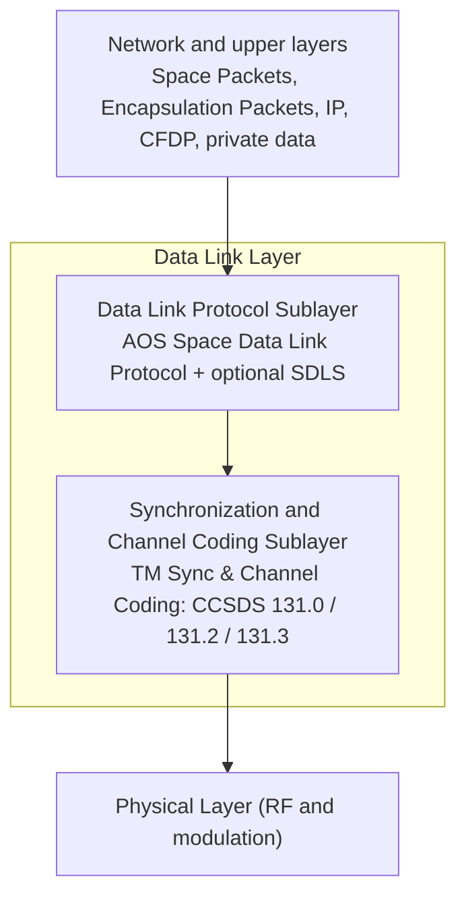
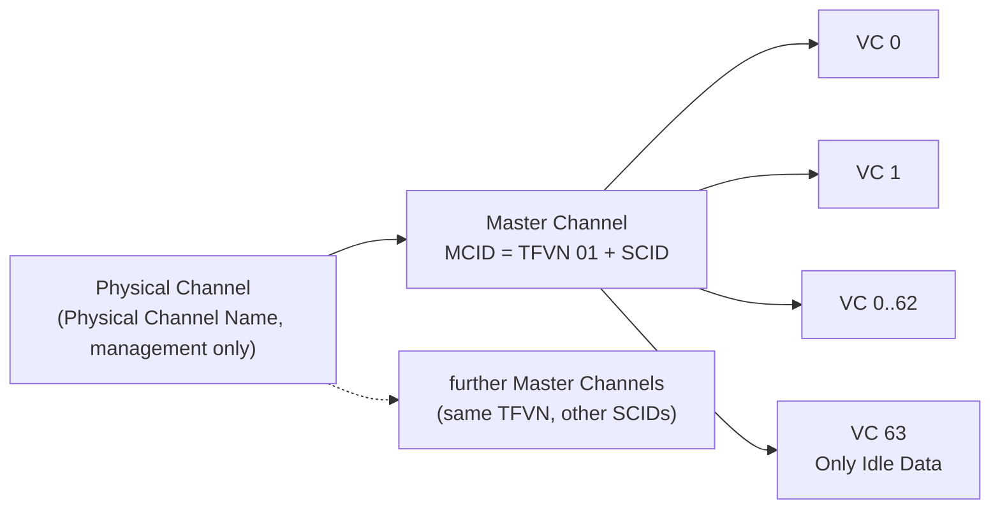
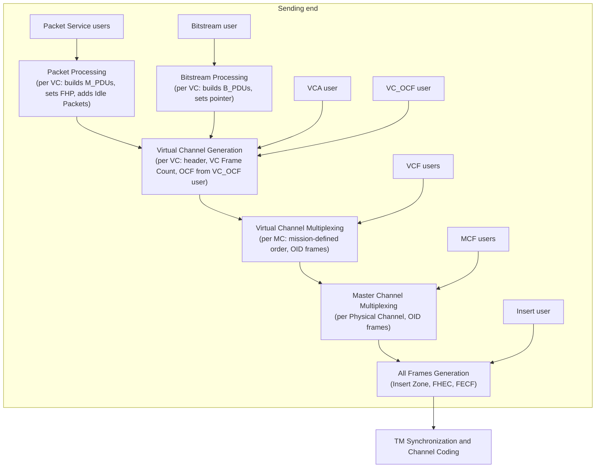

# AOS Space Data Link Protocol (CCSDS 732.0-B-4)

The **AOS Space Data Link Protocol** (AOS-SDLP) is one of the CCSDS protocols of the Data Link
Protocol Sublayer. It carries user data over a space link in **fixed-length AOS Transfer
Frames**. These can travel space-to-ground, ground-to-space or space-to-space.[^aos-purpose][^aos-arch]
AOS stands for *Advanced Orbiting Systems*. The protocol was created for the International Space
Station and similar systems. They needed to send many classes of data at once, audio and video
included, at high combined rates and in both directions.[^hb-bg] The ECSS communications
handbook (2008) reports that in practice it was adopted for high-rate downlinks,[^hb-practice]
where the conventional TM sequence counters would roll over during a contact.[^hb-later] AOS
has a 24-bit Virtual Channel Frame Count, while the
[TM Space Data Link Protocol](tm-sdlp.md) has 8-bit frame counters.[^aos-vcfc][^tm-vcfc]

The AOS frame is a close relative of the TM frame. Both are fixed-length, both run over
[TM Synchronization and Channel Coding](tm-coding.md), both carry [Space Packets](space-packet.md)
using a First Header Pointer, and both can carry the [CLCW](cop-1.md) of the uplink in an
Operational Control Field. The differences are a wider Virtual Channel ID (6 bits instead of 3)
but, up to Issue 4, a narrower Spacecraft ID (8 bits instead of 10; Issue 5 widens it to 10[^aos5-mcid]), longer counters, an optional
Reed-Solomon-protected header, an **Insert Zone** for small periodic data and a **Bitstream
Service**.[^hb-diff][^hb-ins] This page follows the October 2021 issue, CCSDS 732.0-B-4, held in the
[library](../library/ccsds-732-0-732x0b4.md). Issue 4 adds support for the SDLS Extended
Procedures, a conformance proforma (annex A) and options for randomizing idle frames
(annex D).[^aos-doc] Issue 5 (October 2025) widens the Spacecraft Identifier to 10 bits and the First
Header Pointer to 16 bits, so that frames can be up to 65,536 octets long; it is described in
[Newer issue](#newer-issue-ccsds-7320-b-5-2025) at the end of this page.[^aos5-ctl]

!!! info "At a glance"
    | Property | Value |
    |---|---|
    | Transfer Frame Version Number | `0b01` (Version 2 Transfer Frame)[^aos-tfvn] |
    | Frame length | Fixed per Physical Channel and Mission Phase[^aos-frame] |
    | Primary Header | 6 octets, or 8 with the optional Frame Header Error Control[^aos-frame] |
    | Issue followed here | CCSDS 732.0-B-4, October 2021; newer issue 732.0-B-5, October 2025 (with Editorial Change 1)[^aos-doc][^aos5-ctl] |
    | Spacecraft Identifier | 8 bits (0 to 255) in Issue 4[^aos-tfvn][^g4-ids]; 10 bits (0 to 1023) from Issue 5, split over bits 2–9 and 42–43[^aos5-mcid] |
    | Virtual Channel Identifier | 6 bits; 63 reserved for Only Idle Data frames[^aos-vcid] |
    | Virtual Channel Frame Count | 24 bits, optionally extended to 28 bits[^aos-vcfc][^aos-cycle] |
    | Data units in the data field | M_PDU (packets), B_PDU (bitstream), VCA_SDU or idle data[^aos-tfdf] |
    | Trailer | Optional 4-octet OCF and optional 2-octet FECF (CRC-16)[^aos-frame] |
    | Services | VCP, Bitstream, VCA, VC_OCF, VCF, MCF, Insert[^aos-svc-sum] |
    | Lower layer | TM Synchronization and Channel Coding (CCSDS 131.0, 131.2, 131.3)[^aos-arch] |
    | Retransmission | None (no ARQ); use a higher layer if completeness matters[^g3-retx] |
    | Security | Optional [SDLS](sdls.md) per Virtual Channel[^aos-sdls-opt] |
    | ECSS adoption | ECSS-E-AS-50-23: first issue (2021) based on CCSDS 732.0-B-3; Rev.1 (13 January 2023) adopts 732.0-B-4 and forbids replay frames[^e50-an][^as23-ctx][^as23-req] |

## History and context

CCSDS began extending its Packet Telemetry and Telecommand standards for Advanced Orbiting
Systems in the late 1980s.[^g4-hist] The resulting AOS Recommendation, CCSDS 701.0-B, emerged in
the early 1990s. It went well beyond a link protocol: it defined a "CCSDS Principal Network" of
ground network, on-board network and space links, with Path and Internet services running end to
end.[^hb-bg] CCSDS later
restructured the Packet Telemetry, Telecommand and AOS standards into a cleaner set: the
[Space Packet Protocol](space-packet.md), the TM, TC and AOS Space Data Link Protocols, and the
TM and TC synchronization and coding standards.[^g4-hist] For AOS the replacement, CCSDS
732.0-B, came in 2003. It covers only data transfer over a single space link.[^hb-bg-2] It has
had five issues: September 2003, July 2006, September 2015, October 2021 and October 2025.[^aos-doc][^aos5-ctl]

The ECSS communications handbook describes what happened next. The demand for a high-rate
uplink largely vanished once projects were realistic about it, and the symmetric reliability
features failed for lack of firm requirements. What was left is a protocol that suits high-rate
downlinks.[^hb-later] CCSDS now expects the [Unified Space Data Link Protocol](uslp.md) to be
used by future missions in place of TM, TC, AOS and [Proximity-1](proximity-1.md).[^g4-uslp]

## Where AOS sits in the protocol stack

CCSDS divides the OSI Data Link Layer into two sublayers. AOS-SDLP belongs to the upper one, the
**Data Link Protocol Sublayer**, together with the optional
[Space Data Link Security](sdls.md) protocol. Below it, the **Synchronization and Channel Coding
Sublayer** delimits frames, adds error-correcting codes and ensures enough bit transitions. For
AOS this sublayer must be one of the TM synchronization and coding standards: CCSDS 131.0-B,
131.2-B (flexible advanced coding and modulation) or 131.3-B (DVB-S2).[^aos-arch][^aos-lower]



The coding options and the RF link performance must keep two error probabilities below
mission-specified values: misidentifying the MCID or VCID, and failing to extract packets using
the First Header Pointer and the packet length field. All frames of a Physical Channel use the
same coding options.[^aos-perf]

Every CCSDS data link protocol works one way only. A link with commands going up and telemetry
coming down uses two Physical Channels, one in each direction. Only one Space Data Link Protocol
may be used on a given Physical Channel.[^g3-link] Three pairings are common:[^g3-combo]

| Forward link (ground to space) | Return link (space to ground) | Typical use |
|---|---|---|
| [TC-SDLP](tc-sdlp.md) | [TM-SDLP](tm-sdlp.md) | Most missions |
| TC-SDLP | AOS-SDLP | Missions that need the extended AOS features on the return link |
| AOS-SDLP | AOS-SDLP | Crewed missions, or missions that need two-way on-line or high-rate links (audio, video) |

## Channels and addressing

An AOS frame carries three identifiers: the **Transfer Frame Version Number** (TFVN), the
**Spacecraft Identifier** (SCID) and the **Virtual Channel Identifier** (VCID). They combine as
follows:[^aos-addr]

$$\text{MCID} = \text{TFVN} + \text{SCID}, \qquad \text{GVCID} = \text{MCID} + \text{VCID}$$

All frames with the same MCID on a Physical Channel form a **Master Channel**, and all frames
with the same GVCID form a **Virtual Channel**. Usually a Physical Channel carries one Master
Channel. It may carry several, provided they share the same TFVN. The **Physical Channel Name**
is set by management and does not appear in the frame.[^aos-addr]



Because the TFVN is part of the MCID, AOS spacecraft identifiers form a separate number space
from the 10-bit SCIDs used with TM and TC. A spacecraft that uses TC on the uplink and AOS on
the downlink therefore needs two SCIDs from the SANA registry, one for each TFVN.[^g3-scid] The
CCSDS overview compares the identifier ranges of all the data link protocols:[^g4-ids]

| Identifier | TM | TC | AOS | Proximity-1 | [USLP](uslp.md) |
|---|---|---|---|---|---|
| TFVN | Version 1 | Version 1 | Version 2 | Version 3 | Version 4 |
| SCID | 0 to 1023 | 0 to 1023 | 0 to 255 | 0 to 1023 | 0 to 65535 |
| VCID | 0 to 7 | 0 to 63 | 0 to 63 | not used | 0 to 63 |
| MAP ID | not used | 0 to 63 | not used | not used | 0 to 15 |

The overview predates AOS Issue 5, which widens the AOS SCID to 10 bits (0 to 1023) while keeping the
TFVN `01` in the MCID; the MCID thus grows from 10 to 12 bits.[^g4-ids][^aos5-mcid]

!!! warning "Inference"
    Solar Orbiter's TM frames carry the global spacecraft ID 650 (`0x28A`).[^solo-frame] That
    value does not fit in the 8-bit AOS SCID field of Issue 4. If the mission had used AOS frames
    under Issue 4, it would have needed a separate AOS SCID. This illustrates the separate number
    spaces; it is not a statement about any real assignment. The 10-bit SCID of Issue 5 could hold
    the value 650, but the TFVN still distinguishes an AOS MCID from a TM or TC one, and the
    available sources do not say whether SANA would assign the same number in both spaces.[^aos5-mcid][^g3-scid]

## The AOS Transfer Frame

An AOS Transfer Frame consists of these fields, in this order and with no gaps:[^aos-frame]

| # | Field | Length | Presence |
|---|---|---|---|
| 1 | Transfer Frame Primary Header | 6 or 8 octets | Mandatory |
| 2 | Transfer Frame Insert Zone | Integral number of octets | Optional (per Physical Channel) |
| 3 | Transfer Frame Data Field | Integral number of octets | Mandatory |
| 4 | Operational Control Field (OCF) | 4 octets | Optional (per Virtual Channel) |
| 5 | Frame Error Control Field (FECF) | 2 octets | Optional (per Physical Channel) |

Together the OCF and FECF are called the **Transfer Frame Trailer**. The frame length is
constant for every Virtual and Master Channel of a Physical Channel throughout a Mission Phase.
Changing it can cost the receiver its synchronization. The start of a frame is signalled by the
coding sublayer below, through the attached sync marker.[^aos-frame]

AOS-SDLP itself does not fix the frame length. The coding option decides which lengths are
allowed. Uncoded or convolutional-only links may use any integer number of octets up to 2048.
With the Reed-Solomon code, the length follows from the code parameters as
$L = (255 - 2E - q)\,I$, where $E$ is the error-correction capability, $q$ the number of virtual
fill symbols and $I$ the interleaving depth.[^tmc-len][^tmc-rs] For example, $E = 16$, $q = 0$ and
$I = 5$ give $L = 1115$ octets. That is exactly the frame length Solar Orbiter uses for its TM
frames.[^solo-frame]

All bit numbering follows the CCSDS convention. Bit 0 is the first bit transmitted and the most
significant bit of any number, and spare bits are always set to zero.[^aos-bits]

### Transfer Frame Primary Header

The Primary Header has five fields. The first four are mandatory and the last, the Frame Header
Error Control, is optional.[^aos-hdr]

<div class="bitfield" data-title="AOS Transfer Frame Primary Header (48 bits, plus 16-bit optional FHEC)" data-width="16"
     data-fields='[{"n":"TFVN","b":2,"v":"01","g":"Master Channel ID","d":"Transfer Frame Version Number; 01 identifies the AOS Version 2 frame"},
                   {"n":"Spacecraft ID","b":8,"g":"Master Channel ID","d":"SCID assigned by SANA"},
                   {"n":"Virtual Channel ID","b":6,"d":"0 to 62 for data; 63 (all ones) for Only Idle Data frames"},
                   {"n":"Virtual Channel Frame Count","b":24,"d":"Modulo 16777216 count of frames of this Virtual Channel"},
                   {"n":"Replay Flag","b":1,"g":"Signaling Field","d":"0 = realtime frame, 1 = replay frame"},
                   {"n":"VC Frame Count Cycle Use Flag","b":1,"g":"Signaling Field","d":"1 = the VC Frame Count Cycle field is used"},
                   {"n":"Reserved Spare","b":2,"v":"00","g":"Signaling Field"},
                   {"n":"VC Frame Count Cycle","b":4,"g":"Signaling Field","d":"Incremented each time the VC Frame Count wraps to zero; extends the count to 28 bits"},
                   {"n":"Frame Header Error Control (optional)","b":16,"d":"Reed-Solomon (10,6) check symbols over the MCID, VCID and Signaling Field"}]'></div>

| Field | Bits | Values | Meaning and rationale |
|---|---|---|---|
| Transfer Frame Version Number | 0–1 | `0b01` | Identifies the AOS Version 2 Transfer Frame.[^aos-tfvn] |
| Spacecraft Identifier | 2–9 | 0 to 255 | Identifies the spacecraft; assigned by SANA under CCSDS 320.0-M.[^aos-tfvn] Together with the TFVN it forms the 10-bit MCID. |
| Virtual Channel Identifier | 10–15 | 0 to 62; 63 reserved | Identifies the Virtual Channel. All zeros when only one VC is used. All ones (63) marks the Only Idle Data (OID) channel. VCIDs need not be consecutive.[^aos-vcid] |
| Virtual Channel Frame Count | 16–39 | 0 to 16 777 215 | Sequential count, modulo 16 777 216, of the frames of one Virtual Channel. It gives each VC its own accounting, mainly so packets can be extracted systematically. It is not reset unless that is unavoidable; after a reset, completeness cannot be judged.[^aos-vcfc] |
| Replay Flag | 40 | 0 = realtime, 1 = replay | Separates frames played back from on-board storage from realtime frames, when both use the same VC.[^aos-replay] |
| VC Frame Count Cycle Use Flag | 41 | 0 = not used, 1 = used | Says whether the receiver must interpret bits 44–47.[^aos-cycle] |
| Reserved Spare | 42–43 | `0b00` | Reserved for future CCSDS definition.[^aos-cycle] |
| Virtual Channel Frame Count Cycle | 44–47 | 0 to 15 | When used, it increments each time the VC Frame Count returns to zero, which in effect extends the counter from 24 to 28 bits. When unused it is all zeros.[^aos-cycle] |
| Frame Header Error Control | 48–63 | RS check symbols | Optional. Protects the key header fields with an error-correcting code (see below).[^aos-fhec] |

Bits 40–47 form the **Signaling Field**. It warns the receiver about things that change faster
than management can handle, and it gives a cross-check against manual or automated setups for
fault detection.[^aos-sig] Issue 5 shrinks the Signaling Field to bits 40–41, puts the two most
significant SCID bits in the former spare bits 42–43 and lists the cycle count as a field of its own;
see the [Issue 5 header](#the-issue-5-primary-header).[^aos5-hdr][^aos5-sig]

The Replay Flag is deliberately loosely specified. On-board storage technologies vary widely, so
projects and cross-support organizations must agree on what it means exactly. For example, it may
mean that the frame count on the replayed VC runs downwards because the data is played back in
reverse. If frames were stored after channel coding, they must be re-encoded when the flag
changes on retrieval.[^aos-replay] The ECSS handbook contrasts this with TM. With TM, recorded
frames are nested inside the data field of realtime frames ("asynchronous insertion"), whereas
AOS simply flags the replayed frame.[^hb-replay] The ECSS adoption notice ECSS-E-AS-50-23C Rev.1
removes the choice: under ECSS the Replay Flag **shall** be `0`, the interpretation requirement and
its two notes are deleted, and a new note explains that other means of replaying frames exist and that
replay frames would add processing complexity at the receiving end.[^as23-req]

!!! example "Why 24 bits matter (illustrative calculation by this wiki)"
    Take 1115-octet frames (8920 bits) on a 1 Mbit/s return link, about 112 frames per second.
    An 8-bit TM Virtual Channel frame count[^tm-vcfc] wraps every 256 frames, so in under 3 s if
    one VC takes all the frames. The 24-bit AOS count wraps after 16 777 216 frames, about
    41.6 hours. With the 4-bit cycle extension in use it wraps after 2^28 frames, about 27.7
    days. A ground system can therefore detect gaps and order frames across a whole pass,
    without guessing how many times the counter has wrapped.

#### Frame Header Error Control

The optional **Frame Header Error Control** is a shortened **Reed-Solomon (10,6)** code. This
page abbreviates it "FHEC", an abbreviation the standard itself does not use. The code works
over 4-bit symbols. It protects the 10-bit MCID, the 6-bit VCID and the 8-bit Signaling Field.
Management decides whether it is present. If present, it appears in every frame of the Physical
Channel, and its presence stays fixed for the Mission Phase.[^aos-fhec] The code is defined as
follows:[^aos-fhec-code]

* symbol size $J = 4$ bits, correcting up to $E = 2$ symbol errors per codeword;
* field generator polynomial $F(x) = x^4 + x + 1$ over GF(2);
* code generator $g(x) = (x+\alpha^6)(x+\alpha^7)(x+\alpha^8)(x+\alpha^9) = x^4 + \alpha^3x^3 + \alpha x^2 + \alpha^3x + 1$ over GF(2^4);
* each symbol is transmitted left bit first (for example $\alpha^3$ = `1000` is sent as a 1 then three 0s).

The ten symbols are mapped onto header bits as follows. Symbols 0 to 3 cover bits 0–15, symbols
4 and 5 cover bits 40–47, and symbols 6 to 9 are the check bits 48–63.[^aos-fhec-map] The frame
count (bits 16–39) is **not** protected. Correcting up to two symbol errors is enough for fewer
than $10^{-7}$ missing data fields at a channel bit error rate of $10^{-5}$, with random errors.
On convolutionally coded channels, especially interleaved ones, the burst errors typical of the
decoders give a data field loss rate of $2\times10^{-5}$ at an equivalent operating
point.[^aos-fhec-map]
The receiving All Frames Reception Function uses the field to try to correct the key header
elements. A frame with an uncorrectable header error need not be delivered in cross-support
situations.[^aos-afr] ECSS adds a note when adopting Issue 4: the Frame Header Error Control may be
restricted to physical channels whose frames are not protected by an error-correcting code in the
coding sublayer; when the frames are, for example, Reed-Solomon coded, the field brings no benefit and
is strongly discouraged.[^as23-req] Issue 5 restates the code as a Reed-Solomon (15,11) code shortened by
five symbols (see [below](#frame-header-error-control-in-issue-5)).[^aos5-fhec]

### Transfer Frame Insert Zone

The **Insert Zone** is an optional, fixed-length area directly after the Primary Header. Management
decides whether it is present. If the Physical Channel supports the
[Insert Service](#insert-service), the zone is in **every** frame of that channel, OID frames
included. Its presence and length stay fixed for the Mission Phase. The zone holds exactly one
octet-aligned IN_SDU, and the space it takes is lost to the data field.[^aos-iz] Because the
zone appears in every frame at the constant frame rate, it gives a periodic, low-overhead path
for small fixed-size data (see [Insert Service](#insert-service)). If a Virtual Channel Frame or
Master Channel Frame service exists on the Physical Channel, no frame may carry an Insert
Zone.[^aos-restr-frame]

### Transfer Frame Data Field

The **Transfer Frame Data Field** follows the Primary Header, or the Insert Zone when present. It
is an integral number of octets. Its length is the frame length minus the Primary Header, the
Insert Zone and the Trailer.[^aos-tfdf] It holds exactly one of the following:[^aos-tfdf]

* one **Multiplexing Protocol Data Unit (M_PDU)**, which carries packets;
* one **Bitstream Protocol Data Unit (B_PDU)**, which carries a bit stream;
* one **VCA_SDU**, a private fixed-length block;
* **Idle Data**.

These types are never mixed on one Virtual Channel. Management assigns the type of each VC, and
the assignment stays fixed for a Mission Phase.[^aos-tfdf]

#### Only Idle Data frames

When no valid data field is ready at release time, an **OID Transfer Frame** is sent. Its VCID is
all ones (63). Its data field is filled with a mandatory pseudo-noise sequence from a 32-cell
linear feedback shift register with polynomial $D^0 + D^1 + D^2 + D^{22} + D^{32}$.[^aos-oid] In
the Fibonacci form the register starts with an all-ones seed. In the Galois form it starts with
`00000000001111111111111111111101`. In both forms it is initialized once at device start-up and
never restarted. Both produce the same output, which begins
`FF FF FF FF 6D B6 D8 61 45 1F 11 F1 97 16 72 3C BE 7E 00 B1`.[^aos-oid-seed][^aos-annexd] A
random pattern is used to avoid frame-reception problems that insufficient randomization would
cause. OID
frames keep the receiver synchronized, and they still carry the Insert Zone when there is nothing
else to send. Idle Data in an OID frame is not the same thing as the CCSDS Idle Packet.[^aos-oid-seed]

### Multiplexing Protocol Data Unit (M_PDU)

On a VC that carries packets, the data field holds one M_PDU. It has a 2-octet header followed by
the **M_PDU Packet Zone**. Its length is fixed by management so that it fits the data field
exactly, after allowing for an Insert Zone if there is one.[^aos-mpdu]

<div class="bitfield" data-title="M_PDU Header (16 bits)" data-width="16"
     data-fields='[{"n":"Reserved Spare","b":5,"v":"00000","d":"Undefined by CCSDS; set to 00000"},
                   {"n":"First Header Pointer","b":11,"d":"Octet offset, in the Packet Zone, of the first packet that starts there. 2047 = no packet starts; 2046 = Packet Zone holds only Idle Data"}]'></div>

| Field | Bits | Values | Meaning |
|---|---|---|---|
| Reserved Spare | 0–4 | `0b00000` | Currently undefined by CCSDS.[^aos-mpdu-fhp] |
| First Header Pointer (FHP) | 5–15 | 0 to 2045 | Position of the first octet of the first packet that **starts** in the Packet Zone. The first octet of the zone is position 0.[^aos-mpdu-fhp] |
| | | 2047 (`0x7FF`, all ones) | No packet starts in this Packet Zone (a long packet spans the whole frame).[^aos-mpdu-fhp] |
| | | 2046 (all ones minus one) | The Packet Zone contains only Idle Data.[^aos-mpdu-idle] |

The FHP exists so that variable-length packets can be found inside fixed-length frames. A
receiver reads the first packet header at the FHP, takes its length field to locate the next
packet, and so on. If the last packet of frame N carries on into frame M of the same VC, the FHP
of frame M skips the leftover part and points to the next packet that starts there.[^aos-mpdu-fhp]
This is what lets the receiver resynchronize after a lost frame. Issue 5 drops the five spare bits
and makes the pointer 16 bits wide, with `0xFFFF` and `0xFFFE` as the special values (see
[the Issue 5 M_PDU](#the-issue-5-m_pdu-header)).[^aos5-mpdu]

Packets go into the Packet Zone one after another, in forward order. So the first and last
packets in an M_PDU may be incomplete.[^aos-mpdu-idle] If not enough packets are ready at
release time, the sender may build Idle Packets of a suitable length. These are either CCSDS
[Space Packet](space-packet.md) Idle Packets (APID all ones, at least 7 octets) or
[Encapsulation](encapsulation.md) Idle Packets (as short as 1 octet). A 7-octet Idle Packet
that does not fit spills into the next M_PDU.[^aos-ppf][^spp-idle][^epp-idle] Otherwise the
sender sends an "idle" M_PDU with FHP = 2046. It may do so even in the middle of a packet that is
split across frames.[^aos-mpdu-idle][^aos-ppf-idle] An idle M_PDU is not an OID frame. The frame
still belongs to its own VC, so it can keep the frame rate up and still carry an OCF for that
VC.[^aos-mpdu-idle]

!!! example "Worked example: delimiting packets across frames (illustrative)"
    Consider a VC with an 1103-octet Packet Zone. That is a 1115-octet frame minus the 6-octet
    header, a 4-octet OCF and the 2-octet M_PDU header, with no Insert Zone or FECF.

    | Frame | FHP | Packet Zone content |
    |---|---|---|
    | N | 40 | Octets 0–39: tail of a packet begun in frame N−1. Octets 40–539: a complete 500-octet packet. Octets 540–1102: the first 563 octets of an 800-octet packet. |
    | N+1 | 237 | Octets 0–236: the last 237 octets of the 800-octet packet. A new packet starts at octet 237. |
    | N+2 | 2047 | A 3000-octet packet that started in N+1 fills the whole zone. No packet starts here. |

    Suppose frame N+1 is lost. The receiver notices a jump in the VC Frame Count. Frame N+2 has
    no packet start, so extraction restarts at the FHP of frame N+3, the next frame that has
    one. It does not have to deliver the incomplete packet. If the location it worked out from
    packet lengths disagrees with the FHP, the standard tells it to trust the FHP.[^aos-pef]

!!! note "Pointer width and frame length"
    An 11-bit FHP can address octet offsets up to 2045. That matches the 2048-octet maximum
    frame length that TM Synchronization and Channel Coding Issue 5 allows for AOS.[^tmc-len] The
    AOS standard of 2021 does not link the two, but later documents do: Issue 5 of the AOS
    standard widens the pointer to 16 bits "to accommodate frames up to 65,536 octets", and Issue 6
    of the coding standard states that the maximum frame length is constrained by the number of FHP
    bits (11 for TM, 16 for AOS and USLP).[^aos5-ctl][^tmc6-len]

### Bitstream Protocol Data Unit (B_PDU)

On a VC that carries a bit stream, the data field holds one B_PDU. It has a 2-octet header and a
**Bitstream Data Zone**, and its length is fixed so that it fills the data field.[^aos-bpdu]

<div class="bitfield" data-title="B_PDU Header (16 bits)" data-width="16"
     data-fields='[{"n":"Reserved Spare","b":2,"v":"00"},
                   {"n":"Bitstream Data Pointer","b":14,"d":"Bit position of the last valid user data bit in the Bitstream Data Zone. 16383 = no idle data; 16382 = only idle data"}]'></div>

| Field | Bits | Values | Meaning |
|---|---|---|---|
| Reserved Spare | 0–1 | `0b00` | Currently undefined by CCSDS.[^aos-bpdu] |
| Bitstream Data Pointer | 2–15 | 0 to 16381 | Bit position (counting from 0) of the **last valid user data bit** in the zone. Everything after it is idle fill.[^aos-bdp] |
| | | 16383 (all ones) | The zone contains only valid user data.[^aos-bdp] |
| | | 16382 (all ones minus one) | The zone contains only idle data.[^aos-bdp] |

The pointer counts **bits**, whereas the FHP counts **octets**. Bitstream Data are undelimited
strings of bits whose format the provider does not know.[^aos-src-bs][^aos-bdp] When a frame must be released before the zone is
full, the provider pads it with a locally specified idle pattern and marks the boundary with the
pointer.[^aos-bpf] At the receiving end the Bitstream Extraction Function removes the idle data.
It may also raise a **Bitstream Data Loss Flag**, derived from gaps in the VC Frame Count. That
flag tells the user that an unknown amount of data may have been lost. It stays set through
discarded idle-only B_PDUs until valid data is delivered again.[^aos-bef][^aos-bsloss] The B_PDU
header is unchanged in Issue 5, which adds a note that the 14-bit pointer limits frames used with the
Bitstream Service to 16384 bits.[^aos5-bpdu]

### Operational Control Field

The **OCF** is an optional 4-octet field directly after the data field. Management decides per
Virtual Channel whether it is present. If it is present on a VC, it is in every frame of that VC
for the whole Mission Phase.[^aos-ocf] Bit 0 is a **Type Flag**:[^aos-ocf-type]

* `0`: **Type-1 Report**, a Communications Link Control Word (CLCW). This is the FARM-1 report
  of [COP-1](cop-1.md), which closes the retransmission loop of the TC uplink.
* `1`: **Type-2 Report**. Bit 1 then tells the two uses apart: `0` means the content is
  project-specific, and `1` means it is an SDLS **Frame Security Report** (FSR) as defined in the
  SDLS Extended Procedures (see [The Frame Security Report](security.md#the-frame-security-report)).

<div class="bitfield" data-title="Operational Control Field (32 bits)" data-width="32"
     data-fields='[{"n":"Type Flag","b":1,"d":"0 = Type-1 Report (CLCW); 1 = Type-2 Report"},
                   {"n":"Type-2 use (if Type Flag = 1)","b":1,"d":"0 = project-specific; 1 = SDLS Frame Security Report. Part of the CLCW when Type Flag = 0"},
                   {"n":"Report content","b":30,"d":"CLCW fields (see COP-1) or FSR or project-specific data"}]'></div>

The Type Flag, and bit 1 in Type-2 reports, can change from frame to frame on the same VC. The
spacecraft designer must make sure that VCs carrying OCFs are sent often enough. Otherwise the
COP-1 sender on the ground may time out.[^aos-ocf-type] The OCF is filled by the **VC_OCF
Service**.[^aos-svc-ocf]

Solar Orbiter uses TM rather than AOS frames, but its CLCW is laid out the same way. The Solar
Orbiter MIB decodes the CLCW reported by each of the two on-board TC decoders field by field.
Examples are [NCD0Z021](../explorer/index.md#/solo/param/NCD0Z021) "PDEC_CLCW.A.Type" (a 1-bit
parameter, [PTC](../mib/parameter-types.md) 1 and PFC 0) and
[NCD0Z025](../explorer/index.md#/solo/param/NCD0Z025) "PDEC_CLCW.A.VCID". The whole word also
exists as a 32-bit unsigned parameter, [NCDD05J1](../explorer/index.md#/solo/param/NCDD05J1)
"TC Decoder A.PdecCLCW" (PTC 3, PFC 14).[^mib-clcw] These definitions are in the
[pcf](../mib/tables/pcf.md) table.

??? example "SQL used (Solar Orbiter MIB, release 2025-09-16)"
    ```sql
    -- CLCW-related monitoring parameters
    SELECT PCF_NAME, PCF_DESCR, PCF_PTC, PCF_PFC
    FROM pcf WHERE upper(PCF_DESCR) LIKE '%CLCW%' ORDER BY PCF_NAME;
    -- 34 rows, among them NCD0Z021..NCD0Z02D (decoder A), NCD0Z051..NCD0Z05D (decoder B),
    -- NCDD05J1 / NCDD05N1 (whole CLCW, PTC 3 / PFC 14)
    ```

### Frame Error Control Field

The optional **FECF** fills the last 16 bits of the frame. Management decides whether it is
present. If present, it is in every frame of the Physical Channel for the Mission Phase. It
detects errors introduced in transmission and data handling. Whether it is needed depends on the
mission's data quality requirements and on the coding options, and some coding options make it
mandatory.[^aos-fecf] For example, TM Synchronization and Channel Coding requires the FECF for
frame validation when the convolutional code is used without an outer Reed-Solomon
code.[^tmc-conv]

The FECF is a systematic cyclic redundancy check:[^aos-fecf-eq]

$$\text{FECF} = \left[X^{16}\,M(X) + X^{(n-16)}\,L(X)\right] \bmod G(X), \quad G(X) = X^{16}+X^{12}+X^5+1,\quad L(X)=\sum_{i=0}^{15}X^i$$

Here $M(X)$ is the frame without the FECF, sent most significant bit first, and $n$ is the frame
length in bits. The $L(X)$ term amounts to presetting the shift register to all ones. At the
receiver, the syndrome $S(X) = [X^{16}C^*(X) + X^nL(X)] \bmod G(X)$ over the received frame
$C^*$ is zero when no error is detected.[^aos-fecf-eq][^aos-fecf-dec]

!!! example "Worked example: FECF (computed by this wiki, illustrative frame)"
    The register is preset to `0xFFFF`, the generator is `0x1021`, data is processed MSB first and
    no final inversion is applied. This is the same CRC that is often called "CRC-16/CCITT-FALSE".
    Over the ASCII string `123456789` it gives `0x29B1`, a handy test vector. Now take a toy
    uncoded frame of 18 octets. Before the FECF it holds 16 octets: the header
    `56 83 00 01 2C 42`, an M_PDU header `07 FF` (FHP = 2047) and eight zero octets. The FECF over
    those 16 octets is `0xFBBA`. Running the decoder equation over all 18 octets gives a syndrome
    of zero. The header bytes decode as TFVN 01, SCID `0x5A`, VCID 3, VC Frame
    Count 300, Replay Flag 0, Cycle Use Flag 1, VC Frame Count Cycle 2.

!!! warning "Inference: FHEC of the example header"
    For the same header, this wiki computed the RS(10,6) Frame Header Error Control as `0x4D5C`.
    The information symbols are `5 6 8 3 4 2` and the check symbols are `4 D 5 C`. The
    calculation takes symbol 0 as the coefficient of the highest power of x. The standard gives
    the symbol-to-bit mapping, but it does not state the polynomial ordering in these words. The
    codeword was checked to vanish at α^6 to α^9, and the generator expands to the coefficients
    printed in the standard. A second, independent recomputation during review, using the same
    convention, gave the same check symbols; taking symbol 0 as the lowest power of x instead gives
    different ones. Check this against a validated implementation before relying on it. The Issue 5
    formulation, five leading zero symbols of virtual fill followed by the six header symbols, gives
    the same check symbols when computed the same way.[^aos5-fhec]

## Services

AOS-SDLP offers **seven services**. Five work on a Virtual Channel, one on a Master Channel and
one on the whole Physical Channel.[^aos-svc-sum]

| Service | Service type | SDU | SAP address | SDLS protection |
|---|---|---|---|---|
| Virtual Channel Packet (VCP), the "Packet Service" | Asynchronous | Packet | GVCID + Packet Version Number | All features |
| Bitstream | Asynchronous or periodic | Bitstream Data | GVCID | All features |
| Virtual Channel Access (VCA) | Asynchronous or periodic | VCA_SDU | GVCID | All features |
| Virtual Channel Operational Control Field (VC_OCF) | Synchronous or periodic | OCF_SDU (4 octets) | GVCID | None |
| Virtual Channel Frame (VCF) | Asynchronous or periodic | AOS Transfer Frame | GVCID | None |
| Master Channel Frame (MCF) | Asynchronous or periodic | AOS Transfer Frame | MCID | None |
| Insert | Periodic | IN_SDU | Physical Channel Name | None |

All the services are **unidirectional**, **unconfirmed**, **incomplete** (no guarantee that every
SDU arrives, although some services signal gaps) and **sequence-preserving** within one SAP. SDUs
at one SAP are processed in the order received. No order is kept between different SAPs. CCSDS
does not define any flow control between user and provider.[^aos-common] The services may be
extended on the ground with [SLE](sle/index.md) services.[^aos-common]

### Service types

* **Asynchronous**: each SDU goes into a queue and is sent exactly once, in order. The provider
  picks the timing according to mission rules.[^aos-async]
* **Synchronous**: the SDU sits in a one-slot buffer that is read every time a frame of the
  associated VC, MC or Physical Channel is sent. This is effectively time-division multiplexing.
  A value may go out once, several times, or not at all if it is overwritten first.[^aos-sync]
* **Periodic**: a synchronous service at constant rate, with a specified maximum delay and
  jitter. This is the case when the associated VC or MC produces frames at a constant rate, or
  when the service belongs to the only Master Channel of the Physical Channel.[^aos-periodic]

### Virtual Channel Packet Service

The VCP service carries variable-length, delimited, octet-aligned **packets** whose Packet
Version Number (PVN) is authorized by CCSDS. The SANA registry lists the PVNs, and examples are
the Space Packet and the Encapsulation Packet. A user is one protocol entity with one PVN on one
GVCID. Packets of several PVNs may share a VC, and the provider multiplexes them into one
stream.[^aos-vcp][^g3-b5] The provider must know where the packet length field is and how long it is,
because it delimits packets with it.[^aos-src-pkt] Primitives: `VCP.request(Packet, GVCID, Packet
Version Number)` and `VCP.indication(Packet, GVCID, Packet Version Number, Packet Quality
Indicator, Verification Status Code)`. The last two parameters are optional. The Packet Quality
Indicator says whether the packet is complete or partial, and the Verification Status Code
reports SDLS errors.[^aos-vcp-par][^aos-prims] Packets without an authorized PVN, such as IP
datagrams, can travel inside an [Encapsulation Packet](encapsulation.md).[^g3-svc]

### Bitstream Service

The Bitstream Service carries a serial string of bits whose structure the provider does not
know. The length of each request is not preserved, because data may be split across frames or
combined in one. One user per VC; bitstreams are never multiplexed on a VC.[^aos-bs][^aos-src-bs]
Primitives: `BITSTREAM.request(Bitstream Data, GVCID)` and `BITSTREAM.indication(Bitstream Data,
GVCID, Bitstream Data Loss Flag, Verification Status Code)`, with the last two
optional.[^aos-prims] Among TM, TC and AOS, only AOS has a stream service. In the same row of
the CCSDS service summary, USLP offers an Octet Stream service.[^g4-svc]

### Virtual Channel Access Service

The VCA Service carries **private, fixed-length** SDUs whose format the provider does not know.
Management sets their length so that one VCA_SDU fills a data field. One user per VC; the service
may signal gaps.[^aos-vca][^aos-src-vca] The CCSDS green book illustrates the VCA Service
with a TM-SDLP example: a stream of encrypted data, cut into fixed-length chunks and sent on its
own VC.[^g3-example]

### VC_OCF Service

The VC_OCF Service puts a 4-octet **OCF_SDU** into the OCF of every frame of one Virtual
Channel. Its typical uses are the COP-1 CLCW and the SDLS FSR. Sending is synchronized to the
release of frames on the VC. When the user *creates* each OCF_SDU, however, need not be
synchronized; that is a mission design choice.[^aos-svc-ocf][^aos-src-ocf] Note that AOS has
**no** Master Channel OCF service and no frame secondary header services. TM has both; AOS has
the Insert Service instead.[^g3-short][^aos-svc-sum] The schematic figure B-5 of the same green
book nevertheless draws an "MC OCF Service" box for AOS.[^g3-b5] This conflicts with the
seven services of CCSDS 732.0-B-4 and with table 3-1 of the green book itself, so this page
follows the Recommended Standard.

### Virtual Channel Frame and Master Channel Frame Services

The VCF and MCF services pass in **complete frames built by another, independent protocol
entity**, identified by GVCID or MCID. The provider multiplexes these with its own frames. The
outside frames must have the same length as the provider's frames, and each VCF or MCF instance
needs its own unique GVCID or MCID.[^aos-vcf][^aos-mcf] These frames bypass the provider's error
control encoding. The user must therefore supply frames whose FHEC and FECF options match the
Physical Channel.[^aos-afg-ext] Unlike TM frames, frames supplied through these services are
complete AOS frames. That is why the Insert Service cannot be used together with VCF or MCF on
the same Physical Channel.[^aos-restr-frame]

### Insert Service

The Insert Service carries private, fixed-length, octet-aligned **IN_SDUs** in the Insert Zone of
**every** frame of the Physical Channel. It is periodic and makes efficient use of the link at
relatively low data rates.[^aos-ins] An IN_SDU may be any whole number of octets, from 1 up to the
full data-carrying space of the frame. Its length is the same at both ends.[^aos-src-in] On the
ground the Insert Zone is read from all incoming frames, whatever their GVCID. If the IN_SDUs do
not need error protection, they may even be read before the FECF check.[^aos-afr] The ECSS
handbook notes the trade-off with TM's secondary-header services. Those are more flexible
because they are not tied to the Physical Channel, but they allow a shorter maximum
length.[^hb-ins] The CCSDS Green Book on the packet protocols names the Insert Zone of AOS (and of
USLP) as one way to carry isochronous data such as voice or launch-vehicle telemetry, since neither the
Space Packet nor the Encapsulation Packet guarantees a minimum delay.[^g5-rt]

### Restrictions on combining services

* On one Physical Channel, the Insert Service cannot coexist with the VCF or MCF services.
* If the MCF Service exists on a Master Channel, no other service may exist on that Master
  Channel.
* If the VCF Service exists on a VC, no other service may exist on that VC.
* On any other VC, only one of VCP, Bitstream or VCA may exist.[^aos-restr]

## How the protocol works: sending and receiving ends

The standard describes the protocol entity as a set of functions. Data flows downwards at the
sending end and upwards at the receiving end. The figures are logical models, not a design, and a
real system need only contain the functions for the services it uses.[^aos-org]



### Sending end

* **Packet Processing** (one per packet-carrying VC) concatenates packets until the M_PDU is
  full. A packet that does not fit is split, and the rest starts the next M_PDU of the same VC.
  Packets of different PVNs are merged into one stream first. The function sets the FHP, inserts
  Idle Packets when it runs short at release time, or issues an idle M_PDU with
  FHP = 2046.[^aos-ppf][^aos-ppf-idle]
* **Bitstream Processing** (one per bitstream VC) places the user's bits into B_PDUs one after
  another, unchanged. It pads with idle data at release time and sets the Bitstream Data Pointer,
  or issues an idle-only B_PDU. Each B_PDU is exactly as long as the data field.[^aos-bpf]
* **Virtual Channel Generation** (one per VC) places one M_PDU, B_PDU or VCA_SDU unchanged into
  the data field. It builds the Primary Header, keeps a separate VC Frame Count for each VC, and
  puts the VC_OCF user's OCF_SDU into the OCF. It leaves the Insert Zone and FECF
  empty.[^aos-vcg]
* **Virtual Channel Multiplexing** (one per Master Channel with several VCs) interleaves frames
  of the VCs and of VCF users in an order that management sets. CCSDS does not specify the
  algorithm; projects define it from priority, release rate and isochronous timing. With a
  single Master Channel, this function also creates **OID frames** (VCID 63) when nothing valid
  is ready. OID frames need no VC Frame Count.[^aos-vcm][^aos-vcm-oid]
* **Master Channel Multiplexing** (one per Physical Channel with several MCs) interleaves Master
  Channels and MCF users in the same way. It creates OID frames with an allowed MCID when nothing
  is ready.[^aos-mcm]
* **All Frames Generation** (one per Physical Channel) puts the IN_SDU, which arrives at a
  constant interval matching the frame release rate, into the Insert Zone. It then computes the
  FHEC and the FECF. Frames from VCF and MCF users bypass this encoding.[^aos-afg][^aos-afg-ext]

!!! note "Multiplexing is the mission's job"
    Virtual Channels are the quality-of-service tool of every CCSDS data link protocol. Urgent
    traffic goes on one VC and bulk traffic on another, and the multiplexer can slip a frame of
    the urgent VC between two frames of a long packet on the bulk VC. CCSDS deliberately leaves
    the multiplexing algorithm to the project, which must check that it meets its own latency
    and priority needs.[^g3-vc] For an example, Solar Orbiter's ICD gives a fixed priority order
    among its TM Virtual Channels, with VC 7 reserved for idle frames.[^solo-frame]

### Receiving end

* **All Frames Reception** uses the FHEC to correct the header, if present. It recomputes the
  CRC and compares it with the FECF, and it extracts IN_SDUs from all frames. Frames with
  detected errors need not be delivered in cross-support situations.[^aos-afr]
* **Master Channel Demultiplexing** routes frames by MCID and discards frames whose SCID or TFVN
  is not in the managed list. A loss signal from the coding sublayer cannot be tied to one
  Master Channel, so it may be passed to all users.[^aos-mcd]
* **Virtual Channel Demultiplexing** routes frames by VCID. It discards OID frames and frames
  with an invalid VCID, and it may raise a Loss Flag when the VC Frame Count jumps.[^aos-vcd]
* **Virtual Channel Reception** takes the data field and the OCF apart and hands them to their
  users, again with an optional Loss Flag.[^aos-vcr]
* **Packet Extraction** uses the FHP and each packet's length field. It joins packets split
  across frames, trusts the FHP over its own calculation when the two disagree, discards Idle
  Packets and idle M_PDUs, and delivers packets by PVN. Incomplete packets need not be delivered
  in cross-support.[^aos-pef]
* **Bitstream Extraction** removes the idle data using the pointer and passes on the loss
  flag.[^aos-bef]

AOS-SDLP does **not** set up or release connections, does not control flow, never retransmits,
and does not manage SDLS.[^aos-func] Neither TM nor AOS has a retransmission mechanism. Missions
that need complete delivery must leave retransmission to a higher layer, for example LTP.[^g3-retx]
For files, [CFDP](cfdp.md) gives reliable transfer over an unreliable protocol.[^g4-cfdp]

## Managed parameters

Parameters that change rarely are set by management rather than sent in every frame, which saves
link capacity. A change usually means a major reconfiguration.[^aos-mp]

| Scope | Managed parameter | Allowed values |
|---|---|---|
| Physical Channel[^aos-mp-pc] | Physical Channel Name | Character string |
| | Transfer Frame Length (octets) | Integer |
| | Transfer Frame Version Number | 2 |
| | Valid Spacecraft IDs | Set of integers |
| | MC Multiplexing Scheme | Mission specific |
| | Presence of Frame Header Error Control | Present, Absent |
| | Presence of Insert Zone; Insert Zone Length (octets) | Present, Absent; integer |
| | Presence of Frame Error Control | Present, Absent |
| Master Channel[^aos-mp-mc] | Spacecraft ID | Integer |
| | Valid VCIDs | Selectable set from 0 to 62, plus VCID 63, which is always valid |
| | VC Multiplexing Scheme | Mission specific |
| Virtual Channel[^aos-mp-vc] | Spacecraft ID; VCID | Integer; 0 to 62 (63 reserved) |
| | Data Field Content | M_PDU, B_PDU, VCA_SDU, Idle Data |
| | Presence of VC_OCF | Present, Absent |
| Packet transfer[^aos-mp-pkt] | Valid Packet Version Numbers | Set of integers |
| | Maximum Packet Length (octets) | Integer |
| | Delivery of incomplete packets to the receiving user | Required, Not required |
| VC with SDLS[^aos-mp-sdls] | Presence and length of Security Header | Present/Absent; integer octets |
| | Presence and length of Security Trailer | Present/Absent; integer octets |

The TFVN value "2" in the table is the version number. Its binary encoding in the header is
`01`.[^aos-tfvn][^g3-tfvn] The ECSS handbook adds a practical note. Most of these parameters are
fixed for a Mission Phase and are often fixed for the whole mission.[^hb-opt]

## AOS with the SDLS option

When a link needs security, AOS can use the [Space Data Link Security](sdls.md) protocol on
selected Virtual Channels. Using SDLS changes nothing in the requirements for VCs without it, and
different VCs may use different kinds of security.[^aos-sdls-opt] On a VC with SDLS, a
**Security Header** follows the Insert Zone (or the Primary Header when there is no Insert Zone).
An optional **Security Trailer** follows the data field, so the OCF and FECF move along. The data
field shrinks to match. The header, Insert Zone and trailer fields keep their meaning.[^aos-sdls-frame][^aos-sdls-fields]


* **Where security is applied.** The SDLS `ApplySecurity` call may sit in Virtual Channel
  Generation or in Virtual Channel Multiplexing. In VC Generation, each Security Association can
  cover one VC and the processing can happen in different places for different VCs, which is the
  most flexible option. In VC Multiplexing, several VCs can share one Security Association,
  because security is applied to the multiplexed stream.[^aos-sdls-where]
* **Order of processing.** The function first assembles the frame, leaving the security fields
  empty, and then calls `ApplySecurity`. SDLS fills in the security fields and may encrypt the
  data field.[^aos-sdls-vcg] SDLS has no interface with All Frames Generation, which guarantees
  that the FECF is computed after SDLS has processed the frame.[^aos-sdls-afg]
* **Receiving end.** `ProcessSecurity` is called in VC Demultiplexing or in VC Reception,
  matching the choice made at the sending end. If it reports an error, the frame is discarded and
  the optional Verification Status Code tells the service user.[^aos-sdls-rx]
* **What is protected.** SDLS fully protects the VCP, Bitstream and VCA services. It
  authenticates some Primary Header fields but does not encrypt them. It gives no protection to
  the VC_OCF and Insert services, nor to frames supplied through VCF or MCF.[^sdls-aos] The
  Insert Zone and the FHEC are always masked out of authentication.[^sdls-mask]
* **Replay frames.** How SDLS treats frames with the Replay Flag set is mission-specific.[^aos-sdls-replay]

!!! example "Worked example: data field budget with the SDLS AOS baseline (illustrative)"
    The informative baseline of SDLS for AOS is AES-GCM authenticated encryption. It uses a
    14-octet Security Header (2-octet SPI and 12-octet IV, with no Sequence Number or Pad Length
    field) and a 16-octet MAC.[^sdls-base-aos] Take a 1115-octet frame with a 6-octet header, a
    4-octet OCF, no Insert Zone and no FECF. The data field is 1105 octets, of which 1103 form
    the M_PDU Packet Zone. With the baseline SDLS fields the data field drops to 1075 octets. The
    30 octets of overhead are 2.7 % of the frame.

## AOS compared with TM

| Feature | AOS Transfer Frame | TM Transfer Frame |
|---|---|---|
| TFVN | `0b01` (Version 2)[^aos-tfvn] | `0b00` (Version 1)[^tm-tfvn] |
| Primary Header | 6 octets (8 with FHEC)[^aos-frame] | 6 octets[^tm-hdr] |
| Spacecraft ID | 8 bits (Issue 4)[^aos-tfvn]; 10 bits in two parts (Issue 5)[^aos5-mcid] | 10 bits[^tm-tfvn] |
| Virtual Channel ID | 6 bits (64 VCs, 63 reserved for OID)[^aos-vcid] | 3 bits (8 VCs)[^tm-tfvn] |
| Master Channel Frame Count | none | 8 bits[^tm-vcfc] |
| Virtual Channel Frame Count | 24 bits, +4-bit cycle[^aos-vcfc][^aos-cycle] | 8 bits (extension possible in the secondary header)[^tm-vcfc][^hb-diff] |
| First Header Pointer | In the 2-octet M_PDU header in the data field: 11 bits (Issue 4), 16 bits (Issue 5)[^aos-mpdu][^aos5-mpdu] | 11 bits, in the Data Field Status field of the Primary Header[^tm-fhp] |
| Header error control | Optional RS(10,6) FHEC[^aos-fhec] | none[^hb-diff] |
| Auxiliary data | Insert Zone (per Physical Channel, periodic)[^aos-iz] | Frame Secondary Header (up to 64 octets, per VC or MC)[^tm-fsh] |
| Replay indication | Replay Flag in the header (fixed at `0` under ECSS)[^aos-replay][^as23-req] | No replay flag in the header; legacy systems nest recorded frames in realtime frames[^tm-hdr][^hb-replay] |
| Bitstream service | Yes[^aos-bs] | No[^g3-svc] |
| OCF services | VC_OCF only[^g3-short] | VC_OCF and MC_OCF[^g3-short] |
| Maximum length (uncoded or convolutional) | 2048 octets under coding Issue 5[^tmc-len]; 65536 octets for AOS Issue 5 under coding Issue 6[^tmc6-len] | 2048 octets[^tmc-len][^tmc6-len] |

TM and AOS frames must not be mixed on the same Physical Channel.[^g3-link][^hb-practice]

## When do missions choose AOS?

The sources give the following reasons and patterns:

* **High data rates.** The ECSS handbook (2008) names the long frame counter as one reason: AOS
  "is sometimes applied for its suitability to high rate downlinks" where TM counters would roll
  over during a contact.[^hb-later]
* **A hybrid configuration.** TC on the uplink and AOS on the downlink, with the CLCW in the AOS
  OCF. According to the same 2008 handbook, AOS had been adopted for high-rate downlinks on
  Envisat and the International Space Station, and some mission scenarios use two downlinks: AOS
  frames for high-rate payload data and TM frames for housekeeping.[^hb-practice] No newer source
  in the library reports on current AOS usage.
* **Two-way high-rate or on-line links.** For example audio and video on crewed missions, using
  AOS in both directions.[^g3-combo]
* **Isochronous side data.** The Insert Service gives a slot for small periodic data units in
  every frame, without the cost of a Virtual Channel.[^aos-ins]

ECSS applies the protocol through the adoption notice ECSS-E-AS-50-23, described
[below](#ecss-adoption-notice-ecss-e-as-50-23); the earlier ECSS-E-ST-50-03 covered only the TM
frame.[^e50-an][^as23-ctx] ECSS-E-ST-50C names the SDLS option of AS-50-22 (TM) and AS-50-23 (AOS) as
one way to provide telemetry authentication and encryption.[^e50-tmsec] See the
[ECSS communications page](../ecss/e-st-50-communications.md) for all the adoption notices.

## ECSS adoption notice ECSS-E-AS-50-23

ECSS-E-ST-50-03C (2008) was limited to the TM Transfer Frame and did not include the AOS frame. It is
superseded by two adoption notices, ECSS-E-AS-50-22 for the [TM protocol](tm-sdlp.md) and
ECSS-E-AS-50-23 for AOS. The notice states that the AOS protocol has a purpose similar to that of the TM
protocol and supports some features the TM protocol lacks.[^as23-ctx]

| Issue | Date | CCSDS issue applied | Change |
|---|---|---|---|
| ECSS-E-AS-50-23C | 1 March 2021 | 732.0-B-3 (dated August 2016 by ECSS; the CCSDS Document Control dates Issue 3 September 2015[^aos5-ctl]) | First issue; with ECSS-E-AS-50-22C it replaces ECSS-E-ST-50-03C[^as23-log][^e50-an] |
| Rev.1 | 13 January 2023 | 732.0-B-4 (October 2021) | Update to the new CCSDS issue, which adds support for the SDLS Extended Procedures (CCSDS 355.1-B-1), the PICS proforma of annex A and the OID randomization options of annex D[^as23-log][^as23-ctx] |

Rev.1 makes CCSDS 732.0-B-4 applicable with the amendments of its Table 4-1:[^as23-req]

| Clause (as printed) | Kind | Effect for ECSS users |
|---|---|---|
| 4.1.2.5.2 | Modified | "The Replay Flag shall be set to '0'" replaces the sentence on storing frames for later replay |
| 4.1.2.5.2 | New note | `0` means a realtime frame; CCSDS also allows `1` for replay frames, ECSS does not, because frames can be replayed by other means and replay frames add processing complexity at the receiving end |
| 4.1.2.5.3 | Deleted requirement and notes | The interpretation `0` realtime, `1` replay, and the notes on negotiated meaning (reverse playback) and on re-encoding stored frames, are deleted |
| 4.1.2.6.1 | Note renumbered, new note 2 | The Frame Header Error Control may be restricted to physical channels without an error-correcting code; with Reed-Solomon coding it brings no benefit and is strongly discouraged |

The deleted interpretation and notes are numbered 4.1.2.5.2.3 and its notes in CCSDS 732.0-B-4 itself,
where 4.1.2.5.3 is the VC Frame Count Cycle Use Flag; the notice's own "original text" column quotes the
Replay Flag text.[^as23-req][^aos-replay][^aos-cycle] The bibliography of the December 2024 notice for TM
coding still lists ECSS-E-AS-50-23C Rev.1 (732.0-B-4) as the current AOS notice; whether ECSS has adopted
732.0-B-5 is not stated in the available sources.[^as21-bib]

!!! warning "Inference"
    With the Replay Flag fixed at `0`, an ECSS AOS link uses only realtime frames, so recorded data
    must come back by other means, for example as packets played back from on-board storage on
    dedicated Virtual Channels, which is how the [TM frames of Solar Orbiter](tm-sdlp.md#virtual-channel-multiplexing-and-quality-of-service)
    handle playback. The notice says only that "alternative means" exist; it does not name them. The FHEC note matches the arithmetic of the coding layer: a Reed-Solomon decoder that has
    corrected the whole frame leaves nothing for the header code to correct.[^as23-req][^aos-fhec]

!!! note "Solar Orbiter uses TM frames, not AOS"
    The Solar Orbiter TM/TC ICD requires all telemetry transfer frames to follow
    ECSS-E-ST-50-03C, the TM frame standard. The frames are 1115 octets long, with version number
    `00` and spacecraft ID `0x28A`.[^solo-frame] So the AOS-specific fields described on this page
    do not appear in Solar Orbiter telemetry. The [TM Space Data Link Protocol](tm-sdlp.md) page
    covers the frames the mission actually uses.

## AOS on the ground: Space Link Extension

Ground stations deliver AOS frames to control centres through the same
[SLE return services](sle/return-services.md) as TM frames. The SLE Return All Frames
specification defines a "telemetry frame" as a TM, AOS or USLP Transfer Frame.[^sle-raf] Return
Channel Frames delivers selected Master or Virtual Channels, and Return Operational Control
Field delivers OCFs. In the forward direction, Enhanced FCLTU lets users supply uncoded AOS or TC
frames for uplink.[^g3-sle]

## Conformance

Issue 4 adds a normative **Protocol Implementation Conformance Statement (PICS)** proforma in
annex A. Implementers complete its requirements list, marked M (mandatory), O (optional) or C
(conditional), to state which features they support. SDLS items, for example, become mandatory
only if the SDLS option is claimed.[^aos-pics][^aos-pics-sdls]

## Newer issue: CCSDS 732.0-B-5 (2025)

!!! info "Newer issue"
    The sections above follow Issue 4 (October 2021). Issue 5 was published in October 2025, together
    with Editorial Change 1, which corrects the note in §4.1.2.1 and the issue year, adds a status
    description, and restates §4.1.2.6 as a Reed-Solomon (15,11) code. This section describes what
    Issue 5 changes.[^aos5-ctl]

The Document Control table gives the purpose in one sentence: the SCID field is extended to 10 bits and
the First Header Pointer of the M_PDU to 16 bits, to accommodate frames up to 65,536 octets.[^aos5-ctl]
The changes, marked "Issue 5" in the margin of the standard, are confined to the frame format and one
conformance item:[^aos5-frame][^aos5-pics]

| Item | Issue 4 (2021) | Issue 5 (2025) |
|---|---|---|
| Spacecraft Identifier | 8 bits, bits 2–9; bits 42–43 reserved spare `00`[^aos-tfvn][^aos-cycle] | 10 bits: 8 least significant bits in bits 2–9, 2 most significant bits in bits 42–43[^aos5-mcid] |
| Master Channel Identifier | 10 bits (TFVN + SCID)[^aos-tfvn] | 12 bits, from two non-contiguous parts[^aos5-mcid] |
| Signaling Field | 8 bits (40–47): Replay Flag, Cycle Use Flag, spare, VC Frame Count Cycle[^aos-sig] | 2 bits (40–41): Replay Flag and Cycle Use Flag; the cycle count becomes a header field of its own[^aos5-hdr][^aos5-sig] |
| Frame Header Error Control | Shortened RS (10,6) over the MCID, VCID and Signaling Field[^aos-fhec-code] | RS (15,11) shortened by five symbols, a binary (40,24) code over the MCID, VCID, Signaling Field and cycle count, the same 24 bits[^aos5-fhec] |
| M_PDU header | 5-bit spare and 11-bit FHP; `0x7FF` no packet start, `0x7FE` idle[^aos-mpdu-fhp][^aos-mpdu-idle] | 16-bit FHP; all ones (`0xFFFF`) no packet start, all ones minus one (`0xFFFE`) idle[^aos5-mpdu] |
| B_PDU header | 2-bit spare, 14-bit pointer[^aos-bpdu] | Unchanged; a note limits Bitstream frames to 16384 bits[^aos5-bpdu] |
| Managed parameters | Tables 5-1 to 5-4[^aos-mp-pc] | Unchanged[^aos5-mp] |
| PICS | Table A-4[^aos-pics] | Adds item AOS-47.1 "SCID Length" (mandatory)[^aos5-pics] |

### The Issue 5 primary header

<div class="bitfield" data-title="AOS Transfer Frame Primary Header, Issue 5 (48 bits, plus 16-bit optional FHEC)" data-width="16"
     data-fields='[{"n":"TFVN","b":2,"v":"01","g":"Master Channel ID","d":"Transfer Frame Version Number; 01 = AOS Version 2 frame"},
                   {"n":"Spacecraft ID (LSB)","b":8,"g":"Master Channel ID","d":"8 least significant bits of the 10-bit SCID"},
                   {"n":"Virtual Channel ID","b":6,"d":"0 to 62; 63 for Only Idle Data frames"},
                   {"n":"Virtual Channel Frame Count","b":24,"d":"Modulo 16777216 count per Virtual Channel (unchanged)"},
                   {"n":"Replay Flag","b":1,"g":"Signaling Field","d":"0 = realtime, 1 = replay"},
                   {"n":"VC Frame Count Cycle Use Flag","b":1,"g":"Signaling Field","d":"1 = the cycle field is used"},
                   {"n":"Spacecraft ID (MSB)","b":2,"g":"Master Channel ID (high SCID bits)","d":"2 most significant SCID bits; 00 in Issue 4 or earlier"},
                   {"n":"VC Frame Count Cycle","b":4,"d":"Incremented each time the VC Frame Count wraps; all zeros if unused"},
                   {"n":"Frame Header Error Control (optional)","b":16,"d":"RS(15,11) over GF(16), shortened by 5 symbols"}]'
     data-caption="CCSDS 732.0-B-5 §4.1.2 and figure 4-2; the MCID is TFVN + SCID (MSB) + SCID (LSB)"></div>

| Field | Bits | Values | Meaning |
|---|---|---|---|
| Transfer Frame Version Number | 0–1 | `0b01` | AOS Version 2 frame, as before.[^aos5-mcid] |
| Spacecraft ID (LSB) | 2–9 | 0 to 255 | The 8 least significant bits of the SCID.[^aos5-mcid] |
| Virtual Channel Identifier | 10–15 | 0 to 62; 63 | Unchanged; all ones marks OID frames.[^aos5-vc] |
| Virtual Channel Frame Count | 16–39 | 0 to 16 777 215 | Unchanged.[^aos5-vc] |
| Replay Flag | 40 | `0`, `1` | Realtime or replay frame, unchanged in meaning.[^aos5-sig] |
| VC Frame Count Cycle Use Flag | 41 | `0`, `1` | Whether bits 44–47 are used.[^aos5-sig] |
| Spacecraft ID (MSB) | 42–43 | `0b00` to `0b11` | The 2 most significant SCID bits; missions implementing Issue 4 or earlier set them to `00`.[^aos5-sig] |
| VC Frame Count Cycle | 44–47 | 0 to 15 | Extends the frame count to 28 bits; all zeros if not used.[^aos5-sig] |
| Frame Header Error Control | 48–63 | check symbols | Optional, presence fixed for the physical channel and mission phase.[^aos5-fhec] |

The standard defines the MCID as the concatenation TFVN + SCID (MSB) + SCID (LSB), so the SCID itself is
$256 \times \text{MSB} + \text{LSB}$; it notes that Issue 4 and earlier define the SCID as the 8 least
significant bits only, giving a 10-bit MCID.[^aos5-hdr][^aos5-mcid] The addressing rules of §2.1.3
(MCID = TFVN + SCID, GVCID = MCID + VCID) are unchanged.[^aos5-addr]

!!! example "Worked example: SCID 650 in an Issue 5 header (illustrative, computed by this wiki)"
    Take SCID 650 = `0x28A` = `0b10 1000 1010`, so SCID (MSB) = `0b10` and SCID (LSB) = `0x8A`, with
    VCID 3, VC Frame Count 300, Replay Flag 0, Cycle Use Flag 1 and cycle count 2. The header is
    `62 83 00 01 2C 62`: `01` + `10001010` + `000011` gives `0x6283`, the count gives `00 01 2C`, and
    `0` `1` `10` `0010` gives `0x62`. The Issue 4 example header used [above](#frame-error-control-field),
    `56 83 00 01 2C 42`, has `00` in bits 42–43 and so decodes under Issue 5 to the same SCID `0x5A`.

!!! warning "Inference: compatibility of the two layouts"
    An Issue 4 frame always reads correctly under Issue 5, because its spare bits 42–43 are `00`. The
    reverse holds only for SCIDs below 256: equipment built to Issue 4 that ignores the spare bits
    would read SCID 650 as `0x8A` = 138. The PICS item "SCID Length" lets an implementation state which
    layout it supports. These consequences are this wiki's reading of the field definitions; the
    standard states only that older missions set bits 42–43 to `00`.[^aos5-sig][^aos5-pics]

### Frame Header Error Control in Issue 5

Issue 5 (Editorial Change 1) describes the Frame Header Error Control as a Reed-Solomon (15,11) code over
GF(2⁴), shortened by 5 symbols and converted to GF(2) to form a binary (40,24) code. Its parameters are
those of Issue 4: $J = 4$, $E = 2$, $F(x) = x^4 + x + 1$ and
$g(x) = (x+\alpha^6)(x+\alpha^7)(x+\alpha^8)(x+\alpha^9) = x^4 + \alpha^3x^3 + \alpha x^2 + \alpha^3 x + 1$,
with $\alpha^6$ = `1100`, $\alpha^7$ = `1011`, $\alpha^8$ = `0101` and $\alpha^9$ = `1010` as before. Two items
are new: five symbols of all-zero virtual fill, not transmitted and inserted only at the beginning of the
codeword, complete it, and the code is declared systematic; the symbols are now numbered 1 to 15
instead of 0 to 9.[^aos5-fhec][^aos-fhec-code][^aos-fhec-map]

| Symbol | Header bits | Function |
|---|---|---|
| 1–5 | none | Virtual fill |
| 6, 7, 8, 9 | 0–3, 4–7, 8–11, 12–15 | Systematic: TFVN, SCID (LSB), VCID |
| 10, 11 | 40–43, 44–47 | Systematic: Signaling Field, SCID (MSB), VC Frame Count Cycle |
| 12, 13, 14, 15 | 48–51, 52–55, 56–59, 60–63 | Parity |

(After §4.1.2.6.5 h.)[^aos5-fhec] The 24 protected bits are the 12-bit MCID, the 6-bit VCID, the 2-bit
Signaling Field and the 4-bit cycle count; the VC Frame Count is still unprotected, and the performance
note (fewer than 10⁻⁷ lost data fields at a 10⁻⁵ random bit error rate, 2 × 10⁻⁵ on interleaved
convolutional channels) is unchanged.[^aos5-fhec]

!!! warning "Inference"
    Prefixing a systematic Reed-Solomon codeword with zero symbols changes neither its check symbols nor
    the header bits it covers, so the Issue 5 code produces exactly the same 16 bits as the Issue 4
    (10,6) code. This wiki checked this for the example header above: both formulations give `0x4D5C`
    for `56 83 00 01 2C 42`, and `0xE47F` for the Issue 5 header `62 83 00 01 2C 62`, with the
    symbol-ordering convention discussed earlier on this page. Bits 42–43 were already inside symbol
    10 (symbol 4 in Issue 4), so the new SCID bits are protected without any change to the encoder.[^aos5-fhec][^aos-fhec-map]

### The Issue 5 M_PDU header

<div class="bitfield" data-title="M_PDU Header, Issue 5 (16 bits)" data-width="16"
     data-fields='[{"n":"First Header Pointer","b":16,"d":"Octet offset of the first packet starting in the Packet Zone; 0xFFFF = no packet starts; 0xFFFE = only Idle Data"}]'></div>

| Field | Bits | Values | Meaning |
|---|---|---|---|
| First Header Pointer | 0–15 | offset | Position of the first octet of the first packet that starts in the M_PDU Packet Zone, counting from 0.[^aos5-mpdu] |
| | | `0xFFFF` (all ones) | No packet starts in the Packet Zone.[^aos5-mpdu] |
| | | `0xFFFE` (all ones minus one) | The Packet Zone contains only Idle Data.[^aos5-mpdu] |

The rest of the M_PDU rules (contiguous forward-ordered packets, the FHP skipping the residue of a split
packet, idle M_PDUs that are not OID frames) are unchanged.[^aos5-mpdu] For a 65,536-octet frame with a
6-octet primary header the Packet Zone is at most 65,528 octets, so the largest real offset is 65,527
and never meets the two reserved values (arithmetic by this wiki).

!!! warning "Inference: pointer values in the two issues"
    For real offsets the two headers carry the same octets, because the Issue 4 spare bits are zero:
    the pointers 40 and 237 of the [worked example above](#multiplexing-protocol-data-unit-m_pdu) are
    `00 28` and `00 ED` in both issues. The special values differ: "no packet starts" is `07 FF` in
    Issue 4 and `FF FF` in Issue 5. A receiver built to Issue 5 would take the Issue 4 value as offset
    2047, while an Issue 4 receiver that ignores the spare bits would read `FF FF` and `FF FE` correctly
    as 2047 and 2046. Sender and receiver must therefore agree on the issue; the standard does not
    discuss mixed configurations.[^aos5-mpdu][^aos-mpdu-fhp]

### Frame length and the coding layer

Issue 5 still requires the frame length to be consistent with the coding standards it references:
CCSDS 131.0-B-5, 131.2-B-2 and 131.3-B-2. Of these, the library holds only 131.0-B-5, whose §11 limits
uncoded and convolutionally coded AOS frames to 2048 octets; the limits of the other two are not stated in
the available sources.[^aos5-frame][^aos5-refs][^tmc-len] Within the 131.0 series, the 65,536-octet AOS
maximum appears in Issue 6 (2026), which references AOS Issue 5, allows that length
for uncoded, convolutional and sliced block-coded links, and ties it to the 16-bit FHP; without slicing,
Reed-Solomon, turbo and LDPC codes still dictate the frame lengths given [on the coding page](tm-coding.md#frame-lengths-and-managed-parameters-in-issue-6).[^tmc6-len]
The Bitstream Service keeps its 14-bit bit pointer, hence the 16384-bit limit on frames that carry
B_PDUs.[^aos5-bpdu] The services, procedures, managed parameters and SDLS provisions show no Issue 5
change marks, and the managed-parameter tables list the same parameters and values as those above,
with only editorial rewording.[^aos5-mp][^aos-mp-pc]

## Related pages

* [CCSDS protocol stack overview](index.md) and [standards landscape](../overview/standards-map.md)
* [TM Space Data Link Protocol](tm-sdlp.md), [TC Space Data Link Protocol](tc-sdlp.md), [USLP](uslp.md)
* [TM Synchronization and Channel Coding](tm-coding.md) (ASM, randomizer, RS, LDPC, frame lengths)
* [COP-1 and the CLCW](cop-1.md), [Space Data Link Security](sdls.md)
* [Space Packet Protocol](space-packet.md), [Encapsulation Packet Protocol](encapsulation.md)
* [Space link identifiers: SCIDs, VCIDs, APIDs and SANA](space-link-identifiers.md) (including the 10-bit AOS SCID of Issue 5)
* [Proximity-1](proximity-1.md), the other protocol that USLP is expected to replace
* [Security in CCSDS space links](security.md) (the Frame Security Report and the Extended Procedures) and [Radio frequency, modulation and ranging](rf-and-ranging.md) (the physical layer below)
* [ECSS-E-ST-50C communications and the adoption notices](../ecss/e-st-50-communications.md)
* [Glossary](../glossary.md) and [reference catalogue](../references/index.md)

[^aos-purpose]: [CCSDS 732.0-B-4, AOS Space Data Link Protocol](../library/ccsds-732-0-732x0b4.md), §1.1 Purpose, PDF p. 11.
[^aos-arch]: [CCSDS 732.0-B-4](../library/ccsds-732-0-732x0b4.md), §2.1.1 Architecture and figure 2-1, PDF p. 17.
[^aos-doc]: [CCSDS 732.0-B-4](../library/ccsds-732-0-732x0b4.md), Document Control, PDF p. 7.
[^aos-bits]: [CCSDS 732.0-B-4](../library/ccsds-732-0-732x0b4.md), §1.6.3 Conventions (bit numbering, spare bits), PDF p. 15.
[^aos-sdls-opt]: [CCSDS 732.0-B-4](../library/ccsds-732-0-732x0b4.md), §2.1.2.2 Optional Space Data Link Security Protocol, PDF p. 18.
[^aos-addr]: [CCSDS 732.0-B-4](../library/ccsds-732-0-732x0b4.md), §2.1.3 Addressing and figure 2-2, PDF pp. 18–19.
[^aos-common]: [CCSDS 732.0-B-4](../library/ccsds-732-0-732x0b4.md), §2.2.1 Common Features of Services, PDF p. 20.
[^aos-async]: [CCSDS 732.0-B-4](../library/ccsds-732-0-732x0b4.md), §2.2.2.2 Asynchronous Service, PDF p. 21.
[^aos-sync]: [CCSDS 732.0-B-4](../library/ccsds-732-0-732x0b4.md), §2.2.2.3 Synchronous Service, PDF pp. 21–22.
[^aos-periodic]: [CCSDS 732.0-B-4](../library/ccsds-732-0-732x0b4.md), §2.2.2.4 Periodic Service, PDF p. 22.
[^aos-svc-sum]: [CCSDS 732.0-B-4](../library/ccsds-732-0-732x0b4.md), §2.2.3.1 and table 2-1 Summary of Services, PDF pp. 22–23.
[^aos-vcp]: [CCSDS 732.0-B-4](../library/ccsds-732-0-732x0b4.md), §2.2.3.2 Virtual Channel Packet Service, PDF p. 23.
[^aos-bs]: [CCSDS 732.0-B-4](../library/ccsds-732-0-732x0b4.md), §2.2.3.3 Bitstream Service, PDF p. 24.
[^aos-vca]: [CCSDS 732.0-B-4](../library/ccsds-732-0-732x0b4.md), §2.2.3.4 Virtual Channel Access Service, PDF p. 24.
[^aos-svc-ocf]: [CCSDS 732.0-B-4](../library/ccsds-732-0-732x0b4.md), §2.2.3.5 VC_OCF Service, PDF p. 24.
[^aos-vcf]: [CCSDS 732.0-B-4](../library/ccsds-732-0-732x0b4.md), §2.2.3.6 Virtual Channel Frame Service, PDF pp. 24–25.
[^aos-mcf]: [CCSDS 732.0-B-4](../library/ccsds-732-0-732x0b4.md), §2.2.3.7 Master Channel Frame Service, PDF p. 25.
[^aos-ins]: [CCSDS 732.0-B-4](../library/ccsds-732-0-732x0b4.md), §2.2.3.8 Insert Service, PDF p. 25.
[^aos-restr]: [CCSDS 732.0-B-4](../library/ccsds-732-0-732x0b4.md), §2.2.4 Restrictions on Services, PDF p. 26.
[^aos-func]: [CCSDS 732.0-B-4](../library/ccsds-732-0-732x0b4.md), §2.3.1 General Functions, PDF p. 26.
[^aos-org]: [CCSDS 732.0-B-4](../library/ccsds-732-0-732x0b4.md), §2.3.2 Internal Organization of Protocol Entity and figures 2-5 to 2-7, PDF pp. 27–28.
[^aos-lower]: [CCSDS 732.0-B-4](../library/ccsds-732-0-732x0b4.md), §2.4.1 Services Assumed from the Synchronization and Channel Coding Sublayer, PDF p. 29.
[^aos-perf]: [CCSDS 732.0-B-4](../library/ccsds-732-0-732x0b4.md), §2.4.2 Performance Requirements to Lower Layers, PDF p. 29.
[^aos-src-pkt]: [CCSDS 732.0-B-4](../library/ccsds-732-0-732x0b4.md), §3.2.2 Packet, PDF pp. 30–31.
[^aos-src-bs]: [CCSDS 732.0-B-4](../library/ccsds-732-0-732x0b4.md), §3.2.3 Bitstream Data, PDF p. 31.
[^aos-src-vca]: [CCSDS 732.0-B-4](../library/ccsds-732-0-732x0b4.md), §3.2.4 VCA_SDU, PDF p. 31.
[^aos-src-ocf]: [CCSDS 732.0-B-4](../library/ccsds-732-0-732x0b4.md), §3.2.5 OCF_SDU, PDF p. 31.
[^aos-restr-frame]: [CCSDS 732.0-B-4](../library/ccsds-732-0-732x0b4.md), §3.2.6 AOS Transfer Frame (restriction and note 2), PDF p. 32.
[^aos-src-in]: [CCSDS 732.0-B-4](../library/ccsds-732-0-732x0b4.md), §3.2.7 IN_SDU, PDF p. 32.
[^aos-vcp-par]: [CCSDS 732.0-B-4](../library/ccsds-732-0-732x0b4.md), §3.3.2 VCP Service Parameters (Packet Quality Indicator, Verification Status Code), PDF p. 33.
[^aos-bsloss]: [CCSDS 732.0-B-4](../library/ccsds-732-0-732x0b4.md), §3.4.2.4 Bitstream Data Loss Flag and note, PDF pp. 36–37.
[^aos-prims]: [CCSDS 732.0-B-4](../library/ccsds-732-0-732x0b4.md), §3.3.3 to §3.9.3 service primitives (VCP, BITSTREAM, VCA, VC_OCF, VCF, MCF, INSERT), PDF pp. 34–55.
[^aos-frame]: [CCSDS 732.0-B-4](../library/ccsds-732-0-732x0b4.md), §4.1.1 AOS Transfer Frame and figure 4-1, PDF pp. 56–57.
[^aos-hdr]: [CCSDS 732.0-B-4](../library/ccsds-732-0-732x0b4.md), §4.1.2.1 Transfer Frame Primary Header and figure 4-2, PDF p. 57.
[^aos-tfvn]: [CCSDS 732.0-B-4](../library/ccsds-732-0-732x0b4.md), §4.1.2.2 Master Channel Identifier (TFVN, SCID), PDF p. 58.
[^aos-vcid]: [CCSDS 732.0-B-4](../library/ccsds-732-0-732x0b4.md), §4.1.2.3 Virtual Channel Identifier and notes, PDF pp. 58–59.
[^aos-vcfc]: [CCSDS 732.0-B-4](../library/ccsds-732-0-732x0b4.md), §4.1.2.4 Virtual Channel Frame Count, PDF p. 59.
[^aos-sig]: [CCSDS 732.0-B-4](../library/ccsds-732-0-732x0b4.md), §4.1.2.5.1 Signaling Field, PDF p. 60.
[^aos-replay]: [CCSDS 732.0-B-4](../library/ccsds-732-0-732x0b4.md), §4.1.2.5.2 Replay Flag and notes, PDF p. 60.
[^aos-cycle]: [CCSDS 732.0-B-4](../library/ccsds-732-0-732x0b4.md), §4.1.2.5.3 to §4.1.2.5.5 (Cycle Use Flag, Reserved Spare, VC Frame Count Cycle), PDF p. 61.
[^aos-fhec]: [CCSDS 732.0-B-4](../library/ccsds-732-0-732x0b4.md), §4.1.2.6.1 to §4.1.2.6.4 Frame Header Error Control, PDF pp. 61–62.
[^aos-fhec-code]: [CCSDS 732.0-B-4](../library/ccsds-732-0-732x0b4.md), §4.1.2.6.5 a) to e), Reed-Solomon (10,6) code parameters, PDF p. 62.
[^aos-fhec-map]: [CCSDS 732.0-B-4](../library/ccsds-732-0-732x0b4.md), §4.1.2.6.5 f) bit-to-symbol mapping and notes 1–3, PDF p. 63.
[^aos-iz]: [CCSDS 732.0-B-4](../library/ccsds-732-0-732x0b4.md), §4.1.3 Transfer Frame Insert Zone, PDF pp. 63–64.
[^aos-tfdf]: [CCSDS 732.0-B-4](../library/ccsds-732-0-732x0b4.md), §4.1.4.1.1 to §4.1.4.1.4 Transfer Frame Data Field, PDF p. 64.
[^aos-oid]: [CCSDS 732.0-B-4](../library/ccsds-732-0-732x0b4.md), §4.1.4.1.5 OID Transfer Frame (VCID, PN sequence), PDF p. 64.
[^aos-oid-seed]: [CCSDS 732.0-B-4](../library/ccsds-732-0-732x0b4.md), §4.1.4.1.5.2.1–4.1.4.1.5.2.2 (LFSR seeds) and notes 1–3, PDF p. 65.
[^aos-annexd]: [CCSDS 732.0-B-4](../library/ccsds-732-0-732x0b4.md), annex D OID Frame Randomization Implementation Options (figures D-1, D-2 and generated pattern), PDF p. 112.
[^aos-mpdu]: [CCSDS 732.0-B-4](../library/ccsds-732-0-732x0b4.md), §4.1.4.2.1 Multiplexing Protocol Data Unit, PDF p. 65.
[^aos-mpdu-fhp]: [CCSDS 732.0-B-4](../library/ccsds-732-0-732x0b4.md), §4.1.4.2.2 Reserved Spare and §4.1.4.2.3 First Header Pointer with notes, PDF p. 66.
[^aos-mpdu-idle]: [CCSDS 732.0-B-4](../library/ccsds-732-0-732x0b4.md), §4.1.4.2.3.5 and §4.1.4.2.4 M_PDU Packet Zone with notes, PDF p. 67.
[^aos-bpdu]: [CCSDS 732.0-B-4](../library/ccsds-732-0-732x0b4.md), §4.1.4.3.1 and §4.1.4.3.2 Bitstream Protocol Data Unit, PDF p. 68.
[^aos-bdp]: [CCSDS 732.0-B-4](../library/ccsds-732-0-732x0b4.md), §4.1.4.3.3 Bitstream Data Pointer and §4.1.4.3.4 Bitstream Data Zone, PDF p. 69.
[^aos-ocf]: [CCSDS 732.0-B-4](../library/ccsds-732-0-732x0b4.md), §4.1.5.1 to §4.1.5.3 Operational Control Field, PDF pp. 69–70.
[^aos-ocf-type]: [CCSDS 732.0-B-4](../library/ccsds-732-0-732x0b4.md), §4.1.5.4 and §4.1.5.5 Type Flag, Type-2 Reports and notes, PDF p. 70.
[^aos-fecf]: [CCSDS 732.0-B-4](../library/ccsds-732-0-732x0b4.md), §4.1.6.1 Frame Error Control Field, PDF pp. 70–71.
[^aos-fecf-eq]: [CCSDS 732.0-B-4](../library/ccsds-732-0-732x0b4.md), §4.1.6.2 Frame Error Control Field Encoding Procedure, PDF pp. 71–72.
[^aos-fecf-dec]: [CCSDS 732.0-B-4](../library/ccsds-732-0-732x0b4.md), §4.1.6.3 Frame Error Control Field Decoding Procedure, PDF pp. 72–73.
[^aos-ppf]: [CCSDS 732.0-B-4](../library/ccsds-732-0-732x0b4.md), §4.2.2.1 to §4.2.2.5 Packet Processing Function and note on Idle Packet lengths, PDF pp. 74–75.
[^aos-ppf-idle]: [CCSDS 732.0-B-4](../library/ccsds-732-0-732x0b4.md), §4.2.2.6 idle M_PDU, PDF p. 75.
[^aos-bpf]: [CCSDS 732.0-B-4](../library/ccsds-732-0-732x0b4.md), §4.2.3 Bitstream Processing Function and note, PDF pp. 75–76.
[^aos-vcg]: [CCSDS 732.0-B-4](../library/ccsds-732-0-732x0b4.md), §4.2.4 Virtual Channel Generation Function, PDF pp. 76–77.
[^aos-vcm]: [CCSDS 732.0-B-4](../library/ccsds-732-0-732x0b4.md), §4.2.5.1 to §4.2.5.4 Virtual Channel Multiplexing Function, PDF p. 77.
[^aos-vcm-oid]: [CCSDS 732.0-B-4](../library/ccsds-732-0-732x0b4.md), §4.2.5.5 OID Transfer Frame, PDF p. 78.
[^aos-mcm]: [CCSDS 732.0-B-4](../library/ccsds-732-0-732x0b4.md), §4.2.6 Master Channel Multiplexing Function, PDF pp. 78–79.
[^aos-afg]: [CCSDS 732.0-B-4](../library/ccsds-732-0-732x0b4.md), §4.2.7.1 to §4.2.7.4 All Frames Generation Function, PDF pp. 79–80.
[^aos-afg-ext]: [CCSDS 732.0-B-4](../library/ccsds-732-0-732x0b4.md), §4.2.7.5 externally generated frames, PDF p. 80.
[^aos-pef]: [CCSDS 732.0-B-4](../library/ccsds-732-0-732x0b4.md), §4.3.2 Packet Extraction Function and notes, PDF pp. 81–82.
[^aos-bef]: [CCSDS 732.0-B-4](../library/ccsds-732-0-732x0b4.md), §4.3.3 Bitstream Extraction Function and note, PDF p. 82.
[^aos-vcr]: [CCSDS 732.0-B-4](../library/ccsds-732-0-732x0b4.md), §4.3.4 Virtual Channel Reception Function, PDF p. 83.
[^aos-vcd]: [CCSDS 732.0-B-4](../library/ccsds-732-0-732x0b4.md), §4.3.5 Virtual Channel Demultiplexing Function and notes, PDF p. 84.
[^aos-mcd]: [CCSDS 732.0-B-4](../library/ccsds-732-0-732x0b4.md), §4.3.6 Master Channel Demultiplexing Function and notes, PDF p. 85.
[^aos-afr]: [CCSDS 732.0-B-4](../library/ccsds-732-0-732x0b4.md), §4.3.7 All Frames Reception Function and notes, PDF p. 86.
[^aos-mp]: [CCSDS 732.0-B-4](../library/ccsds-732-0-732x0b4.md), §5.1 Overview of Managed Parameters, PDF p. 88.
[^aos-mp-pc]: [CCSDS 732.0-B-4](../library/ccsds-732-0-732x0b4.md), §5.2 and table 5-1 Managed Parameters for a Physical Channel, PDF p. 88.
[^aos-mp-mc]: [CCSDS 732.0-B-4](../library/ccsds-732-0-732x0b4.md), §5.3 and table 5-2 Managed Parameters for a Master Channel, PDF p. 89.
[^aos-mp-vc]: [CCSDS 732.0-B-4](../library/ccsds-732-0-732x0b4.md), §5.4 and table 5-3 Managed Parameters for a Virtual Channel, PDF p. 89.
[^aos-mp-pkt]: [CCSDS 732.0-B-4](../library/ccsds-732-0-732x0b4.md), §5.5 and table 5-4 Managed Parameters for Packet Transfer, PDF p. 90.
[^aos-sdls-frame]: [CCSDS 732.0-B-4](../library/ccsds-732-0-732x0b4.md), §6.1 to §6.3.1 and figure 6-1, PDF pp. 91–92.
[^aos-sdls-replay]: [CCSDS 732.0-B-4](../library/ccsds-732-0-732x0b4.md), §6.3.2 note 2 (Replay Flag with SDLS), PDF p. 92.
[^aos-sdls-fields]: [CCSDS 732.0-B-4](../library/ccsds-732-0-732x0b4.md), §6.3.3 to §6.3.8 (Insert Zone, Security Header, Data Field, Security Trailer, OCF and FECF with SDLS), PDF pp. 93–94.
[^aos-sdls-where]: [CCSDS 732.0-B-4](../library/ccsds-732-0-732x0b4.md), §6.4.1 Sending End Procedures with SDLS, overview, PDF p. 95.
[^aos-sdls-vcg]: [CCSDS 732.0-B-4](../library/ccsds-732-0-732x0b4.md), §6.4.4 Virtual Channel Generation Function with SDLS and §6.4.5, PDF pp. 96–97.
[^aos-sdls-afg]: [CCSDS 732.0-B-4](../library/ccsds-732-0-732x0b4.md), §6.4.7 All Frames Generation Function with SDLS, note, PDF p. 97.
[^aos-sdls-rx]: [CCSDS 732.0-B-4](../library/ccsds-732-0-732x0b4.md), §6.5.1 and §6.5.2 Error Reporting, PDF pp. 97–98.
[^aos-mp-sdls]: [CCSDS 732.0-B-4](../library/ccsds-732-0-732x0b4.md), §6.6 and table 6-1 Additional Managed Parameters with SDLS, PDF p. 100.
[^aos-pics]: [CCSDS 732.0-B-4](../library/ccsds-732-0-732x0b4.md), annex A, §A1 Introduction and §A1.2 conventions, PDF pp. 101–102.
[^aos-pics-sdls]: [CCSDS 732.0-B-4](../library/ccsds-732-0-732x0b4.md), annex A tables A-7 and A-8 (SDLS items, conditions C3 to C5), PDF p. 108.
[^g3-link]: [CCSDS 130.2-G-3, Space Data Link Protocols—Summary of Concept and Rationale](../library/ccsds-130-2-130x2g3.md), §2.2 Basic Concepts, PDF pp. 13–14; and §4.3.4, PDF p. 35.
[^g3-combo]: [CCSDS 130.2-G-3](../library/ccsds-130-2-130x2g3.md), §2.2 and figure 2-2 Frequently Used Combinations, PDF pp. 14–15.
[^g3-scid]: [CCSDS 130.2-G-3](../library/ccsds-130-2-130x2g3.md), §4.3.3 Spacecraft Identifier, PDF p. 35.
[^g3-tfvn]: [CCSDS 130.2-G-3](../library/ccsds-130-2-130x2g3.md), §4.3.2 Transfer Frame Version Number, PDF p. 35.
[^g3-retx]: [CCSDS 130.2-G-3](../library/ccsds-130-2-130x2g3.md), §3.2.2.3 Reliability Provided by TM-SDLP and AOS-SDLP (PDF p. 21) and §4.4.1 Retransmission (PDF p. 36).
[^g3-vc]: [CCSDS 130.2-G-3](../library/ccsds-130-2-130x2g3.md), §3.2.3 Priority and Latency (PDF p. 22) and §4.2 Virtual Channels with figure 4-2 (PDF pp. 32–34).
[^g3-svc]: [CCSDS 130.2-G-3](../library/ccsds-130-2-130x2g3.md), §3.3.1 table 3-1 and §3.3.3 Encapsulation Service, PDF pp. 25 and 27.
[^g3-example]: [CCSDS 130.2-G-3](../library/ccsds-130-2-130x2g3.md), §3.4 Typical Example and figure 3-4, PDF pp. 29–30.
[^g3-short]: [CCSDS 130.2-G-3](../library/ccsds-130-2-130x2g3.md), §3.3.5 Services to Transfer Short, Fixed-Length Data, PDF pp. 28–29.
[^g3-sle]: [CCSDS 130.2-G-3](../library/ccsds-130-2-130x2g3.md), §3.5 Space Link Extension (SLE) Services, PDF p. 31.
[^g3-b5]: [CCSDS 130.2-G-3](../library/ccsds-130-2-130x2g3.md), annex B5 and figure B-5 AOS Data Link Services, PDF p. 48.
[^g4-cfdp]: [CCSDS 130.0-G-4, Overview of Space Communications Protocols](../library/ccsds-130-0-130x0g4e1.md), §2.1 (CFDP), PDF p. 17.
[^g4-hist]: [CCSDS 130.0-G-4, Overview of Space Communications Protocols](../library/ccsds-130-0-130x0g4e1.md), §2.1 History of Space Communications Protocols, PDF p. 16.
[^g4-uslp]: [CCSDS 130.0-G-4](../library/ccsds-130-0-130x0g4e1.md), §2.1 (PDF p. 18) and §3.2.1 (PDF p. 25).
[^g4-ids]: [CCSDS 130.0-G-4](../library/ccsds-130-0-130x0g4e1.md), §3.2.2 and table 3-1 Identifiers of Space Data Link Protocols, PDF p. 28.
[^g4-svc]: [CCSDS 130.0-G-4](../library/ccsds-130-0-130x0g4e1.md), §3.2.3 and table 3-2 Summary of Services Provided by Space Data Link Protocols, PDF p. 29.
[^hb-bg]: [ECSS-E-HB-50A, Communications guidelines (15 November 2008)](../library/ecss-e-hb-50a-15november2008.md), §4.8.1.1 Background, PDF p. 77.
[^hb-bg-2]: [ECSS-E-HB-50A](../library/ecss-e-hb-50a-15november2008.md), §4.8.1.1 (end) and §4.8.1.2.1 Overview of AOS Transfer Frames, PDF pp. 77–78.
[^hb-diff]: [ECSS-E-HB-50A](../library/ecss-e-hb-50a-15november2008.md), §4.8.1.2.1 table 4-4 Some differences between AOS and TM transfer frames, PDF pp. 78–79.
[^hb-ins]: [ECSS-E-HB-50A](../library/ecss-e-hb-50a-15november2008.md), §4.8.1.2.2 Services of the AOS Space Data Link Protocol, PDF p. 79.
[^hb-opt]: [ECSS-E-HB-50A](../library/ecss-e-hb-50a-15november2008.md), §4.8.2 Options, PDF p. 80.
[^hb-practice]: [ECSS-E-HB-50A](../library/ecss-e-hb-50a-15november2008.md), §4.8.3.1 AOS and TM on return links, PDF p. 80.
[^hb-replay]: [ECSS-E-HB-50A](../library/ecss-e-hb-50a-15november2008.md), §5.3.1 Legacy systems with stored TM Transfer Frames and §5.3.2 Systems with stored AOS Transfer Frames, PDF p. 127.
[^hb-later]: [ECSS-E-HB-50A](../library/ecss-e-hb-50a-15november2008.md), §6.1.3 Later standards: AOS, Proximity-1 and CFDP, PDF p. 137.
[^tmc-len]: [CCSDS 131.0-B-5, TM Synchronization and Channel Coding](../library/ccsds-131-0-131x0b5.md), §11.1 to §11.4 Transfer Frame Lengths (uncoded and convolutional-only cases), PDF p. 73.
[^tmc-rs]: [CCSDS 131.0-B-5](../library/ccsds-131-0-131x0b5.md), §11.5.3 Reed-Solomon frame length equation, PDF p. 74.
[^tmc-conv]: [CCSDS 131.0-B-5](../library/ccsds-131-0-131x0b5.md), §3.2.3 Frame Validation, PDF p. 26.
[^tm-hdr]: [CCSDS 132.0-B-3, TM Space Data Link Protocol](../library/ccsds-132-0-132x0b3.md), §4.1.2.1 Transfer Frame Primary Header, PDF p. 61.
[^tm-tfvn]: [CCSDS 132.0-B-3](../library/ccsds-132-0-132x0b3.md), §4.1.2.2 to §4.1.2.3 (TFVN `00`, SCID bits 2–11, VCID bits 12–14), PDF p. 62.
[^tm-vcfc]: [CCSDS 132.0-B-3](../library/ccsds-132-0-132x0b3.md), §4.1.2.5 Master Channel Frame Count and §4.1.2.6 Virtual Channel Frame Count (8 bits, modulo 256), PDF p. 63.
[^tm-fhp]: [CCSDS 132.0-B-3](../library/ccsds-132-0-132x0b3.md), §4.1.2.7 Transfer Frame Data Field Status, including the First Header Pointer, PDF pp. 64–66.
[^tm-fsh]: [CCSDS 132.0-B-3](../library/ccsds-132-0-132x0b3.md), §4.1.1 (Transfer Frame Secondary Header up to 64 octets), PDF p. 60.
[^spp-idle]: [CCSDS 133.0-B-2, Space Packet Protocol](../library/ccsds-133-0-133x0b2e2.md), §4.1.3.3.4.4 (Idle Packet APID all ones), PDF p. 34.
[^epp-idle]: [CCSDS 133.1-B-3, Encapsulation Packet Protocol](../library/ccsds-133-1-133x1b3e1.md), Encapsulation Idle Packet (Protocol ID `000`, one-octet packet), PDF pp. 25 and 28.
[^sdls-aos]: [CCSDS 355.0-B-2, Space Data Link Security Protocol](../library/ccsds-355-0-355x0b2.md), §2.2.5 Security Service for AOS (PDF p. 18) and §5.3 AOS Protocol (PDF p. 48).
[^sdls-mask]: [CCSDS 355.0-B-2](../library/ccsds-355-0-355x0b2.md), §4.2.2.6.2 Authentication Bit Mask, items e) and g), PDF p. 40.
[^sdls-base-aos]: [CCSDS 355.0-B-2](../library/ccsds-355-0-355x0b2.md), annex E3 Baseline Mode for Use with AOS, PDF pp. 72–73.
[^sle-raf]: [CCSDS 911.1-B-5, SLE Return All Frames Service](../library/ccsds-911-1-911x1b5e1.md), §1.6.1.8.14 Telemetry Frame, PDF p. 18.
[^e50-an]: [ECSS-E-ST-50C Rev.1 (1 March 2021)](../library/ecss-e-st-50c-rev-1-1march2021.md), table of ECSS adoption notices (ECSS-E-AS-50-23 based on CCSDS 732.0-B-3), PDF p. 20.
[^e50-tmsec]: [ECSS-E-ST-50C Rev.1](../library/ecss-e-st-50c-rev-1-1march2021.md), §5.5.7 Telemetry authentication and encryption, note, PDF p. 41.
[^solo-frame]: [SOL.S.ASTR.TN.00079 issue 7, Solar Orbiter TM-TC and Packet Structure ICD](../library/sol-s-astr-tn-00079-07.md), §4.3 Telemetry Frame (PUS-240 to PUS-264: frames per [RD1], 1115 octets, version `00`, SCID `0x28A`, VC usage and priorities), PDF pp. 27–28; [RD1] = ECSS-E-ST-50-03C in the reference list, PDF p. 13.
[^mib-clcw]: [Solar Orbiter MIB release MIB__20250916M25925PFMS001_SOL](../library/mib-20250916m25925pfms001-sol.md), table pcf; this wiki's query (see "SQL used").
[^aos5-ctl]: [CCSDS 732.0-B-5, AOS Space Data Link Protocol, Issue 5 (October 2025, with EC 1)](../library/ccsds-732-0-732x0b5ec1.md), Document Control, PDF p. 7.
[^aos5-addr]: [CCSDS 732.0-B-5](../library/ccsds-732-0-732x0b5ec1.md), §2.1.3 Addressing, PDF pp. 18–19.
[^aos5-refs]: [CCSDS 732.0-B-5](../library/ccsds-732-0-732x0b5ec1.md), §1.7 References, PDF pp. 15–16.
[^aos5-frame]: [CCSDS 732.0-B-5](../library/ccsds-732-0-732x0b5ec1.md), §4.1.1 AOS Transfer Frame and figure 4-1, PDF pp. 54–55.
[^aos5-hdr]: [CCSDS 732.0-B-5](../library/ccsds-732-0-732x0b5ec1.md), §4.1.2.1 and figure 4-2 Transfer Frame Primary Header (issues 4 or prior and issue 5), PDF pp. 55–56.
[^aos5-mcid]: [CCSDS 732.0-B-5](../library/ccsds-732-0-732x0b5ec1.md), §4.1.2.2 Master Channel Identifier (TFVN, SCID LSB and MSB) and notes, PDF pp. 56–57.
[^aos5-vc]: [CCSDS 732.0-B-5](../library/ccsds-732-0-732x0b5ec1.md), §§4.1.2.3–4.1.2.4 Virtual Channel Identifier and Virtual Channel Frame Count, PDF pp. 57–58.
[^aos5-sig]: [CCSDS 732.0-B-5](../library/ccsds-732-0-732x0b5ec1.md), §4.1.2.5 Signaling Field, Replay Flag, Cycle Use Flag, Spacecraft Identifier (MSB) and VC Frame Count Cycle, PDF pp. 58–60.
[^aos5-fhec]: [CCSDS 732.0-B-5](../library/ccsds-732-0-732x0b5ec1.md), §4.1.2.6 Frame Header Error Control, §4.1.2.6.5 a) to h) and notes 1–3, PDF pp. 60–62.
[^aos5-mpdu]: [CCSDS 732.0-B-5](../library/ccsds-732-0-732x0b5ec1.md), §4.1.4.2 Multiplexing Protocol Data Unit and figure 4-3, PDF pp. 64–66.
[^aos5-bpdu]: [CCSDS 732.0-B-5](../library/ccsds-732-0-732x0b5ec1.md), §4.1.4.3 Bitstream Protocol Data Unit and note on the 16384-bit limit, PDF pp. 66–68.
[^aos5-mp]: [CCSDS 732.0-B-5](../library/ccsds-732-0-732x0b5ec1.md), §5 and tables 5-1 to 5-4, PDF pp. 87–89.
[^aos5-pics]: [CCSDS 732.0-B-5](../library/ccsds-732-0-732x0b5ec1.md), annex A, table A-4 (item AOS-47.1 SCID Length), PDF p. 103.
[^tmc6-len]: [CCSDS 131.0-B-6, TM Synchronization and Channel Coding, Issue 6 (April 2026)](../library/ccsds-131-0-131x0b6ec1.md), §11 Transfer Frame Lengths (note in §11.1 on the FHP width; cases 11.3–11.5), PDF pp. 73–74; reference [2] to CCSDS 732.0-B-5 in §1.7, PDF p. 19.
[^as23-log]: [ECSS-E-AS-50-23C Rev.1, Adoption Notice of CCSDS 732.0-B-4 (13 January 2023)](../library/ecss-e-as-50-23c-rev-1-13january2023.md), Change log, PDF p. 3.
[^as23-ctx]: [ECSS-E-AS-50-23C Rev.1](../library/ecss-e-as-50-23c-rev-1-13january2023.md), §1 Scope and §2 Context information, PDF pp. 5–6.
[^as23-req]: [ECSS-E-AS-50-23C Rev.1](../library/ecss-e-as-50-23c-rev-1-13january2023.md), §4, requirement ECSS-E-AS-50-23_1540001 and table 4-1, PDF pp. 8–10.
[^as21-bib]: [ECSS-E-AS-50-21C Rev.2, Adoption Notice of CCSDS 131.0-B-5 (5 December 2024)](../library/ecss-e-as-50-21c-rev-2-5december2024.md), Bibliography, PDF p. 12.
[^g5-rt]: [CCSDS 130.3-G-1, Space Packet Protocols, Informational Report (April 2023)](../library/ccsds-130-3-130x3g1.md), §4 (question on real-time operations), PDF p. 26.
