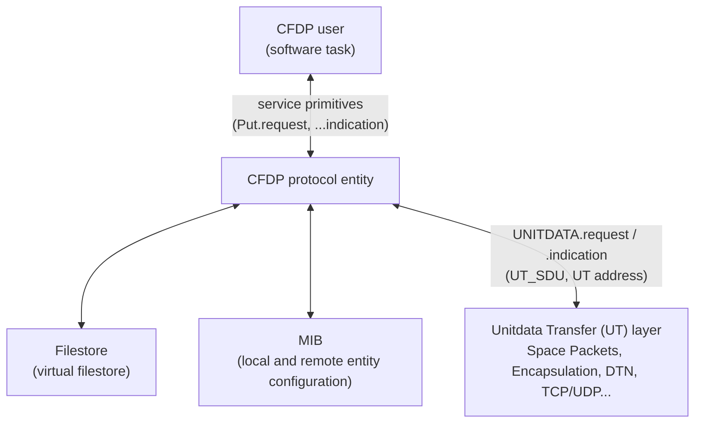
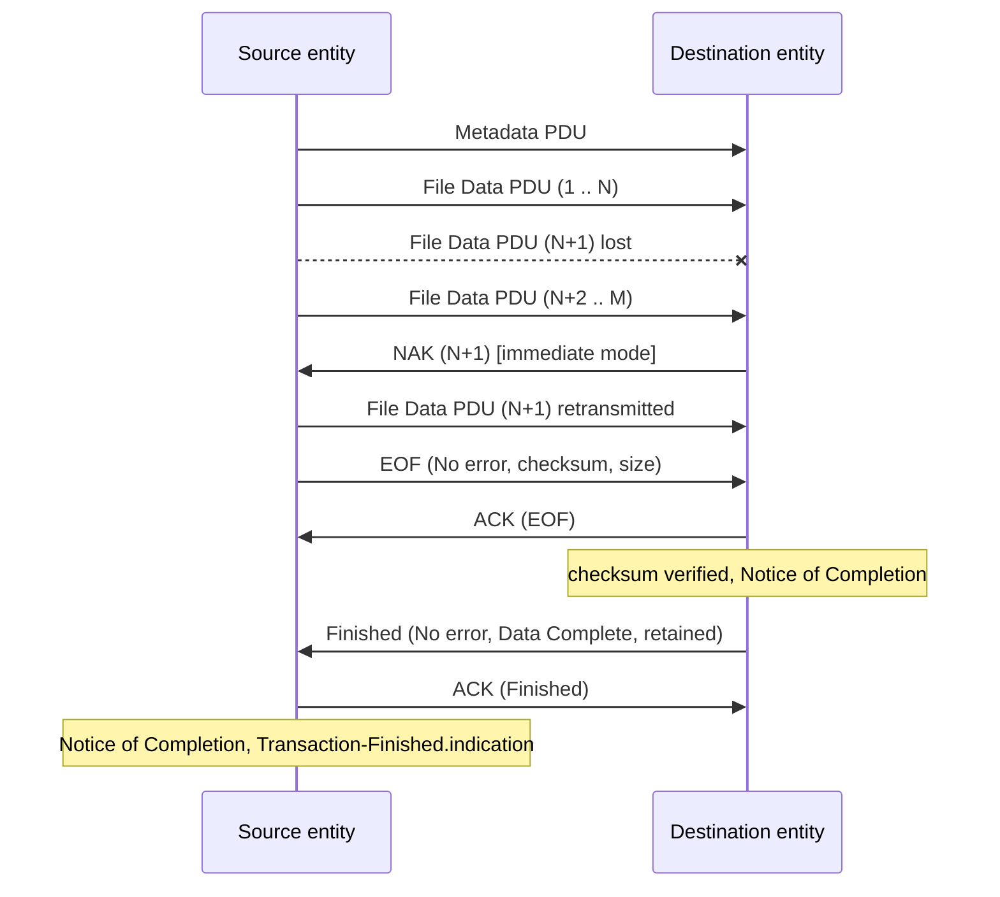
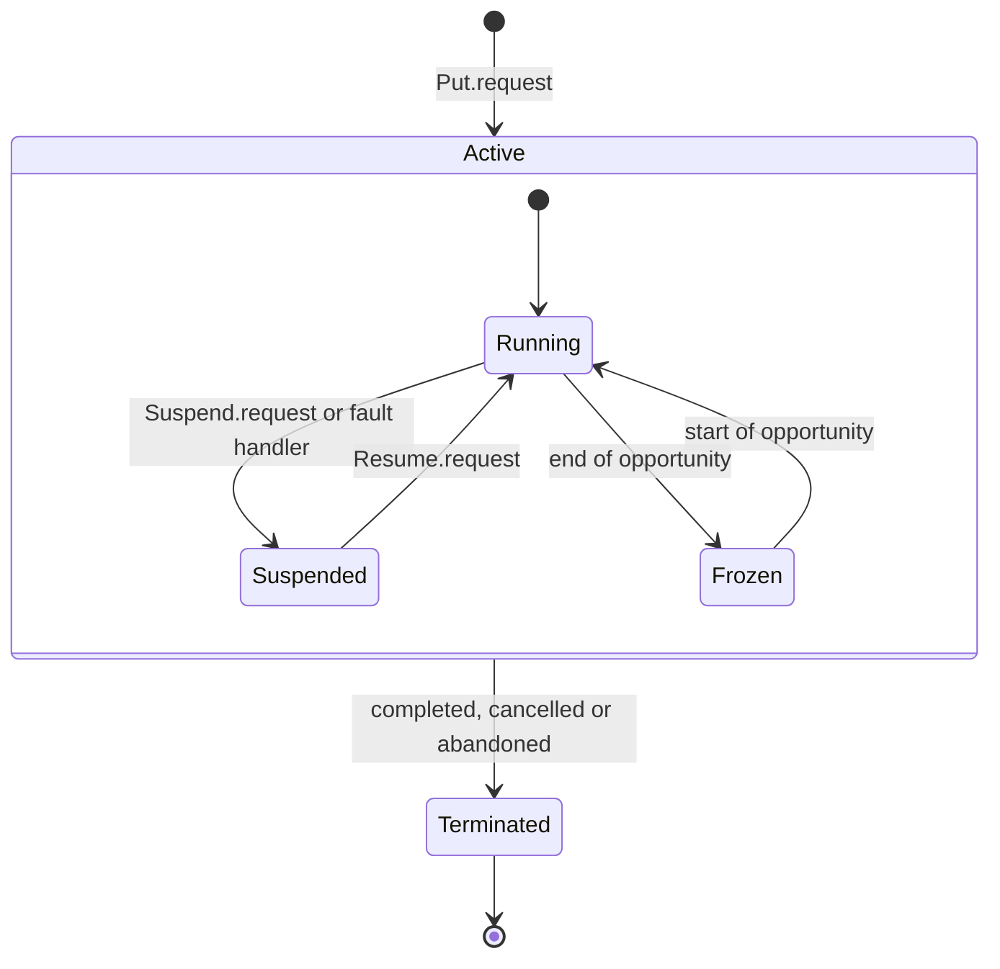

# CCSDS File Delivery Protocol (CCSDS 727.0-B-5)

Spacecraft used to store data on tape recorders that could only be dumped, and ground teams
handled them with ad hoc, private protocols. Solid-state mass memory changed this. It gives
random access to gigabytes, so data lost on the link can be sent again and delivery of critical
information can be guaranteed. Much routine traffic can then become **files**.[^foreword] The
**CCSDS File Delivery Protocol (CFDP)** is the CCSDS standard for moving files to and from that
storage. It also offers simple file management on the remote file system. It is designed for
noisy, bandwidth-limited, asymmetric and interrupted links with long light times, and for
platforms with little computing power and memory.[^foreword][^general]

CFDP runs over almost any packet service. Examples are the CCSDS [Space Packet](space-packet.md)
over [TM](tm-sdlp.md), [TC](tc-sdlp.md) or [AOS](aos.md) frames, the
[Encapsulation Packet](encapsulation.md), DTN bundles, and ground networks.[^scope][^ut] It can
be started by the sender or by the receiver.[^scope] This page describes CCSDS 727.0-B-5 (July
2020, Editorial Change 1 of September 2024) as held in the
[library](../library/ccsds-727-0-727x0b5e1.md). It ends by comparing CFDP with the PUS
alternatives that ESA missions such as [Solar Orbiter](../missions/solar-orbiter/index.md) use
instead.

!!! info "At a glance"
    | Property | Value |
    |---|---|
    | Layer | Application layer[^g4-app] |
    | Data unit | PDU: 4-octet fixed header part + variable entity IDs and sequence number + data field[^hdr] |
    | PDU types | File Directive (EOF, Finished, ACK, Metadata, NAK, Prompt, Keep Alive) and File Data[^dircodes] |
    | Service classes | Class 1 unreliable (unacknowledged), Class 2 reliable (acknowledged)[^classes] |
    | Integrity | optional CRC-16 per PDU (TC CRC); mandatory 32-bit file checksum (modular, CRC-32 variants or null)[^crc][^cksum] |
    | File size | 32-bit "small" or 64-bit "large" (Large File flag)[^hdr][^fss] |
    | Underlying service | UNITDATA.request/indication only, with in-sequence but possibly lossy and erroneous delivery[^ut] |
    | Security | none built in; must come from the layers below[^sec] |
    | Relay | Store and Forward Overlay (normative annex B)[^sfo] |

## History of the standard

| Issue | Date | Notes |
|---|---|---|
| 727.0-B-1 | January 2002 | original issue |
| 727.0-B-2 | October 2002 | |
| 727.0-B-3 | June 2005 | |
| 727.0-B-4 | January 2007 | the issue cited in the PUS-C bibliography[^pus-bib] |
| 727.0-B-5 | July 2020 | moves SFO to annex B; **removes the Extended Procedures** (and so classes 3 and 4); adds large files, multi-segment records and per-segment metadata; adds a choice of checksum from a SANA registry |
| EC 1 | September 2024 | heading numbering under 7.2.3; A4 page size |

The issue list and change summary are from the document control page.[^history][^scope] The
2008 ECSS handbook still describes four classes. Classes 3 and 4 were unreliable and reliable
transfer through waypoints using the Extended Procedures, which forwarded file data inside CFDP
itself. The handbook also describes the SFO as an alternative that works file by file.[^hb-classes]
Issue 5 keeps only the SFO.

## Architecture



*Redrawn after CCSDS 727.0-B-5 figure 2-1.*[^arch]

* **User**. A software task, which may be operated by a human. Each entity has at most one
  user.[^arch]
* **Protocol entity**. An implementation of the core procedures, "roughly analogous" to an
  Internet host.[^arch][^defs]
* **Filestore**. Each entity has exactly one filestore, described to the protocol as a **virtual
  filestore** that each implementation maps to real storage. The minimum capabilities are create,
  delete, rename, append and replace file, and create, remove and list directory. Optionally the
  filestore distinguishes record-structured files from octet streams.[^arch][^vfs]
* **Unitdata Transfer (UT) layer**. One conceptual service at one service access point. CFDP uses
  nothing from it except addressing and PDU delimitation. Multiplexing of transactions, sequence
  auditing and error detection all happen inside CFDP. That is why the PDU header carries its own
  length.[^ut-arch]
* **Management Information Base (MIB)**. Mostly static tables of defaults, address mappings and
  timer settings. This is not the SCOS-2000 [MIB](../mib/index.md). The name is the same, but the
  CFDP MIB is an entity configuration store.[^mib-arch]

### Addressing

Each entity has a name, its **entity ID**, that is unique within the CFDP network. Because an
entity owns exactly one filestore, the entity ID also names the filestore. The MIB maps entity
IDs to **UT addresses**. A UT address can be an Internet address, a radio buffer, an
[APID](../glossary.md), a [virtual channel](tm-sdlp.md) number or any other local
mechanism.[^addr]

### What CFDP expects from the layer below

The UT service has two primitives, `UNITDATA.request (UT_SDU, UT Address)` and
`UNITDATA.indication (UT_SDU, UT Address)`. The assumed minimum quality of service is delivery
**with possible errors, possibly incomplete, but in sequence**. In-sequence delivery is what the
immediate, asynchronous and prompted lost-segment detection modes and Keep Alive rely on. CFDP
tolerates loss and corruption, but it is not meant for networks where they are common: the
standard warns of "severe performance reductions" in that case.[^ut] Implementations may add
non-mandatory primitives, such as a flow-control "ready" indication or a transmission-complete
indication for starting acknowledgement timers.[^ut]

## Key terms

| Term | Meaning |
|---|---|
| File Delivery Unit (FDU) | a file plus its metadata (file names, messages to user, filestore requests). An FDU may be metadata only[^defs] |
| Transaction | the end-to-end delivery of one FDU between two entities, identified by a **transaction ID** = source entity ID + transaction sequence number[^defs][^txid] |
| Source / destination | the entity holding the file at the start of the task / the one holding a copy at the end[^defs] |
| Sender / receiver | the two ends of one point-to-point copy operation. With relays, the source is the first sender and the destination the last receiver[^defs] |
| Offset | the number of file octets that precede a given octet[^defs] |
| Progress | for a File Data PDU, offset + length. Transmission and reception progress are the maxima over all PDUs sent or received[^defs] |

A transaction ends when the file has been delivered, when either end has disallowed it, when a
fault has cancelled it, or when a user has cancelled it.[^modes-overview]

## User services and primitives

The user can start file transfers, start remote filestore operations, receive events, ask for
status, exchange messages, and suspend, resume or cancel transactions. An entity must accept a new
`Put.request` before earlier transactions have finished, so "virtually any number" of transactions
can be in progress at once.[^services]

| Request | Parameters (optional in brackets) |
|---|---|
| `Put.request` | destination entity ID, [source file name], [destination file name], [segmentation control], [fault handler overrides], [flow label], [transmission mode], [closure requested], [messages to user], [filestore requests][^put] |
| `Cancel.request` | transaction ID[^cancel] |
| `Suspend.request` | transaction ID[^suspend] |
| `Resume.request` | transaction ID[^resume] |
| `Report.request` | transaction ID[^report] |

| Indication | Parameters | Notes |
|---|---|---|
| `Transaction.indication` | transaction ID | issued on Put.request[^tind] |
| `EOF-Sent.indication` | transaction ID | optional; on first transmission of the EOF PDU[^eofsent] |
| `Transaction-Finished.indication` | transaction ID, [filestore responses], [status report], condition code, file status, delivery code | always at the source; optional at the destination[^tfin] |
| `Metadata-Recv.indication` | transaction ID, source entity ID, [file size], [source/destination file names], [messages to user] | on receipt of the Metadata PDU[^mdrecv] |
| `File-Segment-Recv.indication` | transaction ID, offset, length, [record continuation state, segment metadata length, segment metadata] | optional[^fsrecv] |
| `Suspended.indication` | transaction ID, condition code | [^susp] |
| `Resumed.indication` | transaction ID, progress | [^resumed] |
| `Report.indication` | transaction ID, status report | content implementation-specific[^rind] |
| `Fault.indication` | transaction ID, condition code, progress | fault handled by "ignore"[^fault-ind] |
| `Abandoned.indication` | transaction ID, condition code, progress | fault handled by "abandon"[^aband] |
| `EOF-Recv.indication` | transaction ID | optional; at the destination[^eofrecv] |

The main parameters behave as follows:[^params][^params2]

* **Segmentation control** says whether the file is cut as an array of octets or as an array of
  variable-length records.
* **Fault handler overrides** pick, for a given fault type, one of four actions: cancel, suspend,
  ignore (with a `Fault.indication`) or abandon (with an `Abandoned.indication`). Where no override
  is given, the MIB default applies.
* **Transmission mode** is acknowledged or unacknowledged. It overrides the MIB default.
* **Closure requested** asks the receiver to confirm an unacknowledged transaction with a
  Finished PDU.
* **Filestore requests** are actions (create, delete, rename, append or replace file, create or
  remove directory, "deny" file or directory) that the destination executes, in the order given,
  after the data transfer completes.
* **Messages to user** are delivered to the destination user at the start of the transaction.
  They are the vehicle for the [user operations](#user-operations).
* **Flow label** is a hint for prioritisation and pre-emption. Its use is an implementation
  matter.
* **Segment metadata** is 0 to 63 octets of per-segment data whose meaning is set by the
  implementation.

## PDU formats

Every PDU is a fixed-format header followed by a data field of fixed or variable format. The data
field holds data items in five possible formats: fixed, **LV** (length-value), **TLV**
(type-length-value), raw file data, and **FSS** (file-size sensitive).[^pdu-general][^formats]

### Fixed PDU header

<div class="bitfield" data-title="CFDP fixed PDU header: first 32 bits" data-width="16" data-caption="CCSDS 727.0-B-5 table 5-1; followed by source entity ID, transaction sequence number and destination entity ID" data-fields='[{"n":"Version","b":3,"v":"001","d":"001 = second version of the protocol"},{"n":"PDU type","b":1,"d":"0 = File Directive, 1 = File Data"},{"n":"Dir","b":1,"d":"0 = toward file receiver, 1 = toward file sender"},{"n":"Mode","b":1,"d":"0 = acknowledged, 1 = unacknowledged"},{"n":"CRC","b":1,"d":"1 = CRC present in the last 2 octets of the data field"},{"n":"Large","b":1,"d":"1 = large file (FSS items are 64 bits)"},{"n":"PDU data field length","b":16,"d":"Length of the data field in octets (includes the CRC when present)"},{"n":"Seg ctrl","b":1,"d":"1 = record boundaries preserved; always 0 for File Directives"},{"n":"Entity ID length - 1","b":3,"d":"0 means 1-octet entity IDs; applies to all entity IDs in the header"},{"n":"Seg MD","b":1,"d":"1 = segment metadata present; always 0 for File Directives"},{"n":"TSN length - 1","b":3,"d":"0 means a 1-octet transaction sequence number"}]'></div>

| Field | Bits | Values | Purpose |
|---|---|---|---|
| Version | 3 | `001` | protocol version 2[^hdr] |
| PDU type | 1 | 0 directive, 1 file data | [^hdr] |
| Direction | 1 | 0 toward receiver, 1 toward sender | used for PDU forwarding[^hdr] |
| Transmission mode | 1 | 0 acknowledged, 1 unacknowledged | [^hdr] |
| CRC flag | 1 | 0 absent, 1 present | [^hdr] |
| Large File flag | 1 | 0 small, 1 large | a file whose size does not fit in an unsigned 32-bit integer, and every file of unbounded size, is "large"[^hdr] |
| PDU data field length | 16 | octets | [^hdr] |
| Segmentation control | 1 | 0 boundaries not preserved, 1 preserved | 0 and ignored for directives[^hdr] |
| Length of entity IDs | 3 | octets − 1 | [^hdr] |
| Segment metadata flag | 1 | 0 absent, 1 present | 0 and ignored for directives[^hdr2] |
| Length of transaction sequence number | 3 | octets − 1 | [^hdr2] |
| Source entity ID | variable | unsigned integer | entity that originated the transaction[^hdr2] |
| Transaction sequence number | variable | unsigned integer | unique among that entity's transactions[^hdr2] |
| Destination entity ID | variable | unsigned integer | final destination of the metadata and file data[^hdr2] |

Entity IDs and sequence numbers of different lengths are compared as if the shorter one were
padded with leading zeros. The length itself has no meaning.[^formats] The sequence number is
allocated in order by the entity that answers the `Put.request`.[^hdr2] The header always names the
**source** and **destination** of the transaction. The Direction bit tells relays and peers which
way a given PDU is travelling.[^hdr][^fwd]

!!! warning "Inference"
    Table 5-1 gives the PDU Data field length only as "in octets". Unlike the Space Packet, it does
    not specify a "minus one" convention, so the field is read here as the plain octet count of the
    data field. Clause 4.1.3.2, which says the CRC's length "shall be included in the PDU data field
    length", is consistent with that reading.[^crc] With 1 to 8 octet entity IDs and sequence
    numbers, the header is 7 to 28 octets long.

### LV, TLV and FSS items

* **LV**: an 8-bit length (0 to 255) followed by that many octets. The position is fixed, the
  length variable.[^formats]
* **TLV**: an 8-bit type, an 8-bit length and the value. Both position and length vary, so these
  are used for options.[^formats]
* **FSS**: integers (file sizes and offsets) that are 32 bits when the Large File flag is 0 and
  64 bits when it is 1.[^fss]

### File Directive PDUs

A directive's data field is a **directive code** octet followed by the directive
parameters.[^dircodes]

| Code | Directive | | Code | Directive |
|---|---|---|---|---|
| `0x00`-`0x03` | reserved | | `0x08` | NAK PDU |
| `0x04` | EOF PDU | | `0x09` | Prompt PDU |
| `0x05` | Finished PDU | | `0x0C` | Keep Alive PDU |
| `0x06` | ACK PDU | | `0x0D`-`0xFF` | reserved |
| `0x07` | Metadata PDU | | | |

The directive table lists no codes `0x0A` and `0x0B`.[^dircodes] Several directives carry a 4-bit
**condition code**:[^cc]

| Code | Condition | | Code | Condition |
|---|---|---|---|---|
| `0000` | No error | | `1000` | Inactivity detected |
| `0001` | Positive ACK limit reached | | `1001` | Invalid file structure |
| `0010` | Keep alive limit reached | | `1010` | Check limit reached |
| `0011` | Invalid transmission mode | | `1011` | Unsupported checksum type |
| `0100` | Filestore rejection | | `1100`-`1101` | reserved |
| `0101` | File checksum failure | | `1110` | Suspend.request received |
| `0110` | File size error | | `1111` | Cancel.request received |
| `0111` | NAK limit reached | | | |

#### Metadata PDU (`0x07`)

<div class="bitfield" data-title="Metadata PDU parameters (small file), fixed part" data-width="16" data-caption="CCSDS 727.0-B-5 table 5-9; followed by LV source file name, LV destination file name and option TLVs" data-fields='[{"n":"Directive code","b":8,"v":"00000111"},{"n":"Rsv","b":1,"v":"0"},{"n":"Closure","b":1,"d":"1 = transaction closure requested (ignored in acknowledged mode)"},{"n":"Rsv","b":2,"v":"00"},{"n":"Checksum type","b":4,"d":"SANA checksum identifier; 0 = legacy modular checksum"},{"n":"File size (FSS)","b":32,"d":"Octets; all zeros for a file of unbounded size; 64 bits for large files"}]'></div>

The Metadata PDU opens every copy operation. It carries the file size (if known), the source and
destination path names as LVs (zero length when no file is involved, as in proxy messages), the
closure flag, the checksum type and the option TLVs: filestore requests, messages to user, fault
handler overrides and flow label.[^md][^md-send] Making all metadata fit in one Metadata PDU is the
implementation's responsibility, and a repeated Metadata PDU is discarded.[^md-send][^recv]

#### EOF PDU (`0x04`)

<div class="bitfield" data-title="EOF PDU parameters (small file)" data-width="16" data-caption="CCSDS 727.0-B-5 table 5-6; a Fault Location entity-ID TLV follows unless the condition code is No error" data-fields='[{"n":"Directive code","b":8,"v":"00000100"},{"n":"Condition code","b":4},{"n":"Spare","b":4,"v":"0000"},{"n":"File checksum","b":32,"d":"32-bit checksum over the file data (see Checksums)"},{"n":"File size (FSS)","b":32,"d":"Total file-data octets transmitted, whatever the condition code"}]'></div>

The sender issues **EOF (No error)** when the Metadata PDU and all File Data PDUs have been sent.
For an unbounded file this is when the session ends. EOF (No error) carries the file's checksum
and length, which may not have been known when the Metadata PDU was sent.[^eof][^send-eof] On
cancellation the sender sends **EOF (cancel)**. Its file size field is the current transmission
progress, its checksum covers the data sent so far, and a Fault Location TLV names the entity at
which the cancellation began.[^eof][^cancel-send]

#### Finished PDU (`0x05`)

<div class="bitfield" data-title="Finished PDU parameters, fixed part" data-width="16" data-caption="CCSDS 727.0-B-5 table 5-7; followed by filestore response TLVs and an optional Fault Location TLV" data-fields='[{"n":"Directive code","b":8,"v":"00000101"},{"n":"Condition code","b":4},{"n":"Spare","b":1},{"n":"Delivery","b":1,"d":"0 = Data Complete (metadata, all data and EOF received, checksum verified), 1 = Data Incomplete"},{"n":"File status","b":2,"d":"00 discarded deliberately, 01 discarded (filestore rejection), 10 retained, 11 unreported"}]'></div>

The destination sends a Finished PDU when delivery is complete. It is mandatory in acknowledged
mode and sent in unacknowledged mode only if closure was requested. The condition code is
"No error" if the checksums matched, or "Unsupported checksum type" if no real checksum could be
verified.[^ack-recv][^unack-recv] A filestore response TLV accompanies every filestore request of
the Metadata PDU.[^fin]

#### ACK PDU (`0x06`)

<div class="bitfield" data-title="ACK PDU parameters" data-width="16" data-caption="CCSDS 727.0-B-5 table 5-8" data-fields='[{"n":"Directive code","b":8,"v":"00000110"},{"n":"Ack&apos;d directive","b":4,"d":"0100 EOF or 0101 Finished (only these are acknowledged)"},{"n":"Subtype","b":4,"d":"0001 when acknowledging Finished, 0000 otherwise"},{"n":"Condition code","b":4,"d":"Condition code of the acknowledged PDU"},{"n":"Spare","b":2},{"n":"Txn status","b":2,"d":"00 Undefined, 01 Active, 10 Terminated, 11 Unrecognized"}]'></div>

Only EOF and Finished PDUs are acknowledged. The **transaction status** reports what the
acknowledging entity knows about the transaction. *Undefined* means it keeps no history. If it
does keep history, the transaction is *Active*, *Terminated* (once active, now ended) or
*Unrecognized* (never active at this entity).[^ackpdu] An ACK confirms receipt only. Entities must
always send it, even for unknown transactions, so that the peer's retransmission timer
stops.[^posack]

#### NAK PDU (`0x08`)

| Parameter | Size | Meaning |
|---|---|---|
| Start of scope | FSS | first offset covered by this NAK |
| End of scope | FSS | end of the range covered |
| Segment requests (× N) | 2 × FSS each | start offset and end offset (first octet *after* the gap) of each missing extent. Missing metadata is requested as the pair 0, 0 |

The layout is from tables 5-10 and 5-11.[^nak] For small files each segment request is 64 bits.

#### Prompt PDU (`0x09`) and Keep Alive PDU (`0x0C`)

The **Prompt PDU** is one parameter octet. Its first bit selects the response wanted (0 = NAK,
1 = Keep Alive) and seven spare bits follow.[^prompt] The **Keep Alive PDU** carries a single FSS
**progress** value, the receiver's reception progress in octets.[^keepalive]

### File Data PDU

| Field | Bits | Present when |
|---|---|---|
| Record continuation state | 2 | segment metadata flag = 1 |
| Segment metadata length | 6 (0 to 63) | segment metadata flag = 1 |
| Segment metadata | 0 to 504 | flag = 1 and length > 0 |
| Offset | FSS | always |
| File data | variable | always |

The table is from table 5-14.[^fd] The **record continuation state** describes how the segment
lines up with the file's records:[^fd]

| Value | Meaning |
|---|---|
| `00` | the segment holds neither the start nor the end of a record. This means "continuation" if the segmentation control flag is 1, and "no records" otherwise |
| `01` | the first octet starts a record whose end is not in this segment |
| `10` | the last octet ends a record whose start is not in this segment |
| `11` | the segment starts with the first octet of a record and ends with the last octet of that record or of a later one |

Record continuation state must be present when record boundaries are to be respected (flag 1).
It may be present otherwise, but then it is always `00`. If boundaries are requested but the file
has no visible record structure, an **Invalid File Structure** fault is declared.[^send-seg]

### TLV options

| Type | TLV | Value |
|---|---|---|
| `0x00` | Filestore Request | 4-bit action code, 4 spare bits, LV first file name, LV second file name (for rename, append, replace)[^fsreq] |
| `0x01` | Filestore Response | action code, 4-bit status code, LV file names, LV filestore message[^fsresp] |
| `0x02` | Message to User | undefined content. Messages beginning with the ASCII characters `cfdp` are reserved for the standard user operations[^msg] |
| `0x04` | Fault Handler Override | 4-bit condition code + 4-bit handler: `0001` cancel, `0010` suspend, `0011` ignore, `0100` abandon[^fho] |
| `0x05` | Flow Label | undefined content[^flow] |
| `0x06` | Entity ID | an entity ID, used as the Fault Location[^entid] |

The filestore action codes are `0000` Create File, `0001` Delete File, `0010` Rename File,
`0011` Append File, `0100` Replace File, `0101` Create Directory, `0110` Remove Directory,
`0111` Deny File (delete if present) and `1000` Deny Directory (remove if present).[^fsreq]
Response status `0000` means success and `1111` means "not performed". Codes in between give
action-specific failures, such as "file does not exist" or "not allowed".[^fsresp]

## Integrity: CRC and file checksum

**PDU CRC.** When the CRC option is active, the sender sets the CRC flag and appends the standard
CCSDS telecommand CRC to every PDU. The CRC covers everything from the first header octet to the
last data octet before the CRC. Its length counts in the data field length. The receiver
discards any PDU that fails the check.[^crc] The algorithm is the one in clause 4.2.1.3 of the TC
Space Data Link Protocol. See [TC SDLP](tc-sdlp.md).[^crc]

**File checksum.** Every file is protected by a **32-bit** checksum that the sender puts in EOF
(No error) and the receiver recomputes.[^cksum][^cksum-assert][^cksum-verify] The algorithm is
identified by a 4-bit type from the SANA "Checksum Identifiers" registry:[^cksum][^sana]

| Type | Algorithm | Requirement |
|---|---|---|
| 0 | Modular checksum | mandatory |
| 1 | [Proximity-1](proximity-1.md) CRC32 (CCSDS 211.2-B-3 annex C) | optional |
| 2 | CRC-32C (RFC 4960 appendix B) | optional |
| 3 | IEEE 802.3-2018 FCS | optional |
| 4-14 | reserved for CFDP | |
| 15 | Null checksum (value 0) | mandatory |

The sender uses the type configured in the MIB for the receiver. The receiver uses the type named
in the Metadata PDU.[^cksum-assert][^cksum-verify] If the preferred algorithm is not available, an
**Unsupported Checksum Type** fault is raised. The sender then falls back to the modular checksum
and the receiver to the null checksum.[^cksum] With a null checksum the file is not protected.
The standard recommends implementing one of the stronger algorithms for large files.[^cksum]

The **modular checksum** adds 4-octet words modulo $2^{32}$, with words aligned to file offsets
that are multiples of 4 and carries out of the top octet discarded. Data at an offset Q that is
not a multiple of 4 is aligned by inserting Q mod 4 zero octets in front. A final group shorter
than 4 octets is padded with zeros after it. Because addition commutes, segments can be summed in
any order of arrival.[^modsum][^annexf]

!!! example "Modular checksum (example from annex F)"
    A 15-octet file `00 01 … 0E` is sent in segments of 6, 6 and 3 octets. The words are
    `00010203`, `04050607`, `08090A0B` and `0C0D0E00` (the last one padded). When the segments
    arrive out of order, the segment at offset 6 is aligned to `00 00 06 07 08 09 0A 0B`. The
    words are then `00010203`, `04050000`, `0C0D0E00`, `00000607` and `08090A0B`, and
    `04050000 + 00000607` gives the same contribution as `04050607`.[^annexf] The sum, computed by
    this wiki, is `0x181C2015`.

## Procedures

### Put and transaction start

A `Put.request` starts a **Transaction Start Notification** (a new sequence number and a
`Transaction.indication`) and a **Copy File** procedure. Missing file names mean metadata only.
Transmission mode and closure come from the MIB unless the request overrides them.[^putproc] No two
transactions with activity at the same time may share a transaction ID.[^putproc]

### PDU forwarding

Each PDU goes to the UT address that the MIB gives for its target entity. ACKs go to the entity
that sent the acknowledged PDU. File Data, Metadata, EOF and Prompt PDUs go to the receiver. NAK,
Finished and Keep Alive PDUs go to the sender. A PDU whose destination entity ID does not match
the entity that receives it is discarded.[^fwd]

### Copy File: common procedures

At the **sender**: Metadata PDU first, then the file data in File Data PDUs (each with its
offset), then EOF (No error), and optionally an `EOF-Sent.indication`. The segmentation algorithm
is not specified.[^md-send][^send-seg][^send-eof]

At the **receiver**:[^recv][^recv2]

1. Store the transmission mode bit of the first PDU. Declare **Invalid Transmission Mode** if that
   mode is not supported.
2. Store the fault handler overrides, file size, flow label and names from the Metadata PDU.
   Discard repeated Metadata PDUs. Declare **Filestore Rejection** if the filestore cannot accept
   the file.
3. At the destination, issue `Metadata-Recv.indication` with any messages to user, and queue
   filestore requests until the data transfer completes.
4. Assemble the file from offset and length. Discard duplicate data. Declare **File Size Error** if
   any data lies beyond the size given in EOF, or if reception progress already exceeds that size
   when EOF arrives.
5. Once Metadata, all File Data and EOF (No error) are in, compute the checksum with the applicable
   algorithm. If it matches, or if the algorithm is null, delivery is **Complete**. Otherwise
   declare **File Checksum Failure**. The default handler may be "ignore", so the file can still be
   delivered with a `Fault.indication`.

### Unacknowledged mode (Class 1)

Class 1 works over **simplex** links. A duplex link is needed only if transaction closure is
requested.[^unack-path]

* **Sender**: sending EOF (No error) completes the transaction (Notice of Completion), unless
  closure was requested. In that case a **Check timer** runs. Receiving a Finished PDU stops it,
  and expiry declares **Check Limit Reached**.[^unack-send]
* **Receiver**: on EOF (No error), if the file is complete it issues Notice of Completion, plus a
  Finished PDU if closure was requested. If the file is not complete it starts a Check timer and
  re-examines completeness each time the timer expires, up to an implementation-specific limit,
  then declares **Check Limit Reached**. The timer allows for PDUs that arrive after EOF over
  reordering networks.[^unack-recv]

### Acknowledged mode (Class 2)

Acknowledged mode needs a **duplex** path.[^ack-path] The receiver detects **gaps**: data not
starting at offset 0, a hole between extents, or data ending short of the EOF file size. It
detects **lost metadata** when a File Data or EOF PDU arrives before any Metadata PDU.[^ack-recv]
Gaps are reported in **NAK sequences**. Each sequence covers a *scope*. It starts at the end of the
previous sequence's scope, or at 0 for a timer-driven NAK. It ends at the file length if EOF has
arrived, or at the current reception progress otherwise. The sequence is split over as many NAK
PDUs as the UT_SDU size requires, though normally one is enough.[^ack-recv] The sender retransmits
whatever is requested. Its new segments need not match the original segmentation or the NAK
boundaries.[^ack-send]

**When NAKs are sent** depends on the lost-segment detection modes:[^lsd][^lsd2][^lsd-def]

| Mode | Trigger | Before or after EOF |
|---|---|---|
| Immediate | each gap or lost metadata as soon as it is detected | before EOF (No error) only |
| Prompted | receipt of a Prompt (NAK) PDU; an empty NAK if nothing is missing | before EOF |
| Asynchronous | an implementation-specific external event (for example a contact window opens) | before EOF |
| Deferred | receipt of EOF (No error), then each expiry of the **NAK timer** while data is missing (scope 0 to end of file) | after EOF; **required for interoperability** in Class 2 |

An implementation-specific measure of NAK activity, typically the number of NAK-timer expiries
without new data, leads to **NAK Limit Reached** when it hits its limit.[^naklimit] The receiver
may also send periodic **Keep Alive** PDUs, and must send one in reply to a Prompt (Keep Alive). It
stops once EOF arrives. The sender may declare **Keep Alive Limit Reached** if reported reception
progress lags transmission progress by more than a preset amount.[^ka]

**Positive acknowledgement** applies to EOF (expected response ACK (EOF)) and Finished (expected
response ACK (Finished)). The sender of the PDU keeps it, runs a timer, retransmits on expiry,
counts retries, and declares **Positive ACK Limit Reached** when the count exceeds the
limit.[^posack][^ack-send][^ack-recv]



*Redrawn after CCSDS 727.0-B-5 section 7.3.3, the Class 2 event diagram.*[^class2-diag]

### Cancel, suspend, resume, report

* **Cancel**. The sender issues EOF (cancel) and the receiver issues Finished (cancel), each
  carrying the reason (Cancel.request received, or the fault's condition code). In acknowledged
  mode they are positively acknowledged with a matching condition code. Any fault during that
  exchange abandons the transaction.[^cancel-send][^cancel-recv][^cancel-resp]
* **Suspend**. Ignored if the transaction is already suspended, or if the receiver suspends an
  unacknowledged transaction. The sender stops Metadata, File Data, EOF and Prompts, freezes the
  inactivity timer and positive-ack timers, and saves status. The receiver stops NAKs, Keep Alives,
  the inactivity timer and Finished PDUs. Received EOF and Finished PDUs are still acknowledged,
  and File Data PDUs are still accepted, so a file can be completely received while
  suspended.[^suspend-proc][^suspend-proc2]
* **Resume** reverses suspension and issues `Resumed.indication`. It is ignored for transactions
  that are not suspended.[^resume-proc] The standard recommends sending the peer a *Remote
  Suspend* or *Remote Resume* message whenever a transaction is suspended or resumed locally, so
  both ends stay in step.[^suspend-proc][^resume-gen]
* **Report**. `Report.request` yields a `Report.indication` with no protocol exchange.[^reportproc]

### Faults, filestore actions, inactivity

Each fault type has a **default handler in the MIB**. Overrides from the Metadata PDU replace it,
but a receiver cannot know the overrides until the metadata has arrived. Handlers are Notice of
Cancellation, Notice of Suspension (only in acknowledged mode, or at the source), ignore with
`Fault.indication`, or abandon with `Abandoned.indication`. All faults are logged.[^faults]
Filestore requests run only if the copy completed without error. They run in order, and stop at
the first failure, with later requests reported as "not performed". A filestore failure is never a
fault.[^fsproc] The **inactivity monitor** declares an Inactivity fault (default handler: cancel)
after a period without PDUs. It does not run at the sender of an unacknowledged
transaction.[^inact]

### Notices of completion

When a transaction completes, the sender releases its retransmission buffer, stops sending and
issues `Transaction-Finished.indication`. In acknowledged mode that indication carries the
destination's filestore responses.[^noc-send] The receiver stops NAKs and Keep Alives, executes the
filestore requests if the transaction completed, and either **keeps or discards** incomplete data
from a cancelled transaction, as the MIB says.[^noc-recv] A Notice of Completion (Canceled) can
follow a Notice of Completion (Completed). This happens, for example, when the Finished PDU is
never acknowledged and the receiver reaches its positive-ACK limit. By then the file has already
been delivered.[^noc]

### Link state changes: freeze and thaw

CFDP expects the environment to signal the start and end of **transmission** and **reception
opportunities** for each remote entity. These are typically pass boundaries shifted by the one-way
light time. At the end of an opportunity, affected transactions are **frozen**. Freezing has the
effects of suspension, but it issues no indication and does not count as a suspension. At the
next opportunity they are **thawed**. Unacknowledged reception is never frozen, and thawing has no
effect on a transaction that a user has suspended.[^link][^link2] This is the mechanism that lets one
transaction span several ground-station passes. The ECSS handbook calls it the "link lost"
signal.[^hb-practice]



The Running, Suspended and Terminated states follow the PUS Rev.1 draft's summary of CFDP
transaction statuses.[^st24-status] The Frozen sub-state is this wiki's addition, based on
clause 4.12.[^link]

## Service classes

| Class | Purpose | Key procedures |
|---|---|---|
| **Class 1, Unreliable Transfer** | bounded or unbounded files over simplex or duplex paths. Closure only on duplex paths | CRC, checksum, Put, forwarding (Metadata, File Data, EOF only), Copy File, unacknowledged mode, resume, report, fault handling (cancel at source, abandon at destination), filestore, inactivity (destination), internal, transmission opportunity[^class1] |
| **Class 2, Reliable Transfer** | bounded or unbounded files with guaranteed delivery | all of Class 1, plus acknowledged mode, incremental and deferred lost-segment detection, Keep Alive, positive acknowledgement, cancel response with acknowledgement, and link state change procedures[^class2] |

State transition diagrams and state tables for each class are in the CFDP implementers' Green
Book, which the standard's annex D lists as CCSDS 720.2-G-4 "forthcoming". That book is not in
this wiki's library.[^classes][^refs-d]

## The CFDP MIB

**Local entity configuration** (one value per entity): local entity ID; whether `EOF-Sent`,
`EOF-Recv`, `File-Segment-Recv`, `Transaction-Finished` (as receiver), `Suspended` (as receiver)
and `Resumed` (as receiver) indications are required; and the default fault handler for each fault
type.[^mib-local]

**Remote entity configuration** (one set per directly reachable remote entity):[^mib-remote]

| Item | | Item |
|---|---|---|
| Remote entity ID | | CRCs required on transmission |
| Protocol version number | | Maximum file segment length (octets) |
| UT address | | Keep Alive discrepancy limit (octets) |
| Positive ACK timer interval | | Positive ACK timer expiration limit |
| NAK timer interval | | NAK timer expiration limit |
| Keep Alive interval | | Transaction inactivity limit |
| Immediate NAK mode enabled | | Start / end of transmission opportunity (signals) |
| Default transmission mode | | Start / end of reception opportunity (signals) |
| Transaction closure requested | | Disposition of incomplete file on cancellation (discard / retain) |
| Check limit | | Default checksum type for files sent to this entity |

Timer settings must reflect the link, especially the round-trip delay. The ECSS handbook stresses
that reliable modes need the necessary return bandwidth and correctly set timers.[^hb-practice]

## User operations

User operations let a user ask the **remote user** to start transactions. The request is
carried in **Reserved CFDP Messages**, which are Message to User TLVs whose value starts with the
32-bit ASCII identifier `cfdp`, followed by an 8-bit message type.[^userops][^reserved] An
**Originating Transaction ID** message (type `0x0A`) links a reply to the request that caused it.
It holds the entity-ID length, the sequence-number length, the source entity ID and the sequence
number.[^reserved]

| Operation | Message types | What happens |
|---|---|---|
| **Proxy put** | `0x00` Put Request, `0x01` Message to User, `0x02` Filestore Request, `0x03` Fault Handler Override, `0x04` Transmission Mode, `0x05` Flow Label, `0x06` Segmentation Control, `0x07` Put Response, `0x08` Filestore Response, `0x09` Put Cancel, `0x0B` Closure Request | the respondent issues its own Put.request on the originator's behalf. If the beneficiary is the originator, this is a "Get". The result returns in a third transaction with Put Response and Originating Transaction ID[^proxy][^proxy2][^proxy3] |
| **Directory listing** | `0x10` Request (directory name, listing file name), `0x11` Response (1-bit success code) | the remote user sends back a file containing the listing[^dir] |
| **Remote status report** | `0x20` Request, `0x21` Response | the remote user returns a status report file, a success code and the transaction status values of the ACK PDU[^rsr] |
| **Remote suspend** | `0x30` Request, `0x31` Response | acknowledged mode only. The response reports whether the transaction is now suspended[^rsusp] |
| **Remote resume** | `0x38` Request, `0x39` Response | acknowledged mode only. Several suspension reasons can apply at once, so a resume may leave the transaction suspended[^rres] |

The **Proxy Put Request** contains the beneficiary's entity ID (as an LV) and the source and
destination file names (LVs, zero length if omitted). The respondent copies the other proxy
options into its own Put.request.[^proxy2] Proxy operations can invoke core CFDP transfers but not
the Store and Forward Overlay.[^proxy]

## Store and Forward Overlay (annex B)

The **SFO** carries files between users whose entities may never be in contact. Each hop is an
ordinary CFDP transaction to the next **waypoint user**, until the **agent**, the user whose entity
can reach the destination directly, performs an **SFO final delivery transaction**. Reports travel
back the same way.[^sfo]


*Redrawn after CCSDS 727.0-B-5 figure B-1.*[^sfo]

* **Message types**: `0x40` SFO Request, `0x41` SFO Message to User, `0x42` SFO Flow Label,
  `0x43` SFO Fault Handler Override, `0x44` SFO Filestore Request, `0x45` SFO Report, `0x46` SFO
  Filestore Response.[^sfo-types]
* **Routing**: each user keeps an information base of which entities can receive directly from
  which others, and computes the shortest route. An empty route fails at once. A route of only
  the local and destination entities is a plain Put.[^sfo-route]
* **Intermediate file names** follow the form `SFOsourceEntityID_SFOrequestLabel.sfo`, without a
  path. Waypoints should reserve filestore space for files in transit.[^sfo-route][^sfo-name]
* **SFO Request** fields: 2-bit trace control (0 none, 1 toward source, 2 toward destination, 3
  both); transmission mode and segmentation control for the final hop (agent to destination); a
  closure request bit that controls closure notices at waypoints; 3 spare bits; an
  8-bit prior waypoints count (incremented at each hop, with relaying refused at 255); then LV
  request label (printable ASCII), source entity ID, destination entity ID, and source and
  destination file names.[^sfo-req][^sfo-relay]
* **SFO Report** report codes: 1 final delivery completed, 2 relay failed, 3 routing failed, 4 relay
  succeeded, 5 final delivery failed, 6 maximum waypoints exceeded, 7 invalid intermediate file
  name. The report also carries the condition code, direction, delivery code and file
  status.[^sfo-report]

## Security

CFDP was designed before CCSDS recognised that protocols need protection against attack. It has
no security mechanisms. Confidentiality, integrity, authentication and availability must come from
the UT-layer stack beneath it.[^sec][^ut] On a space link this usually means
[SDLS](sdls.md).

## Worked example: a Class 2 transfer on the wire

The bytes below are **illustrative**. They were constructed by this wiki from tables 5-1 to 5-9.
A ground entity with ID `0x0001` sends a 1 024-octet file `a.bin` to an on-board entity `0x0017`
as `b.bin`, in acknowledged mode, without CRC. The entity IDs are 2 octets and the sequence number
is 4 octets (transaction 5).

**Metadata PDU** (30 octets):

| Octets | Value | Meaning |
|---|---|---|
| 0 | `20` | version `001`, directive, toward receiver, acknowledged, no CRC, small file |
| 1-2 | `00 12` | data field length 18 octets |
| 3 | `13` | seg. control 0, entity ID length 2 (`001`), no segment metadata, sequence number length 4 (`011`) |
| 4-5 | `00 01` | source entity ID |
| 6-9 | `00 00 00 05` | transaction sequence number |
| 10-11 | `00 17` | destination entity ID |
| 12 | `07` | directive code: Metadata |
| 13 | `00` | closure not requested (ignored in acknowledged mode), checksum type 0 (modular) |
| 14-17 | `00 00 04 00` | file size 1 024 |
| 18-23 | `05 61 2E 62 69 6E` | LV source file name `a.bin` |
| 24-29 | `05 62 2E 62 69 6E` | LV destination file name `b.bin` |

The data PDUs that follow use the same header with the PDU type bit set (first octet `0x30`).
Each data field is a 4-octet offset followed by file data. The exchange then ends with these
directive data fields:

| PDU | Direction bit | Data field | Meaning |
|---|---|---|---|
| EOF (No error) | 0 | `04 00 <checksum:4> 00 00 04 00` | condition 0, checksum, size 1 024 |
| ACK (EOF) | 1 | `06 40 01` | acknowledges EOF (`0100`/`0000`), condition 0, status Active |
| Finished | 1 | `05 02` | No error, Data Complete, file retained (`10`) |
| ACK (Finished) | 0 | `06 51 01` | acknowledges Finished (`0101`/`0001`), condition 0, status Active |

!!! warning "Inference"
    Section 4.5.3 sends the ACK of a Finished PDU to the entity that sent the Finished PDU. The
    source therefore sends it toward the file receiver, and Direction = 0 is used above. The
    standard does not show the transaction status the source reports in ACK (Finished). "Active"
    is assumed because the source has not yet issued its Notice of Completion.

## CFDP and PUS: three ways to move big data

PUS does not use CFDP directly. It offers related services, and a newer draft adopts CFDP
outright.

### ST[13] large packet transfer

[ST[13]](../ecss/pus/st13-large-packet-transfer.md) exists because ground-space links usually
limit packet length below the CCSDS maximum. A sending entity splits a **large packet** into
numbered **parts**. Each part travels in one packet, and the receiver rebuilds the original. The
services that produce and consume large packets do not need to know this is happening.[^st13]
In PUS-C the downlink parts are TM[13,1] (first), TM[13,2] (intermediate) and TM[13,3] (last).
Uplink parts are TC[13,9], TC[13,10] and TC[13,11], and a failed uplink is reported with
TM[13,16]. A reception timeout bounds the gap between parts.[^st13-types][^st13-cfg] In this
wiki's comparison, PUS-C ST[13] differs from CFDP in that it works on packets rather than files,
and defines no file checksum, no NAK-based retransmission and no filestore.

PUS-A's ST[13] was a richer "large data transfer" service. It had acknowledgement and
retransmission: (13,5) downlink reception acknowledgement, (13,6) repeat parts, (13,7)/(13,12)
repeated parts, (13,14) uplink reception acknowledgement, (13,15) unsuccessfully received parts,
and (13,4)/(13,8)/(13,13)/(13,16) aborts.[^pusa-13]

### ST[23] file management

[ST[23]](../ecss/pus/st23-file-management.md) manages on-board **files and directories**:
create, delete, lock, find, report attributes and so on. It also *copies* and *moves* files
between file systems, including ground to space and space to ground, with TC[23,14] (copy) and
TC[23,15] (move). Suspend, resume, abort and status reporting use messages [23,16] to [23,24],
among them the TM[23,23] file copy status report. PUS-C explicitly
assumes a dedicated file transfer layer such as CFDP below the copy service, but does not
standardise that layer.[^st23][^st23-copy][^st23-types] ST[23]'s filestore operations overlap
CFDP's filestore requests. A mission can command them either through PUS or inside CFDP
metadata.

### ST[24]/ST[25] in the PUS Rev.1 draft

The December 2024 draft ECSS-E-ST-70-41C Rev.1 introduces **File Based Operations**. Its new
**ST[24] file transfer** service has a *file transaction* subservice that adopts **CFDP (CCSDS
727.0-B-5)** as its protocol, and a *file downlink manager* subservice that downlinks files from
prioritised directories on its own. A new **ST[25]** service maps on-board data sources into
files.[^st24][^st24b] ST[24] defines TC[24,1] to TC[24,4] for the start and stop of transmission
and reception opportunities, which are CFDP's link state signals. TC[24,5] to TC[24,7] suspend,
resume and cancel a transaction. TC[24,8] and TM[24,9] report transaction status, TC[24,10] to
TM[24,12] modify and report the remote CFDP entity configuration, and TC[24,13] to TC[24,20]
manage downlink managers.[^st24-types] The local CFDP entity, the on-board one, is linked to
exactly one uplink and one downlink communication channel. Its remote entity configuration
includes at least the default transmission mode and the positive ACK timer.[^st24-entity]
See [PUS-A vs PUS-C](../ecss/pus/pus-a-vs-pus-c.md) for the draft's status.

### Practical guidance from ECSS

The ECSS-E-ST-50 handbook (2008) suggests choosing the class from the link. The forward link is
already well protected and may use [COP-1](cop-1.md) retransmission, so Class 1 with a report of
the received file can be enough. The return link can suffer outages, for example on X-band in bad
weather, so Class 2 may suit it better.[^hb-practice] CFDP PDUs need a packet service to carry
them. For PUS missions the handbook notes that PUS is not strictly needed, because the APID
already routes packets between the two entities, and multiplexing PDUs directly into CCSDS packets
has the lowest overhead. PUS packets may be used as long as cross-support with another agency's
CFDP is not required.[^hb-practice] CFDP retransmits automatically from receiver feedback. It does
not support an operator manually requesting a missing segment by telecommand.[^hb-practice]

At ESOC, the EGS-CC-based ground systems are to provide a CFDP extension. It wraps a generic ESA
CFDP implementation, converts PDUs to and from TM/TC packets, connects them to the EGS-CC file
store, and exposes the CFDP engine to monitoring and control.[^egscc] See
[Ancillary systems and EGS-CC](../scos2000/ancillary-and-egs-cc.md).

## Solar Orbiter: file transfer without CFDP

Solar Orbiter predates the draft ST[24]. It moves files with PUS **service 13**. Uplinked files
(OBCPs, TC files, profiles, ephemerides) are split into a first part with the data unit
characteristics, intermediate parts, and a last part with a CRC. The parts go into on-board
"partitions". Files from the SSMM, such as science files, come down the same way. Reception can
be confirmed at the end, and failed data units can be requested again.[^solo-13] The 2025 MIB
shows two layers:[^mib]

| Layer | Commands (CCF, type 13) | Reports (PID, type 13) |
|---|---|---|
| OBC uplink, APID 172 / 170 (PUS-A subtypes) | [ZCD00D09](../explorer/index.md#/solo/command/ZCD00D09) Accept First Uplink Part (13,9), ZCD00D0A intermediate (13,10), ZCD00D0B last (13,11), ZCD00D0D abort reception (13,13), ZCD00D80 change file transfer time-out (13,128) | Uplink Reception Acknowledgement (13,14, SPID 14166), Unsuccessfully Received Parts (13,15), Reception Abort (13,16) |
| SSMM downlink "FTS", APID 492 / 483 / 490 / 493 (private subtypes) | [ZSM00050](../explorer/index.md#/solo/command/ZSM00050) Start FTS (13,129), suspend/resume/terminate/abort FTS (13,131 to 13,134), append LLFT (13,135), change EOFT timeout, downlink VC and retransmit limit (13,136 to 13,138), request FTS parameters report (13,139), enable/disable LLFT (13,141), replace/suspend/resume/abort LLFT (13,142 to 13,145), repeat LLFT parts (13,146), **confirm correct FDUs reception** (13,147), request LLFT EOFT report (13,148), reset FTS queue (13,153) | LLFT Start (13,130), FTS Parameters (13,140), LLFT EOFT (13,149), Retransmission OOL (13,150), EOFT timeout (13,151), [FDU Layout](../explorer/index.md#/solo/packet/80018) (13,152) |

!!! warning "Inference"
    The SSMM file transfer system uses CFDP-like terms ("FDU", end-of-file "EOFT", retransmission
    limit) and is controlled from the ground, which is how CFDP Class 2 would be operated. Its
    commands, however, are private PUS service 13 subtypes, and none of the Solar Orbiter sources
    in the library mention CFDP. The expansions of "FTS", "LLFT" and "EOFT" are not stated in the
    available sources. Solar Orbiter's TM/TC ICD also lists a private Service 133 "File
    Management".[^solo-toc]

Solar Orbiter's on-board file *management* is the private **service 133**. This wiki compares it
with PUS-C ST[23]; the ICD itself makes no such link. The ICD lists subtypes 6 to 12 (copy file,
delete file, modify file, request report, report info, request mapping, report mapping) and 128
(verify file checksum).[^solo-133] The 2025 MIB holds six service 133 commands on APID 172: [ZCD08506](../explorer/index.md#/solo/command/ZCD08506) Copy File (133,6), ZCD08507
Delete File (133,7), ZCD08508 Modify File Attributes (133,8), ZCD08509 Request File Information
(133,9), ZCD0850B Request Partition Mapping (133,11) and ZCD08580 Verify File Checksum (133,128).
It also holds two reports on APID 163: [SPID 14319](../explorer/index.md#/solo/packet/14319) File
Information Report (133,10) and [SPID 14320](../explorer/index.md#/solo/packet/14320) Partition
Mapping Report (133,12).[^mib]

??? example "SQL used"
    ```sql
    -- solo-2025-09-16.sqlite (MIB__20250916M25925PFMS001_SOL)
    SELECT CCF_CNAME, CCF_DESCR, CCF_TYPE, CCF_STYPE, CCF_APID FROM ccf
      WHERE CCF_TYPE='13' ORDER BY CAST(CCF_STYPE AS INT);
    SELECT PID_TYPE, PID_STYPE, PID_APID, PID_SPID, PID_DESCR FROM pid
      WHERE PID_TYPE IN ('13','23') ORDER BY CAST(PID_STYPE AS INT);   -- no type 23 packets
    SELECT CCF_TYPE, CCF_STYPE, COUNT(*) FROM ccf WHERE CCF_TYPE IN ('13','23') GROUP BY 1,2;
    SELECT CCF_CNAME, CCF_DESCR, CCF_STYPE, CCF_APID FROM ccf WHERE CCF_TYPE='133';   -- 6 commands, APID 172
    SELECT PID_STYPE, PID_APID, PID_SPID, PID_DESCR FROM pid WHERE PID_TYPE='133';    -- SPIDs 14319, 14320, APID 163
    ```

## Related pages

* [CCSDS protocol stack overview](index.md), [Space Packet Protocol](space-packet.md), [Encapsulation](encapsulation.md).
* [Space link identifiers](space-link-identifiers.md) (CFDP entity IDs and the APID once reserved for CFDP) and [Security in CCSDS space links](security.md) (security for CFDP comes from the layers below or above).
* [ST[13] Large packet transfer](../ecss/pus/st13-large-packet-transfer.md), [ST[23] File management](../ecss/pus/st23-file-management.md), [PUS message type catalogue](../ecss/pus/message-types.md).
* [How Solar Orbiter uses PUS](../missions/solar-orbiter/pus-usage.md).

[^foreword]: [CCSDS 727.0-B-5, CCSDS File Delivery Protocol](../library/ccsds-727-0-727x0b5e1.md), Foreword, PDF p. 5.
[^history]: [CCSDS 727.0-B-5](../library/ccsds-727-0-727x0b5e1.md), Document Control, PDF p. 7.
[^scope]: [CCSDS 727.0-B-5](../library/ccsds-727-0-727x0b5e1.md), §1.1 Purpose and scope and §1.2 Applicability, PDF p. 12.
[^defs]: [CCSDS 727.0-B-5](../library/ccsds-727-0-727x0b5e1.md), §1.3.3.3 Terms defined in this Recommendation, PDF pp. 14–16.
[^general]: [CCSDS 727.0-B-5](../library/ccsds-727-0-727x0b5e1.md), §2.1 General, PDF p. 18.
[^arch]: [CCSDS 727.0-B-5](../library/ccsds-727-0-727x0b5e1.md), §2.2.1 to §2.2.4 Architecture elements and figure 2-1, PDF pp. 19–20.
[^ut-arch]: [CCSDS 727.0-B-5](../library/ccsds-727-0-727x0b5e1.md), §2.2.5 Underlying communication system, PDF p. 20.
[^mib-arch]: [CCSDS 727.0-B-5](../library/ccsds-727-0-727x0b5e1.md), §2.2.6 Management information base, PDF p. 20.
[^modes-overview]: [CCSDS 727.0-B-5](../library/ccsds-727-0-727x0b5e1.md), §2.3.1 General (reliability and transaction termination), PDF pp. 21–22.
[^addr]: [CCSDS 727.0-B-5](../library/ccsds-727-0-727x0b5e1.md), §2.3.3 Addressing, PDF p. 22.
[^vfs]: [CCSDS 727.0-B-5](../library/ccsds-727-0-727x0b5e1.md), §2.3.5 Virtual filestore, PDF p. 23.
[^services]: [CCSDS 727.0-B-5](../library/ccsds-727-0-727x0b5e1.md), §3.1 Services at the user interface and §3.2.1 to §3.2.2, PDF pp. 26–27.
[^txid]: [CCSDS 727.0-B-5](../library/ccsds-727-0-727x0b5e1.md), §3.2.9 Transaction ID parameter, PDF p. 28.
[^params]: [CCSDS 727.0-B-5](../library/ccsds-727-0-727x0b5e1.md), §3.2.8 to §3.2.15 (segmentation control, fault handler overrides, transmission mode, messages to user, filestore requests), PDF pp. 28–30.
[^params2]: [CCSDS 727.0-B-5](../library/ccsds-727-0-727x0b5e1.md), §3.2.16 to §3.2.26 (filestore responses, flow label, closure requested, segment metadata, record continuation state), PDF pp. 30–31.
[^ut]: [CCSDS 727.0-B-5](../library/ccsds-727-0-727x0b5e1.md), §3.3 Services required of the underlying communication system, notes 1 to 6, PDF pp. 31–32.
[^put]: [CCSDS 727.0-B-5](../library/ccsds-727-0-727x0b5e1.md), §3.4.1 Put.request, PDF p. 33.
[^cancel]: [CCSDS 727.0-B-5](../library/ccsds-727-0-727x0b5e1.md), §3.4.2 Cancel.request, PDF p. 34.
[^suspend]: [CCSDS 727.0-B-5](../library/ccsds-727-0-727x0b5e1.md), §3.4.3 Suspend.request, PDF p. 35.
[^resume]: [CCSDS 727.0-B-5](../library/ccsds-727-0-727x0b5e1.md), §3.4.4 Resume.request, PDF p. 36.
[^report]: [CCSDS 727.0-B-5](../library/ccsds-727-0-727x0b5e1.md), §3.4.5 Report.request, PDF p. 37.
[^tind]: [CCSDS 727.0-B-5](../library/ccsds-727-0-727x0b5e1.md), §3.4.6 Transaction.indication, PDF p. 38.
[^eofsent]: [CCSDS 727.0-B-5](../library/ccsds-727-0-727x0b5e1.md), §3.4.7 EOF-Sent.indication, PDF p. 39.
[^tfin]: [CCSDS 727.0-B-5](../library/ccsds-727-0-727x0b5e1.md), §3.4.8 Transaction-Finished.indication, PDF p. 40.
[^mdrecv]: [CCSDS 727.0-B-5](../library/ccsds-727-0-727x0b5e1.md), §3.4.9 Metadata-Recv.indication, PDF p. 41.
[^fsrecv]: [CCSDS 727.0-B-5](../library/ccsds-727-0-727x0b5e1.md), §3.4.10 File-Segment-Recv.indication, PDF p. 42.
[^susp]: [CCSDS 727.0-B-5](../library/ccsds-727-0-727x0b5e1.md), §3.4.11 Suspended.indication, PDF p. 43.
[^resumed]: [CCSDS 727.0-B-5](../library/ccsds-727-0-727x0b5e1.md), §3.4.12 Resumed.indication, PDF p. 44.
[^rind]: [CCSDS 727.0-B-5](../library/ccsds-727-0-727x0b5e1.md), §3.4.13 Report.indication, PDF p. 45.
[^fault-ind]: [CCSDS 727.0-B-5](../library/ccsds-727-0-727x0b5e1.md), §3.4.14 Fault.indication, PDF p. 46.
[^aband]: [CCSDS 727.0-B-5](../library/ccsds-727-0-727x0b5e1.md), §3.4.15 Abandoned.indication, PDF p. 47.
[^eofrecv]: [CCSDS 727.0-B-5](../library/ccsds-727-0-727x0b5e1.md), §3.4.16 EOF-Recv.indication, PDF p. 48.
[^crc]: [CCSDS 727.0-B-5](../library/ccsds-727-0-727x0b5e1.md), §4.1 CRC procedures (§4.1.1 to §4.1.3), PDF p. 49.
[^cksum]: [CCSDS 727.0-B-5](../library/ccsds-727-0-727x0b5e1.md), §4.2.1 and §4.2.2 Checksum computation procedure, PDF pp. 49–50.
[^cksum-assert]: [CCSDS 727.0-B-5](../library/ccsds-727-0-727x0b5e1.md), §4.2.3 Checksum assertion procedure, PDF p. 50.
[^cksum-verify]: [CCSDS 727.0-B-5](../library/ccsds-727-0-727x0b5e1.md), §4.2.4 Checksum verification procedure, PDF p. 51.
[^modsum]: [CCSDS 727.0-B-5](../library/ccsds-727-0-727x0b5e1.md), §4.2.5 Modular checksum and notes 1 and 2, PDF p. 51.
[^putproc]: [CCSDS 727.0-B-5](../library/ccsds-727-0-727x0b5e1.md), §4.3 Put procedures and §4.4 Transaction start notification procedure, PDF p. 52.
[^fwd]: [CCSDS 727.0-B-5](../library/ccsds-727-0-727x0b5e1.md), §4.5 PDU forwarding procedures, PDF pp. 52–53.
[^md-send]: [CCSDS 727.0-B-5](../library/ccsds-727-0-727x0b5e1.md), §4.6.1.1.1 to §4.6.1.1.5 Copy File procedures at the sending entity, PDF pp. 53–54.
[^send-seg]: [CCSDS 727.0-B-5](../library/ccsds-727-0-727x0b5e1.md), §4.6.1.1.5.1 to §4.6.1.1.8 (record continuation state, segment metadata, segmentation control), PDF pp. 54–55.
[^send-eof]: [CCSDS 727.0-B-5](../library/ccsds-727-0-727x0b5e1.md), §4.6.1.1.9 EOF (No error) issuance, PDF p. 55.
[^recv]: [CCSDS 727.0-B-5](../library/ccsds-727-0-727x0b5e1.md), §4.6.1.2.1 to §4.6.1.2.7 Copy File procedures at the receiving entity, PDF p. 56.
[^recv2]: [CCSDS 727.0-B-5](../library/ccsds-727-0-727x0b5e1.md), §4.6.1.2.8 to §4.6.1.2.10 and §4.6.2 optional procedures, PDF p. 57.
[^unack-path]: [CCSDS 727.0-B-5](../library/ccsds-727-0-727x0b5e1.md), §4.6.3.1 Transmission paths, PDF p. 57.
[^unack-send]: [CCSDS 727.0-B-5](../library/ccsds-727-0-727x0b5e1.md), §4.6.3.2 Unacknowledged mode procedures at the sending entity, PDF p. 58.
[^unack-recv]: [CCSDS 727.0-B-5](../library/ccsds-727-0-727x0b5e1.md), §4.6.3.3 Unacknowledged mode procedures at the receiving entity and note, PDF pp. 58–59.
[^ack-path]: [CCSDS 727.0-B-5](../library/ccsds-727-0-727x0b5e1.md), §4.6.4.1 Transmission path, PDF p. 59.
[^ack-send]: [CCSDS 727.0-B-5](../library/ccsds-727-0-727x0b5e1.md), §4.6.4.2 Acknowledged mode procedures at the sending entity, PDF p. 59.
[^ack-recv]: [CCSDS 727.0-B-5](../library/ccsds-727-0-727x0b5e1.md), §4.6.4.3 Acknowledged mode procedures at the receiving entity (gap detection, NAK scope and sequences, completion), PDF pp. 59–61.
[^lsd]: [CCSDS 727.0-B-5](../library/ccsds-727-0-727x0b5e1.md), §4.6.4.4 Incremental lost segment detection at the receiving entity (immediate, prompted), PDF p. 61.
[^lsd2]: [CCSDS 727.0-B-5](../library/ccsds-727-0-727x0b5e1.md), §4.6.4.4.4 Asynchronous and §4.6.4.5 at the sending entity, PDF p. 62.
[^lsd-def]: [CCSDS 727.0-B-5](../library/ccsds-727-0-727x0b5e1.md), §4.6.4.6 Deferred lost segment detection, PDF p. 62, and table 7-4 note on Deferred mode, PDF p. 114.
[^naklimit]: [CCSDS 727.0-B-5](../library/ccsds-727-0-727x0b5e1.md), §4.6.4.7 NAK limit, PDF p. 63.
[^ka]: [CCSDS 727.0-B-5](../library/ccsds-727-0-727x0b5e1.md), §4.6.5 Keep alive procedures, PDF p. 63.
[^cancel-resp]: [CCSDS 727.0-B-5](../library/ccsds-727-0-727x0b5e1.md), §4.6.6 Cancel response procedures, PDF p. 64.
[^resume-gen]: [CCSDS 727.0-B-5](../library/ccsds-727-0-727x0b5e1.md), §4.6.7.1 Resume procedures, general, PDF p. 64.
[^resume-proc]: [CCSDS 727.0-B-5](../library/ccsds-727-0-727x0b5e1.md), §4.6.7.1 to §4.6.7.3 Resume procedures, PDF pp. 64–65.
[^reportproc]: [CCSDS 727.0-B-5](../library/ccsds-727-0-727x0b5e1.md), §4.6.8 Report procedures, PDF p. 65.
[^posack]: [CCSDS 727.0-B-5](../library/ccsds-727-0-727x0b5e1.md), §4.7 Positive acknowledgement procedures and notes, PDF pp. 65–66.
[^faults]: [CCSDS 727.0-B-5](../library/ccsds-727-0-727x0b5e1.md), §4.8 Fault handling procedures, PDF pp. 66–67.
[^fsproc]: [CCSDS 727.0-B-5](../library/ccsds-727-0-727x0b5e1.md), §4.9 Filestore procedures, PDF p. 67.
[^inact]: [CCSDS 727.0-B-5](../library/ccsds-727-0-727x0b5e1.md), §4.10 Inactivity monitor procedures, PDF pp. 67–68.
[^noc]: [CCSDS 727.0-B-5](../library/ccsds-727-0-727x0b5e1.md), §4.11.1 Notice of completion procedures, notes 1 and 2, PDF p. 68.
[^noc-send]: [CCSDS 727.0-B-5](../library/ccsds-727-0-727x0b5e1.md), §4.11.1.1 at the sending entity, PDF pp. 68–69.
[^noc-recv]: [CCSDS 727.0-B-5](../library/ccsds-727-0-727x0b5e1.md), §4.11.1.2 at the receiving entity, PDF p. 69.
[^cancel-send]: [CCSDS 727.0-B-5](../library/ccsds-727-0-727x0b5e1.md), §4.11.2.1 and §4.11.2.2 Notice of cancellation at the sending entity, PDF p. 70.
[^cancel-recv]: [CCSDS 727.0-B-5](../library/ccsds-727-0-727x0b5e1.md), §4.11.2.3 Notice of cancellation at the receiving entity, PDF pp. 70–71.
[^suspend-proc]: [CCSDS 727.0-B-5](../library/ccsds-727-0-727x0b5e1.md), §4.11.2.5 Notice of suspension, general, and notes, PDF pp. 71–72.
[^suspend-proc2]: [CCSDS 727.0-B-5](../library/ccsds-727-0-727x0b5e1.md), §4.11.2.6 and §4.11.2.7 Notice of suspension at the sending and receiving entities, PDF p. 72.
[^link]: [CCSDS 727.0-B-5](../library/ccsds-727-0-727x0b5e1.md), §4.12.1 and §4.12.2.1 to §4.12.2.6 Link state change procedures, PDF p. 73.
[^link2]: [CCSDS 727.0-B-5](../library/ccsds-727-0-727x0b5e1.md), §4.12.2.7 to §4.12.2.9, PDF p. 74.
[^pdu-general]: [CCSDS 727.0-B-5](../library/ccsds-727-0-727x0b5e1.md), §5.1.1 to §5.1.3 PDU formats, general, PDF p. 75.
[^hdr]: [CCSDS 727.0-B-5](../library/ccsds-727-0-727x0b5e1.md), §5.1.2 and table 5-1 Fixed PDU header fields (first part), PDF p. 75.
[^hdr2]: [CCSDS 727.0-B-5](../library/ccsds-727-0-727x0b5e1.md), table 5-1 (continued) and §5.1.4 to §5.1.6, PDF p. 76.
[^formats]: [CCSDS 727.0-B-5](../library/ccsds-727-0-727x0b5e1.md), §5.1.7 to §5.1.9, notes, tables 5-2 LV and 5-3 TLV, PDF pp. 76–77.
[^fss]: [CCSDS 727.0-B-5](../library/ccsds-727-0-727x0b5e1.md), §5.1.10 File-size sensitive data items, PDF pp. 77–78.
[^dircodes]: [CCSDS 727.0-B-5](../library/ccsds-727-0-727x0b5e1.md), §5.2.1 File directive PDUs, table 5-4 Directive codes, PDF p. 78.
[^cc]: [CCSDS 727.0-B-5](../library/ccsds-727-0-727x0b5e1.md), §5.2.1.3 and table 5-5 Condition codes, PDF pp. 78–79.
[^eof]: [CCSDS 727.0-B-5](../library/ccsds-727-0-727x0b5e1.md), §5.2.2 End-of-file PDU, table 5-6, PDF pp. 79–80.
[^fin]: [CCSDS 727.0-B-5](../library/ccsds-727-0-727x0b5e1.md), §5.2.3 Finished PDU, table 5-7, PDF pp. 80–81.
[^ackpdu]: [CCSDS 727.0-B-5](../library/ccsds-727-0-727x0b5e1.md), §5.2.4 ACK PDU, transaction status values and table 5-8, PDF pp. 81–82.
[^md]: [CCSDS 727.0-B-5](../library/ccsds-727-0-727x0b5e1.md), §5.2.5 Metadata PDU, table 5-9, PDF p. 83.
[^nak]: [CCSDS 727.0-B-5](../library/ccsds-727-0-727x0b5e1.md), §5.2.6 NAK PDU, tables 5-10 and 5-11, PDF p. 84.
[^prompt]: [CCSDS 727.0-B-5](../library/ccsds-727-0-727x0b5e1.md), §5.2.7 Prompt PDU, table 5-12, PDF p. 84.
[^keepalive]: [CCSDS 727.0-B-5](../library/ccsds-727-0-727x0b5e1.md), §5.2.8 Keep Alive PDU, table 5-13, PDF p. 85.
[^fd]: [CCSDS 727.0-B-5](../library/ccsds-727-0-727x0b5e1.md), §5.3 File data PDU, record continuation state values and table 5-14, PDF p. 85.
[^fsreq]: [CCSDS 727.0-B-5](../library/ccsds-727-0-727x0b5e1.md), §5.4.1 Filestore request TLV, tables 5-15 and 5-16, PDF p. 86.
[^fsresp]: [CCSDS 727.0-B-5](../library/ccsds-727-0-727x0b5e1.md), §5.4.2 Filestore response TLV, tables 5-17 and 5-18, PDF pp. 86–88.
[^msg]: [CCSDS 727.0-B-5](../library/ccsds-727-0-727x0b5e1.md), §5.4.3 Message to user TLV, PDF p. 88.
[^fho]: [CCSDS 727.0-B-5](../library/ccsds-727-0-727x0b5e1.md), §5.4.4 Fault handler override TLV, table 5-19, PDF pp. 88–89.
[^flow]: [CCSDS 727.0-B-5](../library/ccsds-727-0-727x0b5e1.md), §5.4.5 Flow label TLV, PDF p. 89.
[^entid]: [CCSDS 727.0-B-5](../library/ccsds-727-0-727x0b5e1.md), §5.4.6 Entity ID TLV, PDF p. 89.
[^userops]: [CCSDS 727.0-B-5](../library/ccsds-727-0-727x0b5e1.md), §2.3.2 User operations, PDF pp. 22–23.
[^reserved]: [CCSDS 727.0-B-5](../library/ccsds-727-0-727x0b5e1.md), §6.1 Reserved CFDP message format, tables 6-1 and 6-2, PDF pp. 90–91.
[^proxy]: [CCSDS 727.0-B-5](../library/ccsds-727-0-727x0b5e1.md), §6.2 Proxy operation (note) and §6.2.2 Proxy operations message types (table 6-3), PDF pp. 91–92.
[^proxy2]: [CCSDS 727.0-B-5](../library/ccsds-727-0-727x0b5e1.md), §6.2.3 Initiating a proxy operation, tables 6-4 to 6-11, and §6.2.4 Responding, PDF pp. 92–96.
[^proxy3]: [CCSDS 727.0-B-5](../library/ccsds-727-0-727x0b5e1.md), §6.2.5 to §6.2.7 Reporting on and cancelling a proxy put, PDF pp. 96–97.
[^dir]: [CCSDS 727.0-B-5](../library/ccsds-727-0-727x0b5e1.md), §6.3 Directory operations, tables 6-14 to 6-16, PDF pp. 97–99.
[^rsr]: [CCSDS 727.0-B-5](../library/ccsds-727-0-727x0b5e1.md), §6.4 Remote status report operations, tables 6-17 to 6-19, PDF pp. 99–102.
[^rsusp]: [CCSDS 727.0-B-5](../library/ccsds-727-0-727x0b5e1.md), §6.5 Remote suspend operations, tables 6-20 to 6-22, PDF pp. 102–104.
[^rres]: [CCSDS 727.0-B-5](../library/ccsds-727-0-727x0b5e1.md), §6.6 Remote resume operations, tables 6-23 to 6-25, PDF pp. 104–107.
[^classes]: [CCSDS 727.0-B-5](../library/ccsds-727-0-727x0b5e1.md), §7.1 Defined classes and notes, PDF p. 108.
[^class1]: [CCSDS 727.0-B-5](../library/ccsds-727-0-727x0b5e1.md), §7.2 Functions of Class 1, tables 7-1 and 7-2, PDF pp. 109–110.
[^class2]: [CCSDS 727.0-B-5](../library/ccsds-727-0-727x0b5e1.md), §7.3 Functions of Class 2, tables 7-3 and 7-4, PDF pp. 113–114.
[^class2-diag]: [CCSDS 727.0-B-5](../library/ccsds-727-0-727x0b5e1.md), §7.3.3 Event diagram for Class 2, PDF p. 115.
[^mib-local]: [CCSDS 727.0-B-5](../library/ccsds-727-0-727x0b5e1.md), §8.1 and §8.2, table 8-1 Local entity configuration information, PDF p. 116.
[^mib-remote]: [CCSDS 727.0-B-5](../library/ccsds-727-0-727x0b5e1.md), §8.3, table 8-2 Remote entity configuration information, PDF pp. 116–117.
[^sfo]: [CCSDS 727.0-B-5](../library/ccsds-727-0-727x0b5e1.md), Annex B, §B1 Overview and figure B-1, PDF pp. 133–134.
[^sfo-types]: [CCSDS 727.0-B-5](../library/ccsds-727-0-727x0b5e1.md), Annex B, §B2.2 SFO message types, table B-1, PDF p. 134.
[^sfo-route]: [CCSDS 727.0-B-5](../library/ccsds-727-0-727x0b5e1.md), Annex B, §B2.3 Routing and §B2.4.1 Initiating an SFO transmission, PDF p. 135.
[^sfo-name]: [CCSDS 727.0-B-5](../library/ccsds-727-0-727x0b5e1.md), Annex B, §B2.4.1.5 file name convention and notes, PDF pp. 135–136.
[^refs-d]: [CCSDS 727.0-B-5](../library/ccsds-727-0-727x0b5e1.md), Annex D Informative references, reference [D4], PDF p. 147.
[^sfo-req]: [CCSDS 727.0-B-5](../library/ccsds-727-0-727x0b5e1.md), Annex B, §B2.4.2 SFO Request, table B-2, PDF p. 137.
[^sfo-relay]: [CCSDS 727.0-B-5](../library/ccsds-727-0-727x0b5e1.md), Annex B, §B2.5 Relaying an SFO transmission file data unit, PDF pp. 139–140.
[^sfo-report]: [CCSDS 727.0-B-5](../library/ccsds-727-0-727x0b5e1.md), Annex B, §B2.6.2 SFO Report, table B-7, PDF pp. 142–143.
[^sec]: [CCSDS 727.0-B-5](../library/ccsds-727-0-727x0b5e1.md), Annex C, §C1 Security, PDF p. 145.
[^sana]: [CCSDS 727.0-B-5](../library/ccsds-727-0-727x0b5e1.md), Annex C, §C2 SANA considerations, initial checksum identifier registry, PDF pp. 145–146.
[^annexf]: [CCSDS 727.0-B-5](../library/ccsds-727-0-727x0b5e1.md), Annex F, Example of modular checksum calculation, PDF pp. 149–151.
[^g4-app]: [CCSDS 130.0-G-4, Overview of Space Communications Protocols](../library/ccsds-130-0-130x0g4e1.md), §2.2.7 Application layer, PDF p. 23.
[^pus-bib]: [ECSS-E-ST-70-41C](../library/ecss-e-st-70-41c-15april2016.md), Bibliography, PDF p. 656.
[^st13]: [ECSS-E-ST-70-41C](../library/ecss-e-st-70-41c-15april2016.md), §6.13.1 ST[13] large packet transfer, scope, PDF pp. 229–230.
[^st13-cfg]: [ECSS-E-ST-70-41C](../library/ecss-e-st-70-41c-15april2016.md), §6.13.3.1 Configuration (part size, reception timeout) and §6.13.3.3.1, PDF p. 231.
[^st13-types]: [ECSS-E-ST-70-41C](../library/ecss-e-st-70-41c-15april2016.md), §8.13.2 (TM[13,1] to TM[13,3], TC[13,9] to TC[13,11], TM[13,16]), PDF pp. 526–528.
[^st23]: [ECSS-E-ST-70-41C](../library/ecss-e-st-70-41c-15april2016.md), §6.23.1 ST[23] file management, scope, PDF p. 403.
[^st23-copy]: [ECSS-E-ST-70-41C](../library/ecss-e-st-70-41c-15april2016.md), §6.23.1.3 File copy subservice (statement on a dedicated file transfer layer such as CFDP) and §6.23.2, PDF pp. 403–404.
[^st23-types]: [ECSS-E-ST-70-41C](../library/ecss-e-st-70-41c-15april2016.md), Annex C, ST[23] message type list (TC[23,1] to TC[23,24]), PDF pp. 653–654.
[^pusa-13]: [ECSS-E-70-41A (30 January 2003)](../library/ecss-e-70-41a-30jan2003-pus.md), §16.3 Large data transfer service, service requests and reports (13,1) to (13,16), PDF pp. 139–142.
[^st24]: [ECSS-E-ST-70-41C Rev.1 DIR1 (11 December 2024)](../library/ecss-e-st-70-41c-rev1-dir1.md), §6.24.1.1 File Based Operations overview, PDF pp. 414–416.
[^st24-status]: [ECSS-E-ST-70-41C Rev.1 DIR1](../library/ecss-e-st-70-41c-rev1-dir1.md), §6.24.1.1, figure 6.24-5 CFDP transaction statuses, PDF p. 417.
[^st24b]: [ECSS-E-ST-70-41C Rev.1 DIR1](../library/ecss-e-st-70-41c-rev1-dir1.md), §6.24.1.2 to §6.24.4.1 (subservices and adoption of CFDP), PDF pp. 418–420.
[^st24-entity]: [ECSS-E-ST-70-41C Rev.1 DIR1](../library/ecss-e-st-70-41c-rev1-dir1.md), §6.24.4.2 CFDP entity, PDF p. 420.
[^st24-types]: [ECSS-E-ST-70-41C Rev.1 DIR1](../library/ecss-e-st-70-41c-rev1-dir1.md), §8.24.2.1 to §8.24.2.20 (TC[24,1] to TC[24,20]), PDF pp. 655–665.
[^hb-classes]: [ECSS-E-HB-50A (15 November 2008)](../library/ecss-e-hb-50a-15november2008.md), §4.13.2 Description and §4.13.3 Options, PDF pp. 98–101.
[^hb-practice]: [ECSS-E-HB-50A](../library/ecss-e-hb-50a-15november2008.md), §4.13.4 Recommended practice, PDF pp. 101–102.
[^egscc]: [Pecchioli et al., EGS-CC at ESOC](../library/pecchioli-egs-cc-esoc.md), extension components "File exchange with the space segment", PDF pp. 9–10.
[^solo-13]: [SOL.S.ASTR.TN.00079 issue 7](../library/sol-s-astr-tn-00079-07.md), §5.14 Service 13: Large Data Transfer, objective and description, PDF pp. 132–133.
[^solo-toc]: [SOL.S.ASTR.TN.00079 issue 7](../library/sol-s-astr-tn-00079-07.md), table of contents, §5.27 Service 133: File Management, PDF p. 7.
[^solo-133]: [SOL.S.ASTR.TN.00079 issue 7](../library/sol-s-astr-tn-00079-07.md), table 5.1-1 Solar Orbiter TM/TC service and subservice list, Service 133 File Management Service, PDF pp. 38–39.
[^mib]: [Solar Orbiter MIB release MIB__20250916M25925PFMS001_SOL](../library/mib-20250916m25925pfms001-sol.md), tables ccf and pid; this wiki's queries (see "SQL used").
