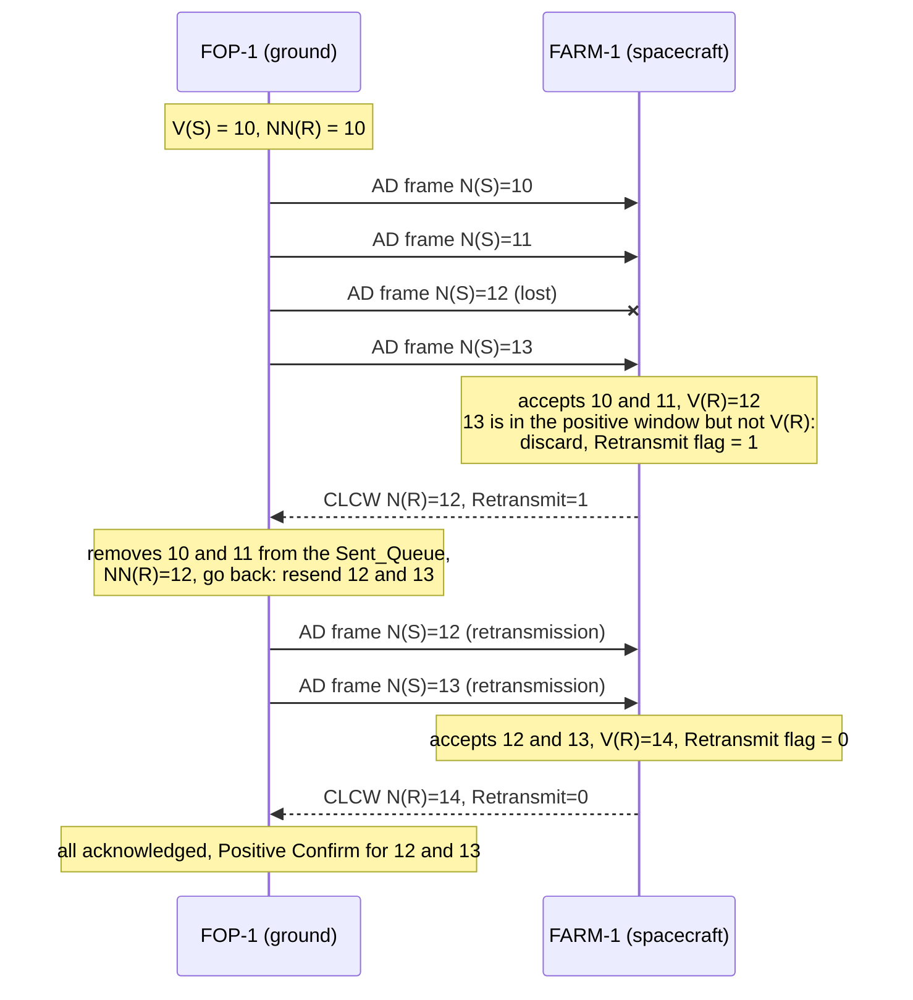
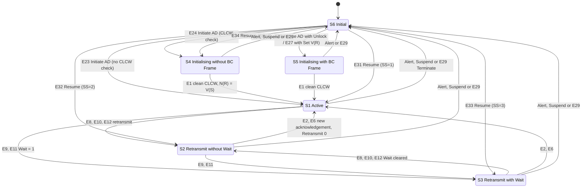
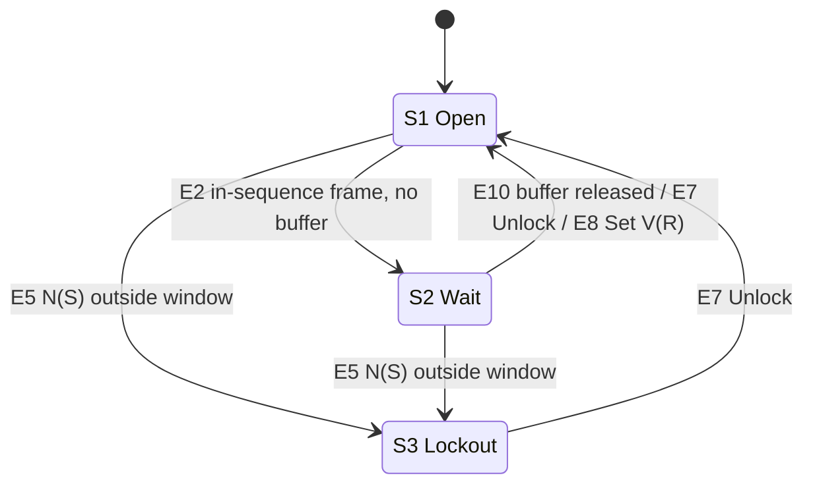
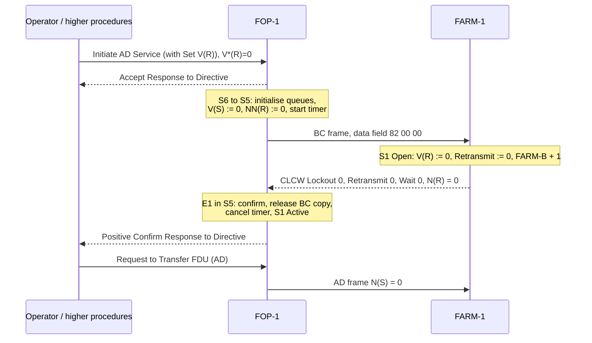

# COP-1: FOP-1, FARM-1 and the CLCW (CCSDS 232.1-B-2)

The **Communications Operation Procedure-1** (COP-1) is the closed-loop retransmission procedure of the
CCSDS telecommand link. It runs inside the [TC Space Data Link Protocol](tc-sdlp.md) (and the
[Unified Space Data Link Protocol](uslp.md)) on every virtual channel, and it uses an Automatic Repeat
reQuest (ARQ) scheme of the **go-back-n** type: the receiver accepts Type-A frames only in strict
sequence, and the sender, on any sign of a loss, sends again every frame that has not yet been
acknowledged. The result is delivery of telecommands to the spacecraft without omission, duplication
or reordering.[^cop-concept]

COP-1 is a pair of synchronised state machines per virtual channel: the **Frame Operation
Procedure-1** (FOP-1) at the sending end, normally on the ground, and the **Frame Acceptance and
Reporting Mechanism-1** (FARM-1) at the receiving end, on board. The FARM-1 reports its state back in a
32-bit **Communications Link Control Word** (CLCW), which travels in the Operational Control Field of
the [telemetry frames](tm-sdlp.md).[^cop-concept][^sdlp-clcw] This page follows CCSDS 232.1-B-2 (Blue Book,
September 2010, with Technical Corrigendum 1 of April 2019), the CLCW definition of CCSDS 232.0-B-4, the
ECSS adoption notice ECSS-E-AS-50-26C, the superseded ECSS-E-ST-50-04C (31 July 2008) whose clause 7
was the European COP-1 text, and the real Solar Orbiter documentation and
[MIB](../mib/index.md).[^cop-cover][^an26-scope][^e5004-cop]

!!! info "COP-1 at a glance"
    | Item | Value |
    |---|---|
    | ARQ type | Go-back-n, with sliding windows at both ends |
    | Sequence numbers | 8-bit Frame Sequence Number N(S), all arithmetic modulo 256 |
    | Services | Sequence-Controlled (AD) and Expedited (BD) |
    | Frame types used | Type-AD (data, checked), Type-BD (data, bypass), Type-BC (control commands Unlock and Set V(R)) |
    | FOP-1 states | S1 Active, S2 Retransmit without Wait, S3 Retransmit with Wait, S4 Initialising without BC Frame, S5 Initialising with BC Frame, S6 Initial |
    | FARM-1 states | S1 Open, S2 Wait, S3 Lockout |
    | Report | CLCW, usually in the TM or AOS Operational Control Field |
    | FOP-1 revision | Revision B (FOP-1B), introduced in issue 2 of the old Command Operation Procedures standard; ESA PSS-04-107 used the older COP-1A |

    Sources: CCSDS 232.1-B-2 §2, §5.1.2, §5.2.1, §5.3.1 and §6.1.2; ECSS-E-ST-50-04C annex B.[^cop-concept][^fop-state][^fop-mod][^fop-rev][^farm-state][^e5004-pss]

## Why COP-1 exists

Space links are noisy. Correctness of what is delivered is guaranteed, within known probabilities, by
the channel coding of the [CLTU](tc-coding-cltu.md) and by the Frame Validation Checks of the data link
protocol. Completeness, order and absence of duplicates on a virtual channel need something else: a
numbering scheme for frames and a feedback loop. That is the job of COP-1.[^sdlp-cop] ECSS-E-ST-50C
turns this into a system requirement: a service shall guarantee in-sequence delivery of telecommands,
and the space communication system shall support both commanding in the blind and the return of
telecommand acknowledgements.[^e50-tc]

COP-1 handles, strictly speaking, *partial* frames: FDUs plus the header fields that COP-1 generates
(Bypass Flag, Control Command Flag, N(S)); the rest of the frame is completed by the frame generation
procedure.[^cop-concept]

## The loop in one picture



Illustrative sequence constructed by this wiki from the FOP-1 and FARM-1 state tables (FOP-1 events E8
then E2; FARM-1 events E1 and E3).[^fop-table][^farm-table]

## Notation

| Symbol | Name in the standard | Held by | Meaning |
|---|---|---|---|
| N(S) | Frame Sequence Number | Frame header | Sequence number of a Type-AD frame (zero in Type-B frames) |
| V(S) | Transmitter_Frame_Sequence_Number | FOP-1 | N(S) to be given to the next new Type-AD frame |
| V(R) | Receiver_Frame_Sequence_Number | FARM-1 | N(S) expected in the next Type-AD frame |
| N(R) | Report Value (Next Expected Frame Sequence Number) | CLCW | Copy of V(R) sent back to the FOP |
| NN(R) | Expected_Acknowledgement_Frame_Sequence_Number | FOP-1 | N(S) of the oldest unacknowledged AD frame; NN(R) − 1 is the newest frame known to have arrived |
| K | FOP_Sliding_Window_Width | FOP-1 | Maximum number of frames sent ahead of the last acknowledged one |
| W, PW, NW | FARM_Sliding_Window_Width, Positive and Negative Window Widths | FARM-1 | Range of N(S) accepted without lockout |
| T1_Initial | Timer_Initial_Value | FOP-1 | Value the retransmission timer is started with |
| TT | Timeout_Type | FOP-1 | Action at timer expiry when the transmission limit is reached (0 alert, 1 suspend) |
| SS | Suspend_State | FOP-1 | State in which FOP-1 was suspended (0 = not suspended) |

Restated from annex A and figure 2-1 of CCSDS 232.1-B-2.[^cop-glossary][^cop-vars-fig]

## The two services

**Sequence-Controlled Service (AD Service).** With high probability no FDU is lost, duplicated or
delivered out of sequence. Two frame types are used: Type-AD frames carry the FDUs, Type-BC frames
carry the control commands that configure COP-1 (Unlock and Set V(R)). The service is started with one
of four "Initiate AD Service" directives; once initialised, FDUs are sent in the order in which they are
presented. The guarantee holds per virtual channel only. A Wait mechanism lets the receiver signal that
it has no resources for more data.[^cop-ad][^cop-ad2]

**Expedited Service (BD Service).** Type-BD frames are sent once, with no retransmission and no
guarantee of delivery. FOP-1 gives them immediate access as far as the lower layers allow, and FARM-1
passes their FDUs on immediately. The service is for exceptional situations such as spacecraft recovery,
or for use under a higher layer that retransmits by itself. "Expedited" does not mean faster: if a
reliable AD service is running, AD is recommended even for urgent data, and an inserted frame must not
use the MAP of an unfinished multi-segment transfer.[^cop-bd][^cop-bd-notes]

Valid Type-B frames are always accepted by FARM-1 and only counted (in the FARM-B counter of the
CLCW). Both frame types are protected by the coding sublayer and must pass the Frame Validation
Checks, so accepted Type-B frames are very probably error-free, but their order is not
controlled.[^cop-concept] ECSS-E-ST-50-04C put it differently: its expedited service delivers data in
order and without duplication, but with possible omissions, and passes a BD FDU on even when FARM-1 is in
Wait or Lockout. The two texts agree that nothing is retransmitted; only the CCSDS book declines to
promise anything about order.[^e5004-bd][^cop-bd]

!!! warning "Shared buffers"
    Some FARM-1 implementations use one buffer for both Type-AD and Type-BD FDUs. A Type-BD frame then
    erases an FDU that is being delivered or is waiting, without any sign of it in the CLCW. With such
    receivers the sender should terminate the AD service before using the BD service on the same
    virtual channel.[^cop-bd-notes]

## Interfaces of COP-1

COP-1 is defined through abstract signals between procedures, not through an implementation.[^cop-ipi]

At the **sending end**, FOP-1 sits between the *Higher Procedures* (segmentation, blocking, conversion
of service primitives) and the *Lower Procedures* (frame generation, multiplexing, coding):[^cop-tx-org]

| Signal | Direction | Parameters | Purpose |
|---|---|---|---|
| Directive Request | Higher → FOP-1 | Request Identifier, GVCID, Directive Type, Directive Qualifier | From `DIRECTIVE.request`[^cop-mgmt-sig] |
| Directive Notification | FOP-1 → Higher | Request Identifier, GVCID, Notification Type | To `DIRECTIVE_Notify.indication` |
| Asynchronous Notification | FOP-1 → Higher | GVCID, Notification Type, Notification Qualifier | To `Async_Notify.indication`[^cop-async-sig] |
| Request to Transfer FDU | Higher → FOP-1 | Request Identifier, GVCID, FDU, Service Type | One per FDU (one service data unit may become several FDUs)[^cop-fdu-sig] |
| Transfer Notification | FOP-1 → Higher | Request Identifier, GVCID, Notification Type | Accept, Reject, Positive or Negative Confirm[^cop-fdu-sig] |
| Transmit Request for Frame | FOP-1 → Lower | GVCID, Bypass Flag, Control Command Flag, N(S), data field | Hand a frame to the lower procedures[^cop-lower] |
| Abort Request | FOP-1 → Lower | GVCID | Cancel ongoing processing of AD and BC frames, to retransmit quickly[^cop-lower] |
| Response | Lower → FOP-1 | GVCID, Response Type | `AD_Accept`, `AD_Reject`, `BC_Accept`, `BC_Reject`, `BD_Accept`, `BD_Reject`: flow control per frame[^cop-response] |

The CCSDS book has an Abort Request cancel only Type-AD and Type-BC processing, and lets it optionally
reach into the coding sublayer. ECSS-E-ST-50-04C spells out three details: Type-BD frames are not
deleted by an abort, a frame already being radiated as a CLTU is completed rather than cut, and the lower
procedures return no response to the abort.[^cop-lower][^e5004-abort]

At the **receiving end**, the Lower Procedures validate and demultiplex frames and signal each valid
frame with *Valid Frame Arrived Indication (GVCID)*. FARM-1 places an accepted Type-AD FDU in a buffer
only if one is free, otherwise the frame is discarded; a Type-BD FDU is placed in a buffer even if none is
free, overwriting older data. Each new FDU is announced with *FDU Arrived Indication (GVCID)*, and an
optional *Aborted Indication* may report data erased in favour of a BD FDU. If the on-board flow control
can ever set the Wait flag, it must also provide a *Buffer Release Signal* when space for at least one
more maximum-size frame becomes available.[^cop-rx-org][^cop-rx-buf][^cop-lower-rx]

## Directives and notifications

### Directives

An authorised user controls COP-1 of a virtual channel through directives passed with
`DIRECTIVE.request` (in TC-SDLP terms, the COP Management Service). Table 4-1 defines eleven directive
types in four groups: four Initiate AD Service directives, one Terminate, one Resume and five FOP-1
Setup directives (Set V(S) and the four Set directives for K, T1_Initial, Transmission_Limit and
Timeout_Type). The standard's text calls them "twelve Directives" corresponding to events E23 to E40;
the count in the categories and the table is eleven. Any other directive is rejected as
invalid.[^cop-dir][^sdlp-copmgmt]

| Directive Type | Qualifier | FOP-1 event | Effect (from S6 Initial unless stated) |
|---|---|---|---|
| Initiate AD Service (without CLCW check) | none | E23 | Initialise, confirm at once, go to S1 Active |
| Initiate AD Service (with CLCW check) | none | E24 | Initialise, start the timer, go to S4; a clean CLCW with N(R) = V(S) confirms and leads to S1 |
| Initiate AD Service (with Unlock) | none | E25, E26 | If BC_Out_Flag is Ready: initialise, send an Unlock BC frame, go to S5 |
| Initiate AD Service (with Set V(R)) | V\*(R), the new V(R) | E27, E28 | If BC_Out_Flag is Ready: initialise, set V(S) and NN(R) to V\*(R), send a Set V(R) BC frame, go to S5 |
| Terminate AD Service | none | E29 | In S1 to S5: Alert [term] and go to S6; in S6: just confirm |
| Resume AD Service | none | E30 to E34 | In S6 with SS = 1 to 4: resume in S1 to S4 respectively; rejected if SS = 0 |
| Set V(S) to V\*(S) | V\*(S) | E35 | Only in S6 and only if SS = 0: set V(S) and NN(R) to V\*(S) |
| Set FOP_Sliding_Window_Width | new K | E36 | Accepted in every state |
| Set T1_Initial | new T1_Initial | E37 | Accepted in every state |
| Set Transmission_Limit | new limit | E38 | Accepted in every state |
| Set Timeout_Type | new TT | E39 | Accepted in every state |
| any other | — | E40 | Rejected |

Directive list from table 4-1; events and effects from the FOP-1 state table (parts 4 to 6).[^cop-dir][^fop-table]
The four Initiate directives differ in how much they rely on the receiving end. Two of them send a
control command and wait for its effect to show in the CLCW, retrying on a timer up to a limit; the other
two start without waiting for any receiving-end action, one of them after checking for a good
CLCW.[^cop-ad]

Notes in the standard: Terminate has no effect on a *suspended* AD service in S6 (it is accepted and
confirmed, but the service stays suspended and the queues are not purged); resume it first, or
re-initiate it. *Set V(S)* is meant for re-aligning FOP-1 with FARM-1 after a break in contact, with
V\*(S) taken from N(R) of the CLCW, and should not be used while suspended. Setup directives are allowed
while AD is active but also affect frames already on the Sent_Queue.[^cop-dir-notes]

### Directive and transfer notifications

For every directive FOP-1 first returns *Accept Response to Directive* or *Reject Response to
Directive* (if rejected, nothing else follows), then later *Positive Confirm* or *Negative Confirm
Response to Directive*. A negative confirm carries no reason, but every condition that can cause one
also raises an Alert.[^cop-dirnotif]

For each *Request to Transfer FDU*, FOP-1 returns *Accept* or *Reject Response to Request to Transfer
FDU*; for AD FDUs it later returns *Positive Confirm* (the FDU was received and acknowledged by a CLCW)
or *Negative Confirm* (COP-1 cannot guarantee the transfer). The user-level `XXX_Notify.indication`
primitives carry the same four types. An AD FDU whose acceptance FOP-1 delays sits in the one-place
Wait_Queue, and the Higher Procedures may not submit another until it is accepted or rejected; this is
the flow control seen by the user.[^cop-xfer-notif][^cop-xfer-ad]

Between acceptance and Positive Confirm an FDU is in a "gray area": nobody can know yet whether it
reached the spacecraft. A Negative Confirm means a break in the sequence-controlled guarantee, and the
FDU may or may not have arrived. BD FDUs are only accepted or rejected (there is no Wait_Queue for them,
no copy is kept, and no confirmation is given).[^cop-xfer-ad][^cop-xfer-bd]

ECSS-E-ST-50-04C names the span of the guarantee: a sequence-controlled *session* begins when the
management entity receives the Positive Confirm of an Initiate AD Service directive and ends with the next
Alert. It also lists cases in which the guarantee does not hold at all: FOP-1 and FARM-1 sequence numbers
not synchronised at the start of a session, several FOP-1 instances sending to one FARM-1 at the same
time, and CLCWs delivered to FOP-1 from the wrong spacecraft.[^e5004-session][^e5004-mgmt]

### Alert and Suspend

Two asynchronous notifications exist: **Alert**, with a Reason Code, and **Suspend**.[^cop-async]
An Alert means an unrecoverable condition and the end of the sequence-controlled guarantee; higher
layers may need to recover. After an Alert no further Alert occurs until an Initiate AD directive is
received, except Alert [LLIF], which can occur at any time.[^cop-alert][^cop-alert2]

| Reason Code | Condition |
|---|---|
| Limit | A CLCW negatively acknowledges a frame while Transmission_Limit = 1 |
| T1 | The timer expires with Transmission_Count at Transmission_Limit (only if TT = 0), or the transmission limit of a BC frame (Unlock, Set V(R)) is exhausted |
| Lockout | The CLCW shows Lockout |
| Synch | A CLCW with Retransmit = 0 and N(R) = NN(R) arrives after one with Retransmit = 1; or all frames are acknowledged but Retransmit = 1; or frames are acknowledged during the initialising phase S4 |
| NN(R) | A CLCW with an invalid N(R) arrives |
| CLCW | A CLCW with Wait = 1 and Retransmit = 0 arrives, or a CLCW with an invalid bit pattern |
| LLIF | Lower Layer Interface: FOP-1 and the lower procedures are out of step (a frame is rejected although the Out flag was Ready) |
| Term | A Terminate AD Service directive arrived |

Restated from table 4-4.[^cop-alert]

Alerts linked to the transmission count can be caused by a physical-layer break outside the data link
layer. All others report a breakdown of the protocol itself: some part of the system does not work to
specification, and earlier reports may have been wrong. Because the VCID in received data may then be
corrupt, one failure can raise Alerts on several virtual channels.[^cop-alert2] ECSS-E-ST-50-04C adds that
after an Alert the management entity should take recovery actions so that no data is lost, duplicated or
erroneous; that an implementation may report, with the Alert, the FOP-1 event number and state that caused
it; and that FOP-1 should pass further, implementation-dependent status information to management for
performance monitoring and diagnosis.[^e5004-alert][^e5004-status]

**Suspend** is the deep-space tool: with TT = 1 and a small T1_Initial, FOP-1 sends a sequence of AD
frames a set number of times and then suspends itself without clearing its buffers; a later Resume
directive continues in the same state.[^cop-suspend]

## FOP-1: the sending end

### FOP-1 variables

FOP-1 keeps fifteen variables per virtual channel. The state table and actions, not the variable
descriptions, are the master definition.[^fop-vars]

| Variable | Values | Role |
|---|---|---|
| State | S1 to S6 | Column of the state table |
| V(S) | 0–255 | N(S) for the next new Type-AD frame |
| Wait_Queue | 0 or 1 FDU | Holds one AD FDU until FOP-1 can accept it; primary user flow control[^fop-wq] |
| Sent_Queue | frames | Master copies of all AD and BC frames between first transmission and the end of their processing (positive acknowledgement, or purge by an exception or Terminate)[^fop-sq] |
| To_Be_Retransmitted_Flag | per frame | Marks frames on the Sent_Queue that still have to be retransmitted, so that CLCWs can be processed while a retransmission is in progress[^fop-tbr] |
| AD_Out_Flag, BC_Out_Flag, BD_Out_Flag | Ready, Not_Ready | Whether a Transmit Request for that frame type is still outstanding at the lower procedures[^fop-out] |
| NN(R) | 0–255 | Oldest unacknowledged AD frame; may lag V(R) by the loop delay[^fop-nnr] |
| T1_Initial | duration | Timer start value |
| Transmission_Limit | integer | Maximum transmissions of the first frame on the Sent_Queue |
| Transmission_Count | integer | Transmissions so far of the first frame on the Sent_Queue |
| K | 1–255 | FOP sliding window width |
| TT | 0, 1 | Timeout type |
| SS | 0–4 | Suspend state |

### FOP-1 states

| State | Name | Meaning |
|---|---|---|
| S1 | Active | Normal state: no recent errors, no flow-control incidents |
| S2 | Retransmit without Wait | The CLCW shows Retransmit = 1, nothing else exceptional |
| S3 | Retransmit with Wait | The CLCW shows Wait = 1 (and therefore also Retransmit = 1, because Wait is only set after a frame has been discarded) |
| S4 | Initialising without BC Frame | After Initiate AD (with CLCW check), waiting for a clean CLCW |
| S5 | Initialising with BC Frame | After Initiate AD (with Unlock or with Set V(R)), waiting for the BC frame to be sent and a clean CLCW |
| S6 | Initial | AD service not running: at start-up, after Terminate, after any Alert, and while suspended; only BD frames can be sent |

Restated from §5.1.2.[^fop-state] The initial state must be re-enterable many times during a mission,
because the link is interrupted and several sending ends may serve one receiver.[^fop-state]

### Timer, transmission limit and timeout type

Every transmission of an AD or BC frame starts (or restarts) the timer with T1_Initial; the timer is not
used for BD frames. Without it, the loss of the last frame sent would never be noticed. If an
acknowledgement arrives and nothing new has been sent, the timer is cancelled.[^fop-t1]

For normal operation, T1_Initial must be at least the sum of eight delays:[^fop-t1-normal]

1. processing below FOP-1 at the sending end;
2. transmitting a maximum-length frame as a serial bit stream, including CLTU and coding overhead;
3. one-way light time to the receiver (including any relay satellite);
4. processing below FARM-1 at the receiving end;
5. the worst-case time to sample FARM-1 status and encode it as a CLCW;
6. the worst-case time to send the CLCW in the return-link data structure;
7. one-way light time back;
8. extracting the CLCW and delivering it to FOP-1.

The transmission limit applies only to the **first** frame on the Sent_Queue, and the count is reset
whenever any frame is acknowledged. So the limit is in effect a property of the queue: each frame is
sent *at least* Transmission_Limit times (unless the limit is 1, in which case nothing is ever
retransmitted), and a frame that moves to the head of the queue may be sent more often. When the count
reaches the limit, a negative acknowledgement raises Alert [Limit] (limit 1) and a timer expiry raises
Alert [T1] if TT = 0 or suspends the AD service if TT = 1. BC frames are retransmitted only on timer
expiry, with Alert [T1] when the limit is reached.[^fop-count][^fop-count2]

### The FOP sliding window

The FOP sliding window limits how many frames may be sent ahead of the last acknowledged one, so that
a new frame can never carry the same N(S) as a frame that the receiver rejected. A new AD frame is sent
only while V(S) < NN(R) + K (modulo 256). K must satisfy 1 ≤ K ≤ PW and K < 256, where PW is the positive
window of the FARM.[^fop-k][^fop-lookfdu] ECSS-E-ST-50-04C warns implementers that comparisons of V(S),
N(R) and NN(R) must respect the valid ranges of the sequence number: with K greater than 127 a
conventional modulo-256 comparison can give the wrong answer.[^e5004-mod]

### FOP-1 actions

| Action | What it does |
|---|---|
| Purge Sent_Queue | Negative Confirm for every frame on it, then delete them (on termination or re-initialisation) |
| Purge Wait_Queue | Reject Response for the queued FDU, clear the queue |
| Transmit Type-AD Frame | N(S) := V(S), then V(S) + 1; master copy to Sent_Queue (not marked for retransmission); Transmission_Count := 1 if the queue was empty; start timer; AD_Out_Flag := Not_Ready; Transmit Request to the lower procedures |
| Transmit Type-BC Frame | Master copy to Sent_Queue; Transmission_Count := 1; start timer; BC_Out_Flag := Not_Ready; Transmit Request |
| Transmit Type-BD Frame | BD_Out_Flag := Not_Ready; Transmit Request (no copy kept) |
| Initiate AD (or BC) Retransmission | Abort Request to the lower procedures; Transmission_Count + 1; start timer; mark all AD frames (or the BC frame) on the Sent_Queue To_Be_Retransmitted |
| Remove Acknowledged Frames | Positive Confirm and delete for each acknowledged frame; update NN(R); Transmission_Count := 1 |
| Look for Directive | If BC_Out_Flag is Ready and the BC frame is marked, send it again |
| Look for FDU | If AD_Out_Flag is Ready: send the first marked AD frame, else, if V(S) < NN(R) + K and an FDU waits, accept it and Transmit Type-AD Frame |
| Initialize | Purge both queues; Transmission_Count := 1; SS := 0 |
| Alert | Cancel timer; purge both queues; Negative Confirm any pending Initiate directive; Alert with reason code |
| Suspend / Resume | Suspend notification / start timer and SS := 0 |
| Accept, Reject, Confirm, Ignore | Notifications, or nothing |

Restated from §5.2.2 to §5.2.18.[^fop-actions][^fop-lookfdu][^fop-actions2]

### FOP-1 state table (condensed)

Before the table is applied, an arriving CLCW is checked for "COP in Effect" and VCID; the table then
tests Lockout, N(R), Retransmit and Wait in that order. "N/A" means the event cannot occur in that
state.[^fop-clcw-pre] ECSS-E-ST-50-04C lists a longer pre-check: the Control Word Type, the CLCW
Version Number, COP in Effect, the VCID and the spare bits 14–15 and 23 are all checked, and any
unexpected value makes the CLCW invalid, which is event E15.[^e5004-clcwarr]

**CLCW arrivals** (valid COP-1 pattern):

| Event | Condition | S1 Active | S2 Retransmit w/o Wait | S3 Retransmit with Wait | S4 Init w/o BC | S5 Init with BC | S6 Initial |
|---|---|---|---|---|---|---|---|
| E1 | Lockout 0, N(R) = V(S), Retransmit 0, Wait 0, N(R) = NN(R) | Ignore | Alert [synch] → S6 | Alert [synch] → S6 | Confirm, cancel timer → S1 | Confirm, release BC copy, cancel timer → S1 | Ignore |
| E2 | as E1 but N(R) ≠ NN(R) (new frames acknowledged) | Remove acked, cancel timer, look for FDU → S1 | same → S1 | same → S1 | N/A | N/A | Ignore |
| E3 | Lockout 0, N(R) = V(S), Retransmit 0, Wait 1 | Alert [CLCW] | Alert [CLCW] | Alert [CLCW] | Alert [CLCW] | Alert [CLCW] | Ignore |
| E4 | Lockout 0, N(R) = V(S), Retransmit 1 | Alert [synch] | Alert [synch] | Alert [synch] | Alert [synch] | Ignore | Ignore |
| E5 | Lockout 0, NN(R) ≤ N(R) < V(S), Retransmit 0, Wait 0, N(R) = NN(R) | Ignore | Alert [synch] | Alert [synch] | N/A | N/A | Ignore |
| E6 | as E5 but N(R) ≠ NN(R) | Remove acked, look for FDU → S1 | same → S1 | same → S1 | N/A | N/A | Ignore |
| E7 | Lockout 0, NN(R) ≤ N(R) < V(S), Retransmit 0, Wait 1 | Alert [CLCW] | Alert [CLCW] | Alert [CLCW] | N/A | N/A | Ignore |
| E101 | Retransmit 1, Transmission_Limit = 1, N(R) ≠ NN(R) | Remove acked, Alert [limit] | same | same | N/A | N/A | Ignore |
| E102 | Retransmit 1, Transmission_Limit = 1, N(R) = NN(R) | Alert [limit] | Alert [limit] | Alert [limit] | N/A | N/A | Ignore |
| E8 | Retransmit 1, limit > 1, N(R) ≠ NN(R), Wait 0 | Remove acked, initiate AD retransmission, look for FDU → S2 | same → S2 | same → S2 | N/A | N/A | Ignore |
| E9 | Retransmit 1, limit > 1, N(R) ≠ NN(R), Wait 1 | Remove acked → S3 | same → S3 | same → S3 | N/A | N/A | Ignore |
| E10 | Retransmit 1, limit > 1, N(R) = NN(R), count < limit, Wait 0 | Initiate AD retransmission, look for FDU → S2 | Ignore | Initiate AD retransmission, look for FDU → S2 | N/A | N/A | Ignore |
| E11 | as E10 but Wait 1 | Ignore → S3 | Ignore → S3 | Ignore | N/A | N/A | Ignore |
| E12 | Retransmit 1, limit > 1, N(R) = NN(R), count ≥ limit, Wait 0 | Ignore → S2 | Ignore | Ignore → S2 | N/A | N/A | Ignore |
| E103 | as E12 but Wait 1 | Ignore → S3 | Ignore → S3 | Ignore | N/A | N/A | Ignore |
| E13 | Invalid N(R): N(R) < NN(R) or N(R) > V(S) | Alert [NN(R)] | Alert [NN(R)] | Alert [NN(R)] | Alert [NN(R)] | Ignore | Ignore |
| E14 | Lockout 1 | Alert [lockout] | Alert [lockout] | Alert [lockout] | Alert [lockout] | Ignore | Ignore |
| E15 | CLCW with invalid bit pattern | Alert [CLCW] | Alert [CLCW] | Alert [CLCW] | Alert [CLCW] | Alert [CLCW] | Ignore |

Every Alert leads to S6. Restated from table 5-1, parts 1 to 3.[^fop-table]

**Timer expiry, requests and lower-layer responses**:

| Event | Condition | S1 | S2 | S3 | S4 | S5 | S6 |
|---|---|---|---|---|---|---|---|
| E16 | Timer expires, count < limit, TT = 0 | Initiate AD retransmission, look for FDU | same | Ignore | Alert [T1] | Initiate BC retransmission, look for directive | N/A |
| E104 | Timer expires, count < limit, TT = 1 | as E16 | as E16 | Ignore | SS := 4, Suspend → S6 | as E16 | N/A |
| E17 | Timer expires, count ≥ limit, TT = 0 | Alert [T1] | Alert [T1] | Alert [T1] | Alert [T1] | Alert [T1] | N/A |
| E18 | Timer expires, count ≥ limit, TT = 1 | SS := 1, Suspend → S6 | SS := 2, Suspend → S6 | SS := 3, Suspend → S6 | SS := 4, Suspend → S6 | Alert [T1] | N/A |
| E19 | AD FDU requested, Wait_Queue empty | Add to Wait_Queue, look for FDU | same | Add to Wait_Queue | Reject | Reject | Reject |
| E20 | AD FDU requested, Wait_Queue full | Reject | Reject | Reject | Reject | Reject | Reject |
| E21 | BD FDU requested, BD_Out_Flag Ready | Accept, transmit BD frame | same | same | same | same | same |
| E22 | BD FDU requested, BD_Out_Flag Not_Ready | Reject | Reject | Reject | Reject | Reject | Reject |
| E41 | AD_Accept | AD_Out_Flag := Ready, look for FDU | same | AD_Out_Flag := Ready | same as S3 | same as S3 | same as S3 |
| E43 | BC_Accept | BC_Out_Flag := Ready | same | same | same | BC_Out_Flag := Ready, look for directive | BC_Out_Flag := Ready |
| E45 | BD_Accept | BD_Out_Flag := Ready, Accept | same | same | same | same | same |
| E42, E44, E46 | AD_Reject, BC_Reject, BD_Reject | Alert [LLIF] | Alert [LLIF] | Alert [LLIF] | Alert [LLIF] | Alert [LLIF] | Alert [LLIF] |

Restated from table 5-1, parts 3, 4 and 7. The directive events E23 to E40 are in the directive table
above.[^fop-table]

### FOP-1 state diagram



Main protocol and initialisation transitions after figures 5-1 to 5-3; "Alert" stands for all
exception events.[^fop-trans]

## FARM-1: the receiving end

### Variables and states

FARM-1 keeps nine variables per virtual channel: State, Lockout_Flag, Wait_Flag, Retransmit_Flag,
V(R), FARM-B_Counter, and the window widths W, PW and NW.[^farm-vars]

| State | Name | Behaviour |
|---|---|---|
| S1 | Open | Accepts in-sequence Type-AD frames and passes their FDUs on |
| S2 | Wait | No buffer is free for another Type-A FDU; entered when an in-sequence frame cannot be stored, left when a buffer is released |
| S3 | Lockout | Entered when a frame arrives with N(S) outside the range a correctly working FOP could produce; a safe state in which no Type-A FDU is accepted; left only by an Unlock command |

Restated from §6.1.2.[^farm-state]

* **Lockout_Flag** is 1 exactly in Lockout and **Wait_Flag** exactly in Wait; both are copied into the
  CLCW.[^farm-flags]
* **Retransmit_Flag** is 1 whenever FARM-1 knows a Type-AD frame was lost or discarded for lack of
  buffer space. At the sender it negatively acknowledges every frame with N(S) ≥ N(R). It is cleared by
  receiving the frame with N(S) = V(R), by Set V(R) (unless locked out) and by Unlock.[^farm-flags]
* **FARM-B_Counter** counts valid Type-BD and Type-BC frames. It is not used by either state machine;
  it gives higher layers a minimal error-control loop for the BD service. Only its two least significant
  bits go into the CLCW.[^farm-bcount]
* **V(R)** is the N(S) expected in the next Type-AD frame.[^farm-vr]

### The FARM sliding window

The windows protect FARM-1 against an uncontrolled sequence of frames whose N(S) runs at least 256
ahead of V(R), and more generally against a malfunctioning or wrongly set-up FOP-1. The window has a total
width W, a positive part PW starting at V(R) and a negative part NW ending at V(R) − 1, the number of
the last accepted frame. Everything else (256 − W values) is the **lockout area**.[^farm-window]

When retransmission is allowed (the normal case), W is an even integer from 2 to 254, fixed for the
mission unless otherwise specified (there is no command to change it), and PW = NW = W/2. A received
Type-AD frame then falls in one of four cases:[^farm-window2][^farm-cases]

| Case | Condition (modulo 256) | FARM-1 action | Typical cause |
|---|---|---|---|
| In sequence | N(S) = V(R) | Accept (if a buffer is free), V(R) := V(R) + 1, Retransmit := 0 | Normal operation, or a retransmission after a loss |
| Positive window | V(R) < N(S) ≤ V(R) + PW − 1 | Discard, Retransmit := 1 | An earlier frame was lost; retransmission has not started |
| Negative window | V(R) − NW ≤ N(S) < V(R) | Discard, nothing else | Frames resent although already accepted: T1 too short, a link outage, or deliberate repetition in deep space |
| Lockout area | otherwise | Discard, Lockout := 1, go to Lockout | FOP and FARM out of step |

If a mission sends each Type-AD frame only once per session (Transmission_Limit = 1), it may set PW > NW,
down to NW = 0 and PW = W, with W from 1 to 256. K may never exceed 255 in any case.[^farm-noretx]
ECSS-E-ST-50-04C spells out one exception to the fixed window: a mission whose commanding performance
depends on different window widths in different mission phases fixes W, PW and NW per phase rather
than for the whole mission.[^e5004-win]

!!! example "Window arithmetic (illustrative)"
    With W = 10 (PW = NW = 5) and V(R) = 250: N(S) = 250 is accepted; 251 to 254 are in the positive
    window (discard and request retransmission); 245 to 249 are in the negative window (silently
    discarded duplicates); 255 and 0 to 244 are in the lockout area, 246 values = 256 − W. A FOP with
    K = 5 never has more than five frames outstanding, so none of its frames can land in the lockout
    area: a new frame falls at V(R) or in the positive window, and a repeat of an already accepted frame
    falls in the negative window. Constructed by this wiki from §6.1.8.3.1 and §5.1.12.[^farm-window2][^fop-k]

### FARM-1 actions and state table

The actions are *Accept* (place the FDU in a buffer and signal FDU Arrived, optionally Aborted for an
overwritten BD buffer), *Discard*, *Report* (produce the CLCW values) and *Ignore*. Before the table is
applied, FARM-1 checks that a Type-BC frame holds one of the two legal control commands; the table then
looks at the Bypass Flag, the Control Command Flag and N(S).[^farm-actions][^farm-pre]

| Event | Condition | S1 Open | S2 Wait | S3 Lockout |
|---|---|---|---|---|
| E1 | Type-AD, N(S) = V(R), buffer available | Accept, V(R) + 1, Retransmit := 0 | N/A | Discard |
| E2 | Type-AD, N(S) = V(R), no buffer | Discard, Retransmit := 1, Wait := 1 → S2 | Discard | Discard |
| E3 | Type-AD, N(S) in positive window, ≠ V(R) | Discard, Retransmit := 1 | Discard | Discard |
| E4 | Type-AD, N(S) in negative window | Discard | Discard | Discard |
| E5 | Type-AD, N(S) outside window | Discard, Lockout := 1 → S3 | Discard, Lockout := 1 → S3 | Discard |
| E6 | Valid Type-BD frame | Accept, FARM-B + 1 | same | same |
| E7 | Valid Unlock (Type-BC) | FARM-B + 1, Retransmit := 0 | FARM-B + 1, Retransmit := 0, Wait := 0 → S1 | FARM-B + 1, Retransmit := 0, Wait := 0, Lockout := 0 → S1 |
| E8 | Valid Set V(R) to V\*(R) (Type-BC) | FARM-B + 1, Retransmit := 0, V(R) := V\*(R) | FARM-B + 1, Retransmit := 0, Wait := 0, V(R) := V\*(R) → S1 | FARM-B + 1 only |
| E9 | Invalid frame | Discard | Discard | Discard |
| E10 | Buffer release signal | Ignore | Wait := 0 → S1 | Wait := 0 |
| E11 | CLCW report time | Report V(R), Lockout, Wait, Retransmit, FARM-B | same | same |

Restated from table 6-1.[^farm-table] In Lockout a Set V(R) is not executed (FARM-1 must be unlocked
first), but it is counted in FARM-B because it was valid and executable. Unlock resets only FARM-1, not
the higher procedures on board, so something else must make sure their buffers are purged as
needed.[^farm-cc]



After figure 6-2.[^farm-fig]

## The CLCW

The CLCW is the only reporting mechanism of COP-1. It is defined in the TC Space Data Link Protocol as
ten fields in 32 bits:[^sdlp-clcw][^clcw-fields]

<div class="bitfield" data-title="Communications Link Control Word (32 bits)" data-width="32"
     data-fields='[{"n":"Type","b":1,"v":"0","d":"Control Word Type: 0 = CLCW"},{"n":"Version","b":2,"v":"00","d":"CLCW Version 1"},{"n":"Status","b":3,"d":"Mission-specific, not part of COP"},{"n":"COP","b":2,"v":"01","d":"COP in Effect: 01 = COP-1"},{"n":"VCID","b":6,"d":"Virtual channel this report is about"},{"n":"Spare","b":2,"v":"00"},{"n":"No RF","b":1,"d":"1 = physical layer not available"},{"n":"No Bit Lock","b":1,"d":"1 = bit lock not achieved"},{"n":"Lockout","b":1,"d":"1 = FARM-1 in Lockout"},{"n":"Wait","b":1,"d":"1 = further Type-A frames will be rejected"},{"n":"Retransmit","b":1,"d":"1 = Type-A frames rejected or missing"},{"n":"FARM-B","b":2,"d":"Two LSBs of the FARM-B counter"},{"n":"Sp","b":1,"v":"0"},{"n":"Report Value N(R)","b":8,"d":"Next expected Frame Sequence Number, equal to V(R)"}]'></div>

| Field | Bits | Values | Meaning |
|---|---|---|---|
| Control Word Type | 1 (0) | `0` | Distinguishes the CLCW from another report that may share the same field (a TM Type-2 report)[^clcw-type] |
| CLCW Version Number | 2 (1–2) | `0b00` | Version 1, the only one defined[^clcw-ver] |
| Status Field | 3 (3–5) | mission-specific | Local enhancements by agencies; not part of COP[^clcw-ver] |
| COP in Effect | 2 (6–7) | `0b01` | COP-1[^clcw-ver] |
| Virtual Channel Identification | 6 (8–13) | 0–63 | VC of the report; each VC in use has its own CLCW[^clcw-ver] |
| Reserved Spare | 2 (14–15) | `0b00` | Reserved[^clcw-ver] |
| No RF Available | 1 (16) | 0, 1 | `0`: physical layer available; `1`: not available, frames cannot get through without physical-layer action. Common to all VCs; mission defines which RF elements count (for example transponder and demodulator)[^clcw-flags] |
| No Bit Lock | 1 (17) | 0, 1 | Optional: `0` bit lock achieved, `1` not; set to 0 if unused. A missing bit lock signals a physical layer working below nominal and a high frame rejection rate[^clcw-flags] |
| Lockout | 1 (18) | 0, 1 | FARM-1 of this VC is in Lockout[^clcw-flags2] |
| Wait | 1 (19) | 0, 1 | The receiving end cannot accept more Type-A data on this VC (for example no storage or processing resources)[^clcw-flags2] |
| Retransmit | 1 (20) | 0, 1 | One or more Type-A frames were rejected or found missing; speeds up COP-1 by telling the FOP at once[^clcw-retx] |
| FARM-B Counter | 2 (21–22) | 0–3 | Two least significant bits of the FARM-B counter of this VC; lets the sender verify that Type-B frames arrived[^clcw-retx] |
| Reserved Spare | 1 (23) | `0` | Reserved[^clcw-rv] |
| Report Value | 8 (24–31) | 0–255 | N(R) = V(R) of this VC[^clcw-rv] |

**Transport.** In a TM Transfer Frame the CLCW is a *Type-1 report* in the 4-octet Operational Control
Field (OCF), identified by a type flag of `0` in OCF bit 0; a type flag of `1` marks a Type-2 report,
which may carry an SDLS Frame Security Report. The OCF can be associated with the master channel or a
virtual channel, and the spacecraft designer must make sure that VCs carrying it are sent often enough
that COP-1 does not time out.[^tm-ocf] The CLCW reporting rate is a managed parameter; it need not match
the uplink frame rate, but some minimum rate is necessary.[^sdlp-clcw][^farm-mp]

!!! example "Decoding a CLCW (illustrative)"
    `0x0104002A` = `0 00 000 01 | 000001 00 | 0 0 0 0 0 00 0 | 00101010`: a CLCW, COP-1, VC 1, all flags
    clear, FARM-B 0, N(R) = 42. The same report with FARM-1 locked out is `0x0104202A` (bit 18 set), and
    with only Retransmit set it is `0x0104082A` (bit 20). Values constructed by this wiki from the field
    layout.[^clcw-fields]

**ECSS rules and recommended practice.** The ECSS adoption of TC-SDLP makes the No Bit Lock flag
mandatory: `0` when at least one spacecraft demodulator of the physical channel has bit lock, `1` when
none has, always reporting the real physical channel even in the CLCW of an inactive virtual
channel.[^an25-nbl] The ECSS handbook recommends choosing TC VCIDs with a large Hamming distance from
each other, so that a corrupted CLCW is less likely to show another valid VCID, and avoiding the
all-zeros and all-ones VCIDs, because a failed or unpowered decoder can produce such CLCWs.[^hb-vcid]
Both rules come from ECSS-E-ST-50-04C §6.3, which also sets the following:[^e5004-clcw][^e5004-clcw2]

* the No RF Available flag to be `0` when the RF connection is available through at least one
  transponder and `1` when through none, and, like No Bit Lock, to report the true physical channel
  state in every CLCW;
* the Status Field to be `000` unless the mission defines a use for it;
* the CLCW to travel in the OCF of a TM (version 1) or AOS (version 2) frame, and to be given to FOP-1
  only if it comes from an error-free frame (a successfully corrected frame counts as error-free) of the
  spacecraft to which the TC virtual channel belongs;
* the width of the on-board FARM-B counter is left to the implementation: the CLCW carries its two
  least significant bits, and telemetry may report the full value.

It also notes that the TM virtual channel that carries a CLCW is unrelated to the TC virtual channel the
CLCW reports on.[^e5004-clcw]

**Use by the ground station.** The [SLE Forward CLTU service](sle/fcltu.md) consumes one OCF channel of
the return link, extracts the CLCWs and uses their No RF Available and No Bit Lock flags to decide
whether the physical channel is available. Its managed parameters `clcw-global-VCID` and
`clcw-physical-channel` name where the CLCW comes from, and `rf-available-required` and
`bit-lock-required` decide whether the flags must be clear before production status becomes
operational. CLCW evaluation can be switched off by service management.[^fcltu-clcw][^fcltu-params]

## Operating COP-1

### Starting the AD service

The four Initiate directives fit different situations. The selection guidance below is this wiki's
reading of the state table and directive notes.

| Directive | Needs from the spacecraft | Typical use |
|---|---|---|
| Without CLCW check (E23) | Nothing | V(S) already known to equal V(R), or no CLCW available (blind start); immediate S1 |
| With CLCW check (E24) | A clean CLCW with N(R) = V(S) before the timer runs out | Resuming after a pass when the FARM state is unchanged |
| With Unlock (E25) | A clean CLCW after the Unlock frame | FARM-1 was in Lockout or Wait; V(S) must already match V(R) |
| With Set V(R) (E27) | A clean CLCW after the Set V(R) frame | Force both ends to a chosen sequence number V\*(R); fails if FARM-1 is locked out |



Sequence constructed by this wiki from FOP-1 events E27 and E1 and FARM-1 event E8.[^fop-table][^farm-table]

### Retransmission and flow control

Retransmission starts either on a Retransmit flag in the CLCW or on timer expiry, and always resends all
unacknowledged frames; the windows prevent a new frame from reusing the number of a missing
one.[^cop-concept] A worked example is in [the loop in one picture](#the-loop-in-one-picture). If the
spacecraft runs out of buffers, FARM-1 discards the in-sequence frame, sets Wait and Retransmit and
enters Wait; FOP-1 moves to S3 and stops sending new frames, and when the buffer release signal clears
Wait, the next CLCW shows Retransmit alone and FOP-1 resends from N(R).[^farm-table][^fop-table] A CLCW
showing Wait without Retransmit is a protocol error (Alert [CLCW]), because Wait is only ever set after
a frame has been discarded.[^fop-state][^cop-alert]

### Lockout and its recovery

Lockout means that FARM-1 received a Type-AD frame with an N(S) that a correct FOP could not have
produced: typically FOP and FARM lost step, for example after a break in contact, a reset of either end,
or two sending ends commanding the same receiver, a case COP-1 cannot handle.[^farm-state][^fop-trans-text]
FOP-1 sees the Lockout flag and raises Alert [lockout], ending the AD service.[^fop-table]

!!! warning "Inference: recovery recipe"
    Unlock clears Lockout, Wait and Retransmit but leaves V(R) unchanged, and a FOP that is
    initialising with a BC frame (S5) only confirms on a clean CLCW whose N(R) equals V(S). The
    usual recoveries are therefore either (1) *Set V(S) to V\*(S)* with V\*(S) taken from the N(R)
    of the latest CLCW, followed by *Initiate AD Service (with Unlock)*; or (2) *Initiate AD Service
    (with Unlock)*, then, once FARM-1 is open, *Initiate AD Service (with Set V(R))* to realign both
    ends on a chosen number (Set V(R) alone does nothing in Lockout). In recipe (2), if V(S) differs from
    V(R), the first directive cannot get the confirming CLCW (event E1) and, once the BC frame has been
    sent Transmission_Limit times, ends with Alert [T1] (event E17), although the Unlock itself has
    reached FARM-1; the second directive then starts from S6. These recipes are this wiki's
    reading of the state tables and of the note on Set V(S); the operational procedure of a given
    mission is not stated in the available sources.[^farm-table][^fop-table][^cop-dir-notes]

The SCOS-2000 database ICD strongly recommends defining the BC-frame commands with a global interlock
on at least the second uplink verification stage, so that the ground releases no further commands until
AD mode has been set up.[^icd-ctype] In the Solar Orbiter MIB, `UNLOCK` and `SETVR` are defined without
an interlock (`CCF_ILSCOPE = N`); see [TC-SDLP control commands](tc-sdlp.md#control-commands-unlock-and-set-vr).[^mib-bc]

### Deep-space options

On a long-delay link the normal T1 leaves the uplink idle for most of the round trip. COP-1 offers two
remedies, which can be combined with the coding sublayer's systematic retransmission:[^fop-deep][^gb-deep]

* **Early automatic retransmission.** A small T1_Initial forces FOP-1 to resend the whole Sent_Queue
  several times before any acknowledgement arrives. With TT = 1 it then suspends instead of raising an
  alert, and is resumed to process the acknowledging CLCWs. The resulting pattern is ABCDEF ABCDEF …;
  it resists error bursts but loses the rest of a cycle after an early loss.[^fop-deep][^gb-early]
* **Set V(R) without verification.** A small T1_Initial lets the Set V(R) command be sent a few times
  without waiting for its confirmation; the user is alerted when the transmissions are used up and can
  then issue *Initiate AD Service (without CLCW check)*.[^fop-deep]
* **Systematic retransmission** in the coding sublayer repeats each CLTU (pattern AAABBBCCC…), which is
  good against sporadic losses. It is invisible to FOP-1: it changes neither its state nor its counters,
  and duplicate frames are simply rejected by FARM-1 in the negative window.[^fop-deep][^gb-sys]

The CCSDS overview report confirms that the sequence-controlled service still delivers each FDU once
and in order even when frames are transmitted several times.[^gb-deep] See the
[CLTU page](tc-coding-cltu.md#repeated-transmissions) for the coding-sublayer side.

### Blind commanding

When no telemetry, and thus no CLCW, is available, the BD service can be used because it does not need
the feedback loop. Data then arrives with high probability of being error-free but possibly with gaps.
Alternatively the AD service can be combined with multiple transmissions; for deep space this can be
more efficient than BD.[^gb-blind] The FARM-B counter in the CLCW lets the sender check afterwards that
BD frames arrived.[^clcw-retx] The ECSS handbook recommends that near-Earth missions use the
sequence-controlled service and keep the expedited service for exceptional situations such as
recovery.[^hb-cop]

## Managed parameters

**FOP-1** (per virtual channel):[^fop-mp]

| Managed parameter | Allowed values |
|---|---|
| T1_Initial | Integer |
| Transmission_Limit | Integer |
| FOP_Sliding_Window_Width (K) | 1 to 255 (and 1 ≤ K ≤ PW) |
| Timeout_Type | 0 or 1 |

**FARM-1** (per virtual channel):[^farm-mp]

| Managed parameter | Allowed values |
|---|---|
| FARM_Sliding_Window_Width (W) | 1 to 256; an even number from 2 to 254 when retransmission is allowed |
| FARM_Positive_Window_Width (PW) | 1 to 256; W/2 when retransmission is allowed |
| FARM_Negative_Window_Width (NW) | 0 to 127; W/2 when retransmission is allowed |
| CLCW reporting period | Real number (seconds) |

The TC-SDLP managed parameters "COP in Effect" (1), "CLCW Version Number" (1) and "CLCW Reporting
Rate" complete the set.[^sdlp-mp-vc] ECSS-E-ST-50-04C covered the same ground with informative *mission
configuration parameters* of a virtual channel: the four FOP-1 values can be set with directives and may
vary during a mission, as may the CLCW reporting rate; the use of the CLCW Status Field is a mission
choice; W, PW and NW are fixed for the mission or a mission phase; and the CLCW version and COP in
Effect are fixed by the standard. Its physical channel parameters add the operational circumstances in
which the expedited service is used.[^e5004-mcp]

## ECSS adoption (ECSS-E-AS-50-26C)

ECSS adopts CCSDS 232.1-B-2 through ECSS-E-AS-50-26C (1 March 2021), which with ECSS-E-AS-50-24C and
ECSS-E-AS-50-25C replaces ECSS-E-ST-50-04C, whose clause 7 specified COP-1. The 2019 corrigendum of the
CCSDS book does not affect the adoption notice.[^an26-change][^an26-context] The notice changes one
thing: when a Type-BD FDU is accepted with no free buffer, the buffered data is erased and the FDU
Arrived Indication carries a mandatory **FDU aborted indication** parameter, set exactly in that case,
which tells the higher procedures that data were overwritten.[^an26-table] Its annex records that the
special FARM-1 with a single back-end buffer, specified in ECSS-E-ST-50-04C, is not part of the CCSDS
book.[^an26-annex] The ECSS handbook explains why: some European on-board hardware has a single back-end
buffer per virtual channel, so a new frame can overwrite the previous FDU, and operators must understand
the link between uplink and on-board flow control.[^hb-diff13] The coding notice ECSS-E-AS-50-24C
records the same three-way replacement in its change log.[^an24-log]

### COP-1 in ECSS-E-ST-50-04C

Clause 7 of ECSS-E-ST-50-04C (31 July 2008) was the ECSS text of COP-1, written against CCSDS
232.1-B-1 (2003). It covers the same ground: FOP-1 and FARM-1 with their variables, the eleven directive
types, the eight Alert reasons and the two state tables (its tables 7-8 and 7-9), and it states that its
FOP-1 is the updated *revision B* ("FOP-1B"), whose revision explains the non-sequential numbering of
some events. This wiki compared the directive and Alert lists, which match the CCSDS tables above, but
not the state tables entry by entry.[^e5004-cop][^e5004-fopb][^e5004-dir] Its annex C lists two differences from CCSDS
232.1-B-1, both on the receiving side, and both are what ECSS-E-AS-50-26C still records
today:[^e5004-ccsds][^an26-table][^an26-annex]

* the FDU Arrived Indication always carries the FDU aborted indication, which CCSDS 232.1-B-1 left
  optional;
* it specifies how a FARM-1 with only **one back-end buffer** per virtual channel behaves, a case the
  CCSDS book did not consider.

The single-buffer rules of §7.5.4 are short. FARM-1 needs at least one front-end buffer for one
maximum-length frame and at least one back-end buffer for one maximum-length FDU. With a single back-end
buffer a valid Type-BD frame always wins, in all three FARM-1 states: if the buffer is free the FDU is
copied and announced normally; if not, the FDU overwrites the previous one, which may have come from a
Type-AD or a Type-BD frame, and the FDU Arrived Indication is raised with the aborted indication set. The
erasure is invisible in the CLCW, and if the lost FDU came from a Type-AD frame it has already been
acknowledged, so the sequence-controlled guarantee is broken. Hence the companion rule of §7.4.4.2: with
such a FARM-1 the sending-end management must terminate any ongoing AD service before starting the BD
service on the same virtual channel. The standard sees the design's merit in reduced complexity and
resource use, hence reliability.[^e5004-buf][^e5004-single][^e5004-bdrule]

**From COP-1A to COP-1B.** Annex B of ECSS-E-ST-50-04C records that ESA's Packet Telecommand Standard
PSS-04-107 (issue 2, April 1992) specified the older version, now called COP-1A, and that the changes
affect only the sending end (FOP-1), not FARM-1. The PSS text also differed around the report: its CLCW
Status Field was always zero, it fixed the CLCW sampling through two *Standard Insertion Schemes*, which
ECSS-E-ST-50-04C replaced by project-specific rates, and it spoke of the *Command* Operation Procedure
and the *Command* Link Control Word; one PSS CLCW field called *Report Type* became a Reserved
Spare.[^e5004-pss] The CCSDS book gives the same lineage from its side: FOP-1B was introduced in issue 2
of the old *Command Operation Procedures-1* recommendation, FOP-1A being defined in issue 1.[^fop-rev]
The history is told on [From ESA PSS to CCSDS and ECSS](../overview/history.md).

## COP-1 on Solar Orbiter

**Spacecraft side.** The Solar Orbiter TM/TC ICD addresses its two on-board telecommand decoders through
two TC virtual channels, VC1 (`0b000001`) and VC2 (`0b000010`), and requires the same values in the
CLCWs. Every TM frame has the OCF flag set and carries a CLCW (type flag 0) in its OCF. The frame
sequence number is V(S) for AD frames and zero for BC and BD frames.[^tn-vc][^tn-ocf][^tn-ocf2] The ICD
sentence that still calls the suggested VCIDs "Zero and One" appears, from its change record, to be a leftover of an earlier issue;[^tn-vcchange] see
the [Solar Orbiter profile](tc-sdlp.md#the-solar-orbiter-profile) of TC-SDLP. Choosing 1 and 2 also
avoids the all-zeros VCID that the ECSS handbook advises against.[^hb-vcid]

**In the MIB.** The MIB defines the two control frames
[`UNLOCK`](../explorer/index.md#/solo/command/UNLOCK) and [`SETVR`](../explorer/index.md#/solo/command/SETVR)
(see [TC-SDLP control commands](tc-sdlp.md#control-commands-unlock-and-set-vr)), and decodes the CLCW in
two places:[^mib-clcw][^mib-mini]

* *On board*, each decoder's CLCW is reported in the "DMS OBC Status Slow" housekeeping packets
  TM(3,25) (SPID [19541](../explorer/index.md#/solo/packet/19541) on APID 164 and SPID
  [19550](../explorer/index.md#/solo/packet/19550) on APID 162). Decoder A's word sits at octets 29–32,
  both as the raw 32-bit parameter [`NCDD05J1`](../explorer/index.md#/solo/param/NCDD05J1) *TC Decoder
  A.PdecCLCW* and split into the CLCW fields `NCD0Z021` (*Type*, bit 0) to
  [`NCD0Z02D`](../explorer/index.md#/solo/param/NCD0Z02D) (*RepValue*, octet 32), including
  [`NCD0Z029`](../explorer/index.md#/solo/param/NCD0Z029) *LkOt*,
  [`NCD0Z02A`](../explorer/index.md#/solo/param/NCD0Z02A) *Wait* and
  [`NCD0Z02B`](../explorer/index.md#/solo/param/NCD0Z02B) *ReTx*. Decoder B's word
  ([`NCDD05N1`](../explorer/index.md#/solo/param/NCDD05N1)) sits at octets 153–156. The bit offsets
  reproduce the CLCW layout exactly; the 1-bit spare before the Report Value has no parameter. The
  3-bit Status Field ([`NCD0Z023`](../explorer/index.md#/solo/param/NCD0Z023) *PDEC_CLCW.A.Status*,
  and `NYGD0657` *CLCW Status Field* on the ground) carries no textual calibration, so the MIB gives it
  no mission-specific meaning; whether Solar Orbiter uses the field, as ECSS-E-ST-50-04C allowed, is not
  stated in the available sources.[^e5004-clcw][^mib-clcw][^mib-mini]
* *On the ground*, the "Good", "Bad" and "Idle mini-transfer frame" packets (SPIDs
  [66980](../explorer/index.md#/solo/packet/66980), 66981 and 66982, APID
  [1966](../explorer/index.md#/solo/apid/1966), type 161, subtypes 5, 4 and 3) each decode a TM frame
  primary header (octets 0–5), the frame secondary header (octets 6–9), the OCF (octets 10–13) split
  into CLCW fields, and the FECF (octets 14–15); the Good packet adds the earth reception time. Each packet has
  its own parameter set: in the Good packet the OCF is `NYGG0670` with CLCW fields `NYGD0655` to
  `NYGD0668`, in the Bad packet `NYGG0570` with `NYGD0555` to `NYGD0568`, and in the Idle packet
  `NYGG0770` with `NYGD0755` to `NYGD0768`. Only the Good packet also carries per-VC copies, such as
  [`NYGDA663`](../explorer/index.md#/solo/param/NYGDA663) *VC1 Lockout* and `NYGDB663` *VC2 Lockout*,
  which are valid only when the CLCW VC Id parameter `NYGD0659` equals 1 or 2; their textual
  calibrations read, for example, `0 = NO LOCKOUT`, `1 = LOCKOUT`. The Solar Orbiter data delivery ICD
  lists these packets as internally generated by the mission control system, to be filtered out by
  external users.[^mib-mini][^ddid-internal]

!!! warning "Inference"
    The mini-transfer-frame packets appear to be how the Solar Orbiter control system turns each
    received TM frame header and its CLCW into monitoring parameters, so that FOP-1 status and
    Lockout or Retransmit conditions can be displayed per TC virtual channel. Which ground element
    runs FOP-1 for Solar Orbiter (the SCOS-2000 telecommand chain or the station interface) is not
    stated in the available sources. The textual calibration of the on-board *NoRF* and *NoBL* fields
    maps raw 0 to "Asserted" and 1 to "Not_Asserted", which this wiki reads as "RF available asserted"
    in line with the CCSDS meaning of 0. The ground-side calibrations of the same flags support that
    reading: they map 0 to "RF" and 1 to "NO RF", and 0 to "BIT LOCK" and 1 to "NO BIT LOCK".[^mib-clcw][^mib-mini]

**EGSE heritage.** In the SCOS-2000-based EGSE described by the EMCS user manual, each TC packet sent
to the TC front end carries the virtual channel number, the MAP ID and the service (AD = 0, BD = 2).
For an AD command the uplink acknowledgement (UL_Ack) reports whether the packet was confirmed through
the processing of the CLCW; for a BD command it only reports whether the packet was completely sent.
The NCTRS simulator of that EGSE includes a CLCW simulator.[^emcs-tc][^emcs-clcw]

??? example "SQL used"
    All queries ran with `sqlite3 -readonly` on `solo-2025-09-16.sqlite` (release
    MIB__20250916M25925PFMS001_SOL); the 2020 release (`solo-2020-04-16.sqlite`) gave the same
    frame-level commands.

    ```sql
    -- frame-level commands (BC frames and control segments)
    SELECT CCF_CNAME, CCF_DESCR, CCF_CTYPE, CCF_PKTID, CCF_ILSCOPE, CCF_ILSTAGE, CCF_HIPRI, CCF_MAPID
      FROM ccf WHERE CCF_CTYPE IN ('F','R');
    SELECT * FROM cdf WHERE CDF_CNAME IN ('SETVR','UNLOCK','RESET','TC_ONLY','REIN_TTR')
      ORDER BY CDF_CNAME, cast(CDF_BIT AS int);
    SELECT * FROM tcp WHERE TCP_ID = 'NO_HDR';
    -- high-priority (CPDU) commands
    SELECT CCF_HIPRI, CCF_MAPID, CCF_APID, count(*) FROM ccf GROUP BY 1, 2, 3;
    -- CLCW parameters and where they are
    SELECT PCF_NAME, PCF_DESCR, PCF_PTC, PCF_PFC, PCF_CURTX, PCF_VALID, PCF_VALPAR FROM pcf
      WHERE PCF_DESCR LIKE 'PDEC_CLCW%' OR PCF_DESCR LIKE '%PdecCLCW%' OR PCF_NAME LIKE 'NYGD%';
    SELECT p.PLF_NAME, c.PCF_DESCR, p.PLF_SPID, p.PLF_OFFBY, p.PLF_OFFBI
      FROM plf p JOIN pcf c ON c.PCF_NAME = p.PLF_NAME
      WHERE p.PLF_NAME LIKE 'NCD0Z02%' OR p.PLF_NAME IN ('NCDD05J1','NCDD05N1')
      ORDER BY p.PLF_SPID, cast(p.PLF_OFFBY AS int), cast(p.PLF_OFFBI AS int);
    SELECT PID_SPID, PID_APID, PID_TYPE, PID_STYPE, PID_PI1_VAL, PID_DESCR FROM pid
      WHERE PID_SPID IN (19541, 19550, 66980, 66981, 66982);
    SELECT * FROM txp WHERE TXP_NUMBR IN ('CBCTZ011TM','CYGT0659TM','CYGT0661TM','CYGT0662TM',
      'CYGT0663TM','CYGT0664TM','CYGT0665TM');
    SELECT PLF_SPID, PLF_NAME, PLF_OFFBY, PLF_OFFBI FROM plf WHERE PLF_SPID IN (66980, 66981, 66982)
      ORDER BY PLF_SPID, cast(PLF_OFFBY AS int), cast(PLF_OFFBI AS int);
    -- the CLCW Status Field parameters (no textual calibration: PCF_CURTX empty)
    SELECT PCF_NAME, PCF_DESCR, PCF_PTC, PCF_PFC, PCF_CURTX FROM pcf
      WHERE PCF_NAME IN ('NCD0Z023', 'NCD0Z053', 'NYGD0557', 'NYGD0657', 'NYGD0757');
    ```

## Related pages

* [TC Space Data Link Protocol](tc-sdlp.md) (the frames COP-1 runs on), [TC coding and the CLTU](tc-coding-cltu.md) (the coding sublayer below), [USLP](uslp.md) (also runs COP-1)
* [Proximity-1](proximity-1.md) (COP-P, the proximity-link counterpart of COP-1)
* [TM Space Data Link Protocol](tm-sdlp.md) and [AOS](aos.md) (the OCF that carries the CLCW back)
* [SDLS](sdls.md) and [Security in CCSDS space links](security.md#why-cop-control-frames-and-the-ocf-stay-in-clear) (order of processing with COP-1, and why COP control frames stay in clear)
* [SLE FCLTU](sle/fcltu.md) (CLCW checks at the station), [SLE FSP](sle/fsp.md) (a provider-side FOP-1) and [SLE return services](sle/return-services.md#rocf-and-the-clcw) (how CLCWs reach the control centre)
* [Space link identifiers](space-link-identifiers.md) (SCIDs, VCIDs and MAP IDs)
* [ECSS-E-ST-50C and the adoption notices](../ecss/e-st-50-communications.md), [From ESA PSS to CCSDS and ECSS](../overview/history.md)
* [Uplink walkthrough](../overview/uplink.md), [glossary](../glossary.md)

[^cop-concept]: [CCSDS 232.1-B-2 Cor. 1, Communications Operation Procedure-1](../library/ccsds-232-1-232x1b2e2c1.md), §2.1 "Concept of COP-1", PDF pp. 15–16.
[^sdlp-clcw]: [CCSDS 232.0-B-4, TC Space Data Link Protocol](../library/ccsds-232-0-232x0b4e1c1.md), §4.2.1.1 and notes, PDF p. 80.
[^cop-cover]: [CCSDS 232.1-B-2 Cor. 1](../library/ccsds-232-1-232x1b2e2c1.md), cover (Blue Book, September 2010, updates through Technical Corrigendum 1 of April 2019), PDF p. 1.
[^an26-scope]: [ECSS-E-AS-50-26C](../library/ecss-e-as-50-26c-1march2021.md), clause 1 "Scope", PDF p. 5.
[^fop-state]: [CCSDS 232.1-B-2](../library/ccsds-232-1-232x1b2e2c1.md), §5.1.2 "State", PDF pp. 37–38.
[^fop-mod]: [CCSDS 232.1-B-2](../library/ccsds-232-1-232x1b2e2c1.md), §5.2.1, note on modulo-256 arithmetic, PDF p. 45.
[^fop-rev]: [CCSDS 232.1-B-2](../library/ccsds-232-1-232x1b2e2c1.md), §5.3.1, note 1 (FOP-1 Revision B), PDF p. 49.
[^farm-state]: [CCSDS 232.1-B-2](../library/ccsds-232-1-232x1b2e2c1.md), §6.1.2 "State", PDF pp. 61–62.
[^sdlp-cop]: [CCSDS 232.0-B-4](../library/ccsds-232-0-232x0b4e1c1.md), §2.3.3 "Communications Operation Procedure (COP)", PDF pp. 31–32.
[^e50-tc]: [ECSS-E-ST-50C Rev.1](../library/ecss-e-st-50c-rev-1-1march2021.md), §5.4.2, §5.4.7 and §5.4.8, PDF pp. 37–38.
[^fop-table]: [CCSDS 232.1-B-2](../library/ccsds-232-1-232x1b2e2c1.md), table 5-1 "FOP-1 State Table", parts 1 to 7, PDF pp. 51–57.
[^farm-table]: [CCSDS 232.1-B-2](../library/ccsds-232-1-232x1b2e2c1.md), table 6-1 "FARM-1 State Table", parts 1 and 2, PDF pp. 69–70.
[^cop-glossary]: [CCSDS 232.1-B-2](../library/ccsds-232-1-232x1b2e2c1.md), annex A "Glossary", PDF pp. 74–75.
[^cop-vars-fig]: [CCSDS 232.1-B-2](../library/ccsds-232-1-232x1b2e2c1.md), §2.2.1 and figure 2-1 "COP-1 Variables, Frame and Report Values", PDF p. 17.
[^cop-ad]: [CCSDS 232.1-B-2](../library/ccsds-232-1-232x1b2e2c1.md), §2.2.1 "Sequence-Controlled Service (AD Service)", PDF pp. 16–17.
[^cop-ad2]: [CCSDS 232.1-B-2](../library/ccsds-232-1-232x1b2e2c1.md), §2.2.1 (variables, Wait mechanism, BC frame variables), PDF p. 17.
[^cop-bd]: [CCSDS 232.1-B-2](../library/ccsds-232-1-232x1b2e2c1.md), §2.2.2 "Expedited Service (BD Service)", PDF p. 17.
[^cop-bd-notes]: [CCSDS 232.1-B-2 Cor. 1](../library/ccsds-232-1-232x1b2e2c1.md), §2.2.2, notes 1 and 2, PDF p. 18.
[^cop-ipi]: [CCSDS 232.1-B-2 Cor. 1](../library/ccsds-232-1-232x1b2e2c1.md), §3.1 "Definitions", PDF p. 19.
[^cop-tx-org]: [CCSDS 232.1-B-2 Cor. 1](../library/ccsds-232-1-232x1b2e2c1.md), §3.2.1 and figure 3-1, PDF pp. 19–20.
[^cop-mgmt-sig]: [CCSDS 232.1-B-2 Cor. 1](../library/ccsds-232-1-232x1b2e2c1.md), §3.2.2.2.1–3.2.2.2.3 (management signals), PDF pp. 21–22.
[^cop-async-sig]: [CCSDS 232.1-B-2 Cor. 1](../library/ccsds-232-1-232x1b2e2c1.md), §3.2.2.2.4 "Asynchronous Notifications", PDF p. 22.
[^cop-fdu-sig]: [CCSDS 232.1-B-2 Cor. 1](../library/ccsds-232-1-232x1b2e2c1.md), §3.2.2.3 "FDU Transfer Signals", PDF pp. 22–23.
[^cop-lower]: [CCSDS 232.1-B-2 Cor. 1](../library/ccsds-232-1-232x1b2e2c1.md), §3.2.3 "FOP-1 Interface to Lower Procedures", PDF pp. 23–24.
[^cop-response]: [CCSDS 232.1-B-2](../library/ccsds-232-1-232x1b2e2c1.md), §3.2.3 (Response signal and Response Types), PDF p. 24.
[^cop-rx-org]: [CCSDS 232.1-B-2 Cor. 1](../library/ccsds-232-1-232x1b2e2c1.md), §3.3.1 and figure 3-2, PDF pp. 24–25.
[^cop-rx-buf]: [CCSDS 232.1-B-2 Cor. 1](../library/ccsds-232-1-232x1b2e2c1.md), §3.3.2 "FARM-1 Interface to Higher Procedures", PDF pp. 25–26.
[^cop-lower-rx]: [CCSDS 232.1-B-2](../library/ccsds-232-1-232x1b2e2c1.md), §3.3.3 "FARM-1 Interface to Lower Procedures", PDF p. 26.
[^cop-dir]: [CCSDS 232.1-B-2 Cor. 1](../library/ccsds-232-1-232x1b2e2c1.md), §4.1 "Directive Request" and table 4-1, PDF pp. 27–28.
[^sdlp-copmgmt]: [CCSDS 232.0-B-4](../library/ccsds-232-0-232x0b4e1c1.md), §3.9 "COP Management Service", PDF pp. 64–68.
[^cop-dir-notes]: [CCSDS 232.1-B-2](../library/ccsds-232-1-232x1b2e2c1.md), §4.1, notes 1 to 4, PDF pp. 27–28.
[^cop-dirnotif]: [CCSDS 232.1-B-2 Cor. 1](../library/ccsds-232-1-232x1b2e2c1.md), §4.2 "Directive Notification" and table 4-2, PDF pp. 29–30.
[^cop-xfer-notif]: [CCSDS 232.1-B-2 Cor. 1](../library/ccsds-232-1-232x1b2e2c1.md), §4.4.1, tables 4-5 and 4-6, PDF pp. 32–33.
[^cop-xfer-ad]: [CCSDS 232.1-B-2](../library/ccsds-232-1-232x1b2e2c1.md), §4.4.2 "Transfer Notifications for Type-A (or AD) Service" and §5.1.4 "Wait_Queue", PDF pp. 34–35 and 38.
[^cop-xfer-bd]: [CCSDS 232.1-B-2](../library/ccsds-232-1-232x1b2e2c1.md), §4.4.3 "Transfer Notifications for Type-B (or BD) Service", PDF p. 35.
[^cop-async]: [CCSDS 232.1-B-2 Cor. 1](../library/ccsds-232-1-232x1b2e2c1.md), §4.3.1 and table 4-3, PDF p. 30.
[^cop-alert]: [CCSDS 232.1-B-2](../library/ccsds-232-1-232x1b2e2c1.md), §4.3.2 "Alert" and table 4-4 "Reasons for the Alert Notification", PDF pp. 30–31.
[^cop-alert2]: [CCSDS 232.1-B-2](../library/ccsds-232-1-232x1b2e2c1.md), §4.3.2 (after table 4-4), PDF p. 32.
[^cop-suspend]: [CCSDS 232.1-B-2](../library/ccsds-232-1-232x1b2e2c1.md), §4.3.3 "Suspend", PDF p. 32.
[^fop-vars]: [CCSDS 232.1-B-2](../library/ccsds-232-1-232x1b2e2c1.md), §5.1.1 "General" (list of FOP-1 variables), PDF p. 36.
[^fop-wq]: [CCSDS 232.1-B-2](../library/ccsds-232-1-232x1b2e2c1.md), §5.1.4 "Wait_Queue", PDF p. 38.
[^fop-sq]: [CCSDS 232.1-B-2](../library/ccsds-232-1-232x1b2e2c1.md), §5.1.7 "Sent_Queue", PDF p. 39.
[^fop-tbr]: [CCSDS 232.1-B-2](../library/ccsds-232-1-232x1b2e2c1.md), §5.1.5 "To_Be_Retransmitted_Flag", PDF p. 38.
[^fop-out]: [CCSDS 232.1-B-2](../library/ccsds-232-1-232x1b2e2c1.md), §5.1.6 "AD_Out_Flag, BC_Out_Flag, and BD_Out_Flag", PDF p. 39.
[^fop-nnr]: [CCSDS 232.1-B-2](../library/ccsds-232-1-232x1b2e2c1.md), §5.1.8 "Expected_Acknowledgement_Frame_Sequence_Number (NN(R))", PDF pp. 39–40.
[^fop-t1]: [CCSDS 232.1-B-2](../library/ccsds-232-1-232x1b2e2c1.md), §5.1.9.1 "General" (timer), PDF p. 40.
[^fop-t1-normal]: [CCSDS 232.1-B-2](../library/ccsds-232-1-232x1b2e2c1.md), §5.1.9.2 "Normal Operation", PDF pp. 40–41.
[^fop-count]: [CCSDS 232.1-B-2](../library/ccsds-232-1-232x1b2e2c1.md), §5.1.10.1–5.1.10.4 (transmission count variables), PDF pp. 42–43.
[^fop-count2]: [CCSDS 232.1-B-2](../library/ccsds-232-1-232x1b2e2c1.md), §5.1.10.5 "Actions for Retransmission", PDF pp. 43–44.
[^fop-k]: [CCSDS 232.1-B-2](../library/ccsds-232-1-232x1b2e2c1.md), §5.1.12 "FOP_Sliding_Window_Width (K)", PDF p. 44.
[^fop-lookfdu]: [CCSDS 232.1-B-2](../library/ccsds-232-1-232x1b2e2c1.md), §5.2.10 "Look for FDU", PDF p. 47.
[^fop-actions]: [CCSDS 232.1-B-2](../library/ccsds-232-1-232x1b2e2c1.md), §5.2.2–5.2.9 (FOP-1 actions), PDF pp. 45–47.
[^fop-actions2]: [CCSDS 232.1-B-2](../library/ccsds-232-1-232x1b2e2c1.md), §5.2.11–5.2.18 (FOP-1 actions), PDF pp. 48–49.
[^fop-clcw-pre]: [CCSDS 232.1-B-2](../library/ccsds-232-1-232x1b2e2c1.md), §5.3.2 "Notes to FOP-1 State Table", PDF pp. 49–50.
[^fop-trans]: [CCSDS 232.1-B-2](../library/ccsds-232-1-232x1b2e2c1.md), §5.3.3 and figures 5-1 to 5-3, PDF pp. 50 and 58–60.
[^fop-trans-text]: [CCSDS 232.1-B-2](../library/ccsds-232-1-232x1b2e2c1.md), §5.3.3 "FOP-1 State Transitions" (limits of the protocol), PDF p. 50.
[^farm-vars]: [CCSDS 232.1-B-2](../library/ccsds-232-1-232x1b2e2c1.md), §6.1.1 "General" (list of FARM-1 variables), PDF p. 61.
[^farm-flags]: [CCSDS 232.1-B-2](../library/ccsds-232-1-232x1b2e2c1.md), §6.1.3–6.1.5 (Lockout_Flag, Wait_Flag, Retransmit_Flag), PDF p. 62.
[^farm-bcount]: [CCSDS 232.1-B-2](../library/ccsds-232-1-232x1b2e2c1.md), §6.1.6 "FARM-B_Counter" and notes, PDF pp. 62–63.
[^farm-vr]: [CCSDS 232.1-B-2](../library/ccsds-232-1-232x1b2e2c1.md), §6.1.7 "Receiver_Frame_Sequence_Number V(R)", PDF p. 63.
[^farm-window]: [CCSDS 232.1-B-2 Cor. 1](../library/ccsds-232-1-232x1b2e2c1.md), §6.1.8.1 "Purpose" and figure 6-1, PDF pp. 63–64.
[^farm-window2]: [CCSDS 232.1-B-2 Cor. 1](../library/ccsds-232-1-232x1b2e2c1.md), §6.1.8.2 and §6.1.8.3.1, PDF pp. 64–65.
[^farm-cases]: [CCSDS 232.1-B-2 Cor. 1](../library/ccsds-232-1-232x1b2e2c1.md), §6.1.8.3.1, first to third case, PDF pp. 65–66.
[^farm-noretx]: [CCSDS 232.1-B-2 Cor. 1](../library/ccsds-232-1-232x1b2e2c1.md), §6.1.8.3.2 "COP-1 Operation with Type AD Frame Retransmission Not Allowed", PDF p. 66.
[^farm-actions]: [CCSDS 232.1-B-2](../library/ccsds-232-1-232x1b2e2c1.md), §6.2 "FARM-1 Actions", PDF pp. 66–67.
[^farm-pre]: [CCSDS 232.1-B-2 Cor. 1](../library/ccsds-232-1-232x1b2e2c1.md), §6.3.2.1 "Transfer Frame Validation", PDF p. 68.
[^farm-cc]: [CCSDS 232.1-B-2](../library/ccsds-232-1-232x1b2e2c1.md), §6.3.2.2 "Control Commands" and note, PDF p. 68.
[^farm-fig]: [CCSDS 232.1-B-2](../library/ccsds-232-1-232x1b2e2c1.md), §6.3.3 and figure 6-2 "FARM-1 State Transitions", PDF pp. 69 and 71.
[^clcw-fields]: [CCSDS 232.0-B-4](../library/ccsds-232-0-232x0b4e1c1.md), §4.2.1.1.2 and figure 4-6, PDF pp. 80–81.
[^clcw-type]: [CCSDS 232.0-B-4](../library/ccsds-232-0-232x0b4e1c1.md), §4.2.1.2 "Control Word Type", PDF p. 81.
[^clcw-ver]: [CCSDS 232.0-B-4](../library/ccsds-232-0-232x0b4e1c1.md), §4.2.1.3–4.2.1.7 (Version, Status Field, COP in Effect, VCID, spare), PDF p. 82.
[^clcw-flags]: [CCSDS 232.0-B-4](../library/ccsds-232-0-232x0b4e1c1.md), §4.2.1.8.1–4.2.1.8.3 (No RF Available, No Bit Lock), PDF pp. 83–84.
[^clcw-flags2]: [CCSDS 232.0-B-4](../library/ccsds-232-0-232x0b4e1c1.md), §4.2.1.8.4–4.2.1.8.5 (Lockout, Wait), PDF pp. 84–85.
[^clcw-retx]: [CCSDS 232.0-B-4](../library/ccsds-232-0-232x0b4e1c1.md), §4.2.1.8.6 "Retransmit Flag" and §4.2.1.9 "FARM-B Counter", PDF p. 85.
[^clcw-rv]: [CCSDS 232.0-B-4](../library/ccsds-232-0-232x0b4e1c1.md), §4.2.1.10–4.2.1.11 (spare, Report Value), PDF p. 86.
[^tm-ocf]: [CCSDS 132.0-B-3, TM Space Data Link Protocol](../library/ccsds-132-0-132x0b3.md), §4.1.5 "Operational Control Field" and notes, PDF pp. 70–71.
[^farm-mp]: [CCSDS 232.1-B-2 Cor. 1](../library/ccsds-232-1-232x1b2e2c1.md), §7.3 "FARM-1 Managed Parameters" and table 7-2, PDF p. 73.
[^an25-nbl]: [ECSS-E-AS-50-25C Rev.1](../library/ecss-e-as-50-25c-rev-1-13january2023.md), table 4-1, rows 4.2.1.8.3.1–4.2.1.8.3.4, PDF pp. 10–11.
[^hb-vcid]: [ECSS-E-HB-50A](../library/ecss-e-hb-50a-15november2008.md), §4.7.6.2 "Virtual channel identifiers" and §4.7.6.3 "CLCW fields", PDF p. 75.
[^fcltu-clcw]: [CCSDS 912.1-B-5, SLE Forward CLTU Service](../library/ccsds-912-1-912x1b5e1.md), §2.2 (Forward TC Space Link Processing SLE-FG, functions a and b, notes 1 and 2), PDF p. 26.
[^fcltu-params]: [CCSDS 912.1-B-5](../library/ccsds-912-1-912x1b5e1.md), §3.1.9 and table 3-1 "Setting of FCLTU Service Configuration Parameters", PDF pp. 47–48, and table 3-11 "FCLTU Service Parameters" (definitions of bit-lock-required, clcw-global-VCID, clcw-physical-channel and rf-available-required), PDF pp. 92–93.
[^fop-deep]: [CCSDS 232.1-B-2 Cor. 1](../library/ccsds-232-1-232x1b2e2c1.md), §5.1.9.3 "Operation on a Deep Space Link" and notes, PDF p. 41.
[^gb-deep]: [CCSDS 130.2-G-3, Space Data Link Protocols](../library/ccsds-130-2-130x2g3.md), §5.4 "Can COP-1 be applied to deep space commanding?", PDF p. 41.
[^gb-early]: [CCSDS 230.1-G-3, TC Synchronization and Channel Coding Green Book](../library/ccsds-230-1-230x1g3e1.md), §10.3.3.3 "Option for Early Automatic Retransmission", PDF p. 70.
[^gb-sys]: [CCSDS 230.1-G-3](../library/ccsds-230-1-230x1g3e1.md), §10.3.3.2 and §10.4, PDF pp. 69 and 71.
[^gb-blind]: [CCSDS 130.2-G-3](../library/ccsds-130-2-130x2g3.md), §5.5 "Can COP-1 be applied to blind commanding?", PDF p. 41.
[^hb-cop]: [ECSS-E-HB-50A](../library/ecss-e-hb-50a-15november2008.md), §4.7.6.4 "COP-1 sequence-controlled service and expedited service", PDF pp. 75–76.
[^fop-mp]: [CCSDS 232.1-B-2 Cor. 1](../library/ccsds-232-1-232x1b2e2c1.md), §7.2 "FOP-1 Managed Parameters" and table 7-1, PDF p. 72.
[^sdlp-mp-vc]: [CCSDS 232.0-B-4](../library/ccsds-232-0-232x0b4e1c1.md), §5.3, table 5-3, PDF p. 109.
[^an26-change]: [ECSS-E-AS-50-26C](../library/ecss-e-as-50-26c-1march2021.md), change log and clause 1 note, PDF pp. 3 and 5.
[^an26-context]: [ECSS-E-AS-50-26C](../library/ecss-e-as-50-26c-1march2021.md), clause 2 "Context information", PDF p. 6.
[^an26-table]: [ECSS-E-AS-50-26C](../library/ecss-e-as-50-26c-1march2021.md), clause 4 and table 4-1 (modifications to §3.3.2), PDF pp. 8–10.
[^an26-annex]: [ECSS-E-AS-50-26C](../library/ecss-e-as-50-26c-1march2021.md), annex A.2.1 "FARM-1 with single back-end buffer", PDF p. 11.
[^hb-diff13]: [ECSS-E-HB-50A](../library/ecss-e-hb-50a-15november2008.md), §4.7.4.14–4.7.4.15 "Difference 13" and "Difference 14", PDF pp. 73–74.
[^tn-vc]: [Solar Orbiter TM-TC and Packet Structure ICD, SOL.S.ASTR.TN.00079 issue 7](../library/sol-s-astr-tn-00079-07.md), §3.4 (Virtual Channel ID, Frame Sequence Number), PDF pp. 21–22.
[^tn-ocf]: [Solar Orbiter TM-TC and Packet Structure ICD](../library/sol-s-astr-tn-00079-07.md), §4.3 "Telemetry Frame", Operational Control Field Flag, PDF p. 29.
[^tn-ocf2]: [Solar Orbiter TM-TC and Packet Structure ICD](../library/sol-s-astr-tn-00079-07.md), §4.3, Operational Control Field and VC identifiers in the CLCW, PDF p. 30.
[^mib-bc]: [Solar Orbiter MIB release MIB__20250916M25925PFMS001_SOL](../library/mib-20250916m25925pfms001-sol.md), tables ccf (UNLOCK, SETVR: CCF_CTYPE, CCF_ILSCOPE, CCF_ILSTAGE, CCF_HIPRI) and cdf; queries by this wiki (see the "SQL used" box on this page).
[^tn-vcchange]: [Solar Orbiter TM-TC and Packet Structure ICD](../library/sol-s-astr-tn-00079-07.md), annex change record, entry PUS-155 (section 3.4, Virtual Channel ID), PDF p. 296.
[^mib-clcw]: [Solar Orbiter MIB release MIB__20250916M25925PFMS001_SOL](../library/mib-20250916m25925pfms001-sol.md), tables pcf (NCD0Z021–NCD0Z02D, NCD0Z051–NCD0Z05D, NCDD05J1, NCDD05N1), plf (SPIDs 19541 and 19550), pid and txp (CBCTZ011TM); queries by this wiki.
[^mib-mini]: [Solar Orbiter MIB release MIB__20250916M25925PFMS001_SOL](../library/mib-20250916m25925pfms001-sol.md), tables pid (SPIDs 66980–66982), plf (SPIDs 66980–66982), pcf (NYG00541–NYG00751, NYGD0555–NYGD0768, NYGG0552–NYGG0770, NYGDA658–NYGDB668 with PCF_VALID and PCF_VALPAR) and txp (CYGT0659TM, CYGT0661TM–CYGT0665TM); queries by this wiki.
[^ddid-internal]: [Solar Orbiter Data Delivery ICD, SOL-ESC-IF-05011 issue 1 rev. 2](../library/solo-ddid-i1r2.md), §8.1 "Packetised Data" (MCS internally generated packets, APID 1966), PDF p. 26.
[^icd-ctype]: [SCOS-2000 Database Import ICD, issue 7.0](../library/icd-7-0-final.md), §3.3.3.2.1, field CCF_CTYPE (remark on BC frames and global interlocks), PDF p. 134.
[^emcs-clcw]: [EGSE based on SCOS 2000, EMCS SUM issue 4.0](../library/emcs-sum-4-0.md), §2.3.1.2 "Connecting NCTRS" (TCSIM, ADMSIM and CLCWSIM), PDF p. 18.
[^emcs-tc]: [EGSE based on SCOS 2000, EMCS SUM issue 4.0](../library/emcs-sum-4-0.md), §7.6 "Sending TC Packets", template 4 and footnotes 5 to 7, PDF p. 53.
[^e5004-cop]: [ECSS-E-ST-50-04C, Space data links - Telecommand protocols synchronization and channel coding](../library/ecss-e-st-50-04c31july2008.md), clause 7 "COP-1", §7.1 "Overview", PDF pp. 55–58.
[^e5004-bd]: [ECSS-E-ST-50-04C](../library/ecss-e-st-50-04c31july2008.md), §7.1.5.3 "Expedited service", PDF p. 58.
[^e5004-abort]: [ECSS-E-ST-50-04C](../library/ecss-e-st-50-04c31july2008.md), §7.6.1 "Overview" and §7.6.3 "Abort request signal", PDF pp. 86–88.
[^e5004-mgmt]: [ECSS-E-ST-50-04C](../library/ecss-e-st-50-04c31july2008.md), §7.4.2.1 "Overview" (cases where the service guarantee does not apply), PDF p. 73.
[^e5004-session]: [ECSS-E-ST-50-04C](../library/ecss-e-st-50-04c31july2008.md), §7.4.3.1 "Overview" (sequence-controlled service session), PDF p. 79.
[^e5004-alert]: [ECSS-E-ST-50-04C](../library/ecss-e-st-50-04c31july2008.md), §7.4.2.5.2 "Requirements" (Alert notification) and note, PDF p. 77.
[^e5004-status]: [ECSS-E-ST-50-04C](../library/ecss-e-st-50-04c31july2008.md), §7.4.2.7 "Additional status information", PDF p. 79.
[^e5004-mod]: [ECSS-E-ST-50-04C](../library/ecss-e-st-50-04c31july2008.md), §7.9.2.3 "Modulo 256 arithmetic for FOP-1" and note, PDF p. 92.
[^e5004-clcwarr]: [ECSS-E-ST-50-04C](../library/ecss-e-st-50-04c31july2008.md), §7.9.2.2 "Arrival of a CLCW", PDF p. 92.
[^e5004-win]: [ECSS-E-ST-50-04C](../library/ecss-e-st-50-04c31july2008.md), §7.2.3.8.2 "Requirements" c and d (FARM sliding window fixed for the mission or a mission phase), PDF pp. 70–71.
[^e5004-clcw]: [ECSS-E-ST-50-04C](../library/ecss-e-st-50-04c31july2008.md), §6.3.4 "Status Field", §6.3.6 "Virtual Channel Identification" notes 1 to 4, §6.3.8 "No RF Available Flag" and §6.3.9 "No Bit Lock Flag", PDF pp. 47–49.
[^e5004-clcw2]: [ECSS-E-ST-50-04C](../library/ecss-e-st-50-04c31july2008.md), §6.3.1 c to e (CLCW in the OCF, delivery rules) and §6.3.13 "FARM-B Counter" notes, PDF pp. 46 and 50.
[^e5004-mcp]: [ECSS-E-ST-50-04C](../library/ecss-e-st-50-04c31july2008.md), annex E §E.2.8 and §E.3.4–E.3.8 (mission configuration parameters), PDF pp. 150–152.
[^e5004-fopb]: [ECSS-E-ST-50-04C](../library/ecss-e-st-50-04c31july2008.md), §7.9.2.1 "Overview" (FOP-1 revision B), PDF p. 91.
[^e5004-ccsds]: [ECSS-E-ST-50-04C](../library/ecss-e-st-50-04c31july2008.md), annex C §C.2 (FDU aborted indication, single back-end buffer), PDF p. 136.
[^e5004-buf]: [ECSS-E-ST-50-04C](../library/ecss-e-st-50-04c31july2008.md), §7.2.3.9 "Buffer Administration Variables", PDF p. 71.
[^e5004-single]: [ECSS-E-ST-50-04C](../library/ecss-e-st-50-04c31july2008.md), §7.5.4 "Single back-end buffer" (§7.5.4.1–7.5.4.2) and §7.5.5 "FDU Arrived Indication", PDF pp. 85–86.
[^e5004-bdrule]: [ECSS-E-ST-50-04C](../library/ecss-e-st-50-04c31july2008.md), §7.4.4.2 b and note, PDF p. 83.
[^e5004-pss]: [ECSS-E-ST-50-04C](../library/ecss-e-st-50-04c31july2008.md), annex B "Changes from ESA-PSS-04-107", §B.2 and tables B-1 and B-2, PDF pp. 132–133.
[^an24-log]: [ECSS-E-AS-50-24C Rev.1, Adoption Notice of CCSDS 231.0-B-4](../library/ecss-e-as-50-24c-rev-1-13january2023.md), change log (the first issue, with ECSS-E-AS-50-25C and -26C, replaces ECSS-E-ST-50-04C), PDF p. 3.
[^e5004-dir]: [ECSS-E-ST-50-04C](../library/ecss-e-st-50-04c31july2008.md), §7.4.2.2 and table 7-3 "FOP-1 directive types and qualifiers", §7.4.2.5 and table 7-4 "Reasons for an Alert notification", PDF pp. 74–77.
