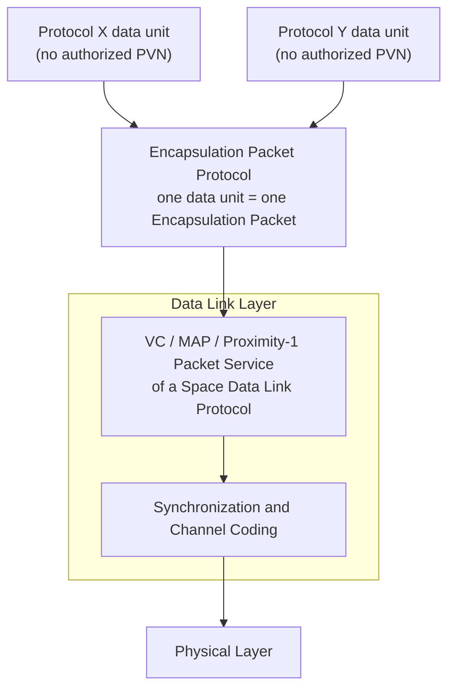
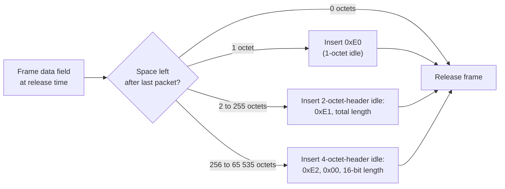
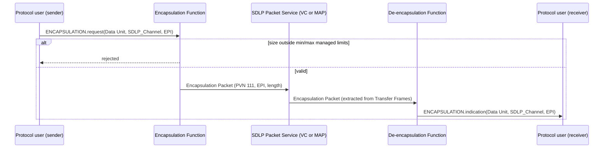
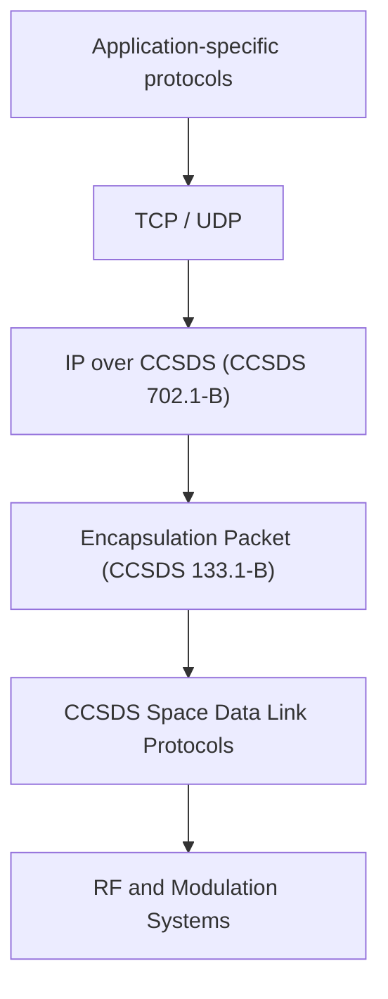

# Encapsulation Packet Protocol (CCSDS 133.1-B-3)

The CCSDS [Space Data Link Protocols](index.md#the-data-link-layer) carry only packets whose
**Packet Version Number (PVN)** CCSDS has authorized. The **Encapsulation Packet Protocol (EPP)**
is how anything else reaches a space link, such as an IP datagram, an LTP segment or a private
protocol data unit. EPP wraps each such data unit, unchanged, in an **Encapsulation Packet**.
This packet is "Version 8 CCSDS Packet", PVN `0b111`. Its header is 1, 2, 4 or 8 octets long, so
the overhead can be as small as the data unit allows.[^epp-concept][^epp-pvn] The 2023 Overview
of Space Communications Protocols calls EPP a "shim". It is also the standard carrier of
CCSDS-recognized IP datagrams over a space link, through IP over CCSDS.[^g4-network]

This page follows CCSDS 133.1-B-3 (May 2020, with Editorial Change 1 of November 2020), the issue
in the [library](../library/ccsds-133-1-133x1b3e1.md).[^epp-doc] For the fixed-header alternative,
see the [Space Packet Protocol](space-packet.md).

!!! info "At a glance"
    | Property | Value |
    |---|---|
    | Packet Version Number | `0b111` (Version 8 CCSDS Packet)[^epp-pvn] |
    | Header length | 1, 2, 4 or 8 octets, chosen by the Length of Length field[^epp-hdr] |
    | Packet length | 1 to 4 294 967 295 octets[^epp-pkt] |
    | Encapsulated data | 0 to 4 294 967 287 octets, one data unit per packet[^epp-pkt][^epp-features] |
    | Addressing | Encapsulation Protocol ID (3 bits), with a 4-bit extension when the ID is `0b110`[^epp-epi] |
    | Idle packet | Protocol ID `0b000`. The shortest is one octet, `0xE0`.[^epp-epi][^epp-lol] |
    | Length field meaning | Total packet length **including** the header (unlike the Space Packet)[^epp-plen] |
    | Security | None in EPP; use SDLS or the Bundle Security Protocol[^epp-sec] |

## Why it exists

CCSDS first designed the Space Data Link Protocols to carry application-layer data put straight
into their data fields. EPP is the shim that defines, without ambiguity, how they can also carry
other protocol data units, such as internetworking, file transfer or message transfer
protocols.[^epp-rationale] A data unit that the data link protocols can carry directly has a
CCSDS-authorized PVN, listed in a SANA registry. EPP exists mainly to move data units that have
no such PVN.[^epp-concept] The overview of the data link protocols puts it this way. Packets with
authorized PVNs go straight through the packet services, and packets without one can be carried
by the encapsulation service.[^g2-encap]

In 2008, the ECSS communications handbook gave a concrete reason. IPv4 datagrams could be carried
directly as packets. The layout of the IPv6 version number, however, required an encapsulation
service with low overhead. At that time the authorized PVNs included the Space Packet, the
Encapsulation Packet and the IPv4 datagram.[^hb-ip][^hb-epp] The current content of the SANA PVN
registry is not in the library, so this page does not list it.

!!! note "Space Packet or Encapsulation Packet?"
    Earlier issues of this standard ("Encapsulation Service", 133.1-B-1 and B-2) could wrap a data
    unit in either a Space Packet or an Encapsulation Packet.[^g2-encap][^hb-epp] Issue 3 **removes
    the Space Packet** from the available formats and renames the standard.[^epp-doc] At the same
    time, Editorial Change 1 of CCSDS 133.0-B-2 made the reference-model figure show that the shim
    position holds *either* EPP *or* SPP.[^spp-doc] Carrying another protocol inside Space Packets
    is still possible, but it is now a mission-specific use of APIDs and no longer part of EPP.[^spp-apid]

## Position in the protocol stack

*Redrawn after CCSDS 133.1-B-3 figure 2-1.*[^epp-concept]

EPP is used together with one of the Space Data Link Protocols ([TM](tm-sdlp.md), [TC](tc-sdlp.md),
[AOS](aos.md), [Proximity-1](proximity-1.md) or [USLP](uslp.md)). It relies on their Virtual Channel Packet, MAP
Packet or Proximity-1 Packet services, and management decides which data link protocol is
used.[^epp-concept]

## Service features

* A user of EPP is a protocol entity that sends or receives data units with no authorized
  PVN.[^epp-features]
* Each data unit is wrapped **unchanged** in exactly **one** Encapsulation Packet. It may be any
  whole number of octets up to 4 294 967 287, within project limits.[^epp-features]
* Data units given to one Service Access Point are processed in order. No order is kept between
  different SAPs. CCSDS recommends no flow-control scheme.[^epp-features]
* Transfer is one-way, with no timing relationship to the data link mechanisms, and the sender
  gets no confirmation. The provider may signal gaps, and the sequence is kept, although it may
  have gaps.[^epp-features]

!!! warning "Inference"
    Clause 2.2 says an `Encapsulation.indication` "acknowledges the receipt of the
    Encapsulation.request". Clause 3 defines the indication as the primitive that delivers a data
    unit at the *receiving* end. That earlier sentence looks like a leftover from an earlier
    issue.[^epp-features][^epp-prim]

## Addressing and service primitives

The user is identified by its **Encapsulation Protocol ID (EPI)**, a value registered in SANA as a
"defined Protocol ID". A SAP is identified by three things together: the PVN, the EPI and the
**SDLP channel** that carries the data.[^epp-addr] The `SDLP_Channel` parameter depends on the
underlying service:[^epp-params]

| Underlying service | `SDLP_Channel` contains |
|---|---|
| Virtual Channel Packet (VCP) service of TM, TC or AOS | Global Virtual Channel Identifier (GVCID) |
| MAP Packet (MAPP) service of TC or USLP | Global MAP ID (GMAP ID) |
| Packet service of Proximity-1 | Transfer Frame Version Number, SCID, Physical Channel ID, Data Field Construction ID and Port ID |

| Primitive | Parameters | Generated |
|---|---|---|
| `ENCAPSULATION.request` | Data Unit, SDLP_Channel, EPI | By the sending user, to have a data unit transferred through the data link protocol |
| `ENCAPSULATION.indication` | Data Unit, SDLP_Channel, EPI | By the provider, to deliver a data unit to the receiving user. The effect on the user is undefined. |

*After CCSDS 133.1-B-3 clauses 3.2 and 3.3.*[^epp-params][^epp-prim]

!!! note "Two expansions of EPI"
    The header specification (clause 4.1.2.3) and clause 3.2.3 call the 3-bit field the
    "Encapsulation Protocol ID" or "Encapsulation Protocol Identifier". The addressing clause 2.3
    and Annex B expand the abbreviation EPI as "Encapsulated Protocol Identifier". Both refer to the
    same field.[^epp-addr][^epp-params][^epp-epi][^epp-abbr]

## The Encapsulation Packet

An Encapsulation Packet is a **Packet Header** of 1 to 8 octets followed by an optional
**Encapsulated Data Field** of 0 to 4 294 967 287 octets. The whole packet is 1 to 4 294 967 295
octets.[^epp-pkt] The header has three, four, six or seven fields, depending on its
length:[^epp-hdr]

| Field | Bits | Present in header of | Values and meaning |
|---|---|---|---|
| Packet Version Number | 3 (bits 0 to 2) | all | `0b111`, the Encapsulation Packet (Version 8 CCSDS Packet)[^epp-pvn] |
| Encapsulation Protocol ID | 3 (bits 3 to 5) | all | The protocol inside. `0b000` is idle, `0b110` means "see the extension", `0b111` is mission-specific private data. Other values are registered in SANA.[^epp-epi] |
| Length of Length | 2 (bits 6 and 7) | all | Length of the Packet Length field: `00` none, `01` 1 octet, `10` 2 octets, `11` 4 octets[^epp-lol] |
| User Defined Field | 4 | 4- and 8-octet headers | Mission-specific, privately defined header data[^epp-udf] |
| Encapsulation Protocol ID Extension | 4 | 4- and 8-octet headers | Identifies the protocol when the EPI is `0b110`; otherwise all zeros. Values are registered in SANA.[^epp-ext] |
| CCSDS Defined Field | 16 | 8-octet header | Reserved for future CCSDS use, set to all zeros by convention[^epp-ccsds] |
| Packet Length | 8, 16 or 32 | 2-, 4- and 8-octet headers | **Total** packet length in octets, header included[^epp-plen] |

The four header formats, as bit-field diagrams:[^epp-hdr]

### Packet Version Number

Bits 0 to 2 are `0b111`. Like the Space Packet's PVN, the field leaves room for other packet
structures. This value identifies the Encapsulation Packet, which the standard calls "Version 8
CCSDS Packet".[^epp-pvn] A receiver can therefore tell an Encapsulation Packet from a Space Packet
(PVN `0b000`) by the first three bits, even when both share one Virtual Channel.[^epp-pvn][^g2-pvn]

### Encapsulation Protocol ID (EPI)

Bits 3 to 5 name the protocol whose data unit the packet carries. The values CCSDS recognizes are
registered with SANA. The standard itself fixes three:[^epp-epi]

| EPI | Meaning |
|---|---|
| `0b000` | **Encapsulation Idle Packet**. It may fill space in a fixed-length TM, AOS or USLP Transfer Frame. |
| `0b110` | The 4-bit Encapsulation Protocol ID Extension identifies the protocol. |
| `0b111` | Mission-specific, privately defined data |
| others | Registered in the SANA "Protocol Identifier" registry |

The 2008 ECSS handbook says the registered values then included IPv6, IPv4 and CFDP.[^hb-epp]
The present registry content is not in the library.

!!! warning "Inference"
    The extension field exists only in 4- and 8-octet headers. An EPI of `0b110` is therefore
    meaningful only with Length of Length `10` or `11`. The standard does not state this
    restriction in so many words.[^epp-hdr][^epp-ext]

### Length of Length

Bits 6 and 7 give the size of the Packet Length field:[^epp-lol]

| Length of Length | Packet Length field | Header length |
|---|---|---|
| `00` | absent | 1 octet |
| `01` | 1 octet | 2 octets |
| `10` | 2 octets | 4 octets |
| `11` | 4 octets | 8 octets |

When the value is `00`, the EPI must be `0b000`. Such a packet is an Encapsulation Idle Packet of
exactly one octet, with neither a length nor a data field.[^epp-lol] Receivers must accept both
fixed and variable header lengths. A sender may keep one header size, or change the size packet by
packet to match the payload and reduce overhead.[^epp-hdr]

### User Defined Field, Protocol ID Extension and CCSDS Defined Field

These fields exist only in the longer headers. The **User Defined Field** (4 bits) carries
mission-specific header data.[^epp-udf] The **Encapsulation Protocol ID Extension** (4 bits)
identifies the protocol when the EPI is `0b110`. Otherwise it is all zeros, and its values are
registered in a separate SANA registry.[^epp-ext] The **CCSDS Defined Field** (2 octets, 8-octet
header only) is reserved and set to zeros by convention.[^epp-ccsds]

### Packet Length

When present, the Packet Length is the last header field. It holds the **total length of the
packet in octets, header included**.[^epp-plen] This differs from the Space Packet, whose length
field counts only the data field and subtracts one.[^spp-len] A 4-octet length field can
represent IPv6 "jumbograms" of up to 4 294 967 287 octets ($2^{32}-5$), although that use is
unlikely in space.[^epp-plen]

| Header length | Packet Length field | Packet length | Encapsulated Data Field |
|---|---|---|---|
| 1 octet | absent | 1 | absent |
| 2 octets | 1 octet | 2 to 255 | 0 to 253 |
| 4 octets | 2 octets | 4 to 65 535 | 0 to 65 531 |
| 8 octets | 4 octets | 8 to 4 294 967 295 | 0 to 4 294 967 287 |

*All lengths in octets, after CCSDS 133.1-B-3 table 4-2. An implementation may set a lower
maximum for the data field.*[^epp-plen]

### Encapsulated Data Field

The data field follows the Packet Length field with no gap. It is a whole number of octets and
contains the data of the protocol named by the EPI (and the extension, if used). With EPI `0b000`
it contains idle data. It is absent when the Length of Length is `00`, or when the Packet Length
equals the header length. Whenever it is absent, the EPI must be `0b000`.[^epp-data] So an
Encapsulation Packet with no data is always an idle packet.

## Encapsulation Idle Packets

An Encapsulation Idle Packet has EPI `0b000` and holds idle data. CCSDS does not specify the idle
bit pattern.[^epp-defs][^epp-data] Its value lies in the **one-octet minimum**. The TM and AOS
protocols may fill a frame that must go out at its release time with either an SPP Idle Packet or
an Encapsulation Idle Packet. An SPP Idle Packet is at least 7 octets, so in a gap of fewer than 7
octets it spills into the next frame. An Encapsulation Idle Packet can fill a gap of a single
octet.[^tm-idle][^aos-idle] [USLP](uslp.md) goes further. When there are not enough packets at
release time, it **shall** insert one Encapsulation Idle Packet of the right length to complete the
frame's data zone.[^uslp-idle]

*This wiki's illustration of the fill rules. The header byte values follow from clause 4.1.2.
The flow itself is not taken from a CCSDS figure.*[^epp-hdr][^uslp-idle]

ECSS took up the option early. ECSS-E-ST-50-03C (2008) already allowed a TM idle packet to be
either an idle Space Packet or a "fill encapsulation packet" of 133.1-B-1, and noted that this
second option was still being evaluated.[^e5003-idle] The 2008 handbook explained that the Fill
Encapsulation Packet (the old name) can be one octet long. It also warned that implementations
would probably be few for some time.[^hb-idle]

## Procedures

At the **sending end**, the *Encapsulation Function* takes data units from users and **rejects any
that break the size limits**. It wraps each valid unit in an Encapsulation Packet and passes it to
the packet service of the data link protocol underneath.[^epp-send] At the **receiving end**, the
*De-encapsulation Function* takes Encapsulation Packets from that packet service, strips the
headers, and delivers each data unit to the user named by the EPI or extended EPI.[^epp-recv]

*Sequence drawn by this wiki from clauses 3.3, 4.2 and 4.3.*[^epp-prim][^epp-send][^epp-recv]

A data link receiver extracting packets from a frame needs to know where each packet ends. The
rule below follows directly from the header definition. It is not a numbered CCSDS procedure.

!!! example "Parsing an Encapsulation Packet (derived from clause 4.1)"
    1. Read octet 0. Bits 0 to 2 must be `111`, otherwise the packet is not an Encapsulation
       Packet. Take the EPI from bits 3 to 5 and the Length of Length (LoL) from bits 6 and 7.
    2. If LoL = `00`, the packet is a 1-octet idle packet, so continue at the next octet.
    3. Otherwise the header is 2, 4 or 8 octets for LoL `01`, `10` or `11`. Read the Packet
       Length from the last 1, 2 or 4 octets of the header.
    4. The packet occupies *Packet Length* octets from octet 0. The data unit is *Packet Length −
       header length* octets. If the EPI is `000`, discard the packet as idle. If the EPI is
       `110`, read the extension from the low 4 bits of octet 1.

    This procedure is this wiki's summary of clauses 4.1.2 to 4.1.3.[^epp-hdr][^epp-lol][^epp-plen][^epp-data]

## Managed parameters

| Managed parameter (table 5-1) | Allowed values | Defined in |
|---|---|---|
| Minimum Data Unit Length (octets) | Integer | §4.1 |
| Maximum Data Unit Length (octets) | Integer | §4.1 |
| Valid Encapsulation Protocol Identifiers | Set of integers | Reference [9], the SANA registry "Protocol Identifier for Encapsulation Service" |
| Valid Extended Encapsulation Protocol Identifiers | Set of integers | Reference [10], the SANA registry "Extended Protocol Identifiers" |

*After CCSDS 133.1-B-3 table 5-1 and the normative references of §1.7. Annex A2.3 asks SANA to
rename both registries (see [Edition history](#edition-history)).*[^epp-mp][^epp-refs][^epp-sana]

As with other CCSDS protocols, these are long-lived settings, conveyed by a management system
rather than in the packets, so that space-link bandwidth is saved.[^epp-mp] The data link protocol
also needs to know which PVNs to accept on each Virtual Channel. For TM, "Valid Packet Version
Numbers" is a managed parameter of packet transfer.[^tm-mp]

## Worked examples

All byte values below are **illustrative**, built by this wiki from the header rules.[^epp-hdr][^epp-lol][^epp-plen]

| Case | Header bytes | Explanation |
|---|---|---|
| 1-octet idle packet | `E0` | `111` PVN · `000` EPI (idle) · `00` LoL. Packet length 1. |
| 5-octet idle packet | `E1 05` + 3 idle octets | `111 000 01`, then a length of 5 that includes the 2-octet header |
| 10 octets of private data | `FD 0C` + 10 data octets | `111 111 01` (EPI `111`, mission-specific), total length 12 |
| 1000-octet unit, protocol in extension | `FA`, then `0` and the extension nibble, then `03 EC`, + 1000 octets | `111 110 10`, then user-defined `0000` and the 4-bit extension (a SANA value, not shown), then total length 1004 = `0x03EC` |
| 100 000-octet unit | `FF 00 00 00 00 01 86 A8` + data | `111 111 11` (private, 8-octet header), user-defined `0000`, extension `0000` (required because the EPI is not `110`), CCSDS Defined Field `0x0000`, total length 100 008 = `0x000186A8` |

!!! tip "Header size and overhead"
    For a data unit of *n* octets, the smallest legal header is 2 octets when $n \le 253$, 4
    octets when $n \le 65\,531$, and 8 octets beyond that.[^epp-plen] Wrapping the same unit in a
    Space Packet costs 6 octets of header, and SPP data fields stop at 65 536
    octets.[^spp-pdu] The 2023 overview gives this lower overhead as the reason the Encapsulation
    Packet is the more bandwidth-efficient carrier for LTP segments.[^g4-ltp]

## Comparison with the Space Packet

| Aspect | [Space Packet](space-packet.md) | Encapsulation Packet |
|---|---|---|
| PVN | `0b000` | `0b111` |
| Header | Fixed 6 octets | 1, 2, 4 or 8 octets |
| What is addressed | Managed data path (11-bit APID) | Carried protocol (3-bit EPI plus 4-bit extension) |
| Length field | Data field octets minus 1 | Total packet octets, header included |
| Size limits | 7 to 65 542 octets | 1 to 4 294 967 295 octets |
| Sequence count | 14-bit count or name per APID | None |
| Extra header space | Optional secondary header | 4-bit user-defined field in 4- and 8-octet headers |
| Idle form | APID 2047, at least 7 octets | EPI `000`, at least 1 octet |
| Typical payload | Application data such as PUS reports and commands, CFDP PDUs | IP datagrams, LTP segments, bundles, private PDUs |

*Compiled from CCSDS 133.0-B-2 clause 4.1 and CCSDS 133.1-B-3 clause 4.1. The "typical payload"
row draws on the 2023 overview.*[^spp-pdu][^spp-len][^epp-pkt][^epp-hdr][^g4-cfdp][^g4-ltp]

## EPP as the carrier for network protocols

### IP over CCSDS

CCSDS recognizes two network-layer standards: CCSDS-recognized **IP datagrams** and the DTN
**Bundle Protocol**.[^g4-net-layer] Over a space link, the data link protocols can carry IP data
units, multiplexed or not, inside Encapsulation Packets. The separate standard **IP over CCSDS
Space Links** (CCSDS 702.1-B-1) specifies how this is done. That standard is not in the
library.[^g4-network] The overview of the data link protocols states it directly: IP over CCSDS
uses the Encapsulation Packet as the data structure that holds the IP datagram.[^g2-ipoc]

*Redrawn after CCSDS 130.0-G-4 figure 4-4.*[^g4-ipoc]

In that configuration the Internet is extended into the space segment. Each IP router makes its
routing decisions from the destination address, and EPP provides the shim that puts the datagrams
into the CCSDS link and takes them out at the other end.[^g4-ipoc] The overview says this suits
missions that need their space segment integrated into the Internet, where connectivity and
round-trip light time allow it.[^g4-ipoc]

### LTP, the Bundle Protocol and CFDP

* **LTP** usually carries each segment in one link-layer data unit, an Encapsulation Packet.
  Space Packets are also possible. The overview prefers EPP because its overhead is
  lower.[^g4-ltp]
* The **Bundle Protocol** reaches links through convergence layer adapters, one of which runs over
  EPP or SPP (ENCAPCLA in the reference model).[^g4-bp]
* **CFDP** needs only a simple unitdata service from below. One option given in CCSDS 727.0-B-5 is
  the Encapsulation service, with the CFDP PDU as the data field of an Encapsulation Packet. The
  CFDP standard also refers to a Magenta Book, *Operation of CFDP over Encapsulation Service*
  (CCSDS 722.1-M-1), which is not in the library.[^cfdp-ut] See [CFDP](cfdp.md).

## Where an ESA ground-segment engineer may meet it

!!! warning "Inference"
    This section joins sourced facts to show where EPP appears in practice. The assessment is
    this wiki's own.

* **Telemetry frames from newer spacecraft.** A TM or AOS on-board encoder may fill frames with
  Encapsulation Idle Packets, and a USLP encoder must.[^tm-idle][^aos-idle][^uslp-idle] Ground
  packet extraction (in the station, in [NCTRS/NIS](../scos2000/nctrs-nis.md) or in the control
  system) then has to recognize PVN `0b111` and discard idle packets, as TM receiving ends already
  do with SPP idle packets.[^tm-extract]
* **Not on Solar Orbiter.** The Solar Orbiter packet ICD fills frames with idle *Space* Packets
  (APID all ones, random data), not Encapsulation Idle Packets.[^solo-idle] Its TM and TC traffic
  is PUS packets, which are Space Packets (see [Space Packet: Solar Orbiter case
  study](space-packet.md#solar-orbiter-case-study)).
* **SCOS-2000 and the MIB.** The SCOS-2000 import ICD identifies telemetry packets by APID, type,
  subtype and extra identification fields in the [`pid`](../mib/tables/pid.md) table. It has no
  key for packet version.[^icd-pid] So the [MIB](../mib/index.md) has nowhere to describe
  Encapsulation Packets, and the library sources do not say how SCOS-2000 would handle them.
* **IP, DTN and file-transfer experiments.** EPP is the standard way to carry IP datagrams, LTP
  segments, bundles or CFDP PDUs that should not be wrapped in mission APIDs.[^g4-network][^g4-ltp][^cfdp-ut]
* **ECSS context.** ECSS-E-ST-50C Rev.1 (2021) shows the "Encapsulation Service" and the
  "Encapsulation Packet" (CCSDS 133.1-B) under IP over CCSDS in its protocol figure.[^e50-fig]
  The 2008 handbook listed CCSDS 133.1-B as "support to IPv6 for all ECSS space links". It
  recommended the Space Packet as the encapsulating packet unless very long data units had to be
  carried, because few implementations then supported Encapsulation Packets.[^hb-appl][^hb-epp]

## Edition history

| Edition | Date | Main points |
|---|---|---|
| CCSDS 133.1-B-1 | June 2006 | "Encapsulation Service", Issue 1, superseded[^epp-doc] |
| CCSDS 133.1-B-2 | October 2009 | "Encapsulation Service", Issue 2, superseded[^epp-doc] |
| CCSDS 133.1-B-3 | May 2020 | Removes the Space Packet from the encapsulation formats, renames the standard "Encapsulation Packet Protocol" and adds USLP to the supported data link protocols[^epp-doc] |
| EC 1 | November 2020 | Updates obsolete page-header text[^epp-doc] |

Issue 3 also asked SANA to rename two registries, without changing their contents. They are now
"Protocol Identifier for Encapsulation Packet Protocol" and "Extended Protocol Identifier for
Encapsulation Packet Protocol". The old names referred to the "Encapsulation
Service".[^epp-sana] EPP offers no security functions of its own. Authentication, confidentiality
and integrity come from [SDLS](sdls.md) at the data link layer or from the Bundle Security Protocol
at the network layer.[^epp-sec]

## Related pages

* [CCSDS protocol stack overview](index.md), [Space Packet Protocol](space-packet.md)
* [TM Space Data Link Protocol](tm-sdlp.md), [AOS](aos.md), [USLP](uslp.md),
  [TC Space Data Link Protocol](tc-sdlp.md)
* [CFDP](cfdp.md), [SDLS](sdls.md), [Proximity-1](proximity-1.md)
* [Space link identifiers](space-link-identifiers.md) (PVNs and Encapsulation Protocol IDs as listed in the historical CCSDS 135.0-B-4)
* [ECSS-E-ST-50C communications](../ecss/e-st-50-communications.md)

[^epp-doc]: [CCSDS 133.1-B-3, Encapsulation Packet Protocol](../library/ccsds-133-1-133x1b3e1.md), Document Control, PDF p. 7.
[^epp-rationale]: [CCSDS 133.1-B-3](../library/ccsds-133-1-133x1b3e1.md), §1.4 Rationale, PDF p. 11.
[^epp-defs]: [CCSDS 133.1-B-3](../library/ccsds-133-1-133x1b3e1.md), §1.6.1.3 (definition of Encapsulation Idle Packet), PDF p. 12.
[^epp-concept]: [CCSDS 133.1-B-3](../library/ccsds-133-1-133x1b3e1.md), §2.1 Concept of the Encapsulation Packet Protocol and figure 2-1, PDF p. 16.
[^epp-features]: [CCSDS 133.1-B-3](../library/ccsds-133-1-133x1b3e1.md), §2.2 Features of the Encapsulation Packet Protocol, PDF p. 17.
[^epp-addr]: [CCSDS 133.1-B-3](../library/ccsds-133-1-133x1b3e1.md), §2.3 Addressing, PDF p. 18.
[^epp-params]: [CCSDS 133.1-B-3](../library/ccsds-133-1-133x1b3e1.md), §3.2 Parameters (Data Unit, SDLP_Channel, EPI), PDF pp. 19–20.
[^epp-prim]: [CCSDS 133.1-B-3](../library/ccsds-133-1-133x1b3e1.md), §3.3 Service Primitives, PDF pp. 20–22.
[^epp-pkt]: [CCSDS 133.1-B-3](../library/ccsds-133-1-133x1b3e1.md), §4.1.1 General and figure 4-1, PDF p. 23.
[^epp-hdr]: [CCSDS 133.1-B-3](../library/ccsds-133-1-133x1b3e1.md), §4.1.2.1 Encapsulation Packet Header, figure 4-2 and note on fixed or adaptive header size, PDF pp. 23–24.
[^epp-pvn]: [CCSDS 133.1-B-3](../library/ccsds-133-1-133x1b3e1.md), §4.1.2.2 Packet Version Number, PDF p. 24.
[^epp-epi]: [CCSDS 133.1-B-3](../library/ccsds-133-1-133x1b3e1.md), §4.1.2.3 Encapsulation Protocol ID and notes 1 to 3, PDF p. 25.
[^epp-lol]: [CCSDS 133.1-B-3](../library/ccsds-133-1-133x1b3e1.md), §4.1.2.4 Length of Length and table 4-1, PDF p. 25.
[^epp-udf]: [CCSDS 133.1-B-3](../library/ccsds-133-1-133x1b3e1.md), §4.1.2.5 User Defined Field, PDF p. 26.
[^epp-ext]: [CCSDS 133.1-B-3](../library/ccsds-133-1-133x1b3e1.md), §4.1.2.6 Encapsulation Protocol ID Extension, PDF p. 26.
[^epp-ccsds]: [CCSDS 133.1-B-3](../library/ccsds-133-1-133x1b3e1.md), §4.1.2.7 CCSDS Defined Field, PDF p. 26.
[^epp-plen]: [CCSDS 133.1-B-3](../library/ccsds-133-1-133x1b3e1.md), §4.1.2.8 Packet Length, notes and table 4-2, PDF pp. 26–27.
[^epp-data]: [CCSDS 133.1-B-3](../library/ccsds-133-1-133x1b3e1.md), §4.1.3 Encapsulated Data Field and notes, PDF pp. 27–28.
[^epp-send]: [CCSDS 133.1-B-3](../library/ccsds-133-1-133x1b3e1.md), §4.2 Procedures at the Sending End and figure 4-3, PDF p. 28.
[^epp-recv]: [CCSDS 133.1-B-3](../library/ccsds-133-1-133x1b3e1.md), §4.3 Protocol Procedures at the Receiving End and figure 4-4, PDF p. 29.
[^epp-mp]: [CCSDS 133.1-B-3](../library/ccsds-133-1-133x1b3e1.md), §5 Managed Parameters and table 5-1, PDF p. 30.
[^epp-refs]: [CCSDS 133.1-B-3](../library/ccsds-133-1-133x1b3e1.md), §1.7 References [8] to [10] (SANA registries), PDF p. 15.
[^epp-sec]: [CCSDS 133.1-B-3](../library/ccsds-133-1-133x1b3e1.md), Annex A1 Security Considerations, PDF p. 31.
[^epp-sana]: [CCSDS 133.1-B-3](../library/ccsds-133-1-133x1b3e1.md), Annex A2.3 Modified Registries, PDF p. 31.
[^epp-abbr]: [CCSDS 133.1-B-3](../library/ccsds-133-1-133x1b3e1.md), Annex B Abbreviations and Acronyms, PDF p. 32.
[^spp-doc]: [CCSDS 133.0-B-2, Space Packet Protocol](../library/ccsds-133-0-133x0b2e2.md), Document Control (EC 1), PDF p. 7.
[^spp-apid]: [CCSDS 133.0-B-2](../library/ccsds-133-0-133x0b2e2.md), §4.1.3.3.4.4 note 2, PDF p. 34.
[^spp-pdu]: [CCSDS 133.0-B-2](../library/ccsds-133-0-133x0b2e2.md), §4.1.2 Space Packet Requirements, PDF p. 31.
[^spp-len]: [CCSDS 133.0-B-2](../library/ccsds-133-0-133x0b2e2.md), §4.1.3.5 Packet Data Length, PDF p. 36.
[^g4-network]: [CCSDS 130.0-G-4, Overview of Space Communications Protocols](../library/ccsds-130-0-130x0g4e1.md), §2.2.4 and §3.3.1, PDF pp. 21 and 32.
[^g4-ltp]: [CCSDS 130.0-G-4](../library/ccsds-130-0-130x0g4e1.md), §2.2.4 Between Data Link and Network Layers (LTP), PDF p. 21.
[^g4-net-layer]: [CCSDS 130.0-G-4](../library/ccsds-130-0-130x0g4e1.md), §2.2.5 Network Layer, PDF p. 21.
[^g4-bp]: [CCSDS 130.0-G-4](../library/ccsds-130-0-130x0g4e1.md), §2.2.5 (convergence layer adapters) and figure 2-1, PDF pp. 19 and 22.
[^g4-cfdp]: [CCSDS 130.0-G-4](../library/ccsds-130-0-130x0g4e1.md), §3.5 Application Layer (CFDP over SPP with mission-specific APIDs, or over EPP), PDF p. 33.
[^g4-ipoc]: [CCSDS 130.0-G-4](../library/ccsds-130-0-130x0g4e1.md), §4.3 IP over CCSDS for End-to-End Routing and figure 4-4, PDF pp. 38–39.
[^g2-encap]: [CCSDS 130.2-G-3, Space Data Link Protocols, Summary of Concept and Rationale](../library/ccsds-130-2-130x2g3.md), §3.3.3 Encapsulation Service, PDF p. 27.
[^g2-ipoc]: [CCSDS 130.2-G-3](../library/ccsds-130-2-130x2g3.md), table 3-1 note 1, PDF p. 25.
[^g2-pvn]: [CCSDS 130.2-G-3](../library/ccsds-130-2-130x2g3.md), §3.3.2.1 to §3.3.2.3 (packets with different PVNs share a channel), PDF p. 26.
[^tm-idle]: [CCSDS 132.0-B-3, TM Space Data Link Protocol](../library/ccsds-132-0-132x0b3.md), §4.2.2.5 and note, PDF p. 75.
[^tm-extract]: [CCSDS 132.0-B-3](../library/ccsds-132-0-132x0b3.md), §4.3.2.5 and note 1, PDF p. 82.
[^tm-mp]: [CCSDS 132.0-B-3](../library/ccsds-132-0-132x0b3.md), §5.4 table 5-4, PDF p. 90.
[^aos-idle]: [CCSDS 732.0-B-4, AOS Space Data Link Protocol](../library/ccsds-732-0-732x0b4.md), §4.2.2.5 and note, PDF pp. 74–75.
[^uslp-idle]: [CCSDS 732.1-B-3, Unified Space Data Link Protocol](../library/ccsds-732-1-732x1b3e1.md), §4.2.2.1.5 and §4.2.6.1.5 with notes, PDF pp. 109 and 116.
[^cfdp-ut]: [CCSDS 727.0-B-5, CCSDS File Delivery Protocol](../library/ccsds-727-0-727x0b5e1.md), §3.3 Services Required of the Underlying Communication System, note 1 (PDF p. 31); reference [7] (PDF p. 16).
[^e5003-idle]: [ECSS-E-ST-50-03C (31 July 2008)](../library/ecss-e-st-50-03c-31july2008.md), §5.4.3.3 b and notes, PDF p. 25.
[^e50-fig]: [ECSS-E-ST-50C Rev.1 (1 March 2021)](../library/ecss-e-st-50c-rev-1-1march2021.md), §4.2, figure 4-2, PDF pp. 19 and 21.
[^hb-epp]: [ECSS-E-HB-50A (15 November 2008)](../library/ecss-e-hb-50a-15november2008.md), §4.10.1 and §4.10.3 Encapsulation Service, PDF pp. 86 and 89–90.
[^hb-ip]: [ECSS-E-HB-50A](../library/ecss-e-hb-50a-15november2008.md), §4.11.1 and §4.11.2.1 Internet Protocols, PDF p. 91.
[^hb-idle]: [ECSS-E-HB-50A](../library/ecss-e-hb-50a-15november2008.md), §5.4.1.2 Idle packets, PDF p. 130.
[^hb-appl]: [ECSS-E-HB-50A](../library/ecss-e-hb-50a-15november2008.md), table 6-2 Applicability of standards for Network / Transport / Application layers, PDF p. 141.
[^icd-pid]: [SCOS-2000 Database Import ICD issue 7.0](../library/icd-7-0-final.md), §3.3.2.4.1 pid table (PID_TYPE, PID_STYPE, PID_APID, PID_PI1_VAL, PID_PI2_VAL), PDF pp. 84–85.
[^solo-idle]: [SOL.S.ASTR.TN.00079 issue 7, Solar Orbiter TM-TC and Packet Structure ICD](../library/sol-s-astr-tn-00079-07.md), Annex 5 §10.1 Idle Packet Structure, PDF p. 267.
