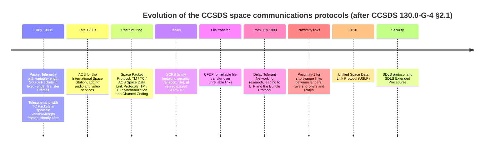
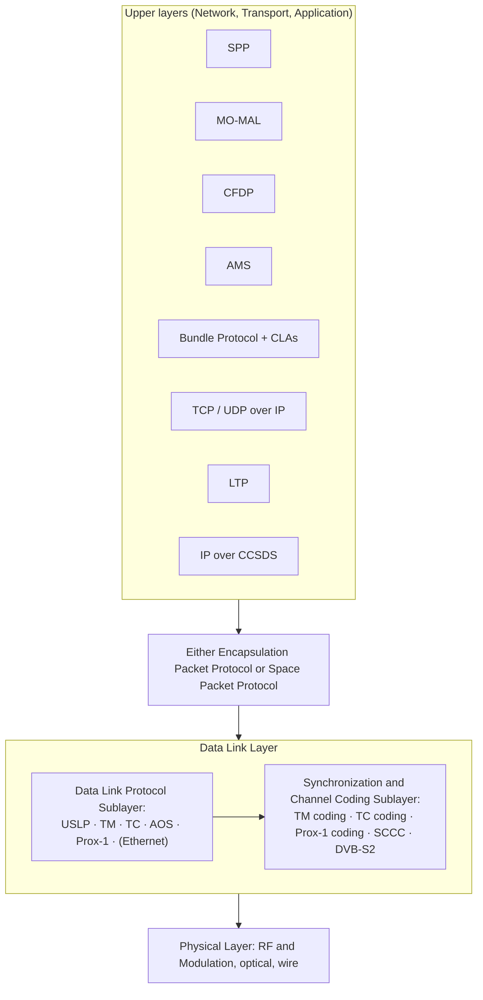
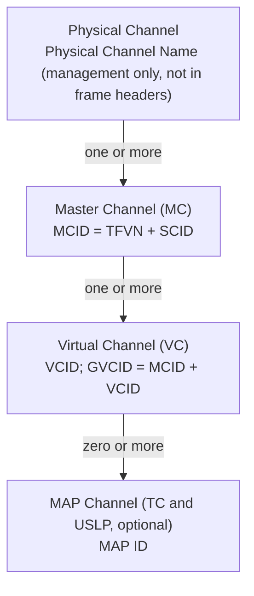

# CCSDS: overview of the protocol stack

The **Consultative Committee for Space Data Systems (CCSDS)** is a committee set up by the space
agencies to solve data-system problems they share. Its member agencies include ESA, NASA, CNES,
DLR, ASI, JAXA and others.[^ccsds-members] Its results are "Recommended Standards". Endorsing one
is voluntary, and a Recommended Standard is reviewed no later than five years after it is issued,
as the Space Packet Protocol's statement of intent puts it.[^ccsds-intent] Together the CCSDS
standards define the chain that spacecraft data follows. Telemetry packets are framed by the
[TM Space Data Link Protocol](tm-sdlp.md), protected by [channel coding](tm-coding.md), received
by a ground station and, in cross support, delivered to the user over
[Space Link Extension](sle/index.md). Telecommands make the reverse trip as
[CLTUs](tc-coding-cltu.md), with [COP-1](cop-1.md) providing retransmission.[^g4-fwd][^g2-sle][^g2-cop]

This page explains how the protocols fit together. It follows two CCSDS reports: the *Overview of
Space Communications Protocols* (CCSDS 130.0-G-4, April 2023) and the *Space Data Link Protocols:
Summary of Concept and Rationale* (CCSDS 130.2-G-3, September 2015).[^g4-purpose][^g2-purpose] It
ends with a [map](#layer-map-standards-library-copies-and-wiki-pages) of every layer, the standard
that defines it, the copy in this wiki's [reference catalogue](../references/index.md) and the page that
explains it.

!!! info "CCSDS document colours"
    The protocol itself is specified in a **Blue Book** (Recommended Standard). Its rationale is
    explained in a **Green Book** (Informational Report).[^g4-purpose] The reference lists also
    show **Magenta Books** (Recommended Practices, such as the SCID code assignment procedures),
    **Yellow Books** (CCSDS Records, such as A02.1-Y-4 on CCSDS organization) and retired
    standards marked "Historical" with an "-S" suffix (for example the SCPS protocols).[^g4-refs]

## From fixed TDM formats to a layered stack

Traditional telemetry used **Time Division Multiplexing (TDM)**. Data items sat in a continuous
stream of fixed-length frames according to a fixed multiplexing rule, so every project built its
own data system.[^g4-history] When on-board processors arrived, CCSDS standardized a series of
protocols. The timeline shows the sequence described in the 2023 overview:[^g4-history] ESA's own
path, from the PSS-04-106 and PSS-04-107 packet standards to the ECSS adoption notices, is told on
[From ESA PSS to CCSDS and ECSS](../overview/history.md).



The 2023 overview expects USLP to become the data link protocol for all future robotic and crewed
missions.[^g4-history] Solar Orbiter, which uses the TC and TM Space Data Link Protocols, is an
example of the established configuration (see [below](#solar-orbiter-as-an-instance)).[^solo-tc-frame][^solo-tm-frame]

## The reference model

CCSDS places its protocols in five layers of the OSI model: Physical, Data Link, Network, Transport
and Application. Session and Presentation layers are rarely used over space links.[^g4-layers]
CCSDS does not define programming interfaces. It describes services as abstract **primitives**
(`.request`, `.indication`), which can serve as a reference for building an API.[^g4-layers]



*Redrawn and simplified after CCSDS 130.0-G-4 figure 2-1, with the two data link sublayers of
§2.2.3 shown explicitly.*[^g4-layers][^g4-dll]

### The physical layer

CCSDS 401.0-B, *Radio Frequency and Modulation Systems*, is an omnibus standard. It covers the RF
signal between spacecraft and ground stations that carries the frames. Proximity-1 has its own
physical layer standard.[^g4-phy] ECSS uses ECSS-E-ST-50-05 for the same role, and notes that
CCSDS 401.0-B has extra options.[^e50-fig] The library holds CCSDS 401.0-B-32 (October 2021) and
ECSS-E-ST-50-05C Rev. 2 (4 October 2011), together with ECSS-E-ST-50-02C on ranging and Doppler
tracking; all three are summarised on [Radio frequency, modulation and ranging](rf-and-ranging.md).[^rf-dc][^rf-e5]

### The data link layer

CCSDS divides the OSI data link layer into two **sublayers**:[^g4-dll][^g2-layers]

* The **Data Link Protocol Sublayer** moves higher-layer data units over one point-to-point space
  link inside **Transfer Frames**. Its protocols are [TM](tm-sdlp.md), [TC](tc-sdlp.md),
  [AOS](aos.md), [Proximity-1](proximity-1.md) and [USLP](uslp.md), together called the **Space Data Link
  Protocols**. TM, TC, AOS and USLP can carry secured user data through the optional
  [Space Data Link Security (SDLS)](sdls.md) protocol. No security requirement exists yet for
  Proximity-1.[^g4-dll] The wider CCSDS security family (threats, the choice of layer, algorithms
  and key management) is on [Security in CCSDS space links](security.md).
* The **Synchronization and Channel Coding Sublayer** gets frames across a noisy link. It
  delimits and synchronizes frames, applies error-correcting coding, and generates and removes bit
  transitions (pseudo-randomization).[^g4-scc][^g2-layers]

The pairing is fixed.[^g4-dll][^g4-scc]

| Coding standard | Used with |
|---|---|
| TM Synchronization and Channel Coding (and the high-rate SCCC and DVB-S2 options) | TM, AOS and USLP |
| TC Synchronization and Channel Coding | TC and USLP |
| Proximity-1 Coding and Synchronization | Proximity-1 and USLP |

| Function | TM sync and coding ([131.0-B](tm-coding.md)) | TC sync and coding ([231.0-B](tc-coding-cltu.md)) | Proximity-1 coding and sync |
|---|---|---|---|
| Error correction and frame validation | Convolutional + FECF; Reed-Solomon; concatenated; Turbo + FECF; LDPC; SCCC + FECF; DVB-S2 + FECF | BCH; BCH + FECF | Convolutional + attached CRC; LDPC + attached CRC |
| Pseudo-randomization | Cyclic pseudo-noise sequence (optional) | Cyclic pseudo-noise sequence (optional) | Cyclic pseudo-noise sequence (mandatory with LDPC only) |
| Frame synchronization | 32-bit (or longer) Attached Sync Marker, depending on coding | 16-bit Start Sequence | 24-bit ASM |

*After CCSDS 130.0-G-4 table 3-3. Only one option of a cell applies at a time, and the TM
pseudo-noise sequence differs from the TC and Proximity-1 one.*[^g4-scc] *Table 3-3 lists only
BCH coding for TC, but CCSDS 231.0-B-4 also specifies LDPC codes for the CLTU, with a 64-bit Start
Sequence.*[^tc-cltu][^tc-start]

The two link directions use quite different sync-and-coding data units:

* On the **return link** (TM), the unit on the channel is the **Channel Access Data Unit
  (CADU)**: an Attached Sync Marker followed by a frame, a Reed-Solomon codeblock or a codeword,
  depending on the coding.[^tm-cadu] The 32-bit ASM for uncoded, convolutional, Reed-Solomon and
  concatenated data is `0x1ACFFC1D`.[^tm-asm] The service is for **fixed-length frames** delivered
  periodically, and it always delivers validated frames.[^g4-scc]
* On the **forward link** (TC), the unit is the **Communications Link Transmission Unit (CLTU)**:
  a Start Sequence, BCH or LDPC codewords, and a Tail Sequence (optional for LDPC).[^tc-cltu] The
  16-bit BCH Start Sequence is `0b1110101110010000`, which is `0xEB90`.[^tc-start] The service is
  for **variable-length frames** sent intermittently, and the TC coding delivers *non-validated*
  frames to the layer above.[^g4-scc] The TC coding standard also defines the Physical Layer
  Operations Procedure (PLOP) that switches the channel on and off.[^tc-cltu]

### Between the data link and network layers

**LTP (Licklider Transmission Protocol)** adds optional reliability over one link. It usually
carries each segment in an [Encapsulation Packet](encapsulation.md). **IP over CCSDS** is a shim
that carries CCSDS-recognized IP datagrams over the Space Data Link Protocols.[^g4-ltp]

### The network layer

CCSDS recognizes two network-layer interfaces: CCSDS-recognized **IP datagrams** and the
**Bundle Protocol** of Delay Tolerant Networking (DTN). The Bundle Protocol builds a
store-and-forward "overlay" network that reaches each link through **convergence layer adapters
(CLAs)**. DTN is designed for intermittent connectivity, long and variable delays, high error
rates and asymmetric or simplex links.[^g4-network]

Between the data link protocols and these network protocols sits the **shim position**, held by
either the [Space Packet Protocol](space-packet.md) or the [Encapsulation Packet
Protocol](encapsulation.md).[^g4-layers][^spp-arch] The Space Packet itself does **forwarding**:
data moves along a path configured in advance by management, labelled only by its APID. It does
not do **routing**, which the overview defines as choosing paths from origins to destinations in a
network.[^g4-defs][^g4-netfeat][^g4-spp-path]

### Transport and application layers

* **Transport:** SCPS-TP, which extends TCP and includes UDP by reference. Internet TCP and UDP can
  run over IP over CCSDS.[^g4-transport]
* **Application:** AMS, [CFDP](cfdp.md), lossless, image and multispectral or hyperspectral data
  compression, the Space Packet Protocol, and the MO MAL Space Packet binding.[^g4-app] CFDP is a
  file transfer protocol that also provides transport functions (complete, in-order delivery
  without duplicates). It can run over SPP (with mission-assigned APIDs), over EPP, over IP or BP,
  or directly over a Virtual Channel, MAP or Port.[^g4-app-cfdp]
* **Mission-specific protocols** may also run on top. For ESA missions the most important is the
  ECSS [Packet Utilization Standard (PUS)](../ecss/pus/index.md). ECSS-E-ST-50C names it as an
  example of an "application specific source/sink".[^g4-app][^e50-fig]

Time stamps in packets use the CCSDS [Time Code Formats](time-codes.md) (CCSDS 301.0-B), which the
Space Packet Protocol cites for its secondary-header time field.[^spp-ref] For describing packet
formats, the Space Packet Protocol prefers a CCSDS notation such as [XTCE](xtce.md).[^spp-sana]

## Packets and Transfer Frames

Two kinds of data unit run through the whole stack, and keeping them apart is the key to
understanding it:

| | Packet | Transfer Frame |
|---|---|---|
| Defined by | Packet protocols: [SPP](space-packet.md), [EPP](encapsulation.md), others with an authorized PVN | Space Data Link Protocols ([TM](tm-sdlp.md), [TC](tc-sdlp.md), [AOS](aos.md), [USLP](uslp.md), Proximity-1) |
| Scope | End to end. Created and used by application processes on board or on the ground. | One space link, point to point |
| Length | Variable | TM, AOS and USLP fixed; TC, Proximity-1 and USLP variable |
| Identified by | APID (SPP) or Protocol ID (EPP), with the Packet Version Number | Transfer Frame Version Number, Spacecraft ID, Virtual Channel ID (and MAP ID) |

*Compiled from CCSDS 130.0-G-4 §2.2.7, §3.2.1 and §3.5 and CCSDS 130.2-G-3 §4.1.*[^g4-dlfeat][^g4-app][^g2-frames]

Fixed-length TM and AOS frames allow simple, robust synchronization on weak, noisy links. Their
length must stay constant on a Physical Channel for a Mission Phase and be known to the receiver
in advance. Variable-length TC frames let short commands arrive quickly.[^g2-frames][^g4-dlfeat]

Every packet that a data link protocol carries directly must have a **Packet Version Number (PVN)**
recognized by CCSDS and recorded by SANA. Other data units travel inside Encapsulation
Packets.[^g4-dlfeat] The protocols put packets into frames in different ways:[^g2-pkts]

* **TM and AOS** concatenate packets into the fixed-length data field, split a packet that does not
  fit across consecutive frames of the same Virtual Channel, and point to the first packet header
  with the **First Header Pointer**. Idle Packets fill frames when there is not enough data.
* **TC** carries one or more complete packets per frame. It segments long packets only when MAP
  channels are in use.
* In both cases the receiver separates packets using each packet's length field, so the data link
  service provider must know where that field is and what it means.

```mermaid
flowchart LR
  subgraph APP["On-board application process"]
    P1["PUS report"]
  end
  P1 --> SP["Space Packet<br/>6-octet header + data"]
  SP --> TF["TM Transfer Frame<br/>header · data field (packets, First Header Pointer) · OCF · FECF"]
  TF --> CODE["Channel coding<br/>(e.g. Reed-Solomon, convolutional, Turbo, LDPC)"]
  CODE --> CADU["CADU<br/>ASM 0x1ACFFC1D + coded frame"]
  CADU --> RF["RF downlink"]
  RF --> GS["Ground station:<br/>sync, decode, frames"]
  GS --> SLE["SLE RAF / RCF<br/>to control centre"]
  SLE --> MCS["Mission control system<br/>(packets sorted by APID)"]
```



*Downlink nesting as described on this wiki. Elements are linked to their pages above. Frame
fields are introduced on the [TM Space Data Link Protocol](tm-sdlp.md) page.*[^g2-pkts][^tm-cadu][^g2-sle]

See [Downlink](../overview/downlink.md) and [Uplink](../overview/uplink.md) for the complete
end-to-end walkthroughs.

## Channels and identifiers

A key idea in every Space Data Link Protocol is the **Virtual Channel (VC)**. One **Physical
Channel**, a stream of bits in one direction, is shared among several logical streams, each
possibly with different service requirements.[^g4-dlfeat] The identifiers form a
hierarchy:[^g4-ids][^g2-addr]



* **Transfer Frame Version Number (TFVN)** separates frame formats. Frames of different Space Data
  Link Protocols must never be mixed on one Physical Channel.[^g4-ids][^g2-addr] The binary values
  in the header are `00` for both TC and TM frames (version 1, told apart by management) and `01`
  for AOS (version 2).[^g2-tfvn]
* **Spacecraft Identifier (SCID)** identifies the spacecraft. It is unique only together with the
  TFVN, which makes the **Master Channel Identifier (MCID)**. TC and TM use 10-bit SCIDs and AOS
  uses 8-bit ones, so a spacecraft with a TC uplink and an AOS downlink needs two SCIDs. SCIDs are
  requested through SANA by an agency representative and must be given up for re-use when a
  spacecraft retires.[^g2-scid][^g2-mcid] A Magenta Book (CCSDS 320.0) governs the code
  assignment, and SANA has replaced the old *Space Link Identifiers* Blue Book.[^g4-ids] Both
  documents, and the Solar Orbiter values of every identifier, are described on
  [Space link identifiers](space-link-identifiers.md).
* **Master Channel (MC)**: all frames with the same MCID on a Physical Channel. Usually the
  Physical Channel carries a single MC. When it carries several (for example when one spacecraft
  relays another, as in an orbiter and lander mission), TM and AOS frames of all of them must have
  the same length.[^g2-mcid][^pusc-relay]
* **Virtual Channel (VC)**: identified by the VCID within an MC. MCID plus VCID gives the
  **Global Virtual Channel Identifier (GVCID)**.[^g2-mcid]
* **MAP channel**: TC and USLP can split a VC into MAP channels with a **MAP ID**. TC uses MAPs to
  segment packets longer than one frame.[^g2-map][^g4-ids]

| Identifier | TM | TC | AOS | Proximity-1 | USLP |
|---|---|---|---|---|---|
| TFVN | Version 1 | Version 1 | Version 2 | Version 3 | Version 4 |
| SCID | 0–1023 | 0–1023 | 0–255 | 0–1023 | 0–65 535 |
| PCID | N/A | N/A | N/A | 0–1 | N/A |
| VCID | 0–7 | 0–63 | 0–63 | N/A | 0–63 |
| MAP ID | N/A | 0–63 | N/A | N/A | 0–15 |
| Port ID | N/A | N/A | N/A | 0–7 | N/A |

*After CCSDS 130.0-G-4 table 3-1.*[^g4-ids]

The identifiers sit at the very start of every frame header. A receiver can therefore sort frames
into Master and Virtual Channels before it looks at anything else. The two layouts used by most
ESA missions are shown below. Both headers continue beyond the fields shown, and the full layouts
are on the [TM](tm-sdlp.md) and [TC](tc-sdlp.md) pages.

<div class="bitfield" data-title="TM Transfer Frame primary header, first 16 bits (identification)" data-width="16" data-caption="CCSDS 132.0-B-3 clauses 4.1.2.2 to 4.1.2.4" data-fields='[{"n":"TFVN","b":2,"v":"00","g":"MCID (12 bits)"},{"n":"Spacecraft ID","b":10,"g":"MCID (12 bits)"},{"n":"VCID","b":3,"g":"Virtual Channel"},{"n":"OCF Flag","b":1,"d":"Operational Control Field present"}]'></div>

<div class="bitfield" data-title="TC Transfer Frame primary header, first 22 bits (identification)" data-width="32" data-caption="CCSDS 232.0-B-4 clauses 4.1.2.2 to 4.1.2.6; frame length and sequence number follow" data-fields='[{"n":"TFVN","b":2,"v":"00"},{"n":"Bypass Flag","b":1,"d":"0 = Type-A, 1 = Type-B"},{"n":"Control Command Flag","b":1,"d":"0 = data, 1 = control command"},{"n":"Spare","b":2,"v":"00"},{"n":"Spacecraft ID","b":10},{"n":"VCID","b":6}]'></div>

*Field positions from the TM and TC Blue Books.*[^tm-hdr][^tc-hdr]

**Why Virtual Channels?** A long, low-priority packet, such as a memory dump, may take several
frames on VC 1. If an urgent event report arrives meanwhile, the provider can insert a VC 0 frame
between the VC 1 frames, provided it has the buffers for this.[^g2-vc] CCSDS does **not**
standardize the VC multiplexing algorithm, and each project must make sure its own scheme meets
its priority and latency needs. The one exception is the SLE Forward Space Packet service, which
prescribes the algorithm when it is used.[^g2-prio]

## What the data link protocols offer

| Data units | TM | TC | AOS | USLP |
|---|---|---|---|---|
| Packets | VC Packet | MAP Packet, VC Packet | VC Packet | MAP Packet |
| Fixed-length private data | VC Access | (none) | VC Access | MAP Access |
| Variable-length private data | (none) | MAP Access, VC Access | (none) | MAP Access |
| Short fixed-length data | VC FSH, MC FSH, VC OCF, MC OCF | (none) | Insert, VC OCF | Insert, MC OCF |
| Stream | (none) | (none) | Bitstream | Octet Stream |
| Transfer Frames | VC Frame, MC Frame | VC Frame, MC Frame | VC Frame, MC Frame | VC Frame, MC Frame |

*After CCSDS 130.0-G-4 table 3-2. FSH is the Frame Secondary Header and OCF the Operational Control
Field. Proximity-1 has no formal service definition.*[^g4-services] *USLP issue 3 (June 2024), the issue
in the library, adds VC Packet and VC Access services to the USLP column; see [USLP](uslp.md).*[^uslp-doc]

The services differ in **reliability** and **timing**:

* **TC** offers each SDU either the **Sequence-Controlled (Type-A)** service, a go-back-n ARQ run
  by [COP-1](cop-1.md) with reports in the CLCW, or the **Expedited (Type-B)** service, sent once
  and used for recovery operations or when a higher layer retransmits.[^g2-reliab] COP-1 guarantees
  complete delivery only over the space link (including SLE), not end to end.[^g2-cop]
* **TM and AOS** have no retransmission. They keep order on each SAP, may signal gaps, and leave
  retransmission to higher layers such as LTP.[^g2-tmrel][^g2-cop]
* TM and AOS services are **asynchronous** (a queue, every SDU sent once), **synchronous** (a
  one-SDU buffer released with frames, so an SDU may be sent several times or not at all) or
  **periodic** (synchronous at a constant rate).[^g2-timing]

Three combinations are common. Most missions use TC forward with TM return. Missions that need AOS
features on the return link use TC with AOS. Missions that need two-way high-rate or audio and
video links use AOS in both directions.[^g2-combos]

## Managed parameters

The CCSDS protocols keep long-lived settings out of the data stream. Such **managed
parameters** change rarely, a change usually means a major reconfiguration, and keeping them out
of the protocol saves bandwidth. A management system that CCSDS does not specify conveys them to
the protocol entities.[^spp-mp] Each data link Blue Book has a section listing its managed
parameters. Their settings depend on the mission, the deployment and any SLE provider, and SLE
parameters are usually set through CCSDS Service Management. SANA keeps one registry per
data-link parameter, giving its format, value range, reserved values and the protocols that use
it.[^g2-mp]

Typical examples:

| Layer | Example managed parameters |
|---|---|
| Space Packet | Maximum packet length, multiplexing scheme, service type per APID, secondary header contents[^spp-mp] |
| Encapsulation | Minimum and maximum data unit length, valid Protocol IDs and extended IDs[^epp-mp] |
| TM packet transfer | Valid PVNs, maximum packet length, whether incomplete packets must be delivered[^tm-mp] |
| Data link generally | Physical Channel Name, a character string that is also the SAP address of the AOS Insert service[^g2-pcname] |

## Cross support: Space Link Extension

**Space Link Extension (SLE)** services give users far from the station access to the space link,
in a controlled way. They extend the TM, TC and AOS space link services between ground stations
and control centres.[^g2-sle] When Space Packets are forwarded end to end, the ground part of the
path is usually an SLE service.[^g4-fwd]

| Direction | SLE service | Delivers |
|---|---|---|
| Return | Return All Frames (RAF) | All TM frames from one space link bit stream |
| Return | Return Channel Frames (RCF) | One Master Channel or selected Virtual Channels |
| Return | Return Operational Control Field (ROCF) | MC or VC Operational Control Fields, such as CLCWs |
| Forward | Forward CLTU (FCLTU) | CLTUs (encoded TC frames) for uplink |
| Forward | Forward Space Packet (FSP) | Packets from one user, without coordination with other users |
| Forward | Enhanced FCLTU (EFCLTU) | Uncoded AOS (or TC) frames for uplink |

*After CCSDS 130.2-G-3 §3.5.*[^g2-sle] In the 2023 overview, the FSP specification is listed as
"Historical" (CCSDS 912.3-B-3-S).[^g4-refs] See [SLE concept](sle/index.md),
[return services](sle/return-services.md), [FCLTU](sle/fcltu.md), [FSP](sle/fsp.md),
[ISP1 and the SLE API](sle/isp1-and-api.md) and
[the cross support reference model and service management](sle/service-management.md).

## Typical end-to-end configurations

The examples in the 2023 overview show three ways to move user data from an on-board end system
through an on-board relay (the spacecraft data handling system) and a ground relay (the station)
to a ground end system. Its §4.1 announces five examples, but issue 4 contains only the three in
§4.2 to §4.4.[^g4-configs]

1. **Space Packets (or Encapsulation Packets) end to end.** At each relay, a mechanism that SPP
   does not specify reads the APID and forwards the packet as instructed. There is no end-point
   address, and the scheme works by management and agreement.[^g4-fwd] PUS telemetry and
   telecommands, which ECSS-E-ST-70-41C carries in Space Packets, follow this pattern.[^pusc-71]
2. **IP over CCSDS.** IP datagrams in Encapsulation Packets, routed at each hop by destination
   address. It suits missions that need Internet integration, where connectivity and round-trip
   light time allow it.[^g4-ipoc]
3. **Bundle Protocol.** Store-and-forward routing of bundles through CLAs, for example over LTP on
   a CCSDS data link.[^g4-bp]

## Solar Orbiter as an instance

The Solar Orbiter packet ICD (SOL.S.ASTR.TN.00079 issue 7) and the public
[MIB](../missions/solar-orbiter/mib.md) show the abstract stack as one real configuration:

| Element | Solar Orbiter setting |
|---|---|
| Protocol combination | TC Space Data Link Protocol forward, TM Space Data Link Protocol return[^solo-tc-frame][^solo-tm-frame] |
| Spacecraft ID | `0x28A` (650), the same on the flight model, ETB and OBC-DM[^solo-tc-frame][^solo-tm-frame] |
| TC frames | At most 256 octets. Two TC Virtual Channels, one per on-board TC decoder.[^solo-tc-frame] |
| TC MAP channels | MAP 0 for CPDU (high-priority, HPC-1) commands, MAP 1 for normal commands. No segmentation (segment flags `11`). Several packets may be aggregated in one segment.[^solo-seg] |
| TM frames | Fixed 1115 octets (8920 bits). Data field 1099 octets. Secondary header with a 24-bit VC frame count extension. CLCW in the OCF of every frame. Frame Error Control in every frame.[^solo-tm-frame][^solo-tm-ovw][^solo-tm-fields] |
| TM Virtual Channels | VC4 real-time high priority; VC5 critical event log playback; VC0 real-time; VC1 playback from OBC mass memory; VC2 and VC3 playback from the SSMM; VC7 idle frames only. Priority in that order. VC6 is marked "Not Required".[^solo-tm-frame] |
| Packets | Space Packets with PUS version 1 (PUS-A) data field headers; see [Space Packet: Solar Orbiter case study](space-packet.md#solar-orbiter-case-study)[^solo-pus] |

In the MIB, all 125 commands that use the CPDU header `HPC1_TC` are flagged high priority
(`CCF_HIPRI = 'Y'`) and carry `CCF_MAPID = 0`, which matches the MAP 0 rule above.[^mib] The
SCOS-2000 import ICD uses `CCF_MAPID` only for high-priority commands and calls it irrelevant
otherwise.[^icd-mapid] Of the 5318 nominal (`NOM_TC`) commands, none is high priority. 5113 leave
`CCF_MAPID` blank, 128 set it to 1 and 77 (all on APID 876) set it to 54. By the ICD's rule these
values have no effect.[^mib][^icd-mapid]

!!! warning "Inference"
    The TM frame length adds up: 6 octets of primary header, 4 of secondary header (1-octet ID
    plus 3 octets of frame count), 1099 of data field, 4 of OCF and 2 of frame error control give
    1115 octets. The ICD gives each component separately and does not show the sum. The TC
    Virtual Channel identifiers are unclear in the ICD. It calls the suggested values "Zero and
    One" but then lists them in binary as `000001` and `000010`.[^solo-tc-frame][^solo-tm-fields]

??? example "SQL used"
    ```sql
    -- solo-2025-09-16.sqlite (MIB__20250916M25925PFMS001_SOL)
    SELECT CCF_PKTID, CCF_HIPRI, CCF_MAPID, COUNT(*) FROM ccf GROUP BY 1, 2, 3;
    -- HPC1_TC|Y|0|125 ; NOM_TC|N||5113 ; NOM_TC|N|1|128 ; NOM_TC|N|54|77 ; NOS2KHDR|N||6 ; NO_HDR|Y||5
    SELECT CCF_APID, COUNT(*) FROM ccf WHERE CCF_MAPID = '54' GROUP BY 1;   -- 876|77
    ```

## ECSS adoption of the CCSDS standards

ESA projects apply CCSDS standards through ECSS. [ECSS-E-ST-50C Rev.1](../ecss/e-st-50-communications.md)
(March 2021) lists the CCSDS standards that ECSS formally adopts through **Adoption Notices**:[^e50-adopt]

| Adoption Notice | Adopts | Supersedes |
|---|---|---|
| ECSS-E-AS-50-21 | CCSDS 131.0-B-3 (Sept. 2017) TM Synchronization and Channel Coding | ECSS-E-ST-50-01C (31 July 2008), whole standard |
| ECSS-E-AS-50-22 | CCSDS 132.0-B-2 (Sept. 2015) TM Space Data Link Protocol | ECSS-E-ST-50-03C (31 July 2008), topic "TM Transfer Frame" |
| ECSS-E-AS-50-23 | CCSDS 732.0-B-3 (Aug. 2016) AOS Space Data Link Protocol | none (ECSS-E-ST-50-03 covered only TM frames) |
| ECSS-E-AS-50-24 | CCSDS 231.0-B-3 (Sept. 2017) TC Synchronization and Channel Coding | ECSS-E-ST-50-04C (31 July 2008), clauses 8 (synchronization and coding sublayer) and 9 (physical layer) |
| ECSS-E-AS-50-25 | CCSDS 232.0-B-3 (Sept. 2015) TC Space Data Link Protocol | ECSS-E-ST-50-04C, clauses 5 (segmentation sublayer) and 6 (transfer sublayer) |
| ECSS-E-AS-50-26 | CCSDS 232.1-B-2 (Sept. 2010) COP-1 | ECSS-E-ST-50-04C, clause 7 (COP-1) |

*After ECSS-E-ST-50C Rev.1 §4.2, PDF p. 20. In the source table the "Superseded ECSS" cell is
empty for AS-50-25 and AS-50-26. They are read here as continuing the ECSS-E-ST-50-04C entry of
AS-50-24, because the listed clauses are clauses of that standard. ECSS dates CCSDS 732.0-B-3 August
2016, while the CCSDS document control dates Issue 3 September 2015 (see [AOS](aos.md#ecss-adoption-notice-ecss-e-as-50-23)).*[^e50-adopt][^aos4-ctl] The library holds
later revisions of five of the notices, each adopting a newer CCSDS issue than the table: ECSS-E-AS-50-21C
Rev.2 (5 December 2024, CCSDS 131.0-B-5), and -22C Rev.1, -23C Rev.1, -24C Rev.1 and -25C Rev.1 (all
13 January 2023, adopting 132.0-B-3, 732.0-B-4, 231.0-B-4 and 232.0-B-4). For COP-1 it holds the
first issue, ECSS-E-AS-50-26C (1 March 2021, CCSDS 232.1-B-2).[^as-titles][^as5025][^as5026] It also holds ECSS-E-ST-50C Rev.2
(5 December 2024).[^e50r2] What each notice changes is on
[ECSS-E-ST-50C and the adoption notices](../ecss/e-st-50-communications.md).

## Layer map: standards, library copies and wiki pages

The issues held in the library are sometimes newer than the issues cited in the green books. For
example, the 2023 overview cites TM coding 131.0-B-4 and USLP 732.1-B-2, while the library holds
131.0-B-5 and 732.1-B-3.[^g4-refs][^lib-titles] For two books it also holds an issue newer than the
one the topic page follows: TM coding 131.0-B-6 (April 2026) and AOS 732.0-B-5 (October 2025).
Each is summarised at the end of its topic page.[^b6-ctl][^aos5-ctl]

| Layer / role | Standard | Library copy | Wiki page |
|---|---|---|---|
| Overview | CCSDS 130.0-G-4 Overview of Space Communications Protocols (Apr 2023) | [ccsds-130-0-130x0g4e1](../library/ccsds-130-0-130x0g4e1.md) | this page |
| Overview (data link) | CCSDS 130.2-G-3 Space Data Link Protocols: Concept and Rationale (Sep 2015) | [ccsds-130-2-130x2g3](../library/ccsds-130-2-130x2g3.md) | this page |
| Physical | CCSDS 401.0-B-32 Radio Frequency and Modulation Systems (Oct 2021); ECSS-E-ST-50-05C Rev. 2 (Oct 2011); ECSS-E-ST-50-02C ranging (Jul 2008) | [ccsds-401-0-401x0b32](../library/ccsds-401-0-401x0b32.md), [ecss-e-st-50-05c-rev24october2011](../library/ecss-e-st-50-05c-rev24october2011.md), [ecss-e-st-50-02c31july2008](../library/ecss-e-st-50-02c31july2008.md) | [RF, modulation and ranging](rf-and-ranging.md) |
| Sync & coding (return) | CCSDS 131.0-B-5 TM Synchronization and Channel Coding (Sep 2023); newer 131.0-B-6 (Apr 2026); 130.1-G-3 rationale (Jun 2020) | [ccsds-131-0-131x0b5](../library/ccsds-131-0-131x0b5.md), [ccsds-131-0-131x0b6ec1](../library/ccsds-131-0-131x0b6ec1.md), [ccsds-130-1-130x1g3e1](../library/ccsds-130-1-130x1g3e1.md) | [TM synchronization and channel coding](tm-coding.md) |
| Sync & coding (forward) | CCSDS 231.0-B-4 TC Synchronization and Channel Coding (Jul 2021, Cor. 1 Jul 2026); 230.1-G-3 rationale (Oct 2021) | [ccsds-231-0-231x0b4e1](../library/ccsds-231-0-231x0b4e1.md), [ccsds-231-0-231x0b4e1c1](../library/ccsds-231-0-231x0b4e1c1.md), [ccsds-230-1-230x1g3e1](../library/ccsds-230-1-230x1g3e1.md) | [CLTU](tc-coding-cltu.md) |
| Data link: return | CCSDS 132.0-B-3 TM Space Data Link Protocol (Oct 2021) | [ccsds-132-0-132x0b3](../library/ccsds-132-0-132x0b3.md) | [TM SDLP](tm-sdlp.md) |
| Data link: forward | CCSDS 232.0-B-4 TC Space Data Link Protocol (Oct 2021, Corr. 1 2023) | [ccsds-232-0-232x0b4e1c1](../library/ccsds-232-0-232x0b4e1c1.md) | [TC SDLP](tc-sdlp.md) |
| Data link: retransmission | CCSDS 232.1-B-2 COP-1 (Sep 2010, Corr. 1 2019) | [ccsds-232-1-232x1b2e2c1](../library/ccsds-232-1-232x1b2e2c1.md) | [COP-1](cop-1.md) |
| Data link: AOS | CCSDS 732.0-B-4 AOS Space Data Link Protocol (Oct 2021); newer 732.0-B-5 (Oct 2025) | [ccsds-732-0-732x0b4](../library/ccsds-732-0-732x0b4.md), [ccsds-732-0-732x0b5ec1](../library/ccsds-732-0-732x0b5ec1.md) | [AOS](aos.md) |
| Data link: unified | CCSDS 732.1-B-3 USLP (Jun 2024) | [ccsds-732-1-732x1b3e1](../library/ccsds-732-1-732x1b3e1.md) | [USLP](uslp.md) |
| Data link: proximity | CCSDS 211.0-B-6 Proximity-1 Space Link Protocol, Data Link Layer (Jul 2020) | [ccsds-211-0-211x0b6e1](../library/ccsds-211-0-211x0b6e1.md) | [Proximity-1](proximity-1.md) |
| Data link: security | CCSDS 355.0-B-2 SDLS (Jul 2022) | [ccsds-355-0-355x0b2](../library/ccsds-355-0-355x0b2.md) | [SDLS](sdls.md) |
| Security family | CCSDS 350.0-G-3 (Mar 2019), 350.5-G-2 (Jan 2024), 352.0-B-2 (Aug 2019), 355.1-B-1 SDLS Extended Procedures (Feb 2020) | [ccsds-350-0-350x0g3](../library/ccsds-350-0-350x0g3.md), [ccsds-350-5-350x5g2](../library/ccsds-350-5-350x5g2.md), [ccsds-352-0-352x0b2](../library/ccsds-352-0-352x0b2.md), [ccsds-355-1-355x1b1](../library/ccsds-355-1-355x1b1.md) | [Security](security.md) |
| Identifiers | CCSDS 135.0-B-4 Space Link Identifiers (Oct 2009, historical); 320.0-M-7 SCID assignment (Nov 2017, Cor. 1 Jul 2019) | [ccsds-135-0-135x0b4s](../library/ccsds-135-0-135x0b4s.md), [ccsds-320-0-320x0m7c1](../library/ccsds-320-0-320x0m7c1.md) | [Space link identifiers](space-link-identifiers.md) |
| Shim / packets | CCSDS 133.0-B-2 Space Packet Protocol (Jun 2020); 130.3-G-1 Space Packet Protocols rationale (Apr 2023) | [ccsds-133-0-133x0b2e2](../library/ccsds-133-0-133x0b2e2.md), [ccsds-130-3-130x3g1](../library/ccsds-130-3-130x3g1.md) | [Space Packet](space-packet.md) |
| Shim / packets | CCSDS 133.1-B-3 Encapsulation Packet Protocol (May 2020) | [ccsds-133-1-133x1b3e1](../library/ccsds-133-1-133x1b3e1.md) | [Encapsulation](encapsulation.md) |
| Network | IP over CCSDS 702.1-B; LTP 734.1-B; BP 734.2-B | not in library | [Encapsulation](encapsulation.md#epp-as-the-carrier-for-network-protocols) |
| Transport / application | CCSDS 727.0-B-5 CFDP (Jul 2020) | [ccsds-727-0-727x0b5e1](../library/ccsds-727-0-727x0b5e1.md) | [CFDP](cfdp.md) |
| Time | CCSDS 301.0-B-4 Time Code Formats (Nov 2010) | [ccsds-301-0-301x0b4e1](../library/ccsds-301-0-301x0b4e1.md) | [Time codes](time-codes.md) |
| Data definition | CCSDS 660.0-B-2 XTCE 1.2 (Feb 2020); 660.1-G-2 element description (Aug 2021) | [ccsds-660-0-660x0b2](../library/ccsds-660-0-660x0b2.md), [ccsds-660-1-660x1g2](../library/ccsds-660-1-660x1g2.md) | [XTCE](xtce.md) |
| Application (ECSS) | ECSS-E-ST-70-41C PUS | [ecss-e-st-70-41c-15april2016](../library/ecss-e-st-70-41c-15april2016.md) | [PUS](../ecss/pus/index.md) |
| Cross support: concept | CCSDS 910.3-G-3 Cross Support Concept, Part 1: SLE Services (Mar 2006) | [ccsds-910x3g3-sle-cross-support](../library/ccsds-910x3g3-sle-cross-support.md) | [SLE](sle/index.md) |
| Cross support: model and management | CCSDS 910.4-B-2 Cross Support Reference Model (Oct 2005, historical); 902.0-G-1 SCCS service management concept (Sep 2014); 902.4-B-1 Service Package Data Formats; 922.1-B-2 Monitored Data CSTS (Sep 2022) | [ccsds-910-4-910x4b2e1s](../library/ccsds-910-4-910x4b2e1s.md), [ccsds-902-0-902x0g1](../library/ccsds-902-0-902x0g1.md), [ccsds-902-4-902x4b1](../library/ccsds-902-4-902x4b1.md), [ccsds-922-1-922x1b2](../library/ccsds-922-1-922x1b2.md) | [Reference model and service management](sle/service-management.md) |
| Cross support: return | CCSDS 911.1-B-5 RAF, 911.2-B-4 RCF, 911.5-B-4 ROCF (all Jul 2023) | [ccsds-911-1-911x1b5e1](../library/ccsds-911-1-911x1b5e1.md) (second copy [ccsds-911x1b5e1-sle-raf](../library/ccsds-911x1b5e1-sle-raf.md)), [ccsds-911-2-911x2b4e1](../library/ccsds-911-2-911x2b4e1.md), [ccsds-911-5-911x5b4e1](../library/ccsds-911-5-911x5b4e1.md) | [SLE return services](sle/return-services.md) |
| Cross support: forward | CCSDS 912.1-B-5 FCLTU (Jul 2023); 912.3-B-3 FSP (Aug 2016, historical) | [ccsds-912-1-912x1b5e1](../library/ccsds-912-1-912x1b5e1.md), [ccsds-912-3-912x3b3s](../library/ccsds-912-3-912x3b3s.md) | [FCLTU](sle/fcltu.md), [FSP](sle/fsp.md) |
| Cross support: transport | CCSDS 913.1-B-2 SLE Internet Protocol for Transfer Services (Sep 2015); 914.0-M-2 SLE API core (Corr. 1 Aug 2016); 915.1-M-2 RAF API and 916.3-M-2 FSP API (Sep 2015) | [ccsds-913-1-913x1b2](../library/ccsds-913-1-913x1b2.md), [ccsds-914-0-914x0m2c1](../library/ccsds-914-0-914x0m2c1.md), [ccsds-915-1-915x1m2](../library/ccsds-915-1-915x1m2.md), [ccsds-916-3-916x3m2](../library/ccsds-916-3-916x3m2.md) | [ISP1 and the SLE API](sle/isp1-and-api.md) |
| ECSS umbrella | ECSS-E-ST-50C Rev.1 (Mar 2021) and Rev.2 (Dec 2024) Communications and the adoption notices ECSS-E-AS-50-21 to -26 | [ecss-e-st-50c-rev-1-1march2021](../library/ecss-e-st-50c-rev-1-1march2021.md), [ecss-e-st-50c-rev-2-5december2024](../library/ecss-e-st-50c-rev-2-5december2024.md), [-21C Rev.2](../library/ecss-e-as-50-21c-rev-2-5december2024.md), [-22C Rev.1](../library/ecss-e-as-50-22c-rev-1-13january2023.md), [-23C Rev.1](../library/ecss-e-as-50-23c-rev-1-13january2023.md), [-24C Rev.1](../library/ecss-e-as-50-24c-rev-1-13january2023.md), [-25C Rev.1](../library/ecss-e-as-50-25c-rev-1-13january2023.md), [-26C](../library/ecss-e-as-50-26c-1march2021.md) | [ECSS-E-ST-50C](../ecss/e-st-50-communications.md) |
| ECSS handbook | ECSS-E-HB-50A Communications guidelines (Nov 2008) | [ecss-e-hb-50a-15november2008](../library/ecss-e-hb-50a-15november2008.md) | [Standards map](../overview/standards-map.md) |

The source registry records when and from where each document was copied. See
[Sources and copies](../about/sources-and-copies.md).

## Frequently asked questions

**How do the Space Data Link Protocols differ from HDLC?** They assume powerful coding, modulation
and synchronization below them, and their frames are designed for efficient synchronization and
decoding. HDLC was designed for nearly noise-free wire links. The CCSDS frames are also
upward-compatible with older TDM frame formats, so existing baseband equipment could be
reused.[^g2-faq]

**Are they secure?** TM, TC, AOS and USLP can carry SDLS-protected data (authentication,
encryption, or both), but SDLS is optional.[^g2-faq][^g4-dll] See [SDLS](sdls.md).

**Does COP-1 work for deep space or blind commanding?** Yes. For long round-trip times, a shorter
retransmission timer or repeated transmission in the coding sublayer keeps the uplink busy. For
blind commanding without telemetry, the Expedited service needs no feedback loop.[^g2-faq2] See
[COP-1](cop-1.md).

[^ccsds-members]: [CCSDS 133.0-B-2, Space Packet Protocol](../library/ccsds-133-0-133x0b2e2.md), list of Member and Observer Agencies, PDF p. 6.
[^ccsds-intent]: [CCSDS 133.0-B-2](../library/ccsds-133-0-133x0b2e2.md), Statement of Intent, PDF p. 4.
[^spp-arch]: [CCSDS 133.0-B-2](../library/ccsds-133-0-133x0b2e2.md), §2.1.1 Architecture and figure 2-1, PDF pp. 16–17.
[^spp-ref]: [CCSDS 133.0-B-2](../library/ccsds-133-0-133x0b2e2.md), §1.7 reference [3] and §4.1.4.2.2, PDF pp. 15 and 37.
[^spp-sana]: [CCSDS 133.0-B-2](../library/ccsds-133-0-133x0b2e2.md), Annex B2.3 note on describing secondary header formats, PDF p. 50.
[^pusc-71]: [ECSS-E-ST-70-41C (15 April 2016)](../library/ecss-e-st-70-41c-15april2016.md), §7.1.1 Packets, PDF p. 425.
[^pusc-relay]: [ECSS-E-ST-70-41C](../library/ecss-e-st-70-41c-15april2016.md), §7.1.2.2 Telemetry link, PDF p. 426.
[^spp-mp]: [CCSDS 133.0-B-2](../library/ccsds-133-0-133x0b2e2.md), §5.1 and table 5-1, PDF p. 42.
[^epp-mp]: [CCSDS 133.1-B-3, Encapsulation Packet Protocol](../library/ccsds-133-1-133x1b3e1.md), §5 and table 5-1, PDF p. 30.
[^g4-purpose]: [CCSDS 130.0-G-4, Overview of Space Communications Protocols](../library/ccsds-130-0-130x0g4e1.md), §1.1 Purpose and Scope, PDF p. 9.
[^g4-defs]: [CCSDS 130.0-G-4](../library/ccsds-130-0-130x0g4e1.md), §1.3.2 Terms Defined in this Report (forwarding, routing, Physical Channel, space link), PDF p. 10.
[^g4-refs]: [CCSDS 130.0-G-4](../library/ccsds-130-0-130x0g4e1.md), §1.4 References (book types, cited issues, FSP as Historical), PDF pp. 11–15.
[^g4-history]: [CCSDS 130.0-G-4](../library/ccsds-130-0-130x0g4e1.md), §2.1 History of Space Communications Protocols, PDF pp. 16–18.
[^g4-layers]: [CCSDS 130.0-G-4](../library/ccsds-130-0-130x0g4e1.md), §2.2.1 Summary and figure 2-1, PDF pp. 18–19.
[^g4-phy]: [CCSDS 130.0-G-4](../library/ccsds-130-0-130x0g4e1.md), §2.2.2 and §3.1 Physical Layer, PDF pp. 20 and 24.
[^g4-dll]: [CCSDS 130.0-G-4](../library/ccsds-130-0-130x0g4e1.md), §2.2.3 Data Link Layer, PDF pp. 20–21.
[^g4-ltp]: [CCSDS 130.0-G-4](../library/ccsds-130-0-130x0g4e1.md), §2.2.4 Between Data Link and Network Layers, PDF p. 21.
[^g4-network]: [CCSDS 130.0-G-4](../library/ccsds-130-0-130x0g4e1.md), §2.2.5 Network Layer, PDF pp. 21–22.
[^g4-transport]: [CCSDS 130.0-G-4](../library/ccsds-130-0-130x0g4e1.md), §2.2.6 and §3.4 Transport Layer, PDF pp. 22 and 32–33.
[^g4-app]: [CCSDS 130.0-G-4](../library/ccsds-130-0-130x0g4e1.md), §2.2.7 Application Layer, PDF p. 23.
[^g4-app-cfdp]: [CCSDS 130.0-G-4](../library/ccsds-130-0-130x0g4e1.md), §3.5 Application Layer (CFDP), PDF p. 33.
[^g4-dlfeat]: [CCSDS 130.0-G-4](../library/ccsds-130-0-130x0g4e1.md), §3.2.1 General Features of Data Link Protocols, PDF pp. 24–25.
[^g4-ids]: [CCSDS 130.0-G-4](../library/ccsds-130-0-130x0g4e1.md), §3.2.2 Identifiers Used by Data Link Protocols, figure 3-1 and table 3-1, PDF pp. 26–28.
[^g4-services]: [CCSDS 130.0-G-4](../library/ccsds-130-0-130x0g4e1.md), §3.2.3 Services Provided by Data Link Protocols and table 3-2, PDF pp. 28–29.
[^g4-scc]: [CCSDS 130.0-G-4](../library/ccsds-130-0-130x0g4e1.md), §3.2.4 Synchronization and Channel Coding and table 3-3, PDF pp. 29–31.
[^g4-netfeat]: [CCSDS 130.0-G-4](../library/ccsds-130-0-130x0g4e1.md), §3.3.1 General Features of Network Protocols, PDF p. 32.
[^g4-spp-path]: [CCSDS 130.0-G-4](../library/ccsds-130-0-130x0g4e1.md), §3.5 Application Layer (APID determines the managed data path; handling set by management agreement), PDF pp. 34–35.
[^g4-configs]: [CCSDS 130.0-G-4](../library/ccsds-130-0-130x0g4e1.md), §4.1 General and figure 4-1, PDF pp. 36–37.
[^g4-fwd]: [CCSDS 130.0-G-4](../library/ccsds-130-0-130x0g4e1.md), §4.2 End-to-End Data Forwarding Using Packets Defined by CCSDS, PDF p. 37.
[^g4-ipoc]: [CCSDS 130.0-G-4](../library/ccsds-130-0-130x0g4e1.md), §4.3 IP over CCSDS for End-to-End Routing, PDF pp. 38–39.
[^g4-bp]: [CCSDS 130.0-G-4](../library/ccsds-130-0-130x0g4e1.md), §4.4 BP for End-to-End Data Routing, PDF pp. 40–41.
[^g2-purpose]: [CCSDS 130.2-G-3, Space Data Link Protocols, Summary of Concept and Rationale](../library/ccsds-130-2-130x2g3.md), §1.1 Purpose and §1.2 Scope, PDF p. 8.
[^g2-combos]: [CCSDS 130.2-G-3](../library/ccsds-130-2-130x2g3.md), §2.2 Basic Concepts and figure 2-2, PDF pp. 13–15.
[^g2-layers]: [CCSDS 130.2-G-3](../library/ccsds-130-2-130x2g3.md), §2.3 Layer Architecture and figure 2-3, PDF pp. 15–16.
[^g2-reliab]: [CCSDS 130.2-G-3](../library/ccsds-130-2-130x2g3.md), §3.2.2.2 Reliability Provided by TC-SDLP, PDF pp. 20–21.
[^g2-tmrel]: [CCSDS 130.2-G-3](../library/ccsds-130-2-130x2g3.md), §3.2.2.3 and §3.2.2.4 (TM-SDLP, AOS-SDLP and LTP reliability), PDF p. 21.
[^g2-prio]: [CCSDS 130.2-G-3](../library/ccsds-130-2-130x2g3.md), §3.2.3 Priority and Latency, PDF p. 22.
[^g2-timing]: [CCSDS 130.2-G-3](../library/ccsds-130-2-130x2g3.md), §3.2.4.3 Transfer Timing of TM-SDLP and AOS-SDLP, PDF pp. 23–24.
[^g2-sle]: [CCSDS 130.2-G-3](../library/ccsds-130-2-130x2g3.md), §3.5 Space Link Extension (SLE) Services, PDF p. 31.
[^g2-frames]: [CCSDS 130.2-G-3](../library/ccsds-130-2-130x2g3.md), §4.1 Transfer Frames, PDF p. 32.
[^g2-vc]: [CCSDS 130.2-G-3](../library/ccsds-130-2-130x2g3.md), §4.2 Virtual Channels and figure 4-2, PDF pp. 32–34.
[^g2-addr]: [CCSDS 130.2-G-3](../library/ccsds-130-2-130x2g3.md), §4.3.1 and figure 4-3, PDF p. 34.
[^g2-tfvn]: [CCSDS 130.2-G-3](../library/ccsds-130-2-130x2g3.md), §4.3.2 Transfer Frame Version Number, PDF p. 35.
[^g2-scid]: [CCSDS 130.2-G-3](../library/ccsds-130-2-130x2g3.md), §4.3.3 Spacecraft Identifier, PDF p. 35.
[^g2-mcid]: [CCSDS 130.2-G-3](../library/ccsds-130-2-130x2g3.md), §4.3.4 Master Channel Identifier, PDF p. 35.
[^g2-pcname]: [CCSDS 130.2-G-3](../library/ccsds-130-2-130x2g3.md), §4.3.5 Physical Channel Name, PDF p. 36.
[^g2-map]: [CCSDS 130.2-G-3](../library/ccsds-130-2-130x2g3.md), §4.3.6 Multiplexer Access Point Identifier, PDF p. 36.
[^g2-cop]: [CCSDS 130.2-G-3](../library/ccsds-130-2-130x2g3.md), §4.4.1 Retransmission, General, PDF p. 36.
[^g2-pkts]: [CCSDS 130.2-G-3](../library/ccsds-130-2-130x2g3.md), §4.5 Transfer of Packets, PDF pp. 38–39.
[^g2-faq]: [CCSDS 130.2-G-3](../library/ccsds-130-2-130x2g3.md), §5.1 and §5.2, PDF p. 40.
[^g2-mp]: [CCSDS 130.2-G-3](../library/ccsds-130-2-130x2g3.md), §5.3 What Are the Managed Parameters on a CCSDS Space Data Link?, PDF p. 40.
[^g2-faq2]: [CCSDS 130.2-G-3](../library/ccsds-130-2-130x2g3.md), §5.4 and §5.5 (COP-1 for deep space and blind commanding), PDF p. 41.
[^tm-cadu]: [CCSDS 131.0-B-5, TM Synchronization and Channel Coding](../library/ccsds-131-0-131x0b5.md), §9.1.2 Channel Access Data Unit and table 9-1, PDF pp. 64–65.
[^tm-asm]: [CCSDS 131.0-B-5](../library/ccsds-131-0-131x0b5.md), §9.3 ASM Bit Patterns and note, PDF pp. 65–66.
[^tm-hdr]: [CCSDS 132.0-B-3, TM Space Data Link Protocol](../library/ccsds-132-0-132x0b3.md), §4.1.2.1 to §4.1.2.4 (MCID, TFVN, SCID, VCID, OCF Flag), PDF pp. 61–63.
[^tc-hdr]: [CCSDS 232.0-B-4, TC Space Data Link Protocol](../library/ccsds-232-0-232x0b4e1c1.md), §4.1.2.2 to §4.1.2.6 (TFVN, Bypass Flag, Control Command Flag, spare, SCID, VCID), PDF pp. 70–73.
[^tm-mp]: [CCSDS 132.0-B-3, TM Space Data Link Protocol](../library/ccsds-132-0-132x0b3.md), §5.4 table 5-4, PDF p. 90.
[^tc-cltu]: [CCSDS 231.0-B-4, TC Synchronization and Channel Coding](../library/ccsds-231-0-231x0b4e1.md), §1.6 definitions (CLTU, Start Sequence), §2.2.2 Error-Control Coding (BCH and LDPC) and §2.2.3 Synchronization (CLTU, PLOP), PDF pp. 14–15 and 19.
[^tc-start]: [CCSDS 231.0-B-4](../library/ccsds-231-0-231x0b4e1.md), §5.2.2.2 and §5.2.2.3 Start Sequence (16-bit for BCH, 64-bit for LDPC), PDF p. 31.
[^e50-adopt]: [ECSS-E-ST-50C Rev.1 (1 March 2021)](../library/ecss-e-st-50c-rev-1-1march2021.md), §4.2 list of ECSS Adoption Notices, PDF pp. 19–20.
[^e50-fig]: [ECSS-E-ST-50C Rev.1](../library/ecss-e-st-50c-rev-1-1march2021.md), §4.2 figure 4-2 CCSDS and Internet space link protocols and notes, PDF p. 21.
[^as5025]: [ECSS-E-AS-50-25C Rev.1 (13 January 2023)](../library/ecss-e-as-50-25c-rev-1-13january2023.md), title page and introduction (adoption of CCSDS 232.0-B-4), PDF pp. 1 and 5–6.
[^as-titles]: Title pages, PDF p. 1, of [ECSS-E-AS-50-21C Rev.2](../library/ecss-e-as-50-21c-rev-2-5december2024.md), [ECSS-E-AS-50-22C Rev.1](../library/ecss-e-as-50-22c-rev-1-13january2023.md), [ECSS-E-AS-50-23C Rev.1](../library/ecss-e-as-50-23c-rev-1-13january2023.md) and [ECSS-E-AS-50-24C Rev.1](../library/ecss-e-as-50-24c-rev-1-13january2023.md).
[^e50r2]: [ECSS-E-ST-50C Rev.2 (5 December 2024)](../library/ecss-e-st-50c-rev-2-5december2024.md), title page, PDF p. 1.
[^as5026]: [ECSS-E-AS-50-26C (1 March 2021)](../library/ecss-e-as-50-26c-1march2021.md), title page (adoption of CCSDS 232.1-B-2), PDF p. 1.
[^lib-titles]: Title pages (PDF p. 1, or p. 2 for the copies marked "historical", whose p. 1 is the CCSDS Historical Document banner) of the library copies listed in the table: [131.0-B-5](../library/ccsds-131-0-131x0b5.md), [132.0-B-3](../library/ccsds-132-0-132x0b3.md), [232.0-B-4](../library/ccsds-232-0-232x0b4e1c1.md), [232.1-B-2](../library/ccsds-232-1-232x1b2e2c1.md), [732.0-B-4](../library/ccsds-732-0-732x0b4.md), [732.1-B-3](../library/ccsds-732-1-732x1b3e1.md), [355.0-B-2](../library/ccsds-355-0-355x0b2.md), [301.0-B-4](../library/ccsds-301-0-301x0b4e1.md), [727.0-B-5](../library/ccsds-727-0-727x0b5e1.md), [660.0-B-2](../library/ccsds-660-0-660x0b2.md), [660.1-G-2](../library/ccsds-660-1-660x1g2.md), [910.3-G-3](../library/ccsds-910x3g3-sle-cross-support.md), [911.1-B-5](../library/ccsds-911-1-911x1b5e1.md), [911.2-B-4](../library/ccsds-911-2-911x2b4e1.md), [911.5-B-4](../library/ccsds-911-5-911x5b4e1.md), [912.1-B-5](../library/ccsds-912-1-912x1b5e1.md), [913.1-B-2](../library/ccsds-913-1-913x1b2.md), [914.0-M-2](../library/ccsds-914-0-914x0m2c1.md), [130.1-G-3](../library/ccsds-130-1-130x1g3e1.md), [230.1-G-3](../library/ccsds-230-1-230x1g3e1.md), [231.0-B-4](../library/ccsds-231-0-231x0b4e1.md), [131.0-B-6](../library/ccsds-131-0-131x0b6ec1.md), [231.0-B-4 Cor. 1](../library/ccsds-231-0-231x0b4e1c1.md), [732.0-B-5](../library/ccsds-732-0-732x0b5ec1.md), [211.0-B-6](../library/ccsds-211-0-211x0b6e1.md), [350.0-G-3](../library/ccsds-350-0-350x0g3.md), [350.5-G-2](../library/ccsds-350-5-350x5g2.md), [352.0-B-2](../library/ccsds-352-0-352x0b2.md), [355.1-B-1](../library/ccsds-355-1-355x1b1.md), [135.0-B-4](../library/ccsds-135-0-135x0b4s.md), [320.0-M-7 Cor. 1](../library/ccsds-320-0-320x0m7c1.md), [130.3-G-1](../library/ccsds-130-3-130x3g1.md), [401.0-B-32](../library/ccsds-401-0-401x0b32.md), [ECSS-E-ST-50-05C Rev. 2](../library/ecss-e-st-50-05c-rev24october2011.md), [ECSS-E-ST-50-02C](../library/ecss-e-st-50-02c31july2008.md), [910.4-B-2](../library/ccsds-910-4-910x4b2e1s.md), [902.0-G-1](../library/ccsds-902-0-902x0g1.md), [902.4-B-1](../library/ccsds-902-4-902x4b1.md), [922.1-B-2](../library/ccsds-922-1-922x1b2.md), [912.3-B-3](../library/ccsds-912-3-912x3b3s.md), [915.1-M-2](../library/ccsds-915-1-915x1m2.md), [916.3-M-2](../library/ccsds-916-3-916x3m2.md). The 902.4-B-1 copy carries no issue date beyond its cover, so the table gives none.
[^rf-dc]: [CCSDS 401.0-B-32, Radio Frequency and Modulation Systems, Part 1](../library/ccsds-401-0-401x0b32.md), title page (October 2021) and Document Control, PDF pp. 1 and 7–11.
[^rf-e5]: [ECSS-E-ST-50-05C Rev. 2, Radio frequency and modulation](../library/ecss-e-st-50-05c-rev24october2011.md), title page (4 October 2011), PDF p. 1; [ECSS-E-ST-50-02C, Ranging and Doppler tracking](../library/ecss-e-st-50-02c31july2008.md), title page (31 July 2008), PDF p. 1.
[^aos4-ctl]: [CCSDS 732.0-B-4, AOS Space Data Link Protocol](../library/ccsds-732-0-732x0b4.md), Document Control (Issue 3, September 2015), PDF p. 7.
[^b6-ctl]: [CCSDS 131.0-B-6, TM Synchronization and Channel Coding, Issue 6 (April 2026, EC 1 May 2026)](../library/ccsds-131-0-131x0b6ec1.md), Document Control, PDF p. 7.
[^aos5-ctl]: [CCSDS 732.0-B-5, AOS Space Data Link Protocol, Issue 5 (October 2025, with EC 1)](../library/ccsds-732-0-732x0b5ec1.md), Document Control, PDF p. 7.
[^uslp-doc]: [CCSDS 732.1-B-3, Unified Space Data Link Protocol](../library/ccsds-732-1-732x1b3e1.md), Document Control (Issue 3 adds the VC Packet and VC Access services), PDF p. 7.
[^solo-seg]: [SOL.S.ASTR.TN.00079 issue 7, Solar Orbiter TM-TC and Packet Structure ICD](../library/sol-s-astr-tn-00079-07.md), §3.3 Telecommand Segments (PUS-86 to PUS-109), PDF pp. 18–19.
[^solo-tc-frame]: [SOL.S.ASTR.TN.00079](../library/sol-s-astr-tn-00079-07.md), §3.4 Telecommand Frame (PUS-113 to PUS-169), PDF pp. 20–22.
[^solo-pus]: [SOL.S.ASTR.TN.00079](../library/sol-s-astr-tn-00079-07.md), §3.2.2.1 (PUS-53, TC PUS version 1) and §4.2.2.1 (PUS-222, TM PUS version 1), PDF pp. 17 and 26.
[^solo-tm-ovw]: [SOL.S.ASTR.TN.00079](../library/sol-s-astr-tn-00079-07.md), §4.1 Telemetry Overview (PUS-176) and §4.2, PDF p. 23.
[^solo-tm-frame]: [SOL.S.ASTR.TN.00079](../library/sol-s-astr-tn-00079-07.md), §4.3 Telemetry Frame (PUS-240 to PUS-264), PDF pp. 27–28.
[^solo-tm-fields]: [SOL.S.ASTR.TN.00079](../library/sol-s-astr-tn-00079-07.md), §4.3 (PUS-271 to PUS-5784: OCF flag, frame counts, secondary header, CLCW, Frame Error Control Word), PDF pp. 29–30.
[^mib]: [Solar Orbiter MIB release MIB__20250916M25925PFMS001_SOL](../library/mib-20250916m25925pfms001-sol.md), table ccf (CCF_PKTID, CCF_HIPRI, CCF_MAPID, CCF_APID); this wiki's query (see "SQL used").
[^icd-mapid]: [SCOS-2000 Database Import ICD issue 7.0](../library/icd-7-0-final.md), §3.3.3.2.1 ccf table, fields CCF_HIPRI and CCF_MAPID, PDF p. 139.
