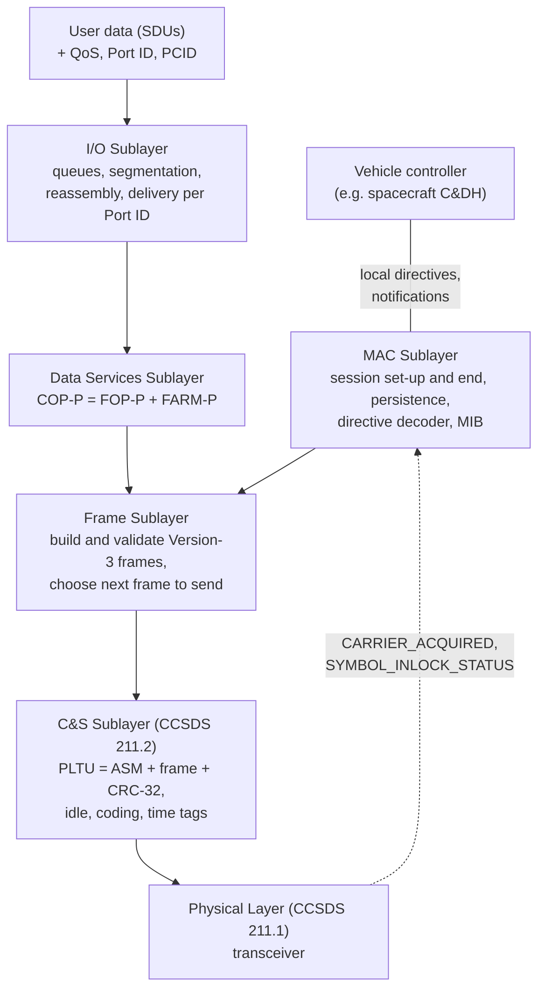
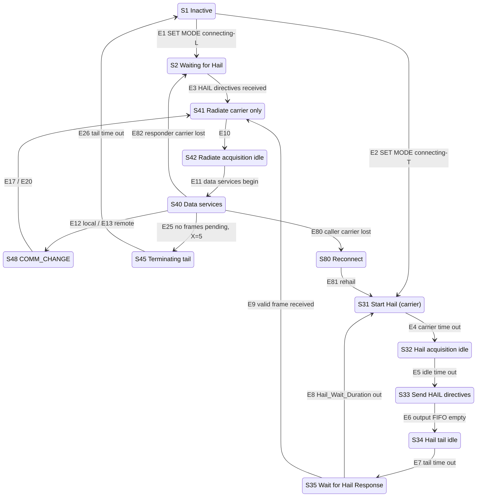
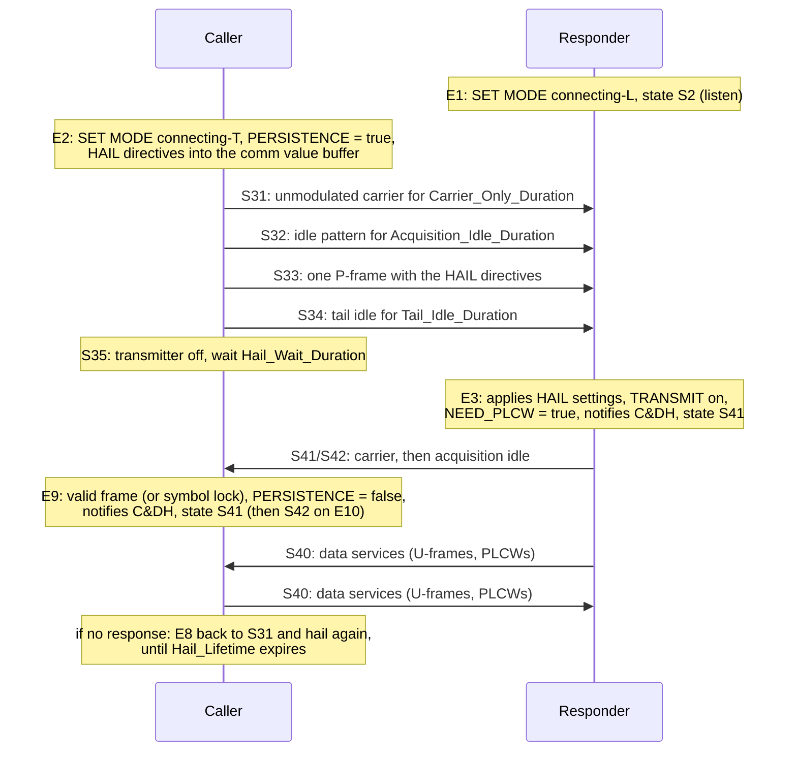
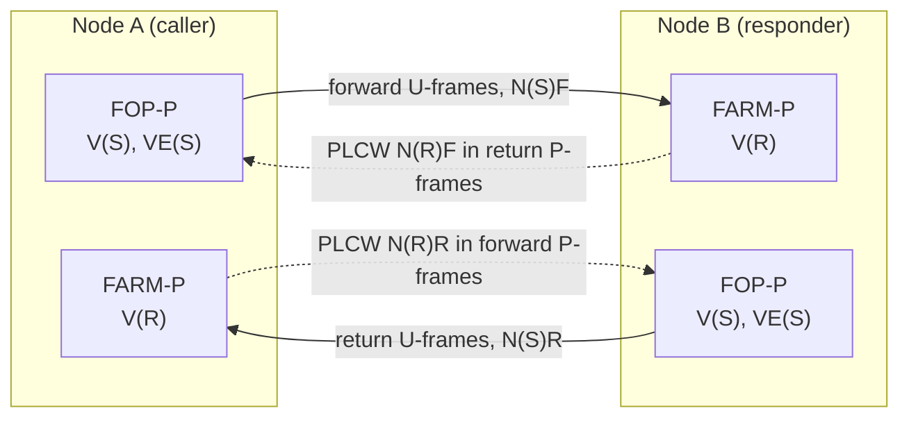
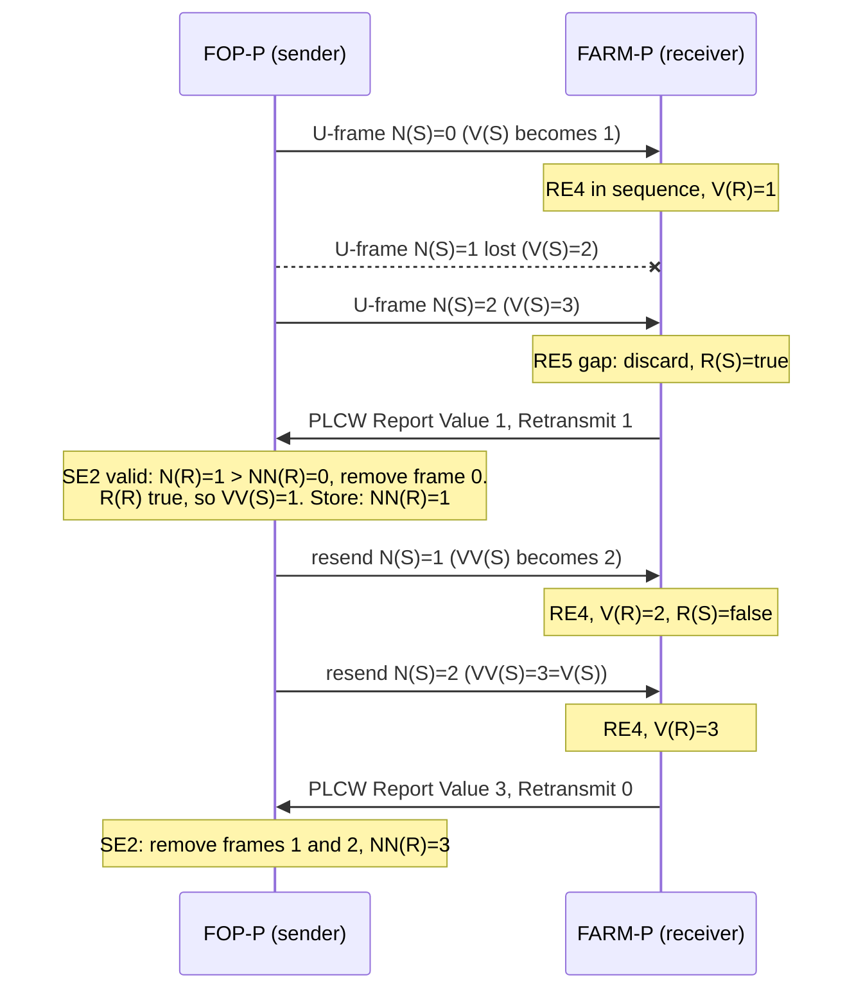

# Proximity-1 Space Link Protocol (CCSDS 211.0-B-6)

**Proximity-1** is the CCSDS link protocol for *proximity space links*: short-range, two-way radio
links, fixed or mobile, between probes, landers, rovers, orbiting constellations and orbiting relays.
Such links have short delays, moderate (not weak) signals and short, independent sessions.[^p-purpose]
The ECSS handbook calls it a departure from earlier CCSDS link protocols such as [TM](tm-sdlp.md) and
[TC](tc-sdlp.md): contacts are brief and mission control is remote, with long delays, so the two
spacecraft set up the link locally by a handshake (*hailing*), without precise scheduling, and can
renegotiate data rates during the contact.[^hb-desc] Proximity-1 then exchanges data reliably and ends
the session itself.[^p-defs3] The Blue Book specifies the **data link layer**. It covers the
Frame, Medium Access Control (MAC), Data Services and Input/Output (I/O) sublayers, the protocol data
units, the sequence-controlled and expedited transfer, timing services and the procedures that start
and end a session between a *caller* and a *responder*.[^p-scope]

This page follows issue 6 of the Blue Book (July 2020, with Editorial Change 1 of September 2024). It adds
the [USLP](uslp.md) annex that maps Proximity-1 onto Version-4 frames, the CCSDS overview Green Book, the
ECSS communications handbook and the CCSDS security report.[^p-doc][^u-annc][^hb-purpose]

| Issue | Date | Notes from the document control page |
|---|---|---|
| 211.0-B-1 | October 2002 | Original issue, titled "Proximity-1 Space Link Protocol" |
| 211.0-B-2 | April 2003 | Retitled "...Data Link Layer" |
| 211.0-B-3 | May 2004 | Superseded |
| 211.0-B-4 | July 2006 | Superseded |
| 211.0-B-5 | December 2013 | Superseded |
| 211.0-B-6 | July 2020 | Current issue: adds text on using the CCSDS Version-4 (USLP) Transfer Frame |
| EC 1 | September 2024 | Corrects heading numbering in section 2 and paragraph numbering in section 6; A4 page size |

Restated from the document control page.[^p-doc]

!!! info "Proximity-1 at a glance"
    | Item | Value |
    |---|---|
    | Layer | Data link layer, in five sublayers: Coding and Synchronization (C&S), Frame, MAC, Data Services, I/O |
    | Companion standards | CCSDS 211.2 (C&S sublayer) and CCSDS 211.1 (physical layer). Neither is in this wiki's library |
    | Protocol data units | Version-3 Transfer Frame (or the USLP Version-4 frame), carried in a PLTU |
    | PLTU | 24-bit ASM `0xFAF320` + frame + CRC-32 |
    | Frame length | 5 to 2048 octets, with a 5-octet header and a data field of up to 2043 octets |
    | Addressing | 10-bit SCID with a source-or-destination flag, 1-bit PCID, 3-bit Port ID |
    | Frame types | U-frame (user data) and P-frame (supervisory PDUs: directives, reports, PLCW) |
    | Reliability | Sequence Controlled (go-back-n ARQ by COP-P) or Expedited (no retransmission) |
    | Report | 16-bit Proximity Link Control Word (PLCW) |
    | Directionality | Full duplex (mandatory), half duplex and simplex (optional) |
    | Security | None in the protocol; SDLS does not apply to Version-3 frames |

    Sources: scope, frame structure, PLTU, PICS and security sections of CCSDS 211.0-B-6; the CCSDS
    security report.[^p-scope][^p-v3ctx][^p-annj][^p-pics-ops][^sec-350]

## Where Proximity-1 sits

The Proximity-1 model has a physical layer and a data link layer. Work is split into a *send side*,
which radiates the transmitted physical channel and acquires the received one, and a *receive side*,
which processes the received bit stream. The transmitter is driven by states. The receiver, once it is
on, has no modes: it accepts every valid local and remote directive and delivers the received data
units to the users.[^p-layers] The physical layer takes control variables and PLTUs from the layers
above and performs the requested channel coding. On reception it reports two status signals,
`CARRIER_ACQUIRED` and `SYMBOL_INLOCK_STATUS`, and outputs the coded symbol stream.[^p-phys]

*Sublayers and their main jobs, after section 2.1.4 and figure 2-1 of the Blue Book.*[^p-sublayers][^p-layers]

The five sublayers divide the work as follows:[^p-sublayers]

| Sublayer | Send side | Receive side |
|---|---|---|
| Coding and Synchronization (C&S), CCSDS 211.2 | Builds a PLTU around each Version-3 or Version-4 frame, inserts idle data, codes the bit stream | Delimits PLTUs, checks them (including decoding), passes valid frames up; time-tags data on request |
| Frame | Builds frames and fills in header fields, decides the order of transmission | Checks the version, SCID and source-or-destination flag, routes U-frames to Data Services and P-frames to MAC |
| Medium Access Control (MAC) | Starts, maintains and ends sessions; changes data rates and other link settings; holds the MIB parameters | Accepts directives from the local controller and across the link; sets `MODE`, `TRANSMIT` and `DUPLEX` |
| Data Services | Runs FOP-P for Sequence Controlled and Expedited service | Runs FARM-P |
| Input/Output (I/O) | Accepts SDUs and routing information from on-board users | Delivers SDUs to users through the Port ID given in the frame |

The [CCSDS overview](index.md) counts Proximity-1 among the Space Data Link Protocols. It notes that
Proximity-1, like TC and USLP, uses variable-length frames to suit variable-length messages with
different latency needs. Like TC, it has a retransmission procedure, COP-P, which the Green Book
calls similar to [COP-1](cop-1.md).[^g4-vl] The Green Book also expects that future missions may use
USLP instead of TM, TC, AOS and Proximity-1. Both Proximity-1 and USLP can run over the Proximity-1 C&S
sublayer and physical layer.[^g4-vl][^g4-stack] ECSS-E-ST-50C shows the Proximity-1 suite in its
protocol architecture figure, but describes it as only one possible choice for proximity
links.[^e50-prox] The Space Packet Protocol Blue Book likewise draws Prox-1 beside USLP, TM, TC
and AOS as a data link protocol that can carry Space Packets or Encapsulation Packets.[^spp-stack]

### Terms used throughout

| Term | Meaning in Proximity-1 |
|---|---|
| Caller / responder | The caller starts link establishment and manages any negotiation. The responder usually receives the link parameters from the caller. The caller calls on a prearranged channel with predefined parameters.[^p-defs] |
| Forward / return link | The forward link carries data from caller to responder (typically commands). The return link carries data from responder to caller (typically telemetry).[^p-defs][^p-defs3] |
| Hailing | The persistent activity that a caller uses to set up a link to a responder, in full or half duplex. It does not apply to simplex.[^p-defs] |
| Hailing channel | The pair of forward and return frequencies used to set up physical communication.[^p-defs] |
| Session | A dialogue in three phases: establishment, data services (which may include resynchronization and reconnect) and termination. Termination is either coordinated, by exchanging "no more data" directives, or each side decides on its own after communication is lost.[^p-defs3] |
| Reconnect | The caller hails the responder again during a session because no progress is being made. FOP-P and FARM-P variables, including the frame counters, are kept.[^p-defs3] |
| Resynchronization | The caller sees a sequence count anomaly and forces the responder's counter with the SET V(R) activity.[^p-defs3] |
| U-frame / P-frame | A frame carrying user data, or a frame carrying only supervisory protocol data units (SPDUs).[^p-defs2][^p-defs4] |
| Vehicle controller | The on-board entity (e.g. the spacecraft computer) that receives the notifications of annex D.[^p-defs4] |
| Asynchronous data link | A sequence of variable-length PLTUs that are not necessarily back to back. Proximity-1 is currently defined only for asynchronous links.[^p-defs][^p-states] |

Rates have their own names. **Rd** is the data rate of the PLTU-plus-idle bit stream at the encoder
input. **Rcs** is the coded symbol rate between the C&S sublayer and the physical layer. **Rchs** is the
channel symbol rate at the transmitter output, after optional Bi-Phase-L encoding.[^p-rates] Bits are
numbered as in all CCSDS standards: bit 0 is transmitted first and is the most significant bit, and all
spare bits are zero.[^p-conv]

## Addressing: SCID, PCID and Port ID

Proximity-1 uses a *triad* of identifiers:[^p-addr][^g4-triad]

* **Spacecraft Identifier (SCID).** The SCID names the spacecraft that is either the source or the
  destination of the frame. A separate bit, the Source-or-Destination Identifier, says which.
* **Physical Channel Identifier (PCID).** The PCID can select one of two redundant receivers at the
  receiving end. Either receiver supports both services.
* **Port ID.** The Port ID routes user data inside the receiving spacecraft. A port can be logical,
  such as an application or a transport process. It can also be physical, such as an on-board bus or
  a hardware command decoder.

SCIDs for Version-3 frames are assigned by the procedures of CCSDS 320.0. These procedures keep a
separate SCID table for each Transfer Frame Version Number. Version 3 ('10') has a 10-bit SCID range of
0 to 1023.[^p-scid][^scid-tfvn] See [space link identifiers](space-link-identifiers.md) for how SANA
assigns them. CCSDS has registered three Port ID uses (bitstream, hardware commands, packets). They are
listed on that page.[^sli-port]

## The Proximity Link Transmission Unit (PLTU)

The PLTU is the data unit of the C&S sublayer. It is sized to fit what it carries: a variable-length
frame that holds variable-length packets.[^p-pltu] It consists of:[^p-v3ctx][^p-annj]

| Part | Size | Content |
|---|---|---|
| Attached Synchronization Marker (ASM) | 3 octets | `0xFAF320`. The 24-bit marker suits short-delay, moderate-signal links and sets the bit error tolerance for synchronization |
| Transfer Frame | up to 2048 octets | Version-3 frame (5-octet header + up to 2043 octets of data field) or a Version-4 frame |
| CRC | 4 octets | CRC-32 for detecting transmission errors |

An idle sequence between PLTUs keeps symbol synchronization. PLTUs are inserted only after a physical
connection exists.[^p-pltu] The PLTU itself is specified in CCSDS 211.2, which is not in this wiki's
library. Because the CRC-32 is outside the frame, frame validation for COP-P is done by the C&S
sublayer, not by a frame error control field.[^p-pltu][^u-copp-val]

## The Version-3 Transfer Frame

A Version-3 Transfer Frame is a mandatory 5-octet header followed by a data field of up to 2043
octets. A particular implementation may allow less on a given physical channel.[^p-v3struct]

| Field | Bits | Values | Meaning |
|---|---|---|---|
| Transfer Frame Version Number | 2 (0–1) | `0b10` | Marks a Version-3 frame. Other values belong to other CCSDS frames.[^p-tfvn] |
| Quality of Service (QoS) Indicator | 1 (2) | 0 / 1 | `0` = Sequence Controlled service, `1` = Expedited service. At the receiver, COP-P checks the sequence number of Sequence Controlled frames only. Expedited frames bypass the check.[^p-tfvn][^p-qos] |
| PDU Type ID | 1 (3) | 0 / 1 | `0` = U-frame with user data, `1` = P-frame with SPDUs.[^p-pdutype] |
| Data Field Construction ID (DFC ID) | 2 (4–5) | `00`–`11` | Says how user data is arranged in a U-frame (table below). Not used in P-frames, where it must be `00`.[^p-dfc] |
| Spacecraft Identifier (SCID) | 10 (6–15) | 0–1023 | Spacecraft that is the source or the destination of the data in the frame.[^p-scid] |
| Physical Channel Identifier (PCID) | 1 (16) | 0 / 1 | Selects which of two concurrently operating receivers processes the frame.[^p-pcid] |
| Port ID | 3 (17–19) | 0–7 | Output port to which the I/O sublayer delivers the SDUs. Must be 0 in P-frames.[^p-port] |
| Source-or-Destination Identifier | 1 (20) | 0 / 1 | `0`: the SCID is the sender (`Local_Spacecraft_ID`). `1`: the SCID is the intended receiver (`Remote_Spacecraft_ID`).[^p-sd] |
| Frame Length | 11 (21–31) | 4–2047 | Total octets in the frame minus one, from the first header octet to the last data field octet. The maximum frame is 2048 octets.[^p-flen] |
| Frame Sequence Number (FSN) | 8 (32–39) | 0–255 | Counts Sequence Controlled frames (`SEQ_CTRL_FSN`) or Expedited frames (`EXP_FSN`) separately, per PCID.[^p-fsn] |

Ranges as listed in the PICS requirements list.[^p-pics-frame]

### Notes on the header fields

**PCID.** The PCID is meant for a receiving system with two transceivers working at the same time,
for example a primary and a backup. An implementation may also ignore the PCID and accept both values
with one set of MIB parameters and one set of state machines, including COP-P. If it does distinguish
the two values, each PCID must have its own complete set of MIB parameters and state machines. If only
one transponder is powered at a time, the standard advises against using the PCID to select
it.[^p-pcid]

**Port ID.** There are eight ports. They are independent of the physical channel, so all SDUs for the
same Port ID reach the same port whatever PCID carried them. CCSDS-reserved values are kept in the SANA
registries.[^p-port]

**Source-or-Destination and SCID checking.** The sender fills the SCID field from its MIB: with
`Local_Spacecraft_ID` when the flag is `0` (source), and with `Remote_Spacecraft_ID` when it is `1`
(destination).[^p-sd] The receiver validates frames as follows:[^p-sd-rx][^p-val]

| S/D flag | `Test_Source` | SCID compared with | Behaviour |
|---|---|---|---|
| 1 (destination) | true or false | `Local_Spacecraft_ID` | A mismatch rejects the frame |
| 0 (source) | true | `RECEIVING_SCID_BUFFER` (the remote SCID) | A mismatch is a *session violation* and the vehicle controller is notified. If the buffer is still zero, it is loaded from the first source-flagged frame and used for the rest of the session |
| 0 (source) | false | (no test) | Accepted |

**Frame Sequence Number.** The FSN increases monotonically and separately for the Sequence Controlled
and the Expedited frames of each PCID. The `SET INITIALIZE MODE` directive resets both counters to 0.
`SEQ_CTRL_FSN` drives the sequence check. `EXP_FSN` plays no part in frame validation but is needed
to correlate time tags in the timing services.[^p-fsn]

### Frame Data Field

The data field follows the header without a gap. It holds from zero octets up to the lesser of 2043
octets and `Maximum_Frame_Length` minus 5.[^p-tfdf] In a U-frame the DFC ID says what it holds:[^p-dfc]

| DFC ID | Content of a U-frame data field | Rules |
|---|---|---|
| `00` | An integer number of complete, unsegmented packets | All for the same Port ID and PCID. The first bit of the data field is the first bit of a packet header.[^p-dfc00] |
| `01` | One segment data unit: an 8-bit segment header and a piece of one packet | See below.[^p-dfc01] |
| `10` | Reserved for future CCSDS definition | Must not be used.[^p-dfc10] |
| `11` | User-defined data (an octet stream) | The user may even send frames with an empty data field.[^p-dfc10] |

In a P-frame the data field holds only SPDUs.[^p-dfc10] The packets carried must have a Packet Version
Number authorised by CCSDS, such as [Space Packets](space-packet.md) or
[Encapsulation Packets](encapsulation.md).[^p-pktsvc] For the Proximity-1 packet service, the
Encapsulation Packet Protocol identifies its channel by TFVN, SCID, PCID, DFC ID and Port ID.[^epp-prox]

The segment header holds two **Sequence Flags** (`01` first, `00` continuing, `10` last, `11` whole
packet) and a 6-bit **pseudo packet identifier**. The pseudo packet ID is a temporary label that the
protocol assigns to a user packet during segmentation. Segments of one packet must travel in frames
with the same PCID and Port ID. Segments of another packet may be interleaved only in frames with a
different PCID or Port ID.[^p-dfc01][^p-defs3] The receiver reassembles by **Routing ID**, the
combination of PCID, Port ID and pseudo packet ID, and delivers only complete packets. It discards the
packet being assembled, and logs the event in the session accountability report, in three cases: the
packet length field disagrees with the octets received; the first segment for a Routing ID is not a
start segment; or a new packet starts before the last segment of the previous one has
arrived.[^p-reasm]

!!! note "Same flags as TC"
    The four sequence flag values are the same as those of the TC segment header (`01` first,
    `00` continuing, `10` last, `11` no segmentation).[^p-reasm][^tc-segflags]

### Worked example: a U-frame header

The bytes below are **illustrative**, built for this page from the field definitions. They are not taken
from a real link. Take a Sequence Controlled U-frame that carries whole packets to Port ID 2, which the
CCSDS port assignment reserves for packets.[^sli-port] It is addressed (S/D = 1) to an illustrative
spacecraft with SCID 42 on PCID 0. The frame is 205 octets long, so C = 204, and its sequence number
is 7:[^p-tfvn][^p-flen]

| Octet | Bits | Hex | Fields |
|---|---|---|---|
| 0–1 | `10 0 0 00 0000101010` | `80 2A` | TFVN `10`, QoS 0, PDU Type 0, DFC `00`, SCID 42 |
| 2–3 | `0 010 1 00011001100` | `28 CC` | PCID 0, Port ID 2, S/D 1, Frame Length 204 |
| 4 | `00000111` | `07` | FSN 7 (a `SEQ_CTRL_FSN`, because QoS = 0) |

The receiver checks that the first two bits are `10`, a Version-3 frame (`11` would mean Version-4, and
`00` or `01` are rejected). With S/D = 1 it compares SCID 42 with its own `Local_Spacecraft_ID`. It then
hands the U-frame to FARM-P, which accepts it only if 7 equals its V(R).[^p-val][^p-farm]

## Supervisory protocol data units (SPDUs)

SPDUs carry protocol directives and reports. Directives configure and control the protocol processor
at the receiving node, set up, maintain and end sessions, and carry time correlation and
synchronization data. Reports describe the configuration and status of the sending node.[^p-spdu-intro]
An SPDU is either fixed-length or variable-length, depending on its **SPDU Format ID** bit. SPDUs
identify and delimit themselves, and they are sent only with Expedited QoS.[^p-spdu]

### Fixed-length SPDU: the Proximity Link Control Word (PLCW)

A `1` in the Format ID marks a 16-bit fixed-length SPDU: a 2-bit SPDU header and 14 bits of data. Type
`0` is the PLCW. Type `1` is reserved for future CCSDS use.[^p-spdu-gen][^p-fixed] The PLCW reports the
progress of the Sequence Controlled service from the receiver back to the sender. It is sent with
Expedited QoS.[^p-fixed][^p-plcw-exp]

| Field | Bits | Values | Meaning |
|---|---|---|---|
| SPDU Format ID | 1 (0) | `1` | Fixed-length SPDU.[^p-fixed] |
| SPDU Type Identifier | 1 (1) | `0` | PLCW (`1` reserved).[^p-fixed] |
| PLCW Retransmit Flag | 1 (2) | 0 / 1 | `0`: no outstanding rejections, nothing to resend. `1`: a received frame left a gap in the sequence numbers and the expected frame must be retransmitted.[^p-plcw-rt] |
| PCID | 1 (3) | 0 / 1 | The physical channel the report belongs to (from `RECEIVING_PCID_BUFFER`). Each PCID in use has its own PLCW reporting.[^p-plcw-pcid] |
| Reserved Spare | 1 (4) | `0` | Always 0.[^p-plcw-rv] |
| Expedited Frame Counter | 3 (5–7) | 0–7 | Modulo-8 counter showing that Expedited frames have arrived.[^p-plcw-rv] |
| Report Value | 8 (8–15) | 0–255 | The FARM-P variable V(R), reported separately for each physical channel and independently of the I/O port.[^p-plcw-rv] |

For comparison, the TC [CLCW](cop-1.md#the-clcw) of COP-1 is a 32-bit report carried in the 4-octet
Operational Control Field of TM frames.[^tc-clcw][^tm-ocf] The PLCW fits in 16 bits and is sent
inside a P-frame.[^p-fixed]

**Illustrative example.** A responder has accepted frames 0 to 7 (V(R) = 8) on PCID 0 and has counted
three Expedited frames. Its PLCW is `1 0 0 0 0 011 00001000` = `0x8308`. In a second case, the responder
has accepted only frame 0 (V(R) = 1) when frame 1 is lost and frame 2 arrives. V(R) stays at 1 and the
Retransmit flag is set: `1 0 1 0 0 011 00000001` = `0xA301` (with the same Expedited count).
These values are built for this page from the field definitions.[^p-plcw-rt][^p-plcw-rv][^p-farm]

### Variable-length SPDUs

A `0` in the Format ID marks a variable-length SPDU. Its 1-octet header carries a 3-bit Type
Identifier and a 4-bit **Data Field Length**. This is the actual number of data octets (0 to 15), not
length minus one. The data field holds one or more directives or reports of the same SPDU type.[^p-spdu-gen][^p-var]

| SPDU type | Type bits | Data field | Use |
|---|---|---|---|
| Type 1 | `000` | 0 to 7 concatenated 16-bit directives or reports | Link control (annex B1).[^p-var][^p-t1] |
| Type 2 | `001` | 1 to 15 octets: directive type octet + time value | TIME DISTRIBUTION (annex B2).[^p-var][^p-t2] |
| Type 3 | `010` | 0 to 15 octets | Status reports. Their format is enterprise-specific and left to the implementation.[^p-t3] |
| Types 4–8 | `011`–`111` | — | Reserved for CCSDS.[^p-var] |

### Type 1 directives and reports

Each Type 1 protocol object is 16 bits long and identifies itself by a 3-bit **Directive Type** in bits
13–15. Objects are concatenated without gaps. The Directive Type sits at the end of the word so that
the format stays compatible with the NASA Mars Odyssey orbiter.[^p-annb][^p-t1]

| Directive Type | Object | Purpose | PICS |
|---|---|---|---|
| `000` | SET TRANSMITTER PARAMETERS | Sets the partner's transmit frequency, encoding, modulation, data rate and mode | M |
| `001` | SET CONTROL PARAMETERS | Token pass, Remote No More Data, duplex change, time sampling | M |
| `010` | SET RECEIVER PARAMETERS | Sets the partner's receive frequency, decoding, modulation, data rate and mode | M |
| `011` | SET V(R) | Forces the partner's FARM-P V(R) (resynchronization) | M |
| `100` | REPORT REQUEST | Asks for a status report, a time-tag exchange or a PLCW per PCID | O |
| `101` | Reserved | — | — |
| `110` | SET PL EXTENSIONS | Enables physical-layer options outside the core standard | M |
| `111` | REPORT SOURCE SPACECRAFT ID | Reports the sender's own SCID | O |

Directive types from figure B-1; status from the PICS (M = mandatory, O = optional).[^p-annb-fig][^p-pics-b]

#### SET TRANSMITTER PARAMETERS and SET RECEIVER PARAMETERS

These two directives share one layout. Seen from the forward link, SET TRANSMITTER PARAMETERS sets the
responder's *transmit* (return) channel and SET RECEIVER PARAMETERS sets its *receive* (forward)
channel. Actual frequencies are defined in the physical layer standard.[^p-stp][^p-srp]

| Field | Bits | Values |
|---|---|---|
| Mode | 0–2 | `001` Proximity-1 protocol; `000`, `010`–`101` mission-specific; `110`, `111` reserved by CCSDS.[^p-stp-mode] |
| Data Rate | 3–6 | Rate before encoding (transmitter) or after decoding (receiver); see the table below.[^p-stp-rate] |
| Modulation | 7 | `0` coherent PSK, `1` non-coherent PSK.[^p-stp-mod] |
| Data Encoding / Decoding | 8–9 | `00` LDPC (2048,1024) rate 1/2; `01` convolutional code (7,1/2) with inverted G2 and an attached CRC-32; `10` bypass all codes; `11` concatenated R-S(204,188) and CC(7,1/2). The last option is an ETSI standard and is not needed for cross support.[^p-stp-enc] |
| Frequency | 10–12 | Channels 0 to 7: `Ch0R`–`Ch7R` for the transmitter, `Ch0F`–`Ch7F` for the receiver.[^p-stp][^p-srp] |
| Directive Type | 13–15 | `000` (transmitter) or `010` (receiver).[^p-stp][^p-srp] |

Because of the Odyssey implementation, the 8, 32, 128 and 256 kb/s codes also depend on the modulation
(NC = non-coherent, C = coherent). Rates of 1, 512, 1024 and 2048 kb/s can only be chosen with SET PL
EXTENSIONS:[^p-stp-rate]

| Bits | Rate (kb/s) | Bits | Rate (kb/s) | Bits | Rate (kb/s) | Bits | Rate (kb/s) |
|---|---|---|---|---|---|---|---|
| `0000` | 8 NC | `0100` | 128 NC | `1000` | 2 | `1100` | 16 |
| `0001` | 8 C | `0101` | 128 C | `1001` | 4 | `1101` | 64 |
| `0010` | 32 NC | `0110` | 256 NC | `1010` | reserved (R1) | `1110` | reserved (R3) |
| `0011` | 32 C | `0111` | 256 C | `1011` | reserved (R2) | `1111` | reserved (R4) |

The data rate follows from the coded symbol rate: Rd = Rcs uncoded, Rd = 0.5 × Rcs with the
convolutional code, and Rd = 0.48484 × Rcs with LDPC. The tabulated coded symbol rates run from 1000 to
4 096 000 symbols per second. For example, Rcs = 16 000 gives 16 000, 8000 or about 7757.6 b/s.[^p-rcs]

#### SET CONTROL PARAMETERS

SET CONTROL PARAMETERS changes zero to four control parameters at once.[^p-scp] **Token** (bit 12): `1`
passes the half-duplex send token, so the recipient switches to transmit. **Remote No More Data**
(bit 11): `1` tells the recipient that the sender has nothing more to send, so the session can end once
the recipient has nothing either. **Duplex** (bits 6–8): `000` no change, `001` full, `010` half,
`011` simplex transmit, `100` simplex receive, `101`–`111` reserved. **Time Sample** (bits 0–5): a
non-zero value *n* tells the recipient to capture time and frame sequence numbers for the next *n*
frames. Bits 9–10 are zero.[^p-scp][^p-scp2][^p-scp3] The illustrative word for "no more data" alone is
`0x0011`.

#### SET V(R), REPORT REQUEST and REPORT SOURCE SPACECRAFT ID

**SET V(R)** carries, in bits 0–7, the Sequence Controlled FSN to which the partner's receiver must be
set. Bits 8–12 are spare.[^p-setvr] **REPORT REQUEST** asks the remote node for a PLCW for PCID 1
(bit 12) or PCID 0 (bit 11), sent on the PCID the request arrived on. It can also ask for a time-tag
exchange (bits 8–10 non-zero) or a status report (bits 3–7). All status report types are still reserved
for CCSDS.[^p-rr][^p-rr2] **REPORT SOURCE SPACECRAFT ID** lets a transceiver tell its partner its own
SCID in bits 0–9.[^p-rssc]

#### SET PL EXTENSIONS

SET PL EXTENSIONS turns on or off physical-layer options that are outside the core standard. It exists
so that transceivers with extra physical-layer and C&S capabilities can work together.[^p-plx][^p-plx-dir]

| Field | Bits | Values and cross-support status |
|---|---|---|
| Direction | 0 | `0` transmit side, `1` receive side.[^p-plx-dir] |
| Frequency Table | 1 | `0` channels 0–7 of the core directives; `1` extended channels 8–15 (`Ch8F`–`Ch15F` forward, `Ch8R`–`Ch15R` return).[^p-plx-freq] |
| Rate Table | 2 | `0` default rate set (required for cross support). `1` extended set: `0000` 1000 b/s, doubling up to `1011` 2 048 000 b/s, with `1100`–`1111` reserved. The extended set is required for cross support below 2000 b/s and above 256 000 b/s.[^p-plx-rate] |
| Carrier Modulation | 3–4 | `00` none, `01` PSK, `10` FSK, `11` QPSK. FSK and QPSK are not needed for cross support.[^p-plx-mod] |
| Data Modulation | 5–6 | `00` NRZ-L, `01` Bi-Phase-L (Manchester), others reserved. NRZ-L is needed only to work with NASA MRO.[^p-plx-mod] |
| Mode Select | 7–8 | `00` suppressed carrier (needs a 90° modulation index and differential mark encoding/decoding), `01` residual carrier, others reserved. Suppressed carrier is needed only to work with MRO.[^p-plx-mode] |
| Scrambler | 9–10 | `00` and `10` bypass, `01` CCITT, `11` IESS. None of these is needed for cross support.[^p-plx-dme] |
| Differential Mark Encoding | 11 | `1`: each output bit is the XOR of the data bit and the previous output bit. Needed only to work with MRO.[^p-plx-dme] |
| R-S Code | 12 | `0` R-S(204,188), `1` R-S(255,239). Neither code is specified elsewhere by CCSDS, so neither is needed for cross support.[^p-plx-rs] |

### Type 2: the TIME DISTRIBUTION SPDU

A TIME DISTRIBUTION SPDU holds exactly one TIME DISTRIBUTION directive in a 15-octet data field. All
time fields use the CCSDS Unsegmented Time Code (see [time codes](time-codes.md)).[^p-b2]

| Field | Octets | Content when the type is TIME TRANSFER (otherwise zero) |
|---|---|---|
| Directive Type | 0 | `0x00` NULL, `0x01` TIME TRANSFER, all others reserved.[^p-b2] |
| Transceiver Clock | 1–8 | Clock value when the trailing edge of the last ASM bit of the transmitted PLTU crosses the clock capture point. 5 octets of coarse time and 3 of fine time.[^p-b2b] |
| Send Side Delay | 9–11 | Delay between the internal clock capture point and the time reference point. 1 coarse octet and 2 fine octets.[^p-b2b] |
| One-Way Light Time | 12–14 | Light time between the two reference points, used if the mission decides so. 1 coarse octet and 2 fine octets.[^p-b2b] |

### Worked example: a hail P-frame

**Illustrative bytes**, built for this page. A caller hails SCID 42 and asks it to use the Proximity-1
protocol mode at 8 kb/s coherent with the convolutional code on channel 0 in both directions. The hail
directives go in one frame, in this order: SET PL EXTENSIONS (TX) if present, SET TRANSMITTER
PARAMETERS, SET PL EXTENSIONS (RX) if present, SET RECEIVER PARAMETERS. Here no extensions are
used.[^p-st-fd][^p-st-hd][^p-fd-est]

| Octets | Hex | Meaning |
|---|---|---|
| 0–4 | `B0 2A 08 09 00` | Header: TFVN `10`, QoS 1 (Expedited), PDU Type 1 (P-frame), DFC `00`, SCID 42, PCID 0, Port 0, S/D 1, length C = 9 (10 octets), EXP_FSN 0 |
| 5 | `04` | Variable-length SPDU header: Format 0, Type `000`, 4 data octets |
| 6–7 | `22 40` | SET TRANSMITTER PARAMETERS: mode `001`, rate `0001` (8 kb/s C), modulation 0, coding `01`, channel `000`, type `000` |
| 8–9 | `22 42` | SET RECEIVER PARAMETERS: the same settings, type `010` |

The P-frame uses Expedited QoS, as every SPDU must. The DFC ID and the Port ID are zero, as required in
P-frames.[^p-spdu][^p-dfc][^p-port] On the wire the C&S sublayer adds the ASM `FA F3 20` in front and a
CRC-32 behind.[^p-annj]

## Services and qualities of service

When a user, for example the vehicle controller, hands over an SDU, it also gives the PCID, the quality
of service and the destination Port ID.[^p-svc-common] There are two data transfer services and a
timing service:[^p-svc-types][^p-pktsvc]

* **Packet delivery service.** Carries packets whose Packet Version Number is authorised by CCSDS.
  A packet larger than the frame data field is segmented and reassembled. Smaller packets can share
  a frame. The Port ID selects the output port.
* **User-defined data delivery service.** Carries one user's octet-aligned data unit, whose format
  the service does not know or use. A large SDU is spread over several frames and delivered frame by
  frame, *without* reassembly.
* **Timing services.** Time-tag frames for time correlation, and transfer time to a remote asset
  (see [timing services](#timing-services)).

Each transfer has one of two **qualities of service**, controlled by COP-P:[^p-qos-gen][^p-qos-sc][^p-qos-exp]

| | Sequence Controlled | Expedited |
|---|---|---|
| QoS Indicator | `0` | `1` |
| Mechanism | Go-back-n ARQ with sequence numbers at both ends and the PLCW report | Sent without ARQ, independently of the Sequence Controlled frames waiting on the same channel |
| Guarantee | Within one session without COP-P resynchronization: no SDU lost, duplicated or out of order, with high probability | None. SDUs may be sent once or several times, but never again because of a retransmission request. Any such request is handled outside the protocol |
| Segmented packets | Reassembled; only complete packets are delivered | Reassembled; only complete packets are delivered. User-defined data units larger than a frame are delivered in pieces |
| Typical use | Normal reliable transfer | Upper layers with their own retransmission, or exceptional cases such as spacecraft recovery |
| Supervisory traffic | Not allowed | All SPDUs, including PLCWs |

The Sequence Controlled guarantee does not cover sessions with a COP-P resynchronization, which may
lose or duplicate data. It also does not remove duplicates at the boundary between two sessions; that
is left to the controlling data system.[^p-ds-gen] The ECSS handbook sums up the two grades: in order and
without gaps or duplicates, or in order without duplicates but possibly with gaps.[^hb-svc]

## Inside the data link layer

### Frame Sublayer: building, validating and choosing frames

At the sending end the Frame Sublayer takes frames from Data Services and MAC, adjusts field values,
builds PLCWs and status reports into P-frames, decides the order of transmission and passes frames to
C&S. At the receiving end it checks that a frame is Version-3 or Version-4 and that the SCID and S/D
flag allow local acceptance. It routes valid U-frames to Data Services, the SPDUs of valid P-frames to
MAC, and PLCWs to Data Services.[^p-fs-func] Frames are sent only while `TRANSMIT` is on. When
`NEED_PLCW` or `NEED_STATUS_REPORT` is true, the report goes into a P-frame.[^p-fs-mux]

Each time a frame is needed, the source is chosen by a fixed priority:[^p-fs-sel]

1. a frame from the MAC queue;
2. a PLCW or status report, if the last frame sent was a U-frame (`U-frame_last_sent` true);
3. an Expedited frame from the I/O sublayer's Expedited queue;
4. a Sequence Controlled frame, first from the Sent queue if a retransmission is needed, then from the
   Sequence Controlled queue;
5. a PLCW or status report, if `U-frame_last_sent` is false.

`U-frame_last_sent` is set true at session start and after any frame other than a report, and false after
a PLCW or status report. Steps 2 and 5 therefore alternate reports with user data. While `PERSISTENCE` is
true, only supervisory frames from the MAC queue are sent.[^p-fs-sel]

### MAC Sublayer: persistence

The MAC Sublayer sets up and ends each session and makes any physical-layer change during data services.
Many of these operations are a handshake based on the physical-layer signals. Because a control message
may be corrupted on the link, each MAC activity uses a **persistence** process: the expected result must
be confirmed before the next activity starts.[^p-mac][^p-pers] A persistent activity uses Expedited QoS and
the MAC queue. It consists of one or more actions, such as sending directives, followed by a waiting period
for a response. Only one activity runs at a time, but activities can be chained. Three are defined:
**hailing**, **COMM_CHANGE** and **resynchronization** (SET V(R)).[^p-pers]

| Persistence parameter | Meaning |
|---|---|
| ACTIVITY | Name of the activity |
| WAITING_PERIOD | Time allowed for the RESPONSE before the activity is repeated or aborted |
| RESPONSE | The responder's acknowledgement that the activity was accepted |
| NOTIFICATION | Success or failure message to the local vehicle controller |
| LIFETIME | How long, or how many times, the activity is repeated before it is aborted |

Per-activity values are MIB parameters (for hailing: `Hail_Wait_Duration`, `Hail_Response`,
`Hail_Notification`, `Hail_Lifetime`).[^p-pers-par][^p-mib-hail] When an activity starts, `PERSISTENCE` is
set true and the Frame Sublayer sends only from the MAC queue. The activity succeeds if the RESPONSE
arrives within the LIFETIME and fails otherwise. In both cases the vehicle controller is notified and
`PERSISTENCE` returns to false.[^p-pers-proc] `MAC_FRAME_PENDING` tells the Frame Sublayer that a whole
frame is in the MAC queue. A **Directive Decoder** applies received directives to the configuration of
both layers. Two buffers hold the egress and ingress clock times, sequence numbers and QoS for the timing
service.[^p-mac-fp][^p-mac-dd]

### Data Services Sublayer and I/O Sublayer

Data Services orders the transfer of user data within the session and provides both qualities of
service. On the send side it runs FOP-P, processes received PLCWs, confirms complete SDUs to the I/O
Sublayer and accepts frames from it. On the receive side it runs FARM-P on received
U-frames.[^p-ds-func][^p-ds-gen] FOP-P reports frame-level accounting, V(S) and VE(S), to the I/O Sublayer
for every frame it numbers.[^p-ds-io]

The I/O Sublayer is the interface to on-board data systems. For a Version-3 frame its **I/O Port ID** is
the PCID followed by the Port ID. For a Version-4 frame it is the VCID followed by the MAP ID.[^p-io]
At the sending end the user gives, for each data unit, the QoS, output Port ID, PDU type, DFC ID,
`Remote_Spacecraft_ID`, PCID and S/D flag. The I/O Sublayer then builds the frame data unit and the
header (with the FSN still empty) within `Maximum_Packet_Size` and `Maximum_Frame_Length`, segmenting
packets if needed.[^p-io-send] All data units in one frame must have the same destination, PDU type,
PCID, Port ID, QoS and DFC ID.[^p-io-ops] The user is told when an Expedited SDU has been radiated, and
when a Sequence Controlled SDU has been acknowledged. For the latter, the I/O Sublayer associates each SDU
with the FSN of the frame that holds its last octet and checks it against NN(R).[^p-io-send][^p-io-q]
Two queues, Expedited and Sequence Controlled, raise `EXPEDITED_FRAME_AVAILABLE` and
`SEQUENCE_CONTROLLED_FRAME_AVAILABLE` while they hold frames. A frame taken by Data Services leaves its
queue for good. The local directive `CLEAR QUEUE` can empty a queue.[^p-io-q][^p-io-q2] At the receiving
end the I/O Sublayer reassembles segments and delivers only complete data units to the port named in the
frame. With Version-4 frames these functions pass to the USLP service users.[^p-io-rx][^p-io-ops]

## Operations: states, variables and events

Section 6 of the Blue Book describes operations with state tables and diagrams for full duplex, half
duplex and simplex. It applies to both Version-3 and Version-4 frames.[^p-ops-road]

### State and operational variables

Four **state control variables** define each state:[^p-states][^p-mode][^p-duplex]

| Variable | Values | Meaning |
|---|---|---|
| `MODE` | inactive, connecting-T, connecting-L, active | inactive: transmitter and receiver off. connecting-T: hailing (transmit-connecting). connecting-L: receiver on, transmitter off (listening). active: data services |
| `DUPLEX` | full, half, simplex transmit, simplex receive | Set with the local `SET DUPLEX` directive |
| `TRANSMIT` (T) | on, off | Turns the transmitter on or off when `MODE` is not inactive |
| `SS` (sub-state) | 0–7 | Tracks the sequence through the states and selects what goes into the output FIFO |

Further **operational control variables** steer sub-processes:[^p-x][^p-yz][^p-need][^p-bufs]

| Variable | Values | Use |
|---|---|---|
| `X` (session termination) | 0–5 | 0 data flowing both ways; 1 local "no more data" received (half duplex); 2 sending RNMD after a local LNMD; 3 local data still pending but RNMD received (half duplex); 4 RNMD received, RNMD to be sent once local data is done; 5 neither side has data, so the session ends after RNMD and `X` returns to 0 |
| `Y` (COMM_CHANGE) | 0–5 | 0 none; 1 local request; 2 sending the COMM_CHANGE directive; 3 waiting for acknowledgement; 4 remote COMM_CHANGE directive (RCCD) received; 5 acting on the RCCD (4 and 5 in full duplex only) |
| `Z` (SYMBOL_INLOCK_STATUS) | 0 / 1 | Whether symbol lock has dropped during a COMM_CHANGE (state S48) |
| `MODULATION` | on / off | Modulates the carrier with coded symbols, or radiates carrier only |
| `PERSISTENCE` | true / false | A persistent activity is in progress |
| `NEED_PLCW`, `NEED_STATUS_REPORT` | true / false | Set at initialization, by state transitions, by the PLCW timer and by COP-P. Cleared when the report is selected for output |
| `REMOTE_SCID_BUFFER` | SCID | Used to test frames whose S/D flag is destination |
| `COMMUNICATION_VALUE_BUFFER` | link settings | Staging area for the HAIL and COMM_CHANGE parameters |
| `RECEIVING_SCID_BUFFER` | SCID | Expected remote SCID. Loaded by the vehicle controller or from the first valid frame |
| `RECEIVING_PCID_BUFFER` | 0 / 1 | Loaded with the PCID of the first valid received frame |

Setting `MODE` to inactive (also through `SET INITIALIZE MODE`) resets `TRANSMIT`, `MODULATION` and
`PERSISTENCE` to off, off and false. It resets `SS`, `X`, `Y`, `Z`, the wait timer, the carrier loss
timer, the PLCW timer and both FSN counters to 0. `SET INITIALIZE MODE` also triggers the COP-P
initialization events SE0 and RE0.[^p-init]

### The states

| State | Name | RX | TX | MODE | T | SS | Duplex |
|---|---|---|---|---|---|---|---|
| S1 | Inactive | off | off | inactive | off | 0 | any |
| S2 | Waiting for Hail | on | off | connecting-L | off | 0 | any |
| S80 | Reconnect | on | off | active | off | 0 | any |
| S31 / S11 | Start Hail Action (carrier only) | on / off | async | connecting-T | on | 1 | full / half |
| S32 / S12 | Send Hail Acquisition (idle) | on / off | async | connecting-T | on | 2 | full / half |
| S33 / S13 | Send Hail Directives | on / off | async | connecting-T | on | 3 | full / half |
| S34 / S14 | Send Hail Tail (idle) | on / off | async | connecting-T | on | 4 | full / half |
| S35 / S36 | Wait for Hail Response | on | async / off | connecting-T | off | 5 | full / half |
| S41 / S51 | Radiate Carrier Only | on / off | sync | active | on | 1 | full / half |
| S42 / S52 | Radiate Acquisition Idle | on / off | sync | active | on | 2 | full / half |
| S40 | Data services | on | sync | active | on | 0 | full |
| S48 | COMM_CHANGE | on | sync | active | on | 6 | full |
| S45 | Terminating Tail | on | sync | active | on | 4 | full |
| S50 | Data Services (send) | off | sync | active | on | 0 | half |
| S54 | Terminate Reply | off | sync | active | on | 3 | half |
| S55 | Tail before Quit | off | sync | active | on | 7 | half |
| S56 | Token Pass or COMM_CHANGE | off | sync | active | on | 6 | half |
| S58 | Tail before Switch | off | sync | active | on | 4 | half |
| S60 | Data Services (receive) | on | off | active | off | 0 | half |
| S61 | Awaiting First Frame | on | off | active | off | 1 | half |
| S62 | Wait for Carrier | on | off | active | off | 2 | half |
| S71 | Simplex Transmit | off | on | active | on | 0 | simplex |
| S72 | Simplex Receive | on | off | active | off | 0 | simplex |

Condensed from tables 6-2 to 6-5. In S2 only supervisory frames (PDU Type ID = 1) are processed, and
nothing is transmitted. In S80 the caller turns its transmitter off for `Drop_Carrier_Duration` so that
the responder loses carrier lock and falls back to S2, while all COP-P variables are
kept.[^p-st-indep][^p-st-fd][^p-st-hd][^p-st-sx]

### Full duplex: hailing, data services and reconnect

*Main full duplex transitions from table 6-7 (establishment), 6-8 (COMM_CHANGE) and 6-9 (termination).
E28, a local `SET MODE inactive` or `SET INITIALIZE MODE`, leads from any state to S1 and is not
drawn.*[^p-fd-est][^p-fd-cc][^p-fd-term]

The hailing sequence, as a timeline between the two transceivers:

*Events E1 to E11 of table 6-7. The responder may treat `SYMBOL_INLOCK_STATUS` = true as the Hail
response instead of a valid frame; this is an implementation option.*[^p-fd-est][^p-mib-hail]

The caller starts a session by setting its local transmitter and receiver parameters, loading
`Test_Source` if needed, and issuing `SET MODE (connecting-T)`.[^p-sess-est] Each transmission starts
with `Carrier_Only_Duration` of unmodulated carrier, then `Acquisition_Idle_Duration` of idle pattern for
symbol and decoder lock. It ends with `Tail_Idle_Duration` of idle to flush the receiver's decoders. The
same idle generator fills gaps when no frame is ready.[^p-mib-dur][^p-sess-disc] **Reconnect** handles loss
of carrier during data services. When the caller's `CARRIER_LOSS_TIMER` expires (E80), it turns its
transmitter off for `Reconnect_Wait_Duration`, returns to the initial hail settings and hails again (E81).
(Table 6-2 calls the carrier-off time `Drop_Carrier_Duration`, and only that name appears in annex C and
in the PICS, item DLL-172. `Reconnect_Wait_Duration` is not defined as a MIB parameter.)[^p-st-indep][^p-annc3][^p-pics-mib2]
FOP-P and FARM-P variables are kept. Implementations may use other durations for re-hailing. When the
responder's timer expires (E82), it returns to S2 and waits for the hail.[^p-fd-est2] The carrier loss
timer avoids dropping the session on a short fade from multipath or obstruction. When it runs out, the
vehicle controller decides whether to end the session or to reconnect.[^p-clt]

### COMM_CHANGE

A **COMM_CHANGE** changes data rate, frequency or other link parameters during a session. Locally it
uses SET TRANSMITTER PARAMETERS and SET RECEIVER PARAMETERS, and possibly SET PL EXTENSIONS. Sent across
the link, the same directives form the Remote COMM_CHANGE Directive (RCCD).[^p-lccd] In full duplex
(table 6-8) a local request (E12) moves S40 to S48 with `Y` = 1 and `PERSISTENCE` true. When no frames
are pending, the RCCD is sent (E14, `Y` = 2). After it has left the FIFO, the caller waits
`Persistence_Wait_Time` (E15, `Y` = 3) and resends if no answer comes (E18).[^p-fd-cc] When symbol lock
drops (E16) the caller applies its new receiver parameters and sets `Z` = 1. The first valid frame on the
new settings (E17) applies the new transmitter parameters and returns to S41 for re-acquisition. A
responder that receives the RCCD (E13) sends its tail idle (E19, E20) and then switches both directions.
It sets `NEED_PLCW`, so that a fresh PLCW confirms the link.[^p-fd-cc] The response, lifetime,
notification and waiting period are the `Comm_Change_*` MIB parameters.[^p-mib-cc]

### Session termination

Termination is coordinated through the `X` variable and the "no more data" signals. LNMD is the local
`LOCAL_NO_MORE_DATA` directive from the vehicle controller. RNMD is the Remote No More Data bit of SET
CONTROL PARAMETERS sent across the link.[^p-fd-term][^p-lnmd]

| Event (full duplex) | From | To | Action |
|---|---|---|---|
| E21 LNMD received | S40, X = 0 | S40, X = 2 | Put an RNMD into the MAC queue and send it |
| E22 RNMD received | S40, X = 0 | S40, X = 4 | Wait for the local side to finish |
| E23 RNMD received | S40, X = 2 | S40, X = 5 | Both done: start terminating |
| E24 LNMD received | S40, X = 4 | S40, X = 5 | Send RNMD |
| E25 no frames pending | S40, X = 5 | S45 | Start `Tail_Idle_Duration` |
| E26 tail time-out | S45 | S1 | `SET MODE inactive`; report end of session and the number of octets received |
| E28 local SET MODE inactive or SET INITIALIZE MODE | any | S1 | Same, from any state |

Table 6-9.[^p-fd-term]

### Half duplex and token passing

In half duplex only one side transmits at a time, and the right to transmit passes back and forth as a
**token** in SET CONTROL PARAMETERS.[^p-st-hd][^p-scp] The sender stays in S50 for at most
`Send_Duration`. When that runs out (E38) it sets `PERSISTENCE` so that only MAC frames are sent. Once
nothing is pending and no PLCW is needed (E39), it puts the token into the MAC queue (S56), sends the tail
(E42, S58) and turns around to receive (E43, S62, wait for carrier).[^p-hd-est][^p-mib-dur2] The receiver
expects transmissions for up to `Receive_Duration`. It moves from S62 to S61 on carrier lock (E47), from
S61 to S60 on the first valid frame (E46), and from S60 or S61 back to transmitting (S51) on receiving the
token (E49).[^p-hd-est] If the token is missed, the receive timer and loss of carrier lock send it to
transmit anyway (E48). The vehicle controller is told about "sender exceeded prescribed transmission
interval" (E44), "no data transferred" (E45, E50) and "no carrier received" (E50).[^p-hd-est][^p-notif]
After `Maximum_Failed_Token_Passes` cycles through S50, S56, S58, S62, S51 and S52 without success, E83
puts the caller into S80 to reconnect.[^p-hd-est2][^p-mib-tok]

Termination and COMM_CHANGE work as in full duplex, but also use `X` values 1 and 3. Termination passes
through the transmit states S54 (Terminate Reply) and S55 (Tail before Quit), and COMM_CHANGE through S56
and S58. If both nodes are out of data, receiving
RNMD with `X` = 2 ends the session at once (E58).[^p-hd-term][^p-hd-cc] PICS lists full duplex as
mandatory and half duplex and simplex as optional.[^p-pics-ops]

### Simplex

Simplex is entered from S1 by a "transmit simplex" or "receive simplex" directive (E71 to S71, E72 to S72).
Either sets `DUPLEX` and `TRANSMIT` and then `SET MODE active`. A local `SET MODE inactive` returns to S1
with an end-of-session notification (E73).[^p-st-sx][^p-sx] There is no feedback in simplex, so receipt
without gaps cannot be confirmed.[^hb-desc2]

### Timers, the output FIFO and what gets transmitted

All timers count down at the MIB frequency `Interval_Clock`, for example 100 Hz. The event fires when a
timer reaches 1, and a timer at 0 is inactive. The **wait timer** (WT) is loaded from whichever MIB
duration the state tables call for. The **CARRIER_LOSS_TIMER** is loaded with
`Carrier_Loss_Timer_Duration` when carrier is lost in mode active (in full duplex, or in half duplex
while receiving), and is cleared when carrier returns. The **PLCW timer** is reloaded with
`PLCW_Repeat_Interval` after each PLCW and sets `NEED_PLCW` when it fires. A zero interval means
"never".[^p-timers][^p-timers2][^p-plcwrep] When the output FIFO is empty, the next content is chosen by
sub-state and flags:[^p-fifo-tab]

| SS | SPDU pending | PERSISTENCE | NEED_PLCW | SDU pending | Loaded into the output FIFO |
|---|---|---|---|---|---|
| 2, 4 or 7 | any | any | any | any | Idle (acquisition or tail) |
| 0, 3 or 6 | true | any | any | any | ASM + P-frame (SPDU) + CRC |
| 0, 3 or 6 | false | true | any | any | Idle |
| 0, 3 or 6 | false | false | true | any | ASM + PLCW / status report + CRC |
| 0, 3 or 6 | false | false | false | true | ASM + U-frame (SDU) + CRC |
| 0, 3 or 6 | false | false | false | false | Idle |

SS = 1 means carrier only, and SS = 5 means transmitter off and receiver waiting for a response.
Choosing an SDU asks FOP-P to supply the next frame. `No_Frames_Pending` fires when the FIFO is empty and
nothing is selectable.[^p-fifo-tab][^p-fifo] Running several PCIDs at once is possible but needs
concurrent COP-P instances with per-PCID reporting. How their output is prioritised is outside the
standard.[^p-multi-pcid]

### Local and remote directives

**Local directives** come from the local controller and never cross the link: `SET MODE`,
`SET INITIALIZE MODE`, `LOCAL COMM_CHANGE` (LCCD), `LOAD COMMUNICATIONS VALUE BUFFER`,
`LOCAL_NO_MORE_DATA`, `SET DUPLEX`, `SET RECEIVING SCID BUFFER` and `READ STATUS`. In the PICS, LNMD and
READ STATUS are optional.[^p-local][^p-local2][^p-pics-dir] **Remote directives** are sent to the partner.
SET TRANSMITTER and SET RECEIVER PARAMETERS put the recipient's `MODE` into active. Together with SET PL
EXTENSIONS they serve both for hailing and for COMM_CHANGE. SET CONTROL PARAMETERS swaps transmit and
receive in half duplex, ends the session, changes duplex and sets up the timing
service.[^p-remote][^p-remote2]

### Frame reception and validation

Receiving is set up by `SET MODE (connecting-L)` or `(connecting-T)`. The Frame Sublayer gets its frames
from the C&S `ChannelAccess.indication` primitive. C&S has already delimited them using the frame length
field and rejected any with a CRC-32 error.[^p-rx] Validation then checks the version (`10` for Version-3,
`11` for Version-4, `00` or `01` rejected) and the SCID rules shown earlier. Each validated Expedited frame
increments the Expedited Frame Counter.[^p-val] Validated U-frames go to COP-P. In validated P-frames the
SPDUs are delimited, PLCWs go to COP-P and all other directives and reports are executed.[^p-valproc]

## COP-P: the Communication Operations Procedure for Proximity links

COP-P works between one sender and one receiver on a direct link. The receiver accepts every valid
Expedited frame, and valid Sequence Controlled frames only if they arrive in sequence. It reports its
state in PLCWs, and the sender uses them to retransmit Sequence Controlled frames. Expedited frames are
never retransmitted. Data can flow both ways at once, so each node runs both a FOP-P (sending) and a
FARM-P (receiving).[^p-copp][^p-copp2]

*After figure 4-1. The PLCWs about forward-link progress travel on the return link, and the other way
round.*[^p-copp2]

The FOP-P orders and multiplexes user data, keeps in step with the FARM-P and starts retransmissions.
If no valid PLCW arrives within `Synch_Timeout`, it tells the local controller that it is out of step.
If `Resync_Local` is false, the controller decides how to recover. Otherwise FOP-P forces a
resynchronization with SET V(R). The FARM-P is purely data-driven: it reacts to what it receives and
relies on C&S (error-free frame) and the Frame Sublayer (valid frame for this node). With Version-4 frames,
the use of FOP-P and FARM-P is specified in USLP.[^p-copp2] The ECSS handbook calls the scheme a
simplified version of the COP-1 retransmission protocol that uses little bandwidth for
acknowledgements.[^hb-svc]

### Modulo-256 arithmetic

All COP-P counters are single octets that count modulo 256. A − B is the number of increments that take B
to A. B < A means that A − B is between 1 and 127, B > A that it is between 128 and 255, and B = A that it
is 0.[^p-mod]

### FOP-P variables

| Variable | Type | Meaning |
|---|---|---|
| VE(S) | 8-bit | Sequence number of the next Expedited frame |
| V(S) | 8-bit | Sequence number of the next *new* Sequence Controlled frame |
| VV(S) | 8-bit | Number for the next Sequence Controlled frame to send. Equals V(S) unless a retransmission is in progress |
| N(R) | 8-bit | Report Value of the current PLCW: last acknowledged frame + 1 |
| NN(R) | 8-bit | Report Value of the previous valid PLCW |
| R(R) | Boolean | Retransmit Flag of the current PLCW |
| RR(R) | Boolean | Retransmit Flag of the previous valid PLCW |
| NEED_PLCW / NEED_STATUS_REPORT | Boolean | A new PLCW or status report must be sent (a PLCW whenever its content changes) |
| SYNCH_TIMER | countdown | Wait for a valid PLCW, loaded from `Synch_Timeout` (0 = never expires) |
| RESYNC | Boolean | True while the SET V(R) activity runs |

FOP-P keeps one output queue, the **Sent queue** of frames sent but not yet
acknowledged.[^p-fopq][^p-fopvars][^p-fopvars2] `Transmission_Window` caps the number of unacknowledged
frames at 127 or fewer. With a window of 10, the sender must wait for an acknowledgement after 10 frames.
Designers should consider the latency added when Sent-queue frames must be resent before new
ones.[^p-fop-notes]

### FOP-P procedures and state table

The procedures used by the state table:[^p-fopproc][^p-fopproc2]

* **Initialize**: V(S) = VE(S) = VV(S) = NN(R) = N(R) = 0; R(R) = RR(R) = RESYNC = false;
  NEED_PLCW = NEED_STATUS_REPORT = true; clear the Sent and SEQ queues.
* **Remove acknowledged frames**: drop N(R) − NN(R) frames from the Sent queue.
* **Start / Clear SYNCH_TIMER**: load `Synch_Timeout` if the timer is 0, or set it to 0 (clearing does not
  trigger a resynchronization).
* **Store this PLCW**: NN(R) = N(R), RR(R) = R(R).
* **Send EXP frame**: take a frame from the EXP queue, number it VE(S), increment VE(S), report VE(S) to
  I/O and pass the frame down.
* **Resend SEQ frame**: copy frame VV(S) from the Sent queue, increment VV(S), pass it down.
* **Send new SEQ frame**: take a frame from the SEQ queue, number it V(S), append a copy to the Sent queue,
  increment V(S) and VV(S), report V(S) to I/O and pass it down.

FOP-P has two states, **S1 Active** and **S2 Resync**:[^p-foptab][^p-fop-notes]

| Event | In S1 Active | In S2 Resync |
|---|---|---|
| SE0 session start-up | Initialize (or keep variables when reconnecting) | — |
| SE1 Frame Sublayer needs a frame | Expedited frame available → send it. Else VV(S) < V(S) → resend (continue a retransmission). Else a new SEQ frame is available and V(S) − NN(R) < `Transmission_Window` → send it. Else NN(R) < V(S) → start a *progressive retransmission*: VV(S) = NN(R), resend. Else nothing to send | — |
| SE2 valid PLCW | If N(R) > NN(R), remove acknowledged frames. If R(R) or N(R) > VV(S), set VV(S) = N(R). Store the PLCW and clear SYNCH_TIMER | If R(R) = false and N(R) = NN(R): RESYNC = false, `PERSISTENCE` = false, go to S1 |
| SE3 invalid PLCW | Start SYNCH_TIMER; VV(S) = NN(R) | Ignore |
| SE4 SYNCH_TIMER expired | Notify the vehicle controller. If `Resync_Local`: RR(R) = false, RESYNC = true, go to S2 | — |
| SE5 / SE6 set `Transmission_Window` / `Synch_Timeout` | Accept and set | Accept and set |
| SE7 reset request | Initialize | Initialize, go to S1 |
| SE8 invalid request | Reject | Reject |

A PLCW is **invalid** if it does not match the PLCW format, if N(R) < NN(R) (too small), if N(R) > V(S)
(too large), if R(R) is set while N(R) = V(S) (retransmit requested although everything is acknowledged),
or if the retransmit flag clears without any new acknowledgement (R(R) false, RR(R) true,
N(R) = NN(R)).[^p-fop-notes]

**Resynchronization (SET V(R) persistent activity).** The activity uses the MIB parameters
`Resync_Waiting_Period`, `Resync_Response`, `Resync_Notification` and `Resync_Lifetime`, with
`Resync_Local` true. FOP-P sets RESYNC. The MAC Sublayer then builds a SET V(R) directive with NN(R) as
the FSN and the PCID of this FOP-P, queues it in the MAC queue and sets `PERSISTENCE`. The activity ends
when a valid PLCW shows N(R) = NN(R) with R(R) false, or when `Resync_Lifetime`
expires.[^p-resync][^p-foptab]

!!! warning "Inconsistencies in the source"
    The text of 7.2.2 and the state table do not agree on event numbers. Clause 7.2.2 i) says that
    SYNCH_TIMER expiry triggers "SE6", and 7.2.2 j) that RESYNC is reset by "SE7". In the state table
    SE4 is the timer expiry, SE6 sets `Synch_Timeout` and SE7 is the reset request, while RESYNC is
    cleared under SE2 in state S2. Likewise 4.2.2.3 points to tables 6-8 and 6-11 for hailing and to
    6-9 and 6-12 for COMM_CHANGE, but hailing is in tables 6-7 and 6-10 and COMM_CHANGE in 6-8 and
    6-11. This page follows the tables.[^p-fopvars2][^p-foptab][^p-pers][^p-ops-road]

### FARM-P

The receiver keeps four variables: **V(R)**, the last acknowledged Sequence Controlled frame + 1;
**R(S)**, the retransmit flag copied into the PLCW; **N(S)**, the FSN of the arriving frame; and the 3-bit
**Expedited Frame Counter**.[^p-farmvars] Its state table has one state:[^p-farm]

| Event | Action |
|---|---|
| RE0 session start | R(S) = false, V(R) = 0, Expedited Frame Counter = 0, NEED_PLCW and NEED_STATUS_REPORT = true |
| RE1 invalid frame | Discard |
| RE2 valid SET V(R) | R(S) = false, V(R) = the FSN in the directive, NEED_PLCW = true |
| RE3 valid Expedited frame | Pass to I/O, increment the Expedited Frame Counter |
| RE4 valid Sequence Controlled frame, N(S) = V(R) | Pass to I/O, R(S) = false, increment V(R), NEED_PLCW = true |
| RE5 N(S) > V(R) (gap) | Discard, R(S) = true, NEED_PLCW = true |
| RE6 N(S) < V(R) (already received) | Discard |
| RE7 Frame Sublayer asks for PLCW content | Report R(S), V(R) and the Expedited Frame Counter |

FARM-P passes valid Expedited and in-sequence U-frames to the I/O Sublayer, which buffers and reassembles
them and delivers the result through the output port.[^p-farmio]

### Worked example: a lost frame

The trace below is **illustrative**. It applies the FOP-P and FARM-P tables to a link where Sequence
Controlled frame 1 is lost and the window is 10:[^p-foptab][^p-farm][^p-fop-notes]

This is the go-back-n behaviour: after a gap, FARM-P discards everything until the missing frame arrives,
and FOP-P resends from the first unacknowledged frame.[^p-qos-sc][^p-farm]

## Timing services

Proximity-1 defines two timing services for Version-3 or Version-4 frames. They provide information for a
time correlation function that is outside the standard. Implementations may offer further
parameters.[^p-time-ov]

**Time tag recording.** When time tagging is active, a transceiver records the time at which the trailing
edge of the last ASM bit of every incoming and outgoing frame crosses its clock capture point. All tags
must be correlatable to the enterprise-defined time reference point. MODE must be active, in full or half
duplex or in simplex, and tagging may run alongside data transfer. The vehicle controller asks its
initiator to send SET CONTROL PARAMETERS with a Time Sample value *n*. Both MAC sublayers then capture
local time, frame sequence number, direction and QoS for *n* frames and package them for time
correlation.[^p-tt][^p-tt2] The correlation process needs both data sets, the relation of one clock to UTC,
all path delays (the spacecraft builder measures those from antenna to radio port, the radio builder those
inside the radio, which depend on coding, symbol rate and mode) and the time code formats. Collecting tags
in both directions at once improves accuracy.[^p-tc]

**Time transfer to a remote asset.** Every transceiver must be able to distribute time. The initiator's
vehicle controller may first add the one-way light time to the enterprise time at the planned instant,
formatted as a CCSDS Unsegmented Time Code. It then commands a TIME DISTRIBUTION directive with that time,
the sender path delay and the OWLT, if used. The responder sets its clock and may add the delays according
to its accuracy needs. Accuracy depends on the initiator's own time error, the latency up to transmission,
the OWLT accuracy and the delay until the remote master clock is loaded.[^p-td][^p-td2] The ECSS handbook
adds that timing services provide time correlation data among units and time-derived ranging
measurements.[^hb-svc]

## Management Information Base (MIB) parameters

Proximity-1 uses the word MIB for its own configuration parameters. They have nothing to do with the
SCOS-2000 [Mission Information Base](../mib/index.md). The parameters are fixed for a session ("session
static") unless noted. Layers: P physical, C C&S, F frame, M MAC, D data services, I I/O, U
USLP.[^p-annc]

| Parameter | Status | Layer | Use |
|---|---|---|---|
| `Acquisition_Idle_Duration` | M | P, M | Idle pattern after carrier only, for symbol and decoder lock |
| `Carrier_Loss_Timer_Duration` | M | D | Grace period after carrier loss (full and half duplex) |
| `Carrier_Only_Duration` | M | P, M | Unmodulated carrier at the start of each transmission |
| `Comm_Change_Lifetime` | M | M | Duration or repetitions of the COMM_CHANGE activity |
| `Comm_Change_Notification` | M | M | Success or failure notice to the vehicle controller |
| `Comm_Change_Response` | M | M | The responder's acknowledgement (events E17, E20, E68) |
| `Comm_Change_Waiting_Period` | M | M | Time the caller waits for the response |
| `Drop_Carrier_Duration` | M | D | Carrier-off time that forces the responder back to S2 (reconnect) |
| `Frame Version in use` | — | F, U | 3 (Proximity-1) or 4 (USLP) |
| `Hail_Lifetime` | M | M | Duration or repetitions of the hailing activity |
| `Hail_Notification` | M | M | Hailing success or failure notice |
| `Hail_Response` | M | M | A valid frame, or (implementation option) symbol lock |
| `Hail_Wait_Duration` | M | M | Time the caller waits for a response to each hail |
| `Hailing_Channel` | M | P, M | Enterprise-specific forward/return frequency pair for establishment |
| `Hailing_Data_Rate` | M | P, M | Data rate during hailing |
| `Interval_Clock` | M | C | Frequency used by all timers (e.g. 100 Hz) |
| `Local_PCID` | O | M | PCID of the local receiver |
| `Local_Spacecraft_ID` | M | M | Own SCID, checked on destination-flagged frames |
| `Maximum_Failed_Token_Passes` | O | D | Half-duplex token cycles before reconnect (E83) |
| `Maximum_Frame_Length` | M | F, U | Largest frame between the nodes; its maximum depends on the frame version |
| `Maximum_Packet_Size` | M if packets | I | Largest packet, used in segmentation |
| `Persistence_Wait_Time` | M | M | Wait for the COMM_CHANGE acknowledgement |
| `PLCW_Repeat_Interval` | M | D | Maximum time between PLCWs (0 = infinite) |
| `Receive_Duration` | M | D | Longest expected transmission from the half-duplex partner |
| `Remote_PCID` | M | M | Powered receiver of the remote transceiver |
| `Remote_Spacecraft_ID` | M | F, M, D, I | Partner SCID (session dynamic) |
| `Resync_Lifetime`, `Resync_Notification`, `Resync_Response`, `Resync_Waiting_Period` | M | M, D | SET V(R) persistent activity |
| `Resync_Local` | M | D | True: FOP-P resynchronizes by itself. False: the local controller decides |
| `Send_Duration` | M | D | Longest half-duplex transmission before passing the token |
| `Source_Destination_ID` | M | M | 0 = source SCID, 1 = destination SCID |
| `Synch_Timeout` | M | D | Initial value of SYNCH_TIMER |
| `Tail_Idle_Duration` | M | P, M | Idle at the end of a transmission to flush the decoders |
| `Test_Source` | M | F | Whether source-flagged SCIDs are checked |
| `Transmission_Window` | M | D | COP-P window, at most 127 |

Restated from annex C.[^p-annc][^p-annc2][^p-annc3]

!!! note "Status mismatches"
    Annex C lists `Local_PCID` as optional, but item DLL-164 of the PICS marks it as mandatory.
    Conversely, annex C calls `Send_Duration` and `Receive_Duration` mandatory, while the PICS
    (DLL-171, DLL-180) marks them optional; both serve only half duplex, itself optional.[^p-annc2][^p-annc3][^p-pics-mib][^p-pics-mib2]
    Annex C also describes `Local_Spacecraft_ID` as a validation check when the Source-or-Destination
    ID equals *source*, while table 3-3 and clause 6.7.2 b) use it for frames flagged *destination*.
    The table above follows table 3-3 and 6.7.2.[^p-annc2][^p-sd-rx][^p-val]

## Notifications to the vehicle controller

| No. | Notification | Source |
|---|---|---|
| 1 | Result (success or failure) of a persistent activity | 4.2.2.2 |
| 2 | Status of the state control variables | Section 6 state tables |
| 3 | Invalid frame source: SCID differs from `RECEIVING_SCID_BUFFER` with `Test_Source` true (session violation) | 6.7 |
| 4 | Timing services: time tags and sequence numbers are available | Section 5 |
| 5 | No carrier received (half duplex) | Table 6-10, E50 |
| 6 | No data transferred (half duplex) | Table 6-10, E45, E50 |
| 7 | Sender exceeded the prescribed transmission period (half duplex) | Table 6-10, E44 |
| 8 | COP-P loss of synchronization (SYNCH_TIMER expired) | FOP-P SE4 |
| 9 | CARRIER_LOSS_TIMER underflow | Given as table 6-9, event 27 |
| 10 | End of session, with the number of octets received | E26, E27, E28, E57, E58, E61, E73 |
| 11 | Carrier only received after "Wait for Hail Response" | E8, E36 |

Annex D. Event E27 is cited there, but tables 6-7 to 6-9 contain no E27. Full duplex carrier loss is
handled by E80 and E82.[^p-notif][^p-fd-term][^p-fd-est2]

## Conformance (PICS)

Annex A is a Protocol Implementation Conformance Statement proforma with 196 items (DLL-1 to DLL-196). The allowed
values it lists match the field ranges above: TFVN 2, SCID 0–1023, Port ID 0–7, Frame Length 4–2047,
data field 0–2043 octets, `SS` 0–7, `X` and `Y` 0–5.[^p-pics-frame][^p-pics-var] At least one of the four
DFC ID options must be supported.[^p-pics-frame] The other optional items are: Type 2 (time distribution)
and Type 3 (status report) SPDUs; the time correlation process; computing the enterprise time (with the
OWLT) before a time transfer (DLL-61); LNMD and READ STATUS; half duplex and simplex operation; REPORT
REQUEST and REPORT SOURCE SPACECRAFT ID; `Maximum_Failed_Token_Passes`, `Send_Duration` and
`Receive_Duration`; and the three half-duplex notifications (5 to 7). Everything else is mandatory,
including full duplex, all COP-P variables and procedures, SET PL EXTENSIONS, time tag recording and the
time distribution steps DLL-60 and DLL-62 to DLL-64. The PICS thus makes the Type 2 SPDU (DLL-23)
optional, although the TIME DISTRIBUTION directive it carries is part of the mandatory time
distribution.[^p-pics-frame][^p-pics-ts][^p-pics-dir][^p-pics-ops][^p-pics-b][^p-pics-mib][^p-pics-notif]

## Version-4 (USLP) frames over Proximity-1

Since issue 6 a USLP Version-4 frame may replace the Version-3 frame over the Proximity-1 C&S sublayer.
USLP then takes over the Frame Sublayer functions, and its users take over the I/O Sublayer
functions.[^p-v4][^p-io-ops] USLP annex C maps the fields:[^u-annc][^u-annc2]

| Version-3 field (bits) | Version-4 equivalent (bits) |
|---|---|
| TFVN `10` (0–1) | TFVN `1100` (0–3): the last 2-bit value `11` extended with `00` |
| QoS Indicator (2) | Bypass/Sequence Control Flag (48) |
| PDU Type ID (3) | Protocol Control Command Flag (49) |
| DFC ID (4–5) and segment header flags | TFDZ Construction Rules (the first 3 bits of the TFDF header; annex C calls them bits 1–3, §4.1.4.2.2.1.2 bits 0–2, see [USLP](uslp.md#relationship-with-proximity-1))[^u-rules-bits] |
| Pseudo Packet ID | 5-bit USLP Protocol Identifier (UPID) field, for segmented data |
| SCID, 10 bits (6–15) | SCID, 16 bits (4–19) |
| PCID (16) | Most significant VCID bit (21) |
| (no Version-3 field) | Remaining VCID bits 22–26, giving 32 VCIDs for proximity operations |
| Port ID (17–19) | MAP ID, bits 28–30 only |
| Source-or-Destination (20) | Source-or-Destination (20) |
| Frame Length, 11 bits (21–31) | Frame Length, 16 bits (32–47); frames up to 65 536 octets |
| Frame Sequence Number (32–39) | VC Frame Count (56–63), with the VCF Count Length set to `001` (1 octet) |

Data field contents map as follows:[^u-annc2][^u-annc3]

| Version-3 DFC ID | Segment flags | Version-4 construction rule |
|---|---|---|
| `00` whole packets | — | `111` no segmentation |
| `01` segment | `01` first | `100` starting segment |
| `01` segment | `00` continuing | `101` continuing segment |
| `01` segment | `10` last | `110` last segment |
| `01` segment | `11` none | `111` no segmentation |
| `11` user-defined | — | `011` octet stream |

!!! note "Segment flag values in USLP table C-2"
    USLP table C-2 prints the Version-3 sequence flags as `00` → `100` starting segment and
    `01` → `101` continuing segment. In CCSDS 211.0-B-6 table 3-4, however, `01` is the first segment
    and `00` a continuing one. The table above pairs the rules by meaning, following 211.0-B-6. Neither
    document comments on the difference.[^u-annc2][^p-reasm]

In Proximity operations the TFDF header is reduced to the construction rule and the UPID. Proximity-1 uses
only variable-length USLP frames, so the First Header/Last Valid Octet Pointer is dropped. The Insert Zone
is not allowed, and the UPID values `00001` and `11111` do not apply. The PLCW, or an SDLS Frame Security
Report, can go in a separate P-frame or in the OCF, even in a frame with no data field. The FECF is
optional, because the PLTU's CRC-32 already protects the frame.[^u-annc3][^u-annc4] Because one VCID bit
stands in for the PCID, only 32 VCIDs remain for proximity links. Different spacecraft can be given
different VCIDs and so use different SDLS security associations.[^u-annc4] For COP-P over Proximity-1
coding, frame validation is done by the C&S sublayer, since the CRC-32 lies outside the
frame.[^u-copp-val]

## Security

The Proximity-1 data link layer has no security services. Annex E assumes that a layer above or below
provides them as needed: authentication where commands must be authentic, integrity against altered
commands, software or telemetry, and confidentiality against eavesdropping. It lists the consequences of
leaving any of these out.[^p-sec] The CCSDS security report states that SDLS cannot be used with the
Proximity-1 data link protocol. It recommends applying security above the I/O sublayer, to the user data,
with all Proximity-1 handling unchanged, which it compares to Transport Layer Security.[^sec-350] The SDLS
Blue Book itself excludes Proximity-1, and the overview Green Book notes that no Proximity-1 security
requirements have been set so far.[^sdls-prox][^g4-sec] With Version-4 frames, SDLS can be used through
the USLP Security Header and Trailer, chosen per VCID.[^u-annc4] See [SDLS](sdls.md) and
[security in CCSDS space links](security.md). The current issue required no SANA action, and the existing
Proximity-1 registries continue.[^p-sana]

## Where Proximity-1 is used: Mars relay

Proximity-1 was partly a response to the need for interoperable Mars spacecraft. The ECSS handbook gives
typical scenarios: a base station and a roving vehicle, such as Pathfinder, or an orbiter and a lander,
such as NASA's Mars Reconnaissance Orbiter (MRO) talking to ESA's ExoMars rover or NASA's MER
rovers.[^hb-purpose] It explains the design choices. Contacts are short because of orbiter motion and
planetary rotation, and mission control is far away. Proximity-1 therefore sets up links locally by
handshake, without precise scheduling, and can renegotiate data rates during a contact as the link budget
changes. Frequency-agile transceivers can use a separate hailing channel and working channel, which
reduces interference when several landed and orbiting elements are in view.[^hb-desc] The protocol is
symmetric, so the same equipment can serve both ends. In practice, however, return rates are often much
higher than forward rates: often 256 to 1, and up to 2000 to 1. Overflight geometry, signal strength and
light time also vary, so session parameters must be tuned.[^hb-desc2]

### NASA Mars Odyssey (annex F)

Annex F records capabilities of the Mars Odyssey orbiter (Mars Surveyor Project 2001). They are given for
information only:[^p-annf][^p-annf2][^p-annf3]

* **Tone Beacon Mode.** A CW tone that tells microprobes to send their data. Four orbiter beacon
  frequencies (437.1000, 440.7425, 444.3850 and 448.0275 MHz) address several microprobes, and the lander
  beacon frequency is 401.585625 MHz. A 437.1 MHz tone coherently transponded at 401.585625 MHz supports
  Doppler measurements.
* **Transmit Standby Mode.** This is the default when several landed elements are in view of a hailing
  orbiter. It stops them all answering at once.
* **Convolutional code.** Odyssey's rate 1/2, constraint-length 7 code does not invert G2, so the encoding
  field must be set to match.
* **Directive values.** Channel `000` is 401.585625 MHz for the responder's return transmissions and
  437.1 MHz for its forward reception. The coding options are scrambler, convolutional (no G2 inversion,
  CRC-32 attached) and bypass. Only 8, 32, 128 and 256 kb/s are available. The mode values are standby,
  sequence controlled, expedited, unreliable bitstream, tone beacon and (transmitter only) canister.
* **PLCW.** Odyssey sets the Expedited Frame Counter to zero (unused), always uses PCID 0, and never sets
  the Retransmit Flag. A Report Value that fails to increase signals a rejected frame. Odyssey called the
  PCID field "VCID".

### NASA MRO Electra (annex G)

Annex G explains the options needed to work with MRO's **Electra** radio:[^p-anng][^p-anng2][^p-anng3]

| Topic | Residual carrier | Suppressed carrier |
|---|---|---|
| Symbols | Bi-Phase-L (Manchester): spectral null at the centre, where the carrier tone sits | NRZ-L, with all power in the data |
| Modulation index | Typically 60°, giving 25 % of power in the carrier and 75 % in the data | 90° |
| Carrier tracking | Standard carrier loop, practical loop SNR threshold 7 dB | Costas loop with a 180° ambiguity, about 16 dB loop SNR needed; differential encoding resolves the ambiguity |
| When to use | Low rates, low or uncertain signals, critical events such as entry, descent and landing; partners that only support it, such as Odyssey's CE-505 radio | When loop SNR allows: about 1.25 dB more power in the data |

Projects that want to work with MRO above 512 ks/s should consider NRZ-L instead of Bi-Phase-L, unless
Bi-Phase-L performs well enough. Manchester coding uses about twice the bandwidth of NRZ-L at the same
symbol rate, and NRZ-L is usually combined with a scrambler.[^p-anng][^p-anng2] Electra's Viterbi decoder
chip follows a commercial convention without G2 inversion. The extra bit handling it needs creates a sign
ambiguity, so differential encoding is recommended with the CCSDS G2-inverted code. Differential decoding
turns each channel bit error into two output errors. FSK and QPSK are not implemented on
Electra.[^p-anng3]

### Recommended practice for UHF orbiter-lander links

The ECSS handbook gives intra-agency best practice for orbiter-lander links in the UHF band. Its table
4-5 is headed "CFDP best practice", but its rows are Proximity-1 parameters:[^hb-tab]

| Item | Recommendation |
|---|---|
| Hailing frequency | UHF Channel 1 |
| Channels implemented | Channel 1 mandatory; channels 0 and 2 to 7 optional |
| Polarization | Right-hand circular |
| Data rates | 8 kb/s mandatory, others optional |
| Quality of service | Sequence Controlled and Expedited both mandatory |
| Service | Packet service |
| Communication modes | Full duplex and half duplex both mandatory |
| `Carrier_Only_Duration` | 5 s / 1 s |
| `Acquisition_Idle_Duration`, `Tail_Idle_Duration` | 4096 bits each |

For cross-agency work the handbook points to mission-to-mission negotiation and to CCSDS protocol
profiles, the first of them for Mars missions.[^hb-tab] Apart from the handbook's ExoMars rover
example, no document in this wiki's library describes an ESA spacecraft's Proximity-1
implementation.

!!! warning "Inference"
    For the ESA ground segment documented elsewhere in this wiki ([SCOS-2000](../scos2000/index.md),
    [NCTRS](../scos2000/nctrs-nis.md)), Proximity-1 is invisible. It runs between two spacecraft, and
    relayed lander data reaches the ground over the orbiter's own space-to-ground link. None of the
    ESA ground segment documents in the library mentions Proximity-1.

## Related pages

* [Space link identifiers](space-link-identifiers.md): SCIDs per frame version, the Port ID registry and SANA.
* [USLP](uslp.md): the Version-4 frame that can replace Version-3.
* [COP-1](cop-1.md) and [TC Space Data Link Protocol](tc-sdlp.md): the ground-to-space counterparts of COP-P.
* [Space Packet Protocol](space-packet.md) and [Encapsulation](encapsulation.md): the packets that Proximity-1 carries.
* [CCSDS overview](index.md) and [radio frequency, modulation and ranging](rf-and-ranging.md).
* Library: [CCSDS 211.0-B-6](../library/ccsds-211-0-211x0b6e1.md), [CCSDS 732.1-B-3](../library/ccsds-732-1-732x1b3e1.md), [ECSS-E-HB-50A](../library/ecss-e-hb-50a-15november2008.md).

[^p-purpose]: [CCSDS 211.0-B-6, Proximity-1 Space Link Protocol—Data Link Layer](../library/ccsds-211-0-211x0b6e1.md), §1.1 Purpose, PDF p. 12.
[^p-scope]: [CCSDS 211.0-B-6](../library/ccsds-211-0-211x0b6e1.md), §1.2 Scope, PDF p. 12.
[^p-doc]: [CCSDS 211.0-B-6](../library/ccsds-211-0-211x0b6e1.md), Document Control, PDF p. 7.
[^p-defs]: [CCSDS 211.0-B-6](../library/ccsds-211-0-211x0b6e1.md), §1.5.1.2 Terms defined (asynchronous data link, caller and responder, forward link, hailing, hailing channel), PDF pp. 13–14.
[^p-defs2]: [CCSDS 211.0-B-6](../library/ccsds-211-0-211x0b6e1.md), §1.5.1.2 (P-frame, PCID), PDF p. 14.
[^p-defs3]: [CCSDS 211.0-B-6](../library/ccsds-211-0-211x0b6e1.md), §1.5.1.2 (PLCW, PLTU, Port ID, pseudo packet ID, reconnect, resynchronization, return link, Routing ID, Sent queue, session), PDF p. 15.
[^p-defs4]: [CCSDS 211.0-B-6](../library/ccsds-211-0-211x0b6e1.md), §1.5.1.2 (SPDU, U-frame, vehicle controller, Version-3 and Version-4 frames), PDF p. 16.
[^p-conv]: [CCSDS 211.0-B-6](../library/ccsds-211-0-211x0b6e1.md), §1.5.3 Conventions, figure 1-1, PDF p. 17.
[^p-rates]: [CCSDS 211.0-B-6](../library/ccsds-211-0-211x0b6e1.md), §1.5.3 Conventions, rate terminology and figure 1-2, PDF pp. 17–18.
[^p-layers]: [CCSDS 211.0-B-6](../library/ccsds-211-0-211x0b6e1.md), §2.1.2 Layered model and figure 2-1, PDF pp. 20–21.
[^p-phys]: [CCSDS 211.0-B-6](../library/ccsds-211-0-211x0b6e1.md), §2.1.3 Physical Layer, PDF p. 20.
[^p-sublayers]: [CCSDS 211.0-B-6](../library/ccsds-211-0-211x0b6e1.md), §2.1.4.1–2.1.4.6 Sublayers in the Data Link Layer, PDF pp. 22–23.
[^p-spdu-intro]: [CCSDS 211.0-B-6](../library/ccsds-211-0-211x0b6e1.md), §2.1.5.1–2.1.5.3 Protocol-unique features, SDUs and SPDUs, PDF p. 24.
[^p-pltu]: [CCSDS 211.0-B-6](../library/ccsds-211-0-211x0b6e1.md), §2.1.6 Proximity Link Transmission Unit, PDF pp. 24–25.
[^p-addr]: [CCSDS 211.0-B-6](../library/ccsds-211-0-211x0b6e1.md), §2.1.7 Addressing, PDF p. 25.
[^p-svc-common]: [CCSDS 211.0-B-6](../library/ccsds-211-0-211x0b6e1.md), §2.2.1 Common features of services, PDF p. 25.
[^p-svc-types]: [CCSDS 211.0-B-6](../library/ccsds-211-0-211x0b6e1.md), §2.2.2.1–2.2.2.4 Service types, PDF p. 26.
[^p-pktsvc]: [CCSDS 211.0-B-6](../library/ccsds-211-0-211x0b6e1.md), §2.2.2.2 CCSDS Packet Delivery Service, PDF p. 26.
[^p-qos-gen]: [CCSDS 211.0-B-6](../library/ccsds-211-0-211x0b6e1.md), §2.2.3.1 Service qualities, general, PDF p. 27.
[^p-qos-sc]: [CCSDS 211.0-B-6](../library/ccsds-211-0-211x0b6e1.md), §2.2.3.2 Sequence Controlled Service, PDF p. 27.
[^p-qos-exp]: [CCSDS 211.0-B-6](../library/ccsds-211-0-211x0b6e1.md), §2.2.3.3 Expedited Service and note, PDF pp. 27–28.
[^p-v3ctx]: [CCSDS 211.0-B-6](../library/ccsds-211-0-211x0b6e1.md), §3.1.1–3.1.2 and figure 3-1 Version-3 PDU context diagram, PDF p. 29.
[^p-v3struct]: [CCSDS 211.0-B-6](../library/ccsds-211-0-211x0b6e1.md), §3.2.1 Version-3 Transfer Frame structure and notes, PDF p. 30.
[^p-tfvn]: [CCSDS 211.0-B-6](../library/ccsds-211-0-211x0b6e1.md), §3.2.2.1–3.2.2.3 Header field summary, figure 3-3, TFVN and QoS Indicator, PDF pp. 30–31.
[^p-qos]: [CCSDS 211.0-B-6](../library/ccsds-211-0-211x0b6e1.md), §3.2.2.3.2 QoS Indicator and note, PDF p. 32.
[^p-pdutype]: [CCSDS 211.0-B-6](../library/ccsds-211-0-211x0b6e1.md), §3.2.2.4 PDU Type ID and notes, PDF p. 32.
[^p-dfc]: [CCSDS 211.0-B-6](../library/ccsds-211-0-211x0b6e1.md), §3.2.2.5 Data Field Construction ID and table 3-1, PDF pp. 32–33.
[^p-scid]: [CCSDS 211.0-B-6](../library/ccsds-211-0-211x0b6e1.md), §3.2.2.6 Spacecraft Identifier and notes, PDF p. 33.
[^p-pcid]: [CCSDS 211.0-B-6](../library/ccsds-211-0-211x0b6e1.md), §3.2.2.7 Physical Channel Identifier and notes, PDF p. 33.
[^p-port]: [CCSDS 211.0-B-6](../library/ccsds-211-0-211x0b6e1.md), §3.2.2.8 Port Identifier and notes, PDF p. 34.
[^p-sd]: [CCSDS 211.0-B-6](../library/ccsds-211-0-211x0b6e1.md), §3.2.2.9.1–3.2.2.9.2 and table 3-2, PDF p. 34.
[^p-sd-rx]: [CCSDS 211.0-B-6](../library/ccsds-211-0-211x0b6e1.md), §3.2.2.9.3 and table 3-3, PDF p. 35.
[^p-flen]: [CCSDS 211.0-B-6](../library/ccsds-211-0-211x0b6e1.md), §3.2.2.10 Frame Length and note, PDF p. 35.
[^p-fsn]: [CCSDS 211.0-B-6](../library/ccsds-211-0-211x0b6e1.md), §3.2.2.11 Frame Sequence Number and notes, PDF pp. 35–36.
[^p-tfdf]: [CCSDS 211.0-B-6](../library/ccsds-211-0-211x0b6e1.md), §3.2.3.1 Transfer Frame Data Field, general, PDF p. 36.
[^p-dfc00]: [CCSDS 211.0-B-6](../library/ccsds-211-0-211x0b6e1.md), §3.2.3.2 Packets in a U-frame and figure 3-4, PDF p. 37.
[^p-dfc01]: [CCSDS 211.0-B-6](../library/ccsds-211-0-211x0b6e1.md), §3.2.3.3.1–3.2.3.3.2 Segment Data Units and table 3-4, PDF pp. 37–38.
[^p-reasm]: [CCSDS 211.0-B-6](../library/ccsds-211-0-211x0b6e1.md), §3.2.3.3.2–3.2.3.3.5 and table 3-4 Segment Header Sequence Flags, PDF pp. 37–38.
[^p-dfc10]: [CCSDS 211.0-B-6](../library/ccsds-211-0-211x0b6e1.md), §3.2.3.4–3.2.3.6 (reserved value, user-defined data, P-frame contents), PDF p. 38.
[^p-spdu]: [CCSDS 211.0-B-6](../library/ccsds-211-0-211x0b6e1.md), §3.2.4.1 Supervisory PDU overview, PDF p. 39.
[^p-spdu-gen]: [CCSDS 211.0-B-6](../library/ccsds-211-0-211x0b6e1.md), §3.2.4.2 SPDU general (fixed and variable formats), PDF p. 39.
[^p-fixed]: [CCSDS 211.0-B-6](../library/ccsds-211-0-211x0b6e1.md), §3.2.4.3.1 Fixed-length SPDU, table 3-5, and §3.2.4.3.2.1.1, PDF p. 40.
[^p-plcw-exp]: [CCSDS 211.0-B-6](../library/ccsds-211-0-211x0b6e1.md), §3.2.4.3.2.1.2 and figure 3-5, PDF p. 41.
[^p-plcw-rv]: [CCSDS 211.0-B-6](../library/ccsds-211-0-211x0b6e1.md), §3.2.4.3.2.2–3.2.4.3.2.5.1 (Report Value, Expedited Frame Counter, spare, PCID position), PDF p. 41.
[^p-plcw-pcid]: [CCSDS 211.0-B-6](../library/ccsds-211-0-211x0b6e1.md), §3.2.4.3.2.5.2 and note, PDF p. 42.
[^p-plcw-rt]: [CCSDS 211.0-B-6](../library/ccsds-211-0-211x0b6e1.md), §3.2.4.3.2.6 PLCW Retransmit Flag, PDF p. 42.
[^p-var]: [CCSDS 211.0-B-6](../library/ccsds-211-0-211x0b6e1.md), §3.2.4.4.1 Variable-length SPDU and table 3-6, PDF pp. 42–43.
[^p-t1]: [CCSDS 211.0-B-6](../library/ccsds-211-0-211x0b6e1.md), §3.2.4.4.2 Type 1 SPDU, PDF p. 43.
[^p-t2]: [CCSDS 211.0-B-6](../library/ccsds-211-0-211x0b6e1.md), §3.2.4.4.3 Type 2 SPDU: TIME DISTRIBUTION PDU, PDF p. 43.
[^p-t3]: [CCSDS 211.0-B-6](../library/ccsds-211-0-211x0b6e1.md), §3.2.4.4.4 Type 3 SPDU: Status Reports, PDF p. 44.
[^p-v4]: [CCSDS 211.0-B-6](../library/ccsds-211-0-211x0b6e1.md), §3.3 Version-4 Transfer Frame and §4.1.1, PDF pp. 44–45.
[^p-fs-func]: [CCSDS 211.0-B-6](../library/ccsds-211-0-211x0b6e1.md), §4.1.2 Frame Sublayer functions, PDF p. 45.
[^p-fs-mux]: [CCSDS 211.0-B-6](../library/ccsds-211-0-211x0b6e1.md), §4.1.3.2 Frame multiplexing process control, PDF p. 46.
[^p-fs-sel]: [CCSDS 211.0-B-6](../library/ccsds-211-0-211x0b6e1.md), §4.1.3.3 Frame selection and notes, PDF p. 46.
[^p-mac]: [CCSDS 211.0-B-6](../library/ccsds-211-0-211x0b6e1.md), §4.2.1 MAC Sublayer overview, PDF pp. 46–47.
[^p-pers]: [CCSDS 211.0-B-6](../library/ccsds-211-0-211x0b6e1.md), §4.2.2.2–4.2.2.3 Persistence, discussion, PDF p. 47.
[^p-pers-par]: [CCSDS 211.0-B-6](../library/ccsds-211-0-211x0b6e1.md), §4.2.2.4 Persistence activity parameters, PDF pp. 47–48.
[^p-pers-proc]: [CCSDS 211.0-B-6](../library/ccsds-211-0-211x0b6e1.md), §4.2.2.5 Persistent activity process, PDF p. 48.
[^p-mac-fp]: [CCSDS 211.0-B-6](../library/ccsds-211-0-211x0b6e1.md), §4.2.2.6 MAC_FRAME_PENDING and §4.2.3 Directive Decoder, PDF pp. 48–49.
[^p-mac-dd]: [CCSDS 211.0-B-6](../library/ccsds-211-0-211x0b6e1.md), §4.2.3 note and §4.2.4 MAC buffers, PDF p. 49.
[^p-ds-func]: [CCSDS 211.0-B-6](../library/ccsds-211-0-211x0b6e1.md), §4.3.1 Data Services Sublayer functionality, PDF p. 49.
[^p-ds-gen]: [CCSDS 211.0-B-6](../library/ccsds-211-0-211x0b6e1.md), §4.3.2 General and notes, PDF p. 50.
[^p-copp]: [CCSDS 211.0-B-6](../library/ccsds-211-0-211x0b6e1.md), §4.3.3 Overview of the COP-P protocol, PDF p. 50.
[^p-copp2]: [CCSDS 211.0-B-6](../library/ccsds-211-0-211x0b6e1.md), §4.3.3, figure 4-1 COP-P Process and following text, PDF p. 51.
[^p-ds-io]: [CCSDS 211.0-B-6](../library/ccsds-211-0-211x0b6e1.md), §4.3.4 Interface to higher sublayer, PDF p. 52.
[^p-io]: [CCSDS 211.0-B-6](../library/ccsds-211-0-211x0b6e1.md), §4.4.1 I/O Sublayer overview, PDF p. 52.
[^p-io-send]: [CCSDS 211.0-B-6](../library/ccsds-211-0-211x0b6e1.md), §4.4.2 I/O Sublayer functions, PDF pp. 52–53.
[^p-io-q]: [CCSDS 211.0-B-6](../library/ccsds-211-0-211x0b6e1.md), §4.4.3 Interface to the lower sublayers and §4.4.4.1, PDF p. 53.
[^p-io-q2]: [CCSDS 211.0-B-6](../library/ccsds-211-0-211x0b6e1.md), §4.4.4.2–4.4.4.3 and note, PDF pp. 53–54.
[^p-time-ov]: [CCSDS 211.0-B-6](../library/ccsds-211-0-211x0b6e1.md), §5.1 Timing services overview, PDF p. 55.
[^p-tt]: [CCSDS 211.0-B-6](../library/ccsds-211-0-211x0b6e1.md), §5.2.1–5.2.7 Time tag recording, PDF p. 55.
[^p-tt2]: [CCSDS 211.0-B-6](../library/ccsds-211-0-211x0b6e1.md), §5.2.7 (continued), notes and figure 5-1, PDF p. 56.
[^p-tc]: [CCSDS 211.0-B-6](../library/ccsds-211-0-211x0b6e1.md), §5.3 Time correlation process and notes, PDF pp. 56–57.
[^p-td]: [CCSDS 211.0-B-6](../library/ccsds-211-0-211x0b6e1.md), §5.4.1–5.4.2.1 Transferring time to a remote asset, PDF pp. 57–58.
[^p-td2]: [CCSDS 211.0-B-6](../library/ccsds-211-0-211x0b6e1.md), §5.4.2.2–5.4.2.4 and note, figure 5-2, PDF pp. 58–59.
[^p-ops-road]: [CCSDS 211.0-B-6](../library/ccsds-211-0-211x0b6e1.md), §6.1 Overview and table 6-1 roadmap, PDF p. 60.
[^p-states]: [CCSDS 211.0-B-6](../library/ccsds-211-0-211x0b6e1.md), §6.2.1 Proximity-1 state tables overview, PDF p. 60.
[^p-st-indep]: [CCSDS 211.0-B-6](../library/ccsds-211-0-211x0b6e1.md), table 6-2 States independent of the DUPLEX variable, PDF p. 61.
[^p-st-fd]: [CCSDS 211.0-B-6](../library/ccsds-211-0-211x0b6e1.md), table 6-3 States when DUPLEX = full, PDF pp. 62–63.
[^p-st-hd]: [CCSDS 211.0-B-6](../library/ccsds-211-0-211x0b6e1.md), table 6-4 States when DUPLEX = half, PDF pp. 64–65.
[^p-st-sx]: [CCSDS 211.0-B-6](../library/ccsds-211-0-211x0b6e1.md), table 6-5 States when DUPLEX = simplex, PDF p. 66.
[^p-mode]: [CCSDS 211.0-B-6](../library/ccsds-211-0-211x0b6e1.md), §6.2.2.1 MODE, PDF p. 67.
[^p-duplex]: [CCSDS 211.0-B-6](../library/ccsds-211-0-211x0b6e1.md), §6.2.2.2–6.2.2.4 DUPLEX, TRANSMIT and SS, PDF pp. 67–68.
[^p-x]: [CCSDS 211.0-B-6](../library/ccsds-211-0-211x0b6e1.md), §6.2.3.1 X (session termination), PDF p. 68.
[^p-yz]: [CCSDS 211.0-B-6](../library/ccsds-211-0-211x0b6e1.md), §6.2.3.2–6.2.3.6.1 Y, Z, MODULATION, PERSISTENCE, NEED_PLCW, PDF pp. 69–70.
[^p-need]: [CCSDS 211.0-B-6](../library/ccsds-211-0-211x0b6e1.md), §6.2.3.6 NEED_PLCW and NEED_STATUS_REPORT, PDF pp. 69–70.
[^p-bufs]: [CCSDS 211.0-B-6](../library/ccsds-211-0-211x0b6e1.md), §6.2.3.7–6.2.3.10 SCID, communication value and PCID buffers, PDF p. 70.
[^p-mib-dur]: [CCSDS 211.0-B-6](../library/ccsds-211-0-211x0b6e1.md), §6.2.4.3–6.2.4.6 Carrier_Only, Acquisition_Idle, Tail_Idle and Carrier_Loss_Timer durations, PDF p. 71.
[^p-mib-cc]: [CCSDS 211.0-B-6](../library/ccsds-211-0-211x0b6e1.md), §6.2.4.7–6.2.4.10 COMM_CHANGE MIB parameters, PDF pp. 71–72.
[^p-mib-hail]: [CCSDS 211.0-B-6](../library/ccsds-211-0-211x0b6e1.md), §6.2.4.11–6.2.4.14 Hail MIB parameters, PDF pp. 72–73.
[^p-mib-dur2]: [CCSDS 211.0-B-6](../library/ccsds-211-0-211x0b6e1.md), §6.2.4.15–6.2.4.18 Hailing channel, Hailing_Data_Rate, Send_Duration, Receive_Duration, PDF p. 73.
[^p-plcwrep]: [CCSDS 211.0-B-6](../library/ccsds-211-0-211x0b6e1.md), §6.2.4.19 PLCW_Repeat_Interval, PDF p. 73.
[^p-timers]: [CCSDS 211.0-B-6](../library/ccsds-211-0-211x0b6e1.md), §6.3.1.1–6.3.1.3 Timers, wait timer and CARRIER_LOSS_TIMER, PDF pp. 74–75.
[^p-clt]: [CCSDS 211.0-B-6](../library/ccsds-211-0-211x0b6e1.md), §6.3.1.3.1 and note, PDF p. 74.
[^p-timers2]: [CCSDS 211.0-B-6](../library/ccsds-211-0-211x0b6e1.md), §6.3.1.3.2–6.3.1.4 Carrier loss timer conditions and PLCW timer, PDF p. 75.
[^p-fifo]: [CCSDS 211.0-B-6](../library/ccsds-211-0-211x0b6e1.md), §6.3.2 Output FIFO and No_Frames_Pending, PDF p. 75.
[^p-init]: [CCSDS 211.0-B-6](../library/ccsds-211-0-211x0b6e1.md), §6.3.3.1.1–6.3.3.1.2 SET MODE, table 6-6 and SET INITIALIZE MODE, PDF p. 76.
[^p-lccd]: [CCSDS 211.0-B-6](../library/ccsds-211-0-211x0b6e1.md), §6.3.3.1.3 Local COMM_CHANGE (LCCD) and note, PDF p. 76.
[^p-local]: [CCSDS 211.0-B-6](../library/ccsds-211-0-211x0b6e1.md), §6.3.3.1 Local directives, PDF p. 76.
[^p-local2]: [CCSDS 211.0-B-6](../library/ccsds-211-0-211x0b6e1.md), §6.3.3.1.4–6.3.3.1.8 (load buffer, LNMD, SET DUPLEX, SET RECEIVING SCID BUFFER, READ STATUS), PDF p. 77.
[^p-lnmd]: [CCSDS 211.0-B-6](../library/ccsds-211-0-211x0b6e1.md), §6.3.3.1.5 LOCAL_NO_MORE_DATA and note, PDF p. 77.
[^p-remote]: [CCSDS 211.0-B-6](../library/ccsds-211-0-211x0b6e1.md), §6.3.3.2.1 Remote directives overview, PDF p. 77.
[^p-remote2]: [CCSDS 211.0-B-6](../library/ccsds-211-0-211x0b6e1.md), §6.3.3.2.2–6.3.3.2.5 SET TRANSMITTER/RECEIVER PARAMETERS, SET PL EXTENSIONS, SET CONTROL PARAMETERS, PDF pp. 78–79.
[^p-fd-est]: [CCSDS 211.0-B-6](../library/ccsds-211-0-211x0b6e1.md), table 6-7 Full duplex session establishment/data services, events E1–E11, PDF p. 81.
[^p-fd-est2]: [CCSDS 211.0-B-6](../library/ccsds-211-0-211x0b6e1.md), table 6-7, events E11, E80–E82 and note, PDF p. 82.
[^p-fd-cc]: [CCSDS 211.0-B-6](../library/ccsds-211-0-211x0b6e1.md), table 6-8 Full duplex communication change, events E12–E20, PDF p. 83.
[^p-fd-term]: [CCSDS 211.0-B-6](../library/ccsds-211-0-211x0b6e1.md), table 6-9 Full duplex session termination, events E21–E28, PDF p. 84.
[^p-hd-est]: [CCSDS 211.0-B-6](../library/ccsds-211-0-211x0b6e1.md), table 6-10 Half duplex session establishment and data services, events E29–E50, PDF pp. 86–87.
[^p-hd-est2]: [CCSDS 211.0-B-6](../library/ccsds-211-0-211x0b6e1.md), table 6-10, events E83–E85, PDF p. 88.
[^p-hd-cc]: [CCSDS 211.0-B-6](../library/ccsds-211-0-211x0b6e1.md), table 6-11 Half duplex communication change, PDF p. 89.
[^p-hd-term]: [CCSDS 211.0-B-6](../library/ccsds-211-0-211x0b6e1.md), table 6-12 Half duplex session termination, events E51–E61, PDF pp. 89–90.
[^p-sx]: [CCSDS 211.0-B-6](../library/ccsds-211-0-211x0b6e1.md), figure 6-3 and table 6-13 Simplex state transitions, PDF pp. 90–91.
[^p-sess-est]: [CCSDS 211.0-B-6](../library/ccsds-211-0-211x0b6e1.md), §6.6.1 Session establishment, PDF p. 92.
[^p-sess-disc]: [CCSDS 211.0-B-6](../library/ccsds-211-0-211x0b6e1.md), §6.6.2 Discussion (ASM, CRC and idle pattern), PDF p. 92.
[^p-fifo-tab]: [CCSDS 211.0-B-6](../library/ccsds-211-0-211x0b6e1.md), §6.6.3 table 6-14 Data source selection for output coded symbol stream, and notes, PDF p. 93.
[^p-multi-pcid]: [CCSDS 211.0-B-6](../library/ccsds-211-0-211x0b6e1.md), §6.6.4 Provision of U-frame for selection, PDF p. 93.
[^p-rx]: [CCSDS 211.0-B-6](../library/ccsds-211-0-211x0b6e1.md), §6.7.1 Frame reception and notes, PDF p. 94.
[^p-val]: [CCSDS 211.0-B-6](../library/ccsds-211-0-211x0b6e1.md), §6.7.2 Frame validation criteria and note, PDF pp. 94–95.
[^p-valproc]: [CCSDS 211.0-B-6](../library/ccsds-211-0-211x0b6e1.md), §6.7.3 Validated frame processing, PDF p. 95.
[^p-mod]: [CCSDS 211.0-B-6](../library/ccsds-211-0-211x0b6e1.md), §7.1 COP-P overview (modulo-256 arithmetic), PDF p. 96.
[^p-fopq]: [CCSDS 211.0-B-6](../library/ccsds-211-0-211x0b6e1.md), §7.2.1 Queue and notes, PDF p. 96.
[^p-fopvars]: [CCSDS 211.0-B-6](../library/ccsds-211-0-211x0b6e1.md), §7.2.2 a)–c) FOP-P variables VE(S), V(S), VV(S), PDF p. 96.
[^p-fopvars2]: [CCSDS 211.0-B-6](../library/ccsds-211-0-211x0b6e1.md), §7.2.2 d)–j) N(R), NN(R), R(R), RR(R), NEED_PLCW, SYNCH_TIMER, RESYNC, PDF p. 97.
[^p-fopproc]: [CCSDS 211.0-B-6](../library/ccsds-211-0-211x0b6e1.md), §7.2.3.1.1 Initialize, PDF p. 97.
[^p-fopproc2]: [CCSDS 211.0-B-6](../library/ccsds-211-0-211x0b6e1.md), §7.2.3.1.2–7.2.3.1.8 FOP-P general procedures, PDF p. 98.
[^p-resync]: [CCSDS 211.0-B-6](../library/ccsds-211-0-211x0b6e1.md), §7.2.3.2 SET V(R) persistent activity, PDF p. 99.
[^p-foptab]: [CCSDS 211.0-B-6](../library/ccsds-211-0-211x0b6e1.md), §7.2.3.3 FOP-P state table, events SE0–SE5, PDF p. 100.
[^p-fop-notes]: [CCSDS 211.0-B-6](../library/ccsds-211-0-211x0b6e1.md), §7.2.3.3 FOP-P state table, events SE6–SE8 and notes 1–6, PDF p. 101.
[^p-farm]: [CCSDS 211.0-B-6](../library/ccsds-211-0-211x0b6e1.md), §7.3.1 FARM-P state table, PDF p. 102.
[^p-farmvars]: [CCSDS 211.0-B-6](../library/ccsds-211-0-211x0b6e1.md), §7.3.2 Internal FARM-P variables, PDF p. 102.
[^p-farmio]: [CCSDS 211.0-B-6](../library/ccsds-211-0-211x0b6e1.md), §7.3.3 Interface to the I/O layer, PDF p. 102.
[^p-io-ops]: [CCSDS 211.0-B-6](../library/ccsds-211-0-211x0b6e1.md), §8.1–8.2 I/O Sublayer overview and sending operations, PDF p. 103.
[^p-io-rx]: [CCSDS 211.0-B-6](../library/ccsds-211-0-211x0b6e1.md), §8.3 Receiving operations, PDF p. 104.
[^p-pics-frame]: [CCSDS 211.0-B-6](../library/ccsds-211-0-211x0b6e1.md), annex A2.2 requirements list, items DLL-1 to DLL-24, PDF p. 108.
[^p-pics-ts]: [CCSDS 211.0-B-6](../library/ccsds-211-0-211x0b6e1.md), annex A2.2, items DLL-52 to DLL-68 (timing services, state control variables), PDF p. 111.
[^p-pics-var]: [CCSDS 211.0-B-6](../library/ccsds-211-0-211x0b6e1.md), annex A2.2, items DLL-65 to DLL-78, PDF pp. 111–112.
[^p-pics-dir]: [CCSDS 211.0-B-6](../library/ccsds-211-0-211x0b6e1.md), annex A2.2, items DLL-85 to DLL-102 (directives, duplex/simplex operations), PDF p. 113.
[^p-pics-ops]: [CCSDS 211.0-B-6](../library/ccsds-211-0-211x0b6e1.md), annex A2.2, items DLL-100 to DLL-102 (full duplex M, half duplex O, simplex O), PDF p. 113.
[^p-pics-b]: [CCSDS 211.0-B-6](../library/ccsds-211-0-211x0b6e1.md), annex A2.2, items DLL-143 to DLL-149 (variable-length SPDU formats), PDF p. 116.
[^p-pics-mib]: [CCSDS 211.0-B-6](../library/ccsds-211-0-211x0b6e1.md), annex A2.2, items DLL-150 to DLL-167 (MIB parameters), PDF p. 117.
[^p-pics-mib2]: [CCSDS 211.0-B-6](../library/ccsds-211-0-211x0b6e1.md), annex A2.2, items DLL-168 to DLL-185 (MIB parameters, continued), PDF p. 117.
[^p-pics-notif]: [CCSDS 211.0-B-6](../library/ccsds-211-0-211x0b6e1.md), annex A2.2, items DLL-186 to DLL-196 (notifications to the vehicle controller), PDF p. 118.
[^p-annb]: [CCSDS 211.0-B-6](../library/ccsds-211-0-211x0b6e1.md), annex B notes and B1.1 Directive/Report/PLCW SPDU data field, PDF p. 119.
[^p-annb-fig]: [CCSDS 211.0-B-6](../library/ccsds-211-0-211x0b6e1.md), annex B figure B-1 Type 1 SPDU data field contents, PDF p. 120.
[^p-stp]: [CCSDS 211.0-B-6](../library/ccsds-211-0-211x0b6e1.md), annex B1.2.1–B1.2.3 SET TRANSMITTER PARAMETERS, figure B-2, transmitter frequency, PDF pp. 120–121.
[^p-stp-enc]: [CCSDS 211.0-B-6](../library/ccsds-211-0-211x0b6e1.md), annex B1.2.4 Transmitter data encoding and note, PDF pp. 121–122.
[^p-stp-mod]: [CCSDS 211.0-B-6](../library/ccsds-211-0-211x0b6e1.md), annex B1.2.5 Transmitter modulation, PDF p. 122.
[^p-stp-rate]: [CCSDS 211.0-B-6](../library/ccsds-211-0-211x0b6e1.md), annex B1.2.6.1–B1.2.6.3 Transmitter data rate and note, PDF p. 122.
[^p-rcs]: [CCSDS 211.0-B-6](../library/ccsds-211-0-211x0b6e1.md), annex B1.2.6.4 coded symbol rate and data rate table, PDF p. 123.
[^p-stp-mode]: [CCSDS 211.0-B-6](../library/ccsds-211-0-211x0b6e1.md), annex B1.2.6.5 and B1.2.7 Transmitter mode, PDF p. 123.
[^p-scp]: [CCSDS 211.0-B-6](../library/ccsds-211-0-211x0b6e1.md), annex B1.3.1–B1.3.3 SET CONTROL PARAMETERS, figure B-3, PDF p. 124.
[^p-scp2]: [CCSDS 211.0-B-6](../library/ccsds-211-0-211x0b6e1.md), annex B1.3.3–B1.3.6 Token, Remote No More Data, Reserved, Duplex, PDF p. 125.
[^p-scp3]: [CCSDS 211.0-B-6](../library/ccsds-211-0-211x0b6e1.md), annex B1.3.7 Time Sample, PDF p. 126.
[^p-srp]: [CCSDS 211.0-B-6](../library/ccsds-211-0-211x0b6e1.md), annex B1.4 SET RECEIVER PARAMETERS directive, figure B-4 and receiver frequency, PDF pp. 126–127.
[^p-setvr]: [CCSDS 211.0-B-6](../library/ccsds-211-0-211x0b6e1.md), annex B1.5 SET V(R) directive, figure B-5, PDF p. 130.
[^p-rr]: [CCSDS 211.0-B-6](../library/ccsds-211-0-211x0b6e1.md), annex B1.6.1–B1.6.2 REPORT REQUEST, figure B-6, PDF p. 131.
[^p-rr2]: [CCSDS 211.0-B-6](../library/ccsds-211-0-211x0b6e1.md), annex B1.6.3–B1.6.7 REPORT REQUEST fields, PDF p. 132.
[^p-plx]: [CCSDS 211.0-B-6](../library/ccsds-211-0-211x0b6e1.md), annex B1.7.1–B1.7.2 SET PL EXTENSIONS, figure B-7, PDF p. 133.
[^p-plx-dir]: [CCSDS 211.0-B-6](../library/ccsds-211-0-211x0b6e1.md), annex B1.7.13 Direction, and §6.3.3.2.4, PDF pp. 137, 78.
[^p-plx-rs]: [CCSDS 211.0-B-6](../library/ccsds-211-0-211x0b6e1.md), annex B1.7.3–B1.7.4 Directive type and Reed-Solomon code, PDF p. 134.
[^p-plx-dme]: [CCSDS 211.0-B-6](../library/ccsds-211-0-211x0b6e1.md), annex B1.7.5–B1.7.6 Differential mark encoding and scrambler, PDF p. 134.
[^p-plx-mode]: [CCSDS 211.0-B-6](../library/ccsds-211-0-211x0b6e1.md), annex B1.7.7 Mode Select, PDF p. 135.
[^p-plx-mod]: [CCSDS 211.0-B-6](../library/ccsds-211-0-211x0b6e1.md), annex B1.7.8–B1.7.9 Data modulation and carrier modulation, PDF p. 135.
[^p-plx-rate]: [CCSDS 211.0-B-6](../library/ccsds-211-0-211x0b6e1.md), annex B1.7.10 Rate Table, PDF p. 136.
[^p-plx-freq]: [CCSDS 211.0-B-6](../library/ccsds-211-0-211x0b6e1.md), annex B1.7.12 Frequency Table, PDF p. 137.
[^p-rssc]: [CCSDS 211.0-B-6](../library/ccsds-211-0-211x0b6e1.md), annex B1.8 REPORT SOURCE SPACECRAFT ID, figure B-8, PDF p. 138.
[^p-b2]: [CCSDS 211.0-B-6](../library/ccsds-211-0-211x0b6e1.md), annex B2.1–B2.2 TIME DISTRIBUTION SPDU data field, figure B-9, PDF pp. 139–140.
[^p-b2b]: [CCSDS 211.0-B-6](../library/ccsds-211-0-211x0b6e1.md), annex B2.3–B2.5 Transceiver clock, send side delay, one way light time, PDF p. 140.
[^p-annc]: [CCSDS 211.0-B-6](../library/ccsds-211-0-211x0b6e1.md), annex C Management Information Base parameters, PDF p. 141.
[^p-annc2]: [CCSDS 211.0-B-6](../library/ccsds-211-0-211x0b6e1.md), annex C (continued: Hail_Response to Maximum_Frame_Length), PDF p. 142.
[^p-annc3]: [CCSDS 211.0-B-6](../library/ccsds-211-0-211x0b6e1.md), annex C (continued: Maximum_Packet_Size to Transmission_Window), PDF pp. 143–144.
[^p-mib-tok]: [CCSDS 211.0-B-6](../library/ccsds-211-0-211x0b6e1.md), annex C, Maximum_Failed_Token_Passes, PDF p. 142.
[^p-notif]: [CCSDS 211.0-B-6](../library/ccsds-211-0-211x0b6e1.md), annex D Notifications to vehicle controller, PDF pp. 145–146.
[^p-sec]: [CCSDS 211.0-B-6](../library/ccsds-211-0-211x0b6e1.md), annex E1 Security considerations, PDF pp. 147–148.
[^p-sana]: [CCSDS 211.0-B-6](../library/ccsds-211-0-211x0b6e1.md), annex E2 SANA consideration, PDF p. 148.
[^p-annf]: [CCSDS 211.0-B-6](../library/ccsds-211-0-211x0b6e1.md), annex F1–F3 Odyssey tone beacon, transmit standby, convolutional code, PDF pp. 149–150.
[^p-annf2]: [CCSDS 211.0-B-6](../library/ccsds-211-0-211x0b6e1.md), annex F4.1–F4.3 Odyssey SET TRANSMITTER and SET RECEIVER PARAMETERS, PDF pp. 150–154.
[^p-annf3]: [CCSDS 211.0-B-6](../library/ccsds-211-0-211x0b6e1.md), annex F4.4 Odyssey Proximity Link Control Word, PDF pp. 154–156.
[^p-anng]: [CCSDS 211.0-B-6](../library/ccsds-211-0-211x0b6e1.md), annex G note and G1 Residual carrier vs. suppressed carrier, PDF pp. 157–158.
[^p-anng2]: [CCSDS 211.0-B-6](../library/ccsds-211-0-211x0b6e1.md), annex G2 NRZ-L vs. Bi-Phase-L modulation, PDF pp. 158–159.
[^p-anng3]: [CCSDS 211.0-B-6](../library/ccsds-211-0-211x0b6e1.md), annex G3 Differential encoding, FSK and QPSK, PDF pp. 159–160.
[^p-annj]: [CCSDS 211.0-B-6](../library/ccsds-211-0-211x0b6e1.md), annex J Proximity-1 data format hierarchy (ASM 0xFAF320), PDF p. 165.
[^u-annc]: [CCSDS 732.1-B-3, Unified Space Data Link Protocol](../library/ccsds-732-1-732x1b3e1.md), annex C1.1 and table C-1, PDF p. 180.
[^u-rules-bits]: [CCSDS 732.1-B-3](../library/ccsds-732-1-732x1b3e1.md), §4.1.4.2.2.1.2 (bits 0–2 of the TFDF Header), PDF p. 101, and annex C §C1.5 (bits 1–3), PDF p. 181.
[^u-annc2]: [CCSDS 732.1-B-3](../library/ccsds-732-1-732x1b3e1.md), annex C1.2–C1.12 field relationships and table C-2, PDF pp. 181–183.
[^u-annc3]: [CCSDS 732.1-B-3](../library/ccsds-732-1-732x1b3e1.md), annex C2 Insert Zone and C3 Transfer Frame Data Field for proximity operations, figure C-1, PDF pp. 183–184.
[^u-annc4]: [CCSDS 732.1-B-3](../library/ccsds-732-1-732x1b3e1.md), annex C3.2.3 UPID, C4 Security Header and Trailer, C5 OCF, C6 FECF, PDF p. 185.
[^u-copp-val]: [CCSDS 732.1-B-3](../library/ccsds-732-1-732x1b3e1.md), §2.1.2.4 Communications Operation Procedure (COP-P frame validation by the C&S sublayer), PDF p. 24.
[^g4-vl]: [CCSDS 130.0-G-4, Overview of Space Communications Protocols](../library/ccsds-130-0-130x0g4e1.md), §3.2.1 General features of data link protocols, PDF p. 25.
[^g4-stack]: [CCSDS 130.0-G-4](../library/ccsds-130-0-130x0g4e1.md), §3.2.1 (Proximity-1 with its C&S sublayer and physical layer), PDF p. 26.
[^g4-triad]: [CCSDS 130.0-G-4](../library/ccsds-130-0-130x0g4e1.md), §3.2.2 Identifiers used by data link protocols, PDF p. 27.
[^g4-sec]: [CCSDS 130.0-G-4](../library/ccsds-130-0-130x0g4e1.md), §2.2.3 Data Link Layer (SDLS and Proximity-1), PDF p. 20.
[^hb-purpose]: [ECSS-E-HB-50A, Communications guidelines](../library/ecss-e-hb-50a-15november2008.md), §4.9.1 Purpose and usage, PDF p. 82.
[^hb-desc]: [ECSS-E-HB-50A](../library/ecss-e-hb-50a-15november2008.md), §4.9.2 Description, PDF p. 82.
[^hb-desc2]: [ECSS-E-HB-50A](../library/ecss-e-hb-50a-15november2008.md), §4.9.2 Description (continued), PDF p. 83.
[^hb-svc]: [ECSS-E-HB-50A](../library/ecss-e-hb-50a-15november2008.md), §4.9.2 (services, grades and retransmission scheme), PDF pp. 83–84.
[^hb-tab]: [ECSS-E-HB-50A](../library/ecss-e-hb-50a-15november2008.md), §4.9.3–4.9.4 Options and recommended practice, table 4-5, PDF pp. 84–85.
[^sec-350]: [CCSDS 350.0-G-3, The Application of Security to CCSDS Protocols](../library/ccsds-350-0-350x0g3.md), §5.3.5 Proximity-1 and figure 5-4, PDF p. 30.
[^sdls-prox]: [CCSDS 355.0-B-2, Space Data Link Security Protocol](../library/ccsds-355-0-355x0b2.md), §2.1 Concept of Security Protocol (not applicable to Proximity-1), PDF p. 14.
[^sli-port]: [CCSDS 135.0-B-4, Space Link Identifiers (historical)](../library/ccsds-135-0-135x0b4s.md), §7.8 Reserved Proximity-1 Port Identifiers, tables 7-8a and 7-8b, PDF p. 27.
[^scid-tfvn]: [CCSDS 320.0-M-7 Cor. 1, Spacecraft Identification Field Code Assignment Control Procedures](../library/ccsds-320-0-320x0m7c1.md), §1.4 (TFVN definition) and table 1-1, PDF p. 12.
[^epp-prox]: [CCSDS 133.1-B-3, Encapsulation Packet Protocol](../library/ccsds-133-1-133x1b3e1.md), §3.2.2 SDLP_Channel for the Proximity-1 packet service, PDF p. 20.
[^tc-segflags]: [CCSDS 232.0-B-4, TC Space Data Link Protocol](../library/ccsds-232-0-232x0b4e1c1.md), §4.1.3.2.2.2 Sequence Flags, table 4-2, PDF p. 76.
[^tc-clcw]: [CCSDS 232.0-B-4](../library/ccsds-232-0-232x0b4e1c1.md), §4.2.1.1 Communications Link Control Word, PDF p. 80.
[^tm-ocf]: [CCSDS 132.0-B-3, TM Space Data Link Protocol](../library/ccsds-132-0-132x0b3.md), §4.1.1 and figure 4-1 TM Transfer Frame structural components (4-octet OCF), PDF p. 61.
[^spp-stack]: [CCSDS 133.0-B-2, Space Packet Protocol](../library/ccsds-133-0-133x0b2e2.md), §2.1.1 and figure 2-1 SPP context within the CCSDS protocol stack, PDF p. 17.
[^e50-prox]: [ECSS-E-ST-50C Rev.2, Communications](../library/ecss-e-st-50c-rev-2-5december2024.md), §4.2 and figure 4-2 (Proximity-1 suite as one possible choice), PDF p. 20.
