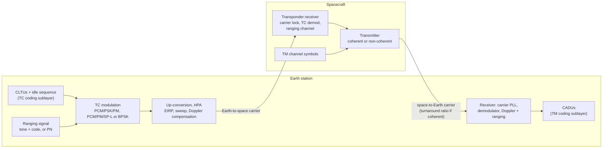
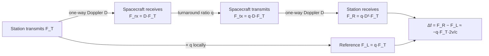
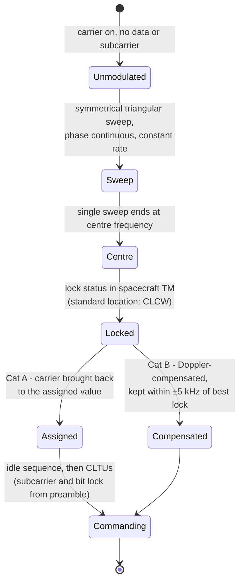
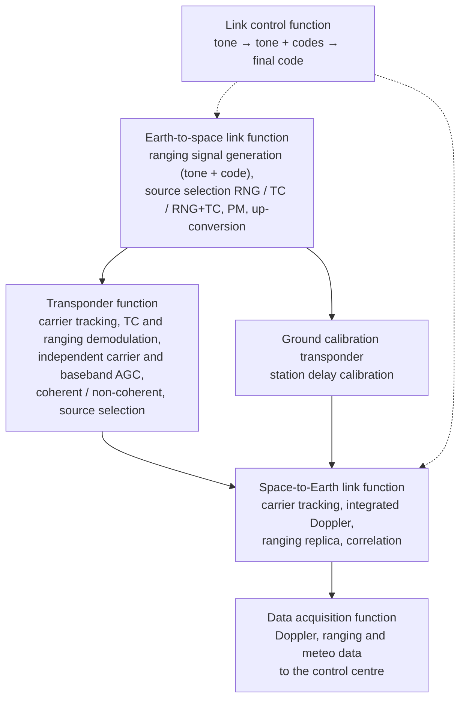
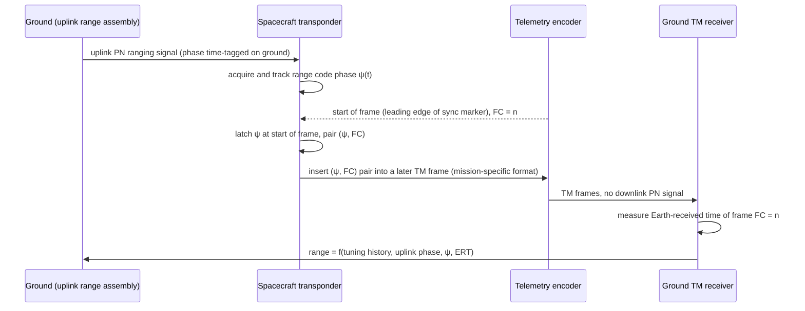
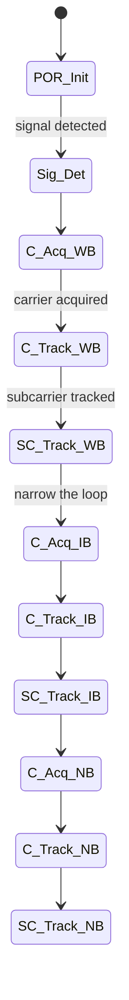

# Radio frequency, modulation and ranging

Everything else on this wiki, from [Space Packets](space-packet.md) to [CLTUs](tc-coding-cltu.md) and
[CADUs](tm-coding.md), eventually becomes a modulated radio carrier. The **physical layer** decides on
which frequency that carrier sits, how the coded symbols are impressed on it, how much spectrum and
power the emission may use, how the ground station and spacecraft find and lock onto each other, and
how the same carrier is used to measure the spacecraft's distance and velocity. CCSDS covers this in
one omnibus Blue Book, **CCSDS 401.0-B, Radio Frequency and Modulation Systems, Part 1: Earth Stations
and Spacecraft**; ECSS covers it in **ECSS-E-ST-50-05C (Radio frequency and modulation)** and
**ECSS-E-ST-50-02C (Ranging and Doppler tracking)**.[^c-fwd][^e5-scope][^e2-scope][^hb-rf] This page is a
structured overview of all three, not a reprint of every recommendation; it links to the
[TM coding](tm-coding.md) and [TC coding](tc-coding-cltu.md) pages for the sublayer immediately above.

!!! info "At a glance"
    | Item | Value |
    |---|---|
    | CCSDS document | CCSDS 401.0-B-32, October 2021; a collection of individual recommendations, first issued January 1987[^c-dc] |
    | ECSS documents | ECSS-E-ST-50-05C Rev. 2 (4 October 2011), with many clauses derived from CCSDS 401.0-B-20; ECSS-E-ST-50-02C (31 July 2008)[^e5-log][^e5-tat][^e2-log] |
    | Mission categories | Category A: less than 2 × 10⁶ km from Earth; Category B (deep space): 2 × 10⁶ km or more[^c-cat] |
    | Residual-carrier formats | PCM/PSK/PM on a subcarrier (8 or 16 kHz for TC, 2–300 kHz for TM) and PCM/PM with SP-L (bi-phase-L) directly on the carrier[^e5-sub][^e5-pcm] |
    | Suppressed-carrier formats | BPSK, QPSK, UQPSK, OQPSK, filtered OQPSK, GMSK, 4D-8PSK TCM (ECSS); CCSDS adds SRRC-QPSK/OQPSK/8PSK and 16/32/64-APSK for Earth-exploration bands[^e5-sc][^c-2418b] |
    | Coherent turnaround ratios | 221/240 (2 GHz up, 2 GHz down), 749/880 (7 GHz up, 8 GHz down), 221/880, 749/240, 749/3344, 3599/3344 and others[^c-sum-sc][^e5-tat] |
    | Tracking techniques | ESA tone-plus-code ranging and integrated Doppler (ECSS-E-ST-50-02C), PN ranging and GMSK+PN, telemetry ranging, Delta-DOR (CCSDS 401)[^e2-sig][^c-2422a][^c-2424][^c-256b] |

## Where the physical layer sits

The CCSDS layered architecture places these recommendations in the physical layer, which the
Foreword itself subdivides into technical characteristics, policy constraints and procedures.[^c-fwd]
The ECSS communications handbook draws the same boundary: its protocol map puts ECSS-E-ST-50-05 and
ECSS-E-ST-50-02 at the bottom, under the TM and TC synchronization and channel coding standards, with
CCSDS 211.1-B as the physical layer of [Proximity-1](proximity-1.md) beside them; it also warns that
the choice of TC and TM modulation must take into account whether a ranging service compatible with
ECSS-E-ST-50-02 is needed.[^hb-layer][^hb-rec] The figure below shows the chain in both
directions; the boxes in the middle are the subject of this page.



The diagram is this wiki's synthesis of the functional descriptions in ECSS-E-ST-50-02C §4.1 and the
modulation clauses of ECSS-E-ST-50-05C §6.[^e2-func][^e5-res-app][^e5-sc] For the data link layer
above, see [TM synchronization and channel coding](tm-coding.md),
[TC synchronization and channel coding](tc-coding-cltu.md) and the ECSS overview in
[ECSS-E-ST-50C communications](../ecss/e-st-50-communications.md). The overall flows are described in
[Downlink](../overview/downlink.md) and [Uplink](../overview/uplink.md).

## How CCSDS 401.0-B is organised

CCSDS 401.0-B is unusual among CCSDS Blue Books: it is a loose-leaf collection of short
recommendations, each written in the ITU-style "considering ... recommends" form, so that agencies can
add, update or delete recommendations independently.[^c-fmt] They are grouped into three sections:
technical (section 2), policy (section 3) and procedural (section 4), plus terminology and a glossary
(section 5).[^c-fmt]

| Section | Subsections | Character |
|---|---|---|
| 2 Technical | 2.1 Earth-to-space RF, 2.2 Telecommand, 2.3 Space-to-Earth RF, 2.4 Telemetry, 2.5 Radio metric, 2.6 Spacecraft | quantitative characteristics of equipment and signals |
| 3 Policy | 3.1 Frequency utilization, 3.2 Power limitations, 3.3 Modulation methods, 3.4 Operational procedures, 3.5 Testing, 3.6 Spacecraft systems | directive rules for sharing the spectrum |
| 4 Procedural | 4.1 Design tools, 4.2 Computational algorithms | link design control table, modulation-loss and bandwidth formulas |
| 5 | 5.1 Terminology, 5.2 Glossary | definitions |

Each recommendation has a self-describing number. Page 2.5.3A-1, for example, is the first page of a
technical recommendation (2) in the radio metric subsection (5), third in that subsection (3), and
applicable to Category A only (A); a number without a letter applies to both categories.[^c-fmt][^c-cat2]
The terms "Telecommand" and "Telemetry" are kept for historical reasons but cover any data sent to or
from the spacecraft, including science and file transfers.[^c-fmt2]

Issue 32 (October 2021) updated recommendations 2.4.18 and 2.4.23 and added 2.6.13 and 2.6.15; the
document control table records 32 issues since January 1987, each adding, updating or deleting
individual recommendations (for example the deletion of 2.1.8A/B by resolution CMC-R-2018-02-001).[^c-dc][^c-218]

## Mission categories and radio services

Four ITU radiocommunication services matter to CCSDS: Space Research, Space Operation, Earth
Exploration-Satellite and Meteorological-Satellite.[^c-cat] Within Space Research, some bands are
reserved for deep space. WARC ORB-88 moved the ITU deep-space boundary from lunar distance to
2.0 × 10⁶ km with effect from 16 March 1990; because the ITU has no name for the nearer region, CCSDS
defines **Category A** (altitude below 2.0 × 10⁶ km) and **Category B** (2.0 × 10⁶ km or more).[^c-cat]
The same split appears in the terminology of §5.1, while the glossary of §5.2 places the boundary
case the other way (Category A "less than or equal to", Category B "greater than"); the difference
only matters for a spacecraft exactly at 2 × 10⁶ km.[^c-cat-gl]
ECSS-E-ST-50-05C and ECSS-E-ST-50-02C adopt the same two categories, and ECSS adds that bands allocated
to Space Research (deep space) shall only be used by Category B spacecraft.[^e5-terms][^e2-terms][^e5-ds]

ECSS-E-ST-50-05C defines the services by reference to the ITU Radio Regulations (ITU/RR): the Space
Operation service (SO) is concerned exclusively with operating spacecraft (tracking, telemetry and
telecommand, TTC); Space Research (SR) uses spacecraft for scientific and technological research; Earth
Exploration-Satellite (EES) obtains information about the Earth from orbiting sensors, and, for this
standard, includes the Meteorological-Satellite service.[^e5-terms][^e5-scope] A service with a
**primary** allocation coordinates only with co-primary services and need not protect secondary
users; a **secondary** service must not cause harmful interference to, and cannot claim protection
from, primary services.[^e5-ds]

## Frequency bands

ECSS-E-ST-50-05C Table 4-1 lists the recommended bands. All are primary allocations.[^e5-bands]

| Band (MHz) | Service | Direction | Conditions |
|---|---|---|---|
| 2 025 – 2 110 | SR, SO, EES | Earth-space | EIRP chosen for a 3 dB link margin; power adjustable in steps of 3 dB or less; no uplink when no tracking or telecommand operations take place[^e5-2ghz] |
| 2 110 – 2 120 | SR (deep space) | Earth-space | part of the IMT-2000/UMTS core band; new assignments only with the frequency coordinator's agreement and formally discouraged[^e5-2ghz][^hb-rec] |
| 2 200 – 2 290 | SR, SO, EES | space-Earth | occupied bandwidth at most 6 MHz; no downlink when no station is in view; reliable switch-off devices[^e5-2ghz] |
| 2 290 – 2 300 | SR (deep space) | space-Earth | no special requirement, but usefulness limited by its paired 2 110–2 120 MHz band[^e5-2ghz] |
| 7 145 – 7 190 | SR (deep space) | Earth-space | Category B only[^e5-bands][^e5-ds] |
| 7 190 – 7 235 | SR | Earth-space | not deep space; paired with Category A downlinks in Table 5-1[^e5-bands][^e5-tat] |
| 8 025 – 8 400 | EES | space-Earth | same RFI mitigation as 2 200–2 290 MHz; the only EES direct-data band below 20 GHz[^e5-8ghz] |
| 8 400 – 8 450 | SR (deep space) | space-Earth | maximum bandwidth B25 as a function of symbol rate (below)[^e5-8ghz] |
| 8 450 – 8 500 | SR | space-Earth | occupied bandwidth at most 10 MHz; priority to Lagrangian-point missions[^e5-8ghz] |
| 25 500 – 27 000 | SR, EES | space-Earth | use as agreed with the frequency coordinator[^e5-8ghz] |
| 31 800 – 32 300 | SR (deep space) | space-Earth | EHF; Category B only, like every deep-space band[^e5-bands][^e5-ds] |
| 34 200 – 34 700 | SR (deep space) | Earth-space | EHF; Category B only[^e5-bands][^e5-ds] |
| 37 000 – 38 000 | SR | space-Earth | use as agreed with the frequency coordinator[^e5-8ghz] |
| 40 000 – 40 500 | SR | Earth-space | use as agreed with the frequency coordinator[^e5-8ghz] |

CCSDS adds policy recommendations on top of the ITU rules. Recommendation 3.1.1 asks geostationary
satellites of non-science services that use the shared 2 GHz bands for TTC to limit themselves to one
frequency pair and to launch, orbit insertion and emergency operations; 3.1.2A reserves 8 450–8 500 MHz
for Category A missions needing up to 10 MHz each (in particular libration-point missions) and says
Category B missions should not use it; 3.1.4A constrains the 14–17 GHz bands; 3.1.6B gives a channel plan for Category B;
3.1.7 covers several spacecraft in one antenna beam.[^c-sum-pol][^c-311][^c-312a]

### The B25 mask in the 8 400–8 450 MHz deep-space band

Mars-region spacecraft cannot be separated spatially, and a single unrestricted high-rate mission
could occupy the whole 50 MHz allocation. CCSDS 3.1.2B therefore limits each mission's **B25**
bandwidth, the width outside which the power spectral density is at least 25 dB below its peak
(discrete lines such as a residual carrier do not count), as a function of symbol rate.[^c-312b]
In the transition region the limit is

$$B_{25}\,[\text{MHz}] = \frac{k\,R_s}{0.41 + R_s},\qquad k = 8.53 \text{ (all missions)},\ k = 12.5 \text{ (non-Mars missions, non-interference basis)}$$

with $R_s$ in Msps; the curves flatten at 8.0 MHz and 12.0 MHz. Outside B25 the spectral power flux
density at the Earth's surface is limited to −266 dB(W/Hz/m²).[^c-312b] ECSS-E-ST-50-05C §4.2.3 imposes
the same mask using the equivalent symbol rate $R_{ES}$, which is twice the NRZ symbol rate for SP-L
and equal to it otherwise.[^e5-8ghz] With GMSK (BT<sub>s</sub> = 0.5), the 12 MHz and 8 MHz caps
correspond to maximum coded symbol rates of 9.3 and 6.2 Msps respectively; missions needing more must
move to 31.8–32.3 GHz.[^c-2417b]

### Frequency assignment procedure

ECSS-E-ST-50-05C makes the **frequency coordinator** the exclusive authority for assignments. The
project requests its frequencies before the design phase, marking preliminary data as such, and must
supply final data for the ITU advance publication, coordination and notification procedures
(ITU/RR articles 9 and 11) no later than three years before launch.[^e5-assign] Annex E adds that the
ITU Radio Regulations cannot be tailored.[^e5-tailor]

### Category B channel frequency plan

CCSDS 3.1.6B asks agencies to choose Category B frequencies from a single channel plan, coordinated
through the SFCG, so that up- and downlink pairs automatically respect the turnaround ratios.[^c-316b]
Each channel derives from a 2 GHz downlink reference $F_{2DN} = N \cdot 10/27 + 2295$ MHz, with
channel number $N + 14$; the 7 GHz uplink is computed from $F_{2DN}$ and the other bands are derived
from the 7 GHz value through the frequency factors 221, 240, 749, 880, 3328, 3344, 3360 and 3599,
each result rounded to the nearest Hz.[^c-316b-tab]

!!! example "Worked example: channel 14 (values from Table 3.1.6B-1)"
    For channel 14, $N = 0$ and $F_{2DN}$ = 2 295.000000 MHz. The table then gives 2 113.312500 MHz
    (2 GHz up, factor 221), 7 162.312500 MHz (7 GHz up, 749), 8 415.000000 MHz (8 GHz down, 880),
    31 977.000000 MHz (32 GHz down, 3344) and 34 415.437500 MHz (34 GHz up, 3599).[^c-316b-tab]
    Multiplying the 2 295 MHz reference by 221/240, 749/240 and 880/240 reproduces 2 113.3125,
    7 162.3125 and 8 415 MHz exactly, which shows how the plan embeds the turnaround ratios (this
    wiki's arithmetic).

## Coherent transponders and turnaround ratios

For coherent Doppler tracking the spacecraft transponder derives its transmitted carrier from the
received one by phase-lock techniques, multiplying it by a fixed **transponder turnaround frequency
ratio (TTFR)**.[^e5-tat][^c-261] A defined ratio is only needed for missions that require both
cross-support from other agencies' stations and up/down coherency, and on-board implementations may
deviate from the nominal value and add a significant downlink delay that orbit determination must
account for.[^c-261]



The relations are those of ECSS-E-ST-50-02C Annex C, where $D = \sqrt{(1-v/c)/(1+v/c)} \approx 1 - v/c$
is the one-way Doppler coefficient and $v$ the radial velocity.[^e2-annc]

| Ratio (up/down) | Bands (MHz) | Category | Recommendation |
|---|---|---|---|
| 221/240 | 2 025–2 120 / 2 200–2 300 | A and B | CCSDS 2.6.1; ECSS Table 5-1 |
| 749/880 | 7 145–7 235 / 8 400–8 500 | A and B | CCSDS 2.6.2; ECSS Table 5-1 |
| 221/900 | 2 025–2 110 / 8 450–8 500 | A | CCSDS 2.6.3A; ECSS Table 5-2 (alternative) |
| 765/240 | 7 190–7 235 / 2 200–2 290 | A | CCSDS 2.6.4A; ECSS Table 5-2 (alternative) |
| 221/880 | 2 110–2 120 / 8 400–8 450 | B | CCSDS 2.6.5B; ECSS Table 5-1 |
| 749/240 | 7 145–7 190 / 2 290–2 300 | B | CCSDS 2.6.6B; ECSS Table 5-1 |
| 749/3328, 749/3344, 749/3360 | 7 145–7 190 / 31 800–32 300 | B | CCSDS 2.6.7B; ECSS Table 5-1 |
| 3599/3344, 3599/3360 (ECSS adds 3599/3328) | 34 200–34 700 / 31 800–32 300 | B | CCSDS 2.6.8B; ECSS Table 5-1 |
| 3599/880 | 34 200–34 700 / 8 400–8 450 | B | ECSS Table 5-1 only |
| 221/3344; 3599/240 | 2 110–2 120 / 31 800–32 300; 34 200–34 700 / 2 290–2 300 | B | ECSS Table 5-2 only (alternatives) |
| 749/2652 … 749/2800 | 7 190–7 235 / 25 500–27 000 | A | CCSDS 2.6.9A; ECSS Table 5-1 |
| 221/2772, 221/2850 | 2 025–2 110 / 25 500–27 000 | A | CCSDS 2.6.10A; ECSS Table 5-1 |
| 749/836 … 749/864 | 7 190–7 250 / 8 025–8 400 | A | CCSDS 2.6.11A |
| 749/876 … 749/884 | 7 145–7 235 / 8 400–8 500 | A and B | CCSDS 2.6.13 (flexible ratios for MSPA) |
| 2407/2720, 2407/2760, 2407/2816 | 22 550–23 150 / 25 500–27 000 | A | CCSDS 2.6.14 |
| 2407/2800, 2407/2816 | 23 150–23 550 / 27 000–27 500 | inter-satellite | CCSDS 2.6.15 |

Sources for the table: the CCSDS spacecraft recommendation summary and recommendations 2.6.7B,
2.6.8B and 2.6.13–2.6.15, and ECSS-E-ST-50-05C Tables 5-1 and 5-2, which also give the exact usable
sub-bands (for example 7 192.102 273–7 234.659 091 MHz up for 8 450–8 500 MHz down at
749/880).[^c-sum-sc][^c-267b][^c-2613][^c-2614][^c-2615][^e5-tat]
ECSS says band pairs *should* be taken from its Table 5-1 and, if not, *shall* come from Table 5-2.[^e5-tat]

The flexible 749/876–884 ratios exist for one particular way of serving several spacecraft from one
antenna: a common uplink frequency, with each spacecraft turning it around to a different downlink.
All keep 749 in the numerator for compatibility with existing receivers; 749/877, 749/881 and 749/883
may not suit analog multiplier designs because of large prime factors, and 749/882 needs care against
self-interference.[^c-2613]

### Frequency stability

| Item | Requirement | Source |
|---|---|---|
| Spacecraft transmitter, 2 200–2 300, 8 025–8 500, 25 500–27 000 MHz | ±2 × 10⁻⁵ under all conditions and over lifetime | ECSS Table 5-3 |
| Spacecraft transmitter, 31 800–32 300 MHz | ±1.5 × 10⁻⁶ at one temperature (+10 to +40 °C, 15 h after 4 h warm-up); ±0.2 × 10⁻⁶/°C; ageing ±2.5 × 10⁻⁶ per year | ECSS Table 5-3 |
| Category B short-term stability | phase error below 10° peak in a second-order PLL of the mission's 2B<sub>L</sub>, high SNR, non-coherent mode | ECSS 5.2.1b |
| Spacecraft receiver, 2 025–2 110 and 7 190–7 235 MHz | ±2 × 10⁻⁵ including ±4.8 × 10⁻⁶ initial setting; ageing over seven years ±7.1 × 10⁻⁶ | ECSS Table 5-4 |
| Spacecraft receiver, 34 200–34 700 MHz | ±1.7 × 10⁻⁵ at one temperature; ±2.4 × 10⁻⁷/°C; ageing ±2.5 × 10⁻⁶ per year | ECSS Table 5-4 |
| Earth station carriers | phase locked to a reference of at least ±5 × 10⁻⁹ accuracy | ECSS 5.2.3 |
| Earth station reference (Allan deviation) | curve A for Category A except lunar missions (range rate 1 mm/s), curve B for Category B and lunar missions (0.1 mm/s); clock drift at most 10 µs per month | CCSDS 2.3.7 |

Sources: ECSS-E-ST-50-05C §5.2 and CCSDS 2.3.7.[^e5-stab][^c-237] The deeper Allan-variance
requirements used for Doppler tracking are in ECSS-E-ST-50-02C (see [below](#ranging-and-doppler-tracking-ecss-e-st-50-02c)).

## Polarization, bandwidth and emissions

**Polarization.** Both CCSDS and ECSS require circular polarization. Linear polarization would vary with
aspect angle on near-omnidirectional antennas and suffer Faraday rotation at low frequencies; CCSDS
asks Earth stations to switch between LCP and RCP with a carrier interruption of no more than
5 seconds, and ECSS requires stations to transmit either sense at the user's choice.[^c-212][^c-235][^e5-pol]

**Occupied bandwidth.** Occupied bandwidth is the band holding all but 0.5 % of the mean power on each
side (ITU/RR 1.153); spurious emissions are those beyond ±2.5 times that bandwidth.[^e5-terms]
ECSS-E-ST-50-05C Table 5-5 gives the maxima, where $f_t$ is the ranging tone and $R_s$ the symbol
rate:[^e5-obw]

| Band (MHz) | Function | Category | Maximum occupied bandwidth |
|---|---|---|---|
| 2 025–2 120, 7 145–7 235 | TC, 8 kHz subcarrier | A and B | 50 kHz |
| 2 025–2 120, 7 145–7 235 | TC, 16 kHz subcarrier | A and B | 100 kHz |
| 2 025–2 120, 7 145–7 235 | TC, direct modulation | A and B | 12 × R<sub>s</sub> |
| 2 025–2 120, 7 145–7 235 | ranging | A and B | 2.5 × f<sub>t</sub> (deep space may exceed with approval) |
| 2 200–2 290, 8 450–8 500 | TM, R<sub>s</sub> < 10 ksps | A | 300 kHz |
| 2 200–2 290, 8 450–8 500 | TM, 10–60 ksps | A | 1 200 kHz or 30 × R<sub>s</sub>, whichever is smaller |
| 2 200–2 290, 8 450–8 500 | TM, 60 ksps–2 Msps | A | 1 200 kHz or 12 × R<sub>s</sub>, whichever is larger, up to 6 MHz (2 GHz) or 10 MHz (8 GHz) |
| 2 200–2 290, 8 450–8 500 | TM, ≥ 2 Msps | A | 1.1 × R<sub>s</sub>, same caps |
| 2 200–2 290, 8 450–8 500 | ranging | A | 2.5 × f<sub>t</sub> |
| 2 290–2 300 | TM, ≥ 2 Msps | B | 1.2 × R<sub>s</sub> |
| 8 025–8 400 (EES band) | TM | – (none given) | 1.1 × R<sub>s</sub> |
| 2 290–2 300, 8 400–8 450 | ranging | B | 2.5 × f<sub>t</sub> |
| 8 400–8 450 | TM | B | B25 mask; at ≥ 2 Msps also 1.2 × R<sub>s</sub> |

CCSDS 4.2 gives approximations for the 99 % bandwidth of unfiltered signals: for PCM/PM,
$BW = 2(26.2m - 5.16)R_{CS}$ with bi-phase-L and $2(8.93m - 1.75)R_{CS}$ with NRZ
(0.4 ≤ m ≤ 1.4 rad, coded symbol rate before bi-phase-L encoding); for PCM/PSK/PM with a sine-wave
subcarrier, $B = 4nR_{CS}$ for 0.8 < m < 1.35 and n > 7, where n is the subcarrier-to-symbol-rate
ratio; and a cubic expression in m for square-wave subcarriers.[^c-421][^c-422][^c-423]

**Spurious emissions.** Any single spurious emission is limited to −60 dBc (relative to the
unmodulated carrier) by CCSDS 2.4.16; ECSS measures the same −60 dBc in a 4 kHz reference bandwidth
for all transmitters from 100 MHz to 40.5 GHz, and limits carrier harmonics of Category B transmitters to
−30 dBc. ECSS applies the limit even to deep-space missions, which ITU would exempt, because they spend
long periods closer than 2 × 10⁶ km.[^c-2416][^e5-spur] Unwanted emissions must also protect radio
astronomy (with GSO satellites 15 dB and single non-GSO satellites 13 dB below the terrestrial
thresholds of ITU-R RA.769-2), deep-space antenna sites (for example −255.1 dBW/m²/Hz in
8 400–8 450 MHz) and the launcher's RF system.[^e5-ra][^e5-dsprot]

**Power flux density.** ECSS-E-ST-50-05C Table 5-10 limits the PFD at the Earth's surface in all
mission phases, for example −154 dBW/m² in 4 kHz at low elevation for 1 525–2 300 MHz, rising to
−144 above 25°; −150 to −140 dBW/m²/4 kHz for 8 025–8 500 MHz; and per-MHz limits for 25.5–27, 31.8–32.3
and 37–38 GHz.[^e5-pfd] CCSDS 2.3.2 makes exceeding these limits with a residual carrier one of the
reasons to switch to suppressed-carrier modulation, and 3.6.1A recommends coding and suppressed
carriers to lower power spectral density in the 2 GHz band.[^c-232][^c-361a]

**Earth station power and elevation.** CCSDS 3.2.1A asks agencies to keep uplink EIRP to what safe
operation needs, prefer adjustable transmitters, and use antennas with a diameter-to-wavelength ratio
of at least 70.[^c-321a] ECSS caps EIRP towards the horizon (for 1–15 GHz, +40 dBW in any 4 kHz for a
horizon elevation of 0° or below, +55 dBW for deep space), and forbids transmission below 3° (SO and
EES), 5° (SR Category A) or 10° (SR Category B) antenna elevation; because host administrations may
impose tighter limits, the actual minimum is agreed with the frequency coordinator.[^e5-es]
Both directions may only radiate during actual operations, and every spacecraft must be able to stop
its emissions by telecommand (ITU/RR 22.1).[^e5-cease][^e5-time]

## Residual-carrier modulation

A **residual-carrier** system phase-modulates the carrier with a peak deviation (the **modulation
index**, in radians) small enough that a discrete carrier line remains for a conventional phase-locked
loop (PLL) receiver to track. CCSDS recommends residual-carrier phase modulation for the uplink and
retains residual-carrier receivers on the ground for low-rate telemetry because most receivers and
autotrack systems need that line.[^c-211][^c-231] ECSS requires phase modulation for telecommand and
ranging in the 2, 7 and 34 GHz uplink bands, for ranging in the 2, 8 and 32 GHz downlink bands, and for
telemetry in those downlink bands unless suppressed-carrier modulation is adopted.[^e5-res-app]

### PCM waveforms

| Waveform | Definition (ECSS Figure 6-1) | Where allowed |
|---|---|---|
| NRZ-L | level A for "1", level B for "0" | only on a subcarrier (ECSS 6.1.3d)[^e5-pcm] |
| NRZ-M | a level change for "1", no change for "0" | TC on a subcarrier; prevented for Category B TC by ECSS[^e5-pcm] |
| SP-L (split-phase-level, also called bi-phase-L or Manchester) | "1" = level A then B within the symbol; "0" = B then A | only directly on the carrier, without subcarrier; not for TM below 10 ksps[^e5-pcm] |

Sources: ECSS-E-ST-50-05C §6.1.3 and Figure 6-1.[^e5-pcm] CCSDS gives the reasoning: NRZ relies
entirely on data transitions for clock recovery, bi-phase-L has a mid-symbol transition in every
symbol, and both a PSK subcarrier with an integer frequency-to-symbol-rate ratio and bi-phase-L have
zero spectral density at the carrier, so the data does not disturb the carrier loop; NRZ-M and NRZ-S
cause errors in pairs.[^c-247]

### Telecommand

| Parameter | CCSDS 401 | ECSS-E-ST-50-05C |
|---|---|---|
| Subcarrier | sine wave, 8 or 16 kHz, PSK (2.2.2) | 8 or 16 kHz sine, PSK; only these two (Table 6-2, 6.1.4.1.2) |
| Data waveform | NRZ-L or NRZ-M on the PSK subcarrier (2.2.3) | NRZ-L/NRZ-M for Category A, NRZ-L only for Category B |
| Low-rate symbol rates | 4000/2ⁿ coded symbols/s, n = 0 … 9; symbol and subcarrier transitions coincide; 4000 only with 16 kHz (2.2.4) | 4000/2ⁿ, n = 0 … 9; 4 ksps only with 16 kHz (Table 6-1) |
| Medium rate | PCM/PM/bi-phase-L directly on the carrier, 4000 × 2ⁿ, n = 1 … 6 (2.2.7) | SP-L, 4000 × 2ⁿ, n = 1 … 6, above 4 ksps (6.1.4.1.2c) |
| High rate | BPSK suppressed carrier up to 2.048 Msps, 1000 × 2ⁿ, n = 0 … 11 (2.2.8) | not covered |
| Subcarrier accuracy and stability | offset ±2 × 10⁻⁴ f<sub>sc</sub>; ±1 × 10⁻⁵ over 1 s; ±5 × 10⁻⁵ over 24 h (2.2.5) | within ±1 × 10⁻⁵; ±5 × 10⁻⁶ over 24 h; ±1 × 10⁻⁶/s (6.1.4.2.1) |
| Baseband symmetry | asymmetry at most 1 % (2.2.6) | at most 1 % (6.1.3b) |

Sources: CCSDS 2.2.2–2.2.8 and ECSS-E-ST-50-05C §6.1.3–6.1.4.[^c-222][^c-223][^c-224][^c-225][^c-226][^c-227][^c-228][^e5-pcm][^e5-sub][^e5-sub-tc]
Symbol asymmetry is |long − short| / (long + short), measured at 50 % of peak-to-peak amplitude;
CCSDS bases the 1 % limit on keeping DC and matched-filter losses below 0.1 dB.[^c-226]

### Telemetry

| Parameter | CCSDS 401 | ECSS-E-ST-50-05C |
|---|---|---|
| Use of subcarriers | only when technically justified (low bit rate, radio science); PSK; sine for Category A, square for Category B (2.4.3) | 2–300 kHz; sine for Category A, square for Category B; NRZ-L (Table 6-2) |
| Subcarrier ratio | integer; 4 (Category A) or 5 (Category B) above 60 kHz unless overlaps force a higher integer for ≤ 0.3 dB / ≤ 0.1 dB degradation; Category B subcarrier ≤ 300 kHz (2.4.14A/B) | same rule, maximum 300 kHz (6.1.4.1.3b–c) |
| Above 60 ksps | no explicit rule; 2.4.15A/B instead bound bi-phase-L at *low* rates relative to the carrier loop bandwidth | no subcarriers; SP-L directly up to 1 Msps in 2 and 8 GHz, or suppressed carrier (6.1.4.1.3a) |
| Subcarrier offset and stability | ±200 ppm; ±1 × 10⁻⁶ short term; ±2 × 10⁻⁵ over 5 min (2.4.6) | within ±1 × 10⁻⁴; ±1 × 10⁻⁵ over 5 min; ±1 × 10⁻⁶ short term (6.1.4.2.2) |
| Symbol asymmetry | ≤ 0.2 % at the modulator input (2.4.8) | ≤ 1 % (6.1.3b) |
| Transition density | runs ≤ 64 symbols; ≥ 125 (A) or ≥ 275 (B) transitions per 1000 symbols; follow CCSDS 131.0 on the use of the pseudo-randomizer (2.4.9) | same values; randomizer of ECSS-E-ST-50-01 clause 9 if not ensured otherwise (6.1.5) |

Sources: CCSDS 2.4.3–2.4.15 and ECSS-E-ST-50-05C §6.1.3–6.1.5.[^c-243][^c-2414a][^c-2414b][^c-246][^c-248][^c-249][^e5-sub][^e5-sub-tm][^e5-trans]
The CCSDS reasoning for the subcarrier ratio is that integer ratios leave a spectral minimum around the
carrier, and the smallest practical integer keeps the spectrum compact while holding data
interference in the carrier loop (C/I above 20 dB for Category A, 25 dB for Category B with
concatenated coding) negligible.[^c-2414a][^c-2414b] Subcarrier modulation itself must be PSK with
the subcarrier an integer multiple of the symbol rate, PCM transitions within ±2.5 % of a subcarrier
period of a zero crossing, and phase within ±5° of an ideal PSK signal after 25 % of a period.[^e5-sub-mod]
For spacecraft subcarrier modulators, CCSDS 2.4.13B limits phase and amplitude imbalance to 2° and
0.2 dB (Category B).[^c-2413b]

### Modulation index, carrier suppression and other signal quality

| Function | Minimum (rad peak) | Maximum (rad peak) |
|---|---|---|
| Telecommand, NRZ-L/NRZ-M on subcarrier | 0.2 | 1.4 |
| Telecommand, SP-L | 0.2 | 1.0 |
| Telemetry, sine-wave subcarrier | – | 1.5 |
| Telemetry, square-wave subcarrier or SP-L | – | 1.25 (1.39 if the carrier-loop SNR stays above 15 dB) |
| Ranging, Earth-space | 0.1 | 1.4 |
| Ranging, space-Earth (effective, after uplink-noise power sharing) | 0.01 | 0.7 |

Source: ECSS-E-ST-50-05C Table 6-3; the combined uplink index (linear sum of peak indices) should not
exceed 1.75 rad, and worst-case tolerances apply.[^e5-mi] CCSDS sets the carrier-suppression rules
that frame these numbers: the reduction of carrier power by all modulating signals should not exceed 10 dB
on the uplink (2.1.6), nor 10 dB for sine-wave modulation on the downlink, while square-wave
modulation may exceed 10 dB if the carrier tracking loop SNR stays above 15 dB (2.3.8).[^c-216][^c-238]
ECSS words this as residual carrier power above −15 dBc (space-Earth) and −10 dBc (Earth-space).[^e5-lines]

The power split follows from the modulation-loss formulas of CCSDS 4.1.5: for a sine-wave
subcarrier the carrier keeps $J_0^2(m)$ of the total power and the data channel $2J_1^2(m)$;
for a square wave (or SP-L) the shares are $\cos^2 m$ and $\sin^2 m$. These are the single-channel
cases of the CCSDS tables, which multiply such factors for every simultaneous signal.[^c-415]

!!! warning "Inference"
    With $\cos^2(1.25) \approx 0.099$ (−10.0 dB) and $\cos^2(1.39) \approx 0.032$ (−14.9 dB), the ECSS
    limits of 1.25 rad and 1.39 rad for square-wave telemetry correspond almost exactly to a 10 dB
    carrier suppression (the CCSDS 2.3.8 limit, which square-wave modulation may exceed while the
    carrier loop SNR stays above 15 dB) and to the −15 dBc residual-carrier floor of ECSS 6.1.11a.
    The standards do not state this derivation; it is this wiki's arithmetic from the CCSDS 4.1.5
    formulas.[^c-415][^c-238][^e5-mi][^e5-lines]

Further ECSS signal-quality requirements: a positive-going video voltage advances the carrier phase
(also CCSDS 2.1.5/2.3.6), and a directly modulated SP-L "1" starts with a phase advance; phase
deviation linear within ±3 % up to 1.5 rad; residual amplitude modulation below 2 %; integrated phase
noise of the unmodulated carrier below 2° rms at UHF and 4° at SHF (10 Hz–100 kHz) in the
non-deep-space bands, 1° rms (0.1 Hz–1 kHz) in the 2 GHz deep-space bands, and 4° (SHF) or 10° (EHF)
between 1 Hz and 10 kHz in the other deep-space bands; discrete lines below −45 dBc, modulation
products below −30 dBc in the occupied bandwidth and within ±60 kHz (UHF), ±220 kHz (SHF) or ±850 kHz
(EHF) of the carrier.[^e5-sense][^c-215][^e5-lines]

CCSDS 2.4.15A/B add charts of where PCM/PM/bi-phase-L is *not* permitted: at low symbol rates the
data spectrum falls into the carrier loop bandwidth, so the ratio of loop bandwidth to symbol rate
and the index determine whether the carrier-to-interference ratio stays above 15–25 dB.[^c-2415a][^c-2415b]
CCSDS 4.1.1 recommends a graphical procedure for choosing the indices of simultaneous ranging,
telecommand and telemetry, and 2.1.7B adds Category B constraints: telecommand index at least
0.2 rad, uplink ranging index at most 1.4 rad, telecommand subcarrier period an integer subdivision of
the bit period, and low-frequency ranging tones chopped by the highest tone.[^c-411][^c-217b]

## Suppressed-carrier modulation

When all the power goes into the data, the carrier line disappears and the receiver recovers the
carrier with a suppressed-carrier tracking loop such as the Costas loop, which still supports Doppler
measurement.[^c-228] CCSDS notes that a suppressed-carrier loop frequently has more than 10 dB better
carrier SNR than a residual-carrier loop, at least as good symbol-error performance, and makes PFD
limits easier to meet; short periodic data patterns can however leave zero power at the carrier
frequency, and the CCSDS randomizer is required.[^c-232]

**When to use it.** CCSDS 2.3.2 requires (filtered) BPSK, (filtered) QPSK, filtered OQPSK or GMSK when
a residual carrier would exceed the PFD limits, up to 2 Msps in the 2 and 8 GHz bands, 10 Msps at
26 GHz and 20 Msps at 32 GHz, recommends them whenever practicable at lower rates, prefers filtered
OQPSK or GMSK, and requires the CCSDS 131.0 randomizer.[^c-232] ECSS-E-ST-50-05C §6.2.1 requires
suppressed carrier for telemetry in the 2 200–2 300, 8 025–8 400 and 8 400–8 500 MHz bands when PFD
limits would be exceeded and in any case above 1 Msps; above 2 Msps (below 8.5 GHz) or 20 Msps
(31.8–32.3 GHz) only TCM 8PSK (8 025–8 400 MHz only), filtered OQPSK (below 8 400 MHz and in
8 450–8 500 MHz) or GMSK (all bands) may be used, and new projects may use BPSK, QPSK, UQPSK and OQPSK
only below those rates.[^e5-sc] ECSS-E-ST-50-02C ranging cannot be combined with these modulations.[^e5-sc][^e2-incomp]

| Scheme (ECSS 6.2.3) | Key ECSS requirements |
|---|---|
| BPSK | carrier reversed at each transition; constellation points 180 ± 2° apart |
| QPSK | equal-rate I and Q channels; quadrature 90 ± 5°; amplitude imbalance < 0.5 dB; cross-channel suppression > 21 dB; symbol clocks aligned within ±2 % or 1 ns; Q-DNRZ differential coding equations if used |
| UQPSK | two channels with different rates and amplitudes; rate imbalance (R<sub>s1</sub> − R<sub>s2</sub>)/(R<sub>s1</sub> + R<sub>s2</sub>) > 0.05; power imbalance 4–10 dB |
| OQPSK / filtered OQPSK | Q delayed by half a channel symbol; same balance limits; filtering by SRRC (α = 0.5) before the modulator, or a 4-pole/2-zero elliptic post-amplifier filter for very high rates at 8 025–8 400 MHz; matched SRRC receive filter; FIR at least 16 bits |
| GMSK | precoded; BT<sub>s</sub> = 0.25 for Category A and 8 025–8 400 MHz, BT<sub>s</sub> = 0.5 for Category B; FIR at least 5 bits (A) or 4 bits (B), coefficients at least 12 bits |
| 4D-8PSK TCM | adjacent phase states 45 ± 1.5°; amplitude imbalance < 0.3 dB; carrier and sideband rejection ≥ 30 dB |

Sources: ECSS-E-ST-50-05C §6.2.3.1–6.2.3.6.[^e5-bpsk][^e5-uqpsk][^e5-gmsk]

**Phase ambiguity.** A suppressed-carrier receiver can lock in any of 2 (BPSK) or 4 (QPSK) phases.
CCSDS and ECSS prefer resolving this with the frame synchronization marker where the ground network
can, synchronizing before convolutional decoding; otherwise differential coding (NRZ-M, or Q-DNRZ for
quadrature schemes) is applied before the convolutional encoder and removed after the Viterbi decoder,
which limits error propagation; with differential coding the I and Q channels are encoded
independently.[^c-242][^c-2411][^e5-wave] ECSS Table 6-4 maps each scheme to its waveform: NRZ-L without
differential encoding; NRZ-M (BPSK, UQPSK) or Q-DNRZ (QPSK, OQPSK, filtered OQPSK) with it; GMSK uses
precoding and TCM its own differential encoder.[^e5-wave]

**QPSK bit mapping.** CCSDS 2.4.10 sends even-numbered bits (bit 0 first, the MSB) on I and odd bits on
Q, and maps the (I, Q) pairs "00", "10", "11" and "01" to carrier phases of 45°, 135°, 225° and 315°,
so that a 90° phase error corrupts at most one bit.[^c-2410]

### GMSK

GMSK is a constant-envelope continuous-phase modulation whose phase is the integral of Gaussian-filtered
frequency pulses. ECSS-E-ST-50-05C §9.1 defines the carrier as
$x(t) = \sqrt{2P}\cos(2\pi f t + \varphi(t) + \varphi_0)$ with
$\varphi(t) = \sum_k a_k \frac{\pi}{2}\int_{-\infty}^{t-kT_s} g(\tau)\,d\tau$. The frequency pulse $g$ is
a rectangle of one symbol duration convolved with a Gaussian of standard deviation
$\sigma T_s$, $\sigma = \sqrt{\ln 2}/(2\pi BT_s)$, B being the one-sided 3 dB bandwidth; the transmitted
symbols are precoded as $a_k = (-1)^k d_k d_{k-1}$ from the information symbols $d_k = \pm 1$.[^e5-gmskfmt] Because GMSK is inherently
differential, the precoder removes the need for differential decoding and improves receiver
performance.[^e5-gmskfmt][^c-2417a] GMSK and baseband-filtered OQPSK can both be received with a
conventional OQPSK receiver, at the price of extra losses if the receiver is not matched.[^c-2417a]

### High-rate modulation by band

| Recommendation | Band | Threshold | Recommended modulations |
|---|---|---|---|
| CCSDS 2.4.17A | SR Category A, 2 200–2 290 and 8 450–8 500 MHz | > 2 Msps | GMSK (BT<sub>s</sub> 0.25, precoded) or baseband-filtered OQPSK (SRRC α 0.5 or 6-pole Butterworth BT<sub>s</sub> 0.5); SRRC-8PSK (α 0.35) above about 10 Msps at 8 450–8 500 MHz; consider a post-HPA filter to protect 8 400–8 450 MHz |
| CCSDS 2.4.17B | SR Category B, 2 and 8 GHz | > 2 Msps (and whenever practicable) | GMSK BT<sub>s</sub> 0.5 within the SFCG B25 limit; move to 32 GHz if more bandwidth is needed; randomizer |
| CCSDS 2.4.18 | EES, 8 025–8 400 MHz | > 2 Msps | SRRC-4D 8PSK TCM (2.0, 2.25, 2.5, 2.75 b/s/Hz; α 0.35 or 0.5), SRRC-QPSK, -OQPSK, -8PSK, -16APSK, -32APSK, -64APSK (α 0.2–0.35), or filtered OQPSK; VCM/ACM where practicable; frame header and pilots above 8PSK |
| CCSDS 2.4.20B | SR Category B, 31.8–32.3 GHz | ≥ 20 Msps | GMSK BT<sub>s</sub> 0.5 (shall above, should below); residual carrier allowed below 20 Msps if the 20 dB bandwidth ≤ 60 MHz |
| CCSDS 2.4.21A | SR Category A, 25.5–27.0 GHz | > 10 Msps | GMSK (BT<sub>s</sub> 0.25) or filtered OQPSK; residual carrier below 1 Msps, other suppressed carrier below 10 Msps |
| CCSDS 2.4.23 | EES, 25.5–27.0 GHz | ≥ 10 Msps channel symbols | SRRC (α 0.2–0.35) QPSK, OQPSK, 8PSK, 16APSK, 32APSK or 64APSK; QPSK/OQPSK/8PSK below 10 Msps; VCM/ACM |

Sources: the respective CCSDS recommendations.[^c-2417a][^c-2417b][^c-2418b][^c-2420b][^c-2421a][^c-2423]
For the higher-order schemes CCSDS also specifies the RF chain: modulator phase imbalance at most 5°
(3° for 32APSK and 64APSK) and amplitude imbalance 0.5 dB, AM/PM slope below 5°/dB unless the
receiver equalizes, phase-noise masks, and linearization or equalization at least from 16APSK; it
regards as acceptable, even without equalization, a channel with up to 0.1 dB ripple, at least 30 dB
out-of-band rejection and group-delay variation up to 10 % of the symbol duration.[^c-2418b][^c-2423] For BPSK, (O)QPSK, GMSK and 8PSK in general, 2.4.12A/B set 5° and
0.5 dB.[^c-2412a]

**Spectral roll-off and stability.** Above 60 ksps, telemetry in 2 200–2 290, 8 025–8 400 and
8 450–8 500 MHz must fit the spectral masks of ECSS Figure 6-5, measured against $R_{ES}$ (2 × R<sub>s</sub>
for SP-L; including the trellis overhead for 8PSK TCM).[^e5-mask] Carrier suppression must exceed
30 dBc, discrete lines stay below −45 dBc, and the symbol rate must be within ±1 × 10⁻⁴ of nominal,
stable to ±1 × 10⁻⁵ over 5 minutes and ±1 × 10⁻⁶ over 100 symbols (CCSDS 2.4.19 asks for ±100 ppm,
±1 × 10⁻⁶ and ±1 × 10⁻⁵).[^e5-sc2][^c-2419]

### 4D-8PSK trellis-coded modulation

ECSS-E-ST-50-05C §9.2 specifies the European 4-dimensional 8PSK TCM used for Earth-exploration
downlinks: a serial-to-parallel converter, a differential encoder (removing the 22.5° ambiguity), a
64-state, constraint length 7, rate-3/4 systematic trellis encoder with the octal polynomials
h3 = 050, h2 = 024, h1 = 006, h0 = 103, a constellation mapper delivering four 3-bit symbols with
natural mapping, and an 8PSK modulator.[^e5-tcm] Two spectral efficiency factors are allowed:
SEF = 2 (b = 8 input lines) and SEF = 2.5 (b = 10), giving $R_{ES} = 1.5\,R_S$ and $1.2\,R_S$
respectively; shaping is SRRC with α = 0.35 or 0.5 before a linear modulator, or an elliptic filter
after a nonlinear amplifier.[^e5-tcm][^e5-tcmf] CCSDS 2.4.18 allows four efficiencies (2.0, 2.25, 2.5
and 2.75 b/s/Hz) where ECSS keeps two; the handbook records that only European agencies had declared an
intention to use the scheme.[^c-2418b][^hb-diff]

## Link acquisition

Acquisition is where the physical layer interacts most directly with operations.

**Space-to-Earth.** Normally on-board automation switches the transmitter on at the scheduled start of
a pass, modulated with at least housekeeping telemetry, and the ground allows time for a triangular
frequency search at worst-case margin. As a secondary mode the transmitter can be switched on by
telecommand after the uplink sweep. Coherent mode is activated automatically or by telecommand once the
uplink is confirmed locked; if the coherent/non-coherent switch causes a frequency step that loses
telemetry, the downlink must be re-acquired.[^e5-acq-se]

**Earth-to-space.** The ECSS procedure for the 2 025–2 110 MHz Category A band is the template for the
others.[^e5-acq-es]



The states paraphrase ECSS-E-ST-50-05C §7.2.1–7.2.2; the on-board demodulators must not rely on a
frequency sweep for subcarrier or bit acquisition but on the preamble that precedes uplink messages,
and outside acquisition the idle sequence is transmitted to limit uplink power spectral density.[^e5-acq-es]
The lock flags of the [CLCW](cop-1.md) and the [PLOP](tc-coding-cltu.md) carrier modulation modes
are the data-link counterparts of this procedure.[^e5-acq-es][^hb-plop]

| Band | Sweep rate | Sweep range | Other | Source |
|---|---|---|---|---|
| 2 025–2 110 MHz, Cat A | ≤ 32 kHz/s | ±150 kHz | discontinuity ≤ 10 Hz; values for a PLL 2B<sub>L</sub> = 800 Hz, damping 0.7–1.2; Doppler predictions within 5 kHz if compensated | ECSS 7.2.1 |
| 2 110–2 120 MHz, Cat B | 1 Hz/s – 10 kHz/s | ±100 Hz – ±300 kHz | loop stress (PLL error) telemetered with resolution of about 2B<sub>L</sub> | ECSS 7.2.2 |
| 7 145–7 190 MHz, Cat B | 1 Hz/s – 10 kHz/s | up to ±1 MHz | as 7.2.2 | ECSS 7.2.3 |
| 7 190–7 235 MHz, Cat A | 100 Hz/s – 50 kHz/s | up to ±500 kHz | discontinuity ≤ 1 Hz | ECSS 7.2.4 |
| CCSDS Earth station transmitter, Cat A | 500 Hz/s to at least 50 kHz/s | ±1 kHz to ±150 kHz (2 GHz), ±500 kHz (7 GHz) | phase continuity at all times | CCSDS 2.1.3A, 2.1.4A |
| CCSDS Earth station transmitter, Cat B | 1 Hz/s to at least 10 kHz/s | ±1 kHz to ±300 kHz (2 GHz), ±1 MHz (7 GHz), ±4 MHz (34 GHz) | | CCSDS 2.1.3B, 2.1.4B |
| CCSDS Earth station receiver, Cat A | ≤ 100 Hz/s to ≥ 200 kHz/s | ±150 kHz (2 GHz), ±600 kHz (8 GHz), ±1 800 kHz (26 GHz) | range rates up to 10 km/s, accelerations up to 380 m/s² | CCSDS 2.3.3A, 2.3.4A |
| CCSDS Earth station receiver, Cat B | ≤ 1 Hz/s to ≥ 10 kHz/s | ±300 kHz (2 GHz), ±1 MHz (8 GHz), ±4 MHz (32 GHz) | range rates up to 35 km/s | CCSDS 2.3.3B, 2.3.4B |

Sources: ECSS-E-ST-50-05C §7.2 and the CCSDS recommendations cited.[^e5-acq-es][^e5-acq-b][^c-213a][^c-213b][^c-214a][^c-214b][^c-233a][^c-233b][^c-234a][^c-234b]
CCSDS explains the Category A uplink numbers: Doppler up to ±80 kHz at 2 GHz and ±300 kHz at 7 GHz,
receiver rest-frequency uncertainty of ±50 kHz and ±200 kHz, but Doppler predictable to ±1 kHz.[^c-213a]

The ECSS handbook describes a failure mode on the receive side, the **transponder dual lock**
condition: one transponder receiver operates very close to its telecommand threshold (for example
about −122 dBm), and so at an inadequate bit error rate, while the other receiver is well above its
threshold, which can cause telecommands to be rejected. Recent near-Earth and Lagrange-point designs
such as Cryosat-2 combine both low-gain antennas through a 3 dB hybrid so that both receivers see the
best uplink signal, a configuration the handbook says avoids this situation. It names the
[COP-1](cop-1.md) sequence-controlled (AD) service as the best operational remedy for the resulting
frame rejections, recommends it for all near-Earth missions, and strongly recommends a realistic
pre-launch compatibility test.[^hb-dual]

## Ranging and Doppler tracking (ECSS-E-ST-50-02C)

ECSS-E-ST-50-02C applies to projects needing unprocessed ranging accuracies of 2.5–30 ns and Doppler
accuracies of 0.1–1 mm/s; less demanding projects may follow CCSDS 401.0-B.[^e2-scope][^hb-r1]
Measurements use an active transponder that re-transmits the uplink signal; ranging signals are
generated and measured in the Earth station, and the same transponder normally also carries
telecommand and telemetry.[^e2-func] The standard divides the system into five functions:[^e2-func]



### The tone-plus-code ranging signal

The baseband ranging signal is a sine-wave **tone** of frequency $f_t$ that is phase-modulated by a
series of **codes** used to resolve the ambiguity of the tone phase. The n-th code is
$C_n = Q_1 \oplus Q_2 \oplus \dots \oplus Q_n$, where $Q_i$ is a square wave at $2^{-i} f_t$ (the outputs of a
divide-by-two chain driven by the tone), and code transitions occur when the unmodulated tone phase is
90°. Each code is sent for a fixed time so that the ground can correlate and align its replica; a
simple implementation sends $C_{n-1}$ followed by its complement.[^e2-sig] The link-control sequence is
tone alone, tone with the sequence of codes, then tone with the final code; deep-space missions may
restart the sequence continuously, trading accuracy for faster re-acquisition.[^e2-lc]

As codes are added, the spectrum evolves from discrete lines at multiples of $f_t$ to a quasi-continuous
spectrum between $2^{-N}f_t$ and $(2-2^{-N})f_t$, N being the longest code.[^e2-spec] On the Earth-to-space
link the tone is selectable from 100 kHz to 1.5 MHz, the code period is $2^n/f_t$ with n = 0 … 20, the
modulation is PCM/PSK/PM, and the tone-to-code modulation index is 45° during ambiguity resolution and
22.5° during measurement.[^e2-es]

!!! example "Illustrative arithmetic: ambiguity of a 698.26 kHz tone"
    The tone period of $f_t$ = 698 260 Hz (the Herschel/Planck tone, see the worked example below) is
    1.432 µs, which repeats every 214.7 m of one-way range. A code with n = 20 has a period of
    $2^{20}/f_t$ = 1.502 s, so the ambiguity grows to about 225 000 km one way. These figures are this
    wiki's arithmetic from the code-period definition, not values stated in the standard.[^e2-es]

### Choosing the tone

ECSS selects the lowest tone compatible with TC, TM and ranging to minimise bandwidth, keeps
$f_t$ (plus or minus Doppler) within 100 kHz–1.5 MHz in a region of stable transponder group delay, and
gives spacing rules against the telemetry and telecommand spectra:[^e2-freq][^e2-tone]

* against telemetry with subcarrier $f_{sc}$ and symbol rate $f_{symb}$, with $D$ the one-way Doppler
  factor: $|Df_t - f_{sc}| \ge 2.5 f_{symb}$, $|Df_t - 3f_{sc}| \ge f_{symb}$ and $|k f_{symb} - Df_t| \ge 5$ Hz;
  for SP-L telemetry take $f_{sc} = f_{symb}$, and if no compatible tone results, place $f_t$ near an
  SP-L spectral null but more than the Doppler shift plus 5 Hz away;[^e2-tone]
* against PCM(NRZ-L)/PSK/PM telecommand with subcarrier $f_{TC}$ and bit rate $f_b$:
  $|2m f_{TC} - f_t| \ge 5$ Hz and $|(2n-1) f_{TC} - f_t| \ge 2f_b$; for PCM(SP-L)/PM telecommand,
  $|f_t - f_b| \ge 2.5 f_b$, $|f_t - 3f_b| \ge f_b$ and $|k f_b - f_t| \ge 5$ Hz.[^e2-tone2]

Simultaneous ranging and telecommand should be used to avoid scheduling conflicts, with time sharing
if the link budget does not allow it; slow on-board baseband AGC can transiently over-modulate the
downlink when TC or ranging starts, which ramping the uplink modulation can mitigate.[^e2-tcrng]
Suppressed-carrier telemetry is not compatible with simultaneous tone ranging, so orbit determination
must then use integrated Doppler on the regenerated carrier, time sharing between telemetry and
ranging, or a separate ranging transponder.[^e2-incomp]

### Earth station requirements

| Parameter | Category A | Category B |
|---|---|---|
| Carrier modulation index, ranging only | 0.1–1.4 rad peak | 0.1–1.4 rad peak |
| Combined ranging + TC index | ≤ 1.75 rad peak | ≤ 1.75 rad peak |
| Spurious signals | < −60 dBc | < −60 dBc |
| Phase noise density | −(48 + 10 log f) dBc/Hz for 10 Hz–1 MHz; < −108 dBc/Hz above | −(51 + 10 log f) dBc/Hz for 1 Hz–1 MHz; < −111 dBc/Hz above |
| Group delay variation vs time | 20 ns per 12 h peak-to-peak | 2 ns per 12 h peak-to-peak |
| Group delay variation over 3 MHz | 5 ns peak-to-peak | 2.5 ns peak-to-peak |
| Timing accuracy | ≤ 10 µs relative to UTC | ≤ 1 µs relative to UTC |
| Downlink carrier C/N in PLL 2B<sub>L</sub> (residual carrier) | ≥ 15 dB | ≥ 15 dB |
| Tone PLL | second order, 2B<sub>L</sub> 10⁻³–3 Hz, damping 1 ± 0.1, ranging SNR ≥ 19 dB, technological degradation ≤ 3 dB | same |
| Doppler rate (tracking limit / for specified accuracy) | 10 Hz/s / 2 Hz/s | 1 Hz/s / 0.02 Hz/s |
| Acquisition time for n = 10 codes (10⁻² wrong resolution) | < 12 s | < 1 500 s |
| Carrier PLL for Doppler | second order | second or third order |
| Doppler / ranging sampling rate | ≤ 10/s / ≤ 1/s | ≤ 10/s / ≤ 1/s |

Sources: ECSS-E-ST-50-02C §4.4.1 and §4.4.2.[^e2-es][^e2-se] Tone integration time for acquisition is
1–1000 s and code integration 0.5–1000 s in both categories. In suppressed-carrier mode only Doppler
tracking is possible, with an equivalent C/N of at least 15 dB including squaring loss.[^e2-se][^e2-sc]
Frequency stability is specified as Allan deviation curves: A for the coherent transponder, B and D for
the station reference (Category A and B) and C for station frequency converters; the sample time is
the Doppler integration time for jitter and the round-trip light time for bias.[^e2-stab]

### Transponder requirements

| Clause | Requirement |
|---|---|
| 4.5.2 Range and range rate | coherent transponder for deep space and two-way Doppler, downlink derived through the turnaround ratio; with digital synthesis the ratio error must cause no more than 0.1 mm/s Doppler bias over 1 s; ranging demodulated and re-modulated; **coherent/non-coherent** and **ranging on/off** independently selectable by telecommand; Allan curve A; ≤ π/4 peak-to-peak carrier phase shift over temperature, voltage, 10 dB of input level and ±3 × 10⁻⁵ uplink shifts |
| 4.5.3 Range only | coherence not required; ranging on/off by telecommand |
| 4.5.4 Group delay | constant within ±1/(5 f<sub>t</sub>) from 0.3 f<sub>t</sub> to 1.7 f<sub>t</sub> (ambiguity resolution); within ±30 ns at f<sub>t</sub> (measurement); calibration typically ±5 ns (A) or ±2.5 ns (B) from predicted Doppler and telemetered level, voltage and temperature |
| 4.5.5 Telemetered monitoring | mode of operation, receiver input level, frequency offset from best lock frequency, lock status, transponder temperature and supply voltage |
| 4.5.6 Amplitude response | ±0.5 dB from 0.3 f<sub>t</sub> to 1.7 f<sub>t</sub>; < 3 dB attenuation at 0.1 f<sub>t</sub> and 1.9 f<sub>t</sub>; one-sided noise bandwidth ≤ 2.5 f<sub>t</sub> |
| 4.5.7–4.5.8 | positive uplink phase shift gives a positive downlink shift; baseband AGC keeps signal plus noise constant, response time 10–30 ms |
| 4.5.9 Modulation index | nominal downlink ranging index 0.1–0.7 rad; Category B selectable by TC to at least two values between 0.2 and 0.7 rad |
| 4.5.10 Technological loss | ≤ 1 dB end to end, in all modes and conditions |

Sources: ECSS-E-ST-50-02C §4.5.[^e2-tr1][^e2-tr2][^e2-tr3] Annex B defines the technological loss as
the shortfall of the measured ranging tone power-to-noise density at the transmitter output against
its theoretical value, which for ranging alone is $(P_R/N_0)_{TH} = C/N_0 + 20\log_{10}J_1(m_R) + 3$ dB,
measurable only with an unmodulated tone.[^e2-annb]

### Performance and ancillary measurements

Integrated Doppler is not a series of independent velocity measurements but the continuous phase of the
received carrier relative to its reference: $\varphi(t) - \varphi_0 = 2\pi\int\Delta f\,d\tau \approx
-(2\pi q F_T \cdot 2/c)\int v\,d\tau$, a high-resolution measurement of the change in range up to an unknown
constant ("non-destructive range-rate measurement"). One-way Doppler is also possible with the
transponder non-coherent, relative to the downlink carrier.[^e2-annc] Its error budget distinguishes
bias (station reference drift, digital synthesis offsets, acceleration effects) from jitter
(reference, converters, transponder stability, thermal and phase noise, quantization below 1/1000 of
a carrier period).[^e2-dop] For ranging, the quantization must be at most 1/65 536 of the tone period and
the station's measurement accuracy 1 ns or 1/1000 of the tone period, whichever is larger; station
calibration before and after a pass is required when group-delay drift would exceed the mission need.[^e2-rng]

Propagation corrections need meteorological data at the station (pressure ±1 hPa, temperature ±1 °C,
relative humidity ±1 %), multiple-frequency ranging or Doppler, or differenced range versus integrated
Doppler (DRVID), and the antenna phase centre known to 0.5 m.[^e2-anc] CCSDS 3.4.2 tabulates which
charged-particle calibration methods (Faraday rotation, DRVID, dual frequency) apply to which tracking
modes.[^c-342] At ESA's ESTRACK stations the IF and modem system (IFMS) makes these measurements
available to data clients such as the NCTRS as Doppler, AGC, meteorological, open-loop and ranging
data sets; see [NCTRS, NIS and the ground station interface](../scos2000/nctrs-nis.md).[^ifms]

### Compatibility with CCSDS networks

ECSS Annex A explains that CCSDS assumes different ranging systems: for Category A a 100 kHz major tone
with minor tones down to 4 kHz (hence the 3–110 kHz transponder passband of CCSDS 2.5.4A), for Category B
a 1 MHz tone with code components down to 1 Hz (3 kHz–1.1 MHz, noise bandwidth ≤ 3.5 MHz, CCSDS 2.5.4B).
ECSS-compliant transponders do not automatically meet those low-frequency requirements, but no major
incompatibility is expected, at some cost in performance.[^e2-anna][^c-254a][^c-254b] The handbook adds
that other techniques, Differential One-way Ranging and regenerative ranging, are not included in the
ECSS standard (it names ECSS-E-ST-50-05) and that CCSDS was working on recommendations for them.
CCSDS 401.0-B-32 addresses both: regenerative PN ranging in 2.5.5A and 2.4.22A/B, and Delta-DOR in
2.5.6B (see below).[^hb-r1][^c-255a][^c-2422a][^c-256b]

### Compatibility testing

ECSS-E-ST-50-02C §5 requires tests with engineering qualification models (often in a portable
"suitcase") of: non-coherent downlink frequency versus time after switch-on; spectrum (spurious and
modulation indices); transmitter power; downlink phase jitter; ranging group delay and jitter versus
tone, levels, Doppler, index and presence of TC/TM; correct ambiguity resolution; coherent phase
stability (Allan variance); and turnaround ratio versus input frequency.[^e2-test] CCSDS 3.5.1 lists a
wider minimum set covering spacecraft RF, telemetry, telecommand, ranging, Doppler and antenna tracking,
performed from maximum power down to threshold.[^c-351]

## CCSDS radio-metric and advanced ranging recommendations

### Group delay and ranging channel

| Rec. | Requirement |
|---|---|
| 2.5.1A / 2.5.1B | station group delay calibrated to ≤ 10 ns (A) or ≤ 7 ns 1σ (B, 7 145–7 190 / 8 400–8 450 MHz, consistent with 2 m range accuracy) |
| 2.5.2A / 2.5.2B | station ranging group delay variation ≤ 20 ns (A) or ≤ 2 ns (B) over any 12 h; Category B delay rate within ±0.1 mm/s |
| 2.5.3A / 2.5.3B | spacecraft ranging-channel delay variation ≤ ±50 ns (A) or ±30 ns (B); calibration to ±5 ns or ±2.5 ns at any time; Category B differential delay between channels < ±2 ns |
| 2.5.4A / 2.5.4B | transponder ranging passband flat to ±0.5 dB over 3–110 kHz (A) or 3 kHz–1.1 MHz (B); phase linear within ±6° |
| 2.5.5A | PN code delay through a regenerative transponder within 20 ns of its pre-launch calibration |

Sources: CCSDS 2.5.1A–2.5.5A.[^c-sum-rm][^c-251][^c-252][^c-253][^c-254a][^c-254b][^c-255a] The
rationale is a 10 m accuracy budget for Category A orbit determination (station share 30 %, transponder
15 %) and 3 m for Category B.[^c-252][^c-253]

Policy recommendation 3.4.1 asks all agencies to design spacecraft for simultaneous telecommand,
telemetry and ranging, because station time is expensive and telemetry interruptions lose data.[^c-341]
3.3.1 requires sine-wave ranging on Category A uplinks when combined with telecommand (either waveform
for Category B) and recommends sine-wave ranging on all downlinks shared with telemetry.[^c-331]

### PN ranging with GMSK telemetry

GMSK and filtered OQPSK cannot carry a conventional residual-carrier ranging signal, yet some missions
need both high-rate telemetry and precise ranging. CCSDS 2.4.22A (Category A, 8.45–8.50 GHz) and 2.4.22B
(Category B, 8.40–8.45 and 31.8–32.3 GHz) combine GMSK with an on-board *regenerated* PN ranging signal
through a phase modulator, which keeps a constant envelope and allows an always-on ranging capability.[^c-2422a][^c-2422b]

| Parameter | Value |
|---|---|
| Ranging chip shaping | half-sine: $h(t) = \sin(\pi t/T_C)$ for $0 \le t \le T_C$, with $T_C = 1/R_{RG}$ |
| Peak ranging index $m_{RG}$ | 0.2–0.45 rad without ranging cancellation; 0.2–0.7 rad with cancellation |
| PN code | T4B when accuracy matters most; T2B when acquisition time matters most |
| Chip-rate to telemetry symbol-rate ratio | without cancellation, a non-integer above 1 (performance figures valid for 1–3; slightly below 1 allowed if margins permit); with cancellation, a non-integer (performance figures valid for 1/3–10); chip and symbol rates not coherent |
| Telemetry symbol error rate | better than 0.1 at the receiver |
| Typical losses | telemetry 0.2–1.0 dB (below 0.1 dB with cancellation); ranging SNR 0.3–3.0 dB; ranging jitter variance +0.3–1.5 dB; carrier jitter variance +0.2–1.0 dB |

Sources: CCSDS 2.4.22A and 2.4.22B.[^c-2422a][^c-2422b] The PN ranging codes themselves are defined in
CCSDS 414.1-B-2, which is not in this wiki's library; their structure is not stated in the available
sources. The Solar Orbiter MIB nevertheless exposes the T2B/T4B choice (see
[below](#solar-orbiters-deep-space-transponder-in-the-mib)).

### Telemetry ranging

CCSDS 2.4.24 (added in Issue 30, February 2020) goes one step further and removes the downlink
ranging signal altogether.[^c-dc] The spacecraft tracks an uplink PN ranging signal (per CCSDS
414.1-B-2) and latches the **range code phase**, on a signal triggered by the transmission of the
leading edge of a frame's synchronization marker, together with that frame's frame counter (FC). The
pairs are sent to the ground as ordinary telemetry, and the ground computes range from the uplink
tuning history, the time-tagged uplink PN phase, the on-board phase and the frame's Earth-received
time.[^c-2424][^c-2424b]



| Item | Requirement or value |
|---|---|
| Bands | space-to-Earth 8.40–8.50 GHz (Categories A and B) and 31.8–32.3 GHz (Category B) |
| Range code phase format | 40-bit number = chips × 2²⁰, rounded, in 5 octets, bit 0 = MSB, bit 39 = LSB |
| Range code period | L = 1 009 479 chips |
| Resolution | 1 ps for a 2 Mchip/s sequence (40 bits) |
| Accuracy | 1 m standard deviation at ≥ 200 ksps coded symbol rate, total timing error below 6 ns |
| Cost | up to 4 % of telemetry throughput |
| Restriction | no punctured convolutional or punctured concatenated codes |
| Compatibility | GMSK or filtered OQPSK above 2 Msps; other CCSDS modulations at lower rates |
| Frames | TM or AOS Transfer Frames; FC type, position and size depend on the frame type |

Sources: CCSDS 2.4.24 and its Appendices A and B.[^c-2424][^c-2424b][^c-2424c]

<div class="bitfield" data-title="Telemetry ranging: recorded range code phase (40 bits, CCSDS 2.4.24)" data-width="8"
     data-fields='[{"n":"Whole chips (20 bits)","b":20,"g":"range code phase x 2^20","d":"Range code phase in whole chips; L = 1 009 479 < 2^20, so 20 bits suffice"},{"n":"Fraction of a chip (20 bits)","b":20,"g":"range code phase x 2^20","d":"Fractional chip in units of 2^-20 chip (about 0.48 ps at 2 Mchip/s)"}]'></div>

!!! warning "Inference"
    CCSDS 2.4.24 specifies only a single 40-bit value (chips × 2²⁰). The split into 20 integer and
    20 fractional bits shown above follows arithmetically from L = 1 009 479 < 2²⁰ = 1 048 576 and is
    this wiki's presentation. Illustrative encoding (constructed, not from a source): a phase of
    123 456.75 chips gives 123 456.75 × 2²⁰ = 0x1E240C0000, sent as octets `1E 24 0C 00 00`. One 2²⁰
    step at 2 Mchip/s is about 0.48 ps, consistent with the stated 1 ps resolution, and the full code
    period at that rate is 0.505 s.[^c-2424][^c-2424b]

### Delta-DOR

Differential One-way Ranging measures the angular position of a Category B spacecraft by VLBI: two
widely separated stations record sine-wave **DOR tones** phase-modulated on the downlink, and the
difference of their arrival times, corrected by observing an angularly nearby quasar (ΔDOR), gives a
geometric delay. The delay precision is $\varepsilon_\tau = 1/(\pi f_{BW}\sqrt{2 (P_{DOR}/N_0) T_{obs}})$,
where $f_{BW}$ is the spanned bandwidth (usually twice the tone frequency).[^c-256b]

| Item | CCSDS 2.5.6B |
|---|---|
| Waveform | sine-wave tones, phase-modulated on the RF carrier; coherent with the carrier if carrier-aided detection is used |
| Number of tones | 1 at 2 GHz, 2 at 8 GHz, 3 at 32 and 37 GHz |
| Tone frequencies | ±1 or ±4 MHz; plus ±20 MHz at 8 GHz; plus ±20 and ±76 MHz at 32/37 GHz (a 250 kHz–1 MHz telemetry subcarrier can replace the 1 MHz tone) |
| Detection threshold | P<sub>DOR</sub>/N₀ ≈ 13 dBHz direct, 1 dBHz carrier-aided (carrier SNR > 13 dB) |
| Oscillator stability (one-way) | Δf/f ≤ 4 × 10⁻¹⁰ (2 GHz), 1 × 10⁻¹⁰ (8 GHz), 0.3 × 10⁻¹⁰ (32/37 GHz) over 1 s |
| Power | enough in the outermost tone for the orbit-determination need, but P<sub>DOR</sub>/N₀ ≤ 30 dBHz; in-flight index reduction capability |
| Protection | PFD outside the deep-space band ≤ −211 dBW/m² (8 GHz) and −204 dBW/m² (32 GHz); no tones in 31.3–31.8 GHz |
| Example | 38.25 MHz spanned bandwidth, 600 s observation: 1.0 dBHz for ε<sub>τSC</sub> = 0.21 ns, 24.1 dBHz for 0.015 ns |

Source: CCSDS 2.5.6B and Table 2.5.6B-2.[^c-256b][^c-256b2]

### Multiple spacecraft per aperture

CCSDS 3.1.7 lists four ways to serve several spacecraft in one Earth station beam (MSPA): time-multiplexed
uplinks (short term), a flexible turnaround ratio with one common uplink frequency and commands separated
by spacecraft identifier (intermediate, see 2.6.13), multiple uplink carriers through one HPA
(intermediate, see 2.1.9) and CDMA (long term).[^c-317] Table 3.1.7-1 was written while the related
recommendations were "under development" and points the flexible-ratio method to 2.1.9 and the
multiple-carrier method to 2.6.13, the reverse of what those two recommendations now
contain.[^c-317][^c-219][^c-2613] Recommendation 2.1.9 asks stations using multiple
uplink carriers to dimension linearizers and HPA back-off so that intermodulation stays at the ITU
spurious limit of −60 dBc.[^c-219] Separation by [spacecraft identifier](space-link-identifiers.md) is
where this physical-layer option meets the data link layer.

## Link budgets and RF interface control

**CCSDS Design Control Table.** Recommendation 4.1.2 defines a standard telecommunications link Design
Control Table (DCT) so agencies can exchange link performance: every parameter has a design value and
favourable and adverse tolerances, with 3-sigma tolerances for telecommand and 2-sigma for other
links.[^c-412] Recommendation 4.1.4 assigns default probability density functions, and 4.1.5 provides
algorithms for the mean and variance of the modulation losses ("the fraction of the total transmitted
power allotted to a designated channel"), avoiding the 512 tolerance combinations that a coherent
ranging channel with TC and TM would otherwise require.[^c-sum-pr][^c-415a]

**ECSS link budget tables.** ECSS-E-ST-50-05C §8.3 uses the DCT terminology with its own layout:
separate budgets per parameter combination at the maximum planned distance; for each parameter a
design value D, adverse tolerance A and favourable tolerance F; a mean and variance computed from the
uniform, triangular or Gaussian density assigned to that parameter (Table 8-1); and margins on the
design values above 3 dB and on the mean minus 3σ and the RSS worst case above 0 dB.[^e5-lb][^e5-lb2]

| Density (ECSS Table 8-1) | Example parameters |
|---|---|
| Uniform | Earth-station antenna gain and losses, polarization loss, phase jitter loss, waveform distortion |
| Triangular | spacecraft antenna gain and pointing loss, transmit power and EIRP, demodulator and ranging losses, loop bandwidths |
| Gaussian | atmospheric attenuation, ionospheric loss, system noise temperature |

**Interface control.** A **spacecraft-Earth station interface control document**, drafted in Phase B and
controlled by the project manager, records stations and usage profile, station and spacecraft
configurations and performance with tolerances, applicable TTC standards and waivers, the selected
parameter subsets (PCM types, bit rates, subcarriers, indices) and the TTC subsystem operational modes; it feeds
the link budget tables. Compatibility is demonstrated by tests per ECSS-E-ST-10-03 using at least an
engineering model, with a test plan before and a test report after.[^e5-icd][^e5-drd][^e5-comp] The
[Herschel/Planck SGICD](../scos2000/herschel-planck-interfaces.md) below is a real example of such a
document.

## ECSS versus CCSDS

| Topic | ECSS-E-ST-50-05C Rev. 2 | CCSDS 401.0-B |
|---|---|---|
| Category B telecommand waveform | NRZ-L only, for its better performance | NRZ-L or NRZ-M (2.2.3) |
| Filtered OQPSK at Category A high rate | specific filters and roll-off only | any filter with equivalent BT<sub>s</sub> ≤ 0.5 meeting the SFCG mask; all quaternary offset types interoperate |
| EES 8 GHz | 4D-8PSK TCM at 2.0 and 2.5 b/s/Hz, GMSK, restricted filtered OQPSK | 4D-8PSK TCM at 2.0–2.75 b/s/Hz, SRRC QPSK/OQPSK/8PSK/APSK and filtered OQPSK (Issue 32); GMSK, which 401.0-B-20 still listed for this band, is no longer among the options |
| FQPSK-B, shaped OQPSK | not included; Rev. 2 aligned Annex D with their suppression in 401.0-B-20 | listed in earlier issues (the 2008 handbook still compares against them), since removed |
| Filtered OQPSK in 8 400–8 450 MHz | removed in Rev. 2, to align with 401.0-B-20 | GMSK for Category B (2.4.17B) |
| Scope | Earth stations and spacecraft, no data relay; normative requirements | recommendations; Part 2 (data relay) foreseen |

Sources: ECSS-E-ST-50-05C change log, scope and Annex D, the handbook's difference analysis, and the
CCSDS Foreword and Rec. 2.4.18.[^e5-log][^e5-scope][^e5-annd][^hb-diff][^hb-diff1][^c-fwd][^c-2418b]

!!! warning "Inference"
    ECSS-E-ST-50-05C Rev. 2 compares itself against CCSDS 401.0-B-20 (April 2009). Recommendations that
    CCSDS added or rewrote later, such as the APSK options of 2.4.18 and 2.4.23, GMSK+PN ranging
    (2.4.22A/B, 2015), telemetry ranging (2.4.24, 2020), MSPA (3.1.7, 2.1.9, 2.6.13) and the 2.6.14/2.6.15
    ratios, therefore have no ECSS counterpart in the documents available here. This is deduced from the
    dates in both documents, not stated by either.[^e5-log][^c-dc]

## Worked example: the Herschel/Planck X-band link (real values)

The Herschel/Planck Space/Ground Interface Control Document (SCI-PT-ICD-07418, issue 3.2, December
2004) shows how a real mission picks values inside these standards. Both spacecraft were Category A
X-band missions with redundant transponders.[^sg-sys]

| Item | Herschel / Planck (SGICD) | Standard it satisfies |
|---|---|---|
| Downlink | 8 468.5 MHz / 8 455.0 MHz, 8 450–8 500 MHz band, RHC | 8 450–8 500 MHz Category A band; circular polarization |
| Uplink | 7 207.8483 MHz / 7 196.3580 MHz, 7 190–7 235 MHz, 3 MHz emission bandwidth | 7 190–7 235 MHz Category A |
| Turnaround | 749/880 | CCSDS 2.6.2, ECSS Table 5-1 |
| TC | PCM(NRZ-L)/PSK/PM, 16 kHz sine subcarrier, 125 bps and 4 kbps, index 1 rad | 8/16 kHz sine; 4000/2⁵ and 4000/2⁰; 4 kbps with 16 kHz |
| TM low rates | 500 bps and 5 kbps, PCM(NRZ-L)/PSK/PM, 45 884 Hz sine subcarrier, ratios N = 40 and 4 | sine subcarrier for Category A; integer ratio |
| TM medium rate | 150 kbps, PCM(SP-L)/PM, with a pre-modulation filter | SP-L direct modulation above 60 ksps |
| TM high rate | 1.5 Mbps, GMSK BT<sub>b</sub> = 0.25; no ranging at this rate (Doppler only) | GMSK BT<sub>s</sub> 0.25 for Category A |
| Coding | RS(255,223), I = 5, plus convolutional rate 1/2, k = 7; ASM 0x1ACFFC1D; randomizer | [TM coding](tm-coding.md) |
| Ranging tone | 698 260 Hz, 10 kHz from an SP-L null | ECSS-E-ST-50-02C tone selection |
| Uplink sweep | ±130 kHz at 500 Hz/s, discontinuity ≤ 1 Hz, within 3 min (TBC) | ECSS 7.2.4 (100 Hz/s–50 kHz/s, ≤ ±500 kHz, 1 Hz) |
| Modes | uplink: carrier, command, ranging, both; downlink: carrier, TM, ranging, both; coherent/non-coherent settable by TC | ECSS-E-ST-50-02C 4.5.2 |

Sources: SGICD §2.1–2.2 and §3.1; standards as cited above.[^sg-dl][^sg-mod][^sg-rates][^sg-ul][^sg-rng][^sg-sweep][^sg-modes]

The numbers check out. $7\,207.8483 \times 880/749 = 8\,468.500$ MHz and
$7\,196.3580 \times 880/749 = 8\,455.000$ MHz, the published downlinks. The ratio column of the rate
table gives $45\,884/1\,147.1 = 40$ and $45\,884/11\,471 = 4$, and the medium-rate transmitted symbol
rate is 344 130 sps.[^sg-rates] The change record says the tone was set at 1 kHz from the SP-L null in
issue 3.0 and corrected in issue 3.1 to give a 10 kHz offset.[^sg-cr]

!!! warning "Inference"
    An SP-L spectrum at 344 130 sps has a null at twice the symbol rate, 688 260 Hz; the tone of
    698 260 Hz is exactly 10 kHz above it (and the earlier 687 260 Hz exactly 1 kHz below). That
    placement is the fallback that ECSS-E-ST-50-02C §4.2.3.2.2c prescribes when the general spacing rules
    give no tone compatible with the mission. With $f_{sc} = f_{symb}$ = 344 130 Hz those rules only
    leave tones above about 1.38 MHz, whose ECSS occupied bandwidth of 2.5 × f<sub>t</sub> would exceed
    the SGICD's 2.0 MHz ranging emission bandwidth. The SGICD does not show this
    calculation.[^sg-rng][^sg-rates][^sg-dl][^e2-tone][^e5-obw]

Some illustrative arithmetic (this wiki's, with the formulas of CCSDS 4.1.5, 4.2 and ECSS Annex C):

* **Uplink power split.** With a 1 rad index on a sine subcarrier, the carrier keeps
  $J_0^2(1) = 0.586$ (−2.3 dB) of the power and the telecommand sidebands $2J_1^2(1) = 0.387$
  (−4.1 dB).[^c-415][^sg-ul-mi]
* **Downlink power split.** A 1.2 rad SP-L telemetry index leaves $\cos^2(1.2) = 0.131$ (−8.8 dB) in
  the carrier; adding 0.7 rad of sine-wave ranging multiplies by $J_0^2(0.7) = 0.777$, giving about
  −9.9 dB. The SGICD sets these nominal indices (±10 %) and, as printed, also requires the combined
  telemetry and ranging indices to give "carrier suppressions of more than or equal to 15 dB"; how this
  squares with the −9.9 dB above and with the ECSS rule of a residual carrier above −15 dBc is not
  explained in the available sources.[^c-415][^sg-dl-mi][^e5-lines]
* **Bandwidth.** CCSDS 4.2.1 estimates the unfiltered 99 % bandwidth of the 150 kbps SP-L signal as
  $2(26.2 \times 1.2 - 5.16) \times 344\,130 \approx 18$ MHz, far above the 6.2 MHz medium-rate
  emission bandwidth, which is consistent with the SGICD's demand for a pre-modulation filter. For the
  500 bps mode (n = 40), CCSDS 4.2.2 gives $4 \times 40 \times 1\,147.1 \approx 184$ kHz against an
  allotted 340 kHz.[^c-421][^c-422][^sg-dl][^sg-mod]
* **Doppler.** At 1 km/s receding radial velocity, the two-way shift measured on the 8 468.5 MHz
  coherent downlink is $-q F_T \cdot 2v/c \approx -56.5$ kHz, while the one-way shift seen by the
  spacecraft receiver at 7 207.8 MHz is about −24 kHz, well inside the ±130 kHz uplink sweep that the
  SGICD sizes for the maximum Doppler.[^e2-annc][^sg-sweep]

## Solar Orbiter's deep-space transponder in the MIB

The library has no Solar Orbiter RF interface document. The early Experiment Interface Document assumed
an X-band uplink, parallel X- and Ka-band downlinks and support for state-of-the-art ΔDOR, and the
E-FECS planning ICD shows that each pass event carries the downlink rate, the modulation, whether
ranging is on, and a "MIB code" for the transponder configuration.[^eida][^efecs] The
[Solar Orbiter MIB](../missions/solar-orbiter/mib.md), however, defines the **deep space transponder
(DST)** telemetry and commands in detail, and they line up closely with the requirements above. The
actual Solar Orbiter frequencies and turnaround ratio are not stated in the available sources.

### The DST housekeeping packet

The 2025 MIB has 428 parameters whose description starts with "DST" (case-insensitive match; 416 in
2020). The main report
is [SPID 33793](../explorer/index.md#/solo/packet/33793) "PLF DST HK", a
[ST[03]](../ecss/pus/st03-housekeeping.md) TM(3,25) report on APID 212 with SID 93 and 165 parameter
placements in both releases. It carries the two transponders (DST-A from octet 17, DST-B from octet
49), four supply voltages from octet 81, and from octet 97 the configuration selections held on board
(output power, DOR, coherence, ranging type and scheme, TM rate, index and scheme).[^mib][^mib20]
Offsets below are [PLF](../mib/tables/plf.md) octet and bit offsets, counted from the start of the
source packet with bit 0 the most significant.[^mib]

<div class="bitfield" data-title="SPID 33793, DST-A status word NDSG0001 (octets 17-18)" data-width="16"
     data-fields='[{"n":"Rx State (NDSD0011)","b":4,"g":"octet 17","d":"PTC 2 PFC 4, CDST0010TM: POR_Init, Sig_Det, C_Acq/C_Track/SC_Track in WB, IB or NB"},{"n":"Carrier lock","b":1,"g":"octet 17","d":"NDSD0021 Rx C_Lock St, CAAT0039TM Unlocked/Locked"},{"n":"Subcarrier lock","b":1,"g":"octet 17","d":"NDSD0031 Rx SC_Lock St"},{"n":"Bit sync lock","b":1,"g":"octet 17","d":"NDSD0041 Rx BitSync Lock St"},{"n":"Data valid","b":1,"g":"octet 17","d":"NDSD0051, CAAT0045TM Invalid/Valid"},{"n":"Slow squelch","b":1,"g":"octet 18","d":"NDSD0061"},{"n":"PN rng tracking","b":1,"g":"octet 18","d":"NDSD0071 PN RNG Tracking St"},{"n":"PN rng code","b":1,"g":"octet 18","d":"NDSD0081 PN RNG Code St"},{"n":"(no individual parameter)","b":2,"g":"octet 18"},{"n":"RAM test","b":1,"g":"octet 18","d":"NDSD0091, CAAT0009TM Failed/Healthy"},{"n":"PROM test","b":1,"g":"octet 18","d":"NDSD0101"},{"n":"CPU test","b":1,"g":"octet 18","d":"NDSD0111"}]'></div>

<div class="bitfield" data-title="SPID 33793, DST-A configuration words NDSG0002-NDSG0005 (octets 19-26)" data-width="16"
     data-fields='[{"n":"(no individual parameter)","b":9,"g":"Rx configuration"},{"n":"TC bit rate","b":3,"g":"Rx configuration","d":"NDSD0012, CDST0003TM: 7.8125, 15.625, 250, 1000, 2000, 4000 bps"},{"n":"Rng type","b":1,"g":"Rx configuration","d":"NDSD0022, CDST0001TM: 0 = PN, 1 = STD"},{"n":"PN type","b":1,"g":"Rx configuration","d":"NDSD0032, CDST0002TM: 0 = T2B, 1 = T4B"},{"n":"(none)","b":2,"g":"Rx configuration"},{"n":"(no individual parameter)","b":8,"g":"X-Tx status"},{"n":"Tx clamp","b":1,"g":"X-Tx status","d":"NDSD0019"},{"n":"TM bit sync","b":1,"g":"X-Tx status","d":"NDSD0013"},{"n":"RF on","b":1,"g":"X-Tx status","d":"NDSD0023"},{"n":"TM mod on","b":1,"g":"X-Tx status","d":"NDSD0033"},{"n":"Rng on","b":1,"g":"X-Tx status","d":"NDSD0043"},{"n":"DOR on","b":1,"g":"X-Tx status","d":"NDSD0053"},{"n":"Coherent","b":1,"g":"X-Tx status","d":"NDSD0063 Coh ON_OFF St"},{"n":"TM source","b":1,"g":"X-Tx status","d":"NDSD0073, CDST0046TM: TTRM_A / TTRM_B"},{"n":"RF power cmd","b":2,"g":"X-Tx configuration","d":"NDSD0014, dBm"},{"n":"(none)","b":4,"g":"X-Tx configuration"},{"n":"Rng mod index","b":6,"g":"X-Tx configuration","d":"NDSD0044, rad; calibration depends on Rng type"},{"n":"(none)","b":4,"g":"X-Tx configuration"},{"n":"High DOR idx","b":2,"g":"DOR TLM configuration","d":"NDSG0015, CDST0008TM: 0.0, 0.1, 0.2 rad-pk"},{"n":"Low DOR idx","b":2,"g":"DOR TLM configuration","d":"NDSG0025"},{"n":"TM mod index","b":4,"g":"DOR TLM configuration","d":"NDSG0035, CDST0005TM: 0.25 to 1.25 rad-pk"},{"n":"Scheme","b":1,"g":"DOR TLM configuration","d":"NDSG0045, CDST0009TM: 0 = GMSK, 1 = SPL"},{"n":"TM symbol rate","b":7,"g":"DOR TLM configuration","d":"NDSG0055, CDST0006TM: 67 values, 21.3333 to 3 333 333.33 sps"}]'></div>

Fields shown as "(none)" or "(no individual parameter)" are covered only by the 16-bit word
parameters (NDSG0001 to NDSG0005); the MIB does not name them. The analog part of each block (from
octet 29 for DST-A) holds the non-coherent and coherent AGC in dBm, the "SPE" in Hz, subcarrier,
ESA-ranging and PN-ranging AGCs, the measured RF output power, three internal temperatures and the
software version; octets 81–96 carry four receiver and transmitter voltages.[^mib] ECSS-E-ST-50-02C
expands SPE as static phase error, and CCSDS 2.5.3A/B list static phase error, with voltage and
temperature, among the telemetered data used to calculate the transponder's ranging group
delay.[^e2-abbr][^c-253]

This maps almost one to one onto ECSS-E-ST-50-02C §4.5.5, which requires telemetry on the mode, the
receiver input level, the offset from best lock frequency, the lock status, and the temperature and
supply voltage:[^e2-tr2][^mib]

| ECSS-E-ST-50-02C §4.5.5 item | Solar Orbiter MIB parameter(s), DST-A |
|---|---|
| chosen mode of operation | [NDSD0063](../explorer/index.md#/solo/param/NDSD0063) coherent on/off, [NDSD0043](../explorer/index.md#/solo/param/NDSD0043) ranging on/off, [NDSD0022](../explorer/index.md#/solo/param/NDSD0022) ranging type, [NDSD0053](../explorer/index.md#/solo/param/NDSD0053) DOR on/off, [NDSD0033](../explorer/index.md#/solo/param/NDSD0033) TM modulation on/off |
| receiver input level | [NDS00009](../explorer/index.md#/solo/param/NDS00009) non-coherent AGC and [NDS00010](../explorer/index.md#/solo/param/NDS00010) coherent AGC, dBm |
| offset from best lock frequency | [NDS00011](../explorer/index.md#/solo/param/NDS00011) "DST-A SPE", Hz, calibrated by curves named "DstLoopStress" |
| lock status | [NDSD0021](../explorer/index.md#/solo/param/NDSD0021) carrier, [NDSD0031](../explorer/index.md#/solo/param/NDSD0031) subcarrier, [NDSD0041](../explorer/index.md#/solo/param/NDSD0041) bit sync, [NDSD0071](../explorer/index.md#/solo/param/NDSD0071) PN tracking |
| temperature and supply voltage | NDS00027, NDS00017, NDS00018 (Tx, Rx, digital, °C); NCFT1Y10, NCFT1Y20 (DST1 Rx and Tx voltages) |

### Calibrations and enumerations

The [textual calibrations](../mib/calibration.md) record the transponder's options:[^mib]

| Calibration | Values | Compared with the standards |
|---|---|---|
| [CDST0003TM](../explorer/index.md#/solo/calib/txt/CDST0003TM) TC bit rate | 7.8125, 15.625, 250, 1000, 2000, 4000 bps | all of the form 4000/2ⁿ (n = 9, 8, 4, 2, 1, 0), the CCSDS 2.2.4 / ECSS Table 6-1 set |
| [CDST0005TM](../explorer/index.md#/solo/calib/txt/CDST0005TM) TM modulation index | 0.25, 0.50, 0.75, 1.00, 1.25 rad-pk | the top value equals the ECSS maximum for SP-L or square-wave telemetry |
| [CDST0009TM](../explorer/index.md#/solo/calib/txt/CDST0009TM) TM modulation scheme | GMSK, SPL | two of the options ECSS allows above 60 ksps: SP-L directly on the carrier, or a suppressed-carrier scheme such as GMSK (BT<sub>s</sub> 0.5 for Category B) |
| [CDST0006TM](../explorer/index.md#/solo/calib/txt/CDST0006TM) TM symbol rate | 67 rates, 21.3333 sps to 3 333 333.33 sps | the top rates exceed 2 Msps, where Category B requires GMSK |
| [CDST0001TM](../explorer/index.md#/solo/calib/txt/CDST0001TM) / CCDT0234TX ranging | PN, STD (command side: PN, STDESA) | PN ranging (CCSDS 414.1) or ESA standard tone ranging (ECSS-E-ST-50-02C) |
| [CDST0002TM](../explorer/index.md#/solo/calib/txt/CDST0002TM) / CCDT0233TX PN scheme | T2B, T4B | the two PN codes named by CCSDS 2.4.22A/B |
| [CDST0008TM](../explorer/index.md#/solo/calib/txt/CDST0008TM) DOR index (high and low) | 0.0, 0.1, 0.2 rad-pk | two DOR tones at 8 GHz in CCSDS 2.5.6B, whose recommends (9) asks for in-flight index flexibility |
| [CDST0010TM](../explorer/index.md#/solo/calib/txt/CDST0010TM) receiver state | POR_Init, Sig_Det, C_Acq_WB, C_Track_WB, SC_Track_WB, C_Acq_IB, C_Track_IB, SC_Track_IB, C_Acq_NB, C_Track_NB, SC_Track_NB | acquisition and tracking of carrier and subcarrier |
| [CCDT0313TX](../explorer/index.md#/solo/calib/txt/CCDT0313TX) TM rate mode ("Dst TM symbol rate modulation id") | 147 modes from `BPSK_2_21` to `GMSK_2_2000000`, plus `SPL_…` and `GMSK_4_…` | combined rate, scheme and coding settings |

Numerical calibrations show the physics behind the raw counts. The SPE calibration
[CDSP0055TM](../explorer/index.md#/solo/calib/num/CDSP0055TM) "DST DstLoopStress_EM" maps raw
0 … 2³¹ − 1 to 0 … +86 187 499.5 Hz and raw 2³¹ … 2³² − 1 to −86 187 499.5 … 0 Hz, a two's-complement
reading of the unsigned 32-bit field; the coherent AGC curve
[CDSP0044TM](../explorer/index.md#/solo/calib/num/CDSP0044TM) "DST_CAGCPwrPFM_WB" is a 16-point table
(for example raw 28 → −95 dBm, 243 → −120 dBm, 936 → −132 dBm); and the [CUR](../mib/tables/cur.md)
table selects among twelve such curves for NDS00010 by flight unit (EM, PFM, FM1, FM2) and by WB, IB or
NB, and between two curves for the ranging index NDSD0044 by ranging type (STD or PN).[^mib]

!!! warning "Inference"
    Several readings above are this wiki's, not documented in the MIB: that WB, IB and NB denote wide,
    intermediate and narrow carrier-loop bandwidths (supported by the AGC curves being selected per
    bandwidth); that "SPE" (static phase error) is the loop-stress measurement ECSS-E-ST-50-05C §7.2.2c
    requires for estimating best lock frequency; that the "High" and "Low" DOR indices drive the two
    8 GHz DOR tones of CCSDS 2.5.6B; and that in rate-mode names such as `GMSK_4_2000000` the middle
    digit is the turbo code-rate denominator (2 or 4, matching TURBO_1_2 and TURBO_1_4 of
    [NCFT1YN0](../explorer/index.md#/solo/param/NCFT1YN0), see [TM coding](tm-coding.md)) and the last
    number the symbol rate (the calibration's own description, "Dst TM symbol rate modulation id",
    and pairs such as `BPSK_2_21`/`BPSK_4_42`, whose symbol rates differ by exactly the factor of
    two between rate 1/2 and rate 1/4 coding, support this). The `BPSK_…` modes stop at 52 428 sps and the `SPL_…`/`GMSK_…` modes start at
    60 787 sps, which matches the ECSS rule that subcarriers are not used above 60 ksps, so "BPSK"
    plausibly means PSK on a subcarrier; the transponder's own scheme parameter only offers GMSK and SPL.
    How the 6-bit ranging-index field relates to the 0–1023 domain of its calibration and of the
    12-bit command parameter is not stated in the available sources.[^mib][^e5-sub-tm][^e5-acq-b]



!!! warning "Inference"
    The diagram only orders the eleven enumerated values of CDST0010TM; the MIB defines no transitions,
    and the sequence (wide to narrow, carrier before subcarrier) is this wiki's reading of the names.[^mib]

### DST commands

The transponder is commanded with TC(131,1) "Perform Functions" of Solar Orbiter's private service 131,
Private Function Management, which controls on-board software functions that are not standard
services, for example equipment management functions that switch units on or off. Its application
data is a 2-octet Function ID followed by function-specific parameters (see
[How Solar Orbiter uses PUS](../missions/solar-orbiter/pus-usage.md)).[^sol-131] In the MIB every DST
command goes to APID 236 and starts with that 16-bit Function ID, followed by an 8-bit unit identifier
(transmitter: `DST_TX_CTR_A`, `DST_TX_CTR_B`, `DST_TX_INUSE`, `DST_TX_NOTUSE`; receiver:
`DST_RX_CTR_A`, `DST_RX_CTR_B`) and an 8-bit or 16-bit setting; 143 commands mention "DST"
(case-insensitive match) in both MIB releases.[^mib][^mib20]

| Command | Description | Function ID (fixed area) | Setting parameter |
|---|---|---|---|
| [ZCSD3409](../explorer/index.md#/solo/command/ZCSD3409) | DST-TX Coherence ON-OFF | 0x3409 | PCSB0054 OFF/ON |
| [ZCSD3502](../explorer/index.md#/solo/command/ZCSD3502) | DST Set Ranging Type | 0x340F | PCSB00DC PN or STDESA |
| [ZCSD3503](../explorer/index.md#/solo/command/ZCSD3503) | DST Set PN Ranging Schm | 0x3410 | PCSB00DB T2B or T4B |
| [ZCSD3504](../explorer/index.md#/solo/command/ZCSD3504) | DST Set Ranging ON-OFF | 0x3411 | PCSB00DE "XBAND ranging on/off", OFF/ON |
| [ZCSD3401](../explorer/index.md#/solo/command/ZCSD3401) | Dst-TX Set RF ON-OFF | 0x3401 | PCSB0058 DST_TX_OFF_SEL / DST_TX_ON_SEL |
| [ZCSD340D](../explorer/index.md#/solo/command/ZCSD340D) | DST-Tx Set DOR ON-OFF | 0x340C | PCSB0057 OFF/ON |
| [ZCSD3505](../explorer/index.md#/solo/command/ZCSD3505) | DST Set Ranging Mod idx | 0x3412 | PCSB00DD, 12-bit, range 0–1023 |
| [ZCSD3402](../explorer/index.md#/solo/command/ZCSD3402) | Dst Set TC Bit Rate | 0x3402 | PCSB004E, six rates from 7.8125 to 4000 bps |
| [ZCSD3406](../explorer/index.md#/solo/command/ZCSD3406) | DST-Tx Set TM Mod index | 0x3406 | PCSB0050, 0.25–1.25 rad-pk |
| [ZCSD3408](../explorer/index.md#/solo/command/ZCSD3408) | Set TLM Bitrate-Mod Schm | 0x3408 | PCSB0101, one of the 147 rate modes |
| [ZCSD340E](../explorer/index.md#/solo/command/ZCSD340E) | DST-Tx Set Low DOR Tone | 0x340D | PCSB0056 "DST-TX DOR Tone Idx", `DORMOD_RADPK00` to `DORMOD_RADPK02` |

The coherence and ranging on/off commands are exactly the two independent telecommand-selectable modes
that ECSS-E-ST-50-02C §4.5.2d requires of a coherent ranging transponder, and the selectable ranging
index corresponds to §4.5.9b; the RF on/off command corresponds to the telecommanded cessation of
emissions that ECSS-E-ST-50-05C §5.5.2 requires.[^e2-tr1][^e2-tr3][^e5-cease][^mib]

!!! warning "Inference"
    The MIB stores the first 16 bits of each command as a fixed area (`CDF_ELTYPE` = A, element
    description "Identification number of", truncated in the MIB) whose values (`3409`, `340F`, ...)
    contain hexadecimal digits. Matching this field to the 2-octet Function ID of TC(131,1) follows
    the packet layout in the TM/TC ICD; the list of Function IDs itself is in a document the ICD
    references but which is not in the library. That Solar Orbiter is a Category B mission is likewise
    deduced, not stated as such: from its "deep space transponder", from the E-FECS reference to ESA's
    three deep-space stations, and from the EID-A's planned approach to 0.22 AU from the Sun, which
    puts the spacecraft at least about 0.78 AU (roughly 1.2 × 10⁸ km) from Earth, far beyond
    2 × 10⁶ km.[^mib][^efecs][^sol-131][^eida-orbit]

??? example "SQL used"
    ```sql
    -- DST parameters, by description (solo-2025-09-16.sqlite; 2020 release for comparison)
    -- (LIKE is case-insensitive in SQLite; GLOB 'DST*' gives 426 / 414)
    SELECT COUNT(*) FROM pcf WHERE PCF_DESCR LIKE 'DST%';
    -- DST HK packet header and layout
    SELECT PID_SPID, PID_TYPE, PID_STYPE, PID_APID, PID_PI1_VAL, PID_DESCR FROM pid WHERE PID_SPID = '33793';
    SELECT l.PLF_OFFBY, l.PLF_OFFBI, c.PCF_PTC, c.PCF_PFC, l.PLF_NAME, c.PCF_DESCR, c.PCF_CURTX, c.PCF_UNIT
      FROM plf l JOIN pcf c ON c.PCF_NAME = l.PLF_NAME
     WHERE l.PLF_SPID = '33793'
     ORDER BY CAST(l.PLF_OFFBY AS INT), CAST(l.PLF_OFFBI AS INT);
    -- textual calibrations
    SELECT TXF_NUMBR, TXF_DESCR FROM txf WHERE TXF_NUMBR IN ('CDST0006TM','CCDT0313TX');
    SELECT TXP_NUMBR, TXP_FROM, TXP_ALTXT FROM txp
     WHERE TXP_NUMBR IN ('CDST0001TM','CDST0002TM','CDST0003TM','CDST0005TM','CDST0006TM','CDST0008TM',
                         'CDST0009TM','CDST0010TM','CCDT0313TX','CCDT0233TX','CCDT0234TX')
     ORDER BY TXP_NUMBR, CAST(TXP_FROM AS INT);
    -- numerical calibrations and curve selection
    SELECT * FROM caf WHERE CAF_NUMBR IN ('CDSP0055TM','CDSP0044TM','CDSP0021TM','CDSP0022TM');
    SELECT * FROM cap WHERE CAP_NUMBR IN ('CDSP0055TM','CDSP0044TM');
    SELECT * FROM cur WHERE CUR_PNAME IN ('NDS00010','NDS00011','NDSD0044');
    SELECT CAF_NUMBR, CAF_DESCR FROM caf WHERE CAF_NUMBR BETWEEN 'CDSP0039TM' AND 'CDSP0058TM';
    -- commands and their parameters
    SELECT CCF_CNAME, CCF_DESCR, CCF_TYPE, CCF_STYPE, CCF_APID FROM ccf WHERE CCF_DESCR LIKE '%DST%';
    SELECT d.CDF_CNAME, d.CDF_BIT, d.CDF_ELTYPE, d.CDF_ELLEN, d.CDF_PNAME, d.CDF_VALUE,
           p.CPC_DESCR, p.CPC_PTC, p.CPC_PFC, p.CPC_PAFREF, p.CPC_PRFREF
      FROM cdf d LEFT JOIN cpc p ON p.CPC_NAME = d.CDF_PNAME
     WHERE d.CDF_CNAME IN ('ZCSD3401','ZCSD3402','ZCSD3406','ZCSD3408','ZCSD3409','ZCSD340D',
                           'ZCSD340E','ZCSD3502','ZCSD3503','ZCSD3504','ZCSD3505')
     ORDER BY d.CDF_CNAME, CAST(d.CDF_BIT AS INT);
    SELECT PAS_NUMBR, PAS_ALVAL, PAS_ALTXT FROM pas
     WHERE PAS_NUMBR IN ('CCDT0258TX','CCDT0020TC','CCDT0299TX','CCDT0222TC','CCDT0232TX','CCDT0234TX');
    SELECT * FROM prv WHERE PRV_NUMBR = 'VCD00314';
    ```
    Run with `sqlite3 -readonly` on `solo-2025-09-16.sqlite` and, for the comparisons, on
    `solo-2020-04-16.sqlite`. Tables: [PCF](../mib/tables/pcf.md), [PID](../mib/tables/pid.md),
    [PLF](../mib/tables/plf.md), [TXF](../mib/tables/txf.md), [TXP](../mib/tables/txp.md),
    [CAF](../mib/tables/caf.md), [CAP](../mib/tables/cap.md), [CUR](../mib/tables/cur.md),
    [CCF](../mib/tables/ccf.md), [CDF](../mib/tables/cdf.md), [CPC](../mib/tables/cpc.md),
    [PAS](../mib/tables/pas.md), [PRV](../mib/tables/prv.md). Browse everything with the
    [explorer search for DST](../explorer/index.md#/solo/search/DST).

## Related pages

* [TM synchronization and channel coding](tm-coding.md) and [TC synchronization and channel coding](tc-coding-cltu.md): the sublayer directly above.
* [COP-1 and the CLCW](cop-1.md): the lock flags reported to the ground.
* [ECSS-E-ST-50C communications](../ecss/e-st-50-communications.md) and [the ECSS system](../ecss/index.md).
* [NCTRS, NIS and the ground station interface](../scos2000/nctrs-nis.md): how ranging and Doppler data reach ESOC.
* [Time correlation in SCOS-2000](../scos2000/time-correlation.md): another user of precise ground timing.
* [Herschel and Planck](../missions/herschel-planck.md), [Solar Orbiter](../missions/solar-orbiter/index.md).
* [Glossary](../glossary.md) and [reference catalogue](../references/index.md).

[^c-fwd]: [CCSDS 401.0-B-32, Radio Frequency and Modulation Systems, Part 1](../library/ccsds-401-0-401x0b32.md), Foreword, PDF p. 5.
[^c-dc]: [CCSDS 401.0-B-32](../library/ccsds-401-0-401x0b32.md), Document Control (issues 1987–2021, Issue 32 changes), PDF pp. 7–11.
[^c-218]: [CCSDS 401.0-B-32](../library/ccsds-401-0-401x0b32.md), Rec. 2.1.8A and 2.1.8B (deleted), PDF pp. 45–46.
[^c-fmt]: [CCSDS 401.0-B-32](../library/ccsds-401-0-401x0b32.md), §1.1–1.4 (purpose, scope, document format and page numbering), PDF pp. 25–27.
[^c-fmt2]: [CCSDS 401.0-B-32](../library/ccsds-401-0-401x0b32.md), §1.4 Notes 1–2 and §2.0, PDF pp. 26 and 29.
[^c-cat]: [CCSDS 401.0-B-32](../library/ccsds-401-0-401x0b32.md), §1.5 Deep Space and non-Deep Space, PDF p. 27.
[^c-cat2]: [CCSDS 401.0-B-32](../library/ccsds-401-0-401x0b32.md), §1.5 (meaning of the A and B suffixes), PDF p. 28.
[^c-cat-gl]: [CCSDS 401.0-B-32](../library/ccsds-401-0-401x0b32.md), §5.1 Terminology and §5.2 Glossary of terms (Category A and B missions), PDF pp. 317 and 319.
[^c-sum-pol]: [CCSDS 401.0-B-32](../library/ccsds-401-0-401x0b32.md), §3.0 Frequency utilization recommendation summary, PDF p. 204.
[^c-sum-sc]: [CCSDS 401.0-B-32](../library/ccsds-401-0-401x0b32.md), §2.0 Spacecraft recommendation summary (2.6.1–2.6.15), PDF p. 35.
[^c-sum-rm]: [CCSDS 401.0-B-32](../library/ccsds-401-0-401x0b32.md), §2.0 Radio metric recommendation summary, PDF p. 34.
[^c-sum-pr]: [CCSDS 401.0-B-32](../library/ccsds-401-0-401x0b32.md), §4.0 Design tools recommendation summary, PDF p. 241.
[^c-211]: [CCSDS 401.0-B-32](../library/ccsds-401-0-401x0b32.md), Rec. 2.1.1, PDF p. 36.
[^c-212]: [CCSDS 401.0-B-32](../library/ccsds-401-0-401x0b32.md), Rec. 2.1.2 Polarization of Earth-to-space links, PDF p. 37.
[^c-213a]: [CCSDS 401.0-B-32](../library/ccsds-401-0-401x0b32.md), Rec. 2.1.3A, PDF p. 38.
[^c-213b]: [CCSDS 401.0-B-32](../library/ccsds-401-0-401x0b32.md), Rec. 2.1.3B, PDF p. 39.
[^c-214a]: [CCSDS 401.0-B-32](../library/ccsds-401-0-401x0b32.md), Rec. 2.1.4A, PDF p. 40.
[^c-214b]: [CCSDS 401.0-B-32](../library/ccsds-401-0-401x0b32.md), Rec. 2.1.4B, PDF p. 41.
[^c-215]: [CCSDS 401.0-B-32](../library/ccsds-401-0-401x0b32.md), Rec. 2.1.5 (also filed as 2.3.6), PDF p. 42.
[^c-216]: [CCSDS 401.0-B-32](../library/ccsds-401-0-401x0b32.md), Rec. 2.1.6 RF carrier suppression on Earth-to-space links, PDF p. 43.
[^c-217b]: [CCSDS 401.0-B-32](../library/ccsds-401-0-401x0b32.md), Rec. 2.1.7B, PDF p. 44.
[^c-219]: [CCSDS 401.0-B-32](../library/ccsds-401-0-401x0b32.md), Rec. 2.1.9 Multiple uplink carriers, PDF p. 47.
[^c-222]: [CCSDS 401.0-B-32](../library/ccsds-401-0-401x0b32.md), Rec. 2.2.2 Subcarriers in telecommand systems, PDF p. 49.
[^c-223]: [CCSDS 401.0-B-32](../library/ccsds-401-0-401x0b32.md), Rec. 2.2.3 Choice of PCM format in telecommand links, PDF p. 50.
[^c-224]: [CCSDS 401.0-B-32](../library/ccsds-401-0-401x0b32.md), Rec. 2.2.4 Low-rate telecommand systems, PDF p. 51.
[^c-225]: [CCSDS 401.0-B-32](../library/ccsds-401-0-401x0b32.md), Rec. 2.2.5 Telecommand subcarrier frequency stability, PDF p. 52.
[^c-226]: [CCSDS 401.0-B-32](../library/ccsds-401-0-401x0b32.md), Rec. 2.2.6 Symmetry of baseband data modulating waveforms, PDF p. 53.
[^c-227]: [CCSDS 401.0-B-32](../library/ccsds-401-0-401x0b32.md), Rec. 2.2.7 Medium-rate telecommand systems, PDF p. 54.
[^c-228]: [CCSDS 401.0-B-32](../library/ccsds-401-0-401x0b32.md), Rec. 2.2.8 Suppressed carrier telecommand systems, PDF p. 55.
[^c-231]: [CCSDS 401.0-B-32](../library/ccsds-401-0-401x0b32.md), Rec. 2.3.1 Residual carriers for low rate telemetry, PDF p. 56.
[^c-232]: [CCSDS 401.0-B-32](../library/ccsds-401-0-401x0b32.md), Rec. 2.3.2 Use of suppressed carrier modulations, PDF pp. 57–58.
[^c-233a]: [CCSDS 401.0-B-32](../library/ccsds-401-0-401x0b32.md), Rec. 2.3.3A, PDF p. 59.
[^c-233b]: [CCSDS 401.0-B-32](../library/ccsds-401-0-401x0b32.md), Rec. 2.3.3B, PDF p. 60.
[^c-234a]: [CCSDS 401.0-B-32](../library/ccsds-401-0-401x0b32.md), Rec. 2.3.4A, PDF p. 61.
[^c-234b]: [CCSDS 401.0-B-32](../library/ccsds-401-0-401x0b32.md), Rec. 2.3.4B, PDF p. 62.
[^c-235]: [CCSDS 401.0-B-32](../library/ccsds-401-0-401x0b32.md), Rec. 2.3.5 Polarization of space-to-Earth links, PDF p. 63.
[^c-237]: [CCSDS 401.0-B-32](../library/ccsds-401-0-401x0b32.md), Rec. 2.3.7 Earth station oscillator reference frequency stability, PDF pp. 65–66.
[^c-238]: [CCSDS 401.0-B-32](../library/ccsds-401-0-401x0b32.md), Rec. 2.3.8 RF carrier suppression on space-to-Earth links, PDF p. 67.
[^c-242]: [CCSDS 401.0-B-32](../library/ccsds-401-0-401x0b32.md), Rec. 2.4.2 PCM format for suppressed carrier systems, PDF p. 69.
[^c-243]: [CCSDS 401.0-B-32](../library/ccsds-401-0-401x0b32.md), Rec. 2.4.3 Subcarriers in low bit rate residual carrier telemetry, PDF p. 70.
[^c-246]: [CCSDS 401.0-B-32](../library/ccsds-401-0-401x0b32.md), Rec. 2.4.6 Telemetry subcarrier frequency stability, PDF p. 73.
[^c-247]: [CCSDS 401.0-B-32](../library/ccsds-401-0-401x0b32.md), Rec. 2.4.7 Choice of PCM waveforms in residual carrier telemetry, PDF p. 74.
[^c-248]: [CCSDS 401.0-B-32](../library/ccsds-401-0-401x0b32.md), Rec. 2.4.8 Maximum permissible symbol asymmetry, PDF p. 75.
[^c-249]: [CCSDS 401.0-B-32](../library/ccsds-401-0-401x0b32.md), Rec. 2.4.9 Minimum coded symbol transition density, PDF p. 76.
[^c-2410]: [CCSDS 401.0-B-32](../library/ccsds-401-0-401x0b32.md), Rec. 2.4.10 Channel input and coding conventions for QPSK, PDF pp. 77–78.
[^c-2411]: [CCSDS 401.0-B-32](../library/ccsds-401-0-401x0b32.md), Rec. 2.4.11 Phase-ambiguity resolution for QPSK/OQPSK, PDF p. 79.
[^c-2412a]: [CCSDS 401.0-B-32](../library/ccsds-401-0-401x0b32.md), Rec. 2.4.12A and 2.4.12B, PDF pp. 83–84.
[^c-2413b]: [CCSDS 401.0-B-32](../library/ccsds-401-0-401x0b32.md), Rec. 2.4.13B, PDF p. 85.
[^c-2414a]: [CCSDS 401.0-B-32](../library/ccsds-401-0-401x0b32.md), Rec. 2.4.14A, PDF p. 86.
[^c-2414b]: [CCSDS 401.0-B-32](../library/ccsds-401-0-401x0b32.md), Rec. 2.4.14B, PDF p. 88.
[^c-2415a]: [CCSDS 401.0-B-32](../library/ccsds-401-0-401x0b32.md), Rec. 2.4.15A, PDF pp. 90–92.
[^c-2415b]: [CCSDS 401.0-B-32](../library/ccsds-401-0-401x0b32.md), Rec. 2.4.15B, PDF p. 94.
[^c-2416]: [CCSDS 401.0-B-32](../library/ccsds-401-0-401x0b32.md), Rec. 2.4.16 Maximum permissible spurious emissions, PDF p. 98.
[^c-2417a]: [CCSDS 401.0-B-32](../library/ccsds-401-0-401x0b32.md), Rec. 2.4.17A, PDF pp. 99–100.
[^c-2417b]: [CCSDS 401.0-B-32](../library/ccsds-401-0-401x0b32.md), Rec. 2.4.17B (including footnote 4 on 9.3 and 6.2 Msps), PDF p. 108.
[^c-2418b]: [CCSDS 401.0-B-32](../library/ccsds-401-0-401x0b32.md), Rec. 2.4.18 EES 8 GHz band, PDF pp. 110–112.
[^c-2419]: [CCSDS 401.0-B-32](../library/ccsds-401-0-401x0b32.md), Rec. 2.4.19 Telemetry coded symbol rate stability, PDF p. 134.
[^c-2420b]: [CCSDS 401.0-B-32](../library/ccsds-401-0-401x0b32.md), Rec. 2.4.20B 31.8–32.3 GHz band, PDF p. 135.
[^c-2421a]: [CCSDS 401.0-B-32](../library/ccsds-401-0-401x0b32.md), Rec. 2.4.21A 25.5–27.0 GHz band, PDF pp. 137–138.
[^c-2422a]: [CCSDS 401.0-B-32](../library/ccsds-401-0-401x0b32.md), Rec. 2.4.22A GMSK and PN ranging, Category A, PDF pp. 139–141.
[^c-2422b]: [CCSDS 401.0-B-32](../library/ccsds-401-0-401x0b32.md), Rec. 2.4.22B GMSK and PN ranging, Category B, PDF pp. 145–147.
[^c-2423]: [CCSDS 401.0-B-32](../library/ccsds-401-0-401x0b32.md), Rec. 2.4.23 EES 25.5–27.0 GHz band, PDF pp. 151–153.
[^c-2424]: [CCSDS 401.0-B-32](../library/ccsds-401-0-401x0b32.md), Rec. 2.4.24 Telemetry ranging, considerings and recommends, PDF pp. 165–166.
[^c-2424b]: [CCSDS 401.0-B-32](../library/ccsds-401-0-401x0b32.md), Rec. 2.4.24 Appendix A, Telemetry ranging equations and overview, PDF pp. 167–168.
[^c-2424c]: [CCSDS 401.0-B-32](../library/ccsds-401-0-401x0b32.md), Rec. 2.4.24 Appendix B, Range delay error budget, PDF pp. 169–170.
[^c-251]: [CCSDS 401.0-B-32](../library/ccsds-401-0-401x0b32.md), Rec. 2.5.1A and 2.5.1B, PDF pp. 171–172.
[^c-252]: [CCSDS 401.0-B-32](../library/ccsds-401-0-401x0b32.md), Rec. 2.5.2A and 2.5.2B, PDF pp. 173–174.
[^c-253]: [CCSDS 401.0-B-32](../library/ccsds-401-0-401x0b32.md), Rec. 2.5.3A and 2.5.3B, PDF pp. 175–176.
[^c-254a]: [CCSDS 401.0-B-32](../library/ccsds-401-0-401x0b32.md), Rec. 2.5.4A, PDF p. 177.
[^c-254b]: [CCSDS 401.0-B-32](../library/ccsds-401-0-401x0b32.md), Rec. 2.5.4B, PDF p. 178.
[^c-255a]: [CCSDS 401.0-B-32](../library/ccsds-401-0-401x0b32.md), Rec. 2.5.5A, PDF p. 179.
[^c-256b]: [CCSDS 401.0-B-32](../library/ccsds-401-0-401x0b32.md), Rec. 2.5.6B Differential one-way ranging, PDF pp. 180–183.
[^c-256b2]: [CCSDS 401.0-B-32](../library/ccsds-401-0-401x0b32.md), Rec. 2.5.6B, Tables 2.5.6B-1 and 2.5.6B-2, PDF pp. 182–183.
[^c-261]: [CCSDS 401.0-B-32](../library/ccsds-401-0-401x0b32.md), Rec. 2.6.1 and 2.6.2 (221/240 and 749/880), PDF pp. 184–185.
[^c-267b]: [CCSDS 401.0-B-32](../library/ccsds-401-0-401x0b32.md), Rec. 2.6.7B (749/3328, 749/3344, 749/3360) and Rec. 2.6.8B (3599/3344, 3599/3360), PDF pp. 190–191.
[^c-2613]: [CCSDS 401.0-B-32](../library/ccsds-401-0-401x0b32.md), Rec. 2.6.13 and Table 2.6.13-1, PDF pp. 199–200.
[^c-2614]: [CCSDS 401.0-B-32](../library/ccsds-401-0-401x0b32.md), Rec. 2.6.14 and Table 2.6.14-1, PDF p. 201.
[^c-2615]: [CCSDS 401.0-B-32](../library/ccsds-401-0-401x0b32.md), Rec. 2.6.15 and Table 2.6.15-1, PDF p. 202.
[^c-311]: [CCSDS 401.0-B-32](../library/ccsds-401-0-401x0b32.md), Rec. 3.1.1 and Table 3.1.1-1, PDF pp. 210–211.
[^c-312a]: [CCSDS 401.0-B-32](../library/ccsds-401-0-401x0b32.md), Rec. 3.1.2A, PDF p. 212.
[^c-312b]: [CCSDS 401.0-B-32](../library/ccsds-401-0-401x0b32.md), Rec. 3.1.2B and Figure 3.1.2B-1, PDF pp. 213–214.
[^c-316b]: [CCSDS 401.0-B-32](../library/ccsds-401-0-401x0b32.md), Rec. 3.1.6B, PDF p. 219.
[^c-316b-tab]: [CCSDS 401.0-B-32](../library/ccsds-401-0-401x0b32.md), Table 3.1.6B-1 Channel frequencies for Category B missions and its notes, PDF pp. 220–221.
[^c-317]: [CCSDS 401.0-B-32](../library/ccsds-401-0-401x0b32.md), Rec. 3.1.7 and Table 3.1.7-1, PDF pp. 222–223.
[^c-321a]: [CCSDS 401.0-B-32](../library/ccsds-401-0-401x0b32.md), Rec. 3.2.1A, PDF p. 224.
[^c-331]: [CCSDS 401.0-B-32](../library/ccsds-401-0-401x0b32.md), Rec. 3.3.1, PDF pp. 225–226.
[^c-341]: [CCSDS 401.0-B-32](../library/ccsds-401-0-401x0b32.md), Rec. 3.4.1, PDF p. 230.
[^c-342]: [CCSDS 401.0-B-32](../library/ccsds-401-0-401x0b32.md), Rec. 3.4.2, Figure 3.4.2-1 and Tables 3.4.2-1/-2, PDF pp. 231–233.
[^c-351]: [CCSDS 401.0-B-32](../library/ccsds-401-0-401x0b32.md), Rec. 3.5.1 and Table 3.5.1-1, PDF pp. 236–237.
[^c-361a]: [CCSDS 401.0-B-32](../library/ccsds-401-0-401x0b32.md), Rec. 3.6.1A, PDF p. 238.
[^c-411]: [CCSDS 401.0-B-32](../library/ccsds-401-0-401x0b32.md), Rec. 4.1.1, PDF p. 243.
[^c-412]: [CCSDS 401.0-B-32](../library/ccsds-401-0-401x0b32.md), Rec. 4.1.2 Telecommunications link design control table, PDF p. 249.
[^c-415]: [CCSDS 401.0-B-32](../library/ccsds-401-0-401x0b32.md), Rec. 4.1.5 Annex, Tables 4.1.5-2a and 4.1.5-2b (modulation loss equations) and downlink formulas, PDF pp. 291 and 299–303.
[^c-415a]: [CCSDS 401.0-B-32](../library/ccsds-401-0-401x0b32.md), Rec. 4.1.5, considerings and recommends, PDF pp. 288–289.
[^c-421]: [CCSDS 401.0-B-32](../library/ccsds-401-0-401x0b32.md), Rec. 4.2.1 Occupied bandwidth of unfiltered PCM/PM, PDF p. 307.
[^c-422]: [CCSDS 401.0-B-32](../library/ccsds-401-0-401x0b32.md), Rec. 4.2.2 Occupied bandwidth with a sine-wave subcarrier, PDF p. 310.
[^c-423]: [CCSDS 401.0-B-32](../library/ccsds-401-0-401x0b32.md), Rec. 4.2.3 Occupied bandwidth with a square-wave subcarrier, PDF p. 313.
[^e5-log]: [ECSS-E-ST-50-05C Rev. 2, Radio frequency and modulation](../library/ecss-e-st-50-05c-rev24october2011.md), Change log, PDF p. 3.
[^e5-scope]: [ECSS-E-ST-50-05C Rev. 2](../library/ecss-e-st-50-05c-rev24october2011.md), Introduction and §1 Scope, PDF pp. 8–9.
[^e5-terms]: [ECSS-E-ST-50-05C Rev. 2](../library/ecss-e-st-50-05c-rev24october2011.md), §3.2 Terms specific to the present standard, PDF pp. 11–13.
[^e5-bands]: [ECSS-E-ST-50-05C Rev. 2](../library/ecss-e-st-50-05c-rev24october2011.md), §4.1.2 and Table 4-1 Frequency allocations, PDF pp. 16–17.
[^e5-ds]: [ECSS-E-ST-50-05C Rev. 2](../library/ecss-e-st-50-05c-rev24october2011.md), §4.1.2.3–4.1.2.5 (deep space bands, direction, allocation status), PDF p. 18.
[^e5-2ghz]: [ECSS-E-ST-50-05C Rev. 2](../library/ecss-e-st-50-05c-rev24october2011.md), §4.2.1 2 025–2 120 MHz and 2 200–2 300 MHz bands, PDF pp. 18–19.
[^e5-8ghz]: [ECSS-E-ST-50-05C Rev. 2](../library/ecss-e-st-50-05c-rev24october2011.md), §4.2.2–4.2.5 and Figure 4-1, PDF pp. 20–21.
[^e5-assign]: [ECSS-E-ST-50-05C Rev. 2](../library/ecss-e-st-50-05c-rev24october2011.md), §4.3 Frequency assignment procedure, PDF pp. 21–22.
[^e5-tat]: [ECSS-E-ST-50-05C Rev. 2](../library/ecss-e-st-50-05c-rev24october2011.md), §5.1 Turnaround frequency ratio for coherent transponders, Tables 5-1 and 5-2, PDF pp. 23–25.
[^e5-stab]: [ECSS-E-ST-50-05C Rev. 2](../library/ecss-e-st-50-05c-rev24october2011.md), §5.2 Carrier frequency stability, Tables 5-3 and 5-4, PDF pp. 25–26.
[^e5-pol]: [ECSS-E-ST-50-05C Rev. 2](../library/ecss-e-st-50-05c-rev24october2011.md), §5.3 Polarization, PDF p. 27.
[^e5-obw]: [ECSS-E-ST-50-05C Rev. 2](../library/ecss-e-st-50-05c-rev24october2011.md), §5.4 and Table 5-5 Occupied bandwidth, PDF pp. 27–28.
[^e5-spur]: [ECSS-E-ST-50-05C Rev. 2](../library/ecss-e-st-50-05c-rev24october2011.md), §5.5.1.1 and Table 5-6 Maximum level of spurious emissions, PDF p. 29.
[^e5-ra]: [ECSS-E-ST-50-05C Rev. 2](../library/ecss-e-st-50-05c-rev24october2011.md), §5.5.1.2 Protection of radio astronomy bands, PDF pp. 29–32.
[^e5-dsprot]: [ECSS-E-ST-50-05C Rev. 2](../library/ecss-e-st-50-05c-rev24october2011.md), §5.5.1.3–5.5.1.4 and Table 5-9, PDF pp. 32–33.
[^e5-cease]: [ECSS-E-ST-50-05C Rev. 2](../library/ecss-e-st-50-05c-rev24october2011.md), §5.5.2 Cessation of emissions, PDF p. 33.
[^e5-pfd]: [ECSS-E-ST-50-05C Rev. 2](../library/ecss-e-st-50-05c-rev24october2011.md), §5.5.3–5.5.4 and Table 5-10 Power flux density limits, PDF pp. 33–35.
[^e5-es]: [ECSS-E-ST-50-05C Rev. 2](../library/ecss-e-st-50-05c-rev24october2011.md), §5.5.5 Power limits for Earth station emissions, PDF pp. 35–36.
[^e5-time]: [ECSS-E-ST-50-05C Rev. 2](../library/ecss-e-st-50-05c-rev24october2011.md), §5.5.6 Time limitations on transmissions, PDF p. 36.
[^e5-res-app]: [ECSS-E-ST-50-05C Rev. 2](../library/ecss-e-st-50-05c-rev24october2011.md), §6.1.1–6.1.2 Phase modulation with residual carriers, application and waveforms, PDF p. 37.
[^e5-pcm]: [ECSS-E-ST-50-05C Rev. 2](../library/ecss-e-st-50-05c-rev24october2011.md), §6.1.3, Table 6-1 and Figure 6-1 PCM waveforms and rates, PDF pp. 38–39.
[^e5-sub]: [ECSS-E-ST-50-05C Rev. 2](../library/ecss-e-st-50-05c-rev24october2011.md), §6.1.4.1.1 and Table 6-2 Subcarriers used with phase-modulated carriers, PDF p. 40.
[^e5-sub-tc]: [ECSS-E-ST-50-05C Rev. 2](../library/ecss-e-st-50-05c-rev24october2011.md), §6.1.4.1.2 and §6.1.4.2.1 Telecommand subcarriers, PDF p. 41.
[^e5-sub-tm]: [ECSS-E-ST-50-05C Rev. 2](../library/ecss-e-st-50-05c-rev24october2011.md), §6.1.4.1.3 and §6.1.4.2.2 Telemetry subcarriers, PDF pp. 41–42.
[^e5-sub-mod]: [ECSS-E-ST-50-05C Rev. 2](../library/ecss-e-st-50-05c-rev24october2011.md), §6.1.4.2.3 Subcarrier modulation, PDF p. 42.
[^e5-trans]: [ECSS-E-ST-50-05C Rev. 2](../library/ecss-e-st-50-05c-rev24october2011.md), §6.1.5 Data transition density, PDF p. 42.
[^e5-mi]: [ECSS-E-ST-50-05C Rev. 2](../library/ecss-e-st-50-05c-rev24october2011.md), §6.1.6 and Table 6-3 Limits of the peak modulation index, PDF p. 43.
[^e5-sense]: [ECSS-E-ST-50-05C Rev. 2](../library/ecss-e-st-50-05c-rev24october2011.md), §6.1.7–6.1.10 (sense of modulation, linearity, residual AM, phase noise), PDF pp. 43–44.
[^e5-lines]: [ECSS-E-ST-50-05C Rev. 2](../library/ecss-e-st-50-05c-rev24october2011.md), §6.1.11 Residual carrier, out-of-band emission and discrete spectral lines, PDF p. 44.
[^e5-sc]: [ECSS-E-ST-50-05C Rev. 2](../library/ecss-e-st-50-05c-rev24october2011.md), §6.2.1 Suppressed carrier modulation, application and schemes (with footnotes 16–18), PDF p. 45.
[^e5-wave]: [ECSS-E-ST-50-05C Rev. 2](../library/ecss-e-st-50-05c-rev24october2011.md), §6.2.2 and Table 6-4 PCM waveforms, PDF p. 46.
[^e5-bpsk]: [ECSS-E-ST-50-05C Rev. 2](../library/ecss-e-st-50-05c-rev24october2011.md), §6.2.3.1–6.2.3.2 BPSK and QPSK, PDF pp. 46–47.
[^e5-uqpsk]: [ECSS-E-ST-50-05C Rev. 2](../library/ecss-e-st-50-05c-rev24october2011.md), §6.2.3.3–6.2.3.4 UQPSK, filtered and unfiltered OQPSK, PDF pp. 48–50.
[^e5-gmsk]: [ECSS-E-ST-50-05C Rev. 2](../library/ecss-e-st-50-05c-rev24october2011.md), §6.2.3.5–6.2.3.6 GMSK and 4D-8PSK TCM, PDF p. 51.
[^e5-sc2]: [ECSS-E-ST-50-05C Rev. 2](../library/ecss-e-st-50-05c-rev24october2011.md), §6.2.4–6.2.7 (transition density, symbol rate stability, phase noise, carrier suppression), PDF p. 52.
[^e5-mask]: [ECSS-E-ST-50-05C Rev. 2](../library/ecss-e-st-50-05c-rev24october2011.md), §6.3 Spectral roll-off and Figure 6-5, PDF p. 53.
[^e5-acq-se]: [ECSS-E-ST-50-05C Rev. 2](../library/ecss-e-st-50-05c-rev24october2011.md), §7.1 Link acquisition, space-Earth, PDF p. 54.
[^e5-acq-es]: [ECSS-E-ST-50-05C Rev. 2](../library/ecss-e-st-50-05c-rev24october2011.md), §7.2.1 Earth-space, 2 025–2 110 MHz Category A, PDF pp. 55–56.
[^e5-acq-b]: [ECSS-E-ST-50-05C Rev. 2](../library/ecss-e-st-50-05c-rev24october2011.md), §7.2.2–7.2.4 (2 110–2 120, 7 145–7 190, 7 190–7 235 MHz), PDF pp. 56–57.
[^e5-icd]: [ECSS-E-ST-50-05C Rev. 2](../library/ecss-e-st-50-05c-rev24october2011.md), §8.1–8.2 RF interface control documents, PDF pp. 58–59.
[^e5-lb]: [ECSS-E-ST-50-05C Rev. 2](../library/ecss-e-st-50-05c-rev24october2011.md), §8.3 Link budget tables and Table 8-1, PDF pp. 59–61.
[^e5-lb2]: [ECSS-E-ST-50-05C Rev. 2](../library/ecss-e-st-50-05c-rev24october2011.md), §8.3.2e–j (margins), PDF p. 62.
[^e5-comp]: [ECSS-E-ST-50-05C Rev. 2](../library/ecss-e-st-50-05c-rev24october2011.md), §8.4 Spacecraft-ground network compatibility test, PDF pp. 62–63.
[^e5-gmskfmt]: [ECSS-E-ST-50-05C Rev. 2](../library/ecss-e-st-50-05c-rev24october2011.md), §9.1 GMSK modulation format, PDF pp. 64–65.
[^e5-tcm]: [ECSS-E-ST-50-05C Rev. 2](../library/ecss-e-st-50-05c-rev24october2011.md), §9.2.1–9.2.5 8PSK TCM modulation format, PDF pp. 65–68.
[^e5-tcmf]: [ECSS-E-ST-50-05C Rev. 2](../library/ecss-e-st-50-05c-rev24october2011.md), §9.2.6 Channel filtering, PDF pp. 69–71.
[^e5-drd]: [ECSS-E-ST-50-05C Rev. 2](../library/ecss-e-st-50-05c-rev24october2011.md), Annex A Spacecraft-Earth station interface control document DRD, PDF p. 72.
[^e5-annd]: [ECSS-E-ST-50-05C Rev. 2](../library/ecss-e-st-50-05c-rev24october2011.md), Annex D Differences from CCSDS recommendations, PDF pp. 77–78.
[^e5-tailor]: [ECSS-E-ST-50-05C Rev. 2](../library/ecss-e-st-50-05c-rev24october2011.md), Annex E Tailoring guidelines, PDF p. 79.
[^e2-log]: [ECSS-E-ST-50-02C, Ranging and Doppler tracking](../library/ecss-e-st-50-02c31july2008.md), Change log, PDF p. 3.
[^e2-scope]: [ECSS-E-ST-50-02C](../library/ecss-e-st-50-02c31july2008.md), Introduction and §1 Scope, PDF pp. 6–7.
[^e2-terms]: [ECSS-E-ST-50-02C](../library/ecss-e-st-50-02c31july2008.md), §3.2 Terms specific to the present standard, PDF p. 9.
[^e2-abbr]: [ECSS-E-ST-50-02C](../library/ecss-e-st-50-02c31july2008.md), §3.3 Abbreviated terms (SPE, static phase error), PDF pp. 9–10.
[^e2-func]: [ECSS-E-ST-50-02C](../library/ecss-e-st-50-02c31july2008.md), §4.1.1–4.1.4 Functional breakdown and Figure 4-1, PDF pp. 11–15.
[^e2-lc]: [ECSS-E-ST-50-02C](../library/ecss-e-st-50-02c31july2008.md), §4.1.5–4.1.6 Link control and data acquisition functions, PDF pp. 15–16.
[^e2-freq]: [ECSS-E-ST-50-02C](../library/ecss-e-st-50-02c31july2008.md), §4.2.1 Frequency assignment, PDF p. 16.
[^e2-sig]: [ECSS-E-ST-50-02C](../library/ecss-e-st-50-02c31july2008.md), §4.2.2.1–4.2.2.2 Modulation schemes and ranging signal composition, PDF p. 17.
[^e2-incomp]: [ECSS-E-ST-50-02C](../library/ecss-e-st-50-02c31july2008.md), §4.2.2.3 Incompatible modulation schemes, PDF pp. 17–18.
[^e2-tcrng]: [ECSS-E-ST-50-02C](../library/ecss-e-st-50-02c31july2008.md), §4.2.2.4–4.2.2.5 Telemetry and ranging, telecommand and ranging, PDF p. 18.
[^e2-spec]: [ECSS-E-ST-50-02C](../library/ecss-e-st-50-02c31july2008.md), §4.2.3.1 Ranging spectra and Figures 4-2 to 4-5, PDF pp. 19–21.
[^e2-tone]: [ECSS-E-ST-50-02C](../library/ecss-e-st-50-02c31july2008.md), §4.2.3.2.1–4.2.3.2.2 Ranging tone selection, interference with telemetry, PDF pp. 21–22.
[^e2-tone2]: [ECSS-E-ST-50-02C](../library/ecss-e-st-50-02c31july2008.md), §4.2.3.2.3 Interference between ranging and telecommand, PDF pp. 22–23.
[^e2-stab]: [ECSS-E-ST-50-02C](../library/ecss-e-st-50-02c31july2008.md), §4.3 Carrier frequency stability and Figure 4-6, PDF pp. 23–24.
[^e2-es]: [ECSS-E-ST-50-02C](../library/ecss-e-st-50-02c31july2008.md), §4.4.1 Earth-to-Space link, PDF p. 25.
[^e2-se]: [ECSS-E-ST-50-02C](../library/ecss-e-st-50-02c31july2008.md), §4.4.2.1 Space-to-Earth link, residual carrier modulation, PDF pp. 26–27.
[^e2-sc]: [ECSS-E-ST-50-02C](../library/ecss-e-st-50-02c31july2008.md), §4.4.2.2 Suppressed carrier modulation, PDF pp. 27–28.
[^e2-tr1]: [ECSS-E-ST-50-02C](../library/ecss-e-st-50-02c31july2008.md), §4.5.1–4.5.3 Spacecraft transponder, range and range-rate and range-only operations, PDF pp. 28–29.
[^e2-tr2]: [ECSS-E-ST-50-02C](../library/ecss-e-st-50-02c31july2008.md), §4.5.4–4.5.6 Group delay, telemetered monitoring, amplitude response, PDF pp. 29–31.
[^e2-tr3]: [ECSS-E-ST-50-02C](../library/ecss-e-st-50-02c31july2008.md), §4.5.7–4.5.10 Phase modulation, AGC, modulation index, technological loss, PDF p. 31.
[^e2-dop]: [ECSS-E-ST-50-02C](../library/ecss-e-st-50-02c31july2008.md), §4.6.2 Integrated Doppler performance, PDF pp. 32–33.
[^e2-rng]: [ECSS-E-ST-50-02C](../library/ecss-e-st-50-02c31july2008.md), §4.6.3 Ranging performance, PDF pp. 33–34.
[^e2-anc]: [ECSS-E-ST-50-02C](../library/ecss-e-st-50-02c31july2008.md), §4.6.4 Ancillary measurements, PDF pp. 34–35.
[^e2-test]: [ECSS-E-ST-50-02C](../library/ecss-e-st-50-02c31july2008.md), §5 Compatibility testing, PDF pp. 36–37.
[^e2-anna]: [ECSS-E-ST-50-02C](../library/ecss-e-st-50-02c31july2008.md), Annex A Compatibility with other ground station networks, PDF pp. 38–39.
[^e2-annb]: [ECSS-E-ST-50-02C](../library/ecss-e-st-50-02c31july2008.md), Annex B Transponder ranging technological loss, PDF p. 40.
[^e2-annc]: [ECSS-E-ST-50-02C](../library/ecss-e-st-50-02c31july2008.md), Annex C Integrated Doppler measurement and Figure C-1, PDF pp. 41–42.
[^hb-layer]: [ECSS-E-HB-50A, Communications guidelines](../library/ecss-e-hb-50a-15november2008.md), §3.3.1 Physical layer and Figure 3-2, PDF p. 31.
[^hb-rf]: [ECSS-E-HB-50A](../library/ecss-e-hb-50a-15november2008.md), §4.4.1–4.4.2 E-ST-50-05 purpose and description, PDF pp. 41–42.
[^hb-rec]: [ECSS-E-HB-50A](../library/ecss-e-hb-50a-15november2008.md), §4.4.5.1 Frequency allocations (recommended practice), PDF pp. 43–44.
[^hb-diff]: [ECSS-E-HB-50A](../library/ecss-e-hb-50a-15november2008.md), §4.4.3.3 Difference 2 (SRRC-4D 8PSK TCM), PDF p. 43.
[^hb-diff1]: [ECSS-E-HB-50A](../library/ecss-e-hb-50a-15november2008.md), §4.4.3.2 Difference 1 (FQPSK-B, GMSK, filtered OQPSK), PDF p. 42.
[^hb-dual]: [ECSS-E-HB-50A](../library/ecss-e-hb-50a-15november2008.md), §4.4.5.2 The transponder dual lock issue and Figure 4-2, PDF pp. 44–45.
[^hb-r1]: [ECSS-E-HB-50A](../library/ecss-e-hb-50a-15november2008.md), §4.3 E-ST-50-02 Ranging and Doppler tracking (purpose, options, recommended practice), PDF pp. 38–40.
[^hb-plop]: [ECSS-E-HB-50A](../library/ecss-e-hb-50a-15november2008.md), §4.7.3.8 Physical layer and §4.7.6.6 PLOP, PDF pp. 68 and 76.
[^sg-sys]: [Herschel/Planck Space/Ground Interface Control Document, SCI-PT-ICD-07418 issue 3.2](../library/herschel-planck-space-ground-interface-control-document-sgicd.md), §2 Telecommunication system and §2.1.1, PDF p. 11.
[^sg-cr]: [Herschel/Planck SGICD](../library/herschel-planck-space-ground-interface-control-document-sgicd.md), Change record (issues 2/1 to 3/2), PDF pp. 2–3.
[^sg-dl]: [Herschel/Planck SGICD](../library/herschel-planck-space-ground-interface-control-document-sgicd.md), §2.1.1 Downlink frequencies, emission bandwidths, polarisation, PDF p. 11.
[^sg-mod]: [Herschel/Planck SGICD](../library/herschel-planck-space-ground-interface-control-document-sgicd.md), §2.1.4 Modulation, PDF p. 12.
[^sg-rates]: [Herschel/Planck SGICD](../library/herschel-planck-space-ground-interface-control-document-sgicd.md), §2.1.5–2.1.8 Telemetry bit rates, coding, frame synchronisation, randomiser, PDF pp. 13–14.
[^sg-ul]: [Herschel/Planck SGICD](../library/herschel-planck-space-ground-interface-control-document-sgicd.md), §2.2.1 Uplink frequencies and turnaround ratio, PDF p. 14.
[^sg-rng]: [Herschel/Planck SGICD](../library/herschel-planck-space-ground-interface-control-document-sgicd.md), §2.2.3–2.2.5 Ranging signal, TC modulation and bit rates, PDF p. 15.
[^sg-sweep]: [Herschel/Planck SGICD](../library/herschel-planck-space-ground-interface-control-document-sgicd.md), §2.2.6 Uplink sweep, PDF p. 16.
[^sg-modes]: [Herschel/Planck SGICD](../library/herschel-planck-space-ground-interface-control-document-sgicd.md), §3.1.1–3.1.2 Modulation and transponder modes, PDF p. 17.
[^sg-ul-mi]: [Herschel/Planck SGICD](../library/herschel-planck-space-ground-interface-control-document-sgicd.md), §4.1.1 Table 4-1 Herschel uplink spacecraft parameters (modulation indices), PDF pp. 19–20.
[^sg-dl-mi]: [Herschel/Planck SGICD](../library/herschel-planck-space-ground-interface-control-document-sgicd.md), §4.1.2 Table 4-3 Herschel downlink spacecraft parameters, PDF p. 22.
[^eida]: [Solar Orbiter Experiment Interface Document Part A, issue 1.0 (2007)](../library/12-3-solarorbiter-eid-a-issue-1-0-2007-10-09.md), §3.3.1 Communications, PDF p. 18.
[^eida-orbit]: [Solar Orbiter EID-A, issue 1.0](../library/12-3-solarorbiter-eid-a-issue-1-0-2007-10-09.md), §3.1 Mission Objectives (approach to the Sun as close as 0.22 AU), PDF p. 14.
[^efecs]: [SOL-SGS-ICD-0006, E-FECS ICD issue 3.0](../library/sol-sgs-icd-0006-efecs-icd-3-0.md), §2.3.11 Pass events, PDF p. 22.
[^sol-131]: [SOL.S.ASTR.TN.00079 issue 7, Solar Orbiter TM-TC and Packet Structure ICD](../library/sol-s-astr-tn-00079-07.md), §5.25 Service 131: Private Function Management and §5.25.1 TC (131,1) Perform Functions, PDF pp. 232–233.
[^ifms]: [IFMS-OCC Interface ICD, issue 11.4.0](../library/ifms-occ-icd-mex.md), §1 Introduction (IFMS and data clients such as the NCTRS) and §2 Network access, PDF p. 5; §5.2 File naming (Doppler, AGC, meteo, open-loop and ranging data-set types), PDF p. 9.
[^mib]: [Solar Orbiter MIB release MIB__20250916M25925PFMS001_SOL](../library/mib-20250916m25925pfms001-sol.md), tables `pcf`, `pid`, `plf`, `txf`, `txp`, `caf`, `cap`, `cur`, `ccf`, `cdf`, `cpc`, `pas`, `prv`, queried by this wiki (see "SQL used").
[^mib20]: [Solar Orbiter MIB release MIB__20200416M10720PFMS001_SOL](../library/mib-20200416m10720pfms001-sol.md), tables `pcf`, `pid`, `plf`, `txp`, `ccf`, queried by this wiki for comparison.
