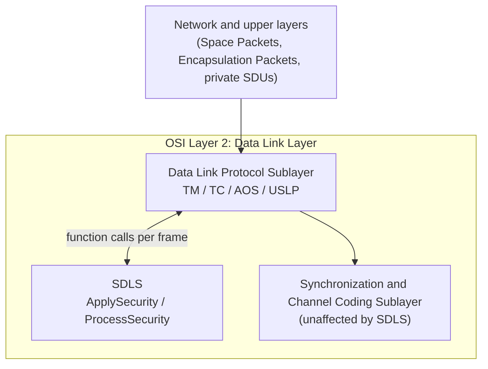
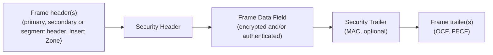
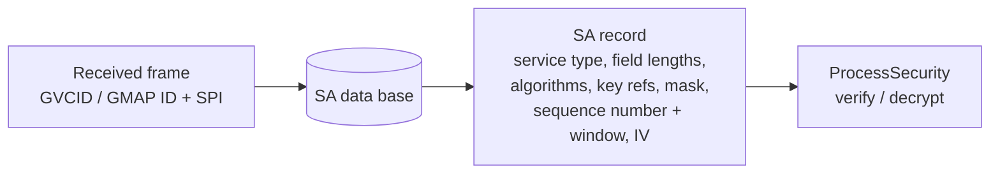
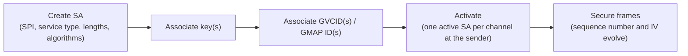
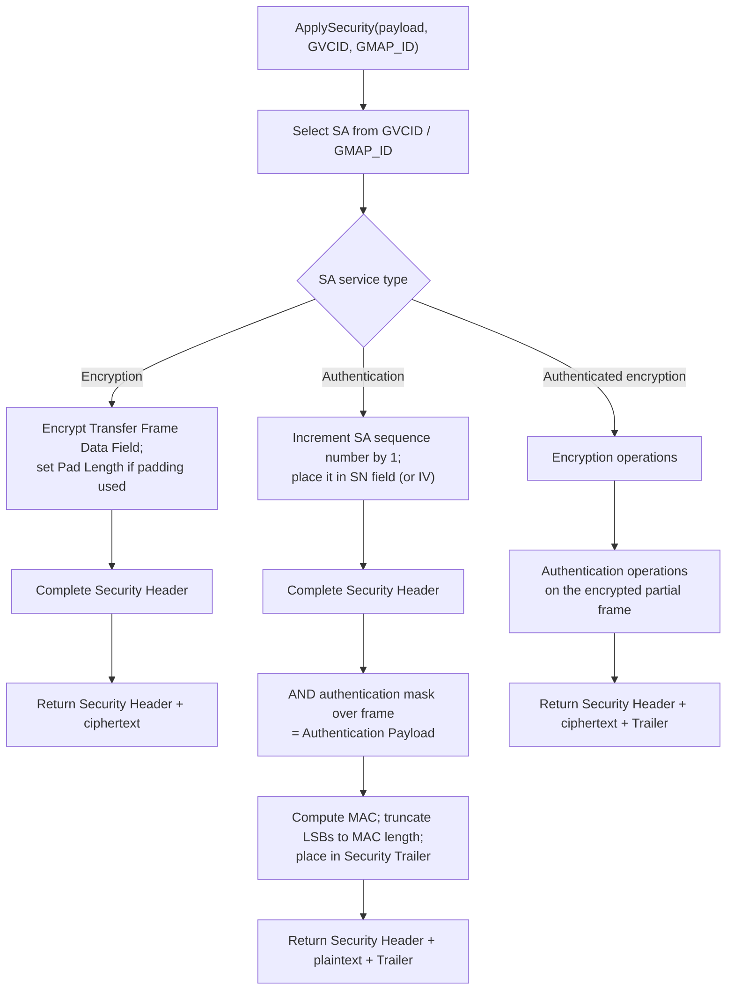
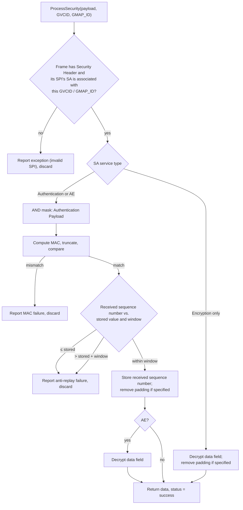

# Space Data Link Security (CCSDS 355.0-B-2)

The **Space Data Link Security (SDLS) protocol** is CCSDS's way of adding **authentication,
encryption, or both** to the contents of transfer frames. It works inside the Data Link Layer,
which is OSI Layer 2. It defines a **Security Header** and a **Security Trailer** that wrap the
frame's data field, together with procedures for applying and checking security on each
frame.[^s-purpose][^s-concept] It is not a stand-alone protocol. It is an optional extra service
of four data link protocols: [TM](tm-sdlp.md), [TC](tc-sdlp.md), [AOS](aos.md) and
[USLP](uslp.md). It does not apply to Proximity-1.[^s-concept] SDLS fixes no cryptographic
algorithm. CCSDS 352.0-B lists the algorithms CCSDS recommends, and annex E of SDLS gives an
informative baseline.[^s-scope]

This page follows CCSDS 355.0-B-2 (July 2022), held in the
[library](../library/ccsds-355-0-355x0b2.md). Issue 2 adds USLP support and makes the **SDLS
Extended Procedures** (CCSDS 355.1-B-1) a normative reference. The Extended Procedures define
key management, Security Association management and monitoring.[^s-doc][^s-ep] Several
companion documents are cited by the standard but are **not in this wiki's library**: the
Extended Procedures, the Cryptographic Algorithms book CCSDS 352.0-B-2, the concept-and-rationale
green book CCSDS 350.5-G-1 and the key-management concept CCSDS 350.6-G-1.[^s-refs][^s-irefs]
Statements here are limited to what 355.0-B-2 and the frame standards say.

!!! info "At a glance"
    | Property | Value |
    |---|---|
    | Layer | Data Link Protocol Sublayer (with TM, TC, AOS or USLP)[^s-concept][^s-dll] |
    | Security services | Authentication, encryption, authenticated encryption ("encrypt-then-MAC")[^s-satype][^s-ae] |
    | Security Header | 16-bit SPI + optional IV, Sequence Number and Pad Length; at most 64 octets[^s-sh] |
    | Security Trailer | MAC, present whenever authentication is used[^s-st] |
    | Session state | Security Association (SA): simplex and stateful, selected by the SPI[^s-sa] |
    | Replay protection | Anti-replay sequence number checked against a window[^s-replay] |
    | Granularity | Per Virtual Channel, or per MAP (TC with Segment Headers, USLP)[^s-ctx][^s-ctx2] |
    | Algorithms | Not mandated; CCSDS 352.0-B lists the recommended ones[^s-scope] |
    | Key and SA management | Out of scope; see the SDLS Extended Procedures[^s-ep][^s-keys] |

## Why SDLS exists, and its design goals

The standard has four goals:[^s-rationale]

1. Apply security **in the same way whatever cryptographic algorithm** a mission chooses.
2. Keep the existing frame headers and trailers, so that **legacy frame-processing
   infrastructure** can be used unchanged where appropriate.
3. Stay compatible with the **SLE forward and return services**.
4. Encourage **common commercial implementations**, so that agencies interoperate.

ECSS sets the system-level requirements behind this. Only telecommands from authorized sources
may be executed on board. Telecommand encryption is required when authentication alone does not
meet the security requirements. Telemetry authentication and encryption are required when
security requirements cannot be met by other means. For telecommand encryption and for
telemetry security, notes in ECSS-E-ST-50C name the SDLS option of the TC (ECSS-E-AS-50-25),
TM (AS-50-22) and AOS (AS-50-23) adoption notices as one way to meet the requirement at the
data link layer.[^e50-auth][^e50-tm] The ECSS adoption notice of the TC protocol, ECSS-E-AS-50-25C
Rev.1, includes the interfaces for SDLS with TC frames. Its predecessor, ECSS-E-ST-50-04, did
not have them.[^as25]

The CCSDS overview calls SDLS optional within TM, TC, AOS and USLP. It also notes that no
security requirements have yet been set for Proximity-1.[^g4-sdls] The older green book on data
link protocols describes the services as authentication, encryption and authenticated
encryption.[^g3-sec]

## Where SDLS sits

SDLS is used *by* the data link protocol entity through two functions. The sending end calls
**ApplySecurity** and the receiving end calls **ProcessSecurity**. The Synchronization and
Channel Coding Sublayer is not affected.[^s-dll][^s-svcdef] The headers and trailers reduce the
space left for the data field, but SDLS keeps the quality of service the link protocol provides.
It scales to any number of Virtual Channels. Whether a Security Header and Trailer are used on a
Global Virtual Channel or GMAP, and how large they are, are managed parameters that stay constant
for a mission.[^s-features]

## The three security services

| Service | What it gives | How |
|---|---|---|
| **Authentication** | Integrity of the data and authenticity of its source, plus detection of replayed frames | A **MAC** over selected frame fields, and an **anti-replay sequence number** in each frame[^s-auth] |
| **Encryption** | Confidentiality of the data | The frame data ("plaintext") is replaced by "ciphertext". An initialization vector is often an input, and padding may be needed for block sizes[^s-enc] |
| **Authenticated encryption** | Both of the above | Encrypt the data, apply the anti-replay sequence number, then compute the MAC over the result ("encrypt-then-MAC")[^s-ae] |

Each Security Association uses exactly one of these services. Its algorithms and modes are fixed
for the life of the SA.[^s-satype][^s-satype2] The standard warns that **encryption without
authentication can give a false sense of security**. Missions should choose services only after
a mission-specific threat and risk analysis.[^s-enc] Annex B adds that encryption alone gives no
protection against data substitution, and that predictable plaintext may weaken
confidentiality.[^s-threats]

For algorithms that take the plaintext and **Additional Authenticated Data** (AAD) as separate
inputs, the so-called AEAD algorithms, SDLS fixes the split. The plaintext is the Transfer Frame
Data Field. The AAD runs from the first octet of the Authentication Payload to the octet just
before the data field, that is, the masked headers including the Security Header.[^s-aead]

## What is protected in a frame

SDLS inserts its fields around the frame data. The Security Header carries the SPI, the
initialization vector, the anti-replay sequence number and the pad length, and the Security
Trailer carries the MAC:[^s-frame-fig][^s-hdrtrl]

Encryption applies **only to the Frame Data Field**. Authentication covers more. Some fields are
always excluded from the MAC, some are always included, and the rest depend on an
**authentication bit mask** in the SA.[^s-mac-fields][^s-mask]

| Frame field | In MAC? | Notes |
|---|---|---|
| Synchronization marker (ASM in TM/AOS/USLP, CLTU Start Sequence in TC) | Never | Added below the data link layer[^s-mac-fields] |
| Virtual Channel ID | Always | Mask bits all ones[^s-mac-fields][^s-mask] |
| MAP ID (USLP) | Always | Mask bits all ones[^s-mask] |
| Segment Header (TC) | Always | Mask bits all ones[^s-mask] |
| Security Header, except the IV | Always | Mask bits all ones[^s-mask] |
| Initialization Vector | Not required | §2.3.2.2 and item h) of the mask rules exempt the IV from the "always included" / "all ones" rule for the Security Header; the standard does not fix its mask bits[^s-mac-fields][^s-mask] |
| Frame Data Field | Always | Mask bits all ones[^s-mask] |
| Master Channel Frame Count (TM) | Never | Mask bits all zeros[^s-mask] |
| Frame Header Error Control (AOS) | Never | Mask bits all zeros[^s-mask] |
| Insert Zone (AOS, USLP) | Never | Mask bits all zeros[^s-mac-fields][^s-mask] |
| OCF, FECF/ECF, the MAC itself | Never | Outside the authenticated part[^s-mac-fields] |
| Other header fields (for example the SCID or the TM secondary header) | By default no | Mask bits *should* be zero. A mission may include them by choosing another mask[^s-mask] |

The mask is ANDed with the frame from the first header octet to the end of the data field. That
yields the **Authentication Payload**, over which the MAC is computed. For variable-length TC
and USLP frames the mask is sized for the largest expected data field. If TM's Master Channel
Frame Secondary Header service is used, the TM secondary header is left out of the authenticated
data.[^s-mask][^s-auth-ops]

!!! warning "Inference: why some fields are excluded"
    The standard gives no rationale field by field. This wiki notes a pattern: the fields that
    are always excluded either lie outside the ApplySecurity Payload, which ends with the data
    field,[^s-apply-in] or are filled in by functions that run *after* SDLS has processed the
    frame. The OCF and FECF follow the data field. The FECF is computed in All Frames Generation,
    after SDLS.[^aos-afg] In AOS, All Frames Generation also fills in the Insert Zone and the
    Frame Header Error Control,[^aos-afg-ins] and in TM the Master Channel Frame Count is
    generated by the Master Channel Generation Function.[^tm-mcg] The standard refers to CCSDS
    350.5-G-1, which is not in the library, for the security concerns that affect the choice of
    mask.[^s-mask]

## Security Header

The Security Header comes directly before the frame data. On a given VC or MAP it is either
always present or always absent for the whole mission. It is **mandatory whenever any security
service is applied**. It has one mandatory field and three optional fields, in this
order:[^s-sh]

| Field | Length | Allowed lengths (managed) | Content |
|---|---|---|---|
| Security Parameter Index (SPI) | 16 bits, mandatory | fixed | Identifies the SA. Values 1 to 65 534; `0x0000` and `0xFFFF` are reserved by CCSDS[^s-spi][^s-mp] |
| Initialization Vector (IV) | Integral octets, fixed for the SA | 1 to 32 octets if used, otherwise 0 | The IV, or an agreed part of it[^s-iv][^s-mp] |
| Sequence Number | Integral octets, fixed for the SA | 2 to 8 octets if used, otherwise 0 | The anti-replay sequence number, when authentication or authenticated encryption is selected. Zero length if the IV doubles as the sequence number[^s-sn][^s-mp] |
| Pad Length | Integral octets, fixed for the SA | 1 to 2 octets if used, otherwise 0 | Number of fill bytes added for the cryptographic process[^s-pl][^s-mp] |

The whole header is at most **64 octets**. The receiver works out which optional fields are
present, and how long they are, by looking up the SPI's Security Association. The frame carries
no length indicators.[^s-sh]

Two layouts from the informative baseline (annex E) show how the header looks in
practice:[^s-base-tm][^s-base-tc]

## Security Trailer

The Security Trailer comes directly after the frame data. Its presence on a VC or MAP stays
constant for the mission, and it is present **whenever authentication or authenticated encryption
is applied**. It contains only the **MAC**, octet-aligned and of fixed length for the SA.[^s-st]
The MAC field may be 8 to 64 octets.[^s-mp] If the computed MAC is longer than the field, the
**least significant bits are truncated** to fit.[^s-auth-ops]

## Security Associations

A **Security Association (SA)** is a simplex (one-way), stateful cryptographic session. It
provides authentication, data integrity, replay protection and/or data confidentiality, and it
holds the state for the duration of the session.[^s-sa] All frames that share an SA on a physical
channel form a **Secure Channel**, made of one or more Global Virtual Channels or, for TC, Global
MAP IDs assigned to the SA when it is created.[^s-ctx]

The **SPI**, carried in every secured frame, is the key into an **SA data base** that holds all
the managed information of every SA on the physical channel.[^s-ctx] Each SA on a physical
channel has a unique SPI.[^s-sa-spi] §4.2.2.3 states the rule per Master Channel instead: frames
with the same SPI on a Master Channel share a single SA.[^s-spi-mc]

### SA rules

* **Exactly one service type** per SA (authentication, encryption or authenticated encryption).
  The algorithms, modes and field lengths are fixed for the SA's lifetime.[^s-satype2][^s-satype]
* **Exactly one active SA** at a time per Global Virtual Channel or GMAP ID at the sending
  end.[^s-uniq]
* **No SA on idle channels.** SAs are never created for VCs that carry Only Idle Data
  frames.[^s-idle] TM goes further: an OID frame that the Master Channel Multiplexing Function
  creates must use a VC that does not use SDLS.[^tm-oid]
* **Protocol-specific limits.** In TC each SA belongs to one VC only. In USLP each SA belongs to
  one VC only when COPs are used.[^s-tc][^s-uslp] The TC and USLP standards also say that
  several VCs sharing an SA is not supported.[^tc-sa][^u-sa] TM and AOS allow an SA to cover
  several VCs, when SDLS is called from the Virtual Channel Multiplexing Function (see
  [AOS with SDLS](aos.md#aos-with-the-sdls-option)).[^tm-where][^aos-where]
* **"Clear mode".** An SA with a "no-op" algorithm can keep header and trailer lengths constant,
  for example during integration testing before cryptography is available. It is not
  recommended in normal operation, and the conditions for activating it need careful
  analysis.[^s-satype2][^s-threats]

### SA parameters

The standard defines the SA data base parameters and their allowed values. It does not define
the management services that set them.[^s-sam][^s-mp]

| Parameter | Applies to | Allowed values / meaning |
|---|---|---|
| GVCID | All SAs | Global Virtual Channel(s) the SA applies to[^s-par-common] |
| GMAP_ID | TC with Segment Headers, USLP | Global MAP(s) the SA applies to[^s-par-common][^s-ctx2] |
| Security Parameter Index | All SAs | 1 to 65 534[^s-par-common][^s-mp] |
| SA_service_type | All SAs | Authentication, Encryption, Authenticated Encryption[^s-par-common] |
| SA_length_IV, SA_length_SN, SA_length_PL, SA_length_MAC | All SAs | Field lengths: IV 1–32, SN 2–8, PL 1–2, MAC 8–64 octets (when used)[^s-par-common][^s-mp] |
| SA_authentication_algorithm | Authentication, AE | HMAC, CMAC, GMAC, GCM or agency-specific, with mode[^s-par-auth][^s-mp] |
| SA_authentication_key | Authentication, AE | The key value, or an index to it[^s-par-auth] |
| SA_authentication_mask | Authentication, AE | Bit mask ANDed with the frame[^s-par-auth] |
| SA_sequence_number | Authentication, AE | Current anti-replay value (sender: next frame; receiver: expected)[^s-par-auth][^s-mp] |
| SA_sequence_window | Authentication, AE | Accepted deviation, an integer greater than zero[^s-par-auth][^s-mp] |
| SA_encryption_algorithm | Encryption, AE | AES in counter mode, GCM, or agency-specific, with mode[^s-par-enc][^s-mp] |
| SA_encryption_key | Encryption, AE | The key value, or an index to it[^s-par-enc] |
| SA_initialization_vector | Encryption, AE | Current IV value (algorithm-specific)[^s-par-enc][^s-mp] |

Table 6-1 groups these parameters by how long they stay fixed.[^s-mp]

* **Fixed for the life of the SA:** SPI, service type, context (GVCID/GMAP_ID), field lengths,
  algorithms, mask and window.
* **Fixed while the SA is active:** the keys.
* **Varying dynamically:** the sequence number and the IV.

The sending and receiving data bases must match for the link to work.[^s-mp]

### SA life cycle and management

Before an SA can secure frames, **both ends** must create it, associate it with key(s), associate
it with its Global Virtual Channel(s) or GMAP IDs, and activate it.[^s-sa-mgmt][^s-sa-proc] SAs
may be statically preloaded before the start of the mission, or created dynamically alongside
active ones. Switching from one
active SA to another is an Application Layer function. Over-the-air negotiation of SA parameters
is an Application Layer function that is "currently undefined".[^s-sa-mgmt] Before operation,
both ends initialize a common SA data base, and they should keep it synchronized.[^s-db]

!!! info "Separation from key management"
    SDLS deliberately specifies **no key management protocol**. Key management and the criteria
    for changing keys in operation are outside its scope.[^s-keys][^s-threats] Creating,
    modifying and maintaining the SA data bases is also outside this document. These functions,
    together with SDLS monitoring and control, are specified in the SDLS Extended Procedures,
    CCSDS 355.1-B-1, which is not in this library.[^s-ep][^s-db][^s-sam2] The standard names
    no SA states beyond "created" and "active". Any finer life-cycle states (for example keyed or
    operational) are not stated in the available sources.

## Sending end: the ApplySecurity function

**Inputs.** The calling protocol passes three things:[^s-apply][^s-apply-in][^s-apply-id]

* The **ApplySecurity Payload**: the partially formatted frame from the first octet of the
  Primary Header to the last octet of the Transfer Frame Data Field, with the Security Header
  still empty. There is one payload type each for TM, TC, AOS and USLP.
* The **GVCID**.
* For TC and USLP, the **GMAP_ID** where applicable.

**Output.** The **ApplySecurity Return** is the part of the frame from the first octet of the
Security Header to the last octet of the Security Trailer, or of the data field if there is no
trailer.[^s-apply-ret]

These steps follow §4.2.3.[^s-send][^s-enc-ops][^s-auth-ops] The way frame data passes between
the link protocol and SDLS is left to the implementation.[^aos-impl]

## Receiving end: the ProcessSecurity function

**Inputs.** The receiving end passes the **ProcessSecurity Payload**, the frame from the first
octet of the Primary Header to the last octet of the Security Trailer (or of the data field), with
the GVCID and the GMAP_ID where applicable.[^s-proc-in]

**Outputs.**[^s-vstat][^s-vcode][^s-pret]

* **Verification Status**: either no failure, or a failure was detected.
* **Verification Status Code**: says which failure occurred. Implementations must support at
  least five values: no failure, invalid SPI, MAC verification failure, anti-replay sequence
  number failure, and padding error. The numeric code values are not stated in the available
  sources.
* **ProcessSecurity Return**: the data field, decrypted if the SA includes encryption. It runs
  from the first octet after the Security Header to the last octet of the data field. No
  decryption is done after a verification failure.

These steps follow §4.2.4.[^s-recv][^s-saver][^s-auth-rx][^s-enc-rx] Frames that are discarded
can be archived for forensic investigation.[^s-saver][^s-auth-rx] The data link protocol then
discards the frame. Through the optional Verification Status Code of the relevant service, it
tells the service user.[^aos-err][^u-err]

## Anti-replay in detail

For an SA with authentication, both ends keep a **sequence number**, a **sequence number
window** and the sequence number's **location** in the frame.[^s-replay]

* The **sender** increments its sequence number by one for every frame of the SA.[^s-sn-rule][^s-auth-ops]
* The **receiver** accepts a frame only if the received number is **greater than** its stored
  value and **no more than the window above** it. Only then does it replace the stored value
  with the received one. Otherwise it reports an exception and discards the frame, leaving its
  stored value unchanged.[^s-sn-rule][^s-auth-rx]
* The **window** is a fixed positive value in the SA. It is sized for the delays and gaps
  expected on the RF link.[^s-window]
* The **location** is either the Sequence Number field (with a managed length), or, for
  counter-mode authenticated encryption, the IV field itself, in which case the Sequence Number
  field has zero length.[^s-loc][^s-sn]
* What a **rollover to zero** means is left to each mission.[^s-sn-rule]

!!! example "Worked example: the receiver's sequence check (illustrative values)"
    SA window = 10, stored value = 1000.

    | Received SN | Check | Result | Stored value afterwards |
    |---|---|---|---|
    | 1001 | 1000 < 1001 ≤ 1010 | accepted | 1001 |
    | 1001 | not > 1001 | rejected (repeat) | 1001 |
    | 1005 | 1001 < 1005 ≤ 1011 | accepted (frames 1002–1004 lost or delayed) | 1005 |
    | 1003 | not > 1005 | rejected (arrived late) | 1005 |
    | 1020 | > 1005 + 10 | rejected (outside window) | 1005 |

    The last row shows why the window must suit the link.

!!! warning "Inference"
    Only accepted frames update the stored value.[^s-auth-rx] So if more consecutive frames are
    lost than the window allows, every later frame lies outside the window and is rejected. The
    stored value cannot catch up by itself. Recovering then means adjusting the SA's sequence
    number through SA management, which CCSDS 355.0-B-2 leaves to the Extended
    Procedures.[^s-sam2]

### Interaction with COP-1 retransmission

The data link standards fix the **order** of SDLS relative to the COP:

* **TC sending end:** Frame Initialization, which reserves the security fields; then
  ApplySecurity; then FOP-1; then Frame Finalization.[^tc-order]
* **TC receiving end:** FARM-1; then ProcessSecurity; then the rest of VC reception. This is
  the text as amended by Corrigendum 1 (October 2023) of the TC standard.[^tc-rx-order]
* **USLP** uses the same order with FOP/FARM for COP-1 or COP-P.[^u-order]

!!! warning "Inference"
    Because ApplySecurity runs before the FOP, a frame resent by COP-1 keeps the sequence number
    it was first given. This is this wiki's reading of the processing order; the standards do
    not state it in these words, but their notes describe its consequence (below).

Both the TC and the USLP standards warn about the consequence. Suppose an authenticated VC mixes sequence-controlled Type-AD frames with expedited Type-BD frames, and
Type-AD frames must be retransmitted. The anti-replay check will then reject the resent frames,
because their sequence numbers are lower than those of BD frames already accepted. They are
falsely labelled security failures. Mixing AD and BD frames on an SDLS-secured VC is therefore
generally not advised, unless BD frames are sent only after all AD frames have been
accepted.[^tc-note][^u-note]

## How SDLS plugs into each data link protocol

In every protocol, the presence and lengths of the Security Header and Trailer are managed
parameters: per VC for TM and AOS, per VC or MAP for TC and USLP. A Security Header that is
present means SDLS is in use.[^tm-mp][^aos-mp][^tc-mp][^u-mp]

| Protocol | Where the Security Header goes | Services fully protected | Not protected |
|---|---|---|---|
| **TM** | After the Frame Secondary Header (or Primary Header)[^tm-sh] | Packet, VCA. VC_FSH: authentication only[^s-tm] | VC_OCF, MC_FSH, MC_OCF, VCF, MCF[^s-tm] |
| **TC** | After the Segment Header (or Primary Header), only in Type-D frames[^tc-sh] | MAPP, MAPA, VCP, VCA[^s-tc] | COP management (Type-C control frames carry no security fields), VCF, MCF[^s-tc][^tc-sh] |
| **AOS** | After the Insert Zone (or Primary Header)[^aos-sh] | Packet, Bitstream, VCA[^s-aos] | VC_OCF, Insert, VCF, MCF[^s-aos] |
| **USLP** | After the Insert Zone (or Primary Header); not in frames with Protocol Control Command Flag = 1[^u-sh] | MAPP, MAP Octet Stream, MAPA[^s-uslp] (USLP issue 3 adds VCP and VCA[^u-sec]) | COPs management, USLP_MC_OCF, Insert, VCF, MCF[^s-uslp] |

In all four protocols SDLS authenticates some Primary Header fields but **never encrypts
headers**. Apart from TM's VC_FSH, which can be authenticated, it does not protect data in
auxiliary fields such as the OCF or the Insert Zone. It never protects frames that outside
sources supply through the VCF and MCF services.[^s-tm][^s-tc-2][^s-aos][^s-uslp]

**Where the call is made.** In TM and AOS, ApplySecurity may be called from Virtual Channel
Generation, which gives the most flexibility and allows one SA per VC, or from Virtual Channel
Multiplexing, where several VCs can share an SA.[^tm-where][^aos-where] The FECF is always
computed **after** SDLS. That is why SDLS has no interface with All Frames
Generation.[^aos-afg] In TC and USLP the call is part of Virtual Channel Generation, in the fixed
order shown above.[^tc-order][^u-order]

!!! example "Worked example: overhead of the baselines (illustrative calculation by this wiki)"
    **TC with AES-CMAC baseline.** The Security Header is 6 octets and the MAC is 16
    octets.[^s-base-tc] The TC data field with SDLS may be at most 1024 octets minus the primary
    header (5), the Security Header, and the Segment Header (1), Security Trailer and FECF (2)
    if present.[^tc-df] ECSS makes the FECF mandatory for TC frames, with or without
    SDLS.[^as25-fecf] That leaves 1024 − 5 − 1 − 6 − 16 − 2 = **994 octets** of user data per
    frame with a Segment Header, or 995 without one.

    **AOS or USLP with the AES-GCM baseline.** The Security Header is 14 octets and the MAC is 16
    octets, 30 octets per frame in total.[^s-base-aos][^s-base-uslp] In a 1115-octet AOS frame
    that is about 2.7 %; see the [AOS page](aos.md#aos-with-the-sdls-option).

## The informative baseline (annex E)

Annex E defines baseline implementations for interoperability testing and operation:[^s-base-tm][^s-base-tc][^s-base-aos][^s-base-uslp]

| Protocol | Service | Algorithm | Key | IV | Sequence Number | MAC | Header / Trailer |
|---|---|---|---|---|---|---|---|
| TM | Authenticated encryption | AES-GCM | 256 bits | 96 bits, all transmitted | none (IV serves) | 128 bits | 14 / 16 octets |
| TC | Authentication | AES-CMAC | 256 bits | none | 32 bits, all transmitted | 128 bits | 6 / 16 octets |
| AOS | Authenticated encryption | AES-GCM | 256 bits | 96 bits | none | 128 bits | 14 / 16 octets |
| USLP | Authenticated encryption | AES-GCM | 256 bits | 96 bits | none | 128 bits | 14 / 16 octets |

In every baseline the Pad Length field has zero length, because neither GCM nor CMAC needs
padding. The mask has zeros for every header field not otherwise fixed by §4.2.2.6.2. GCM
normally uses an incrementing counter as its IV, so a separate anti-replay sequence number is not
needed.[^s-base-tm] In USLP **truncated frames**, SDLS uses a 6-octet Security Header and a
16-octet Security Trailer. That matches the TC baseline sizes, and the truncated frame must then
be at least 28 octets long. A separate SA is advised for truncated frames.[^u-trunc]

## Limits and threats the standard names

Annex B lists what SDLS does **not** do. It is listed here so that readers understand the
protocol's scope:[^s-threats]

* It gives no protection against **denial of service** on the channel, such as RF jamming.
* It gives no protection against **traffic-flow analysis**. Identifiers in the clear, such as the
  SCID, VCID, MAP ID, OCF and COP directives, remain visible as metadata.
* It has no **key management protocol**.
* It does not protect **COP control commands**, or the CLCW and PLCW reports in the OCF.
* A **clear mode**, if implemented, needs careful analysis of how it can be activated.
* **Encryption without authentication** does not protect against data substitution.

The same annex states what is at stake. Without authentication, unauthorized commands or
software could be uploaded, or data could arrive from a source posing as the spacecraft. Without
integrity, corrupted commands or telemetry could cause wrong actions or even loss of the mission.
Without confidentiality, sensitive data could be disclosed. Security may also be needed at other
layers, for example across ground networks. That is outside the scope of SDLS.[^s-threats][^s-layers]

## Managed parameters, conformance and SANA

* **Managed parameters.** Table 6-1 lists the SA data base parameters shown above. In addition,
  every managed parameter of the underlying data link protocol also applies to SDLS.[^s-mp]
* **Conformance.** An implementer completes the PICS proforma of annex A. It requires support of
  at least one of TM, TC, AOS or USLP, and at least one of the three security services. The SA
  parameters are mandatory or conditional on the services supported, and ApplySecurity or
  ProcessSecurity is mandatory for the sender or receiver role.[^s-pics][^s-pics2]
* **SANA.** SDLS defines no new registries.[^s-threats]

## Related pages

* [AOS](aos.md), [USLP](uslp.md), [TM Space Data Link Protocol](tm-sdlp.md), [TC Space Data Link Protocol](tc-sdlp.md)
* [COP-1, FOP-1, FARM-1 and the CLCW](cop-1.md) (the CLCW and the FSR share the OCF)
* [ECSS-E-ST-50C and the CCSDS adoption notices](../ecss/e-st-50-communications.md)
* [SLE return services](sle/return-services.md) and [FCLTU](sle/fcltu.md) (SDLS is designed to stay compatible with them)
* [Glossary](../glossary.md), [reference catalogue](../references/index.md)

[^s-doc]: [CCSDS 355.0-B-2, Space Data Link Security Protocol](../library/ccsds-355-0-355x0b2.md), Document Control, PDF p. 7.
[^s-purpose]: [CCSDS 355.0-B-2](../library/ccsds-355-0-355x0b2.md), §1.1 Purpose, PDF p. 10.
[^s-scope]: [CCSDS 355.0-B-2](../library/ccsds-355-0-355x0b2.md), §1.2 Scope, PDF p. 10.
[^s-rationale]: [CCSDS 355.0-B-2](../library/ccsds-355-0-355x0b2.md), §1.4 Rationale, PDF p. 11.
[^s-refs]: [CCSDS 355.0-B-2](../library/ccsds-355-0-355x0b2.md), §1.8 References ([4] CCSDS 352.0-B-2, [6] CCSDS 355.1-B-1), PDF p. 13.
[^s-irefs]: [CCSDS 355.0-B-2](../library/ccsds-355-0-355x0b2.md), annex D Informative References ([D3] CCSDS 350.5-G-1, [D8] CCSDS 350.6-G-1), PDF p. 68.
[^s-concept]: [CCSDS 355.0-B-2](../library/ccsds-355-0-355x0b2.md), §2.1 Concept of Security Protocol and figure 2-1, PDF p. 14.
[^s-features]: [CCSDS 355.0-B-2](../library/ccsds-355-0-355x0b2.md), §2.2.1 General, PDF p. 15.
[^s-ep]: [CCSDS 355.0-B-2](../library/ccsds-355-0-355x0b2.md), §1.2 (last paragraph) and §2.2.1 (Extended Procedures), PDF pp. 10 and 15.
[^s-dll]: [CCSDS 355.0-B-2](../library/ccsds-355-0-355x0b2.md), §2.2.2 Data Link Layer Protocols, PDF p. 15.
[^s-frame-fig]: [CCSDS 355.0-B-2](../library/ccsds-355-0-355x0b2.md), §2.2.2 and figure 2-2 Security Protocol Interaction with Space Link Frames, PDF pp. 15–16.
[^s-tm]: [CCSDS 355.0-B-2](../library/ccsds-355-0-355x0b2.md), §2.2.3 Security Service for TM (PDF pp. 16–17) and §5.1 TM Protocol (PDF p. 47).
[^s-tc-2]: [CCSDS 355.0-B-2](../library/ccsds-355-0-355x0b2.md), §2.2.4 Security Service for TC, PDF pp. 17–18.
[^s-aos]: [CCSDS 355.0-B-2](../library/ccsds-355-0-355x0b2.md), §2.2.5 Security Service for AOS (PDF p. 18) and §5.3 AOS Protocol (PDF p. 48).
[^s-uslp]: [CCSDS 355.0-B-2](../library/ccsds-355-0-355x0b2.md), §2.2.6 Security Service for USLP (PDF p. 19) and §5.4 USLP (PDF p. 49).
[^s-sa]: [CCSDS 355.0-B-2](../library/ccsds-355-0-355x0b2.md), §2.3.1.1 Security Associations, General, PDF p. 20.
[^s-ctx]: [CCSDS 355.0-B-2](../library/ccsds-355-0-355x0b2.md), §2.3.1.2 Security Association Context, PDF p. 20.
[^s-satype]: [CCSDS 355.0-B-2](../library/ccsds-355-0-355x0b2.md), §2.3.1.3 Security Association Service Types, PDF p. 20.
[^s-hdrtrl]: [CCSDS 355.0-B-2](../library/ccsds-355-0-355x0b2.md), §2.3.1.4 Security Header and Trailer, PDF pp. 20–21.
[^s-sa-mgmt]: [CCSDS 355.0-B-2](../library/ccsds-355-0-355x0b2.md), §2.3.1.5 Security Association Management and note, PDF p. 21.
[^s-auth]: [CCSDS 355.0-B-2](../library/ccsds-355-0-355x0b2.md), §2.3.2.1 and §2.3.2.2 Authentication, Message Authentication and Integrity, PDF p. 21.
[^s-mac-fields]: [CCSDS 355.0-B-2](../library/ccsds-355-0-355x0b2.md), §2.3.2.2 (fields always excluded and included) and note on ASM and CLTU Start Sequence, PDF pp. 21–22.
[^s-replay]: [CCSDS 355.0-B-2](../library/ccsds-355-0-355x0b2.md), §2.3.2.3.1 Replay Protection, General, PDF p. 22.
[^s-sn-rule]: [CCSDS 355.0-B-2](../library/ccsds-355-0-355x0b2.md), §2.3.2.3.2 Sequence Number and note, PDF p. 22.
[^s-window]: [CCSDS 355.0-B-2](../library/ccsds-355-0-355x0b2.md), §2.3.2.3.3 Sequence Number Window, PDF p. 22.
[^s-loc]: [CCSDS 355.0-B-2](../library/ccsds-355-0-355x0b2.md), §2.3.2.3.4 Sequence Number Location, PDF pp. 22–23.
[^s-enc]: [CCSDS 355.0-B-2](../library/ccsds-355-0-355x0b2.md), §2.3.3 Encryption and note, PDF p. 23.
[^s-ae]: [CCSDS 355.0-B-2](../library/ccsds-355-0-355x0b2.md), §2.3.4 Authenticated Encryption, PDF p. 23.
[^s-svcdef]: [CCSDS 355.0-B-2](../library/ccsds-355-0-355x0b2.md), §3.1 Overview of the service definition, PDF p. 24.
[^s-apply]: [CCSDS 355.0-B-2](../library/ccsds-355-0-355x0b2.md), §3.2.1 Function at the Sending End, overview, PDF p. 24.
[^s-apply-in]: [CCSDS 355.0-B-2](../library/ccsds-355-0-355x0b2.md), §3.2.2.1 to §3.2.2.5 ApplySecurity Payloads for TM, TC, AOS and USLP, PDF pp. 24–26.
[^s-apply-id]: [CCSDS 355.0-B-2](../library/ccsds-355-0-355x0b2.md), §3.2.2.6 GVCID and §3.2.2.7 GMAP Identifier, PDF pp. 26–27.
[^s-apply-ret]: [CCSDS 355.0-B-2](../library/ccsds-355-0-355x0b2.md), §3.2.3 ApplySecurity Return, PDF p. 27.
[^s-proc-in]: [CCSDS 355.0-B-2](../library/ccsds-355-0-355x0b2.md), §3.3.1 and §3.3.2 ProcessSecurity overview and input parameters, PDF pp. 27–29.
[^s-vstat]: [CCSDS 355.0-B-2](../library/ccsds-355-0-355x0b2.md), §3.3.3.1 Verification Status and note, PDF pp. 29–30.
[^s-vcode]: [CCSDS 355.0-B-2](../library/ccsds-355-0-355x0b2.md), §3.3.3.2 Verification Status Code, PDF p. 30.
[^s-pret]: [CCSDS 355.0-B-2](../library/ccsds-355-0-355x0b2.md), §3.3.3.3 ProcessSecurity Return and notes, PDF p. 30.
[^s-sam]: [CCSDS 355.0-B-2](../library/ccsds-355-0-355x0b2.md), §3.4.1 Security Association Management Service, overview, PDF p. 31.
[^s-par-common]: [CCSDS 355.0-B-2](../library/ccsds-355-0-355x0b2.md), §3.4.2.2 Security Association Parameters required by all SAs, PDF pp. 31–32.
[^s-par-auth]: [CCSDS 355.0-B-2](../library/ccsds-355-0-355x0b2.md), §3.4.2.3 Parameters Specific to Authentication, PDF pp. 32–33.
[^s-par-enc]: [CCSDS 355.0-B-2](../library/ccsds-355-0-355x0b2.md), §3.4.2.4 Parameters Specific to Encryption, PDF p. 33.
[^s-sam2]: [CCSDS 355.0-B-2](../library/ccsds-355-0-355x0b2.md), §3.4.3 SA Management Service Primitives, PDF p. 34.
[^s-sh]: [CCSDS 355.0-B-2](../library/ccsds-355-0-355x0b2.md), §4.1.1.1 Security Header, General, and figure 4-1, PDF p. 35.
[^s-spi]: [CCSDS 355.0-B-2](../library/ccsds-355-0-355x0b2.md), §4.1.1.2 Security Parameter Index, PDF p. 35.
[^s-iv]: [CCSDS 355.0-B-2](../library/ccsds-355-0-355x0b2.md), §4.1.1.3 Initialization Vector, PDF p. 36.
[^s-sn]: [CCSDS 355.0-B-2](../library/ccsds-355-0-355x0b2.md), §4.1.1.4 Sequence Number and note, PDF p. 36.
[^s-pl]: [CCSDS 355.0-B-2](../library/ccsds-355-0-355x0b2.md), §4.1.1.5 Pad Length, PDF p. 36.
[^s-st]: [CCSDS 355.0-B-2](../library/ccsds-355-0-355x0b2.md), §4.1.2 Security Trailer and figure 4-2, PDF p. 37.
[^s-db]: [CCSDS 355.0-B-2](../library/ccsds-355-0-355x0b2.md), §4.2.1 Security Protocol Procedures, General, and note, PDF p. 37.
[^s-sa-proc]: [CCSDS 355.0-B-2](../library/ccsds-355-0-355x0b2.md), §4.2.2.1 Security Association Management Procedures, General, PDF p. 38.
[^s-ctx2]: [CCSDS 355.0-B-2](../library/ccsds-355-0-355x0b2.md), §4.2.2.2.1 Security Association Context and notes, PDF p. 38.
[^s-uniq]: [CCSDS 355.0-B-2](../library/ccsds-355-0-355x0b2.md), §4.2.2.2.2 SA Uniqueness on Virtual Channels and MAPs, PDF p. 38.
[^s-idle]: [CCSDS 355.0-B-2](../library/ccsds-355-0-355x0b2.md), §4.2.2.2.3 Idle Transfer Frame Virtual Channels, PDF p. 38.
[^s-sa-spi]: [CCSDS 355.0-B-2](../library/ccsds-355-0-355x0b2.md), §3.4.2.2.3 Security Parameter Index and note, PDF p. 32.
[^s-spi-mc]: [CCSDS 355.0-B-2](../library/ccsds-355-0-355x0b2.md), §4.2.2.3 Security Parameter Index, PDF p. 39.
[^s-satype2]: [CCSDS 355.0-B-2](../library/ccsds-355-0-355x0b2.md), §4.2.2.4 Security Association Service Type and note (clear mode), PDF p. 39.
[^s-mask]: [CCSDS 355.0-B-2](../library/ccsds-355-0-355x0b2.md), §4.2.2.6.2 Authentication Bit Mask, items a) to j) and notes, PDF p. 40.
[^s-send]: [CCSDS 355.0-B-2](../library/ccsds-355-0-355x0b2.md), §4.2.3.1 and §4.2.3.2 Sending Procedures, overview and general (including AEAD plaintext and AAD), PDF pp. 41–42.
[^s-aead]: [CCSDS 355.0-B-2](../library/ccsds-355-0-355x0b2.md), §4.2.3.2.2.3 a) and §4.2.4.2.3.2 a) (plaintext and AAD for AEAD algorithms), PDF pp. 42 and 44.
[^s-enc-ops]: [CCSDS 355.0-B-2](../library/ccsds-355-0-355x0b2.md), §4.2.3.3 Encryption Operations, PDF p. 42.
[^s-auth-ops]: [CCSDS 355.0-B-2](../library/ccsds-355-0-355x0b2.md), §4.2.3.4 Authentication Operations a) to h) and notes, PDF pp. 42–43.
[^s-recv]: [CCSDS 355.0-B-2](../library/ccsds-355-0-355x0b2.md), §4.2.4.1 and §4.2.4.2 Receiving Procedures, overview and general, PDF pp. 43–44.
[^s-saver]: [CCSDS 355.0-B-2](../library/ccsds-355-0-355x0b2.md), §4.2.4.3 Security Association Verification and note, PDF p. 45.
[^s-auth-rx]: [CCSDS 355.0-B-2](../library/ccsds-355-0-355x0b2.md), §4.2.4.4 Authentication Operations a) to k) and notes, PDF pp. 45–46.
[^s-enc-rx]: [CCSDS 355.0-B-2](../library/ccsds-355-0-355x0b2.md), §4.2.4.5 Encryption Operations, PDF p. 46.
[^s-tc]: [CCSDS 355.0-B-2](../library/ccsds-355-0-355x0b2.md), §5.2 TC Protocol, items a) to c), PDF p. 47.
[^s-mp]: [CCSDS 355.0-B-2](../library/ccsds-355-0-355x0b2.md), §6.1, §6.2 and table 6-1 Managed Parameters for Security Protocol with note, PDF pp. 51–53.
[^s-pics]: [CCSDS 355.0-B-2](../library/ccsds-355-0-355x0b2.md), §7 Conformance Requirements and annex A §A1–§A2, PDF pp. 54–56.
[^s-pics2]: [CCSDS 355.0-B-2](../library/ccsds-355-0-355x0b2.md), annex A §A4 to §A7 (supported protocols and services, SA data, service primitives), PDF pp. 59–61.
[^s-threats]: [CCSDS 355.0-B-2](../library/ccsds-355-0-355x0b2.md), annex B §B1.3 Potential Threats and Attack Scenarios, §B1.4 Consequences of Not Applying Security and §B2 SANA Considerations, PDF pp. 64–65.
[^s-layers]: [CCSDS 355.0-B-2](../library/ccsds-355-0-355x0b2.md), annex B §B1.1 and §B1.2 Security Concerns, PDF p. 64.
[^s-keys]: [CCSDS 355.0-B-2](../library/ccsds-355-0-355x0b2.md), §4.2.2.1 note 2 (PDF p. 38) and annex B §B1.3 (PDF p. 65).
[^s-base-tm]: [CCSDS 355.0-B-2](../library/ccsds-355-0-355x0b2.md), annex E1 Baseline Mode for Use with TM (algorithm, Security Header figure E-1, Trailer figure E-2, mask), PDF pp. 70–71.
[^s-base-tc]: [CCSDS 355.0-B-2](../library/ccsds-355-0-355x0b2.md), annex E2 Baseline Mode for Use with TC (figures E-3, E-4), PDF pp. 71–72.
[^s-base-aos]: [CCSDS 355.0-B-2](../library/ccsds-355-0-355x0b2.md), annex E3 Baseline Mode for Use with AOS (figures E-5, E-6), PDF pp. 72–73.
[^s-base-uslp]: [CCSDS 355.0-B-2](../library/ccsds-355-0-355x0b2.md), annex E4 Baseline Mode for Use with USLP (figures E-7, E-8), PDF pp. 73–74.
[^g3-sec]: [CCSDS 130.2-G-3, Space Data Link Protocols—Summary of Concept and Rationale](../library/ccsds-130-2-130x2g3.md), §5.2 Are the Space Data Link Protocols Secure Protocols?, PDF p. 40.
[^g4-sdls]: [CCSDS 130.0-G-4, Overview of Space Communications Protocols](../library/ccsds-130-0-130x0g4e1.md), §2.1 (security documents) and §2.2.3 Data Link Layer, PDF pp. 18 and 20.
[^e50-auth]: [ECSS-E-ST-50C Rev.1 (1 March 2021)](../library/ecss-e-st-50c-rev-1-1march2021.md), §5.4.5 Command authentication and §5.4.6 Command encryption with note, PDF p. 38.
[^e50-tm]: [ECSS-E-ST-50C Rev.1](../library/ecss-e-st-50c-rev-1-1march2021.md), §5.5.7 Telemetry authentication and encryption, note, PDF p. 41.
[^as25]: [ECSS-E-AS-50-25C Rev.1 (13 January 2023), Adoption Notice of CCSDS 232.0-B-4](../library/ecss-e-as-50-25c-rev-1-13january2023.md), §A.2.2 Interfaces for Space Data Link Security (SDLS), PDF p. 21.
[^as25-fecf]: [ECSS-E-AS-50-25C Rev.1](../library/ecss-e-as-50-25c-rev-1-13january2023.md), clause 4 modifications to table 5-1 (Presence of Frame Error Control: "Present" only) and to §6.3.7, PDF pp. 19–20.
[^aos-impl]: [CCSDS 732.0-B-4, AOS Space Data Link Protocol](../library/ccsds-732-0-732x0b4.md), §6.4.4.3 note (implementation-dependent data passing), PDF p. 96.
[^aos-where]: [CCSDS 732.0-B-4](../library/ccsds-732-0-732x0b4.md), §6.4.1 Sending End Protocol Procedures with SDLS, overview, PDF p. 95.
[^aos-afg]: [CCSDS 732.0-B-4](../library/ccsds-732-0-732x0b4.md), §6.4.7 All Frames Generation Function with SDLS, note, PDF p. 97.
[^aos-afg-ins]: [CCSDS 732.0-B-4](../library/ccsds-732-0-732x0b4.md), §4.2.7.1 to §4.2.7.3 All Frames Generation Function (IN_SDU insertion, Frame Header Error Control), PDF p. 79.
[^aos-err]: [CCSDS 732.0-B-4](../library/ccsds-732-0-732x0b4.md), §6.5.2 Error Reporting, PDF p. 98.
[^aos-sh]: [CCSDS 732.0-B-4](../library/ccsds-732-0-732x0b4.md), §6.3.4 Security Header, PDF p. 93.
[^aos-mp]: [CCSDS 732.0-B-4](../library/ccsds-732-0-732x0b4.md), §6.6 and table 6-1 Additional Managed Parameters with SDLS, PDF p. 100.
[^tm-mcg]: [CCSDS 132.0-B-3, TM Space Data Link Protocol](../library/ccsds-132-0-132x0b3.md), §4.2.5 Master Channel Generation Function and figure 4-11, PDF pp. 78–79.
[^tm-sh]: [CCSDS 132.0-B-3, TM Space Data Link Protocol](../library/ccsds-132-0-132x0b3.md), §6.3.4 Security Header, PDF p. 93.
[^tm-where]: [CCSDS 132.0-B-3](../library/ccsds-132-0-132x0b3.md), §6.4.1 Sending End Protocol Procedures with SDLS, overview, PDF pp. 94–95.
[^tm-oid]: [CCSDS 132.0-B-3](../library/ccsds-132-0-132x0b3.md), §6.4.6.2 Master Channel Multiplexing Function with SDLS, PDF p. 96.
[^tm-mp]: [CCSDS 132.0-B-3](../library/ccsds-132-0-132x0b3.md), §6.3.1 overview (managed presence of the Security Header per VC), PDF p. 91.
[^tc-sh]: [CCSDS 232.0-B-4, TC Space Data Link Protocol](../library/ccsds-232-0-232x0b4e1c1.md), §6.3.1 and §6.3.4 Security Header (not present in Type-C frames), PDF pp. 111 and 113.
[^tc-df]: [CCSDS 232.0-B-4](../library/ccsds-232-0-232x0b4e1c1.md), §6.3.5.1 Transfer Frame Data Field in a frame with SDLS, PDF p. 114.
[^tc-order]: [CCSDS 232.0-B-4](../library/ccsds-232-0-232x0b4e1c1.md), §6.4.2.1 to §6.4.2.6 Order of Processing between TC, COP-1, and SDLS (sending end), PDF pp. 115–116.
[^tc-sa]: [CCSDS 232.0-B-4](../library/ccsds-232-0-232x0b4e1c1.md), §6.4.7.1 Virtual Channel Generation Function with SDLS, discussion, PDF p. 119.
[^tc-rx-order]: [CCSDS 232.0-B-4 with Corrigendum 1 (October 2023)](../library/ccsds-232-0-232x0b4e1c1.md), §6.5.2.1 Virtual Channel Reception Function, PDF p. 120.
[^tc-note]: [CCSDS 232.0-B-4](../library/ccsds-232-0-232x0b4e1c1.md), §6.5.2.2 discussion, note on anti-replay with Type-AD and Type-BD frames, PDF p. 121.
[^tc-mp]: [CCSDS 232.0-B-4](../library/ccsds-232-0-232x0b4e1c1.md), §6.6 tables 6-2 and 6-3 Additional Managed Parameters for SDLS, PDF pp. 123–124.
[^u-sh]: [CCSDS 732.1-B-3, Unified Space Data Link Protocol](../library/ccsds-732-1-732x1b3e1.md), §6.3.1 overview and §6.3.4 Security Header, PDF pp. 150–152.
[^u-sec]: [CCSDS 732.1-B-3](../library/ccsds-732-1-732x1b3e1.md), §2.2.3.4 Security Service, PDF pp. 29–30.
[^u-order]: [CCSDS 732.1-B-3](../library/ccsds-732-1-732x1b3e1.md), §6.4.2.1 (sending end, PDF p. 154) and §6.5.2.1 (receiving end, PDF p. 159), Order of Processing between USLP, COP and SDLS.
[^u-sa]: [CCSDS 732.1-B-3](../library/ccsds-732-1-732x1b3e1.md), §6.4.8.1 Virtual Channel Generation Function with SDLS, discussion, PDF p. 158.
[^u-err]: [CCSDS 732.1-B-3](../library/ccsds-732-1-732x1b3e1.md), §6.5.2.2 discussion (ProcessSecurity errors, Verification Status Code), PDF p. 160.
[^u-note]: [CCSDS 732.1-B-3](../library/ccsds-732-1-732x1b3e1.md), §6.5.2.2 note 2 (anti-replay with Type-AD and Type-BD frames), PDF pp. 160–161.
[^u-mp]: [CCSDS 732.1-B-3](../library/ccsds-732-1-732x1b3e1.md), §6.6 tables 6-2 and 6-3 Additional Managed Parameters for SDLS, PDF pp. 163–164.
[^u-trunc]: [CCSDS 732.1-B-3](../library/ccsds-732-1-732x1b3e1.md), annex D §D1.2.3 and §D1.2.4 (SDLS in truncated frames), PDF pp. 186–187.
