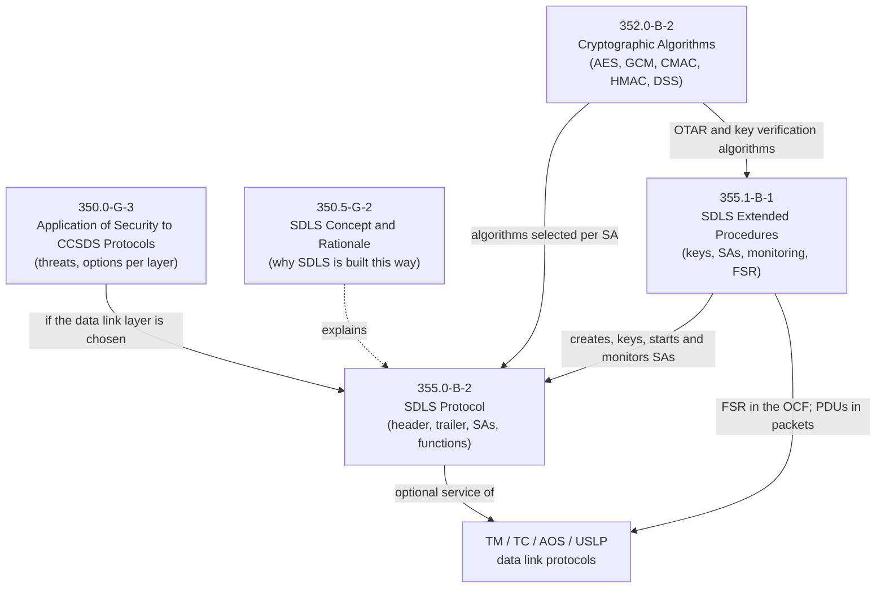
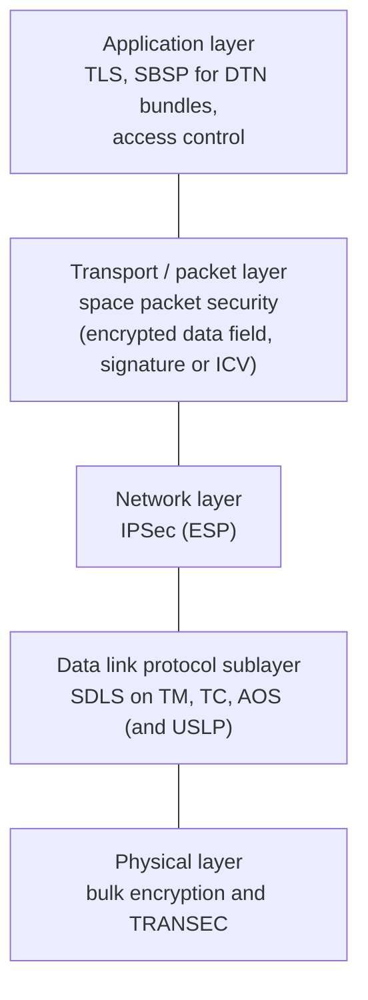
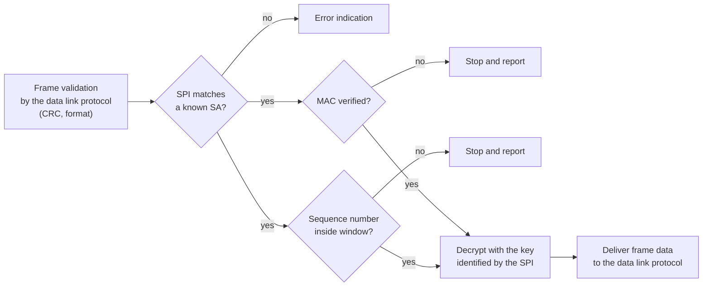
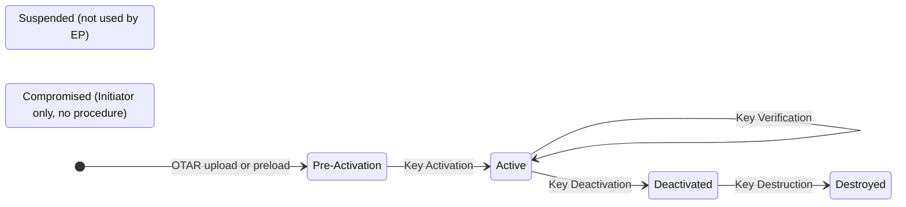
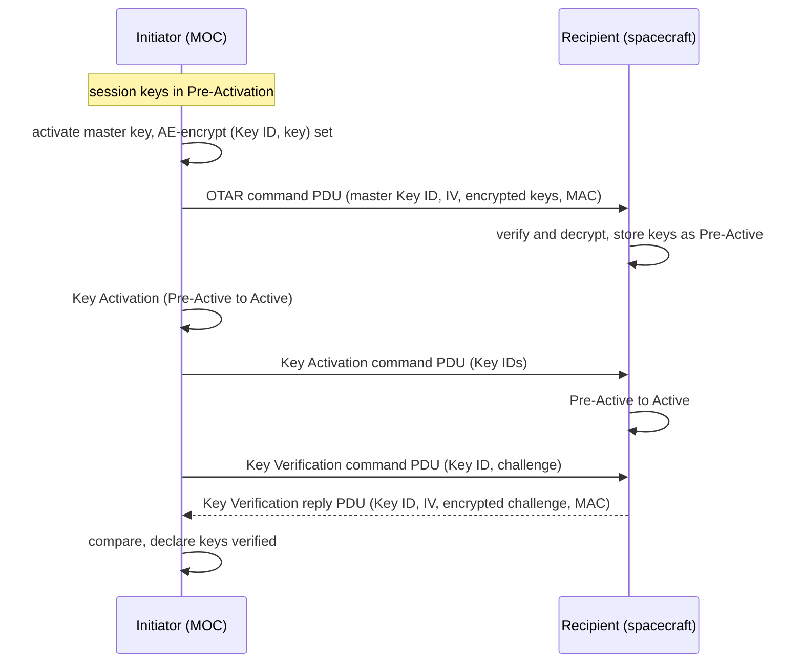

# Security in CCSDS space links

For most of their history, civil missions sent telecommands, telemetry and science data over
radio links that were neither encrypted nor authenticated. CCSDS lists several reasons why this
is no longer enough: ground networks are more interconnected, principal investigators control
instruments remotely, cheaper hardware makes rogue ground stations possible, and national policies
ask for more protection.[^ca-rat] Civil missions used to rely on being unique. Open mission control
systems, Internet connectivity and cross support have changed that, so security now has to be part
of the system design.[^g3-rat] CCSDS answers with a family of documents. Two informational Green
Books explain the concepts and the design choices. Three Recommended Standards (Blue Books) fix the
cryptographic algorithms, the data link security protocol and the in-flight procedures that operate
it.

This page covers that family as a whole. The protocol itself, with its Security Header and Trailer,
Security Associations and the ApplySecurity and ProcessSecurity functions, is described in depth on
[Space Data Link Security (SDLS)](sdls.md). This page covers the context around it: the threats, the
places in the stack where security can sit, why SDLS is designed as it is, which algorithms CCSDS
recommends, and how keys and Security Associations are managed and monitored once the spacecraft
flies. The page describes the standards. It does not give operational guidance.

!!! info "At a glance: the documents on this page"
    | Document | Kind | Issue | What it gives |
    |---|---|---|---|
    | [CCSDS 350.0-G-3](../library/ccsds-350-0-350x0g3.md) *The Application of Security to CCSDS Protocols* | Green Book (informational) | Issue 3, March 2019[^g3-doc] | Security concepts, threat types, mission security classes, mechanisms, security options per layer, impact on cross support, agency examples |
    | [CCSDS 350.5-G-2](../library/ccsds-350-5-350x5g2.md) *SDLS Protocol: Summary of Concept and Rationale* | Green Book (informational) | Issue 2, January 2024[^g5-doc] | The reasons behind each SDLS design choice, the baseline modes, the original user requirements |
    | [CCSDS 352.0-B-2](../library/ccsds-352-0-352x0b2.md) *CCSDS Cryptographic Algorithms* | Recommended Standard | Issue 2, August 2019[^ca-doc] | AES, counter mode, GCM, HMAC with SHA-256, CMAC, GMAC, digital signatures, key sizes |
    | [CCSDS 355.0-B-2](../library/ccsds-355-0-355x0b2.md) *Space Data Link Security Protocol* | Recommended Standard | Issue 2, July 2022[^s-doc] | The protocol (see [SDLS](sdls.md)) |
    | [CCSDS 355.1-B-1](../library/ccsds-355-1-355x1b1.md) *SDLS Protocol: Extended Procedures* | Recommended Standard | Issue 1, February 2020[^ep-doc] | Key management, Security Association management, monitoring and control, the Frame Security Report |

    The two Green Books are not part of any Recommended Standard. If they conflict with one, the
    Recommended Standard prevails.[^g3-scope][^g5-scope]

## How the documents fit together



The **application report** (350.0-G-3) is the entry point. It helps a mission planner decide which
security services are needed and at which layer to apply them.[^g3-purpose] If the answer is the data
link layer, the **SDLS protocol** (355.0-B-2) applies. SDLS fixes no algorithm. The
**Cryptographic Algorithms** standard (352.0-B-2) says which ones to use, and the SDLS annex E
baseline is built from them.[^s-scope-e][^g5-algo] SDLS defines the parameters of a Security
Association but not the services that manage them. Those services are the **Extended Procedures**
(355.1-B-1).[^s-sam][^s-db] The **concept and rationale report** (350.5-G-2) explains the design of
SDLS. Its issue 2 was updated to align with the Extended Procedures and with the current TM, TC, AOS
and USLP books.[^g5-doc]

!!! note "Issue cross-references"
    The documents were published at different times, so their references to each other are not
    symmetric. The Extended Procedures (February 2020) cite SDLS Issue 1 (355.0-B-1, September 2015)
    and the draft Symmetric Key Management practice CCSDS 354.0-R-1.[^ep-refs] SDLS Issue 2 (July
    2022) cites the Extended Procedures as a normative reference.[^s-scope-e] The application report
    (March 2019) describes SDLS for TM, TC and AOS only, because USLP support arrived with SDLS
    Issue 2.[^g3-sdls][^s-doc]

Several related CCSDS security documents are cited by these five but are **not in this wiki's
library**: *Security Threats against Space Missions* (350.1-G-2), the *Space Missions Key Management
Concept* (350.6-G-1), the *Security Guide for Mission Planners* (350.7-G-1), the *Information Security
Glossary of Terms* (350.8-M-2), the cryptographic algorithms Green Book (350.9-G-2), the *Security
Architecture for Space Data Systems* (351.0-M-1), the *CCSDS Guide for Secure System
Interconnection* (350.4-G-1), the *Symmetric Key Management* draft (354.0-R-1) and the Extended
Procedures Green Book, which was still being written.[^g3-refs][^g5-refs][^ep-refs][^ep-irefs]
Statements about these documents are limited to what the five library documents say.

## Security concepts and threats

### What information security covers

The application report names six key elements of information security for a data communications
system.[^g3-infosec]

| Element | Meaning in CCSDS 350.0-G-3 |
|---|---|
| Access control | Limiting system access to specified individuals, groups or processes acting for them |
| Authentication | Assurance that the claimed identity of the source of information is not forged |
| Availability | Assurance that the system will be available for use |
| Confidentiality | Protection against unauthorized disclosure of information |
| Integrity | Protection against unauthorized modification of data |
| Accountability | Listed, but not defined in the report |

Three kinds of thing may need protection in a space mission data system: the **information** it
holds, its **services** (communications and data processing), and its **resources** (ground
equipment and spacecraft). Security is achieved by placing one or more security services at specific
points in the system.[^g3-infosec]

### Security policy and threat assessment

The first task is to assess the threats. This is normally part of a **System Security Policy (SSP)**,
a formal document that describes the system, its top-level security objectives and the
information-security and availability threats against it. The SSP can also give the security
standards and evaluation requirements, the rules for access to security-critical systems such as a
certificate authority, and, if encryption is used, how keys are distributed and managed.[^g3-ssp]

The threat assessment looks at the vulnerabilities of the system. For each threat it then estimates
the likelihood, the consequences and the cost of realization. A threat matters only if the system is
vulnerable to it. Countermeasures are selected per threat, usually through a cost-benefit analysis.
What remains is **residual risk**, which system management must accept before the system goes into
production.[^g3-ssp]

### Kinds of threat

A threat is any circumstance or event that could harm the system by destroying, disclosing or
modifying data, or by denying service. It remains a potential violation until it is shown to be
likely to cause harm. It is then reclassified as a vulnerability.[^g3-threats] The report lists five
threats to a space mission data system:[^g3-threats]

1. unauthorized destruction of information or resources (spacecraft or ground systems);
2. unauthorized corruption or modification of information;
3. theft or loss of information or resources;
4. disclosure of information to unauthorized entities;
5. interruption of services.

Threats are **accidental** (malfunctions, operational errors) or **intentional** (from casual
examination to sophisticated attacks). They are also **passive** or **active**. A passive threat
leaves the information and the system unchanged. It mainly concerns confidentiality, the only
property that can be compromised without leaving a trace. An active threat modifies information or
the state of the space or ground segment, so it attacks integrity or availability.[^g3-threats]

## Mission security classes

The report sorts missions into three classes as a guide, not a rule. A real mission may not fit any
of them. The classes differ in which services they need and in how much **assurance** they need that
those services work. High-security missions, for example, may need government-approved high-grade
algorithms.[^g3-classes]

| Class | Typical missions | Telecommand | Telemetry | Ground data system |
|---|---|---|---|---|
| **High** | Government and military; life-critical crewed missions; some commercial telecommunications missions[^g3-high] | All TC: confidentiality, authentication, access controls, data integrity including anti-replay, availability | All TM: confidentiality, data integrity, possibly authentication and access control, availability | All data: confidentiality, authentication, data integrity, availability, access controls[^g3-high] |
| **Moderate** | Commercial communications, meteorological and remote-sensing missions; satellite navigation (possibly high)[^g3-mod] | Authentication, data integrity, possibly confidentiality | Some or all TM: confidentiality, data integrity | Some or all data: authentication, data integrity, possibly access control and confidentiality[^g3-mod] |
| **Minimal** | All other missions[^g3-min] | All TC: authentication, data integrity, possibly confidentiality | Some TM: confidentiality, data integrity | Some data: confidentiality, data integrity, access control[^g3-min] |

High-security missions also need secure access to the spacecraft control system at all times and in
all conditions, and protection against detection, interception and exploitation of the data
links.[^g3-high] Even a minimal-security mission is expected to protect its telecommand system
against unauthorized access or tampering, whether intentional or not.[^g3-min]

The approach chosen for a mission depends on five factors: the agency's security policy, the
mission security requirements, the operational requirements (including cross support and
interoperability), the CCSDS standards in use (TC, TM, AOS, SCPS-TP or Proximity-1), and the
capability of the on-board systems.[^g3-factors]

## Security mechanisms

### Confidentiality and encryption

Encryption provides confidentiality. A key controls the transformation from plaintext to
ciphertext and back, and a new key gives different ciphertext for the same plaintext. Security
depends on the strength of the algorithm, the key length and the secrecy of the keys. When the
algorithm is public, as AES is, the security of the system is designed to rest on handling the keys:
their management, distribution, use and destruction.[^g3-conf]

Encryption can be arranged in three ways:[^g3-conf]

| Arrangement | Who can read the data in transit |
|---|---|
| **Point-to-point** | Only the two communicating end points; a link crypto device sits at each end |
| **Hop-by-hop** | Each intermediary decrypts and re-encrypts, so trusted gateways see the plaintext |
| **End-to-end** | Only the final destination; intermediaries can neither decrypt nor examine the data |

### Symmetric and asymmetric keys

In a **symmetric** system both ends use the same secret key, so a secure key distribution system has
to generate, distribute and account for every key. AES is symmetric. In an **asymmetric**
(public-key) system each end has a public key and a private key, and the decryption key cannot in
practice be derived from the public one. RSA is the best-known example. In practice it is used in a
hybrid scheme: a public-key exchange agrees a session key, and a symmetric algorithm then protects
the data. A public key must be securely bound to its owner, normally by a certificate authority that
signs it.[^g3-keys][^g3-conf2]

Cryptographic systems are analysed under worst-case assumptions. The attacker is assumed to know the
algorithm completely, to hold a large amount of ciphertext, and to know the plaintext of some of it.
Symmetric keys are therefore the main protection of the information and must be distributed and
kept securely.[^g3-keys] The report contrasts the old 56-bit-key DES (64-bit blocks, no longer
recommended) with AES (128-bit blocks, 128-, 192- or 256-bit keys).[^g3-keys]

### Authentication, integrity, access control and availability

**Authentication** appends extra information to a message: a digital signature or a message digest.
A digital signature, normally made with the sender's private key, proves the origin of the data. A
message digest computed over a shared secret also authenticates. Symmetric encryption gives
implicit authentication, because the receiver must hold the right key. That protection fails if
encrypted data can be captured and **replayed** without replay protection.[^g3-auth]

**Data integrity** has two parts. For a single data unit an **Integrity Check Value (ICV)** is
appended. A CRC is a simple ICV and SHA-2 a stronger one. Reed-Solomon and Turbo codes also give
some integrity through error detection. To protect the integrity of a **stream** of data units, a
sequence number protects against replay, and time stamps give limited replay protection. The ICV is
often keyed, or encrypted, for example with AES CMAC.[^g3-integ]

**Access control** keeps resources available only to authorized users or processes. It is a barrier
in the intruder's path, not a fundamental technique for confidentiality or integrity. The report
recommends good password administration, never sending plaintext passwords over unprotected media,
and keeping audit trails.[^g3-access]

**Availability** is a security concern when an attacker tries to deny access. RF links can be jammed.
Jamming the downlink can lose data or, in an emergency, the spacecraft. Jamming the uplink while
telemetry still arrives can also lose the spacecraft. Spread spectrum and frequency hopping counter
jamming.[^g3-avail]

## Where security can sit in the stack

The report places security at five points of the CCSDS stack. Each has a different scope and a
different cost in compatibility.[^g3-points][^g3-options]



### Physical layer: bulk encryption and TRANSEC

**Bulk encryption**, often called link encryption, encrypts the whole physical-layer data structure
on a point-to-point basis. On a TC link this covers the CLTU and also the acquisition and idle
sequences. On TM or AOS it covers the whole stream of CADUs, including the synchronization marker
and any Reed-Solomon check symbols. It gives the highest possible confidentiality. Other services
come only implicitly from the encryption.[^g3-bulk][^g3-bulkfig] **TRANSEC** (transmission security)
protects the physical layer against jamming. In direct-sequence spread spectrum the signal is spread
so that it looks like noise. In frequency hopping the carrier changes over time, and the receiver
must stay synchronized with the transmitter.[^g3-bulk]

The price is high. Bulk encryption denies all cross-support services unless keys are pre-placed at
the access points, or public-key technology is used to protect content keys. CCSDS link
synchronization cannot work, so the crypto devices must provide synchronization. No error detection
and correction information is visible in plaintext, which makes CCSDS channel coding meaningless.
It also gives no end-to-end security.[^g3-cmp-phys] See
[TC synchronization and channel coding](tc-coding-cltu.md),
[TM synchronization and channel coding](tm-coding.md) and
[RF and modulation](rf-and-ranging.md) for the structures concerned.

### Data link layer: SDLS

The data link option is **SDLS**. It adds authentication, confidentiality or both to the contents of
transfer frames. It works in the data link protocol sublayer and leaves the synchronization and
channel coding sublayer untouched. It does not apply to Proximity-1.[^g3-sdls] Its three classes of
service are authentication (integrity, source authentication and anti-replay), encryption of the
frame data field (or TC segment), and authenticated encryption, which combines both. Frame headers
and the error control field are not encrypted. Security can be applied to selected virtual
channels, at the cost of more algorithms and more complex key management.[^g3-sdls][^g3-sdls2]

| Protocol | Fully protected services | Authentication only | Not protected |
|---|---|---|---|
| [TC](tc-sdlp.md) | MAP Packet, MAP Access, VC Packet, VC Access | Some Primary Header fields | COP Management control frames; frames from external sources (VC Frame, MC Frame services)[^g3-tc] |
| [TM](tm-sdlp.md) | VC Packet, VC Access | Some Primary Header and auxiliary fields; the VC Frame Secondary Header | VC OCF, MC Frame Secondary Header, MC OCF; frames from external sources[^g3-tm] |
| [AOS](aos.md) | VC Packet, Bitstream, VC Access | Some Primary Header fields | VC OCF, Insert service; frames from external sources[^g3-aos] |

For [Proximity-1](proximity-1.md) the report suggests applying security to the user data above the
I/O sublayer. All Proximity-1 protocol handling then works as normal, in a way the report compares to
TLS.[^g3-prox]

### Network layer: IPSec

IPSec, from the IETF, protects the payload of IP datagrams end-to-end, including the TCP header.
Intermediate systems cannot read the data unless explicitly authorized, so insecure networks can
carry sensitive data. IPSec defines a framework and no specific algorithm. Algorithms should come
from the CCSDS algorithms standard.[^g3-ipsec] The ESP structure described in the report has an
8-byte clear header (4-byte SPI and 4-byte sequence number), a variable payload with
algorithm-specific data such as an IV, optional padding, a 1-byte pad length, a 1-byte next-header
field and an optional variable-length ICV.[^g3-ipsec2] SDLS later borrowed the Security
Association concept from IPSec and adapted it to space links (see [below](#security-associations-and-the-authentication-bit-mask)).[^g5-sa]

Because the lower-layer headers stay in clear for routing, IPSec does not protect against traffic
analysis. Encrypted data can still be intercepted in intermediate networks, but it stays
confidential.[^g3-cmp-net]

### Packet layer: space packet security

Security can also be applied at the [space packet](space-packet.md) level. The packet data field is
encrypted, and a digital signature or ICV is added inside it. The optional secondary header may also
be encrypted. The primary header and all lower-layer fields stay in plaintext. The report warns that
without an authenticated replay counter in the primary header, packets are open to replay, and that
fixing this would need a protocol revision. A mission that secures only some packets can use the
APID to tell encrypted packets from plaintext ones.[^g3-pkt]

### Application layer: TLS, SBSP and access control

At the application layer, security for space-packet users looks much like packet security. TLS lets
each application secure itself, independently of the rest of the data system. For DTN, the
Streamlined Bundle Security Protocol (SBSP) defines a block confidentiality block (BCB) and a block
integrity block (BIB).[^g3-app] Application-layer security needs no investment in the lower layers,
but every application has to implement it, which risks duplicated effort and security flaws. The
application layer is also where **access control** naturally sits, for example with access-rights
databases and X.509 credentials.[^g3-app][^g3-cmp-app]

### Combining options

Options can be combined. For example, network-layer security can protect data end-to-end across the
ground networks while a lower layer protects the space link against traffic analysis. The report's
example architecture shows SDLS between the ground TT&C subsystem and the spacecraft and IPSec
end-to-end between the end user and an on-board payload, and also marks TLS.[^g3-combo]

### What encryption hides at each layer

Confidentiality has the largest impact on the CCSDS architecture, because it can hide headers that
other network and cross-support services need. Authentication and integrity only add a few fields,
although those fields can add many bits.[^g3-impact]

| Security option | ASM and EDAC | Frame header | Frame data field | Packet header | Packet data field |
|---|---|---|---|---|---|
| Network layer security | Plain | Plain | Plain | Plain | Encrypted |
| SDLS | Plain | Plain | Encrypted | Encrypted | Encrypted |
| Physical (bulk encryption) | Encrypted | Encrypted | Encrypted | Encrypted | Encrypted |

Source: CCSDS 350.0-G-3, table 6-1.[^g3-impact]

### Emergency commanding

A tumbling or faulty spacecraft is commanded with short emergency commands. These are sent
repeatedly in the hope that one arrives in a brief window, and are typically acted on directly by
the hardware command decoder. The report poses a dilemma. Unauthenticated emergency commands open a
security hole, so a risk analysis must decide whether they are allowed. Even an unauthorized reset
can harm a high-availability mission, or one in the middle of a manoeuvre. But authentication makes
the command longer, which may defeat the purpose of a short emergency command.[^g3-emerg] The SDLS
user requirements return to this point (see [below](#the-user-requirements-behind-sdls)).

### Impact on SLE cross support

The [Space Link Extension](sle/index.md) services give remote ground systems access to the ground end
of the space link. The report rates each SLE service by whether it stays available under each
security option. Physical-layer security is left out, because no cross support is possible with
it.[^g3-sle]

| SLE service | Data link security, decrypted at the SLE client | Data link security, decrypted at the SLE provider | Higher-layer security |
|---|---|---|---|
| Return Insert, Return All Frames | Available | Available | Available |
| Return MC and VC Frames, MC and VC FSH, MC and VC OCF | Available | Available | Available |
| Return Bitstream, Return Space Packet | Not available | Available | Available |
| Forward CLTU, Forward TC Frame | Available | Available | Available |
| Forward TC VCA, Forward Space Packet | Not available | Available | Available |
| Forward AOS Insert, Coded VCDU, Proto VCDU | Available | Available | Available |
| Forward AOS Bitstream, VCA, Space Packet | Not available | Available | Available |

Source: CCSDS 350.0-G-3, figures 6-1 and 6-2.[^g3-sle-fig] In short, frame-level services such as
[RAF](sle/return-services.md) and [FCLTU](sle/fcltu.md) survive data link security. Services that
must read inside the frame data field, such as Return Space Packet or
[Forward Space Packet](sle/fsp.md), stay available under data link security only when it ends at the
SLE provider; with higher-layer security they stay available.

### Comparing and choosing

| Option | Strength | Cost |
|---|---|---|
| Physical (bulk) | Highest confidentiality, full traffic-analysis protection | Point-to-point only, no cross support, CCSDS sync and coding lost[^g3-cmp-phys][^g3-select] |
| Data link (SDLS) | Compromise: relatively high security while keeping sync and EDAC | Protects higher-layer data but not the TC, TM or AOS protocol structures; no traffic-flow protection; hop-by-hop[^g3-cmp-dl] |
| Network (IPSec) | End-to-end, transparent to applications | No traffic-analysis protection[^g3-cmp-net] |
| Packet or application | Protects only the application data; a fallback for payloads | Many separate implementations, risk of flaws[^g3-cmp-app] |

The selection guidance in §6.5 says:[^g3-select]

* Most missions need encryption at **one layer only**. This keeps the approach simple and the costs
  and processing load low. Encryption at the network layer or below spares each application its
  own implementation.
* **Full traffic-analysis protection** needs physical-layer encryption, possibly with TRANSEC.
* **High security with some traffic-flow confidentiality** that keeps the CCSDS benefits points to
  data link security. Its protection can be extended into the ground network with low-level SLE
  services (Return All Frames, Forward CLTU).
* **Per-payload confidentiality** on separate virtual channels points to encryption above the frame
  sublayer, which is the SDLS approach.
* **End-to-end protection** points to application-layer or network-layer encryption.
* **Very fine granularity**, such as per-application keys or selective fields, needs
  application-level encryption.
* **High security over RF plus end-to-end protection** may need encryption at more than one layer.

Authentication, integrity and access control have less architectural impact. Their fields can sit at
the same layer as encryption to keep one "clean" security layer. Access control is likely to be
implemented at the application layer.[^g3-select2]

## Agency implementations described by CCSDS

Annex A of the application report describes four missions that added security to CCSDS links.[^g3-annexa]

### ESA Copernicus Sentinels: telecommand authentication

ESA and industry developed a telecommand authentication system for the Copernicus Sentinel fleet.
It was one of the predecessors of SDLS and shares features with it, such as the algorithm of the
SDLS telecommand baseline. It has a **two-tier key hierarchy**. Session (authentication) keys
authenticate telecommands and are replenished by **Over-The-Air Rekeying (OTAR)**, similar to the
SDLS Extended Procedures. Master keys protect the session keys during OTAR and other critical
operations.[^g3-cop]

Authentication happens at the **segmentation layer**, and security associations are distinguished
by MAP. An authentication tail identifies the key in use and carries the current value of the
**Logical Authentication Counter (LAC)** and the MAC. Figure A-1 labels the same field "Logical
Authentication Channel (LAC)", split into a LAC Id and a LAC Count. ESA's older TC decoder
specification also speaks of Logical Authentication Channels with LAC identifiers and LAC
counters.[^g3-cop][^g3-copfig][^pss151-au] The LAC increments with every telecommand and defeats the
replay of an intercepted command. The MAC covers the whole segment except the MAC field itself, and depends on
the key and the LAC. The mission control system generates the tail. The on-board security unit
checks it, rejects a failing command and reports the reason to the operator.[^g3-cop]

<div class="bitfield" data-title="Copernicus authenticated TC segment: segment header (8 bits)" data-width="8"
     data-fields='[{"n":"Seq. flags","b":2,"d":"Segment sequence flags"},{"n":"Ctrl","b":1,"d":"Control Flag","g":"MAP Identifier"},{"n":"MAP Address","b":5,"g":"MAP Identifier"}]'></div>

<div class="bitfield" data-title="Copernicus authenticated TC segment: authentication tail (0 or 22 octets)" data-width="32"
     data-fields='[{"n":"Key Type","b":1,"g":"Key Info"},{"n":"Reserved","b":15,"g":"Key Info"},{"n":"LAC Id","b":2,"g":"Logical Authentication Channel"},{"n":"LAC Count","b":30,"d":"Anti-replay counter, incremented per telecommand","g":"Logical Authentication Channel"},{"n":"Message Authentication Code","b":128,"d":"Computed over the whole segment except the MAC field"}]'></div>

Between header and tail sits the segment data field, of 1 to 1016 octets or of 1 to 904 octets as
the figure gives it. The whole segment is 1 to 1017 octets.[^g3-copfig] OTAR uses a custom
[PUS](../ecss/pus/index.md) service at the application layer, addressed directly to the spacecraft
security unit. Keys are generated on the ground in a separate, isolated **Key Management Facility
(KMF)** with a state-of-the-art random-number generator.[^g3-copfig]

### International Space Station, STRV-1c/d and ATV

* **ISS.** The station uses [AOS](aos.md) for both links, with the MPDU and Bitstream services. The
  uplink is encrypted with Triple DES at the VCA sublayer, so the VCDU data zone is encrypted. A
  64-bit Insert Zone carries cryptographic synchronization.[^g3-iss]
* **STRV-1c/d.** These microsatellites put data link security on both links: confidentiality and
  authentication on telecommand, confidentiality only on telemetry.[^g3-iss]
* **ATV.** The Automated Transfer Vehicle encrypted its telecommand packets with Triple DES (ANSI
  X9.52) and added time authentication. The segment data field held a 2-octet key index, an 8-octet
  IV unique to each message, and the encrypted packet data. Each packet carried a Time Authentication
  field that the on-board packet processor compared with on-board time, rejecting the packet when the
  comparison exceeded a threshold.[^g3-atv]

<div class="bitfield" data-title="ATV telecommand encryption sublayer: start of the segment data field" data-width="16"
     data-fields='[{"n":"Key Index","b":16,"d":"Points to the decryption key"},{"n":"Initialization Vector","b":64,"d":"Unique per message; followed by the encrypted packet data"}]'></div>

## SDLS concept and rationale (CCSDS 350.5-G-2)

The concept and rationale report explains why SDLS is built the way it is. It gives the
architecture, the interaction with the data link protocols, the justification of each design
choice, the security analyses, and guidance on choosing parameters.[^g5-purpose]

### Motivation and target topologies

Before SDLS, a CCSDS mission that needed uplink command authentication or downlink confidentiality
had to invent its own solution. SLE already protected the ground leg between control centre and
ground station, with identification, authentication and confidentiality, but not the space link. A
joint working group of the Space Link and Security areas therefore defined data link security for
TM, TC, AOS and USLP **without modifying those standards**.[^g5-motiv]

The target is the simple topology. A mission control centre reaches one spacecraft through a ground
station, and SLE extends the data link to the control centre (Topology A). Topology B adds a separate
payload downlink. Securing the path end to end is split into two tasks: protecting SLE and the ground
network, and protecting the data link between the spacecraft and the mission control system, which
is SDLS's job. TRANSEC can be added against denial of service and is compatible with SDLS. Secure
cross support with another agency's ground station needs a service level agreement.[^g5-topo]

SDLS and its Extended Procedures work in a fixed **master-slave** arrangement with no negotiation.
Directives always go from a predetermined master (the *Initiator*) to a predetermined slave (the
*Recipient*). For space-to-space links a hierarchy between satellites has to be set up, together with
a key management scheme. This could be keys per link pair, which becomes impractical as the number
of pairs grows, or keys shared across a constellation while keeping key-IV uniqueness for AES-GCM.
"Forward" and "return" link then replace "telecommand" and "telemetry". For large constellations the
report suggests considering security at a higher layer.[^g5-topo2]

### Security objectives and services

| Direction | Objectives |
|---|---|
| Uplink (TC, AOS, USLP) | Command authentication, command integrity, command confidentiality, command anti-replay protection |
| Downlink (TM, AOS, USLP) | TM data authentication, integrity, confidentiality, anti-replay protection |

Source: CCSDS 350.5-G-2, §2.3.2.[^g5-obj]

Three security services meet these objectives: **authentication** (authentication, integrity and
anti-replay, when confidentiality is not needed), **encryption** (confidentiality only), and
**authenticated encryption** (all of them).[^g5-obj]

### Key requirements

Section 2.4 of the report picks out the main requirements behind SDLS. The full set is the user
requirements document of annex C (see [below](#the-user-requirements-behind-sdls)).[^g5-req]

* Two operational modes for each logical channel on TC, TM, AOS or USLP: a **Clear Mode**, in which
  the SDU is left unchanged but the SDLS fields are present, and a **Secure Mode** with
  authentication, encryption or authenticated encryption.
* Independent secure channels, so that clear and secure channels can share one physical channel.
* Compatibility with three key management schemes: (1) all session keys preloaded for the whole
  mission; (2) master keys (key encryption keys, KEKs) and some session keys preloaded, with session
  keys uploaded encrypted by OTAR; (3) session keys generated on board from master keys and an
  uploaded non-secret seed. Key management itself is specified in the Extended Procedures.
* Security function control directives handled either in-band, by the security device right after
  authentication or decryption, or out-of-band, at application level.
* At most **32 octets** of overhead per transfer frame for the complete protocol.
* No interference between frame verification by SDLS and frame validation by the data link protocol.

### Which data link services SDLS protects

Services that carry application-layer SDUs, such as packets or variable-length private data, can be
protected with any of the three services. The VC Frame Secondary Header is a compromise: it gets
authentication only. Services that carry frames or auxiliary data produced elsewhere (Insert data,
the MC Frame Secondary Header) are not secured. Their sources can protect them with standard
application-layer authentication or encryption.[^g5-svc]

| Protocol | Protected with all three services | Authentication only | Not protected |
|---|---|---|---|
| TM | VC Packet, VC Access | VC_FSH (also "authentication only" under authenticated encryption) | VC_OCF, VC Frame, MC_FSH, MC_OCF, MC Frame |
| TC | MAP Packet, MAP Access, VC Packet, VC Access | — | COP Management (BC frames), VC Frame, MC Frame |
| AOS | VC Packet, Bitstream, VC Access | — | VC_OCF, VC Frame, MC Frame, Insert |
| [USLP](uslp.md) | MAP Packet, MAP Octet Stream, MAP Access | — | MC_OCF, VC Frame, MC Frame, Insert |

Source: CCSDS 350.5-G-2, table 2-2.[^g5-tab22] Table 2-1 adds conformance levels. A fully compliant
implementation must be able to protect the mandatory services (for TC, MAP Packet and MAP Access).
Protection of the TC VC Packet and VC Access services and of the AOS Bitstream service is
optional.[^g5-tab21]

### Why COP control frames and the OCF stay in clear

The rationale for this is one of the most important passages in the report. SDLS must run
**before the COP** at the sending end and **after the COP** at the receiving end:[^g5-cop]

* [COP-1](cop-1.md) is a go-back-N protocol, so it retransmits frames. If FOP-1 ran before SDLS at the
  sender and SDLS before FARM-1 at the receiver, SDLS would reject every retransmission as a replay
  and block the link.
* The MAC detects errors far better than the BCH or short LDPC codes. If SDLS ran before FARM-1, it
  would discard frames with transmission errors. These would be counted as security events, the
  CLCW would not report them, and FOP-1 would keep retransmitting frames that FARM-1 never sees.
* With this order the COP control commands (BC frames) and the **Frame Sequence Number**, which the
  FOP sets, cannot be authenticated. The OCF is appended by the Master Channel Generation function
  after SDLS has run, so it cannot be protected either.

The report accepts the residual risk. An attacker could send false COP directives or OCF contents,
but the legitimate operator can always reinitialize the COP, so the denial of service is temporary
and not easy to achieve.[^g5-cop] It also warns about mixing frame types. If Type-AD and Type-BD
frames share a secured VC, a BD frame accepted after a lost AD frame raises the expected anti-replay
number. The AD retransmissions then fail the anti-replay check and are falsely reported as security
failures. Mixing AD and BD frames on such a VC while AD frames are pending is therefore not
advised.[^g5-cop][^g5-tc]

```mermaid
flowchart LR
  subgraph G["Ground (sending end)"]
    direction TB
    g1["1 VC Generation:<br/>frame initialization"] --> g2["2 ApplySecurity:<br/>encrypt data field,<br/>fill header and MAC"] --> g3["3 FOP-1, frame<br/>finalization (sets the<br/>frame sequence number)"] --> g4["4-6 VC mux, MC mux,<br/>All Frames (FECF)"] --> g5["7-8 BCH or LDPC coding,<br/>randomize, modulate"]
  end
  subgraph S["Spacecraft (receiving end)"]
    direction TB
    s1["9-10 demodulate,<br/>decode"] --> s2["11-14 frame validation,<br/>MC and VC demux,<br/>VC Reception"] --> s3["15 FARM-1<br/>(16: CLCW in OCF)"] --> s4["17 ProcessSecurity:<br/>check MAC and ARSN,<br/>decrypt"] --> s5["18 FSR in OCF;<br/>data units to users"]
  end
  g5 -->|"space link"| s1
```



Source: CCSDS 350.5-G-2, figure 3-3 and table 3-3.[^g5-order] The other places SDLS leaves alone
follow the same logic. In AOS and USLP the **Insert Zone** is written into the frame on the fly as it
goes to the modulator, so it cannot be authenticated. SDLS works only on virtual channels, so Master
Channel services (MC_FSH, MC_OCF) cannot be secured. VCs carrying **Only Idle Data** are not protected:
idle frames may be generated somewhere else, their repetitive patterns could help cryptanalysis, and
exposing them only leaks activity patterns.[^g5-oid]

### Compatibility with SLE

SDLS security sits only at the end points, the spacecraft and the mission control centre, so it
should be transparent to SLE processing. The full frame header must stay unaltered. The compatibility
goals were F-CLTU and F-TCF for TC, and RAF, RCF and Return OCF for TM, AOS and USLP. Ground station
equipment may route frames using fields it has not authenticated. That risk is accepted, because the
end processor at mission control detects any manipulation.[^g5-sle][^g5-resid]

### OSI security services, threats and residual risks

SDLS borrows its services from the ISO OSI security architecture. That architecture allows only
confidentiality services at the data link layer. SDLS goes further and also authenticates.[^g5-osi]

| OSI security service | SDLS decision |
|---|---|
| Peer entity authentication | Not adopted (too complex) |
| Data origin authentication | Adopted (TC, TM, AOS, USLP) |
| Access control | Not adopted; relevant for TC, residual risk mitigated |
| Connection confidentiality | Adopted (TC only) |
| Connectionless confidentiality | Adopted (TC, TM, AOS, USLP) |
| Selective field confidentiality; traffic flow confidentiality | Not adopted |
| Connection integrity with recovery | Adopted (TC only) |
| Connection integrity without recovery; connectionless integrity | Adopted (TC, TM, AOS, USLP) |
| Selective field integrity (connection and connectionless) | Not adopted |
| Non-repudiation (proof of origin or delivery) | Not adopted |

Source: CCSDS 350.5-G-2, tables 3-1 and 3-2.[^g5-osi-tab] Annex B justifies each line per protocol,
with threats, impact, priority, applicability and residual risk. It gives data origin authentication
and connection and connectionless integrity high priority, and traffic flow confidentiality medium
priority, as a candidate for a future SDLS extension. It rates non-repudiation as not relevant to
space data links.[^g5-annexb]

The threat analysis assumes **trust between CCSDS agencies**: protecting against an agency that acts
maliciously against another is not a goal. **Availability threats**, such as jamming or flooding the
receiver with unwanted signals, are out of scope and belong to physical-layer measures.[^g5-threat]
**Traffic analysis** protection would mean encrypting every protocol structure, which conflicts with
SLE and the data link protocols. It is a residual risk, and missions that need it should consider
bulk encryption.[^g5-resid]

### Algorithm agility

SDLS is deliberately **algorithm-agnostic**, so that it does not have to change when cryptanalysis
or brute-force power forces CCSDS to change its recommended algorithms.[^g5-algo] This shapes the
fields:

* **Authentication** produces a MAC over the SDU and selected header fields. To prove freshness, the
  data is authenticated together with a time-dependent value. SDLS prefers a counter, the sequence
  number. Some algorithms need an IV, and block-oriented ones such as GMAC may need padding, so the
  header can carry both.[^g5-auth]
* **Encryption** covers only the SDU, for compatibility with SLE and the data link protocols. Most
  secure modes need an IV. Encryption alone does not protect against manipulation and gives no
  protection against data substitution. If the plaintext is partly predictable, an attacker may even
  be able to recover the key. It should be selected only after a threat and risk analysis.[^g5-enc]
* **Authenticated encryption** follows **Encrypt-then-MAC** (the other generic compositions are
  MAC-then-Encrypt and MAC-and-Encrypt). It is the CCSDS-recommended way to obtain both services, and
  its additional authenticated data (AAD) protects the readable headers.[^g5-ae]
* **Separate authentication and encryption algorithms** are possible, each with its own key. But SDLS
  provides only one IV, one sequence counter and one padding field, and the 16-bit SPI limits how key
  changes can be signalled. CCSDS gives no pairing recommendations, so users need expert advice.[^g5-ae2]

### Design of the header and trailer fields

| Field | Rationale in 350.5-G-2 |
|---|---|
| **Security Parameter Index** (16 bits) | Mandatory. Up to 65,534 SAs per Master Channel, because 0 and 65,535 are reserved. The receiver uses it to find the SA and so the presence and length of the optional fields.[^g5-spi] |
| **Initialization Vector** (managed) | Gives freedom of algorithm. Some IVs must be unique per key, others random. With 128-bit-block algorithms the IV is at most 128 bits, and shorter constructs that partly regenerate the IV at the receiver save overhead at the expense of robustness. Mismanaging the IV can make the security useless.[^g5-iv] |
| **Sequence Number** (managed) | Used with authentication. It may be part of a longer managed counter. Sending it lets the receiver check the MAC and then the counter window as two separate tests, instead of trying every MAC in the window. With GCM-like counters the IV doubles as the transmitted sequence number and the field is omitted.[^g5-sn] |
| **Pad Length** (1 octet when present) | Gives the number of fill bits, 0 to 127. Recommended algorithms need no padding, but the field keeps SDLS algorithm-independent. The report cites ISO Padding Method 2 (a "1" then "0"s, not transmitted), and warns that other padding schemes need careful assessment.[^g5-pl] |
| **MAC** (trailer) | Present with authentication or authenticated encryption. It covers the SDU, selected header fields, any fields between the header and the Security Header, and the Security Header itself.[^g5-mac] |

Two more design points come from the same section. The MAC is computed last, so placing it after the
data it covers suits very high data rates. Using two structures, a header and a trailer, also helps
high-rate implementations.[^g5-trl][^g5-struct] On **MAC length**, the report argues that a MAC needs
about twice the key length to resist birthday attacks. With 128- to 256-bit keys that gives 256 to 512
bits, and 512 bits is the SDLS maximum. Shorter MACs are possible with more frequent rekeying. GCM is
limited to 128 bits, even when used for authentication only. NIST-style schemes that allow very short
MACs by limiting failed attempts are rejected, because locking out a spacecraft after failed attempts
is worse than resisting attempts with a long MAC.[^g5-maclen]

### Security Associations and the authentication bit mask

The **Security Association (SA)** comes from IPSec, adapted for space. It is a simplex, stateful
session. Both ends must create it, give it keys and activate it before use. SAs can be preloaded or
created while others are active. All frames sharing an SA on a physical channel form a **Secure
Channel**.[^g5-sa] IPSec-style parameter negotiation is rejected. Contacts are short and delays long,
the ground wants full authority over the spacecraft, and on-board processing is limited. Instead of
an IPSec SA database, a simpler **Security Association Context (SAC)** exists in advance on board and
on ground, and maps each SA to its [GVCIDs or Global MAP IDs](space-link-identifiers.md).[^g5-sac]

The **authentication bit mask** zeroes selected header bits before the MAC is computed. The VCID and
the TC or USLP Segment Header are always included, because they identify the channel and MAP. The
Security Header (except the IV) and the frame data field are also always included. The TM Master
Channel Frame Count, the Insert Zone, the OCF, the error control field and the MAC are always
excluded. The SCID is not in the default mask, because frame validation has already checked it.
Missions can add fields, for example a sensitive VC_FSH, or the SCID when a constellation shares SAs.
In cross support the mask must be exchanged out of band.[^g5-mask][^g5-mac]

### Clear Mode and the Recovery SA

Projects often ask for a **Clear Mode** that bypasses security on an otherwise protected SA. Security
experts do not recommend it. A civil mission may still justify it when losing the spacecraft through
a telecommand outage is a bigger risk than spoofing, and then on-board FDIR or a ground command may
activate it. A Clear Mode SA can use a "no-op" algorithm, for example in testing before the
cryptography is integrated. Such an SA can be enabled by a hardware strap and inhibited before
flight. The header and trailer can stay present so that throughput does not change. Transitions
between secure and clear should go through a separate authenticated SA.[^g5-clear]

A TC SA covers one VC only, but several SAs may cover the same VC. Experience with earlier ESA
telecommand security led to the **Recovery SA**, a redundant SA used only as a last resort when the
nominal SA has failed. Its context is stored separately at both ends, and its on-board keys should
not be erasable, reloadable or revocable.[^g5-recovery] The scenario section lists the emergencies
it is meant for. If the telemetry link is lost, the ground commands blind, without SDLS reports,
and the anti-replay counters may disagree. The programmable key storage may be corrupted. Or
anti-replay synchronization may be lost. Recovery SA contexts and keys should be kept in
non-erasable, non-volatile memory.[^g5-recov-scen]

### Managed parameters

Parameters that rarely change are managed rather than sent in-line, to save bandwidth. All managed
parameters of the underlying data link protocol also apply.[^g5-mp]

| Group | Parameters (350.5-G-2 table 3-4) |
|---|---|
| Static for the mission (per VC or MAP) | Presence of Security Header; presence of Security Trailer; Security Header length (the report says up to 42 octets); Security Trailer length (up to 64 octets) |
| Static for the SA | SPI; service type; SA context (GVCIDs or Global MAP IDs); transmitted lengths of IV, sequence number, pad length and MAC; authentication algorithm; authentication mask; sequence number window; encryption algorithm |
| Static while the SA is active | Authentication key; encryption key (each a value or an index) |
| Dynamic | Sequence number (sender's next, receiver's expected); encryption IV (sender's current) |

Source: CCSDS 350.5-G-2, table 3-4.[^g5-mp-tab] For bidirectional AOS or USLP links the GVCID does not
show direction, so the uplink and downlink should use different SPIs.[^g5-aosuslp]

### Signalling, monitoring and control

Only the SPI, IV, sequence number, pad length and MAC travel in-line. Algorithms, keys and the other
managed parameters need a separate, **out-of-band** logical channel for control and monitoring. The
report describes two options:[^g5-mc]

* **In-band at the crypto processor.** Control messages are multiplexed and demultiplexed at the
  device that runs SDLS, so the security function stays controllable without the on-board computer.
  A dedicated VC would need its own FARM-1, COP-1 and CLCW reporting. A reserved **MAP** avoids that,
  so MAP IDs should be reserved for security control. On some missions MAPs already route
  high-priority commands (HPCs) to the command pulse generators.[^g5-mc][^g5-mc2]
* **Out-of-band through the platform computer.** The security processor sits on the avionics bus and
  exchanges CCSDS packets with the platform computer. It may accept HPCs and software commands, so
  some commanding survives an OBC outage.[^g5-mc2]

Monitoring the security function is also vital. Some missions use high-priority telemetry packets
that do not need the OBC. The Extended Procedures add a data link solution, the **Frame Security
Report**, an OCF similar to the CLCW (see [below](#the-frame-security-report)).[^g5-mc2]

SDLS is agnostic about **redundancy**. It works with VC-based selection of redundant receivers, and
with two identical processors running in parallel, which need fully synchronized managed
parameters.[^g5-red] **Keys** are SA attributes. Switching to another SPI changes the key from one
frame to the next, provided the new SA's key is already active.[^g5-keys] SA scope differs by
protocol. On TC an SA covers exactly one VC, because SDLS sits before FOP-1. There is no master
channel SA, but several MAP-level SAs can share a VC. On TM, AOS and USLP an SA may span several VCs,
but never an Only Idle Data VC. If a secured VC also carries idle frames, the idle pattern must be
chosen with care to avoid known-plaintext weaknesses.[^g5-tc-scope][^g5-tm-scope]

### Concept of operation

At the sending end the SDU is first encrypted, using the key, the IV and any padding. The Security
Header is built from the SA. The mask is applied to give the authentication payload, and the MAC is
appended. At the receiving end the order is reversed.[^g5-generic]



The MAC and sequence number checks may run in either order. Both must pass before decryption.[^g5-generic2]
Three items must stay synchronized between the two ends.[^g5-sync]

* **Keys.** In-band synchronization typically sends an index into mirrored key tables on ground and on
  board.
* **IV.** For robustness the IV is sent with each message, even though in theory it need not be.
* **Sequence count.** TC sequence-controlled service could keep the counters aligned, but TM, AOS and
  TC expedited service lose frames. A **window** tolerates gaps and delays, and the Extended
  Procedures allow the on-board counter to be monitored and set.

### Baseline modes and the MAC and key length analysis

SDLS annex E defines baseline modes for interoperability testing and operation. The report explains
the choices.[^s-base][^g5-base-tc][^g5-base-tm][^g5-base-aos]

| Protocol | Service | Algorithm | Key | MAC | ARSN or IV | Security Header | Trailer |
|---|---|---|---|---|---|---|---|
| TC | Authentication | AES-CMAC | 256 bits | 128 bits | 32-bit sequence number in-line | 6 octets (SPI + SN) | 16 octets |
| TM | Authenticated encryption | AES-GCM | 256 bits | 128 bits | 96-bit IV in-line, also the counter | 14 octets (SPI + IV) | 16 octets |
| AOS, USLP | Authenticated encryption | AES-GCM | 256 bits | 128 bits | 96-bit IV in-line; mask also excludes the Insert Zone | 14 octets (SPI + IV) | 16 octets |

Sources: CCSDS 355.0-B-2 annex E and CCSDS 350.5-G-2 §4.4 and annex A.[^s-base][^g5-base-tc][^g5-base-tm][^g5-base-aos]

**Why CMAC for TC.** Authentication is the key service for protecting control of the spacecraft. CMAC
is a NIST algorithm and an ISO standard since 2011. It needs neither an IV nor padding, both of which
are delicate to manage. Being cipher-based, it can reuse the AES engine for authentication key
encryption and decryption.[^g5-cmac]

**Why GCM for TM, AOS and USLP.** Authenticated encryption protects mission products. Encryption alone
would not stop forgery. GCM is the CCSDS-recommended AE algorithm, it uses one key for both functions,
and its deterministic 96-bit IV construction is recommended. Reusing an IV with the same key leaks
information. Research has also found weak GCM keys, so key generation needs care.[^g5-gcm][^g5-base-tm]

**Sizing the MAC and key.** The analysis assumes the worst case for the attacker: telecommands can be
sent without limit between two legitimate contacts, with no lockout after failures. The chance of
forging a MAC is made comparable to the chance of accepting a telecommand with an undetected channel
error. The required length is $t \ge \mathrm{ld}(\mathrm{MaxInvalids}/\mathrm{Risk})$, where ld is the
binary logarithm. The risk categories come from the undetected-frame-error probabilities of
ECSS-E-ST-50-04C appendix D for 130 codeblocks at bit error rates of $10^{-4}$, $10^{-5}$ and
$10^{-6}$.[^g5-len]

| Risk category | MAC length (bits) | Key length (bits) |
|---|---|---|
| Medium | 78 | 107 |
| Low | 98 | 127 |
| Lowest | 118 | 147 |
| **Conclusion** | **128** | **128** |

Source: CCSDS 350.5-G-2, table A-1.[^g5-tabA1]

!!! example "Worked example: the attacker budgets (arithmetic by this wiki)"
    The report assumes 64 telecommands per second for 48 hours, the maximum assumed key validity.
    That is $64 \times 172\,800 = 11\,059\,200$ attempts, and $\mathrm{ld}(11\,059\,200) \approx 23.4$
    bits.[^g5-len] For key search it assumes 60 GIPS for 48 hours, $1.0368 \times 10^{16}$ instructions,
    about 53.2 bits. Subtracting these from table A-1 gives about 54.6 bits (MAC) and 53.8 bits (key)
    for the medium risk, 74.6 and 73.8 for low, and 94.6 and 93.8 for lowest.

!!! warning "Inference"
    The near-equal differences in the worked example suggest that the analysis used a single risk
    value per category, about $2^{-54}$ (some $10^{-17}$), $2^{-74}$ and $2^{-94}$. This matches the
    report's statement that both lengths use the same probability of success. The report does not
    print these risk values. They are back-calculated by this wiki.

The 128-bit values were chosen for margin and convenience, and later research cited by the report
says they hold well beyond 2032. Quantum computing changed the key length: Grover's algorithm halves
the exponent of a brute-force search, so the baseline key was **doubled to 256 bits**. The 32-bit
anti-replay counter allows about 4 billion uses of a key before it rolls over.[^g5-tabA1]

### Scenarios

In the **basic scenario** a ground centre sends telecommands over the forward link. Red marks data
that needs protection and black marks data that is protected.[^g5-scen] In the **complex scenario**
three on-board elements share a return link, and two of them use separate SAs and keys. A trusted
baseband unit does the link-layer security on board. On the ground, separate elements receive their
own VC or MC frames and manage their own keys. Because the primary headers stay readable, SLE
return services still work. The scenario can represent several missions sharing a channel, or
separate housekeeping and payload operations groups.[^g5-scen2]

### Telling transmission errors from security events

For FDIR it matters whether a rejected frame was corrupted by noise or by an attacker. A MAC of 64 to
512 bits detects errors far better than a 16-bit CRC, so errors missed by the channel coding could
appear as security failures.[^g5-dlp] Annex D concludes:

* **TC.** The TC requirement is at most one erroneously accepted frame in $10^{9}$. It is met without
  a CRC at bit error rates below $10^{-4}$ (TED mode) or $10^{-5}$ (SEC mode). ESA's SEC mode with a
  mandatory CRC reaches below $10^{-15}$. No extra CRC needs to be mandated when security is applied.
  The same holds for the short LDPC codes and for USLP uplinks.[^g5-dlp-tc]
* **TM, AOS, USLP.** A CRC is recommended whenever SDLS is used, except with Reed-Solomon $E=16$ or
  LDPC codes. Higher integrity can come from the 32-bit USLP CRC or a non-standard longer one.[^g5-dlp-tm]

| Channel coding | CRC (FECF) | Remark |
|---|---|---|
| No code; convolutional; Turbo | Mandatory | — |
| Reed-Solomon (and concatenated) | Optional | $E=16$ outperforms a CRC; $E=8$ is comparable |
| LDPC | Optional | Outperforms a CRC |

Source: CCSDS 350.5-G-2, table D-1.[^g5-tabD1]

### The user requirements behind SDLS

Annex C reproduces the **User Requirements Document** (version 3, October 2012) that the working group
agreed as the basis for SDLS. Each requirement is marked compliant, partially compliant, not
compliant or not applicable.[^g5-urd] Many requirements are only "partially compliant" because SDLS itself defines no
management procedures. That gap is what the Extended Procedures fill. Notable entries:

| Requirement | Content | Status noted in the annex |
|---|---|---|
| SECTMTC_URD_4010 | TC objectives, including denial-of-service protection for COP-1 and traffic-analysis protection at APID level | Partial: neither is provided[^g5-urd-obj] |
| SECTMTC_URD_5060 | Anti-replay counter of at least 32 bits (TBC) | Partial: SDLS allows a transmitted counter down to 16 bits[^g5-urd-arc] |
| SECTMTC_URD_6010 / 6020 | Baseline algorithms for interoperability testing: HMAC-SHA-256 (authentication), AES-GCM (AE) | Compliant[^g5-urd-alg] |
| SECTMTC_URD_10000 | Clear Mode and Secure Mode per logical channel | Compliant[^g5-urd-modes] |
| SECTMTC_URD_10090 | Clear or Secure mode flagged explicitly in the security header or trailer | Not compliant: no such flag[^g5-urd-flag] |
| SECTMTC_URD_11020 | Key schemes: (1) all session keys preloaded; (2) master keys preloaded, session keys uploaded encrypted (OTAR); (3) session keys derived on board from master keys and an uploaded seed | Compliant[^g5-urd-keys] |
| SECTMTC_URD_13010 | At most 50 % overhead on the shortest CLTU, so emergency commanding can stay secure | Partial: SDLS may exceed this[^g5-urd-perf] |
| SECTMTC_URD_13020 / 13030 / 13040 | At least 256 secure channels; non-detection of an invalid TC below $10^{-20}$; at most 5 % TM overhead | Compliant; partial (the minimum 8-octet MAC gives $5.42 \times 10^{-20}$); compliant[^g5-urd-perf2] |

The 2012 URD baseline for authentication was HMAC-SHA-256. The published TC baseline uses AES-CMAC,
for the reasons given above.[^g5-urd-alg][^g5-cmac] The URD also notes that SDLS adds an
"Encryption Only" service for the TM link. It is theoretically insecure, but can be secure when
authentication is achieved by another channel, and was judged useful for some missions, for example a
video channel.[^g5-urd-eo] It also contains the concept of a *Reduced Secure
Mode* after on-board events, with encryption off and a relaxed anti-replay check. SDLS does not define
it.[^g5-urd-modes2]

## Cryptographic algorithms (CCSDS 352.0-B-2)

### Scope and rationale

The algorithms standard recommends **one symmetric encryption algorithm and one mode** for all CCSDS
missions, plus a choice of authentication and integrity algorithms. It does not say where or when to
use them: that is up to mission planners and their risk analysis. Standard, well-known algorithms
give high-quality cryptography, economies of scale through off-the-shelf products, and
interoperability. The standard also says that using it does not by itself remove every risk, and
that an information security risk assessment is still needed.[^ca-purpose] It applies to civil
missions with confidentiality or authentication requirements, on forward and return links, on ground
networks and even for stored data. Security is encouraged for all missions, especially on command
links, but a risk analysis may reduce or remove the need. Key management is out of scope.[^ca-scope][^ca-appl]

CCSDS does not mandate a layer for encryption. It may sit in an application (TLS), above the network
layer (IPSec), at the data link layer (SDLS), at the physical layer (bulk encryption), or at several
layers at once.[^ca-enc-ov]

### Normative choices

| Topic | Requirement | Clause |
|---|---|---|
| Encryption algorithm | All CCSDS missions **shall** use AES (FIPS 197, ISO/IEC 18033-3) | §3.1[^ca-enc] |
| Key size | Missions planned after Issue 2 **shall** use 256-bit keys; existing implementations **may** use 128-bit keys | §3.2[^ca-enc] |
| Mode | **Counter Mode** shall be used; other modes are allowed after careful consideration | §3.3[^ca-enc] |
| Authenticated encryption | When encryption plus integrity and origin authentication is needed, **GCM** shall be used, with a **128-bit** MAC tag | §3.4[^ca-enc] |
| Hash-based MAC | HMAC (FIPS 198-1) with SHA (FIPS 180-4), normally **SHA-256**. SHA-224, SHA-384, SHA-512 or RIPEMD-160 may be used if agreed or signalled. **SHA-1 shall not be used** | §4.2.1–4.2.2[^ca-hmac] |
| MAC truncation | HMAC output should not be truncated; any truncation must be agreed in advance | §4.2.3[^ca-trunc] |
| Cipher-based MAC | **CMAC** shall be used: AES-256 for new missions; 128, 192 or 256 bits for existing ones. **GMAC** may replace CMAC when an AE implementation is used for authentication only | §4.3[^ca-cmac] |
| Digital signatures | **DSS** shall be used; **RSA** (PKCS #1 v2.1) should be used, with 4096-bit keys for new missions and 2048-bit allowed for existing ones. DSA and ECDSA may be used | §4.4[^ca-dss][^ca-dss2] |

"Future" in the key-size clauses means missions whose planning began after the publication of
Issue 2.[^ca-enc]

### Concepts behind the choices

* **Hash-based and cipher-based MACs.** An HMAC runs a hash such as SHA-256 over the data and a
  shared secret, which gives a MAC of fixed size. A cipher-based MAC uses the secret as the key of a
  block cipher such as AES. When both confidentiality and authentication are needed it can share one
  algorithm with encryption, and it is often easier to build in hardware.[^ca-macs]
* **Digital signatures.** The signer hashes the data and encrypts the hash with its private key. The
  receiver recovers the hash with the public key, which proves origin, and compares it with its own
  hash, which proves integrity. Public keys can be sent with the data, cached, or fetched from a key
  server. A spacecraft that cannot reach a key server can have a key cache preloaded before launch or
  uploaded later.[^ca-sig][^ca-dss2]
* **Authenticated encryption (AEAD).** Encrypt-then-MAC is secure against adaptive chosen-ciphertext
  attacks. CCM and GCM are AE modes. GCM is fast in hardware and software, can be parallelized and
  pipelined, and needs no padding. The standard states that "the use of non-authenticated encryption
  is highly discouraged for CCSDS missions".[^ca-ae][^ca-enc]

### How SDLS and the Extended Procedures use them

The SDLS baselines take their algorithms from this standard: AES-CMAC for TC, AES-GCM for TM, AOS and
USLP, all with 256-bit keys and 128-bit MACs.[^s-base][^g5-cmac] The Extended Procedures baseline uses
AES-GCM for OTAR and for key verification, with 256-bit keys, 96-bit IVs and 128-bit MACs.[^ep-d-alg]
CCSDS 355.1-B-1 requires the challenge-related authentication algorithms to come from this standard,
and its managed parameters list "AES/Counter Mode, GCM" as the OTAR algorithm choices.[^ep-kv][^ep-mp]

### Security considerations

The algorithms standard describes what happens if security is missing. Without confidentiality,
sensitive, proprietary or private data such as crew medical information can be disclosed, for
example to an RF eavesdropper, a landline tap or an insider. Without authentication, false commands
could be injected into a spacecraft's command chain. Without integrity checking, a corrupted command
might still be executed, and corrupted telemetry might lead controllers to act on a non-existent
problem. The standard adds an availability caution: if on-board security fails and there is no
bypass mode, all communication could be lost. SANA takes no action, and the algorithms are in the
public domain with no known patents.[^ca-annexA][^ca-annexA2]

## SDLS Extended Procedures (CCSDS 355.1-B-1)

### Purpose, scope and roles

The Extended Procedures (EP) define the **Key Management**, **Security Association Management** and
**SDLS Monitoring and Control** services needed to run SDLS over a space link. They define the PDUs,
the procedures, and the interfaces to SDLS and the data link protocols, including a status report in
the OCF. They do not define implementations, the security protocol itself, or any particular
algorithm for key generation and management.[^ep-purpose] There are two roles:[^ep-defs]

* The **Initiator** manages the session parameters, provides the resources and always starts a
  procedure. It is usually the mission operations centre.
* The **Recipient** configures itself according to the Initiator's procedures. It is usually the
  spacecraft.

The **Anti-Replay Sequence Number (ARSN)** is defined as a counter set to zero when an SA is activated
and incremented for each frame sent on that SA.[^ep-defs]

### The three services at a glance

| Service | Procedures (PICS status: M mandatory, O optional, C conditional) |
|---|---|
| Key Management | OTAR (M), Key Activation (M), Key Deactivation (M), Key Destruction (O), Key Verification (M), Key Inventory (M) |
| SA Management | Start SA (M), Stop SA (M), Rekey SA (O), Expire SA (C: M if Rekey is supported), Create SA (O), Delete SA (C: M if Create is supported), Set ARSN (O), Set ARSN Window (O), SA Status Request (O), Read ARSN (M) |
| Monitoring and Control | Ping (M), Log Status, Dump Log, Erase Log (C: M if a security log exists), Self-Test (M), Alarm Flag Reset (M) |

Source: CCSDS 355.1-B-1 §3 and PICS tables A5.1–A5.3.[^ep-svc][^ep-pics] A conforming implementation
supports at least one of the three services.[^ep-pics4]

### Key management

#### The two-tier key hierarchy

The key management service is an SDLS-specific version of the abstract procedures in the CCSDS
Symmetric Key Management practice. Initiator and Recipient share the keys for all their links. The
baseline is a **two-tier** symmetric infrastructure. **Master keys** (also called static keys or key
encryption keys) are used for management, with few exceptions. **Session keys** (traffic protection
keys) do the SDLS cryptographic work. **OTAR** keeps session keys fresh by sending new ones, generated
by the Initiator, to the Recipient. OTAR is recommended, but a mission may fly with preloaded keys
only.[^ep-km]

#### Key lifecycle



Source: CCSDS 355.1-B-1, figure 2-1 and §5.4.1.[^ep-life] A **deactivated** key can no longer be used
for new cryptographic operations, but can still decrypt data encrypted earlier. A **destroyed** key
leaves no record and cannot decrypt anything.[^ep-deact][^ep-destr] Key Inventory reports each key as
pre-activation, active, deactivated or destroyed. The size of the key state field is a managed
parameter, and its encoding is not stated in the available sources.[^ep-inv-pdu][^ep-mp]

#### Key management procedures

| Procedure | Precondition | What happens |
|---|---|---|
| **OTAR** | Initiator has session keys in pre-activation; both ends share an identical master key (pre-active or active) | The Initiator activates the master key if needed and applies **authenticated encryption** under it to the set of (Key ID, key) pairs. It sends an OTAR command PDU. The Recipient authenticates and decrypts, and stores each key under its Key ID in **Pre-Active** state. How keys are installed and memory slots reused is mission-specific.[^ep-otar] |
| **Key Activation** | Identical pre-active keys at both ends | The Initiator moves the listed keys to Active and signals their IDs. The Recipient does the same.[^ep-act] |
| **Key Deactivation** | Identical active keys | Active to Deactivated at both ends (also called revocation).[^ep-deact] |
| **Key Destruction** | Identical deactivated keys | Deactivated to Destroyed at both ends; no record is kept.[^ep-destr] |
| **Key Verification** | Identical active keys | The Initiator sends a challenge per key. The Recipient returns, per key, an IV, the encrypted challenge and a MAC. The Initiator recomputes and compares, and declares the key verified on a match. The challenge algorithm is out of scope, but must comply with 352.0-B.[^ep-kv] |
| **Key Inventory** | None | The Initiator gives a range of Key IDs. The Recipient returns the number of keys in the range and each key's state, so the Initiator can check synchronization and confirm earlier procedures.[^ep-inv] |



### Security Association management

The SA management service sets up the context of an SA for one or more GVCIDs or Global MAP IDs. It
supports both simple and complex missions. Simple ones use static SAs with preloaded keys and only
choose which SA to use. Long missions may need to rekey or even create SAs on demand.[^ep-sam]


Source: CCSDS 355.1-B-1, figures 2-2 and 5-11.[^ep-sa-states] The figure splits the transitions into
three tiers. Start and Stop apply to every SA, including static SAs with preloaded keys. Rekey and
Expire apply where OTAR is supported. Create and Delete apply where SAs can be allocated on
demand.[^ep-sam] The 4-bit procedure identifiers of the state-changing directives encode the
transition. The left two bits are the state left and the right two bits the state entered, so Start
SA, `0b1011`, goes from Keyed (`10`) to Operational (`11`).[^ep-status]

| Directive | Parameters | Precondition | Effect |
|---|---|---|---|
| Create SA | SPI, service type, header field lengths (IV, SN, PL), MAC length, encryption and authentication cipher suites, IV length and initial value, authentication bit mask, ARSN and ARSN window lengths and values | SA does not exist | New SA in Unkeyed state[^ep-create] |
| Rekey SA | SPI, ARSN, IV, encryption Key ID, authentication Key ID | SA Unkeyed; new key Active | Keys (and ARSN, IV) imported; Keyed[^ep-rekey] |
| Start SA | SPI, GVC/GMAP ID(s) | SA Keyed | IDs checked as authorized and added; Operational[^ep-start] |
| Stop SA | SPI | SA Operational | All GVC/GMAP IDs removed; Keyed[^ep-stop] |
| Expire SA | SPI | SA Keyed | Keys removed so another can be associated; Unkeyed[^ep-expire] |
| Delete SA | SPI | SA Unkeyed | All managed parameters erased; no SA[^ep-delete] |
| Set ARSN | SPI, new ARSN | Service type authentication or AE | Managed ARSN replaced[^ep-setarsn] |
| Set ARSN Window | SPI, new window | Service type authentication or AE | Managed window replaced[^ep-setarsnw] |
| SA Status Request | SPI | None | Recipient returns the last state-transition directive (or the current state)[^ep-status-proc] |
| Read ARSN | SPI | None | Recipient returns the full ARSN, never truncated[^ep-readarsn] |

### Monitoring and control

The monitoring and control service commands and reads the **Recipient Security Function**. This may be
a separate unit or software applied to one link (TC, TM, AOS or USLP).[^ep-mc-ov]

| Procedure | What it does |
|---|---|
| Ping | Checks that the Recipient Security Function is alive; the reply has no data[^ep-ping] |
| Log Status | Returns the number of messages in the Security Log and the space left[^ep-log] |
| Dump Log | Sends the whole Security Log to the ground without erasing it; message contents are implementation-specific[^ep-dump] |
| Erase Log | Erases the log and returns the count and space after erasure[^ep-erase] |
| Self-Test | Runs an implementation-specific self-test; the result is OK (`0XXXXXXXb`) or not OK (`1XXXXXXXb`)[^ep-selftest] |
| Alarm Flag Reset | Clears the FSR Alarm Flag; no reply PDU[^ep-alarm] |

### Transport over the space link

EP PDUs travel inside packets on the data link services:[^ep-transport]

| Link | Service used for EP PDUs |
|---|---|
| TC | MAP Packet service with a **dedicated MAP** |
| TM | VC Packet service |
| AOS (uplink or downlink) | VC Packet service |
| USLP (uplink or downlink) | MAP Packet service |

Several related EP PDUs can be grouped in one packet so that they are transferred together. The APID
or MAP number to use is not stated in the available sources.[^ep-transport] Every EP **command** PDU
must travel on an SDLS channel protected by authentication or authenticated encryption. The mission
risk analysis decides which.[^ep-sdls] The two SPIs that SDLS reserves, `0` and `65535`, may carry EP
PDUs, and the baseline mode uses them. It is good practice to manage an SA from a different SA, so that
control is not lost by accident. At least one SA should be allocated to EP traffic.[^ep-sdls][^ep-d-pdu][^ep-iface][^s-spi]

### PDU format

All EP commands and replies share a **Tag, Length, Value (TLV)** format with an 8-bit tag, a 16-bit
length and a variable value. An implementation that does not recognize a tag can skip the message,
which allows proprietary extensions, and TLVs can be nested. The baseline does not use
nesting.[^ep-tlv][^ep-d-pdu]

<div class="bitfield" data-title="Extended Procedures PDU header (24 bits)" data-width="24"
     data-fields='[{"n":"Type","b":1,"d":"Procedure Type: 0 = command (Initiator to Recipient), 1 = reply","g":"Tag"},{"n":"User","b":1,"d":"User Flag: 0 = CCSDS-defined procedure, 1 = user-defined","g":"Tag"},{"n":"Service Group","b":2,"d":"00 key management; 01 SA management, Initiator-to-Recipient SAs; 10 SA management, Recipient-to-Initiator SAs; 11 monitoring and control","g":"Tag"},{"n":"Procedure ID","b":4,"d":"See the procedure table","g":"Tag"},{"n":"Data Field Length","b":16,"d":"Length of the data field in bits, octet-aligned; 0 = no data field","g":"Length"}]'></div>

The data field is optional and octet-aligned, and absent when the length is zero. Where a field is
longer than its value, the value is right-justified.[^ep-pdu][^ep-len] The service group distinguishes
SA management for SAs that protect Initiator-to-Recipient traffic (`01`, normally the uplink) from SAs
that protect Recipient-to-Initiator traffic (`10`, normally the downlink).[^ep-hdr]

| Procedure | Procedure ID | Service group | Command tag | Reply tag |
|---|---|---|---|---|
| OTAR | `0001` | `00` | `0x01` | — |
| Key Activation | `0010` | `00` | `0x02` | — |
| Key Deactivation | `0011` | `00` | `0x03` | — |
| Key Verification | `0100` | `00` | `0x04` | `0x84` |
| Key Destruction | `0110` | `00` | `0x06` | — |
| Key Inventory | `0111` | `00` | `0x07` | `0x87` |
| Create SA | `0001` | `01` / `10` | `0x11` / `0x21` | — |
| Rekey SA | `0110` | `01` / `10` | `0x16` / `0x26` | — |
| Start SA | `1011` | `01` / `10` | `0x1B` / `0x2B` | — |
| Stop SA | `1110` | `01` / `10` | `0x1E` / `0x2E` | — |
| Expire SA | `1001` | `01` / `10` | `0x19` / `0x29` | — |
| Delete SA | `0100` | `01` / `10` | `0x14` / `0x24` | — |
| Set ARSN | `1010` | `01` / `10` | `0x1A` / `0x2A` | — |
| Set ARSN Window | `0101` | `01` / `10` | `0x15` / `0x25` | — |
| Read ARSN | `0000` | `01` / `10` | `0x10` / `0x20` | `0x90` / `0xA0` |
| SA Status Request | `1111` | `01` / `10` | `0x1F` / `0x2F` | `0x9F` / `0xAF` |
| Ping | `0001` | `11` | `0x31` | `0xB1` |
| Log Status | `0010` | `11` | `0x32` | `0xB2` |
| Dump Log | `0011` | `11` | `0x33` | `0xB3` |
| Erase Log | `0100` | `11` | `0x34` | `0xB4` |
| Self-Test | `0101` | `11` | `0x35` | `0xB5` |
| Alarm Flag Reset | `0111` | `11` | `0x37` | — |

Procedure IDs and service groups from CCSDS 355.1-B-1 table 5-1. The hexadecimal tags are computed by
this wiki from §5.3.2.2 for CCSDS-defined procedures (User Flag 0). A dash means that no reply PDU is
defined.[^ep-tab51][^ep-hdr]

### PDU layouts

Most field sizes are **managed parameters**. Annex D fixes them for the baseline. The OTAR command in
the baseline uses a 16-bit master Key ID, a 96-bit IV, blocks of a 16-bit Key ID plus a 256-bit
session key, and a 128-bit MAC. The Length field is $N \times 272 + 240$ bits. At most 28 keys fit, so
that the PDU stays within 995 octets and the command fits one 1024-octet frame.[^ep-otar-pdu][^ep-d-otar]

<div class="bitfield" data-title="OTAR command PDU, baseline mode, drawn for N = 1 key" data-width="32"
     data-caption="Upload key block repeated N times (N up to 28)"
     data-fields='[{"n":"Tag","b":8,"v":"0x01","d":"Command, CCSDS, key management, OTAR","g":"Header"},{"n":"Length","b":16,"d":"N x 272 + 240 bits","g":"Header"},{"n":"Master Key ID","b":16,"d":"Master key used to protect the upload"},{"n":"IV","b":96,"d":"IV for the AES-GCM authenticated encryption of the key block"},{"n":"Encrypted Key ID","b":16,"g":"Upload key block"},{"n":"Encrypted session key","b":256,"g":"Upload key block"},{"n":"MAC","b":128,"d":"AES-GCM tag over the upload key block"}]'></div>

The **Start SA** PDU carries a 16-bit SPI and one or more 32-bit GVC/GMAP IDs. How the master channel,
VC and MAP values are packed into 32 bits is mission-specific in the normative text. Annex D gives the
baseline layout:[^ep-start-pdu][^ep-d-start]

<div class="bitfield" data-title="GVCID / GMAP ID field of the Start SA PDU, baseline mode (32 bits)" data-width="32"
     data-fields='[{"n":"TFVN","b":4,"d":"Transfer Frame Version Number, right-justified"},{"n":"Spacecraft ID","b":16,"d":"Right-justified"},{"n":"VCID","b":6,"d":"Right-justified"},{"n":"MAP ID","b":6}]'></div>

The **Create SA** PDU starts with fixed-size fields, followed by pairs of a length and a value: the
cipher suite identifiers, the IV, the bit mask, the ARSN and the window. A service type flag set to 1
means the SA provides that service, and authenticated encryption sets both. The meaning of the cipher
suite identifiers is mission-specific.[^ep-create-pdu]

<div class="bitfield" data-title="Create SA PDU: header and fixed-size data fields" data-width="32"
     data-caption="Followed by: encryption cipher suite length (8) and identifier; IV length (8) and initial value; authentication cipher suite length (8) and identifier; authentication bit mask length and value; ARSN length (8) and value; ARSN window length (8) and value"
     data-fields='[{"n":"Tag","b":8,"v":"0x11 or 0x21","g":"Header"},{"n":"Length","b":16,"g":"Header"},{"n":"SPI","b":16},{"n":"E","b":1,"d":"Encryption Service Type flag: 1 = encryption"},{"n":"A","b":1,"d":"Authentication Service Type flag: 1 = authentication"},{"n":"SH IV length","b":6},{"n":"SH SN length","b":6},{"n":"PL len","b":2,"d":"Security Header Pad Length field length"},{"n":"ST MAC length","b":8}]'></div>

The other SA PDUs are short. Stop, Expire, Delete, SA Status Request and Read ARSN carry only the
16-bit SPI. Set ARSN and Set ARSN Window add the new value. Rekey SA carries the SPI, the new encryption
and authentication Key IDs, the new ARSN and the new IV. For an AE algorithm with a single key, the
new authentication Key ID field signals that key. The SA Status reply returns the SPI and an 8-bit field
holding the last state-transition procedure ID.[^ep-sa-pdus][^ep-rekey-pdu][^ep-status] In the baseline
the Rekey and Set ARSN PDUs use a 96-bit ARSN field. TC SAs put their 32-bit ARSN in it with the left 64
bits zeroed. TM, AOS and USLP SAs put the 96-bit GCM IV in it, because for AES-GCM the IV *is* the
anti-replay number, so setting the ARSN sets the IV. Read ARSN returns 4 octets for TC and 12 octets
for TM and AOS.[^ep-d-rekey][^ep-d-arsn]

### The Frame Security Report

The **Frame Security Report (FSR)** gives the Initiator systematic, real-time status of frame
acceptance by the security function at the receiving end of a secured TC, AOS or USLP link. It is
carried in the **OCF** of TM, AOS or USLP frames, through the MC_OCF or VC_OCF service, and is updated
for every SDLS-protected frame received. Other EP messages give on-demand reporting.[^ep-fsr]

<div class="bitfield" data-title="Frame Security Report (32 bits)" data-width="32"
     data-fields='[{"n":"CWT","b":1,"v":"1","d":"Control Word Type: 1 = not a CLCW"},{"n":"FSR Version","b":3,"v":"100","d":"Leading 1 = CCSDS Type-2 OCF; 00 = Version-1 FSR"},{"n":"Alarm","b":1,"d":"1 = at least one frame rejected since the last Alarm Flag Reset (persistent)"},{"n":"Bad SN","b":1,"d":"1 = ARSN of the last frame outside the window","g":"Security event flags"},{"n":"Bad MAC","b":1,"d":"1 = last frame failed MAC verification","g":"Security event flags"},{"n":"Bad SA","b":1,"d":"1 = bad SPI, SA not Operational, or key not Active","g":"Security event flags"},{"n":"Last SPI used","b":16,"d":"SPI of the last received frame"},{"n":"ARSN (LSBs)","b":8,"d":"8 least significant bits of the ARSN of the last frame"}]'></div>

| Field | Bits | Values | Meaning |
|---|---|---|---|
| Control Word Type | 0 | `1` | Tells the FSR apart from the CLCW, whose type is `0`[^ep-fsr-cwt] |
| FSR Version Number | 1–3 | `100` | `1` marks a CCSDS-defined Type-2 OCF; `00` is Version 1, the only version so far[^ep-fsr-ver] |
| Alarm Flag | 4 | `0` / `1` | `1` once any frame on the link (all VCs and SAs) has been rejected since the last reset. Stays set until an Alarm Flag Reset command[^ep-fsr-alarm] |
| Bad Sequence Number Flag | 5 | `0` / `1` | `1` when the last frame's ARSN is outside the window. Not persistent[^ep-fsr-flags] |
| Bad MAC Flag | 6 | `0` / `1` | `1` when the last frame's MAC did not match. Not persistent[^ep-fsr-flags] |
| Bad SA Flag | 7 | `0` / `1` | `1` when the last frame failed SA verification, named an SA not in Operational state, or an Operational SA whose key is not Active. Not persistent[^ep-fsr-flags] |
| Last SPI used | 8–23 | 16 bits | SPI of the last received frame. The three flags always refer to it[^ep-fsr-spi] |
| Sequence Number Value | 24–31 | 8 bits | 8 least significant bits of that frame's ARSN[^ep-fsr-spi] |

A frame has only one OCF, so the FSR is **multiplexed with the [CLCW](cop-1.md)** in a mission-specific
pattern. The baseline alternates the two when COP-1 reports on the same virtual channel.[^ep-fsr-mux][^ep-d-fsr]

!!! example "Worked example: decoding an FSR (illustrative values)"
    The 32-bit OCF value `0xCA00012A` is constructed for this explanation. It is not from a real
    mission. The first octet `0xCA` is `0b1100_1010`. Control Word Type `1` and version `100` make it
    an FSR, not a CLCW. The Alarm bit is `1`: a frame has been rejected since the last reset. Bad SN is
    `0`, Bad MAC is `1` and Bad SA is `0`, so the last frame failed its MAC check. The next 16 bits,
    `0x0001`, say that frame used SPI 1, and the last octet, `0x2A`, gives the low 8 bits of its ARSN.
    The Alarm bit stays set until the Initiator sends an Alarm Flag Reset (tag `0x37`). The three event
    flags change with the next frame.[^ep-fsr-alarm][^ep-fsr-flags]

### Managed parameters

| Group | Parameter | Allowed values |
|---|---|---|
| Key management | Key State | Pre-active, Active, Deactivated, Destroyed |
| | OTAR number of keys to upload | Integer greater than 0 |
| | OTAR IV length; upload session key size; OTAR MAC size | Algorithm-specific |
| | OTAR cryptographic algorithm | AES/Counter Mode, GCM, mission-specific |
| | Key Verification IV length, challenge length, MAC size | Algorithm-specific |
| | Key ID field size; key state field size | Mission-specific |
| SA management | SPI | 1–65534 |
| | SA service type | Authentication, Encryption, Authenticated Encryption |
| | Security Header IV, SN, PL field lengths | 1–32, 2–8, 1–2 octets |
| | Security Trailer MAC field length | 8–64 octets |
| | Encryption and authentication cipher suite identifiers; encryption and authentication Key IDs | Mission-specific |
| | IV length and value; ARSN length; ARSN window length | Algorithm-specific |
| | Authentication bit mask length and value | Size of the transfer frame; binary mask |
| | ARSN value; ARSN window value | Integer; integer greater than 0 |
| | Global VC IDs; Global MAP IDs | As defined by the data link protocols |
| Monitoring and control | Field lengths of number of events and remaining space | Mission-specific |

Source: CCSDS 355.1-B-1, table 6-1. All managed parameters of the data link protocol also apply.[^ep-mp]

### Baseline implementation mode

Annex D gives a baseline for interoperability testing and operation:[^ep-d-fsr][^ep-d-pdu][^ep-d-km][^ep-d-alg]

* The FSR is an OCF of Type 2 and alternates with the CLCW when COP-1 reports on the same VC.
* SDLS runs in its own baseline mode, and EP PDUs use the reserved SPIs 0 and 65535. TLV nesting is not
  used.
* Key Destruction and Key Inventory are left out of the baseline.
* OTAR and Key Verification use AES-GCM with 256-bit keys, 96-bit IVs and 128-bit MACs.
* Key IDs are 16 bits. Values 0–127 are not used to reference session keys in Key Verification.
* Key Activation and Deactivation handle up to 16 keys per PDU (at most 35 octets, Length = $N \times 16$).
  Key Verification handles up to 21 keys (128-bit challenges; the reply carries per key a 96-bit IV, a
  128-bit encrypted challenge and a 128-bit MAC).[^ep-d-act][^ep-d-kv]

!!! warning "Inference"
    The baseline reserves Key IDs 0–127 from session keys and leaves it to implementers to give master
    keys "a special range". This suggests, but does not state, that 0–127 is meant for master keys.[^ep-d-otar][^ep-d-kv]

### Conformance and security considerations

Conformance is claimed by filling in the PICS proforma of annex A.[^ep-conf] The security annex notes
that EP PDUs are protected at least by authentication, which gives integrity, and that authentication
of the communicating entities relies on SDLS. The protection of especially sensitive PDUs is left to
the implementer. Without authentication, unauthorized procedures or software could be uploaded.
Without integrity, corrupted procedures could cost the security function or the mission. Without
confidentiality, session keys could be disclosed. The standard creates no SANA registries.[^ep-annexb]

!!! example "Worked example: a Key Activation command (illustrative bytes)"
    These bytes are constructed for this explanation. To activate session keys `0x0080` and `0x0081`
    with baseline 16-bit Key IDs, the PDU is `02 00 20 00 80 00 81`. The tag `0x02` means command,
    CCSDS-defined, key management, Key Activation. The length `0x0020` is $2 \times 16 = 32$ bits. The
    data field holds the two Key IDs. This 7-octet PDU travels in a packet on the dedicated TC MAP,
    inside an SDLS-authenticated frame.[^ep-act-pdu][^ep-d-act][^ep-transport][^ep-sdls] A matching
    SA Status reply for SPI 3 after Start SA would be `9F 00 18 00 03 0B`. Here `0x9F` is the reply tag,
    the length is 24 bits, the SPI is `0x0003`, and `0x0B` (`1011`, right-justified) is Start SA, from
    Keyed `10` to Operational `11`.[^ep-status][^ep-pdu]

## How this page relates to the SDLS protocol page

| Question | Where it is answered |
|---|---|
| Should data link security be used at all, or another layer? | 350.0-G-3, on this page |
| What the Security Header and Trailer look like and how frames are processed | [SDLS](sdls.md) (355.0-B-2) |
| Why COP-1 frames, the OCF and the Insert Zone are unprotected | 350.5-G-2, on this page; also [SDLS](sdls.md) |
| Which algorithms and key sizes | 352.0-B-2, on this page |
| How keys reach the spacecraft and change state | 355.1-B-1 Key Management, on this page |
| How SAs are created, keyed, started and stopped in flight | 355.1-B-1 SA Management, on this page |
| How the ground learns of rejected frames | The FSR, on this page; the CLCW on [COP-1](cop-1.md) |
| Where ECSS points to SDLS for European missions | [ECSS-E-ST-50C and the adoption notices](../ecss/e-st-50-communications.md) |

The SDLS protocol standard specifies only the parameters of the SA data base. It leaves the services
that manage them, and the initialization and maintenance of the data bases, to the Extended
Procedures.[^s-sam][^s-db] The Null, Unkeyed, Keyed and Operational states, and the directives that
move between them, therefore come from 355.1-B-1, described above.

## In the Solar Orbiter MIB

The public Solar Orbiter MIB (release MIB__20250916M25925PFMS001_SOL, and the April 2020 release) does
not mention SDLS. Searches of parameter, command and textual-calibration descriptions for "SDLS",
"crypt", "anti-replay", "Security Assoc" and "Frame Security" return nothing. "OTAR" matches only
unrelated substrings such as "BootArea".[^mib-search] Three items still relate to this page.

1. **"AU Mode" status.** Four parameters in [pcf](../mib/tables/pcf.md) report the mode of an "AU":
   [`NCDD05G1`](../explorer/index.md#/solo/param/NCDD05G1) *OBCHP_TTRA_AU A Mode*,
   [`NCDD05G2`](../explorer/index.md#/solo/param/NCDD05G2) *OBCHP_TTRA_AU B Mode*, and their `TTRB`
   counterparts [`NCDD05L1`](../explorer/index.md#/solo/param/NCDD05L1) and
   [`NCDD05L2`](../explorer/index.md#/solo/param/NCDD05L2). Each is a 1-bit enumerated parameter (PTC 2,
   PFC 1; see [parameter types](../mib/parameter-types.md)). Its textual calibration
   [`CCDT0046TM`](../explorer/index.md#/solo/calib/txt/CCDT0046TM), "AU Mode" (tables
   [txf](../mib/tables/txf.md) and [txp](../mib/tables/txp.md)), maps `0` to **CLEAR** and `1` to
   **SECURE**. The four parameters appear in seven PUS TM(3,25) housekeeping packets on APIDs
   162, 164 and 165, for example [SPID 19500](../explorer/index.md#/solo/packet/19500) "DMS OBC Status
   Fast" and [SPID 19578](../explorer/index.md#/solo/packet/19578) "DMS Safe Mode Slow". The 2020
   release has the same parameters and calibration.[^mib-au][^mib-au20]
2. **MAP 0 for high-priority commands.** 125 commands have `CCF_MAPID = 0`, and all of them have
   `CCF_HIPRI = 'Y'`, for example [`ZBC04001`](../explorer/index.md#/solo/command/ZBC04001) "Select PM A
   EEPROM Image 1" on APID 44. 128 commands use MAP 1 and 77 use MAP 54, and the remaining 5,124 have no
   MAP ID (see [ccf](../mib/tables/ccf.md)). This matches 350.5-G-2's description of MAPs that route
   high-priority commands, and the URD note that direct commands on MAP 0 go to the CPDU of the ESA TC
   decoder. [COP-1 on Solar Orbiter](cop-1.md#cop-1-on-solar-orbiter) covers these commands.[^mib-map][^g5-mc2][^g5-urd-hpc]
3. **The OCF type bit.** The CLCW decomposition includes
   [`NCD0Z021`](../explorer/index.md#/solo/param/NCD0Z021) *PDEC_CLCW.A.Type*, a 1-bit parameter (PTC 1)
   placed at the first bit of the decoded CLCW. This is the Control Word Type bit that would tell a
   CLCW (`0`) from an FSR (`1`) in the OCF.[^mib-clcw][^ep-fsr-cwt]

!!! warning "Inference"
    The MIB does not expand "AU". In ESA's Telecommand Decoder Specification (PSS-04-151, see
    [From ESA PSS to CCSDS and ECSS](../overview/history.md)), "AU" is the
    Authentication Unit, the on-board authentication part of the TC decoder.[^pss151-au] The
    parameters' placement next to the TC decoder registers (`NCDD05J1` *TC Decoder A.PdecCLCW* and its
    neighbours) and their CLEAR/SECURE states, which match the Clear Mode and Secure Mode terms of the
    SDLS user requirements, suggest such an authentication unit in the Solar Orbiter telecommand
    chain. Whether that unit implements SDLS or an earlier ESA scheme, and how it is configured or
    operated, is not stated in the available sources.[^mib-au][^g5-urd-modes]

??? example "SQL used"
    All queries ran with `sqlite3 -readonly` on `solo-2025-09-16.sqlite`. The same queries on
    `solo-2020-04-16.sqlite` gave the same AU parameters, calibration and MAP 0 count (MAP 1: 115
    commands in 2020).

    ```sql
    -- absence of SDLS vocabulary (repeated for each term)
    SELECT count(*) FROM pcf WHERE PCF_DESCR LIKE '%SDLS%' OR PCF_DESCR2 LIKE '%SDLS%';
    SELECT count(*) FROM ccf WHERE CCF_DESCR LIKE '%SDLS%' OR CCF_DESCR2 LIKE '%SDLS%';
    SELECT count(*) FROM txp WHERE TXP_ALTXT LIKE '%SDLS%';
    -- AU mode parameters, calibration and packets
    SELECT PCF_NAME, PCF_DESCR, PCF_PTC, PCF_PFC, PCF_CATEG, PCF_CURTX FROM pcf
      WHERE PCF_CURTX = 'CCDT0046TM';
    SELECT * FROM txf WHERE TXF_NUMBR = 'CCDT0046TM';
    SELECT * FROM txp WHERE TXP_NUMBR = 'CCDT0046TM';
    SELECT p.PLF_SPID, d.PID_TYPE, d.PID_STYPE, d.PID_APID, d.PID_DESCR, count(*)
      FROM plf p JOIN pid d ON d.PID_SPID = p.PLF_SPID
      WHERE p.PLF_NAME IN (SELECT PCF_NAME FROM pcf WHERE PCF_CURTX = 'CCDT0046TM')
      GROUP BY p.PLF_SPID;
    -- MAP usage and high-priority flag
    SELECT CCF_MAPID, CCF_HIPRI, count(*) FROM ccf GROUP BY 1, 2;
    SELECT CCF_CNAME, CCF_DESCR, CCF_APID FROM ccf WHERE CCF_MAPID = '0' LIMIT 6;
    ```

## Points to watch in the sources

The documents disagree in a few places. These are noted here rather than resolved.

* **Security Header maximum.** 350.5-G-2 table 3-4 says the Security Header can reach 42 octets. SDLS
  §4.1.1.1.4 allows up to 64 octets.[^g5-mp-tab][^s-hdr64]
* **TM baseline sequence number.** 350.5-G-2 §4.4.2 lists a 32-bit in-line anti-replay sequence number
  for the TM baseline. Its annex A3.4 and SDLS annex E1 say that the 96-bit IV takes that role and the
  Sequence Number field is empty.[^g5-base-tm][^s-base]
* **SA count.** 350.5-G-2 §3.2.2 gives a maximum of $2^{16}$ simultaneous SAs per physical channel.
  §3.4.2.2 gives 65,534 per Master Channel, since two SPI values are reserved.[^g5-sa][^g5-spi]
* **Reserved SPIs.** SDLS reserves 0 and 65535 "for future use". The Extended Procedures allow them for
  EP PDUs, and their baseline uses them, while their own managed parameter table gives the SPI range
  as 1–65534.[^s-spi][^ep-sdls][^ep-d-pdu][^ep-mp]
* **Create SA PDU.** The clause text gives the authentication bit mask length field as 8 bits.
  Figure 5-16 draws it as 16 bits. The PICS lists encryption and authentication Key IDs as mandatory
  Create SA fields, but the PDU definition has none.[^ep-create-pdu][^ep-pics-create]
* **Switching SAs.** 350.5-G-2 §3.2.2 places the mechanism for switching between active SAs in the
  Extended Procedures. §4.1 calls it an application layer function.[^g5-sa][^g5-sa-switch]
* **Editorial leftovers in 350.0-G-3.** §6.5.1 mentions an "Option B as described in 5.3", but §5.3 of
  Issue 3 defines no such option.[^g3-select] §3.1 first speaks of four security implementation
  points and then lists five, and §5.1 considers four layers.[^g3-points][^g3-options] §5.5 cites
  reference [9], the Cross Support Reference Model, for the space packet layer, while the Space
  Packet Protocol is reference [8].[^g3-pkt][^g3-refs]
* **Overhead budget.** 350.5-G-2 §2.4 limits the SDLS overhead to 32 octets per transfer frame, while
  its table 3-4 allows a 42-octet Security Header and a 64-octet Security Trailer. The baselines use
  6 + 16 = 22 octets (TC) and 14 + 16 = 30 octets (TM, AOS, USLP); these sums are this wiki's
  arithmetic.[^g5-req][^g5-mp-tab][^s-base]
* **Length units.** The EP Length field counts bits. The baseline Key Verification lengths ($N \times 18$
  and $N \times 46$) match the field sizes only when counted in octets.[^ep-len][^ep-d-kv]

## Related pages

* [Space Data Link Security (SDLS)](sdls.md), the protocol itself
* The protocols it protects: [TC](tc-sdlp.md), [TM](tm-sdlp.md), [AOS](aos.md), [USLP](uslp.md); and [Proximity-1](proximity-1.md), which SDLS does not cover
* [COP-1 and the CLCW](cop-1.md) (the OCF shared with the Frame Security Report), [Space link identifiers](space-link-identifiers.md) (GVCIDs and MAP IDs that Security Associations are bound to)
* [SLE concept](sle/index.md#security-access-control-and-authentication) and [ISP1 and the SLE API](sle/isp1-and-api.md) (authentication on the ground links)
* [Radio frequency, modulation and ranging](rf-and-ranging.md) (the physical layer where bulk encryption would sit)
* [ECSS-E-ST-50C and the adoption notices](../ecss/e-st-50-communications.md), [From ESA PSS to CCSDS and ECSS](../overview/history.md) (PSS-04-151 authentication)
* [Glossary](../glossary.md), [reference catalogue](../references/index.md)

[^g3-doc]: [CCSDS 350.0-G-3, The Application of Security to CCSDS Protocols](../library/ccsds-350-0-350x0g3.md), Document Control, PDF p. 6.
[^g3-scope]: [CCSDS 350.0-G-3](../library/ccsds-350-0-350x0g3.md), §1.2 Scope, PDF p. 9.
[^g3-purpose]: [CCSDS 350.0-G-3](../library/ccsds-350-0-350x0g3.md), §1.1 Purpose, PDF p. 9.
[^g3-rat]: [CCSDS 350.0-G-3](../library/ccsds-350-0-350x0g3.md), §1.3 Rationale, PDF pp. 9–10.
[^g3-refs]: [CCSDS 350.0-G-3](../library/ccsds-350-0-350x0g3.md), §1.5 References ([8], [9], [14], [16]–[20]), PDF pp. 11–12.
[^g3-infosec]: [CCSDS 350.0-G-3](../library/ccsds-350-0-350x0g3.md), §2.1 Information Security Overview, PDF p. 13.
[^g3-ssp]: [CCSDS 350.0-G-3](../library/ccsds-350-0-350x0g3.md), §2.2 System Security Policy, PDF pp. 13–14.
[^g3-threats]: [CCSDS 350.0-G-3](../library/ccsds-350-0-350x0g3.md), §2.3 Types of Threat, PDF p. 14.
[^g3-points]: [CCSDS 350.0-G-3](../library/ccsds-350-0-350x0g3.md), §3.1 Space Data System Reference Model and figure 3-1, PDF p. 15.
[^g3-factors]: [CCSDS 350.0-G-3](../library/ccsds-350-0-350x0g3.md), §3.1 (factors a–e), PDF p. 16.
[^g3-classes]: [CCSDS 350.0-G-3](../library/ccsds-350-0-350x0g3.md), §3.2.1 General, PDF p. 16.
[^g3-high]: [CCSDS 350.0-G-3](../library/ccsds-350-0-350x0g3.md), §3.2.2 High Security, PDF pp. 16–17.
[^g3-mod]: [CCSDS 350.0-G-3](../library/ccsds-350-0-350x0g3.md), §3.2.3 Moderate Security, PDF pp. 17–18.
[^g3-min]: [CCSDS 350.0-G-3](../library/ccsds-350-0-350x0g3.md), §3.2.4 Minimal Security, PDF p. 18.
[^g3-conf]: [CCSDS 350.0-G-3](../library/ccsds-350-0-350x0g3.md), §4.1.1 Confidentiality, General, and figures 4-1, 4-2, PDF pp. 19–20.
[^g3-conf2]: [CCSDS 350.0-G-3](../library/ccsds-350-0-350x0g3.md), §4.1.1 (symmetric systems), PDF p. 20.
[^g3-keys]: [CCSDS 350.0-G-3](../library/ccsds-350-0-350x0g3.md), §4.1.2 Key Management, PDF pp. 20–21.
[^g3-auth]: [CCSDS 350.0-G-3](../library/ccsds-350-0-350x0g3.md), §4.2 Authentication, PDF pp. 21–22.
[^g3-integ]: [CCSDS 350.0-G-3](../library/ccsds-350-0-350x0g3.md), §4.3 Data Integrity, PDF p. 22.
[^g3-access]: [CCSDS 350.0-G-3](../library/ccsds-350-0-350x0g3.md), §4.4 Access Control, PDF p. 23.
[^g3-avail]: [CCSDS 350.0-G-3](../library/ccsds-350-0-350x0g3.md), §4.5 Availability, PDF p. 23.
[^g3-options]: [CCSDS 350.0-G-3](../library/ccsds-350-0-350x0g3.md), §5.1 Overview and figure 5-1, PDF p. 24.
[^g3-bulk]: [CCSDS 350.0-G-3](../library/ccsds-350-0-350x0g3.md), §5.2 Bulk Encryption, PDF p. 25.
[^g3-bulkfig]: [CCSDS 350.0-G-3](../library/ccsds-350-0-350x0g3.md), figure 5-2 Bulk Encryption of CCSDS Protocols, PDF p. 26.
[^g3-sdls]: [CCSDS 350.0-G-3](../library/ccsds-350-0-350x0g3.md), §5.3.1 Data Link Security, General, PDF pp. 27–28.
[^g3-sdls2]: [CCSDS 350.0-G-3](../library/ccsds-350-0-350x0g3.md), §5.3.1 (selective VC security, figure 5-3), PDF p. 28.
[^g3-tc]: [CCSDS 350.0-G-3](../library/ccsds-350-0-350x0g3.md), §5.3.2 Telecommand Data Link Security, PDF p. 29.
[^g3-tm]: [CCSDS 350.0-G-3](../library/ccsds-350-0-350x0g3.md), §5.3.3 Telemetry Data Link Security, PDF p. 29.
[^g3-aos]: [CCSDS 350.0-G-3](../library/ccsds-350-0-350x0g3.md), §5.3.4 AOS Data Link Security, PDF p. 29.
[^g3-prox]: [CCSDS 350.0-G-3](../library/ccsds-350-0-350x0g3.md), §5.3.5 Proximity-1 and figure 5-4, PDF p. 30.
[^g3-ipsec]: [CCSDS 350.0-G-3](../library/ccsds-350-0-350x0g3.md), §5.4 Network Layer Security (IPSec), PDF p. 30.
[^g3-ipsec2]: [CCSDS 350.0-G-3](../library/ccsds-350-0-350x0g3.md), §5.4 and figure 5-5 IPSec Protocol Structure, PDF p. 31.
[^g3-pkt]: [CCSDS 350.0-G-3](../library/ccsds-350-0-350x0g3.md), §5.5 Transport Layer Security, Space Packet Protocol Security, and figure 5-6, PDF p. 31.
[^g3-app]: [CCSDS 350.0-G-3](../library/ccsds-350-0-350x0g3.md), §5.6 Application Security, PDF p. 32.
[^g3-combo]: [CCSDS 350.0-G-3](../library/ccsds-350-0-350x0g3.md), §5.7 CCSDS Security Option Combinations and figure 5-7, PDF pp. 32–33.
[^g3-impact]: [CCSDS 350.0-G-3](../library/ccsds-350-0-350x0g3.md), §6.1 Impact of Encryption and table 6-1, PDF p. 34.
[^g3-emerg]: [CCSDS 350.0-G-3](../library/ccsds-350-0-350x0g3.md), §6.2 Impact on Emergency Commanding, PDF pp. 34–35.
[^g3-sle]: [CCSDS 350.0-G-3](../library/ccsds-350-0-350x0g3.md), §6.3.1 General and §6.3.2 Return SLE Services, PDF p. 35.
[^g3-sle-fig]: [CCSDS 350.0-G-3](../library/ccsds-350-0-350x0g3.md), §6.3.3 and figures 6-1, 6-2 Impact of Security on Return and Forward SLE Services, PDF p. 36.
[^g3-cmp-phys]: [CCSDS 350.0-G-3](../library/ccsds-350-0-350x0g3.md), §6.4.1 Physical Layer (Bulk Encryption), PDF p. 37.
[^g3-cmp-dl]: [CCSDS 350.0-G-3](../library/ccsds-350-0-350x0g3.md), §6.4.2 Data Link Security, PDF pp. 37–38.
[^g3-cmp-net]: [CCSDS 350.0-G-3](../library/ccsds-350-0-350x0g3.md), §6.4.3 Network, PDF p. 38.
[^g3-cmp-app]: [CCSDS 350.0-G-3](../library/ccsds-350-0-350x0g3.md), §6.4.4 Application Layer Security, PDF p. 38.
[^g3-select]: [CCSDS 350.0-G-3](../library/ccsds-350-0-350x0g3.md), §6.5.1 Choice of Position of Encryption, PDF pp. 39–40.
[^g3-select2]: [CCSDS 350.0-G-3](../library/ccsds-350-0-350x0g3.md), §6.5.2 Location of Other Security Services, PDF p. 40.
[^g3-annexa]: [CCSDS 350.0-G-3](../library/ccsds-350-0-350x0g3.md), annex A Specific Agency Security Implementations, PDF pp. 41–43.
[^g3-cop]: [CCSDS 350.0-G-3](../library/ccsds-350-0-350x0g3.md), annex A1 The ESA Copernicus Telecommand Authentication System, PDF p. 41.
[^g3-copfig]: [CCSDS 350.0-G-3](../library/ccsds-350-0-350x0g3.md), annex A1, figure A-1 ESA Copernicus Authenticated Telecommand Segment and following text, PDF p. 42.
[^g3-iss]: [CCSDS 350.0-G-3](../library/ccsds-350-0-350x0g3.md), annex A2 International Space Station and A3 STRV 1c/d, PDF p. 42.
[^g3-atv]: [CCSDS 350.0-G-3](../library/ccsds-350-0-350x0g3.md), annex A4 The ESA Automated Transfer Vehicle and figure A-2, PDF p. 43.
[^g5-doc]: [CCSDS 350.5-G-2, SDLS Protocol: Summary of Concept and Rationale](../library/ccsds-350-5-350x5g2.md), Document Control, PDF p. 6.
[^g5-purpose]: [CCSDS 350.5-G-2](../library/ccsds-350-5-350x5g2.md), §1.1 Purpose, PDF p. 9.
[^g5-scope]: [CCSDS 350.5-G-2](../library/ccsds-350-5-350x5g2.md), §1.2 Scope, PDF p. 9.
[^g5-refs]: [CCSDS 350.5-G-2](../library/ccsds-350-5-350x5g2.md), §1.5 References ([2], [11], [21], [32]), PDF pp. 10–12.
[^g5-motiv]: [CCSDS 350.5-G-2](../library/ccsds-350-5-350x5g2.md), §2.1 SDLS Protocol and §2.2 Motivation, PDF pp. 13–14.
[^g5-topo]: [CCSDS 350.5-G-2](../library/ccsds-350-5-350x5g2.md), §2.3.1 Mission Network Topologies and figures 2-2, 2-3, PDF pp. 15–16.
[^g5-topo2]: [CCSDS 350.5-G-2](../library/ccsds-350-5-350x5g2.md), §2.3.1 (space-to-space links), PDF pp. 16–17.
[^g5-obj]: [CCSDS 350.5-G-2](../library/ccsds-350-5-350x5g2.md), §2.3.2 Security Objectives and Corresponding User Services, PDF p. 19.
[^g5-req]: [CCSDS 350.5-G-2](../library/ccsds-350-5-350x5g2.md), §2.4 Requirements, PDF p. 26.
[^g5-tab21]: [CCSDS 350.5-G-2](../library/ccsds-350-5-350x5g2.md), §2.3.2 and table 2-1 User Services, PDF pp. 17–18.
[^g5-svc]: [CCSDS 350.5-G-2](../library/ccsds-350-5-350x5g2.md), §2.3.3 Compatibility with SDL Services, PDF p. 20.
[^g5-tab22]: [CCSDS 350.5-G-2](../library/ccsds-350-5-350x5g2.md), table 2-2 Summary of SDLS Services, PDF p. 21.
[^g5-sle]: [CCSDS 350.5-G-2](../library/ccsds-350-5-350x5g2.md), §2.3.4 Compatibility with SLE Services, PDF p. 22.
[^g5-algo]: [CCSDS 350.5-G-2](../library/ccsds-350-5-350x5g2.md), §2.3.5.1 Cryptographic Algorithm Support, General, PDF p. 22.
[^g5-auth]: [CCSDS 350.5-G-2](../library/ccsds-350-5-350x5g2.md), §2.3.5.2 Authentication, PDF p. 23.
[^g5-enc]: [CCSDS 350.5-G-2](../library/ccsds-350-5-350x5g2.md), §2.3.5.3 Encryption, PDF p. 23.
[^g5-ae]: [CCSDS 350.5-G-2](../library/ccsds-350-5-350x5g2.md), §2.3.5.4 Authenticated Encryption, PDF p. 24.
[^g5-ae2]: [CCSDS 350.5-G-2](../library/ccsds-350-5-350x5g2.md), §2.3.5.5 Authentication and Encryption, PDF pp. 24–25.
[^g5-dlp]: [CCSDS 350.5-G-2](../library/ccsds-350-5-350x5g2.md), §2.3.6 Decoupling of SDL and SDLS Data Integrity Performance (PDF p. 25) and annex D2 (PDF p. 129).
[^g5-cop]: [CCSDS 350.5-G-2](../library/ccsds-350-5-350x5g2.md), §3.1.1 Security Services Selection, General, PDF pp. 27–29.
[^g5-oid]: [CCSDS 350.5-G-2](../library/ccsds-350-5-350x5g2.md), §3.1.1 (Insert Zone, Master Channel services, OID frames), PDF p. 29, and §3.3.4 (Insert Zone inserted on the fly), PDF p. 43.
[^g5-threat]: [CCSDS 350.5-G-2](../library/ccsds-350-5-350x5g2.md), §3.1.2.1 Trust between CCSDS Agencies and §3.1.2.2 Threats, PDF p. 30.
[^g5-osi]: [CCSDS 350.5-G-2](../library/ccsds-350-5-350x5g2.md), §3.1.2.3 Relationship with ISO Security Architecture, PDF p. 30.
[^g5-osi-tab]: [CCSDS 350.5-G-2](../library/ccsds-350-5-350x5g2.md), table 3-1 OSI Security Services vs. SDLS (PDF p. 31) and §3.1.3, table 3-2 Baseline SDLS Security Services (PDF p. 32).
[^g5-resid]: [CCSDS 350.5-G-2](../library/ccsds-350-5-350x5g2.md), §3.1.2.4 Residual Risks, PDF pp. 31–32.
[^g5-annexb]: [CCSDS 350.5-G-2](../library/ccsds-350-5-350x5g2.md), annex B ISO/OSI Security Services vs. SDL Protocols, tables B-1 to B-3, PDF pp. 85–101.
[^g5-sa]: [CCSDS 350.5-G-2](../library/ccsds-350-5-350x5g2.md), §3.2.1 Concept and §3.2.2 Operation, PDF p. 33.
[^g5-sac]: [CCSDS 350.5-G-2](../library/ccsds-350-5-350x5g2.md), §3.2.3 Rationale and §3.2.4 Security Association Context, PDF p. 34.
[^g5-mask]: [CCSDS 350.5-G-2](../library/ccsds-350-5-350x5g2.md), §3.2.5 Authentication Bit Mask, PDF pp. 34–35.
[^g5-tc]: [CCSDS 350.5-G-2](../library/ccsds-350-5-350x5g2.md), §3.3.2 Telecommand (and its note on Type-AD and Type-BD frames), PDF pp. 37–38.
[^g5-order]: [CCSDS 350.5-G-2](../library/ccsds-350-5-350x5g2.md), figure 3-3 Order of Processing between TC SDL and SDLS Functions (PDF p. 39) and table 3-3 (PDF p. 40).
[^g5-struct]: [CCSDS 350.5-G-2](../library/ccsds-350-5-350x5g2.md), §3.4.1 Protocol Data Structures, General, PDF p. 45.
[^g5-spi]: [CCSDS 350.5-G-2](../library/ccsds-350-5-350x5g2.md), §3.4.2.1 General and §3.4.2.2 Security Parameter Index, PDF p. 46.
[^g5-iv]: [CCSDS 350.5-G-2](../library/ccsds-350-5-350x5g2.md), §3.4.2.3 Initialization Vector, PDF pp. 46–47.
[^g5-sn]: [CCSDS 350.5-G-2](../library/ccsds-350-5-350x5g2.md), §3.4.2.4 Sequence Number, PDF p. 47.
[^g5-pl]: [CCSDS 350.5-G-2](../library/ccsds-350-5-350x5g2.md), §3.4.2.5 Pad Length, PDF p. 48.
[^g5-mac]: [CCSDS 350.5-G-2](../library/ccsds-350-5-350x5g2.md), §3.4.3.1 Message Authentication Code, PDF pp. 49–50.
[^g5-maclen]: [CCSDS 350.5-G-2](../library/ccsds-350-5-350x5g2.md), §3.4.3.2 Message Authentication Code Length and Security, PDF p. 50.
[^g5-trl]: [CCSDS 350.5-G-2](../library/ccsds-350-5-350x5g2.md), §3.4.3.3 Trailer Position, PDF p. 51.
[^g5-clear]: [CCSDS 350.5-G-2](../library/ccsds-350-5-350x5g2.md), §3.5.1.1 Clear Mode Management, PDF p. 51.
[^g5-recovery]: [CCSDS 350.5-G-2](../library/ccsds-350-5-350x5g2.md), §3.5.1.2 Recovery SA in TC SDL, PDF pp. 51–52.
[^g5-mp]: [CCSDS 350.5-G-2](../library/ccsds-350-5-350x5g2.md), §3.5.2 Managed Parameters, PDF p. 52.
[^g5-mp-tab]: [CCSDS 350.5-G-2](../library/ccsds-350-5-350x5g2.md), table 3-4 Managed Parameters, PDF pp. 53–56.
[^g5-mc]: [CCSDS 350.5-G-2](../library/ccsds-350-5-350x5g2.md), §3.5.3 Signaling, Monitoring, and Control and figure 3-8, PDF pp. 56–57.
[^g5-mc2]: [CCSDS 350.5-G-2](../library/ccsds-350-5-350x5g2.md), §3.5.3 (MAP routing, out-of-band option, HPTM, FSR), PDF p. 58.
[^g5-red]: [CCSDS 350.5-G-2](../library/ccsds-350-5-350x5g2.md), §3.5.4 Redundancy, PDF pp. 58–59.
[^g5-keys]: [CCSDS 350.5-G-2](../library/ccsds-350-5-350x5g2.md), §3.5.5 Cryptographic Keys, PDF p. 59.
[^g5-tc-scope]: [CCSDS 350.5-G-2](../library/ccsds-350-5-350x5g2.md), §3.5.6 Telecommand, PDF p. 59.
[^g5-tm-scope]: [CCSDS 350.5-G-2](../library/ccsds-350-5-350x5g2.md), §3.5.7 Telemetry, PDF p. 60.
[^g5-aosuslp]: [CCSDS 350.5-G-2](../library/ccsds-350-5-350x5g2.md), §3.5.8 Advanced Orbiting Systems or Unified Space Link Protocol, PDF p. 60.
[^g5-sa-switch]: [CCSDS 350.5-G-2](../library/ccsds-350-5-350x5g2.md), §4.1 Security Association (concept of operation), PDF p. 61.
[^g5-generic]: [CCSDS 350.5-G-2](../library/ccsds-350-5-350x5g2.md), §4.2 Generic Operation and figure 4-1, PDF pp. 61–63.
[^g5-generic2]: [CCSDS 350.5-G-2](../library/ccsds-350-5-350x5g2.md), §4.2 (receiving end) and figure 4-2, PDF pp. 63–64.
[^g5-sync]: [CCSDS 350.5-G-2](../library/ccsds-350-5-350x5g2.md), §4.3 Synchronization (§4.3.1–4.3.4), PDF pp. 65–66.
[^g5-base-tc]: [CCSDS 350.5-G-2](../library/ccsds-350-5-350x5g2.md), §4.4.1 Telecommand (PDF pp. 66–67) and annex A2.4 with figures A-1, A-2 (PDF pp. 78–79).
[^g5-base-tm]: [CCSDS 350.5-G-2](../library/ccsds-350-5-350x5g2.md), §4.4.2 Telemetry (PDF pp. 67–68) and annex A3.4 with figures A-3, A-4 (PDF p. 80).
[^g5-base-aos]: [CCSDS 350.5-G-2](../library/ccsds-350-5-350x5g2.md), §4.4.3 AOS and USLP (PDF pp. 68–70) and annexes A4.4, A5.4 (PDF pp. 82, 84).
[^g5-scen]: [CCSDS 350.5-G-2](../library/ccsds-350-5-350x5g2.md), §4.5.2 Basic Scenario, PDF p. 71.
[^g5-scen2]: [CCSDS 350.5-G-2](../library/ccsds-350-5-350x5g2.md), §4.5.3 Complex Scenario, §4.5.4 Onboard Processing and §4.5.5 Ground Processing, PDF pp. 72–73.
[^g5-recov-scen]: [CCSDS 350.5-G-2](../library/ccsds-350-5-350x5g2.md), §4.5.6 Recovery SA Scenario, PDF p. 74.
[^g5-cmac]: [CCSDS 350.5-G-2](../library/ccsds-350-5-350x5g2.md), annex A2.1 and A2.2 Telecommand selection of security services and algorithm, PDF p. 75.
[^g5-len]: [CCSDS 350.5-G-2](../library/ccsds-350-5-350x5g2.md), annex A2.3 Design of Cryptographic Algorithm Parameters, PDF pp. 76–77.
[^g5-tabA1]: [CCSDS 350.5-G-2](../library/ccsds-350-5-350x5g2.md), annex A2.3, table A-1 MAC and Key Lengths and following text, PDF p. 78.
[^g5-gcm]: [CCSDS 350.5-G-2](../library/ccsds-350-5-350x5g2.md), annex A3.1–A3.3 Telemetry (selection of services, algorithm, IV construction), PDF pp. 79–80.
[^g5-urd]: [CCSDS 350.5-G-2](../library/ccsds-350-5-350x5g2.md), annex C, C1 Introduction (PDF p. 104) and the compliance notes in C5 (for example PDF pp. 109, 118 and 124).
[^g5-urd-obj]: [CCSDS 350.5-G-2](../library/ccsds-350-5-350x5g2.md), annex C5.6.1, SECTMTC_URD_4010, PDF p. 110.
[^g5-urd-eo]: [CCSDS 350.5-G-2](../library/ccsds-350-5-350x5g2.md), annex C5.6.2 Security Services, PDF pp. 111–112.
[^g5-urd-arc]: [CCSDS 350.5-G-2](../library/ccsds-350-5-350x5g2.md), annex C5.6.2, SECTMTC_URD_5060, PDF p. 112.
[^g5-urd-alg]: [CCSDS 350.5-G-2](../library/ccsds-350-5-350x5g2.md), annex C5.7, SECTMTC_URD_6010 and 6020, PDF p. 113.
[^g5-urd-modes]: [CCSDS 350.5-G-2](../library/ccsds-350-5-350x5g2.md), annex C5.11.1, SECTMTC_URD_10000, PDF p. 116.
[^g5-urd-modes2]: [CCSDS 350.5-G-2](../library/ccsds-350-5-350x5g2.md), annex C5.11.1, SECTMTC_URD_10040 to 10060, PDF pp. 117–118.
[^g5-urd-flag]: [CCSDS 350.5-G-2](../library/ccsds-350-5-350x5g2.md), annex C5.11.1, SECTMTC_URD_10090, PDF pp. 118–119.
[^g5-urd-keys]: [CCSDS 350.5-G-2](../library/ccsds-350-5-350x5g2.md), annex C5.11.2, SECTMTC_URD_11020, PDF p. 119.
[^g5-urd-perf]: [CCSDS 350.5-G-2](../library/ccsds-350-5-350x5g2.md), annex C5.12.1, SECTMTC_URD_13010, PDF pp. 123–124.
[^g5-urd-perf2]: [CCSDS 350.5-G-2](../library/ccsds-350-5-350x5g2.md), annex C5.12.1, SECTMTC_URD_13020 to 13040, PDF p. 124.
[^g5-urd-hpc]: [CCSDS 350.5-G-2](../library/ccsds-350-5-350x5g2.md), annex C5.12.1, SECTMTC_URD_13050 and its note on MAP 0, PDF p. 124.
[^g5-dlp-tc]: [CCSDS 350.5-G-2](../library/ccsds-350-5-350x5g2.md), annex D4 Telecommand Analysis and D5 Telecommand Conclusion, PDF pp. 130–131.
[^g5-dlp-tm]: [CCSDS 350.5-G-2](../library/ccsds-350-5-350x5g2.md), annex D7 Analysis and D8 Telemetry and AOS Conclusion, PDF pp. 132–133.
[^g5-tabD1]: [CCSDS 350.5-G-2](../library/ccsds-350-5-350x5g2.md), annex D6, table D-1 Channel Coding Options and CRC Requirement, PDF p. 132.
[^ca-doc]: [CCSDS 352.0-B-2, CCSDS Cryptographic Algorithms](../library/ccsds-352-0-352x0b2.md), Document Control, PDF p. 7.
[^ca-purpose]: [CCSDS 352.0-B-2](../library/ccsds-352-0-352x0b2.md), §1.1 Purpose of this Recommended Standard, PDF p. 9.
[^ca-scope]: [CCSDS 352.0-B-2](../library/ccsds-352-0-352x0b2.md), §1.2 Scope, PDF p. 9.
[^ca-appl]: [CCSDS 352.0-B-2](../library/ccsds-352-0-352x0b2.md), §1.3 Applicability, PDF p. 10.
[^ca-rat]: [CCSDS 352.0-B-2](../library/ccsds-352-0-352x0b2.md), §1.4 Rationale, PDF p. 10.
[^ca-enc-ov]: [CCSDS 352.0-B-2](../library/ccsds-352-0-352x0b2.md), §2.2 Encryption Overview, PDF pp. 13–14.
[^ca-macs]: [CCSDS 352.0-B-2](../library/ccsds-352-0-352x0b2.md), §2.3.2 Symmetric Message Authentication Codes, PDF pp. 14–15.
[^ca-sig]: [CCSDS 352.0-B-2](../library/ccsds-352-0-352x0b2.md), §2.3.3 Digital Signature Based Authentication, PDF p. 15.
[^ca-ae]: [CCSDS 352.0-B-2](../library/ccsds-352-0-352x0b2.md), §2.4 Authenticated Encryption, PDF pp. 15–16.
[^ca-enc]: [CCSDS 352.0-B-2](../library/ccsds-352-0-352x0b2.md), §3.1 Algorithm and Mode, §3.2 Cryptographic Key Size, §3.3 Algorithm Mode of Operation and §3.4 Authenticated Encryption with its note, PDF p. 17.
[^ca-hmac]: [CCSDS 352.0-B-2](../library/ccsds-352-0-352x0b2.md), §4.1 Overview, §4.2.1 General and §4.2.2 HMAC Hash Algorithm, PDF p. 18.
[^ca-trunc]: [CCSDS 352.0-B-2](../library/ccsds-352-0-352x0b2.md), §4.2.3 Truncation Issues, PDF p. 19.
[^ca-cmac]: [CCSDS 352.0-B-2](../library/ccsds-352-0-352x0b2.md), §4.3 Cipher-Based Authentication, PDF p. 19.
[^ca-dss]: [CCSDS 352.0-B-2](../library/ccsds-352-0-352x0b2.md), §4.4.1–4.4.4 Digital Signature Based Authentication, PDF p. 19.
[^ca-dss2]: [CCSDS 352.0-B-2](../library/ccsds-352-0-352x0b2.md), §4.4.5 and notes 1–2, PDF p. 20.
[^ca-annexA]: [CCSDS 352.0-B-2](../library/ccsds-352-0-352x0b2.md), annex A1.3 Potential Threats and Attack Scenarios and A1.4 Consequences of Not Applying Security, PDF pp. 21–22.
[^ca-annexA2]: [CCSDS 352.0-B-2](../library/ccsds-352-0-352x0b2.md), annex A2 SANA Considerations and A3 Patent Considerations, PDF pp. 22–23.
[^ep-doc]: [CCSDS 355.1-B-1, SDLS Protocol: Extended Procedures](../library/ccsds-355-1-355x1b1.md), Authority page (Issue 1, February 2020), PDF p. 3.
[^ep-purpose]: [CCSDS 355.1-B-1](../library/ccsds-355-1-355x1b1.md), §1.1 Purpose, §1.2 Scope and §1.4 Rationale, PDF pp. 11–12.
[^ep-defs]: [CCSDS 355.1-B-1](../library/ccsds-355-1-355x1b1.md), §1.6 Definitions, PDF p. 13.
[^ep-refs]: [CCSDS 355.1-B-1](../library/ccsds-355-1-355x1b1.md), §1.8 References ([1] CCSDS 355.0-B-1, [2] CCSDS 354.0-R-1, [3] CCSDS 350.8-M-2), PDF pp. 14–15.
[^ep-irefs]: [CCSDS 355.1-B-1](../library/ccsds-355-1-355x1b1.md), annex C Informative References ([C5], [C6], [C12], [C13]), PDF pp. 118–119.
[^ep-svc]: [CCSDS 355.1-B-1](../library/ccsds-355-1-355x1b1.md), §2.3.1 and §3.2.1, §3.3.1, §3.4.1 service procedure lists, PDF pp. 16, 20, 34 and 53.
[^ep-pics]: [CCSDS 355.1-B-1](../library/ccsds-355-1-355x1b1.md), annex A5.1–A5.3 Service Primitives, PDF pp. 109–110.
[^ep-pics4]: [CCSDS 355.1-B-1](../library/ccsds-355-1-355x1b1.md), annex A4 Supported Security Services, PDF p. 108.
[^ep-pics-create]: [CCSDS 355.1-B-1](../library/ccsds-355-1-355x1b1.md), annex A6.12 Create SA PDU Data Field, PDF p. 113.
[^ep-km]: [CCSDS 355.1-B-1](../library/ccsds-355-1-355x1b1.md), §2.3.2 Key Management Service, PDF pp. 16–17.
[^ep-life]: [CCSDS 355.1-B-1](../library/ccsds-355-1-355x1b1.md), figure 2-1 SDLS Extended Procedures Cryptographic Key Lifecycle and its note (PDF p. 17), and §5.4.1 Key Types and Key Lifecycle (PDF p. 72).
[^ep-otar]: [CCSDS 355.1-B-1](../library/ccsds-355-1-355x1b1.md), §3.2.2.1 OTAR service parameters and §3.2.3.1 OTAR procedure, PDF pp. 20–25.
[^ep-act]: [CCSDS 355.1-B-1](../library/ccsds-355-1-355x1b1.md), §3.2.3.2 Key Activation, PDF pp. 25–26.
[^ep-deact]: [CCSDS 355.1-B-1](../library/ccsds-355-1-355x1b1.md), §3.2.3.3 Key Deactivation, PDF pp. 26–28.
[^ep-destr]: [CCSDS 355.1-B-1](../library/ccsds-355-1-355x1b1.md), §3.2.3.4 Key Destruction, PDF pp. 28–29.
[^ep-kv]: [CCSDS 355.1-B-1](../library/ccsds-355-1-355x1b1.md), §3.2.2.5 and §3.2.3.5 Key Verification, PDF pp. 22 and 30–32.
[^ep-inv]: [CCSDS 355.1-B-1](../library/ccsds-355-1-355x1b1.md), §3.2.2.6 and §3.2.3.6 Key Inventory, PDF pp. 22 and 32–33.
[^ep-inv-pdu]: [CCSDS 355.1-B-1](../library/ccsds-355-1-355x1b1.md), §5.4.2.6 Key Inventory PDUs and figure 5-10, PDF pp. 79–80.
[^ep-sam]: [CCSDS 355.1-B-1](../library/ccsds-355-1-355x1b1.md), §2.3.3 Security Association Management Service and §3.3.1 Overview, PDF pp. 18 and 34.
[^ep-sa-states]: [CCSDS 355.1-B-1](../library/ccsds-355-1-355x1b1.md), figure 2-2 Variable State Model for Security Association Management (PDF p. 18) and figure 5-11 SA Management Procedures Overview (PDF p. 80).
[^ep-status]: [CCSDS 355.1-B-1](../library/ccsds-355-1-355x1b1.md), §5.5.1.10.3 SA Status Request Reply PDU, note 1 and figure 5-21, PDF p. 91.
[^ep-create]: [CCSDS 355.1-B-1](../library/ccsds-355-1-355x1b1.md), §3.3.2.5 and §3.3.3.5 Create SA, PDF pp. 35–36 and 43–45.
[^ep-rekey]: [CCSDS 355.1-B-1](../library/ccsds-355-1-355x1b1.md), §3.3.2.3 and §3.3.3.3 Rekey SA, PDF pp. 35 and 40–41.
[^ep-start]: [CCSDS 355.1-B-1](../library/ccsds-355-1-355x1b1.md), §3.3.2.1 and §3.3.3.1 Start SA, PDF pp. 34 and 36–38.
[^ep-stop]: [CCSDS 355.1-B-1](../library/ccsds-355-1-355x1b1.md), §3.3.3.2 Stop SA, PDF pp. 38–39.
[^ep-expire]: [CCSDS 355.1-B-1](../library/ccsds-355-1-355x1b1.md), §3.3.3.4 Expire SA, PDF pp. 41–43.
[^ep-delete]: [CCSDS 355.1-B-1](../library/ccsds-355-1-355x1b1.md), §3.3.3.6 Delete SA, PDF pp. 45–46.
[^ep-setarsn]: [CCSDS 355.1-B-1](../library/ccsds-355-1-355x1b1.md), §3.3.3.7 Set Anti-Replay Sequence Number, PDF pp. 46–48.
[^ep-setarsnw]: [CCSDS 355.1-B-1](../library/ccsds-355-1-355x1b1.md), §3.3.3.8 Set Anti-Replay Sequence Number Window, PDF pp. 48–50.
[^ep-status-proc]: [CCSDS 355.1-B-1](../library/ccsds-355-1-355x1b1.md), §3.3.3.9 SA Status Request, PDF pp. 50–51.
[^ep-readarsn]: [CCSDS 355.1-B-1](../library/ccsds-355-1-355x1b1.md), §3.3.2.10 and §3.3.3.10 Read Anti-Replay Sequence Number, PDF pp. 36 and 51–53.
[^ep-mc-ov]: [CCSDS 355.1-B-1](../library/ccsds-355-1-355x1b1.md), §2.3.4 SDLS Monitoring and Control Service, PDF p. 18.
[^ep-ping]: [CCSDS 355.1-B-1](../library/ccsds-355-1-355x1b1.md), §3.4.3.1 Ping and §5.6.1.1, PDF pp. 54–55 and 93–94.
[^ep-log]: [CCSDS 355.1-B-1](../library/ccsds-355-1-355x1b1.md), §3.4.2.2 and §3.4.3.2 Log Status, PDF pp. 53 and 55–56.
[^ep-dump]: [CCSDS 355.1-B-1](../library/ccsds-355-1-355x1b1.md), §3.4.2.3 and §3.4.3.3 Dump Log, PDF pp. 53–54 and 57–58.
[^ep-erase]: [CCSDS 355.1-B-1](../library/ccsds-355-1-355x1b1.md), §3.4.2.4 and §3.4.3.4 Erase Log, PDF pp. 54 and 58–59.
[^ep-selftest]: [CCSDS 355.1-B-1](../library/ccsds-355-1-355x1b1.md), §3.4.3.5 Self-Test and §5.6.1.5.3 Self-Test Reply PDU, PDF pp. 60–61 and 99.
[^ep-alarm]: [CCSDS 355.1-B-1](../library/ccsds-355-1-355x1b1.md), §3.4.3.6 Alarm Flag Reset and §5.6.1.6, PDF pp. 61–62 and 99–100.
[^ep-iface]: [CCSDS 355.1-B-1](../library/ccsds-355-1-355x1b1.md), §4.1 Overview, PDF p. 63.
[^ep-transport]: [CCSDS 355.1-B-1](../library/ccsds-355-1-355x1b1.md), §4.2.1 Transfer of Extended Procedures Service PDU over the Space Link, PDF p. 63.
[^ep-fsr]: [CCSDS 355.1-B-1](../library/ccsds-355-1-355x1b1.md), §4.2.2.1 Frame Security Report, General, PDF pp. 63–64.
[^ep-fsr-cwt]: [CCSDS 355.1-B-1](../library/ccsds-355-1-355x1b1.md), §4.2.2.2 Control Word Type, PDF p. 64.
[^ep-fsr-ver]: [CCSDS 355.1-B-1](../library/ccsds-355-1-355x1b1.md), §4.2.2.3 FSR Version Number, PDF p. 65.
[^ep-fsr-alarm]: [CCSDS 355.1-B-1](../library/ccsds-355-1-355x1b1.md), §4.2.2.4 Alarm Field, PDF p. 65.
[^ep-fsr-flags]: [CCSDS 355.1-B-1](../library/ccsds-355-1-355x1b1.md), §4.2.2.5 Security Event Flags, PDF pp. 65–67.
[^ep-fsr-spi]: [CCSDS 355.1-B-1](../library/ccsds-355-1-355x1b1.md), §4.2.2.6 Last SPI used and Sequence Number Value (LSB), PDF p. 67.
[^ep-fsr-mux]: [CCSDS 355.1-B-1](../library/ccsds-355-1-355x1b1.md), §2.4 Frame Security Report, PDF p. 19.
[^ep-sdls]: [CCSDS 355.1-B-1](../library/ccsds-355-1-355x1b1.md), §4.3.1 Transfer of EP Service PDUs, PDF p. 67.
[^ep-tlv]: [CCSDS 355.1-B-1](../library/ccsds-355-1-355x1b1.md), §5.3.1.2 Tag, Length, Value Notation and figure 5-1, PDF pp. 68–69.
[^ep-pdu]: [CCSDS 355.1-B-1](../library/ccsds-355-1-355x1b1.md), §5.3.2.1 Extended Procedures PDU, General, notes 1–2 and figure 5-2, PDF p. 69.
[^ep-hdr]: [CCSDS 355.1-B-1](../library/ccsds-355-1-355x1b1.md), §5.3.2.2 Extended Procedures PDU Header, PDF pp. 70–71.
[^ep-tab51]: [CCSDS 355.1-B-1](../library/ccsds-355-1-355x1b1.md), table 5-1 Extended Procedures PDU Header Values, PDF p. 71.
[^ep-len]: [CCSDS 355.1-B-1](../library/ccsds-355-1-355x1b1.md), §5.3.2.3 Data Field Length and §5.3.2.4 Data Field, PDF p. 72.
[^ep-otar-pdu]: [CCSDS 355.1-B-1](../library/ccsds-355-1-355x1b1.md), §5.4.2.1 OTAR command PDU and figure 5-3, PDF pp. 72–73.
[^ep-act-pdu]: [CCSDS 355.1-B-1](../library/ccsds-355-1-355x1b1.md), §5.4.2.2 Key Activation Command PDU and figure 5-4, PDF p. 74.
[^ep-start-pdu]: [CCSDS 355.1-B-1](../library/ccsds-355-1-355x1b1.md), §5.5.1.2 Start SA PDU and figure 5-12, PDF p. 81.
[^ep-rekey-pdu]: [CCSDS 355.1-B-1](../library/ccsds-355-1-355x1b1.md), §5.5.1.4 Rekey SA PDU and figure 5-14, PDF pp. 82–83.
[^ep-create-pdu]: [CCSDS 355.1-B-1](../library/ccsds-355-1-355x1b1.md), §5.5.1.6 Create SA PDU and figure 5-16, PDF pp. 84–87.
[^ep-sa-pdus]: [CCSDS 355.1-B-1](../library/ccsds-355-1-355x1b1.md), §5.5.1.3, §5.5.1.5, §5.5.1.7–5.5.1.11 (Stop, Expire, Delete, Set ARSN, Set ARSNW, SA Status, Read ARSN PDUs), PDF pp. 82–92.
[^ep-mp]: [CCSDS 355.1-B-1](../library/ccsds-355-1-355x1b1.md), §6 Managed Parameters and table 6-1, PDF pp. 101–102.
[^ep-conf]: [CCSDS 355.1-B-1](../library/ccsds-355-1-355x1b1.md), §7 Conformance Requirements, PDF p. 103.
[^ep-annexb]: [CCSDS 355.1-B-1](../library/ccsds-355-1-355x1b1.md), annex B Security, SANA, and Patent Considerations, PDF pp. 116–117.
[^ep-d-fsr]: [CCSDS 355.1-B-1](../library/ccsds-355-1-355x1b1.md), annex D1 Frame Security Report, baseline mode, PDF p. 120.
[^ep-d-pdu]: [CCSDS 355.1-B-1](../library/ccsds-355-1-355x1b1.md), annex D2 Protocol Data Units and D3 Reserved SPIs/SAs, PDF p. 120.
[^ep-d-km]: [CCSDS 355.1-B-1](../library/ccsds-355-1-355x1b1.md), annex D4.1 Key Management Service, General, PDF p. 121.
[^ep-d-alg]: [CCSDS 355.1-B-1](../library/ccsds-355-1-355x1b1.md), annex D4.2 Security Algorithm and Key Configuration (OTAR, Key Verification), PDF p. 121.
[^ep-d-otar]: [CCSDS 355.1-B-1](../library/ccsds-355-1-355x1b1.md), annex D4.3.1 OTAR and figure D-1, PDF p. 122.
[^ep-d-act]: [CCSDS 355.1-B-1](../library/ccsds-355-1-355x1b1.md), annex D4.3.2 Key Activation and D4.3.3 Key Deactivation, PDF pp. 122–123.
[^ep-d-kv]: [CCSDS 355.1-B-1](../library/ccsds-355-1-355x1b1.md), annex D4.3.4 Key Verification and figures D-4, D-5, PDF pp. 123–124.
[^ep-d-start]: [CCSDS 355.1-B-1](../library/ccsds-355-1-355x1b1.md), annex D5.2 Start SA, PDF p. 125.
[^ep-d-rekey]: [CCSDS 355.1-B-1](../library/ccsds-355-1-355x1b1.md), annex D5.4 Rekey SA and figure D-8 with notes, PDF p. 126.
[^ep-d-arsn]: [CCSDS 355.1-B-1](../library/ccsds-355-1-355x1b1.md), annex D5.6 Set Anti-Replay Sequence Number and D5.7 Read Anti-Replay Sequence Number, PDF p. 127.
[^s-doc]: [CCSDS 355.0-B-2, Space Data Link Security Protocol](../library/ccsds-355-0-355x0b2.md), Document Control (Issue 2 adds USLP support and the normative reference to the Extended Procedures), PDF p. 7.
[^s-scope-e]: [CCSDS 355.0-B-2, Space Data Link Security Protocol](../library/ccsds-355-0-355x0b2.md), §1.2 Scope (CCSDS 352.0-B, annex E, Extended Procedures), PDF p. 10.
[^s-sam]: [CCSDS 355.0-B-2](../library/ccsds-355-0-355x0b2.md), §3.4.1 Security Association Management Service, Overview (PDF p. 31) and §3.4.3 SA Management Service Primitives (PDF p. 34).
[^s-db]: [CCSDS 355.0-B-2](../library/ccsds-355-0-355x0b2.md), §4.2.1 General and note, PDF p. 37.
[^s-hdr64]: [CCSDS 355.0-B-2](../library/ccsds-355-0-355x0b2.md), §4.1.1.1.4 Security Header length, PDF p. 35.
[^s-spi]: [CCSDS 355.0-B-2](../library/ccsds-355-0-355x0b2.md), §4.1.1.2.3 reserved SPI values, PDF p. 35.
[^s-base]: [CCSDS 355.0-B-2](../library/ccsds-355-0-355x0b2.md), annex E Baseline Implementation Mode, E1–E4, PDF pp. 70–74.
[^mib-search]: [Solar Orbiter MIB release MIB__20250916M25925PFMS001_SOL](../library/mib-20250916m25925pfms001-sol.md) and [release MIB__20200416M10720PFMS001_SOL](../library/mib-20200416m10720pfms001-sol.md), tables pcf (PCF_DESCR, PCF_DESCR2), ccf (CCF_DESCR, CCF_DESCR2) and txp (TXP_ALTXT); queries by this wiki (see the "SQL used" box).
[^mib-au]: [Solar Orbiter MIB release MIB__20250916M25925PFMS001_SOL](../library/mib-20250916m25925pfms001-sol.md), tables pcf (NCDD05G1, NCDD05G2, NCDD05L1, NCDD05L2 and neighbouring NCDD05J1), txf and txp (CCDT0046TM), plf and pid (SPIDs 19500, 19537, 19541, 19542, 19550, 19557, 19578); queries by this wiki.
[^mib-au20]: [Solar Orbiter MIB release MIB__20200416M10720PFMS001_SOL](../library/mib-20200416m10720pfms001-sol.md), tables pcf and txp (CCDT0046TM); queries by this wiki.
[^mib-map]: [Solar Orbiter MIB release MIB__20250916M25925PFMS001_SOL](../library/mib-20250916m25925pfms001-sol.md), table ccf (CCF_MAPID, CCF_HIPRI, CCF_APID); queries by this wiki.
[^mib-clcw]: [Solar Orbiter MIB release MIB__20250916M25925PFMS001_SOL](../library/mib-20250916m25925pfms001-sol.md), tables pcf (NCD0Z021 PDEC_CLCW.A.Type, PTC 1) and plf (bit 0 of octet 29 in SPID 19541, followed by the other PDEC_CLCW.A fields); queries by this wiki.
[^pss151-au]: [ESA PSS-04-151 Issue 1, Telecommand Decoder Specification](../library/esa-pss-04-151-issue1-september1992.md), §8.1 General Specification (Authentication Unit, Logical Authentication Channels with LAC Identifiers and LAC Counters), PDF p. 47.
