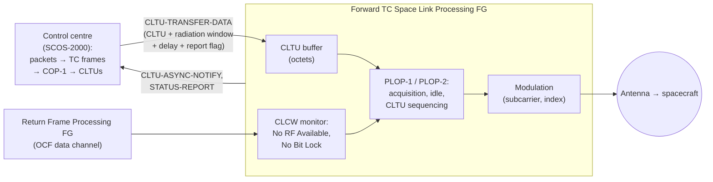
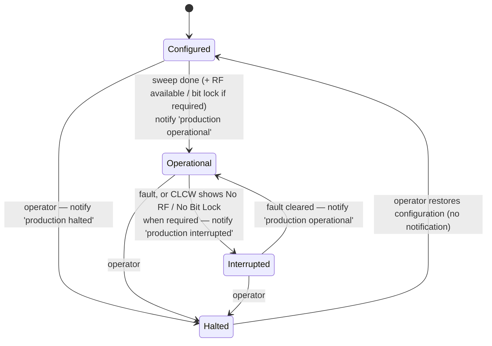
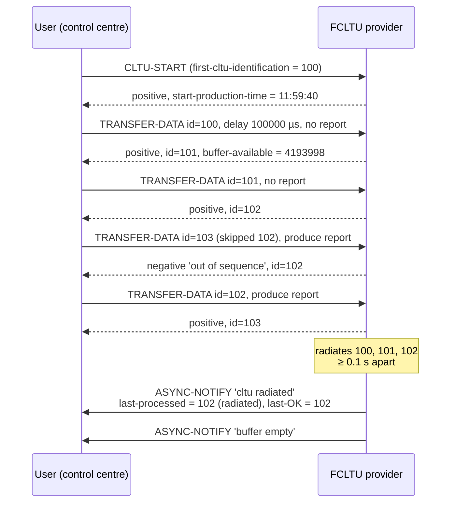
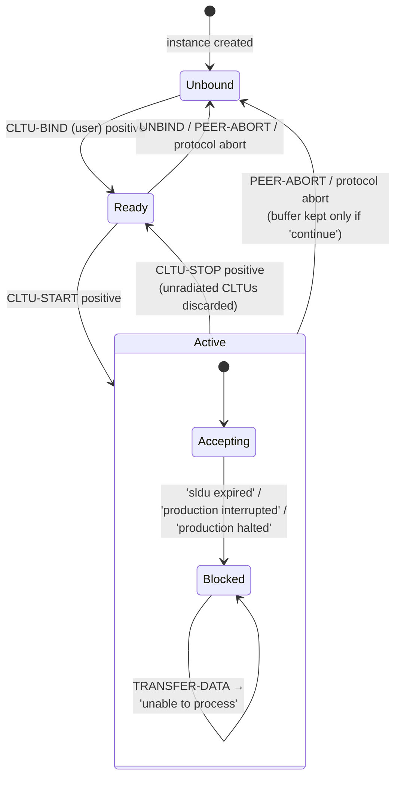

# SLE forward service: FCLTU

The **Forward CLTU** (FCLTU) service lets a control centre hand complete Communications Link
Transmission Units to a ground station, together with instructions on when to radiate them. The
station then radiates each CLTU, bit for bit, on the telecommand uplink and reports back what
happened.[^cltu-purpose][^cltu-ovw] It is the lowest-level forward SLE service. The user does
all the telecommand work above the physical layer: packets, segments, TC frames, COP-1 and
CLTU encoding. The provider adds the carrier, the acquisition and idle sequences, the timing,
and the uplink status that it reads from the spacecraft's CLCWs.[^cltu-fg]

The higher-level alternative is the [Forward Space Packet service](fsp.md) (FSP), where the user
hands over Space Packets and the provider builds the frames, runs COP-1 and generates the CLTUs
before radiating them with the same function that provides FCLTU; the two are compared
[below](#fcltu-and-the-other-forward-tc-services).[^fsp-ovw][^fsp-d11]
For the concepts shared with the other SLE services (BIND, states, security, service
instances) see the [SLE overview](index.md). The CLTU format itself is on
[TC synchronization and channel coding](../tc-coding-cltu.md), and the frames inside it on
[TC SDLP](../tc-sdlp.md) and [COP-1](../cop-1.md).

!!! info "At a glance"
    | Item | Value |
    |---|---|
    | Specification | CCSDS 912.1-B-5, July 2023 (adds USLP), with Editorial Change 1, October 2024[^cltu-ctl] |
    | Data unit | One CLTU per CLTU-TRANSFER-DATA, radiated bit for bit; any octet-aligned bit pattern is accepted[^cltu-ovw] |
    | Produced by | Forward TC Space Link Processing SLE-FG[^cltu-fg] |
    | Reference model names | Port type `CLTU-Transfer`; data channel "CLTU channel", unique identifier "CLTU ID", TC physical channels only[^csrm-fwdports][^csrm-chan] |
    | Instances | Only one FCLTU instance per physical forward channel at a time[^cltu-ovw] |
    | Delivery mode | Forward online only (`fwdOnline (3)`)[^cltu-modes][^raf-delmode] |
    | Binding | User-initiated only; `ApplicationIdentifier` `fwdCltu (16)`[^cltu-bind][^raf-appid] |
    | BIND `version-number` | 6 in this issue[^cltu-version] |
    | Provider states | 1 'unbound', 2 'ready', 3 'active'[^cltu-states] |
    | Production status | configured, operational, interrupted, halted[^cltu-prodstat] |
    | Time precision | Radiation times precise and accurate to 0.1 s[^cltu-time] |

## What the provider does

The Forward TC Space Link Processing functional group consumes two data channels. One is the
CLTU data channel from the user. The other is an OCF data channel, from which it extracts CLCWs
to judge whether the physical channel is available (service management may tell it to ignore
CLCWs). It then generates the acquisition and idle sequences required by the PLOP in effect,
steers the antenna, modulates the CLTUs onto the RF carrier, and radiates them.[^cltu-fg]



Diagram based on the functional view and operational scenario of the FCLTU specification.[^cltu-fg][^cltu-scen]

The reference model describes the same group in terms of ports. To produce FCLTU, the Forward TC
Space Link Processing SLE-FG has a consumer `CLTU-Transfer` port facing the user, a supplier
`Fwd-RF-Transfer` port facing the spacecraft, a supplier management port `TCSpLinkProc-Mgmt`
facing Complex Management, and a consumer `Rtn-MCOCF-Transfer` or `Rtn-VCOCF-Transfer` port through
which the CLCWs arrive.[^csrm-fcltu] Its functions are to consume the CLTU data channel, consume
the OCF channels and judge from the CLCW whether the physical channel is available, generate the
acquisition and idle sequences of the PLOP in effect on the asynchronous physical channel, inject
the CLTUs, use the antenna steering of the ground element, and modulate and radiate.[^csrm-fslp]
The users that the model names for the `CLTU-Transfer` port are an MUE and the Forward CLTU
Generation SLE-FG, the next group up, which turns TC frames into CLTUs.[^csrm-fwdports]

**Delivery.** In the reference model, forward online delivery happens during the forward space link
session and cannot extend beyond it. Forward offline delivery would transfer a complete data set into
the SLE system, a transfer that must be finished before the data are transmitted to the spacecraft
during the session, at a time set by SLE management.[^csrm-fmodes]
FCLTU defines only the online mode; offline is outside the scope of the current specification.[^cltu-modes]

**Production versus provision.** Production configuration parameters such as bit rate and
modulation index affect complex resources, so only service management may change them. A user
may change some *provision* parameters through operations. If the station and the mission user
agree, the user may also change *production* parameters indirectly, by asking complex management
to act through CLTU-THROW-EVENT.[^cltu-sm]

## The CLTU being radiated

A CLTU is a start sequence, a series of codewords that hold one or more TC transfer frames (plus
fill), and, for BCH coding, a tail sequence.[^cltu-struct]

<div class="bitfield" data-title="CLTU with BCH coding" data-width="16"
     data-fields='[{"n":"Start sequence","b":16,"v":"0xEB90","d":"1110 1011 1001 0000"},
                   {"n":"BCH codeword 1: 56 information bits","b":56,"g":"Codeword (64 bits)","d":"TC frame data, optionally randomized"},
                   {"n":"7 parity bits","b":7,"g":"Codeword (64 bits)","d":"(63,56) modified BCH code"},
                   {"n":"Filler","b":1,"v":"0","g":"Codeword (64 bits)"},
                   {"n":"… further 64-bit codewords …","b":16},
                   {"n":"Tail sequence","b":64,"v":"0xC5C5C5C5C5C5C579","d":"Non-correctable pattern that stops decoding"}]'></div>

Field values from CCSDS 231.0-B-4.[^cltu-struct][^bch-cw][^cltu-tail] With LDPC coding the start
sequence is the 64-bit pattern 0x034776C7272895B0, the codewords are 128 or 512 bits, and a tail
sequence is optional (128 bits for LDPC (128,64)).[^cltu-struct][^cltu-start-ldpc][^cltu-tail]

**Worked example (Solar Orbiter frame limit, illustrative coding).** The maximum Solar Orbiter TC
frame is 256 octets, or 2,048 bits.[^solo-tcflen] If BCH coding is used, the frame needs 37
codewords of 56 information bits each (37 × 56 = 2,072 bits, so 24 bits of fill). The CLTU is
then 2 + 37 × 8 + 8 = 306 octets. That is well inside FCLTU's `maximum-cltu-length` range of 12
to 4,096 octets.[^cltu-gp-asn] At an illustrative 2,000 bit/s uplink, the CLTU takes 2,448 bits
÷ 2,000 bit/s ≈ 1.22 s to radiate. The coding scheme Solar Orbiter actually uses is not stated in
the sections of its ICD consulted here.

## Production, PLOP and the CLCW

### Carrier modulation modes and the PLOPs

The physical layer operations procedures (PLOPs) of CCSDS 231.0 define how the carrier is
modulated around CLTUs (see also [TC coding and the CLTU](../tc-coding-cltu.md#physical-layer-operations-procedures)
and, for the carrier itself, [Radio frequency, modulation and ranging](../rf-and-ranging.md)). Missions whose planning began after September 2010 must use
PLOP-2.[^plop-select] There are four carrier modulation modes:[^cmm]

| Mode | Carrier is modulated with |
|---|---|
| CMM-1 | nothing (unmodulated carrier only) |
| CMM-2 | the acquisition sequence (alternating ones and zeros; preferred minimum 16 octets) |
| CMM-3 | a CLTU |
| CMM-4 | the idle sequence (alternating ones and zeros) |

Sources: carrier modulation modes and sequences.[^cmm][^acq-idle]

FCLTU binds these modes to its own parameters:[^cltu-delay]

```mermaid
stateDiagram-v2
    direction LR
    state "PLOP-1 (per CLTU)" as P1 {
        [*] --> CMM1a: carrier on,<br/>unmodulated
        CMM1a --> CMM2a: CLTU received
        CMM2a --> CMM4a: acquisition-sequence-length<br/>octets sent
        CMM4a --> CMM3a: plop-1-idle-sequence-length<br/>octets (if > 0)
        CMM3a --> CMM4b: CLTU sent
        CMM4b --> CMM1a: trailing idle (if > 0);<br/>wait delay-time
    }
```

```mermaid
stateDiagram-v2
    direction LR
    state "PLOP-2 (per session)" as P2 {
        [*] --> CMM1: uplink sweep
        CMM1 --> CMM2: sweep complete
        CMM2 --> CMM4: acquisition sequence sent
        CMM4 --> CMM3: CLTU available and<br/>previous delay-time expired
        CMM3 --> CMM4: CLTU sent;<br/>idle until delay-time expires
    }
```

Diagrams based on §3.6.2.8 of the FCLTU specification.[^cltu-delay]

* **PLOP-1:** the carrier stays unmodulated (CMM-1) until a CLTU arrives. For each CLTU the
  provider sends an acquisition sequence of `acquisition-sequence-length` octets (CMM-2), an
  optional leading idle sequence of `plop-1-idle-sequence-length` octets (CMM-4), the CLTU (CMM-3),
  and an optional trailing idle sequence (CMM-4). The carrier then returns to CMM-1 until the
  latest of three events: the `delay-time` expiring (measured from the last bit sent), the next
  CLTU becoming available, or the end of the session. Both lengths may be set to zero, so that a
  mission which does not fully follow PLOP-1 can put its own acquisition and idle bits inside the
  CLTU data.[^cltu-delay]
* **PLOP-2:** after the uplink sweep (CMM-1) the provider sends the acquisition sequence once, then
  idle (CMM-4) for as long as needed. Each CLTU is sent (CMM-3) as soon as it is available and the
  previous CLTU's `delay-time` has expired, with idle in between. PLOP-2 ends with a return to
  CMM-1, but no standard mechanism decides when.[^cltu-delay]

The idle sequence lets the spacecraft keep bit synchronisation when no CLTU is being sent. Under
PLOP-2, CCSDS 231.0 recommends inserting at least one octet of idle between CLTUs. This avoids a
rare synchronisation lockout, where a missed start sequence plus a false start pattern spanning the
end of one CLTU would make the receiver miss the start of the next.[^acq-idle][^plop2]

### Production status

FCLTU production status has four values. In ASN.1 they are `operational (0)`, `configured (1)`,
`interrupted (2)` and `halted (3)`. Note that the numbering differs from the return services.[^cltu-prodstat][^cltu-asn-status]

| Value | Meaning |
|---|---|
| configured | Equipment assigned, but not yet able to radiate CLTUs (initial value) |
| operational | Configured, acquisition complete, able to radiate |
| interrupted | Stopped by a fault that may be transient |
| halted | Taken out of service by management, for example after a non-transient fault or to reassign resources |



Diagram based on figure B-1, table B-1 and B2.3–B2.4 of the FCLTU specification.[^cltu-annexb][^cltu-annexb2]

The CLCW drives two optional checks, enabled by `rf-available-required` and `bit-lock-required`.

* **PLOP-1:** production becomes operational at the end of the uplink sweep. If
  `rf-available-required` is 'yes', the CLCW must also show RF available. While the carrier is
  unmodulated, acquiring, radiating or idling, production drops to 'interrupted' if a required
  flag shows a problem. For bit lock, this check applies from the end of the acquisition sequence
  onwards.[^cltu-annexb2]
* **PLOP-2:** the transition at the end of the sweep requires `bit-lock-required` to be 'no'.
  Otherwise production becomes operational during CMM-2 or CMM-4, as soon as a CLCW reports bit
  lock.[^cltu-annexb3]

**Uplink status** is the provider's summary of the last CLCW it received:[^cltu-uplink][^cltu-asn-status]

| `uplink-status` | Code | Condition on the last CLCW |
|---|---|---|
| uplink status not available | 0 | No CLCW received yet |
| no rf available | 1 | No RF Available = 1 |
| no bit lock | 2 | No RF Available = 0, No Bit Lock = 1 |
| nominal | 3 | Both flags 0 |

Those two flags are bits 16 and 17 of the CLCW (see the CLCW diagram on the
[return services page](return-services.md#rocf-and-the-clcw)).[^clcw] The provider learns which
telemetry channel carries the CLCW from the `clcw-global-VCID` and `clcw-physical-channel`
parameters, either of which may be 'not configured'.[^cltu-params][^cltu-clcw-asn]

The FCLTU `GvcId` type allows spacecraft identifiers 0 to 65535, but its ASN.1 comment gives
0 to 255 as the range for TM frames.[^cltu-gvcid-asn] The RCF and ROCF modules give 0 to 1023 for
TM, which matches the 10-bit TM spacecraft identifier.[^rcf-gvcid-range] A TM spacecraft such as
Solar Orbiter (SCID 650) is therefore encodable in `clcw-global-VCID`, even though it lies outside
the range stated in the FCLTU comment.

!!! warning "Inference"
    The 0 to 255 TM range in the FCLTU comment looks like an editorial slip copied from the AOS
    line. The standard does not say so.

**Notification mode.** A provider may tell the user about an interruption at once ('immediate') or
only when it affects a CLTU that is radiating or due ('deferred'). In deferred mode, CLTU-TRANSFER-DATA
is accepted until the notification has been sent. The parameter only documents what the
implementation does.[^cltu-notify][^cltu-annexb3][^cltu-conf]

| Production status | Operation | Effect | Diagnostic |
|---|---|---|---|
| halted | CLTU-BIND, CLTU-START | rejected | 'out of service' |
| halted | CLTU-TRANSFER-DATA | rejected | 'unable to process' |
| interrupted | CLTU-START | rejected | 'unable to comply' |
| interrupted | CLTU-TRANSFER-DATA | rejected (in deferred mode, only after notification) | 'unable to process' |
| configured, operational | all | none specified | — |

Source: table B-2.[^cltu-annexb3]

## Operations

| Operation | Invoker | Confirmed | Valid in states | ASN.1 tag (invocation / return) |
|---|---|---|---|---|
| CLTU-BIND | user only | yes | 1 | `[100]` / `[101]` |
| CLTU-UNBIND | user | yes | 2 | `[102]` / `[103]` |
| CLTU-START | user | yes | 2 | `[0]` / `[1]` |
| CLTU-STOP | user | yes | 3 | `[2]` / `[3]` |
| CLTU-TRANSFER-DATA | user | yes | 3 | `[10]` / `[11]` |
| CLTU-ASYNC-NOTIFY | provider | no | 2, 3 | `[12]` |
| CLTU-SCHEDULE-STATUS-REPORT | user | yes | 2, 3 | `[4]` / `[5]` |
| CLTU-STATUS-REPORT | provider | no | 2, 3 | `[13]` |
| CLTU-GET-PARAMETER | user | yes | 2, 3 | `[6]` / `[7]` |
| CLTU-THROW-EVENT | user | yes | 2, 3 | `[8]` / `[9]` |
| CLTU-PEER-ABORT | either | no | 2, 3 | `[104]` |

Sources: operations table,[^cltu-ops] states,[^cltu-start][^cltu-td][^cltu-an][^cltu-te] PDU tags.[^cltu-pdu-in][^cltu-pdu-out]
Unlike the return services, **TRANSFER-DATA is confirmed**: every CLTU is individually accepted or
rejected.[^cltu-ops] BIND, UNBIND and PEER-ABORT follow the common rules on the
[overview](index.md#bind-unbind-and-peer-abort-in-detail). The BIND service type is 'fwdCltu',
and version negotiation in BIND is optional for FCLTU.[^cltu-bind][^cltu-conf1]

### CLTU-START

START moves the provider to 'active' and fixes the first CLTU number.[^cltu-start]

| Parameter | Inv. | Ret. | Meaning |
|---|:-:|:-:|---|
| `invoke-ID` | M | M | Echoed |
| `first-cltu-identification` | M | | The `cltu-identification` expected in the first CLTU-TRANSFER-DATA |
| `start-production-time` | | C | If not yet operational, the estimated time radiation can start; otherwise the most recent time production became operational |
| `stop-production-time` | | C | Estimated stop of radiation, or 'null'; may be after the end of the provision period |
| `result`, `diagnostic` | | M, C | |

After an 'sldu expired' event the user must STOP and START again. The specification advises
choosing a new `first-cltu-identification` that cannot be confused with a CLTU still being
processed, because that CLTU may still produce a notification after the new START.[^cltu-start]

| START diagnostic | Code |
|---|---|
| duplicate invoke-ID | `common` 100 |
| out of service (production 'halted') | `specific` 0 |
| unable to comply (production 'interrupted') | `specific` 1 |
| production time expired | `specific` 2 |
| invalid cltu-ID (lower than a CLTU already buffered) | `specific` 3 |
| other reason | `common` 127 |

Sources: diagnostics,[^cltu-start] codes.[^cltu-diag-asn][^raf-common]

### CLTU-STOP

STOP takes the provider back to 'ready'. Buffered CLTUs that have not started radiating are
**discarded**. A CLTU that is being radiated is completed, and its requested report is still sent
as an ASYNC-NOTIFY. Depending on the implementation, one more CLTU may get radiated after the STOP
arrives. If STOP is rejected, nothing is discarded.[^cltu-stop]

### CLTU-TRANSFER-DATA

| Parameter | Inv. | Ret. | Meaning |
|---|:-:|:-:|---|
| `invoke-ID` | M | M | Echoed |
| `cltu-identification` | M | M | Monotonically increasing sequence number; the return holds the *next expected* value |
| `earliest-radiation-time` | M | | 'null' or the earliest time the first bit may be radiated |
| `latest-radiation-time` | M | | 'null' or the latest time radiation may begin |
| `delay-time` | M | | Minimum gap in µs between this CLTU and the next |
| `report` | M | | 'produce report' (0) or 'do not produce report' (1): notify when radiation completes |
| `data` | M | | The CLTU |
| `cltu-buffer-available` | | M | Remaining buffer, in octets |
| `result`, `diagnostic` | | M, C | |

Sources: parameter table and definitions,[^cltu-td][^cltu-td2] ASN.1 encodings.[^cltu-td-asn][^raf-common]

The rules that make FCLTU deterministic:

* **Sequence numbers.** The first CLTU after START must carry `first-cltu-identification`, and each
  accepted CLTU increments it. A positive return carries the invocation value plus one. A negative
  return carries the value the provider still expects.[^cltu-id]
* **Radiation window.** With a null earliest time, the CLTU is processed as soon as the previous
  CLTU's delay has elapsed and production is operational. With a null latest time, the CLTU waits as
  long as the instance is active and production is not halted. If a latest time is given and
  production is interrupted, processing is deferred until production recovers or the latest time
  passes; in the second case the CLTU is discarded. Equal earliest and latest times mean "radiate at
  exactly this time". A CLTU that has not started by its latest time raises 'sldu expired' and is
  not radiated.[^cltu-window]
* **Delay.** `delay-time` is a guard time after the CLTU, and must not be below the managed
  `minimum-delay-time`. Its exact effect depends on the PLOP (above).[^cltu-delay][^cltu-td2]
* **Buffering.** Accepted CLTUs are buffered and processed in the order received, according to their
  times and delays. `cltu-buffer-available` does not include any small extra buffer at the modulator
  input, which belongs to production.[^cltu-td2][^cltu-td-eff]

| TRANSFER-DATA diagnostic | Code | Cause |
|---|---|---|
| duplicate invoke-ID | `common` 100 | |
| unable to process | `specific` 0 | Production halted; interrupted and notified; blocked after an earlier fault, an expired CLTU, or while a THROW-EVENT is being processed |
| unable to store | `specific` 1 | Not enough buffer space |
| out of sequence | `specific` 2 | `cltu-identification` is not the expected value |
| inconsistent time range | `specific` 3 | Earliest time later than latest time |
| invalid time | `specific` 4 | Window outside scheduled production or the provision period |
| late sldu | `specific` 5 | Latest time already past when the invocation arrives |
| invalid delay time | `specific` 6 | Below `minimum-delay-time` |
| CLTU error | `specific` 7 | Fails agreed checks, for example longer than the maximum CLTU length |
| other reason | `common` 127 | |

Sources: diagnostics,[^cltu-td-diag] codes.[^cltu-diag-asn]

**Worked example (illustrative).** A user STARTs with `first-cltu-identification` = 100 and sends
three CLTUs with null radiation times, a delay time of 100,000 µs, and 'produce report' only on the
last one.



Illustrative sequence built from the rules in §3.4, §3.6 and §3.7.[^cltu-start][^cltu-id][^cltu-an]
The buffer value assumes the 4,194,304-octet minimum buffer and a 306-octet CLTU.[^cltu-conf]

### CLTU-ASYNC-NOTIFY

Notifications travel independently of the CLTU flow, in states 2 and 3.[^cltu-an]

| `notification-type` | ASN.1 `CltuNotification` | Meaning and effect |
|---|---|---|
| cltu radiated | `cltuRadiated [0]` | The CLTU `cltu-last-processed` finished radiating (only if its `report` asked for it) |
| sldu expired | `slduExpired [1]` | It did not start by its latest time. Nothing more is radiated, the buffer is discarded, and TRANSFER-DATA is blocked until STOP |
| production interrupted | `productionInterrupted [2]` | Immediate or deferred (see above). Same blocking and discarding as above (in state 3) |
| production halted | `productionHalted [3]` | Management halted production. Same blocking and discarding (in state 3) |
| production operational | `productionOperational [4]` | Ready to radiate (after acquisition or recovery) |
| buffer empty | `bufferEmpty [5]` | No more CLTUs buffered; not sent if the buffer was emptied by STOP or by an interruption or halt |
| action list completed | `actionListCompleted [6]` | All actions of THROW-EVENT `event-thrown-identification` succeeded |
| action list not completed | `actionListNotCompleted [7]` | At least one action failed |
| event condition evaluated to false | `eventConditionEvFalse [8]` | A precondition of the event was false; nothing was done |

Sources: notification types and effects,[^cltu-an][^cltu-an-eff] ASN.1.[^cltu-notif-asn]

Every notification also carries `cltu-last-processed` (with its radiation start time and status, or
'null'), `cltu-last-OK` (with its radiation stop time, or 'null'), `production-status` and
`uplink-status`.[^cltu-an-params][^cltu-notif-asn] The `cltu-status` values are:[^cltu-an-params][^raf-common]

| `cltu-status` | `ForwardDuStatus` code | Meaning |
|---|---|---|
| radiated | 0 | Radiation completed without aborting: guaranteed radiated |
| expired | 1 | Latest time reached before radiation began: guaranteed not radiated |
| interrupted | 2 | Radiation started but production became 'interrupted' |
| radiation started | 4 (`productionStarted`) | Radiation started, processing not complete |
| radiation not started | 5 (`productionNotStarted`) | Could not start because production was 'interrupted' |

### CLTU-SCHEDULE-STATUS-REPORT and CLTU-STATUS-REPORT

Scheduling works as for the return services ('immediately', 'periodically', 'stop'), except that
FCLTU has no offline mode.[^cltu-ssr] A status report contains:[^cltu-sr]

| Field | Meaning |
|---|---|
| cltu-last-processed, cltu-last-OK, cltu-status, radiation-start-time, radiation-stop-time | As in ASYNC-NOTIFY |
| production-status, uplink-status | As above |
| number-of-cltus-received | CLTUs checked successfully and buffered during this instance |
| number-of-cltus-processed | CLTUs the provider attempted to radiate: radiated, expired, aborted, or being radiated |
| number-of-cltus-radiated | CLTUs radiated successfully (not counting one in progress) |
| cltu-buffer-available | Octets free; a CLTU leaves the buffer when processing starts |

Statistics accumulate over the whole provision period, across associations.[^cltu-term][^cltu-abort]

### CLTU-GET-PARAMETER

| Parameter | Result tag | `ParameterName` | Value and meaning |
|---|---|---|---|
| acquisition-sequence-length | `[0]` | 201 | Octets of acquisition pattern |
| bit-lock-required | `[1]` | 3 | yes (0) / no (1): CLCW 'No Bit Lock' must be false for 'operational' |
| clcw-global-VCID | `[2]` | 202 | GVCID carrying the CLCW, or 'not configured' |
| clcw-physical-channel | `[3]` | 203 | Return RF channel carrying the CLCW (VisibleString 1–32), or 'not configured'; implies the frame version |
| delivery-mode | `[4]` | 6 | 'fwd online' |
| expected-cltu-identification | `[5]` | 10 (`expectedSlduIdentification`) | Next expected `cltu-identification`; 0 before any START |
| expected-event-invocation-identification | `[6]` | 9 | Next expected THROW-EVENT number; initially 0 |
| maximum-cltu-length | `[7]` | 21 (`maximumSlduLength`) | 12 to 4,096 octets |
| minimum-delay-time | `[8]` | 204 | Minimum guard time between CLTUs |
| modulation-frequency | `[9]` | 22 | Subcarrier frequency, or bit rate for direct modulation, in 0.1 Hz |
| modulation-index | `[10]` | 23 | Peak phase deviation in milliradians |
| notification-mode | `[11]` | 205 | deferred (0) / immediate (1) |
| plop-1-idle-sequence-length | `[12]` | 206 | Octets; 0 = no idle |
| plop-in-effect | `[13]` | 25 | plop1 (0) / plop2 (1) |
| protocol-abort-mode | `[14]` | 207 | abort (0) / continue (1) |
| reporting-cycle | `[15]` | 26 | Off, or seconds |
| return-timeout-period | `[16]` | 29 | 1 to 600 s |
| rf-available-required | `[17]` | 31 | yes (0) / no (1): CLCW 'No RF Available' must be false for 'operational' |
| subcarrier-to-bit-rate-ratio | `[18]` | 34 | Subcarrier divisor; 1 = direct carrier modulation |
| minimum-reporting-cycle | `[19]` | 301 | 1 to 600 s |

Sources: table 3-11,[^cltu-params] ASN.1 `CltuGetParameter` and `ParameterName`.[^cltu-gp-asn][^cltu-asn-status][^raf-pn]
Table 3-1 records which of these only service management can set. The user sets the reporting
cycle through SCHEDULE-STATUS-REPORT, and selected production parameters may be changed through
THROW-EVENT, which is allowed but not mandated.[^cltu-config]

### CLTU-THROW-EVENT

THROW-EVENT asks the provider to pass an event to SLE complex management. The standard's example
is changing the uplink bit rate. The mission first sends a telecommand that reconfigures the
spacecraft receiver. When that has executed, the user throws the event that changes the ground
bit rate. The event happens when the invocation arrives, so it is asynchronous with CLTU
radiation. Keeping it in step with specific CLTUs (for example by controlling their radiation
times) is the user's job.[^cltu-te]

| Parameter | Inv. | Ret. | Meaning |
|---|:-:|:-:|---|
| `invoke-ID` | M | M | Echoed |
| `event-invocation-identification` | M | M | Starts at 0 after the first BIND, increments per accepted event, survives re-binding; the return holds the next expected value |
| `event-identifier` | M | | Event to forward (`IntPosShort`) |
| `event-qualifier` | M | | 1 to 1,024 octets of event-specific data, checked only for type and length by the provider |
| `result`, `diagnostic` | | M, C | |

| Diagnostic | Code |
|---|---|
| duplicate invoke-ID | `common` 100 |
| operation not supported | `specific` 0 |
| out of sequence | `specific` 1 (`eventInvocIdOutOfSequence`) |
| no such event | `specific` 2 |
| other reason | `common` 127 |

Sources: parameters and diagnostics,[^cltu-te2] ASN.1.[^cltu-te-asn][^cltu-diag-asn]
A positive return only means "forwarded". The outcome arrives later as 'action list completed',
'action list not completed' or 'event condition evaluated to false'.[^cltu-te][^cltu-te3] Event
identifiers and qualifiers must be agreed in advance between complex and utilization
management. THROW-EVENT is optional for conforming providers.[^cltu-te3][^cltu-conf1]

The standard gives informative examples, which assume a 16 kHz subcarrier and therefore a
maximum of 4,000 bit/s:[^cltu-annexf]

| Name | ID | `event-qualifier` | Range | Precondition |
|---|---|---|---|---|
| Set Mod | 1 | `on` or `off` | — | 'on' requires production 'operational' |
| Change Rate | 2 | `br <BR>` | 7.8125 to 4000.0 bit/s | No CLTU radiating, buffer empty |
| Change Index | 3 | `mi <MI>` | 1 to 1570 mrad | No CLTU radiating, buffer empty |
| Change Rate/Index | 4 | `br <BR> mi <MI>` | as above | No CLTU radiating, buffer empty |

## Buffering, termination and protocol abort

The service package states the provider's CLTU buffer size in octets, and only complete CLTUs are
buffered.[^cltu-buffer] The conforming minimum is 4,194,304 octets, equivalent to 1,024 CLTUs of
4,096 octets each.[^cltu-conf]

When an association ends, production stops at once, except for a CLTU that is being radiated,
and all buffered CLTUs are discarded. The one exception is a **protocol abort** (loss of the
communications link) when `protocol-abort-mode` is 'continue'. Buffered CLTUs are then kept and
radiated as if nothing had happened. Notifications produced meanwhile are not delivered or queued
(logging them is recommended). After re-binding, the user can rebuild the picture from a status
report, and must choose a `first-cltu-identification` above any CLTU still in the buffer.[^cltu-term][^cltu-abort]
Sequence numbers that relate notifications to operations are not reset by a protocol abort.[^cltu-abort]

!!! warning "Inconsistent naming in the standard"
    §4.1.5.3 and the conformance matrix call the discarding value of `protocol-abort-mode` 'flush'
    (the default behaviour if the parameter is not supported). Table 3-11 and the ASN.1 call it
    'abort' (`abort (0)`).[^cltu-abort][^cltu-conf][^cltu-params][^cltu-gp-asn] This wiki treats
    them as the same value.

## State machine



Diagram based on figure 2-4 and §3.7.3 of the FCLTU specification.[^cltu-states][^cltu-an-eff]
Getting out of 'Blocked' needs a STOP, which returns the provider to 'ready'. The normative
behaviour is the state table in §4.2, and conformance to it is mandatory.[^cltu-conf]

## FCLTU and the other forward TC services

### Three functional groups, four services

The reference model stacks three forward telecommand functional groups. Each higher group adds
one layer of telecommand processing, and each layer has its own transfer service:[^csrm-tcfg][^csrm-fprod]

| Service | The user supplies | Provider functional groups involved | What the extra group does | Recommended Standard |
|---|---|---|---|---|
| Forward CLTU (FCLTU) | CLTUs | Forward TC Space Link Processing | PLOP sequences, modulation, radiation, CLCW checks of the physical channel | 912.1-B-5 (this page) |
| Forward TC Frame (FTCF) | TC frames, in blocks of one or more frames per CLTU | + Forward CLTU Generation | Optional randomisation, BCH encoding, start and tail sequences | none yet (as stated in 2016)[^fsp-fg] |
| Forward TC Virtual Channel Access (TC-VCA) | Frame Data Units with the GVCID to use | + Forward TC VC Data Insertion | Builds TC frames; for sequence-controlled frames sets the frame sequence count, keeps a copy and retransmits or deletes it according to the CLCW | not in this library |
| Forward Space Packet (FSP) | Space Packets | + Forward TC VC Data Insertion | Blocks or segments packets into frames (segmented packets only with sequence control), with the same frame sequence numbering, copy keeping and CLCW-driven retransmission | 912.3-B-3 ([page](fsp.md)) |

Sources: §4.3.2.3 and §5.6.2 of the reference model, and the FSP specification.[^csrm-tcfg][^csrm-fprod][^fsp-fg]
If TC-VCA and FSP are both active on one virtual channel, only one of them may be
sequence-controlled.[^csrm-tcfg] Because no FTCF standard exists, FSP requires the CLTU Generation
and the TC VC Data Insertion groups to sit in the same complex, while the radiation group may still
be in another complex, reached through an FCLTU service instance.[^fsp-fg][^fsp-d11] The
[FSP page](fsp.md#who-does-what-fsp-compared-with-fcltu) compares the user's and the provider's
tasks under FCLTU and FSP in detail.

| Attribute | FCLTU (912.1-B-5) | FSP (912.3-B-3) |
|---|---|---|
| `ApplicationIdentifier` | `fwdCltu (16)` | `fwdTcSpacePkt (13)` |
| BIND `version-number` in the library issue | 6 | 5 |
| Data unit per TRANSFER-DATA | one CLTU | one Space Packet |
| Release-time control | earliest and latest *radiation* time | earliest and latest *production* time |
| COP-1 (FOP-1) runs at | the user | the provider; the user may send COP-1 directives (FSP-INVOKE-DIRECTIVE) |
| Production status values | configured, operational, interrupted, halted | configured, operational (sub-states 'BD', 'AD and BD', 'AD suspended'), interrupted, halted |

Sources: the BIND, TRANSFER-DATA and production status clauses of both specifications.[^raf-appid][^cltu-version][^fsp-version][^cltu-td][^fsp-epl][^fsp-dir][^cltu-prodstat][^fsp-prodstat]

### The FCLTU radiation function inside FSP production

FSP reuses the FCLTU production rules for its radiation group. Annex D of the FSP specification
states that most of the Forward TC Space Link Processing production is already described in the
FCLTU specification, and defines how that group handles each *CLTU Transfer Data SLE-SDU* coming
from the CLTU Generation group in the same complex. The differences from a real FCLTU
CLTU-TRANSFER-DATA are these:[^fsp-d11]

| Aspect | FCLTU service (CLTU-TRANSFER-DATA from a user) | Inside FSP production (CLTU Transfer Data SLE-SDU) |
|---|---|---|
| Credentials and invoke-ID | carried and checked | none passed or authenticated; they matter only when the groups are in different complexes and a real FCLTU instance connects them |
| `cltu-identification` sequencing | enforced ('out of sequence') | not enforced; the CLTU identifier only labels acceptance, rejection and radiation reports |
| Earliest and latest radiation time | supported, with 'sldu expired' | none; each CLTU is radiated as soon as possible after those already queued, and eventually radiated as long as production is operational |
| Delay time | per invocation, at least `minimum-delay-time` | taken from the SDU; acceptance or rejection reported on the same minimum |
| Radiation report | `report` parameter, CLTU-ASYNC-NOTIFY | flag in the SDU; radiation reported to the CLTU Generation group |
| CLTU content | any octet-aligned bit pattern | exactly one TC frame per CLTU, although the coding standard allows more |

Sources: annex D1.1 and D1.2 of 912.3-B-3.[^fsp-d11][^fsp-d12] Service management configures the
same eleven production parameters as for FCLTU: `acquisition-sequence-length`, `bit-lock-required`,
`clcw-physical-channel`, `clcw-global-VCID`, `minimum-delay-time`, `modulation-frequency`,
`modulation-index`, `plop-1-idle-sequence-length`, `plop-in-effect`, `rf-available-required` and
`subcarrier-to-bit-rate-ratio`. The CLTU Generation group adds two of its own: the maximum CLTU
length and whether the randomiser is used.[^fsp-d11][^fsp-d12]

```mermaid
sequenceDiagram
    participant VCDI as TC VC Data Insertion FG (FSP)
    participant CG as CLTU Generation FG
    participant FSLP as Forward TC Space Link Processing FG
    VCDI->>CG: TC Frame Transfer Data SLE-SDU<br/>(frame, delay, frame id, report flag)
    CG->>CG: randomise (option), BCH, start + tail;<br/>map frame id to CLTU id
    CG->>FSLP: CLTU Transfer Data SLE-SDU<br/>(CLTU, delay, CLTU id, report flag)
    alt delay at least minimum-delay-time
        FSLP-->>CG: accepted (CLTU id)
        CG-->>VCDI: frame accepted (frame id)
    else delay too short
        FSLP-->>CG: rejected (CLTU id)
        CG-->>VCDI: frame rejected (frame id)
    end
    FSLP-->>CG: radiated (CLTU id), if requested
    CG-->>VCDI: frame radiated (frame id)
    Note over VCDI: maps frame id to packet-identification<br/>and reports radiation per FSP instance
```

Diagram based on annex D1.1 to D1.3 of the FSP specification.[^fsp-d11][^fsp-d12][^fsp-d13]

Each group passes its production status up the chain, combined with its own. The CLTU Generation
group combines the radiation group's status (the FCLTU values) with its own as follows:[^fsp-d12]

| Space link processing status ↓ / CLTU Generation status → | configured | operational | interrupted | halted |
|---|---|---|---|---|
| configured | configured | configured | interrupted | halted |
| operational | configured | operational | interrupted | halted |
| interrupted | interrupted | interrupted | interrupted | halted |
| halted | halted | halted | halted | halted |

Source: table D-1.[^fsp-d12] The TC VC Data Insertion group applies the same combination to
the result and its own status (table D-2), and an 'operational' aggregate then also carries the
FSP sub-states.[^fsp-d13] In words: 'halted' anywhere wins, then 'interrupted', and the chain is
'operational' only if every group is.

## Security

Commanding is the most sensitive SLE service. FCLTU adds one integrity mechanism of its own: the
monotonically increasing `cltu-identification`. A CLTU without the expected number is rejected,
which constrains a third party's ability to inject extra commands. The strict operation sequence of
the state table constrains a third party's ability to take over an instance without being
detected.[^cltu-integrity] Everything else (authentication of BIND or of every PDU, confidentiality,
denial-of-service protection, auditing) relies on the common SLE mechanisms, the underlying network
and bilateral agreements. The standard warns that a hijacked forward service could be used to
subvert or destroy a spacecraft.[^cltu-integrity][^cltu-threat] See
[SDLS](../sdls.md) for protection of the TC frames themselves, which the FCLTU service carries
transparently.[^cltu-td2]

## SCOS-2000, the NIS and throw events

### Throw events in the MIB

SCOS-2000 has supported throw events as commands since release 5.0. The import ICD defines two
special values of the command type `CCF_CTYPE`.[^icd-ccf][^icd-ctype]

* **'T' (SLE throw event):** sent to the SLE service provider (the ground station equipment) and
  not uplinked. Its CDF entries define the Event ID and the following fields according to the
  NIS/NCTRS MCS interface ICD.
* **'N' (NIS throw event):** executed by the NIS itself and not forwarded to the station. Its CDF
  entries follow the NIS Throw Events ICD.

The referenced documents are EGOS-NIS-NCTR-ICD-0002 "ICD NIS/NCTRS Volume 2 – MCS I/F" issue 4.0.2
and EGOS-NIS-NIS-ICD-0003 "NIS Throw Events ICD" issue 1.3. Neither is in this library.[^icd-rd]
Throw events cannot be blocked with other commands in a sequence or command source.[^icd-ccf]

The Solar Orbiter MIB (release 25925PFM, 2025-09-16) has **no** 'T' commands and **six** 'N'
commands. All six use the packet header `NOS2KHDR` ("NIS Throw Events"), type 251, subtype 1 and
APID 1964. That header has no PCDF fields.[^mib-te]

| CCF_CNAME | Description | Event ID (CNISX205TC) | Further content |
|---|---|---|---|
| [ESESIONO](../../explorer/index.md#/solo/command/ESESIONO) | OPEN SESSION | OPEN_SESSION 10 | unnamed fixed octet (0), 16-bit "Polling Frequency" (ENISTE01), fixed octet described as "Spare" |
| [ESESIONC](../../explorer/index.md#/solo/command/ESESIONC) | CLOSE SESSION | CLOSE_SESSION 11 | unnamed fixed octet (0) |
| [EGENRTCO](../../explorer/index.md#/solo/command/EGENRTCO) | GENERIC OPEN TC LINK | OPEN_LINK 20 | service type FCLTU, First CLTU ID, service instance identifier |
| [EGENRTCC](../../explorer/index.md#/solo/command/EGENRTCC) | GENERIC CLOSE TC LINK | CLOSE_LINK 21 | service type FCLTU, service instance identifier |
| [EGENRTMO](../../explorer/index.md#/solo/command/EGENRTMO) | GENERIC OPEN TM LINK | OPEN_LINK 20 | RCF, GVCID fields, times, identifier (see [return services](return-services.md#opening-an-rcf-link-from-scos-2000)) |
| [EGENRTMC](../../explorer/index.md#/solo/command/EGENRTMC) | GENERIC CLOSE TM LINK | CLOSE_LINK 21 | RCF, identifier |

The Event ID calibration also defines HEARTBEAT_MSG (12), ABORT_LINK (22) and CHANGE_MODE (23),
which no Solar Orbiter command uses. The SLE service type calibration `CNISX207TC` lists RAF 1,
RCF 2, ROCF 3, FCLTU 4 and FSP 5.[^mib-te] The interface therefore knows [FSP](fsp.md), but both
Solar Orbiter TC-link commands fix the service type to FCLTU (`CDF_ELTYPE` 'F'), and the TM-link
commands carry RCF as the default of an editable element (`CDF_ELTYPE` 'E'), in the 2025 and the
2020 releases alike.[^mib-te][^mib2020] As far as these commands show, the TC link is opened as
FCLTU, so the frames, COP-1 and the CLTUs are produced on the user side of the SLE interface, as
the FCLTU division of work implies.[^cltu-fg]

<div class="bitfield" data-title="EGENRTCO GENERIC OPEN TC LINK (Solar Orbiter MIB, fixed part)" data-width="32"
     data-fields='[{"n":"Event ID","b":16,"v":"20","d":"ENISTE02 OPEN_LINK, fixed (CDF_ELTYPE F)"},
                   {"n":"SLE service type","b":8,"v":"4","d":"ENISTE03 FCLTU, fixed"},
                   {"n":"First CLTU ID","b":32,"v":"1","d":"ENISTE24, editable, default 1"},
                   {"n":"SII part 1 (15 chars)","b":120,"v":"sagr=144.spack=","d":"ENISTE35, ASCII"},
                   {"n":"SII part 2 (15 chars)","b":120,"v":"NN11-PERM.fsl-f","d":"ENISTE38, ASCII"}]'></div>

The last element, ENISTE37 "Service_Instance_End", is a variable-length ASCII string (PTC 8,
PFC 0) with the default "g=1.cltu=cltu01". The three parts together form
`sagr=144.spack=NN11-PERM.fsl-fg=1.cltu=cltu01`, a valid FCLTU service instance identifier.[^mib-te][^raf-sii]
The 2020-04-16 release contains the same six commands with the same values.[^mib2020]

!!! warning "Inference"
    The "First CLTU ID" field corresponds to FCLTU's `first-cltu-identification`. This suggests
    that the NIS performs CLTU-BIND and CLTU-START towards the station when it receives
    OPEN_LINK. Likewise, "OPEN SESSION" with a polling frequency suggests a session between
    SCOS-2000 and the NIS, inside which links are opened. The ICD that would confirm these
    semantics is not in the library.

??? example "SQL used"
    ```sql
    -- Solar Orbiter MIB, release 25925PFM (VDF: 20250916-CSW3.1.2_MAS7.33)
    SELECT CCF_CTYPE, count(*) FROM ccf GROUP BY CCF_CTYPE;
    SELECT CCF_CNAME, CCF_DESCR, CCF_PKTID, CCF_TYPE, CCF_STYPE, CCF_APID
      FROM ccf WHERE CCF_CTYPE = 'N';
    SELECT * FROM tcp WHERE TCP_ID = 'NOS2KHDR';
    SELECT count(*) FROM pcdf WHERE PCDF_TCNAME = 'NOS2KHDR';   -- 0

    SELECT CDF_CNAME, CDF_ELTYPE, CDF_DESCR, CDF_ELLEN, CDF_BIT,
           CDF_PNAME, CDF_INTER, CDF_VALUE
      FROM cdf WHERE CDF_CNAME IN ('EGENRTCO','EGENRTCC','ESESIONO','ESESIONC')
     ORDER BY CDF_CNAME, CAST(CDF_BIT AS INT);

    SELECT CPC_NAME, CPC_DESCR, CPC_PTC, CPC_PFC, CPC_PAFREF, CPC_DEFVAL
      FROM cpc WHERE CPC_NAME LIKE 'ENISTE%';
    SELECT PAS_NUMBR, PAS_ALTXT, PAS_ALVAL FROM pas WHERE PAS_NUMBR LIKE 'CNISX2%';

    -- Which SLE service type each command fixes (same result in solo-2020-04-16)
    SELECT CDF_CNAME, CDF_ELTYPE, CDF_VALUE FROM cdf WHERE CDF_PNAME = 'ENISTE03' ORDER BY CDF_CNAME;
    -- -> EGENRTCC F FCLTU, EGENRTCO F FCLTU, EGENRTMC E RCF, EGENRTMO E RCF
    ```

The relevant MIB tables are [CCF](../../mib/tables/ccf.md), [CDF](../../mib/tables/cdf.md),
[CPC](../../mib/tables/cpc.md), [PAS](../../mib/tables/pas.md), [TCP](../../mib/tables/tcp.md) and
[PCDF](../../mib/tables/pcdf.md); command definition in general is explained in
[commanding](../../mib/commanding.md).

### Bit-rate changes: on board and on the ground

The FCLTU example of a bit-rate change (first reconfigure the spacecraft, then throw an event) has a
visible on-board half in the Solar Orbiter MIB. The "Set TC bit rate" commands include the
following. The MIB has five more TC bit-rate commands: ZCS2Z05J and ZCS2Z05K ("Set DST-RX Antenna
A/B TC Bitrate SDP") and ZCD2Z086 to ZCD2Z088 ("Set SGM ... TC Bitrate").[^mib-br]

| Command | Description | Type/Subtype | APID |
|---|---|---|---|
| [ZCSD3402](../../explorer/index.md#/solo/command/ZCSD3402) | Dst Set TC Bit Rate | 131/1 | 236 |
| [ZDSG0009](../../explorer/index.md#/solo/command/ZDSG0009) | DST-RX A Set TC bitrate | 2/128 | 172 |
| [ZDSG1009](../../explorer/index.md#/solo/command/ZDSG1009) | DST-RX B Set TC bitrate | 2/128 | 172 |
| [ZYP66991](../../explorer/index.md#/solo/command/ZYP66991) | PSS Set TC Bit Rate | 170/7 | 1948 |

!!! warning "Inference"
    These are on-board commands. The matching ground-side change would be an SLE throw event
    ('T'), of which this MIB has none, or a station reconfiguration made by other means. How ESA
    actually sequences a Solar Orbiter uplink rate change is not stated in the available sources.

??? example "SQL used"
    ```sql
    SELECT CCF_CNAME, CCF_DESCR, CCF_TYPE, CCF_STYPE, CCF_APID FROM ccf
     WHERE CCF_CNAME IN ('ZCSD3402','ZDSG0009','ZDSG1009','ZYP66991');
    -- all TC bit-rate commands
    SELECT CCF_CNAME, CCF_DESCR FROM ccf
     WHERE CCF_DESCR LIKE '%TC Bit%Rate%' OR CCF_DESCR LIKE '%TC bitrate%';
    ```

### Ground responses and verification stages

SCOS-2000 tracks every telecommand through verification stages. The EDDS external user ICD defines
the first three as follows:[^euicd-stages]

| Stage | Meaning |
|---|---|
| R | Release from SCOS-2000 to "the SLE User (NCTRS/NIS)". It fails if the PTV check fails, if there is no TCP/IP connection to the NCTRS, or if the NCTRS rejects the command (for example because the station connection is not available) |
| G | Ground station reception (first uplink verification stage) |
| T | Uplink, also called radiation (second stage). For a throw event command this is the execution stage |

The Solar Orbiter MIB defines an internal ground packet "TM Packet used by the Releaser G/S
response" ([SPID 66850](../../explorer/index.md#/solo/packet/66850), type 165/1, APID 1966). Its
fields are listed below.[^mib-gs]

| Octet | Parameter | Description | PTC/PFC, calibration |
|---|---|---|---|
| 0 | [NYG02201](../../explorer/index.md#/solo/param/NYG02201) | GS Packet Size | 3/14 |
| 4 | [NYG02202](../../explorer/index.md#/solo/param/NYG02202) | GS Packet Type | 2/16, CYGT2202TM |
| 6 | [NYG02203](../../explorer/index.md#/solo/param/NYG02203) | GS Spacecraft ID | 3/12 |
| 8 | [NYG02204](../../explorer/index.md#/solo/param/NYG02204) | GS Acceptance Time | 9/2 |
| 19 | [NYG02206](../../explorer/index.md#/solo/param/NYG02206) | GS CLTU ID | 3/14 |
| 23 | [NYG02207](../../explorer/index.md#/solo/param/NYG02207) | GS Acknowledgement | 2/8, CYGT2207TM |
| 24 | [NYG02208](../../explorer/index.md#/solo/param/NYG02208) | GS Acknowledgement | 3/4 |
| 26 | [NYG02210](../../explorer/index.md#/solo/param/NYG02210) | GS Next TC ID | 3/14 |

The "GS Packet Type" calibration lists BDseq (0), BDseq_response (1), LinkStatus_PCM (3),
COP1directive (4), ThrowEvnt (5), ThrowEvnt_Resp (6), CLTU (7), CLTU_Resp (8), SDID_MKII_RQM (9),
SDID_MKII_TRM (10), FSPPkt (20), FSPPkt_Resp (21), FSPdirective (22) and FSPdir_Resp (23). The
acknowledgement calibration lists Confirm_Accept (0), ConfirmTrnsmit (1), Failure_accept (3),
FailureTrnsmit (4) and Nis_Rejected (9).[^mib-gs] The four FSP values (identical in the 2020
release) suggest message types for packets and COP-1 directives sent to an FSP provider; they are
discussed on the [FSP page](fsp.md#fsp-in-esas-ground-segment-and-the-solar-orbiter-mib).[^mib2020]

!!! warning "Inference"
    "GS CLTU ID" and "GS Next TC ID" mirror the FCLTU `cltu-identification` in the
    TRANSFER-DATA invocation and the next expected value in its return. The accept and transmit
    confirmations and failures look like the positive or negative TRANSFER-DATA return (stage G)
    and the 'cltu radiated' or failure notification (stage T). This mapping is not stated in the
    available sources.

??? example "SQL used"
    ```sql
    SELECT l.PLF_NAME, p.PCF_DESCR, l.PLF_OFFBY, p.PCF_PTC, p.PCF_PFC, p.PCF_CURTX
      FROM plf l JOIN pcf p ON p.PCF_NAME = l.PLF_NAME
     WHERE l.PLF_SPID = 66850 ORDER BY CAST(l.PLF_OFFBY AS INT);
    SELECT TXP_NUMBR, TXP_FROM, TXP_ALTXT FROM txp
     WHERE TXP_NUMBR IN ('CYGT2202TM','CYGT2207TM') ORDER BY TXP_NUMBR, CAST(TXP_FROM AS INT);
    ```

See [command verification](../../mib/command-verification.md) and the [TXP table](../../mib/tables/txp.md).

### Routing and CLTU size limits

Commands normally go to the NCTRS. The MIB's [DST](../../mib/tables/dst.md) table can route an APID
elsewhere. Solar Orbiter has a single entry, which sends APID 1372 (91 commands, ZIC00000 to
ZICCMS65) to `EGSE.TC.0x8800`.[^mib-dst][^icd-dst] The import ICD also explains that the mission
specific maximum CLTU size limits commands. The variable `CMDP_MAX_BLOCK_SIZE` (default 248 octets)
must be set to the maximum CLTU size minus the time-tag wrapper, so that time-tagged commands still
fit.[^icd-block]

??? example "SQL used"
    ```sql
    SELECT * FROM dst;                                   -- 1372 | EGSE.TC.0x8800
    SELECT count(*), min(CCF_CNAME), max(CCF_CNAME) FROM ccf WHERE CCF_APID = '1372';
    ```

The page on [NCTRS and the NIS](../../scos2000/nctrs-nis.md) describes the ESA side of
the interface, and [uplink](../../overview/uplink.md) follows a command end to end.

## Related pages

* [SLE overview](index.md), [return services](return-services.md), [FSP](fsp.md), [ISP1 and the SLE API](isp1-and-api.md)
* [Cross support reference model and service management](service-management.md)
* [TC SDLP](../tc-sdlp.md), [COP-1](../cop-1.md), [TC coding and CLTU](../tc-coding-cltu.md)
* [Radio frequency, modulation and ranging](../rf-and-ranging.md) (carrier, subcarrier and command modulation), [Space link identifiers](../space-link-identifiers.md) (the GVCID in `clcw-global-VCID`) and [Security in CCSDS space links](../security.md#impact-on-sle-cross-support)
* [Worked example: a telecommand](../../overview/worked-example-tc.md)
* Library: [CCSDS 912.1-B-5](../../library/ccsds-912-1-912x1b5e1.md), [CCSDS 912.3-B-3](../../library/ccsds-912-3-912x3b3s.md),
  [CCSDS 910.4-B-2](../../library/ccsds-910-4-910x4b2e1s.md), [CCSDS 231.0-B-4](../../library/ccsds-231-0-231x0b4e1.md);
  terms in the [glossary](../../glossary.md)

[^cltu-purpose]: [CCSDS 912.1-B-5, SLE Forward CLTU Service](../../library/ccsds-912-1-912x1b5e1.md), §1.1 Purpose, PDF p. 10.
[^cltu-ovw]: [CCSDS 912.1-B-5](../../library/ccsds-912-1-912x1b5e1.md), §2.1 Overview, PDF p. 23.
[^cltu-fg]: [CCSDS 912.1-B-5](../../library/ccsds-912-1-912x1b5e1.md), §2.4.1 Forward TC Space Link Processing SLE-FG and figure 2-1, PDF pp. 25–27.
[^cltu-ctl]: [CCSDS 912.1-B-5](../../library/ccsds-912-1-912x1b5e1.md), Document Control, PDF p. 6.
[^cltu-modes]: [CCSDS 912.1-B-5](../../library/ccsds-912-1-912x1b5e1.md), §3.1.8 Delivery modes, PDF pp. 46–47.
[^raf-delmode]: [CCSDS 911.1-B-5, SLE RAF Service](../../library/ccsds-911-1-911x1b5e1.md), Annex A2.1 `DeliveryMode`, PDF p. 115.
[^cltu-bind]: [CCSDS 912.1-B-5](../../library/ccsds-912-1-912x1b5e1.md), §3.2 CLTU-BIND (§3.2.1.5, service-type 'fwdCltu'), PDF pp. 49–52.
[^raf-appid]: [CCSDS 911.1-B-5](../../library/ccsds-911-1-911x1b5e1.md), Annex A2.2 `ApplicationIdentifier`, PDF p. 120.
[^cltu-version]: [CCSDS 912.1-B-5](../../library/ccsds-912-1-912x1b5e1.md), §3.2.2.8.7, PDF p. 53.
[^cltu-states]: [CCSDS 912.1-B-5](../../library/ccsds-912-1-912x1b5e1.md), §2.6.4.2 and figure 2-4, PDF pp. 30–31.
[^cltu-prodstat]: [CCSDS 912.1-B-5](../../library/ccsds-912-1-912x1b5e1.md), §3.7.2.10 production-status, PDF p. 79.
[^cltu-time]: [CCSDS 912.1-B-5](../../library/ccsds-912-1-912x1b5e1.md), §3.1.7 Time, PDF p. 46.
[^cltu-scen]: [CCSDS 912.1-B-5](../../library/ccsds-912-1-912x1b5e1.md), §2.7 Operational scenario, PDF pp. 36–37.
[^cltu-sm]: [CCSDS 912.1-B-5](../../library/ccsds-912-1-912x1b5e1.md), §2.3 Service management, PDF p. 25.
[^cltu-struct]: [CCSDS 231.0-B-4, TC Synchronization and Channel Coding](../../library/ccsds-231-0-231x0b4e1.md), §5.2.1 Structure of a CLTU and figures 5-1, 5-2, PDF p. 30.
[^bch-cw]: [CCSDS 231.0-B-4](../../library/ccsds-231-0-231x0b4e1.md), §3.2–3.3 BCH codeword (56 information bits, 7 parity bits, filler bit), PDF p. 24.
[^cltu-tail]: [CCSDS 231.0-B-4](../../library/ccsds-231-0-231x0b4e1.md), §5.2.4 Tail sequence, PDF p. 32.
[^cltu-start-ldpc]: [CCSDS 231.0-B-4](../../library/ccsds-231-0-231x0b4e1.md), §5.2.2 Start sequence, PDF p. 31.
[^solo-tcflen]: [Solar Orbiter Space/Ground ICD SOL.S.ASTR.TN.00079 issue 7](../../library/sol-s-astr-tn-00079-07.md), §3.4 TC Transfer Frame, Frame Length, PDF pp. 21–22.
[^cltu-gp-asn]: [CCSDS 912.1-B-5](../../library/ccsds-912-1-912x1b5e1.md), Annex A `CltuGetParameter`, PDF pp. 130–131.
[^plop-select]: [CCSDS 231.0-B-4](../../library/ccsds-231-0-231x0b4e1.md), §7.1.3, PDF p. 39.
[^cmm]: [CCSDS 231.0-B-4](../../library/ccsds-231-0-231x0b4e1.md), §7.3 and table 7-1 Carrier modulation modes, PDF pp. 40–41.
[^acq-idle]: [CCSDS 231.0-B-4](../../library/ccsds-231-0-231x0b4e1.md), §7.2.2 Acquisition sequence and §7.2.4 Idle sequence, PDF pp. 39–40.
[^cltu-delay]: [CCSDS 912.1-B-5](../../library/ccsds-912-1-912x1b5e1.md), §3.6.2.8 delay-time and PLOP behaviour, PDF pp. 68–70.
[^plop2]: [CCSDS 231.0-B-4](../../library/ccsds-231-0-231x0b4e1.md), §7.5 PLOP-2 and figure 7-2, PDF pp. 42–43.
[^cltu-asn-status]: [CCSDS 912.1-B-5](../../library/ccsds-912-1-912x1b5e1.md), Annex A `ProductionStatus`, `UplinkStatus`, `ModulationFrequency`, `ModulationIndex`, `SubcarrierDivisor`, PDF p. 134.
[^cltu-annexb]: [CCSDS 912.1-B-5](../../library/ccsds-912-1-912x1b5e1.md), Annex B figure B-1 and table B-1, PDF pp. 140–141.
[^cltu-annexb2]: [CCSDS 912.1-B-5](../../library/ccsds-912-1-912x1b5e1.md), Annex B2.3 Production status changes with PLOP-1, PDF pp. 141–142.
[^cltu-annexb3]: [CCSDS 912.1-B-5](../../library/ccsds-912-1-912x1b5e1.md), Annex B2.4 (PLOP-2), notes and table B-2, PDF pp. 142–144.
[^cltu-uplink]: [CCSDS 912.1-B-5](../../library/ccsds-912-1-912x1b5e1.md), §3.7.2.11 uplink-status, PDF p. 79.
[^clcw]: [CCSDS 232.0-B-4, TC Space Data Link Protocol](../../library/ccsds-232-0-232x0b4e1c1.md), §4.2.1 CLCW and No RF Available flag, PDF pp. 80–83.
[^cltu-params]: [CCSDS 912.1-B-5](../../library/ccsds-912-1-912x1b5e1.md), table 3-11 FCLTU service parameters, PDF pp. 92–93.
[^cltu-clcw-asn]: [CCSDS 912.1-B-5](../../library/ccsds-912-1-912x1b5e1.md), Annex A `ClcwGvcId`, `ClcwPhysicalChannel`, PDF p. 129.
[^cltu-gvcid-asn]: [CCSDS 912.1-B-5](../../library/ccsds-912-1-912x1b5e1.md), Annex A2.5 `GvcId` (value range comments), PDF p. 133.
[^rcf-gvcid-range]: [CCSDS 911.2-B-4, SLE Return Channel Frames Service](../../library/ccsds-911-2-911x2b4e1.md), Annex A2.5 `GvcId`, PDF p. 130.
[^cltu-notify]: [CCSDS 912.1-B-5](../../library/ccsds-912-1-912x1b5e1.md), §3.7.2.3 c) production interrupted, PDF p. 75.
[^cltu-conf]: [CCSDS 912.1-B-5](../../library/ccsds-912-1-912x1b5e1.md), Annex C table C-2, PDF p. 146.
[^cltu-ops]: [CCSDS 912.1-B-5](../../library/ccsds-912-1-912x1b5e1.md), §2.6.4.1 table 2-1, PDF p. 30.
[^cltu-start]: [CCSDS 912.1-B-5](../../library/ccsds-912-1-912x1b5e1.md), §3.4 CLTU-START and table 3-4, PDF pp. 59–62.
[^cltu-td]: [CCSDS 912.1-B-5](../../library/ccsds-912-1-912x1b5e1.md), §3.6.1 and table 3-6, PDF p. 66.
[^cltu-an]: [CCSDS 912.1-B-5](../../library/ccsds-912-1-912x1b5e1.md), §3.7.1–3.7.2.3 CLTU-ASYNC-NOTIFY, PDF pp. 74–77.
[^cltu-te]: [CCSDS 912.1-B-5](../../library/ccsds-912-1-912x1b5e1.md), §3.11.1 CLTU-THROW-EVENT purpose and notes, PDF p. 95.
[^cltu-pdu-in]: [CCSDS 912.1-B-5](../../library/ccsds-912-1-912x1b5e1.md), Annex A `CltuUserToProviderPdu`, PDF p. 135.
[^cltu-pdu-out]: [CCSDS 912.1-B-5](../../library/ccsds-912-1-912x1b5e1.md), Annex A `CltuProviderToUserPdu`, PDF pp. 138–139.
[^cltu-conf1]: [CCSDS 912.1-B-5](../../library/ccsds-912-1-912x1b5e1.md), Annex C table C-1, PDF p. 145.
[^cltu-diag-asn]: [CCSDS 912.1-B-5](../../library/ccsds-912-1-912x1b5e1.md), Annex A `DiagnosticCltuStart`, `DiagnosticCltuThrowEvent`, `DiagnosticCltuTransferData`, PDF p. 133.
[^raf-common]: [CCSDS 911.1-B-5](../../library/ccsds-911-1-911x1b5e1.md), Annex A2.1 common types (`Diagnostics`, `Duration`, `ForwardDuStatus`, `SlduStatusNotification`), PDF pp. 116 and 118.
[^cltu-stop]: [CCSDS 912.1-B-5](../../library/ccsds-912-1-912x1b5e1.md), §3.5 CLTU-STOP, PDF pp. 63–65.
[^cltu-td2]: [CCSDS 912.1-B-5](../../library/ccsds-912-1-912x1b5e1.md), §3.6.2.8–3.6.2.11 delay-time, report, data, cltu-buffer-available, PDF pp. 68–71.
[^cltu-td-asn]: [CCSDS 912.1-B-5](../../library/ccsds-912-1-912x1b5e1.md), Annex A `CltuTransferDataInvocation`, PDF p. 136.
[^cltu-id]: [CCSDS 912.1-B-5](../../library/ccsds-912-1-912x1b5e1.md), §3.6.2.5 cltu-identification, PDF p. 67.
[^cltu-window]: [CCSDS 912.1-B-5](../../library/ccsds-912-1-912x1b5e1.md), §3.6.2.6–3.6.2.7 earliest and latest radiation time, PDF p. 68.
[^cltu-td-eff]: [CCSDS 912.1-B-5](../../library/ccsds-912-1-912x1b5e1.md), §3.6.3 Effects, PDF p. 73.
[^cltu-td-diag]: [CCSDS 912.1-B-5](../../library/ccsds-912-1-912x1b5e1.md), §3.6.2.13 diagnostic, PDF pp. 71–73.
[^cltu-an-eff]: [CCSDS 912.1-B-5](../../library/ccsds-912-1-912x1b5e1.md), §3.7.3 Effects, PDF pp. 79–80.
[^cltu-notif-asn]: [CCSDS 912.1-B-5](../../library/ccsds-912-1-912x1b5e1.md), Annex A `CltuLastProcessed`, `CltuLastOk`, `CltuNotification`, `CltuStatus`, PDF pp. 131–132.
[^cltu-an-params]: [CCSDS 912.1-B-5](../../library/ccsds-912-1-912x1b5e1.md), §3.7.2.4–3.7.2.9, PDF pp. 77–78.
[^cltu-ssr]: [CCSDS 912.1-B-5](../../library/ccsds-912-1-912x1b5e1.md), §3.8 CLTU-SCHEDULE-STATUS-REPORT, PDF pp. 81–84.
[^cltu-sr]: [CCSDS 912.1-B-5](../../library/ccsds-912-1-912x1b5e1.md), §3.9 CLTU-STATUS-REPORT and table 3-9, PDF pp. 85–89.
[^cltu-term]: [CCSDS 912.1-B-5](../../library/ccsds-912-1-912x1b5e1.md), §2.6.4.4 Effects of association termination, PDF p. 32.
[^cltu-abort]: [CCSDS 912.1-B-5](../../library/ccsds-912-1-912x1b5e1.md), §4.1.5 Communications failure, PDF pp. 104–105.
[^raf-pn]: [CCSDS 911.1-B-5](../../library/ccsds-911-1-911x1b5e1.md), Annex A2.1 `ParameterName`, PDF p. 117.
[^cltu-config]: [CCSDS 912.1-B-5](../../library/ccsds-912-1-912x1b5e1.md), §3.1.9 table 3-1 and notes, PDF pp. 47–48.
[^cltu-te2]: [CCSDS 912.1-B-5](../../library/ccsds-912-1-912x1b5e1.md), §3.11.2 parameters and table 3-12, PDF pp. 96–98.
[^cltu-te-asn]: [CCSDS 912.1-B-5](../../library/ccsds-912-1-912x1b5e1.md), Annex A `CltuThrowEventInvocation`, PDF p. 136.
[^cltu-te3]: [CCSDS 912.1-B-5](../../library/ccsds-912-1-912x1b5e1.md), §3.11.3 Effects and notes, PDF pp. 98–99.
[^cltu-annexf]: [CCSDS 912.1-B-5](../../library/ccsds-912-1-912x1b5e1.md), Annex F table F-1 and notes, PDF pp. 152–153.
[^cltu-buffer]: [CCSDS 912.1-B-5](../../library/ccsds-912-1-912x1b5e1.md), §3.1.10 Provider buffering requirements, PDF p. 48.
[^cltu-integrity]: [CCSDS 912.1-B-5](../../library/ccsds-912-1-912x1b5e1.md), §2.8.2.3–2.8.2.7, PDF pp. 39–40.
[^cltu-threat]: [CCSDS 912.1-B-5](../../library/ccsds-912-1-912x1b5e1.md), §2.8.3 Potential threats and attack scenarios, PDF pp. 40–41.
[^icd-ccf]: [SCOS-2000 Database Import ICD issue 7.0](../../library/icd-7-0-final.md), §3.3.3.2.1 ccf remarks (throw events from R5.0), PDF p. 132.
[^icd-ctype]: [SCOS-2000 Database Import ICD issue 7.0](../../library/icd-7-0-final.md), §3.3.3.2.1 field CCF_CTYPE ('T', 'N'), PDF p. 135.
[^icd-rd]: [SCOS-2000 Database Import ICD issue 7.0](../../library/icd-7-0-final.md), reference documents RD-18 and RD-19, PDF p. 20.
[^mib-te]: [Solar Orbiter MIB release MIB__20250916M25925PFMS001_SOL](../../library/mib-20250916m25925pfms001-sol.md), tables `ccf`, `tcp`, `pcdf`, `cdf`, `cpc`, `pas` for CCF_CTYPE = 'N'; queries by this wiki.
[^raf-sii]: [CCSDS 911.1-B-5](../../library/ccsds-911-1-911x1b5e1.md), Annex A2.4 service instance identifier (`fsl-fg`, `cltu`), PDF pp. 124–126.
[^mib2020]: [Solar Orbiter MIB release MIB__20200416M10720PFMS001_SOL](../../library/mib-20200416m10720pfms001-sol.md), same queries on the April 2020 release.
[^mib-br]: [Solar Orbiter MIB release MIB__20250916M25925PFMS001_SOL](../../library/mib-20250916m25925pfms001-sol.md), table `ccf`, TC bit-rate commands; query by this wiki.
[^euicd-stages]: [EDDS External User ICD (library copy v25)](../../library/euicd-v25.md), §6.6 ASCII, table 26 TC report verification stages, PDF pp. 52–53.
[^mib-gs]: [Solar Orbiter MIB release MIB__20250916M25925PFMS001_SOL](../../library/mib-20250916m25925pfms001-sol.md), tables `pid`, `plf`, `pcf`, `txp` for SPID 66850; queries by this wiki.
[^mib-dst]: [Solar Orbiter MIB release MIB__20250916M25925PFMS001_SOL](../../library/mib-20250916m25925pfms001-sol.md), tables `dst` and `ccf`; queries by this wiki.
[^icd-dst]: [SCOS-2000 Database Import ICD issue 7.0](../../library/icd-7-0-final.md), §3.3.3.2.1.1 Command routing: DST (DST_ROUTE), PDF p. 141.
[^icd-block]: [SCOS-2000 Database Import ICD issue 7.0](../../library/icd-7-0-final.md), §3.3.3.2 Commands, remarks on command size and CMDP_MAX_BLOCK_SIZE, PDF pp. 131–132.
[^fsp-ovw]: [CCSDS 912.3-B-3, SLE Forward Space Packet Service](../../library/ccsds-912-3-912x3b3s.md), §2.1 Overview, PDF p. 27.
[^fsp-d11]: [CCSDS 912.3-B-3](../../library/ccsds-912-3-912x3b3s.md), Annex D1 Introduction and D1.1 Forward TC Space Link Processing SLE-FG (D1.1.1–D1.1.4), PDF pp. 185–187.
[^fsp-d12]: [CCSDS 912.3-B-3](../../library/ccsds-912-3-912x3b3s.md), Annex D1.2 Forward CLTU Generation SLE-FG, table D-1 and note on one TC frame per CLTU, PDF pp. 187–188.
[^fsp-d13]: [CCSDS 912.3-B-3](../../library/ccsds-912-3-912x3b3s.md), Annex D1.3 Forward TC VC Data Insertion SLE-FG, table D-2 and TC Frame Transfer Data SLE-SDU, PDF pp. 189–190.
[^fsp-fg]: [CCSDS 912.3-B-3](../../library/ccsds-912-3-912x3b3s.md), §2.4.1.1 and figure 2-1, notes 1 and 2 (no Recommended Standard for FTCF), PDF pp. 29–30.
[^fsp-version]: [CCSDS 912.3-B-3](../../library/ccsds-912-3-912x3b3s.md), §3.2.2.8.7 version-number (value 5), PDF p. 60.
[^fsp-epl]: [CCSDS 912.3-B-3](../../library/ccsds-912-3-912x3b3s.md), §3.6.2.6–3.6.2.7 earliest- and latest-production-time, PDF pp. 76–77.
[^fsp-dir]: [CCSDS 912.3-B-3](../../library/ccsds-912-3-912x3b3s.md), §3.12 FSP-INVOKE-DIRECTIVE, PDF pp. 122–125.
[^fsp-prodstat]: [CCSDS 912.3-B-3](../../library/ccsds-912-3-912x3b3s.md), §3.7.2.14 production-status (sub-states of 'operational'), PDF pp. 97–98.
[^csrm-fwdports]: [CCSDS 910.4-B-2, Cross Support Reference Model—Part 1: SLE Services](../../library/ccsds-910-4-910x4b2e1s.md), §5.4.3 Forward transfer ports and table 5-2, PDF pp. 72–73.
[^csrm-chan]: [CCSDS 910.4-B-2](../../library/ccsds-910-4-910x4b2e1s.md), Annex A3.3 Forward space data channel tree, table A-5, PDF pp. 89–91.
[^csrm-fcltu]: [CCSDS 910.4-B-2](../../library/ccsds-910-4-910x4b2e1s.md), §5.6.2.2 Forward CLTU service (ports of the TC Space Link Processing SLE-FG), PDF p. 79.
[^csrm-fslp]: [CCSDS 910.4-B-2](../../library/ccsds-910-4-910x4b2e1s.md), §4.3.2.3.3 Forward TC Space Link Processing SLE-FG, PDF p. 55.
[^csrm-fmodes]: [CCSDS 910.4-B-2](../../library/ccsds-910-4-910x4b2e1s.md), §3.4.2.1.1 Forward online delivery and §3.4.2.2.1 Forward offline delivery, PDF pp. 33–35.
[^csrm-tcfg]: [CCSDS 910.4-B-2](../../library/ccsds-910-4-910x4b2e1s.md), §4.3.2.3 Forward TC SLE functional groups (4.3.2.3.1–4.3.2.3.3) and figure 4-6, PDF pp. 52–55.
[^csrm-fprod]: [CCSDS 910.4-B-2](../../library/ccsds-910-4-910x4b2e1s.md), §5.6.2.2, 5.6.2.5, 5.6.2.6 and 5.6.2.9.2 production of the Forward CLTU, TC Frame, TC-VCA and Space Packet (TC profile) services, PDF pp. 79–82.
