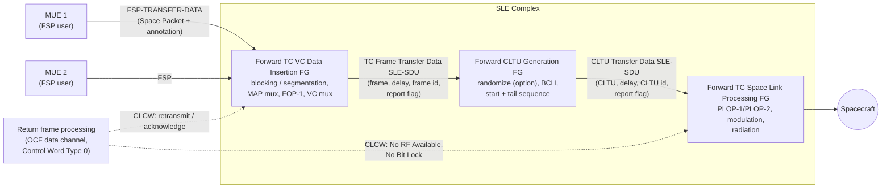
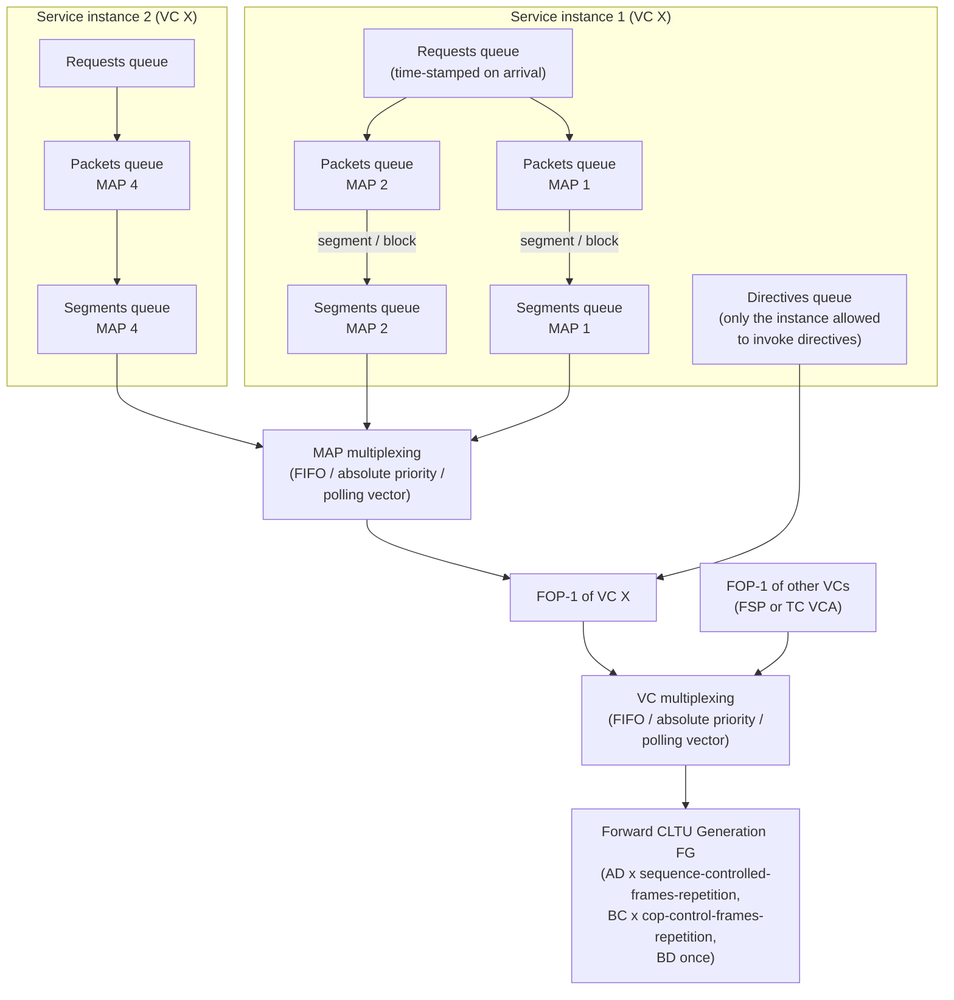
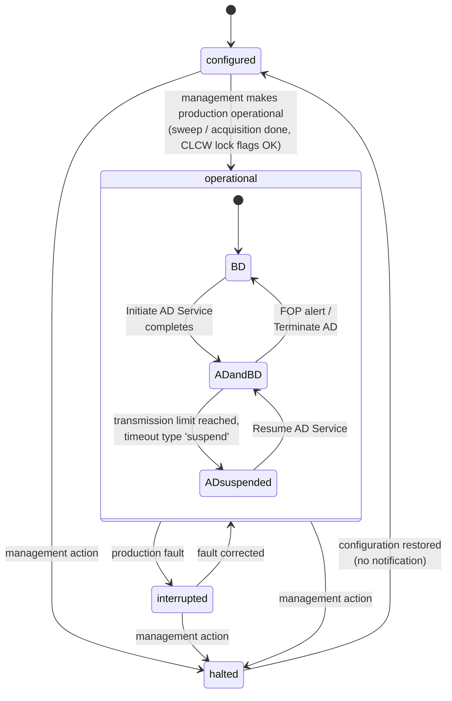
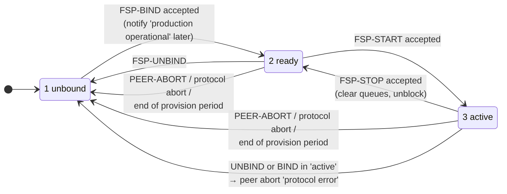
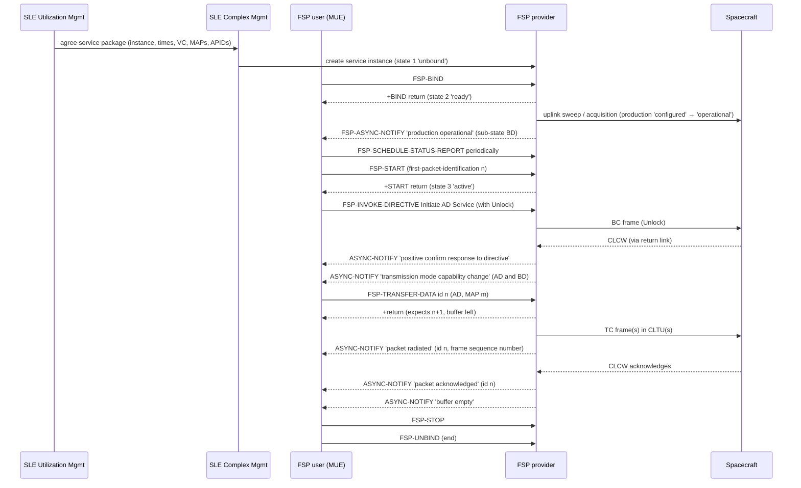

# SLE forward service: Forward Space Packet (FSP)

The **Forward Space Packet** (FSP) service lets a mission send telecommand
[Space Packets](../space-packet.md) to a spacecraft through someone else's ground system. The
packets can go in sequence-controlled mode or in expedited mode.[^fsp-purpose] Of the forward
[SLE](index.md) services for conventional telecommand (FCLTU, FSP and Enhanced FCLTU), it is the
one that works at packet level.[^fsp-g2-list] The user hands over whole packets. The provider does the rest: it blocks or segments the packets
into TC Transfer Frames, runs the sending end of [COP-1](../cop-1.md), encodes each frame into a
CLTU and radiates it.[^fsp-ovw] Several users, each with its own service instance, can share one
Virtual Channel (VC) and one uplink. The provider multiplexes their packets by fixed rules, so the
users do not have to coordinate with each other.[^fsp-ovw][^fsp-g2-list]

Compare this with [FCLTU](fcltu.md), where the user builds the frames and CLTUs and runs COP-1
itself. The [SLE overview](index.md) explains the concepts that FSP shares with the other services
(BIND, states, authentication). The architecture behind it is on
[the cross support reference model and service management](service-management.md).

!!! info "At a glance"
    | Item | Value |
    |---|---|
    | Specification | CCSDS 912.3-B-3, August 2016 ("adds clarifications and corrections"); earlier issues B-1 November 2004 and B-2 July 2010[^fsp-ctl] |
    | Status | The library copy carries the CCSDS "Historical Document" banner.[^fsp-hist] The 2023 overview lists it as 912.3-B-3-S, made historical in September 2022.[^g4-fsp] |
    | Data unit | One telecommand Space Packet per FSP-TRANSFER-DATA (1 to 65,536 octets as an ASN.1 `SpaceLinkDataUnit`)[^fsp-td][^fsp-asn-common] |
    | Space link stack | TC only: TC SDLP, COP-1, TC coding. The AOS profile named in the reference model is out of scope.[^fsp-scope] |
    | Produced by | Forward TC VC Data Insertion SLE-FG, fed into CLTU Generation and Forward TC Space Link Processing[^fsp-fg] |
    | Instance | One instance per pair of TC VC and Mission User Entity (MUE)[^fsp-ovw] |
    | Delivery mode | Forward online only (`fwdOnline (3)`); offline is "the subject of further study"[^fsp-modes][^fsp-asn-common] |
    | Transmission modes | Sequence-controlled (AD) and expedited (BD)[^fsp-modes] |
    | Binding | User-initiated; `ApplicationIdentifier` `fwdTcSpacePkt (13)`[^fsp-ops][^fsp-asn-bind] |
    | BIND `version-number` | 5 in this issue[^fsp-version] |
    | Provider states | 1 'unbound', 2 'ready', 3 'active'[^fsp-states] |
    | Production status | configured, operational (BD / AD and BD / AD suspended), interrupted, halted[^fsp-prodstat] |
    | Time | UTC as CDS (1958 epoch, 16-bit day), microsecond or picosecond resolution, 0.1 s precision and accuracy[^fsp-time] |
    | Service instance attribute | `fsp`, OID {iso 3 112 4 3 1 2 10}; value "fsp" plus an instance number[^fsp-siid] |

## What FSP does

The user sends packets wrapped in SLE-SDUs with FSP-TRANSFER-DATA. The provider reads the Packet
Primary Header to check, for example, that the APID is one the user may use. It does not otherwise
look at, interpret or change the packet. A telecommand packet with a valid header is sent bit for
bit as received.[^fsp-ovw] Through the operations of the service the user can bind, send annotated
packets, get notifications and status reports, stop and restart sending, change some parameters,
invoke COP-1 directives, throw events at complex management, and unbind.[^fsp-ovw][^fsp-ops]

FSP was conceived for packet structures in general. This issue handles only CCSDS Space Packets,
and only on the TC protocol stack (TC SDLP, COP-1, TC synchronization and channel coding).[^fsp-scope]
The FSP version of the TC VC Data Insertion function does not apply Space Data Link Security. The
reason given is that a user would not want to tell a third party (the FSP provider) how its SDLS
is configured.[^fsp-vcdi]

### Who does what: FSP compared with FCLTU

| Task | With [FCLTU](fcltu.md) | With FSP |
|---|---|---|
| Build the Space Packet | User | User |
| Block or segment packets into TC frames, choose MAP | User | Provider (TC VC Data Insertion FG)[^fsp-vcdi] |
| Run FOP-1: frame sequence numbers, retransmission from CLCWs | User | Provider; the user can only send COP-1 directives[^fsp-vcdi][^fsp-dir] |
| Multiplex MAPs and VCs | User | Provider, using the algorithms of annex B[^fsp-mux] |
| Randomize, BCH-encode, add start and tail sequences | User | Provider (CLTU Generation FG); one TC frame per CLTU[^fsp-cltugen][^fsp-d12] |
| Radiate under PLOP-1 or PLOP-2, watch RF and bit lock in the CLCW | Provider | Provider (Forward TC Space Link Processing FG)[^fsp-fslp] |
| Release-time control | Earliest and latest *radiation* time per CLTU[^cltu-times] | Earliest and latest *production* time per packet; no radiation-time limits inside the provider[^fsp-epl][^fsp-d11] |
| Unit the provider reports on | CLTU | Packet: processing started, radiated, acknowledged[^fsp-notif] |

Sources: functional groups and production requirements of FSP, CLTU-TRANSFER-DATA of FCLTU.

## Where FSP sits: the forward TC functional groups

Three SLE Functional Groups (SLE-FGs) produce FSP. The data channel between two FGs is carried by
an SLE transfer service if the FGs are in different SLE Complexes, and by local means if they are
in the same complex.[^fsp-fg] No Recommended Standard exists for the Forward TC Frame (FTCF)
service. So, until CCSDS publishes one, the CLTU Generation FG and the TC VC Data Insertion FG
must be in the same complex.[^fsp-fg]



Diagram based on the forward TC functional groups and the production requirements of annex D.[^fsp-fg][^fsp-vcdi][^fsp-d13][^fsp-d12]

* **Forward TC VC Data Insertion FG.** For each FSP instance it takes the packets out of the
  SLE-SDUs and blocks or segments them into TC frames. For sequence-controlled frames it sets the
  Frame Sequence Number and keeps a copy. It reads the CLCWs from Operational Control Field
  channels (Control Word Type 0 only) and retransmits or deletes the kept frames.[^fsp-vcdi] It
  also provides the TC VC Access (TC VCA) service, but only one of the two service types is allowed
  on a given VC.[^fsp-annexb]
* **Forward CLTU Generation FG.** It optionally randomizes the frames, BCH-encodes them and adds
  the start and tail sequences.[^fsp-cltugen] For FSP a CLTU carries exactly one TC frame, even
  though the coding standard allows more.[^fsp-d12]
* **Forward TC Space Link Processing FG.** It checks from the CLCW that the physical channel is
  available, generates the acquisition and idle sequences of the PLOP in effect, and modulates and
  radiates the CLTUs.[^fsp-fslp] This is the same function that provides FCLTU, and annex D reuses
  the FCLTU rules for it.[^fsp-d11]

The reference model gives FSP two production profiles. The **AOS profile** runs through the
Forward AOS VC Data Insertion and AOS Space Link Processing FGs. The **TC profile** runs through
the three FGs above.[^csrm-fsp-prof] FSP 912.3-B-3 specifies only the TC profile.[^fsp-scope] The
reference model adds two rules for TC. Segmented packets can only be sent with sequence control.
If FSP and TC-VCA are both active on one VC, only one of them can be sequence-controlled.[^csrm-tcvdi]

When the FGs are in different complexes, FSP depends on the FTCF and/or Forward CLTU services
underneath it. The FSP schedule must then fit the schedules of those underlying
services.[^fsp-under]

## What the provider checks in each packet

The provider looks only at the 6-octet Space Packet primary header, and only to enforce what
service management has set up.[^fsp-ovw][^fsp-tddiag]

<div class="bitfield" data-title="Space Packet primary header as checked by an FSP provider (48 bits)" data-width="16"
     data-fields='[{"n":"Version","b":3,"v":"000","d":"Checked: unsupported packet version (13) if not supported for this instance"},
                   {"n":"Type","b":1,"v":"1","d":"Checked: must be 1 (telecommand), otherwise incorrect packet type (14)"},
                   {"n":"Sec. hdr flag","b":1,"d":"Not checked by FSP"},
                   {"n":"APID","b":11,"d":"Checked against apid-list (or any); otherwise invalid packet apid (15)"},
                   {"n":"Sequence flags","b":2,"d":"Not checked by FSP"},
                   {"n":"Sequence count / name","b":14,"d":"Not checked by FSP"},
                   {"n":"Packet data length","b":16,"d":"Packet must not exceed maximum-packet-length; otherwise packet too long (12)"}]'></div>

Field layout from the Space Packet Protocol. Version '000' and Type '1' for telecommand are its
values.[^spp-hdr][^spp-type] The checks and diagnostic codes come from FSP-TRANSFER-DATA.[^fsp-tddiag][^fsp-asn-struct]

The `apid-list` parameter is either `any` or an ascending list of up to 2,048 APIDs (0 to
2047).[^fsp-asn-struct][^fsp-tddiag] The ASN.1 allows `maximum-packet-length` values from 7 to
65,542 octets.[^fsp-asn-get] That is the length range of a complete Space Packet.[^spp-len] The `data` parameter of FSP-TRANSFER-DATA, however, is an ASN.1
`SpaceLinkDataUnit` of 1 to 65,536 octets (see
[Notes on the specification text](#notes-on-the-specification-text)).[^fsp-asn-common] The provider
buffers only complete packets.[^fsp-buf]

## Production, provision and the managed parameters

FSP separates **service provision**, which makes the operations available to one user, from
**service production**, which turns the FSP channel into the RF channel. Provision parameters,
such as the status-report frequency, affect one instance. Service management sets them when it
creates the instance, and the user may change them through operations. Production parameters,
such as maximum packet length or the VC multiplexing scheme, can affect several instances and
the complex's resources, so only service management may change them. There is one exception:
COP-1 directives. For each VC, one service instance may invoke them. Some directives act on the
spacecraft, so FSP treats them as part of the telecommand service rather than of its
management.[^fsp-sm] One production instance may serve several FSP instances. Production
extracts the packets from the concurrent streams and multiplexes them onto the space link,
independently of any single instance.[^fsp-prodprov]

Service packages, agreed between SLE Utilization Management and SLE Complex Management, define
which instances exist, when, and their initial parameters. Production parameters include the VC,
the multiplexing schemes, the maximum packet and frame lengths, and the CLTU-generation and
space-link configuration. Provision parameters include the instance's start and stop
times.[^fsp-sched] The service package also sets the provider's buffer size in octets.[^fsp-buf]

### Who sets each parameter

FSP divides its parameters by scope. The table shows who sets each one: service management
(SM), FSP-START, FSP-SCHEDULE-STATUS-REPORT or FSP-INVOKE-DIRECTIVE.[^fsp-t31]

| Scope | Parameter | Set by |
|---|---|---|
| All FSP instances | `maximum-packet-data-length`, `vc-multiplexing-control`, `vc-multiplexing-scheme` | SM |
| All instances on one physical channel | `bit-lock-required`, `clcw-physical-channel`, `clcw-global-VCID`, `repetition-limit`, `rf-available-required` | SM |
| All instances on one VC | `blocking-timeout-period`, `blocking-usage`, `cop-control-frames-repetition`, `directive-invocation-enabled`, `map-multiplexing-scheme`, `maximum-frame-length`, `segment-header`, `sequence-controlled-frames-repetition` | SM |
| All instances on one VC | `fop-sliding-window`, `map-multiplexing-control`, `timeout-type`, `timer-initial`, `transmission-limit`, `transmitter-frame-sequence-number` | SM, then FSP-INVOKE-DIRECTIVE |
| One instance | `apid-list`, `delivery-mode`, `map-list`, `minimum-reporting-cycle`, `permitted-transmission-mode`, `return-timeout-period`, `service-instance-provision-period`, `service-version-number`, `throwing-of-events-enabled`, `virtual-channel` | SM |
| One instance | `expected-packet-identification` | FSP-START |
| One instance | `reporting-cycle` | FSP-SCHEDULE-STATUS-REPORT |

Strictly, `bit-lock-required` and `rf-available-required` belong to the Forward TC Space Link
Processing FG. FSP lists them because all instances on a physical channel share them and because
the uplink lock status strongly shapes what the user sees.[^fsp-t31]

### The parameters a user can read (FSP-GET-PARAMETER)

| Parameter | ASN.1 code | Range or values | Meaning |
|---|---|---|---|
| `apid-list` | 2 | `any`, or 1 to 2,048 APIDs | APIDs this instance may use |
| `bit-lock-required` | 3 | yes (0) / no (1) | If yes, the CLCW 'No Bit Lock' flag must be false before production can become operational |
| `blocking-timeout-period` | 0 | 100 to 100,000 ms, or blocking off | Time from the first packet entering a Frame Data Unit until the unit goes to the FOP |
| `blocking-usage` | 1 | permitted (0) / not permitted (1) | Whether packets may be blocked, for all MAPs of the VC |
| `clcw-global-VCID` | 202 | GVCID (SCID 0–1023, version 0–3, MC or VC), or not configured | Channel that carries the CLCW used for RF and bit-lock status |
| `clcw-physical-channel` | 203 | string of 1–32 characters, or not configured | Return RF channel that carries that CLCW |
| `cop-control-frames-repetition` | 300 | 1 to 65,535 | Times each BC frame is passed to CLTU Generation |
| `delivery-mode` | 6 | `fwdOnline` | |
| `directive-invocation-enabled` | 7 | enabled (0) / disabled (1) | Whether this instance may invoke directives |
| `directive-invocation-online` | 108 | yes (0) / no (1) | Whether the instance that may invoke directives on this VC is bound |
| `expected-directive-identification` | 8 | 0 to 2³²−1, starts at 0 | Next `directive-identification` expected |
| `expected-event-invocation-identification` | 9 | 0 to 2³²−1, starts at 0 | Next `event-invocation-identification` expected |
| `expected-sldu-identification` | 10 | 0 to 2³²−1 (0 before any START) | Next `packet-identification` expected |
| `fop-sliding-window` | 11 | 1 to 255 | Frames that may be sent on the VC before an acknowledgement is needed |
| `fop-state` | 12 | active (0), retransmit without wait (1), retransmit with wait (2), initialising without BC frame (3), initialising with BC frame (4), initial (5) | FOP state on this VC |
| `map-list` | 16 | up to 64 MAP IDs (0–63), or MAPs not used | MAPs this instance may use |
| `map-multiplexing-control` | 17 | priority list (1–64 entries, priority 1 highest to 64 lowest) or polling vector (1–192 entries) | null for FIFO or no MAPs |
| `map-multiplexing-scheme` | 18 | fifo (0), absolute-priority (1), polling-vector (2) | FIFO when MAPs are not used |
| `maximum-frame-length` | 19 | 12 to 1,024 octets | Mission maximum TC frame length |
| `maximum-packet-length` | 20 | 7 to 65,542 octets | Mission maximum packet length (table 3-11 calls it the maximum "Packet Data Length") |
| `minimum-reporting-cycle` | 301 | 1 to 600 s | Shortest status-report cycle a user may ask for |
| `permitted-transmission-mode` | 107 | sequence-controlled (0), expedited (1), any (2) | |
| `reporting-cycle` | 26 | 2 to 600 s, or off | Current status-report cycle (null until set) |
| `return-timeout-period` | 29 | 1 to 600 s | Maximum wait for a return before PEER-ABORT |
| `rf-available-required` | 31 | yes (0) / no (1) | If yes, the CLCW 'No RF Available' flag must be false before production can become operational |
| `segment-header` | 32 | present (0) / absent (1) | Whether TC frames carry a Segment Header |
| `sequence-controlled-frames-repetition` | 303 | 1 to 65,535 | Times each AD frame is passed to CLTU Generation |
| `throw-event-operation` | 304 | enabled (0) / disabled (1) | Whether this instance may throw events |
| `timeout-type` | 35 | generate alert (0) / suspend sequence-controlled (1) | FOP behaviour when the transmission limit is reached |
| `timer-initial` | 36 | 1 to 2³²−1 µs | Initial value of the countdown timer for AD and BC frames |
| `transmission-limit` | 37 | 1 to 255 | Maximum transmissions of the first frame on the Sent_Queue |
| `transmitter-frame-sequence-number` | 38 | 0 to 255 | V(S): N(S) of the next AD frame |
| `vc-multiplexing-control` | 39 | priority list or polling vector | null for FIFO |
| `vc-multiplexing-scheme` | 40 | fifo, absolute priority, polling vector | |
| `virtual-channel` | 41 | 0 to 63 | VC used by this instance |

Sources: parameter descriptions in table 3-11, ASN.1 types `FspGetParameter` and `ParameterName`.[^fsp-t311][^fsp-asn-get][^fsp-asn-common]

A rejected FSP-GET-PARAMETER carries 'duplicate invoke-ID' (100), 'unknown parameter' (0) or
'other reason' (127). A positive return carries the parameter name and its value.[^fsp-get-diag][^fsp-asn-struct]

Service management must keep `maximum-frame-length`, `maximum-packet-length` and `segment-header`
consistent, and must reject a bad combination when the configuration is set up. FSP is not
designed to handle such inconsistencies at run time. The standard's example is a 100-octet frame
limit with 1,024-octet packets and no Segment Header: a 250-octet packet could then be neither
carried whole nor segmented.[^fsp-t311]

## Operations

| Operation | Invoked by | Confirmed | Valid in states | Invocation / return PDU tag |
|---|---|---|---|---|
| FSP-BIND | User (initiator) | Yes | 1 | 100 / 101 |
| FSP-UNBIND | User (initiator) | Yes | 2 | 102 / 103 |
| FSP-START | User | Yes | 2 | 0 / 1 |
| FSP-STOP | User | Yes | 3 | 2 / 3 |
| FSP-TRANSFER-DATA | User | Yes | 3 | 10 / 11 |
| FSP-ASYNC-NOTIFY | Provider | No | 2, 3 | 12 |
| FSP-SCHEDULE-STATUS-REPORT | User | Yes | 2, 3 | 4 / 5 |
| FSP-STATUS-REPORT | Provider | No | 2, 3 | 13 |
| FSP-GET-PARAMETER | User | Yes | 2, 3 | 6 / 7 |
| FSP-THROW-EVENT | User | Yes | 2, 3 | 8 / 9 |
| FSP-INVOKE-DIRECTIVE | User | Yes | 3 | 14 / 15 |
| FSP-PEER-ABORT | User or provider | No | 2, 3 | 104 |

Sources: table 2-1, the "valid only in state" clause of each operation, and the
`FspUserToProviderPdu` and `FspProviderToUserPdu` CHOICE tags.[^fsp-ops][^fsp-asn-in][^fsp-asn-out]

The conformance matrix (annex E) makes every operation mandatory except FSP-THROW-EVENT, which is
optional. Version negotiation in FSP-BIND is optional, and so are the credentials parameters and
`stop-production-time`. Buffering is mandatory, with a minimum size of 1,024 maximum-length
FSP-TRANSFER-DATA invocations.[^fsp-conf]

The rules common to all operations are the usual SLE ones. Every confirmed operation returns a
`result`, plus a `diagnostic` when the result is negative. 'Other reason' may be used only when no
specific value fits. Checks should be made in the order the diagnostics are listed, and an
implementation that uses another order must document it.[^fsp-gen] Access control is two-level:
initiator and responder must be registered with each other, and both must be authorised for the
instance.[^fsp-ac] Authentication can be 'all' (every invocation and return except PEER-ABORT),
'bind' or 'none'.[^fsp-auth] Every confirmed operation except BIND and UNBIND carries an
`invoke-ID` (0 to 65,535). Such operations are non-blocking, and a duplicate outstanding ID is
rejected with 'duplicate invoke-ID' (common diagnostic 100).[^fsp-block][^fsp-asn-common]

### FSP-BIND, FSP-UNBIND and FSP-PEER-ABORT

FSP-BIND carries the usual parameters. The `service-type` is redundant because its only valid
value is `fwdTcSpacePkt`, but it is kept for a future generic SLE-BIND.[^fsp-bind-st] A responder
that does not negotiate versions accepts the version configured in `service-version-number`. One
that does negotiate may answer with a lower version.[^fsp-version] The BIND diagnostics are
'access denied' (0), 'service type not supported' (1), 'version not supported' (2), 'no such
service instance' (3), 'already bound' (4), 'service instance not accessible to this initiator'
(5), 'inconsistent service type' (6), 'invalid time' (7), 'out of service' (8, production halted)
and 'other reason' (127).[^fsp-bind-diag][^fsp-asn-bind] A successful BIND moves the provider from
state 1 to state 2.[^fsp-bind-eff]

FSP-UNBIND is valid only in 'ready', so the user must stop first. Its `unbind-reason` is 'end'
(0), after which the provider may delete the instance, 'suspend' (1), 'version not supported' (2)
or 'other' (127). The only possible result is 'positive result'.[^fsp-unbind][^fsp-asn-bind]
FSP-PEER-ABORT carries one diagnostic: 'access denied' (0), 'unexpected responder ID' (1),
'operational requirement' (2), 'protocol error' (3), 'communications failure' (4, gateways only),
'encoding error' (5), 'return timeout' (6), 'end of service instance provision period' (7),
'unsolicited invoke-ID' (8) or 'other reason' (127). Values 128 to 255 are reserved for the
communications technology. PEER-ABORT carries no credentials.[^fsp-pa][^fsp-asn-bind]

What survives the end of an association matters for commanding. The provider discards the packets
it holds for the instance. Packets already turned into Frame Data Units and placed in the segment
queues are still sent. Three things persist across associations: accounting information, the
identifiers that link notifications to the operations that caused them, and the COP parameters
set by directives. Other provision parameters return to the values set by service
management.[^fsp-term][^fsp-pa-eff]

### FSP-START and FSP-STOP

| Parameter | In | Return | Meaning |
|---|---|---|---|
| `first-packet-identification` | M | | `packet-identification` expected in the first TRANSFER-DATA after this START |
| `start-production-time` | | C | Before 'operational': estimated time the provider can start processing, allowing for the uplink acquisition sequence. Otherwise: the most recent time production became 'operational'. Positive result only. |
| `stop-production-time` | | C | Estimated time production stops (may be later than the provision period ends), or null |
| `result`, `diagnostic` | | M, C | 'duplicate invoke-ID' (100), 'out of service' (0, halted), 'unable to comply' (1, interrupted), 'production time expired' (2), 'other reason' (127) |

Sources: FSP-START parameters and diagnostics.[^fsp-start][^fsp-asn-struct]

After 'unable to comply' the user may try again later. If complex management decides the problem is
more than transient, the provider may abort.[^fsp-start] FSP-STOP discards the instance's packets
that have not yet reached the segment queues. Packets already in the segment queues are completed,
and any radiation or acknowledgement notifications that were asked for are still sent. STOP also
clears the 'service instance blocked' and 'AD blocked' flags.[^fsp-stop][^fsp-compound] This is
how a user recovers after 'sldu expired', 'production interrupted' or 'production halted': STOP,
then a new START with a fresh `first-packet-identification`. The new identifiers should be chosen
so that packets still being processed from before can be told apart.[^fsp-start-note][^fsp-sldu]

### FSP-TRANSFER-DATA

| Parameter | ASN.1 type | Meaning |
|---|---|---|
| `packet-identification` | 0 to 2³²−1 | Sequence number: the START value, then +1 for each accepted packet. The return holds the next expected value. |
| `earliest-production-time` | null or Time | Earliest time processing of the packet may start |
| `latest-production-time` | null or Time | Latest time processing may start; if passed before the packet leaves the packets queue: 'sldu expired' |
| `delay-time` | microseconds (0 to 2³²−1) | Minimum gap between the last CLTU carrying this packet and the next CLTU |
| `transmission-mode` | sequence-controlled (0), expedited (1), sequence-controlled and unblock AD (2) | AD, BD, or AD with unblocking |
| `MAP-identifier` | none, or MAP 0–63 | MAP to use; must be none if no Segment Headers are generated |
| `blocking` | permitted (0) / not permitted (1) | May this packet share a frame with others? (written as yes/no in the text) |
| `processing-started-notification` | produce (0) / do not produce (1) | Notify when the packet moves to a segments queue |
| `radiated-notification` | produce (0) / do not produce (1) | Notify when radiation completes |
| `acknowledged-notification` | produce (0) / do not produce (1) | Notify when all segments are acknowledged by CLCW (AD only) |
| `data` | 1 to 65,536 octets | The Space Packet |
| `packet-buffer-available` (return) | 7 to 66,560 octets | Free space left in this instance's request queue |

Sources: table 3-6 and parameter clauses; ASN.1 `FspTransferDataInvocation` and `FspTransferDataReturn`.[^fsp-td][^fsp-epl][^fsp-delay][^fsp-tm][^fsp-map][^fsp-asn-in][^fsp-asn-out]

**The time window.** Times may not go backwards from one packet to the next. If the earliest time
is null, processing starts at once, provided production is operational and the required
transmission mode is available, or the latest time is also null.[^fsp-epl] If the latest time is
null, the packet waits as long as the instance is 'active' and production is not halted. If a
latest time is given, the provider holds the packet back while production is 'interrupted' or the
transmission mode is unavailable, until recovery or expiry.[^fsp-epl] Two notes in the standard
matter in practice. First, the processing steps (for example blocking) take a non-negligible time.
Setting the latest time equal to the earliest time therefore usually produces 'late sldu'. Second,
once a packet is inside a TC frame, its latest time no longer applies. Multiplexing may then
radiate it later than that time.[^fsp-epl]

**Delay time.** The delay runs from the trailing edge of the last radiated bit of the last CLTU
that carries part of the packet to the leading edge of the first bit of the next CLTU. Zero means
no delay. The delay also applies when a frame is retransmitted under COP-1, and whatever VC the
next frame is on. When several packets are blocked into one frame, the largest of their delay
times is used. An unacceptable value is caught by the space link processing FG, and the rejection
travels back up so that the TRANSFER-DATA return is negative.[^fsp-delay]

**Transmission mode and AD blocking.** After a 'packet transmission mode mismatch', the AD mode of
the instance is *blocked*. Every later AD request is rejected with 'invalid transmission mode' until
the user sends a packet with mode 'sequence-controlled and unblock AD mode'. That mode is accepted
only while AD is blocked. If the unblocking packet has to start before the AD service is back, a
new mismatch occurs and AD is blocked again.[^fsp-tm]

**MAP and blocking.** With a polling-vector MAP scheme, a packet on a permitted MAP that is not in
the vector is queued but not processed until the vector changes. Segment Headers are needed when
packets can exceed the frame's data field, or when MAPs are used on the VC.[^fsp-map] If
`blocking-usage` is 'not permitted', the per-packet `blocking` flag is ignored, and each frame
carries at most one packet.[^fsp-block2]

#### Diagnostics of FSP-TRANSFER-DATA

| Code | Diagnostic | Cause |
|---|---|---|
| 100 | duplicate invoke-ID | `invoke-ID` already outstanding |
| 0 | unable to process | Production not operational (already notified), provider still blocked after a fault and recovery, instance blocked after 'sldu expired', or production paused to process a THROW-EVENT |
| 1 | unable to store | Not enough space left in the request queue |
| 2 | out of sequence | `packet-identification` is not the expected value |
| 3 | duplicate packet identification | Same identifier as a packet still buffered or in process (possible only after STOP/START) |
| 4 | inconsistent time range | Earliest time later than latest time |
| 5 | invalid time | Window does not overlap the scheduled production period or the provision period |
| 6 | conflicting production time intervals | Window starts or ends earlier than that of an already accepted packet |
| 7 | late sldu | Latest time already past when the invocation arrives |
| 8 | invalid delay time | Outside the range supported by the space link processing configuration |
| 9 | invalid transmission mode | Mode not permitted, AD requested while blocked, or unblock requested while not blocked |
| 10 | invalid MAP | MAP not in `map-list`, or a MAP given when no Segment Headers are generated |
| 11 | invalid notification request | Acknowledgement notification requested for an expedited packet |
| 12 | packet too long | Over the maximum packet length |
| 13 | unsupported packet version | Version not supported by CCSDS or by this instance |
| 14 | incorrect packet type | Packet Type is not telecommand |
| 15 | invalid packet apid | APID not allowed for this instance |
| 127 | other reason | |

Sources: diagnostic list in the order of the standard (check order); codes from `DiagnosticFspTransferData` and `Diagnostics`.[^fsp-tddiag][^fsp-asn-struct][^fsp-asn-common]

Rejecting 'conflicting production time intervals' up front is deliberate. Such a packet need not
cause 'sldu expired', but it could. Rejecting it lets the user correct the time window, instead of
losing the packets already buffered when the earlier packet expires during production.[^fsp-tddiag]

!!! example "Worked example (illustrative values): sequence numbers"
    The user starts with `first-packet-identification` = 1000. TRANSFER-DATA with id 1000 is
    accepted, and the return carries 1001. The user then sends id 1002 by mistake. It is rejected
    with 'out of sequence', and the return again carries 1001, the value the provider still
    expects. A correct id 1001 is then accepted, and the return carries 1002.[^fsp-td]

### FSP-ASYNC-NOTIFY

Every notification carries `notification-type`, `packet-identification-last-processed`,
`packet-identification-last-ok` and `production-status`. When the last-processed identifier is not
null, it also carries `production-start-time` and `packet-status`. When the last-ok identifier is
not null, it also carries `production-stop-time`.[^fsp-an-par][^fsp-an-last]
The identifiers survive release or abort of the association.[^fsp-an-last]

| Tag | Notification | Sent to | Extra content |
|---|---|---|---|
| 0 | packet processing started | Submitting user, if asked | The packet's id |
| 1 | packet radiated | Submitting user, if asked | Id + `frame-sequence-number` (0–255) of the frame with the last segment |
| 2 | packet acknowledged | Submitting user, if asked (AD only) | Id |
| 3 | sldu expired | Submitting user | Expired id first, then ids of all its other discarded packets; instance blocked |
| 4 | packet transmission mode mismatch | Users whose AD packets were discarded | Discarded ids; AD blocked |
| 5 | transmission mode capability change | All users of the VC (see conditions) | `fop-alert` |
| 6 | buffer empty | User of the instance | None (not sent after STOP or after a discard event) |
| 7 | no invoke directive capability on this VC | All other users of the VC | None |
| 17 | invoke directive capability established on this VC | All other users of the VC | None |
| 8 | positive confirm response to directive | Directive invoker | `directive-executed-identification` |
| 9 | negative confirm response to directive | Directive invoker | Directive id + `fop-alert` |
| 10 | VC aborted | All users of the VC | Discarded ids (including frames already built) |
| 11 | production interrupted | Users with packets in process | Discarded ids (including frames already built); instance blocked |
| 12 | production halted | All connected users | Discarded ids; instance blocked |
| 13 | production operational | Users not yet told, or told something else | None; sub-state starts at 'BD' |
| 14 | action list completed | Event thrower | `event-thrown-identification` |
| 15 | action list not completed | Event thrower | `event-thrown-identification` |
| 16 | event condition evaluated to false | Event thrower | `event-thrown-identification` |

Sources: notification-type definitions, conditional parameters and the `FspNotification` CHOICE.[^fsp-ntypes][^fsp-ncond][^fsp-asn-notif]

A 'packet acknowledged' notification means the spacecraft received every frame carrying parts of
the packet. It does not mean that the packet was reassembled or executed correctly. Only telemetry
can show that.[^fsp-ack-def][^fsp-ntypes] On the telemetry side, see
[command verification in the MIB](../../mib/command-verification.md) and
[ST\[01\] request verification](../../ecss/pus/st01-request-verification.md).

**FOP alerts.** The `fop-alert` parameter reports why the sequence-controlled guarantee ended. Its
values follow the COP-1 alert reason codes:

| Code | FSP value | COP-1 cause |
|---|---|---|
| 0 | no FOP alert | Capability changed without ending the guarantee |
| 1 | FOP alert-limit | Transmissions exhausted for an AD frame, or for a BC frame from an 'Unlock' or 'Set V(R)' directive |
| 2 | FOP alert-lockout | Lockout detected |
| 3 | FOP alert-synch | Retransmit flag cleared with N(R) = NN(R) after it was set; all frames acknowledged but Retransmit = 1; or acknowledgement attempted in state S4 |
| 4 | FOP alert-NN(R) | CLCW with invalid N(R) |
| 5 | FOP alert-CLCW | Wait = 1 with Retransmit = 0, or an invalid CLCW bit pattern |
| 6 | FOP alert-LLIF | FOP-1 and the lower layer out of synchronisation |
| 7 | FOP alert-term | 'Terminate AD Service' directive received |

Sources: FSP `fop-alert`, ASN.1 `FopAlert`, COP-1 table 4-4.[^fsp-fopalert][^fsp-asn-struct][^cop-alert]

COP-1 itself reports exhausted transmissions under two reason codes: 'Limit' or 'T1' for an AD
frame, and 'T1' for a BC frame. FSP has the single value 'FOP alert-limit' for both
cases.[^cop-alert][^fsp-fopalert]

**Packet status.** The status of the last processed packet uses the shared `ForwardDuStatus` type:
'radiated' (0), 'expired' (1), 'interrupted' (2), 'acknowledged' (3), 'production started' (4),
'production not started' (5) and 'unsupported transmission mode' (6). 'Expired' and 'unsupported
transmission mode' guarantee that the packet was not radiated. 'Interrupted' means processing
began and was aborted, because production became 'interrupted' or 'halted' or because 'Abort VC'
was executed. Earlier packets may also be affected, and an AD packet may already have completed
radiation before its status changed to 'interrupted'.[^fsp-pstat][^fsp-asn-common]
`production-stop-time` is the end of radiation for a BD packet, and the time of the last
acknowledging CLCW for an AD packet.[^fsp-ptimes]

**Losing telemetry during commanding.** The `frame-sequence-number` in 'packet radiated' exists
for one case. Telemetry is lost before commanding finishes, and commanding must continue through
another station and therefore another FSP provider. The new provider does not know which packet
went in which frame. With GET-PARAMETER the user reads its `transmitter-frame-sequence-number`.
From the frame numbers it already received, the user can then work out which packets arrived on
board, and resume without sending any packet twice or missing one.[^fsp-fsn]

### Status reports

FSP-SCHEDULE-STATUS-REPORT asks for one report now ('immediately'), periodic reports
('periodically', with a 2 to 600 s cycle), or no more reports ('stop'). Periodic reporting is off
after every BIND. Its diagnostics are 'duplicate invoke-ID', 'already stopped' (1), 'invalid
reporting cycle' (2) and 'other reason'.[^fsp-ssr][^fsp-asn-cpdu] Each FSP-STATUS-REPORT contains
the last-processed and last-ok groups and the production status. It also contains AD and BD counts
of packets received, processed and radiated, the count of AD packets acknowledged, and the free
buffer space.[^fsp-sr][^fsp-asn-out] Only packets that passed the checks count as received.
"Processed" includes packets that aborted or are still in process. A packet counts as radiated
once, however many times COP-1 retransmits it. The counts run over the whole provision period and
survive new associations.[^fsp-sr][^fsp-acct]

### FSP-THROW-EVENT

THROW-EVENT asks the provider to pass an event to SLE Complex Management, typically a change of
production parameters. The standard's examples are an uplink bit-rate change after a telecommand
has reconfigured the on-board receiver, and releasing the bit pattern that resets a Packet
Assembly Controller.[^fsp-te] The event happens when it is thrown, not in step with any radiation.
If the user needs it synchronised with a particular packet, the user must arrange that with
production times or notifications.[^fsp-te] The operation is optional. It must be enabled per
instance, and several instances (for example one per VC) may be allowed to throw events.[^fsp-te][^fsp-conf]

| Parameter | Type | Meaning |
|---|---|---|
| `event-identifier` | 1 to 65,535 | Event agreed between Complex Management and Utilization Management |
| `event-qualifier` | 1 to 1,024 octets | Event-specific data; the provider checks only type and length, and complex management checks the content |
| `event-invocation-identification` | 0 to 2³²−1 | 0 after the first BIND, +1 per accepted event; return carries the next expected value; kept across re-binding |

Sources: THROW-EVENT parameters and `FspThrowEventInvocation`.[^fsp-te-par][^fsp-asn-in]

The return only says whether the request was accepted: 'duplicate invoke-ID', 'operation not
supported' (0), 'out of sequence' (1), 'no such event' (2) or 'other reason'. The outcome arrives
later as 'action list completed', 'action list not completed' or 'event condition evaluated to
false'.[^fsp-te-diag][^fsp-asn-struct] If space link processing is in another complex, the FSP
provider throws the matching FTCF or CLTU THROW-EVENT there, and translates the notifications that
come back.[^fsp-te][^fsp-te-ret]

Annex H gives example events. They are not binding. Qualifier fields are separated by white
space.[^fsp-annexh]

| Event | ID | Qualifier | Action and preconditions |
|---|---|---|---|
| Set Mod | 1 | `on` or `off` | Switch command modulation of the carrier; 'on' needs production at least 'configured' |
| Change Rate | 2 | `br <BR>`, 7.8125 to 4000.0 bit/s | New bit rate (range assumes a subcarrier; up to 256 kb/s with direct modulation) |
| Change Index | 3 | `mi <MI>`, 1 to 1570 mrad | New modulation index |
| Change Rate/Index | 4 | `br <BR> mi <MI>` | Both |

For events 2 to 4, no radiation may be in progress, and all packet, segment and directive queues
must be empty. Otherwise the provider answers 'event condition evaluated to false'.[^fsp-annexh]
A worked example with illustrative values: the user throws event 2 with the qualifier `br 2000`.
The return is positive. Once the station has switched, an 'action list completed' notification
follows, quoting the same `event-invocation-identification`.[^fsp-annexh][^fsp-te-par]
SCOS-2000 and the NIS model station-side events with their own throw-event commands (see
[below](#fsp-in-esas-ground-segment-and-the-solar-orbiter-mib)).

### FSP-INVOKE-DIRECTIVE

This operation lets the user drive the provider's FOP-1. At most one FSP instance per VC may be
configured to invoke directives. The operation is valid only in 'active'.[^fsp-dir]

| Tag | FSP directive | COP-1 directive | Qualifier |
|---|---|---|---|
| 0 | Initiate AD Service (without CLCW check) | same | none |
| 1 | Initiate AD Service (with CLCW check) | same | none |
| 2 | Initiate AD Service (with Unlock) | same; sends a BC segment | none |
| 3 | Initiate AD Service (with Set V(R)) | same; sends a BC segment | V*(R), 0–255 |
| 4 | Terminate AD Service | same; deletes queued AD packets of the VC, keeps BD packets | none |
| 5 | Resume AD Service | same | none |
| 6 | Set V(S) to V*(S) | same | V*(S), 0–255 |
| 7 | Set FOP_Sliding_Window_Width | same | 1–255 |
| 8 | Set T1_Initial | same | µs, 1 to 2³²−1 |
| 9 | Set Transmission_Limit | same | 1 to 65,535 |
| 10 | Set Timeout_Type | same | terminate AD (0) / suspend AD (1) |
| 11 | Abort VC | FSP only | none: implies Terminate AD, deletes all queued frames and packets of the VC, BD included |
| 12 | Modify map-multiplexing-control | FSP only | priority list or polling vector |

Sources: FSP directive list, ASN.1 `FspInvokeDirectiveInvocation`, COP-1 table 4-1.[^fsp-dir][^fsp-asn-in][^cop-dirs]

`directive-identification` is numbered like `event-invocation-identification`: it starts at 0
after the first BIND and is kept across re-binding. The diagnostics are 'duplicate invoke-ID',
'directive invocation not allowed' (0), 'directive identification out of sequence' (1), 'directive
error' (2) and 'other reason'.[^fsp-dir][^fsp-asn-struct] A positive return only means that the
directive was passed to FOP-1. Completion is reported as 'positive confirm response to directive',
or as 'negative confirm response to directive' with a FOP alert, because the negative confirmation
itself carries no reason.[^fsp-dir-eff][^fsp-ntypes][^cop-negconf] After 'Abort VC', only BD
packets can be sent until one of the four Initiate directives restarts the AD service.[^fsp-dir]

## Inside the provider: queues and multiplexing

Annex B is normative. It describes the provider with a logical model, and an implementation
conforms if its external behaviour matches that model.[^fsp-annexb]



Diagram based on figures B-1 to B-3 and clauses B3 to B5.[^fsp-annexb][^fsp-queues][^fsp-mapmux][^fsp-vcmux]

The queue rules, in order:

1. Each instance has one **requests queue**. It has one **packets queue**, or one per permitted MAP
   if MAPs are used. Each packets queue has one **segments queue**. The instance allowed to invoke
   directives also has a **directives queue**, so a VC has at most one.[^fsp-queues]
2. A packet is stamped with its arrival time when it enters the requests queue. It moves to its
   MAP's packets queue when that queue has room and one of these holds. Production is operational
   with the needed mode available (sub-state 'AD and BD' for AD packets) and the earliest time is
   null. Or the same, with the earliest time reached. Or both times are null. Or the latest time,
   minus an implementation guard period, has been reached. The guard period makes sure the user gets
   the right notification ('packet transmission mode mismatch' or 'production interrupted') rather
   than 'late sldu'. Only the packet at the head of the requests queue is examined.[^fsp-queues]
3. When a segments queue is empty, the head packet of its packets queue is segmented if needed and
   moved. If blocking is permitted and the packet allows it, the provider starts a blocking timer
   (`blocking-timeout-period`). It adds same-mode packets until the Frame Data Unit is full, a
   no-blocking packet comes next, or the timer expires.[^fsp-queues][^fsp-blocking]
4. The latest-time check is made when a packet leaves the packets queue, and never again
   afterwards.[^fsp-blocking]
5. A Frame Data Unit takes the time stamp of its (first) packet. MAP multiplexing then picks Frame
   Data Units for the FOP. FIFO takes the earliest time stamp. Absolute priority always searches
   from the highest-priority MAP, and all priorities must be different. A polling vector visits
   MAPs in vector order and wraps round. VC multiplexing between FOPs works the same way, and the
   chosen frame goes to CLTU Generation.[^fsp-mapmux][^fsp-vcmux] The MAP schemes of different VCs
   and the VC scheme are independent.[^fsp-mux]
6. Directives go into the directives queue for immediate execution.[^fsp-mapmux]
7. Discards. STOP, PEER-ABORT, 'sldu expired' and protocol abort discard packets not yet in a
   segments queue and keep the built Frame Data Units. A transmission mode mismatch discards the
   built AD Frame Data Units, plus all AD packets of every instance that lost one. 'Abort VC'
   clears every queue of the VC. 'Interrupted' clears all queues of the instances that had Frame
   Data Units in progress. 'Halted' clears all queues.[^fsp-mapmux]
8. When the FOP sliding window is full of unacknowledged AD and BC frames, BD Frame Data Units
   still pass to the FOP.[^fsp-vcmux]
9. **Frame repetition** (optional). AD frames go to CLTU Generation
   `sequence-controlled-frames-repetition` times, and BC frames `cop-control-frames-repetition`
   times. Neither may exceed `repetition-limit`. BD frames go once. Repetition is meant for links
   with long light-time delay, where it raises the chance that a sequence of frames gets through
   in a short session. A provider that does not support repetition sets both parameters to
   1.[^fsp-vcmux]

!!! example "Worked example (illustrative numbers): one large packet and three small ones"
    Assume `maximum-frame-length` = 256 octets, a Frame Error Control Field and Segment Headers on
    the VC. A TC frame has a 5-octet header and an optional 2-octet FECF.[^sdlp-frame] That leaves
    256 − 5 − 2 = 249 octets of frame data field, and after the 1-octet Segment Header, 248 octets
    of packet per frame. A 1,000-octet AD packet on MAP 2 therefore needs five segments
    (4 × 248 = 992, plus 8). Their Sequence Flags are `0b01`, `0b00`, `0b00`, `0b00` and `0b10`.[^sdlp-seg]
    It must be sent sequence-controlled, because segmented packets cannot go without sequence
    control.[^csrm-tcvdi] FSP puts each frame in its own CLTU, so this means five CLTUs. The packet's
    `delay-time` applies after the fifth.[^fsp-d12][^fsp-delay]

    Next, three 40-octet AD packets with blocking allowed, on the same MAP, with delay times 0,
    20,000 and 5,000 µs. They fit in one frame (120 + 1 octets ≤ 249), carry Sequence Flags `0b11`,
    and the CLTU that carries them gets the largest delay, 20,000 µs.[^fsp-delay][^sdlp-seg]

<div class="bitfield" data-title="TC Segment Header (8 bits): what FSP sets from MAP-identifier and segmentation" data-width="8"
     data-fields='[{"n":"Sequence flags","b":2,"d":"01 first, 00 continuing, 10 last, 11 unsegmented (one packet or several blocked)"},
                   {"n":"MAP ID","b":6,"d":"0 to 63; from MAP-identifier"}]'></div>

Segment Header layout and Sequence Flags from TC SDLP; MAP range from the FSP ASN.1.[^sdlp-seg][^fsp-asn-struct]

This annex is also why the CCSDS link-protocol overview makes an exception to its rule that the
project chooses the multiplexing algorithm. If FSP is used on the ground with TC SDLP, the FSP
algorithms must be used for VC and MAP multiplexing.[^g2-mux] The ECSS communications handbook
adds that the one-octet PAC control segment used in European TC could affect interoperability, for
example with SLE FSP.[^hb-fsp] See [TC SDLP](../tc-sdlp.md#segment-header-and-map-channels).

## Production status



Diagram based on figure C-1, table C-1 and the definitions of the sub-states. CCSDS leaves the
sub-state transitions to COP-1.[^fsp-c1][^fsp-prodstat]

The ASN.1 encodes the status as configured (0), operational-BD (1), operational-AD-and-BD (2),
operational-AD-suspended (3), interrupted (4) and halted (5).[^fsp-asn-struct] The initial status
is 'configured'. The uplink is switched on with the nominal sweep (carrier modulation mode CMM-1)
when the supported agency asks for it, by schedule or by voice.[^fsp-c2] The step to 'operational'
depends on the PLOP and on the two CLCW checks:[^fsp-c2]

| `plop-in-effect` | `rf-available-required` | `bit-lock-required` | Production becomes 'operational' |
|---|---|---|---|
| PLOP-1 | no | n/a | when the uplink sweep completes |
| PLOP-1 | yes | n/a | when the sweep completes and the CLCW shows RF available |
| PLOP-2 | no | no | when the acquisition sequence has been radiated |
| PLOP-2 | yes | no | after acquisition, and the CLCW shows RF available |
| PLOP-2 | no | yes | after acquisition, and the CLCW shows bit lock |
| PLOP-2 | yes | yes | after acquisition, and the CLCW shows both |

Production becomes 'interrupted' when a lock check is required and the uplink status no longer has
the required value.[^fsp-c2] PLOP handling is formally part of the Forward TC Space Link Processing
FG. FSP specifies it because that FG may be visible to the user only through FSP.[^fsp-c2] The PLOPs
themselves are described on the [FCLTU page](fcltu.md#production-plop-and-the-clcw).

| Production status | BIND | START | TRANSFER-DATA | Others |
|---|---|---|---|---|
| halted | rejected, 'out of service' | rejected, 'out of service' | rejected, 'unable to process' | no effect |
| configured | accepted | accepted | accepted | accepted |
| operational | accepted | accepted | accepted | accepted |
| interrupted | accepted | rejected, 'unable to comply' | rejected, 'unable to process', once this instance has been notified | accepted |

Source: table C-2.[^fsp-c2t] INVOKE-DIRECTIVE and THROW-EVENT are accepted in any production status.
If the resources are missing, the failure shows up in the notification.[^fsp-c2]

**Aggregation across complexes.** Each FG combines its own status with the status of the FG below
it, and the worse one wins. Halted beats interrupted, interrupted beats configured, and configured
beats operational. Only "operational and operational" gives 'operational'. The TC VC Data Insertion
result carries the operational sub-states.[^fsp-d1agg]

## Provider state machine



Diagram based on figure 2-4 and table 4-1.[^fsp-states][^fsp-t41]

Table 4-1 is normative. The behaviour of an instance depends on its state and on four Boolean
flags, all initially false: "AD blocked", "notify production operational", "notify production
interrupted" and "service instance blocked".[^fsp-t41][^fsp-flags] Some rules worth knowing:

* In 'ready', a TRANSFER-DATA, STOP or INVOKE-DIRECTIVE is a protocol error, and the provider aborts.
  In 'unbound', all incoming PDUs except BIND are ignored.[^fsp-t41]
* When production is interrupted, the provider notifies 'production interrupted' and blocks only
  those active instances with packets in process. For any other instance, it sets "notify
  production interrupted" and sends the notification (and blocks) when that instance's next
  packet is about to start processing.[^fsp-t41][^fsp-flags]
* A START rejected for 'out of service' or 'unable to comply' sets the flag, so that the user gets
  'production operational' once production recovers.[^fsp-compound]
* Incoming events are queued first-in first-out and never lost. A BIND for an instance that is
  already bound gets 'already bound' and does not disturb the existing association.[^fsp-t41gen]
* If the invoker of a confirmed operation gets no return within `return-timeout-period`, it
  aborts with 'return timeout'. A return whose invoke-ID matches no pending invocation causes
  an abort with 'unsolicited invoke-ID'. A PDU that cannot be decoded causes 'encoding
  error'.[^fsp-proto][^fsp-t41]

## A typical session



Diagram based on the operational scenario of 2.7, the directive and notification clauses, and
the COP-1 Initiate directives.[^fsp-scen][^fsp-dir][^fsp-ntypes][^cop-dirs]

Service management creates the instance some time before its start. The provision period usually
starts a little before the space link session, so that the user can bind in time.[^fsp-scen] At the
end of the session, the user uses the notifications or status reports to check that every packet
was radiated or acknowledged. It then stops, and either starts again with another batch or
unbinds.[^fsp-scen]

## Security

FSP provides authentication (three levels) and access control. Everything else is left to the
communications service or to the mission. It specifies no confidentiality, no denial-of-service
protection and no auditing.[^fsp-sec] For integrity it has the monotonically increasing
`packet-identification`, which makes it harder to inject extra packets, and the strict operation
sequence of the state table. Neither prevents a third party from replacing the `data` of a PDU in
transit. Protection against that has to come from above (for example encrypted packets), from below
(the network), or from bilateral additions.[^fsp-sec] The standard states that the consequences of
not applying security can include losing the ability to command the spacecraft, and losing the
spacecraft.[^fsp-sec] This page describes the protections only. See also
[security in CCSDS space links](../security.md).

## The FSP API (CCSDS 916.3-M-2)

The SLE API core (914.0-M) defines a C++ API for SLE transfer services. The FSP Recommended
Practice adds what FSP needs: FSP-specific behaviour of the components, the interfaces, and their
visible behaviour. Issue 2 is from September 2015 and issue 1 from October 2008. Issue 2 updated
the text to the then-current service specification and split provisions by
generation.[^api-purpose][^api-ctl] It supports two generations of FSP:[^api-gen]

| Generation | BIND `version-number` | Service specification referenced |
|---|---|---|
| G2 | 1 | 912.3-B-1-S (historical) |
| G3 | 4 | 912.3-B-2 (July 2010) |

!!! warning "Version mismatch with the service book in this library"
    The API references FSP issue 2 (912.3-B-2), whose BIND version is 4.[^api-refs][^api-gen] The
    service book in this library is issue 3, which defines version 5.[^fsp-version] Whether an API
    issue covers version 5 is not stated in the available sources. Generation 1 is not valid for
    FSP, because FSP was first issued as part of generation 2.[^api-gen]

A comparison of the two parameter lists shows the same gap. The API's `FSP_ParameterName`
enumeration lacks codes 202, 203, 300, 301, 303 and 304, which the 2016 FSP ASN.1
defines.[^api-types][^fsp-asn-common]

!!! warning "Inference"
    The missing codes (`clcwGlobalVcId`, `clcwPhysicalChannel`, `copCntrFramesRepetition`,
    `minReportingCycle`, `sequCntrFramesRepetition`, `throwEventOperation`) are probably
    additions of issue 3, so a 2015 API implementation could not report them. The issue 2 book is
    not in the library to confirm this.

### Components and interfaces

The package FSP Service Instances adds two service-instance classes. **FSP SI User** adds nothing
to the base user class. **FSP SI Provider** exports three interfaces. The core's conceptual
`I<SRV>_SIAdmin` is split in two because FSP has so many parameters.[^api-pkg]

| Interface | Used by the application to | Contents |
|---|---|---|
| `IFSP_SIAdmin` | configure the instance before `ConfigCompleted()` | `apid-list`, [G3:] `bit-lock-required`, `blocking-timeout-period`, `blocking-usage`, `directive-invocation-enabled`, `map-list`, `maximum-frame-length`, `maximum-packet-length`, [G3:] `rf-available-required`, `segment-header`, `vc-multiplexing-control`, `vc-multiplexing-scheme`, `virtual-channel` (all may be changed later); plus maximum packet buffer size, initial production status and, for an instance not enabled for directives, the initial `directive-invocation-online` (these three are fixed after configuration) |
| `IFSP_FOPMonitor` | initialise and keep updated the FOP parameters | `fop-sliding-window`, `timeout-type`, `timer-initial`, `transmission-limit`, `transmitter-frame-sequence-number`, `fop-state`, and the MAP multiplexing scheme and control (because a directive can change MAP control) |
| `IFSP_SIUpdate` | report production events for the whole lifetime of the instance, bound or not | methods below |

Sources: 2.2.3, tables 2-2 and 2-3, 3.1.2 and 3.1.3.[^api-pkg][^api-t22][^api-cfg][^api-fop]

| `IFSP_SIUpdate` method | Event | Notification the API can send |
|---|---|---|
| `PacketStarted()` | Processing of a packet started | packet processing started |
| `PacketRadiated()` | Radiation completed | packet radiated |
| `PacketAcknowledged()` | All segments acknowledged by CLCW | packet acknowledged |
| `BufferEmpty()` | Packet buffer empty | buffer empty |
| `PacketNotStarted()` | Could not start: latest time expired, production interrupted, or mode unavailable (`FSP_Failure` expired 0, interrupted 1, mode mismatch 2) | sldu expired / production interrupted / transmission mode mismatch |
| `ProductionStatusChange()` | Production status changed | production operational / interrupted / halted / transmission mode capability change / mismatch |
| `VCAborted()` | 'Abort VC' executed | VC aborted |
| `NoDirectiveCapability()` | Directive-capable instance unbound | no invoke directive capability on this VC |
| `DirectiveCapabilityOnline()` | Directive-capable instance bound | invoke directive capability established |
| `DirectiveCompleted()` | Directive finished | positive / negative confirm response |
| `EventProcCompleted()` | Thrown event finished (`FSP_EventResult` 0, 1, 2) | action list completed / not completed / condition false |

Sources: table 2-1 and the A2 type definitions.[^api-t21][^api-types]

The provider-side service instance answers GET-PARAMETER by itself, generates the STATUS-REPORT
invocations by itself (the application never creates that operation object), and can send the
notifications on the application's behalf.[^api-resp][^api-factory] It also keeps the status
counters. For example, `packet-buffer-available` is reset to the maximum after STOP, 'buffer empty',
PEER-ABORT and protocol abort. `expected-sldu-identification` is set from the
`first-packet-identification` of a START that the application confirms positively, and then from
the `packet-identification` of each TRANSFER-DATA return.[^api-t24][^api-status] The initial values after configuration are zero or
null for all counters and identifiers, 'invalid' for packet status, and the configured values for
production status, buffer size and `directive-invocation-online`.[^api-init]

### What the API does not check, and why

The API deliberately leaves several checks to the application. Production status can change
between the moment the service element looks at a PDU and the moment the application sees it.
So the API need not check production status for BIND and START, the 'blocked' and 'AD blocked'
states, time windows against the current time, or the production period. The API treats packets as
opaque, so it does not check APID, packet version or packet type either.[^api-nothandled] For
TRANSFER-DATA, THROW-EVENT and INVOKE-DIRECTIVE, it may pass an invocation that failed its own
checks to the application with the diagnostic already set. The application then fills in the next
expected identifier (and, for TRANSFER-DATA, the free buffer space) before the return goes out.
This departs from the core API's handling of confirmed operations. Applications that want
substitutable API products must expect it.[^api-neg][^api-app]

The checks the service element does make on TRANSFER-DATA, in its own order, are: time range
consistent, window overlaps the provision period, MAP valid for the Segment Header setting, mode
matches the permitted mode, no acknowledgement request for expedited packets, and packet not too
long.[^api-td] As a result, the documented order of diagnostics is split.[^api-diagseq]

| Set by the API service element | Set by the application (standard order kept) |
|---|---|
| duplicate invoke id; inconsistent time range; invalid time; invalid MAP; invalid notification request; packet too long | unable to process; unable to store; out of sequence; duplicate packet identification; invalid time; conflicting production time intervals; late sldu; invalid delay time; invalid transmission mode; unsupported packet version; incorrect packet type; invalid packet apid; other reason |

The API's C++ enumerations mirror the ASN.1. Examples are `FSP_Directive` (`fspDV_initiateADwithoutCLCW` = 0
to `fspDV_modifyMapMuxControl` = 12), `FSP_NotificationType` (0 to 17, with
`fspNT_invokeDirectiveCapabilityOnThisVC` = 17), `FSP_ProductionStatus` (0 to 5) and
`FSP_FopAlert` (0 to 7). The annex says every enumeration has an `invalid` value, and most define
it as −1, but `FSP_Failure` and `FSP_EventResult` are printed without one.[^api-types] The operation
objects are `IFSP_Start`, `IFSP_TransferData`, `IFSP_AsyncNotify`, `IFSP_StatusReport`,
`IFSP_GetParameter`, `IFSP_ThrowEvent` and `IFSP_InvokeDirective`. BIND, UNBIND, PEER-ABORT, STOP
and SCHEDULE-STATUS-REPORT use the core objects.[^api-ops][^api-sleops] See
[ISP1 and the SLE API](isp1-and-api.md) for the core components.

## FSP in ESA's ground segment and the Solar Orbiter MIB

The public Solar Orbiter MIB shows that the ESOC ground interface knows about FSP but that the
mission's TC links are opened as FCLTU. The NIS throw-event command parameter `ENISTE03` "SLE
Service Type" is calibrated by the textual calibration `CNISX207TC`. It lists RAF (1), RCF (2),
ROCF (3), FCLTU (4) and **FSP (5)**. Yet both TC-link commands,
[EGENRTCO](../../explorer/index.md#/solo/command/EGENRTCO) "GENERIC OPEN TC LINK" and
[EGENRTCC](../../explorer/index.md#/solo/command/EGENRTCC), fix it to FCLTU. The TM-link commands
fix it to RCF. The 2020-04-16 release has the same values.[^mib][^mib2020] The NIS throw events are
described on [NCTRS, NIS and the ground station interface](../../scos2000/nctrs-nis.md).

The MIB's "Releaser G/S response" telemetry parameter
[NYG02202](../../explorer/index.md#/solo/param/NYG02202) "GS Packet Type" (in
[SPID 66850](../../explorer/index.md#/solo/packet/66850)) has textual calibration
[CYGT2202TM](../../explorer/index.md#/solo/calib/txt/CYGT2202TM). Beside CLTU, COP-1 directive and
throw-event values, it defines **FSPPkt (20), FSPPkt_Resp (21), FSPdirective (22) and FSPdir_Resp
(23)**.[^mib]

!!! warning "Inference"
    The GS packet types suggest that the NCTRS/NIS ground interface has message types for
    forwarding packets and COP-1 directives to an FSP provider. The two Solar Orbiter TC-link
    commands use FCLTU, so on this mission frames and COP-1 appear to be produced on the ground
    side of the SLE interface and FSP appears unused. The NIS interface document that would
    confirm this is not public.

The MIB also shows a real SLE service instance identifier, split across the elements of
EGENRTCO. The values `sagr=144.spack=`, `NN11-PERM.fsl-f` and `g=1.cltu=cltu01` join up as
`sagr=144.spack=NN11-PERM.fsl-fg=1.cltu=cltu01`.[^mib] That is exactly the attribute syntax that the
FSP ASN.1 defines. It names the service agreement (`sagr`), the service package (`spack`), the
forward functional group (`fsl-fg`) and the service (`cltu` plus an instance number), separated by
dots. An FSP instance would end in `fsp=fsp<n>`.[^fsp-siid] The meaning of agreements and packages
is on [service management](service-management.md).

??? example "SQL used"
    ```sql
    -- SLE service type enumeration of the NIS throw-event parameter (2025-09-16 and 2020-04-16)
    SELECT PAS_NUMBR, PAS_ALTXT, PAS_ALVAL FROM pas
     WHERE PAS_NUMBR IN ('CNISX205TC','CNISX207TC') ORDER BY PAS_NUMBR, CAST(PAS_ALVAL AS INT);
    -- -> CNISX207TC: RAF 1, RCF 2, ROCF 3, FCLTU 4, FSP 5

    -- Which commands fix the SLE service type, and to what
    SELECT CDF_CNAME, CDF_VALUE FROM cdf WHERE CDF_PNAME = 'ENISTE03' ORDER BY CDF_CNAME;
    -- -> EGENRTCC FCLTU, EGENRTCO FCLTU, EGENRTMC RCF, EGENRTMO RCF (same in 2020)

    -- Service instance identifier pieces of the TC link opening command
    SELECT CDF_ELTYPE, CDF_ELLEN, CDF_BIT, CDF_PNAME, CDF_VALUE FROM cdf
     WHERE CDF_CNAME = 'EGENRTCO' ORDER BY CAST(CDF_BIT AS INT);

    -- GS packet types of the releaser ground-station response
    SELECT TXP_FROM, TXP_ALTXT FROM txp WHERE TXP_NUMBR = 'CYGT2202TM' ORDER BY CAST(TXP_FROM AS INT);
    SELECT PCF_NAME, PCF_DESCR FROM pcf WHERE PCF_CURTX = 'CYGT2202TM';
    ```
    Tables: [ccf](../../mib/tables/ccf.md), [cdf](../../mib/tables/cdf.md),
    [cpc](../../mib/tables/cpc.md), [pas](../../mib/tables/pas.md),
    [pcf](../../mib/tables/pcf.md), [txp](../../mib/tables/txp.md).

The extensible service management concept uses a telecommand mission as an example. Its service
agreement allows each SLS service package either up to five FSP instances or one FCLTU instance,
never both in one package, together with RAF, RCF, ROCF, tracking data and monitored data. That
mirrors the FSP-or-FCLTU choice above.[^sm-tc]

## Notes on the specification text

Some inconsistencies appear in the library copy of 912.3-B-3. They are recorded here so that
implementers can check them against the current CCSDS text:

* In `FspGetParameter`, context tag [27] is used for both `parBitLockRequired` and
  `parClcwGlobalVcId`, and tag [28] for both `parClcwPhysicalChannel` and
  `parRfAvailableRequired`.[^fsp-asn-get]
* 3.9.2.12.2 says the acknowledged count is set to zero "if Space Packets have been
  acknowledged". The parallel clauses read "if no Space Packets…".[^fsp-sr]
* One reason for 'unable to process' (3.6.2.18.1 b 2) refers to CLTU-ASYNC-NOTIFY, which is an FCLTU
  operation.[^fsp-tddiag]
* The text calls the THROW-EVENT diagnostic 'out of sequence'. The ASN.1 names it
  `eventIdentificationOutOfSequence`.[^fsp-te-diag][^fsp-asn-struct]
* `transmission-limit` is reported as 1 to 255 by GET-PARAMETER. The 'Set Transmission_Limit'
  directive accepts 1 to 65,535.[^fsp-asn-get][^fsp-asn-in]
* The text disagrees with itself on when a packet "starts to be processed". The
  `processing-started-notification` parameter (3.6.2.12) and the note in 3.7.2.9 place it at the
  move from a packets queue to a segments queue. The 'packet processing started' notification
  (3.7.2.3 a), the 'production started' packet status (3.7.2.11 c) and the note in 3.9.2.3.1 place
  it at the move from the requests queue to a packets queue.[^fsp-notif][^fsp-ntypes][^fsp-an-last][^fsp-sr]
* `maximum-packet-length` is described as the maximum "Packet Data Length" (table 3-11 and
  diagnostic 'packet too long'). Its ASN.1 range, 7 to 65,542 octets, is that of a whole Space
  Packet, while the `data` parameter (`SpaceLinkDataUnit`) stops at 65,536
  octets.[^fsp-t311][^fsp-tddiag][^fsp-asn-get][^fsp-asn-common][^spp-len]

The API book has its own slips:

* The header of A3.7 (Invoke Directive) names the file `IFSP_ThrowEvent.H`.[^api-ops]
* 3.1.5.1.1 d) has the service element check the transmission mode against the permitted mode.
  Yet 3.4.2 lists 'invalid transmission mode' among the diagnostics set by the application, not
  by the service element.[^api-td][^api-diagseq]
* 1.1 calls the API core specification "reference [5]", but [5] in 1.7 is the C++ language
  standard and the core (914.0-M-2) is [4].[^api-purpose][^api-refs]
* It dates the generation 2 book, 912.3-B-1, to December 2004. The FSP book's document control
  gives November 2004.[^api-refs][^fsp-ctl]

## Related pages

* [SLE concept and architecture](index.md): BIND, states, delivery modes, security
* [SLE forward service: FCLTU](fcltu.md): the CLTU-level alternative and the PLOPs
* [SLE return services: RAF, RCF and ROCF](return-services.md): where the CLCWs come from
* [ISP1 and the SLE API](isp1-and-api.md): the wire protocol and the API core
* [Cross support reference model and service management](service-management.md)
* [COP-1: FOP-1, FARM-1 and the CLCW](../cop-1.md) and [TC SDLP](../tc-sdlp.md)
* [TC synchronization and channel coding](../tc-coding-cltu.md) and [Space Packet Protocol](../space-packet.md)
* [Time code formats](../time-codes.md) (the CDS time used by SLE)
* [Space link identifiers](../space-link-identifiers.md) (APIDs, VCIDs and MAP IDs that FSP maps packets onto), [Radio frequency, modulation and ranging](../rf-and-ranging.md) and [Security in CCSDS space links](../security.md#impact-on-sle-cross-support)
* [NCTRS, NIS and the ground station interface](../../scos2000/nctrs-nis.md)
* [Uplink: from operator command to on-board execution](../../overview/uplink.md)
* [Glossary](../../glossary.md)

[^fsp-purpose]: [CCSDS 912.3-B-3, SLE Forward Space Packet Service](../../library/ccsds-912-3-912x3b3s.md), §1.1 Purpose, PDF p. 12.
[^fsp-ovw]: [CCSDS 912.3-B-3](../../library/ccsds-912-3-912x3b3s.md), §2.1 Overview, PDF p. 27.
[^fsp-g2-list]: [CCSDS 130.2-G-3, Space Data Link Protocols—Summary of Concept and Rationale](../../library/ccsds-130-2-130x2g3.md), §3.5 Space Link Extension services, PDF p. 31.
[^fsp-ctl]: [CCSDS 912.3-B-3](../../library/ccsds-912-3-912x3b3s.md), Document Control, PDF p. 8.
[^fsp-hist]: [CCSDS 912.3-B-3](../../library/ccsds-912-3-912x3b3s.md), Historical-document cover sheet, PDF p. 1.
[^g4-fsp]: [CCSDS 130.0-G-4, Overview of Space Communications Protocols](../../library/ccsds-130-0-130x0g4e1.md), §1.4 References, entry [42] "912.3-B-3-S … (August 2016) September 2022", PDF p. 14.
[^fsp-td]: [CCSDS 912.3-B-3](../../library/ccsds-912-3-912x3b3s.md), §3.6.1–3.6.2.5 FSP-TRANSFER-DATA purpose, table 3-6 and packet-identification, PDF pp. 74–76.
[^fsp-asn-common]: [CCSDS 912.3-B-3](../../library/ccsds-912-3-912x3b3s.md), Annex A2.1 Common types (`DeliveryMode`, `Diagnostics`, `ForwardDuStatus`, `ParameterName`, `SpaceLinkDataUnit`, `Time`, integer types), PDF pp. 143–146.
[^fsp-scope]: [CCSDS 912.3-B-3](../../library/ccsds-912-3-912x3b3s.md), §1.2 Scope (Space Packets only, TC stack only, AOS out of scope), PDF p. 12.
[^fsp-fg]: [CCSDS 912.3-B-3](../../library/ccsds-912-3-912x3b3s.md), §2.4.1.1 and figure 2-1 (notes 1 and 2 on FTCF), PDF pp. 29–30.
[^fsp-modes]: [CCSDS 912.3-B-3](../../library/ccsds-912-3-912x3b3s.md), §1.2 (online only) and §3.1.8 Delivery modes, PDF pp. 13 and 52–53.
[^fsp-ops]: [CCSDS 912.3-B-3](../../library/ccsds-912-3-912x3b3s.md), §2.6.4.1 table 2-1 FSP service operations, PDF p. 36.
[^fsp-asn-bind]: [CCSDS 912.3-B-3](../../library/ccsds-912-3-912x3b3s.md), Annex A2.2 Bind types (`ApplicationIdentifier`, `BindDiagnostic`, `PeerAbortDiagnostic`, `UnbindReason`, `AuthorityIdentifier`), PDF pp. 147–149.
[^fsp-version]: [CCSDS 912.3-B-3](../../library/ccsds-912-3-912x3b3s.md), §3.2.2.8 version-number (3.2.2.8.7: value 5), PDF p. 60.
[^fsp-states]: [CCSDS 912.3-B-3](../../library/ccsds-912-3-912x3b3s.md), §2.6.4.2 and figure 2-4, PDF p. 37.
[^fsp-prodstat]: [CCSDS 912.3-B-3](../../library/ccsds-912-3-912x3b3s.md), §3.7.2.14 production-status, PDF pp. 97–98.
[^fsp-time]: [CCSDS 912.3-B-3](../../library/ccsds-912-3-912x3b3s.md), §3.1.7 Time, PDF p. 52.
[^fsp-siid]: [CCSDS 912.3-B-3](../../library/ccsds-912-3-912x3b3s.md), Annex A2.4 Service instance identifier definition (OIDs, attribute syntax, example), PDF pp. 152–155.
[^fsp-vcdi]: [CCSDS 912.3-B-3](../../library/ccsds-912-3-912x3b3s.md), §2.4.1.2 Forward TC VC Data Insertion SLE-FG, PDF pp. 30–31.
[^fsp-dir]: [CCSDS 912.3-B-3](../../library/ccsds-912-3-912x3b3s.md), §3.12.1–3.12.2.8 FSP-INVOKE-DIRECTIVE, PDF pp. 122–125.
[^fsp-mux]: [CCSDS 912.3-B-3](../../library/ccsds-912-3-912x3b3s.md), Annex B2 Multiplexing within the FSP service, PDF p. 173.
[^fsp-cltugen]: [CCSDS 912.3-B-3](../../library/ccsds-912-3-912x3b3s.md), §2.4.1.3 Forward CLTU Generation SLE-FG, PDF pp. 31–32.
[^fsp-d12]: [CCSDS 912.3-B-3](../../library/ccsds-912-3-912x3b3s.md), Annex D1.2 Forward CLTU Generation SLE-FG (one TC frame per CLTU, CLTU Transfer Data SLE-SDU content), PDF pp. 187–188.
[^fsp-fslp]: [CCSDS 912.3-B-3](../../library/ccsds-912-3-912x3b3s.md), §2.4.1.4 Forward TC Space Link Processing SLE-FG, PDF pp. 32–33.
[^cltu-times]: [CCSDS 912.1-B-5, SLE Forward CLTU Service](../../library/ccsds-912-1-912x1b5e1.md), §3.6.2.6–3.6.2.7 earliest- and latest-radiation-time, PDF p. 68.
[^fsp-epl]: [CCSDS 912.3-B-3](../../library/ccsds-912-3-912x3b3s.md), §3.6.2.6–3.6.2.7 earliest- and latest-production-time, PDF pp. 76–77.
[^fsp-d11]: [CCSDS 912.3-B-3](../../library/ccsds-912-3-912x3b3s.md), Annex D1.1 Forward TC Space Link Processing SLE-FG (no radiation-time constraints, configuration parameters), PDF pp. 185–187.
[^fsp-notif]: [CCSDS 912.3-B-3](../../library/ccsds-912-3-912x3b3s.md), §3.6.2.12–3.6.2.14 notification parameters, PDF p. 80.
[^fsp-d13]: [CCSDS 912.3-B-3](../../library/ccsds-912-3-912x3b3s.md), Annex D1.3 Forward TC VC Data Insertion SLE-FG (TC Frame Transfer Data SLE-SDU, radiation reports), PDF pp. 189–190.
[^fsp-annexb]: [CCSDS 912.3-B-3](../../library/ccsds-912-3-912x3b3s.md), Annex B1 Introduction and figure B-1 (one service type per VC), PDF p. 172.
[^csrm-fsp-prof]: [CCSDS 910.4-B-2, Cross Support Reference Model Part 1](../../library/ccsds-910-4-910x4b2e1s.md), §5.6.2.9 Forward Space Packet service (AOS and TC profiles), PDF pp. 81–82.
[^csrm-tcvdi]: [CCSDS 910.4-B-2](../../library/ccsds-910-4-910x4b2e1s.md), §4.3.2.3.1 Forward TC VC Data Insertion SLE-FG, PDF pp. 53–54.
[^fsp-under]: [CCSDS 912.3-B-3](../../library/ccsds-912-3-912x3b3s.md), §2.6.3 Underlying services, PDF p. 35.
[^fsp-tddiag]: [CCSDS 912.3-B-3](../../library/ccsds-912-3-912x3b3s.md), §3.6.2.18 diagnostic of FSP-TRANSFER-DATA, PDF pp. 81–84.
[^spp-hdr]: [CCSDS 133.0-B-2, Space Packet Protocol](../../library/ccsds-133-0-133x0b2e2.md), §4.1.3.1–4.1.3.2 Packet Primary Header and Packet Version Number, PDF p. 32.
[^spp-type]: [CCSDS 133.0-B-2](../../library/ccsds-133-0-133x0b2e2.md), §4.1.3.3 Packet Identification Field (Packet Type '1' for telecommand), PDF p. 33.
[^spp-len]: [CCSDS 133.0-B-2](../../library/ccsds-133-0-133x0b2e2.md), §4.1.2 Packet structure (data field 1 to 65,536 octets; 4.1.2.2: a Space Packet is 7 to 65,542 octets), PDF p. 31.
[^fsp-get-diag]: [CCSDS 912.3-B-3](../../library/ccsds-912-3-912x3b3s.md), §3.10.2.5–3.10.2.8 fsp-parameter, parameter-value, result and diagnostic of FSP-GET-PARAMETER, PDF pp. 112–115.
[^fsp-asn-struct]: [CCSDS 912.3-B-3](../../library/ccsds-912-3-912x3b3s.md), Annex A2.5 FSP transfer structures (diagnostic, notification, status, MAP and multiplexing types), PDF pp. 156–165.
[^fsp-asn-get]: [CCSDS 912.3-B-3](../../library/ccsds-912-3-912x3b3s.md), Annex A2.5 `FspGetParameter`, PDF pp. 159–161.
[^fsp-buf]: [CCSDS 912.3-B-3](../../library/ccsds-912-3-912x3b3s.md), §3.1.10 Provider buffering requirements, PDF p. 56.
[^fsp-sm]: [CCSDS 912.3-B-3](../../library/ccsds-912-3-912x3b3s.md), §2.3 Service management, PDF p. 29.
[^fsp-prodprov]: [CCSDS 912.3-B-3](../../library/ccsds-912-3-912x3b3s.md), §2.4.2 FSP service production and provision, PDF pp. 33–34.
[^fsp-sched]: [CCSDS 912.3-B-3](../../library/ccsds-912-3-912x3b3s.md), §2.6.2 Scheduling and configuration, PDF p. 35.
[^fsp-t31]: [CCSDS 912.3-B-3](../../library/ccsds-912-3-912x3b3s.md), §3.1.9 and table 3-1 Setting of FSP service operation parameters (with note), PDF pp. 53–56.
[^fsp-t311]: [CCSDS 912.3-B-3](../../library/ccsds-912-3-912x3b3s.md), §3.10.2.5 and table 3-11 FSP service parameters (with note on consistency), PDF pp. 112–114.
[^fsp-asn-in]: [CCSDS 912.3-B-3](../../library/ccsds-912-3-912x3b3s.md), Annex A2.6 FSP incoming PDUs, PDF pp. 166–168.
[^fsp-asn-out]: [CCSDS 912.3-B-3](../../library/ccsds-912-3-912x3b3s.md), Annex A2.7 FSP outgoing PDUs, PDF pp. 169–171.
[^fsp-gen]: [CCSDS 912.3-B-3](../../library/ccsds-912-3-912x3b3s.md), §3.1.1–3.1.3 Result of operations, parameter types and checking, PDF pp. 48–49.
[^fsp-ac]: [CCSDS 912.3-B-3](../../library/ccsds-912-3-912x3b3s.md), §3.1.4 Access control, PDF p. 49.
[^fsp-auth]: [CCSDS 912.3-B-3](../../library/ccsds-912-3-912x3b3s.md), §3.1.5 Authentication, PDF pp. 50–51.
[^fsp-block]: [CCSDS 912.3-B-3](../../library/ccsds-912-3-912x3b3s.md), §3.1.6 Blocking and non-blocking operations, PDF pp. 51–52.
[^fsp-bind-st]: [CCSDS 912.3-B-3](../../library/ccsds-912-3-912x3b3s.md), §3.2.2.7 service-type and footnote 1, PDF p. 60.
[^fsp-bind-diag]: [CCSDS 912.3-B-3](../../library/ccsds-912-3-912x3b3s.md), §3.2.2.11 diagnostic of FSP-BIND, PDF pp. 61–62.
[^fsp-bind-eff]: [CCSDS 912.3-B-3](../../library/ccsds-912-3-912x3b3s.md), §3.2.3 Effects of FSP-BIND, PDF pp. 62–63.
[^fsp-unbind]: [CCSDS 912.3-B-3](../../library/ccsds-912-3-912x3b3s.md), §3.3 FSP-UNBIND (unbind-reason, result, effects), PDF pp. 64–66.
[^fsp-pa]: [CCSDS 912.3-B-3](../../library/ccsds-912-3-912x3b3s.md), §3.13.1–3.13.2 FSP-PEER-ABORT, PDF pp. 127–128.
[^fsp-term]: [CCSDS 912.3-B-3](../../library/ccsds-912-3-912x3b3s.md), §2.6.4.3–2.6.4.4 Terminating an association and its effects, PDF p. 38.
[^fsp-pa-eff]: [CCSDS 912.3-B-3](../../library/ccsds-912-3-912x3b3s.md), §3.13.3 Effects of FSP-PEER-ABORT and §4.1.5.3 protocol abort, PDF pp. 128–129 and 131.
[^fsp-start]: [CCSDS 912.3-B-3](../../library/ccsds-912-3-912x3b3s.md), §3.4 FSP-START (table 3-4, parameters, diagnostics, effects), PDF pp. 67–70.
[^fsp-stop]: [CCSDS 912.3-B-3](../../library/ccsds-912-3-912x3b3s.md), §3.5 FSP-STOP, PDF pp. 71–73.
[^fsp-compound]: [CCSDS 912.3-B-3](../../library/ccsds-912-3-912x3b3s.md), §4.2.2 table 4-5 Compound action definitions, PDF p. 141.
[^fsp-start-note]: [CCSDS 912.3-B-3](../../library/ccsds-912-3-912x3b3s.md), §3.4.2.5 first-packet-identification and note, PDF p. 68.
[^fsp-sldu]: [CCSDS 912.3-B-3](../../library/ccsds-912-3-912x3b3s.md), §3.7.2.3 d) and m)–n) notes on clearing the blocking, PDF pp. 87 and 90–91.
[^fsp-delay]: [CCSDS 912.3-B-3](../../library/ccsds-912-3-912x3b3s.md), §3.6.2.8 delay-time, PDF pp. 77–78.
[^fsp-tm]: [CCSDS 912.3-B-3](../../library/ccsds-912-3-912x3b3s.md), §3.6.2.9 transmission-mode, PDF pp. 78–79.
[^fsp-map]: [CCSDS 912.3-B-3](../../library/ccsds-912-3-912x3b3s.md), §3.6.2.10 MAP-identifier, PDF p. 79.
[^fsp-block2]: [CCSDS 912.3-B-3](../../library/ccsds-912-3-912x3b3s.md), §3.6.2.11 blocking, PDF pp. 79–80.
[^fsp-an-par]: [CCSDS 912.3-B-3](../../library/ccsds-912-3-912x3b3s.md), §3.7.1–3.7.2.1 FSP-ASYNC-NOTIFY and table 3-7, PDF p. 85.
[^fsp-an-last]: [CCSDS 912.3-B-3](../../library/ccsds-912-3-912x3b3s.md), §3.7.2.9–3.7.2.13 last-processed and last-ok parameters, PDF pp. 94–97.
[^fsp-ntypes]: [CCSDS 912.3-B-3](../../library/ccsds-912-3-912x3b3s.md), §3.7.2.3 notification-type, PDF pp. 86–92.
[^fsp-ncond]: [CCSDS 912.3-B-3](../../library/ccsds-912-3-912x3b3s.md), §3.7.2.4–3.7.2.8 conditional notification parameters, PDF pp. 92–94.
[^fsp-asn-notif]: [CCSDS 912.3-B-3](../../library/ccsds-912-3-912x3b3s.md), Annex A2.5 `FspNotification`, `PacketRadiatedInfo`, `NegativeConfirmResponseToDirective`, PDF pp. 162–164.
[^fsp-ack-def]: [CCSDS 912.3-B-3](../../library/ccsds-912-3-912x3b3s.md), §1.6.1.8.1 Acknowledged (Space Packet) and §1.6.1.8.11 Radiated, PDF pp. 19 and 21.
[^fsp-fopalert]: [CCSDS 912.3-B-3](../../library/ccsds-912-3-912x3b3s.md), §3.7.2.7 fop-alert, PDF p. 93.
[^cop-alert]: [CCSDS 232.1-B-2 Cor. 1, Communications Operation Procedure-1](../../library/ccsds-232-1-232x1b2e2c1.md), §4.3.2 Alert and table 4-4, PDF pp. 30–31.
[^fsp-pstat]: [CCSDS 912.3-B-3](../../library/ccsds-912-3-912x3b3s.md), §3.7.2.11 packet-status, PDF pp. 95–96.
[^fsp-ptimes]: [CCSDS 912.3-B-3](../../library/ccsds-912-3-912x3b3s.md), §3.7.2.13 production-stop-time, PDF pp. 96–97.
[^fsp-fsn]: [CCSDS 912.3-B-3](../../library/ccsds-912-3-912x3b3s.md), §3.7.2.8 frame-sequence-number and note, PDF p. 94.
[^fsp-ssr]: [CCSDS 912.3-B-3](../../library/ccsds-912-3-912x3b3s.md), §3.8 FSP-SCHEDULE-STATUS-REPORT, PDF pp. 100–103.
[^fsp-asn-cpdu]: [CCSDS 912.3-B-3](../../library/ccsds-912-3-912x3b3s.md), Annex A2.3 Common PDUs (`ReportingCycle` 2..600, `DiagnosticScheduleStatusReport`), PDF pp. 150–151.
[^fsp-sr]: [CCSDS 912.3-B-3](../../library/ccsds-912-3-912x3b3s.md), §3.9 FSP-STATUS-REPORT (table 3-9, counters), PDF pp. 104–110.
[^fsp-acct]: [CCSDS 912.3-B-3](../../library/ccsds-912-3-912x3b3s.md), §3.1.11 Accounting summary and §2.6.4.4 a), PDF pp. 56 and 38.
[^fsp-te]: [CCSDS 912.3-B-3](../../library/ccsds-912-3-912x3b3s.md), §3.11.1 FSP-THROW-EVENT purpose and notes, PDF pp. 117–118.
[^fsp-conf]: [CCSDS 912.3-B-3](../../library/ccsds-912-3-912x3b3s.md), Annex E conformance matrix (tables E-1 and E-2), PDF pp. 191–192.
[^fsp-te-par]: [CCSDS 912.3-B-3](../../library/ccsds-912-3-912x3b3s.md), §3.11.2 table 3-12 and parameters, PDF pp. 118–120.
[^fsp-te-diag]: [CCSDS 912.3-B-3](../../library/ccsds-912-3-912x3b3s.md), §3.11.2.8–3.11.3 result, diagnostic and effects, PDF pp. 120–121.
[^fsp-te-ret]: [CCSDS 912.3-B-3](../../library/ccsds-912-3-912x3b3s.md), §3.11.1.3 notes 1 and 2, PDF p. 118.
[^fsp-annexh]: [CCSDS 912.3-B-3](../../library/ccsds-912-3-912x3b3s.md), Annex H Throw event definitions, table H-1 and notes, PDF pp. 199–200.
[^cop-dirs]: [CCSDS 232.1-B-2 Cor. 1](../../library/ccsds-232-1-232x1b2e2c1.md), §4.1 Directive request and table 4-1, PDF pp. 27–28.
[^fsp-dir-eff]: [CCSDS 912.3-B-3](../../library/ccsds-912-3-912x3b3s.md), §3.12.3 Effects of FSP-INVOKE-DIRECTIVE, PDF p. 126.
[^cop-negconf]: [CCSDS 232.1-B-2 Cor. 1](../../library/ccsds-232-1-232x1b2e2c1.md), §4.2 note on 'Negative Confirm Response to Directive', PDF p. 30.
[^fsp-queues]: [CCSDS 912.3-B-3](../../library/ccsds-912-3-912x3b3s.md), Annex B3.1–B3.6 and figure B-3, PDF pp. 174–177.
[^fsp-blocking]: [CCSDS 912.3-B-3](../../library/ccsds-912-3-912x3b3s.md), Annex B3.7–B3.8 Blocking process and latest-time check, PDF p. 177.
[^fsp-mapmux]: [CCSDS 912.3-B-3](../../library/ccsds-912-3-912x3b3s.md), Annex B3.9–B3.17 Time stamps, MAP multiplexing, directives and discards, PDF pp. 177–178.
[^fsp-vcmux]: [CCSDS 912.3-B-3](../../library/ccsds-912-3-912x3b3s.md), Annex B3.18, B4 VC multiplexing and B5 TC frame repetition, PDF pp. 179–180.
[^sdlp-frame]: [CCSDS 232.0-B-4, TC Space Data Link Protocol](../../library/ccsds-232-0-232x0b4e1c1.md), §4.1.1 TC Transfer Frame (5-octet header, optional 2-octet FECF), PDF p. 69.
[^sdlp-seg]: [CCSDS 232.0-B-4](../../library/ccsds-232-0-232x0b4e1c1.md), §4.1.3.2.2 Segment Header, figure 4-3 and table 4-2, PDF pp. 75–76.
[^g2-mux]: [CCSDS 130.2-G-3](../../library/ccsds-130-2-130x2g3.md), §3.2.3 Priority and latency and §4.2 Virtual channels, PDF pp. 22 and 34.
[^hb-fsp]: [ECSS-E-HB-50A, Communications guidelines](../../library/ecss-e-hb-50a-15november2008.md), §4.7.4.3 "Difference 2", PDF p. 69.
[^fsp-c1]: [CCSDS 912.3-B-3](../../library/ccsds-912-3-912x3b3s.md), Annex C2.1–C2.2, figure C-1 and table C-1, PDF pp. 181–182.
[^fsp-c2]: [CCSDS 912.3-B-3](../../library/ccsds-912-3-912x3b3s.md), Annex C2.3–C2.7 and notes, PDF pp. 182–183.
[^fsp-c2t]: [CCSDS 912.3-B-3](../../library/ccsds-912-3-912x3b3s.md), Annex C table C-2 Effects of production status on operations, PDF p. 184.
[^fsp-d1agg]: [CCSDS 912.3-B-3](../../library/ccsds-912-3-912x3b3s.md), Annex D1.2.1 table D-1 and D1.3.1 table D-2 aggregate production status, PDF pp. 187–189.
[^fsp-t41]: [CCSDS 912.3-B-3](../../library/ccsds-912-3-912x3b3s.md), §4.2.2 table 4-1 Provider behavior, PDF pp. 135–138.
[^fsp-flags]: [CCSDS 912.3-B-3](../../library/ccsds-912-3-912x3b3s.md), §4.2.2 tables 4-3 predicates and 4-4 Boolean flags, PDF p. 140.
[^fsp-t41gen]: [CCSDS 912.3-B-3](../../library/ccsds-912-3-912x3b3s.md), §4.2.1 General requirements, PDF p. 133.
[^fsp-proto]: [CCSDS 912.3-B-3](../../library/ccsds-912-3-912x3b3s.md), §4.1 Generic protocol characteristics (unexpected and invalid PDUs, missing and unsolicited returns, communications failure), PDF pp. 130–131.
[^fsp-scen]: [CCSDS 912.3-B-3](../../library/ccsds-912-3-912x3b3s.md), §2.7 Operational scenario, PDF pp. 42–43.
[^fsp-sec]: [CCSDS 912.3-B-3](../../library/ccsds-912-3-912x3b3s.md), §2.8 Security aspects, PDF pp. 44–47.
[^api-purpose]: [CCSDS 916.3-M-2, SLE API for the Forward Space Packet Service](../../library/ccsds-916-3-916x3m2.md), §1.1–1.2 Purpose and scope, PDF p. 10.
[^api-ctl]: [CCSDS 916.3-M-2](../../library/ccsds-916-3-916x3m2.md), Document Control, PDF p. 7.
[^api-gen]: [CCSDS 916.3-M-2](../../library/ccsds-916-3-916x3m2.md), §1.3 Applicability (generations 2 and 3), PDF p. 11.
[^api-refs]: [CCSDS 916.3-M-2](../../library/ccsds-916-3-916x3m2.md), §1.7 References ([3] = 912.3-B-2) and Annex C [C8], PDF pp. 17 and 154.
[^api-types]: [CCSDS 916.3-M-2](../../library/ccsds-916-3-916x3m2.md), Annex A2 FSP type definitions (`FSP_Types.h`), PDF pp. 67–73.
[^api-pkg]: [CCSDS 916.3-M-2](../../library/ccsds-916-3-916x3m2.md), §2.2.1–2.2.3 Package FSP Service Instances and figure 2-1, PDF pp. 18–21.
[^api-t22]: [CCSDS 916.3-M-2](../../library/ccsds-916-3-916x3m2.md), §2.2.4 table 2-2 FSP configuration parameters, PDF pp. 25–26.
[^api-cfg]: [CCSDS 916.3-M-2](../../library/ccsds-916-3-916x3m2.md), §3.1.2 Service instance configuration, PDF pp. 40–42.
[^api-fop]: [CCSDS 916.3-M-2](../../library/ccsds-916-3-916x3m2.md), §2.2.5 table 2-3 and §3.1.3 FOP parameters, PDF pp. 27 and 42–43.
[^api-t21]: [CCSDS 916.3-M-2](../../library/ccsds-916-3-916x3m2.md), table 2-1 Production events reported via `IFSP_SIUpdate`, PDF pp. 22–24.
[^api-resp]: [CCSDS 916.3-M-2](../../library/ccsds-916-3-916x3m2.md), §2.2.3.1.4–2.2.3.1.6 Notifications, GET-PARAMETER and status reporting, PDF p. 21.
[^api-factory]: [CCSDS 916.3-M-2](../../library/ccsds-916-3-916x3m2.md), §3.1.6 Service instance specific operation factory, PDF p. 61.
[^api-t24]: [CCSDS 916.3-M-2](../../library/ccsds-916-3-916x3m2.md), §2.2.6 table 2-4 FSP status parameters, PDF pp. 28–29.
[^api-status]: [CCSDS 916.3-M-2](../../library/ccsds-916-3-916x3m2.md), §3.1.4.1 Status parameters, PDF pp. 43–46.
[^api-init]: [CCSDS 916.3-M-2](../../library/ccsds-916-3-916x3m2.md), Annex A4.3 (`IFSP_SIUpdate`), table of initial parameter values, PDF p. 152.
[^api-nothandled]: [CCSDS 916.3-M-2](../../library/ccsds-916-3-916x3m2.md), §2.2.9.1–2.2.9.5 Features not handled by the provider side service instance (table 2-5), PDF pp. 30–33.
[^api-neg]: [CCSDS 916.3-M-2](../../library/ccsds-916-3-916x3m2.md), §2.2.3.1.8–2.2.3.1.10 and §2.2.9.3, PDF pp. 25 and 31.
[^api-app]: [CCSDS 916.3-M-2](../../library/ccsds-916-3-916x3m2.md), §3.3 SLE application obligations, PDF pp. 62–64.
[^api-td]: [CCSDS 916.3-M-2](../../library/ccsds-916-3-916x3m2.md), §3.1.5.1 FSP TRANSFER DATA checks, PDF pp. 58–59.
[^api-diagseq]: [CCSDS 916.3-M-2](../../library/ccsds-916-3-916x3m2.md), §3.4 Sequence of diagnostic codes, PDF pp. 64–65.
[^api-ops]: [CCSDS 916.3-M-2](../../library/ccsds-916-3-916x3m2.md), Annex A3 FSP operation objects (A3.1–A3.7 file headers), PDF pp. 74, 77, 84, 91, 97, 115 and 118.
[^api-sleops]: [CCSDS 916.3-M-2](../../library/ccsds-916-3-916x3m2.md), §2.3 Package FSP Operations and §3.2 SLE Operations, PDF pp. 33–34 and 62.
[^mib]: [Solar Orbiter MIB, release 2025-09-16](../../library/mib-20250916m25925pfms001-sol.md), tables `ccf`, `cdf`, `cpc`, `pas`, `pcf`, `plf`, `txp` (commands EGENRTCO/EGENRTCC/EGENRTMO/EGENRTMC, calibrations CNISX205TC, CNISX207TC, CYGT2202TM, parameter NYG02202); queries on this page.
[^mib2020]: [Solar Orbiter MIB, release 2020-04-16](../../library/mib-20200416m10720pfms001-sol.md), tables `cdf`, `cpc`, `pas`, `txp`; same queries.
[^sm-tc]: [CCSDS 902.0-G-1, Extensible Space Communication Cross Support—Service Management—Concept](../../library/ccsds-902-0-902x0g1.md), §6.2.3.2 and §6.2.4.2 Telecommand mission example, PDF pp. 80–81 and 85–87.
