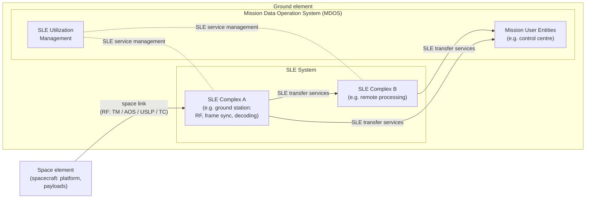
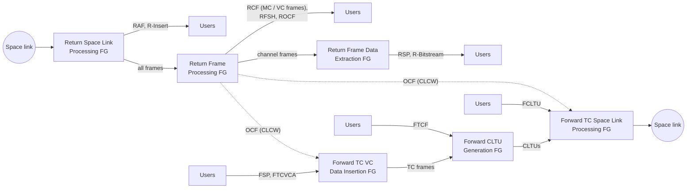
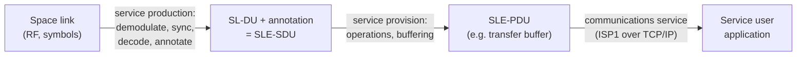
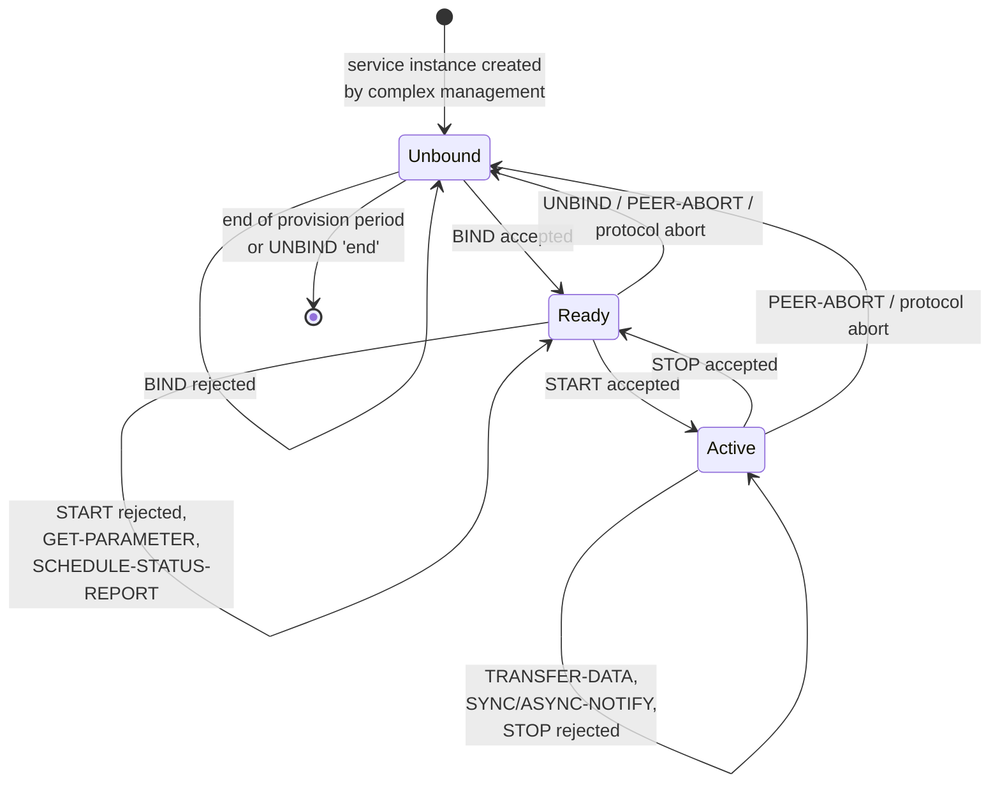
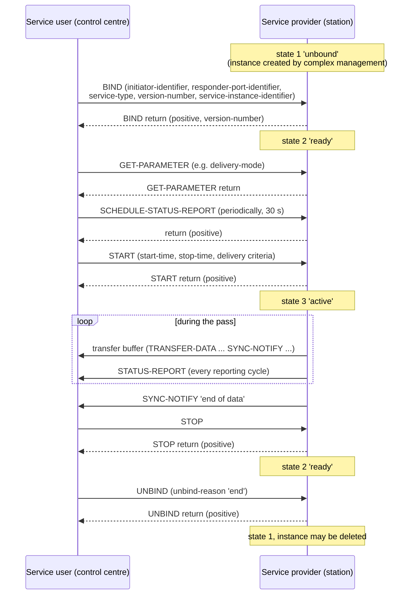
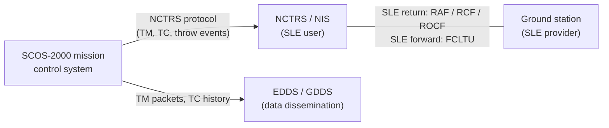

# Space Link Extension (SLE): concept and architecture

**Space Link Extension** (SLE) is the CCSDS family of ground-to-ground services that carries
space link data units (telemetry frames, operational control fields, telecommand CLTUs and
packets) between the ground station that terminates the radio link and the mission control
centre that actually uses the data. CCSDS defines cross support as one organisation lending part
of its space data system to serve another organisation's mission, and SLE is the standard
interface where most of that cross support happens: between the tracking stations of one agency
and the mission-specific ground systems of another.[^csc-purpose][^csc-rationale] With SLE, a
control centre can bind to a station it does not own, ask for "all frames from this antenna" or
"radiate this CLTU at 12:00:03", and receive annotated, time-stamped data over an ordinary
terrestrial network, without a mission-specific gateway.[^csc-benefits]

This page explains the concept and architecture common to all SLE services. The individual
services have their own pages: [return services RAF, RCF and ROCF](return-services.md), the
[forward CLTU service](fcltu.md), and the wire protocol and software interface,
[ISP1 and the SLE API](isp1-and-api.md). In the protocol stack, SLE sits above the
[TM](../tm-sdlp.md), [AOS](../aos.md), [USLP](../uslp.md) and [TC](../tc-sdlp.md) data link
protocols and their [channel coding](../tm-coding.md) and [CLTU](../tc-coding-cltu.md) layers; see
the [CCSDS overview](../index.md) and the [standards map](../../overview/standards-map.md).

!!! info "At a glance"
    | Item | Value |
    |---|---|
    | Concept document | CCSDS 910.3-G-3, *Cross Support Concept—Part 1: Space Link Extension Services*, Green Book, March 2006[^csc-ctl] |
    | Transfer service specifications in this library | RAF 911.1-B-5, RCF 911.2-B-4, ROCF 911.5-B-4, FCLTU 912.1-B-5 (all July 2023 issues)[^raf-ctl][^rcf-ctl][^rocf-ctl][^cltu-ctl] |
    | Wire protocol | ISP1, CCSDS 913.1-B-2 (September 2015): ASN.1 BER over TCP/IP[^isp-purpose] |
    | Programming interface | SLE API core, CCSDS 914.0-M-2 (September 2015), a C++ component API[^api-purpose] |
    | Roles | *Provider* = the object closer to the space link (station); *user* = the object farther away (control centre)[^raf-roles] |
    | Directions | Return (space to ground, e.g. telemetry) and forward (ground to space, e.g. telecommand)[^csc-defs] |
    | Phases | Definition phase (service management) and utilization phase (data transfer)[^csc-what] |
    | Provider states | 1 'unbound', 2 'ready', 3 'active'[^raf-states] |

## Why SLE exists

The CCSDS space link protocols define how data crosses the radio link. They stop at the ground
antenna. A real mission needs the same data units at a control centre, possibly on another
continent, possibly hours later, and enriched with facts that only the receiving station knows,
such as the reception time. Without standard services, interoperation needs ad hoc gateways
designed for each new mission.[^csc-benefits] The SLE concept report states the problem plainly:
standardising the ground interfaces for transport and management of space data reduces the
technical, management and operational cost of cross support.[^csc-why]

The report lists the expected benefits: agencies can cross-support each other more efficiently;
station owners can offer standard services to any CCSDS-compliant spacecraft; data users can reach
their payloads through a familiar interface over the internet or ISDN; interfaces can be reused
mission after mission; a commercial market for TT&C products is stimulated; and a provider only
implements the services it actually needs.[^csc-benefits] The ECSS communications handbook makes
the same point from the European side. Two CCSDS-compliant implementations may still be unable to
interoperate because they chose different options, and the handbook says that SLE has "to a great
extent" resolved this problem for ground-segment cross support.[^hb-interop]

CCSDS divides cross support services into three kinds:[^csc-applic]

| Kind | Scope | CCSDS document part |
|---|---|---|
| SLE services | Extend the CCSDS space link services across the ground | Cross Support Concept Part 1 (this page) |
| Ground communications services | The communications that underlie the ground element, for example relaying operational data | Part 2 (no plans to produce it in 2006) |
| Ground domain services | Services that do not use space link data structures: tracking, spacecraft database exchange, mission planning | Part 3 (under consideration in 2006) |

The part numbers in this table follow the 2006 concept report. The 2015 SLE API book numbers
them the other way round (Part 2 Ground Domain Services, Part 3 Ground Communications
Services).[^api-tree]

The SLE services themselves have two parts. **Data transfer services** move space link data
units between stations, control centres and end users. **Management services** schedule and
provision the transfer services.[^csc-what] Management happens mostly in a *definition phase*;
data flows in a *utilization phase*, either in real time or offline with respect to the pass.[^csc-what]

## The cross support environment

A space data system has a **space element** (the spacecraft, its payloads and operations
subsystems) and a **ground element**, linked by the space link.[^csc-sds] The ground element
contains an **SLE System**, which extends the transfer of forward and return data between the
ground termination of the space link and the **Mission Data Operation System** (MDOS), the
mission-dedicated system that sources forward data and sinks return data. In a mission, the MDOS
manages the SLE System.[^csc-env] The SLE System performs RF modulation and demodulation, ground
termination of the space link protocols, annotation of the data, terrestrial networking, and the
interfaces to ground-side protocol processing.[^csc-env]



Diagram based on the SLE system and complex model of the cross support concept.[^csc-env][^csc-complex][^csc-sm-arch]

### Extension over distance, in information and in time

The space link protocols divide one physical channel into logical **space data channels** (for
example virtual channels), each carrying frames or packets. SLE gives ground users access to these
channels and extends them in three ways:[^csc-ext]

| Extension | Meaning | Example from the concept report |
|---|---|---|
| Over distance | Protocol processing may happen at sites far from the antenna. Each site must forward enough context for the next site to finish processing, because space link protocols are not strictly layered. | The APID is only unique within a spacecraft; it is qualified by the SCID in the frame header, so a site that extracts packets far from the frame processing site needs the SCID too.[^csc-dist] |
| In information (annotation) | Facts known only at reception are added to each data unit. | Earth reception time, receiving location, data unit quality, sequence continuity; also data type, operations mode, and format parameters such as frame size.[^csc-info] |
| In time | Data can be delivered later than they were received, from a brief delay (a reduced ground communication rate) to a long one (temporary storage and later forwarding). | Temporary storage at a processing facility followed by later packet extraction.[^csc-time][^csc-all] |

Information that is not tied to a single data unit, such as "loss of frame synchronization",
must also be conveyed, and each service specification defines it.[^csc-dist] On the
[return services page](return-services.md) you can see exactly which annotation fields the RAF,
RCF and ROCF services carry.

## Functional groups and SLE complexes

SLE describes processing with **SLE Functional Groups** (SLE-FGs). An SLE-FG is a building block
derived from the layered functionality of channels, frames and packets in the space link
protocols. It cannot be decomposed further, and it represents the set of SLE services that a real
system can implement at that layer.[^csc-fg] A physical facility that implements a set of
functional groups is an **SLE Complex**. All functions of one functional group must sit in one
complex, but different groups can be spread over complexes run by different organisations.[^csc-complex]
A complex has a service provision component and a management component, and it is one
collection of resources under a single management authority: one station, a network of stations,
or, for packet services delivered to payload control centres, a spacecraft control centre.[^csc-gloss][^csc-cm]

A return service instance is produced by a chain of up to three functional groups, and a forward
service instance likewise. The table shows what an organisation must implement to offer each kind
of service:[^csc-ret-fg][^csc-fwd-fg][^csc-aos-fg]

| Direction | To be a… | …the provider must implement |
|---|---|---|
| Return | All Frames Service Provider | Return Space Link Processing SLE-FG |
| Return | Channel Frames Service Provider | Return Frame Processing SLE-FG + Return Space Link Processing SLE-FG |
| Return | Packet Service Provider | Return Frame Data Extraction SLE-FG + Return Frame Processing SLE-FG + Return Space Link Processing SLE-FG |
| Forward TC | CLTU Service Provider | Forward Telecommand Space Link Processing SLE-FG |
| Forward TC | TC Frames Service Provider | Forward CLTU Generation SLE-FG + Forward Telecommand Space Link Processing SLE-FG |
| Forward TC | VC and Packet Service Provider | Forward TC VC Data Insertion SLE-FG + Forward CLTU Generation SLE-FG + Forward Telecommand Space Link Processing SLE-FG |
| Forward AOS | VCDU Service Provider | Forward AOS Space Link Processing SLE-FG |
| Forward AOS | AOS VC and Packet Service Provider | Forward AOS VC Data Insertion SLE-FG + Forward AOS Space Link Processing SLE-FG |



Diagram based on the return and forward telecommand functional groups of the cross support concept.[^csc-ret-fg][^csc-fwd-fg][^csc-fwd-list]

The dotted arrows matter. The CLCW, carried in the telemetry Operational Control Field, is
needed by the CLTU provider to know whether the physical uplink is available, and by the VC and
packet provider to decide whether TC frames must be retransmitted under [COP-1](../cop-1.md).[^csc-fwd-list]
Some services cannot be separated: Return Insert processing must live in the same functional group
as Return All Frames because insert data appear in every frame.[^csc-insert]

The concept report's annex C illustrates several real cross support layouts: a station with
extensive capability (all return processing up to packet extraction in the station), a station
with limited capability (frames sent to separate real-time and offline processing centres), and
an SLE System of two complexes in which a ground terminal complex does only space link processing
while a remote complex does frame processing, packet extraction, CLTU generation and VC data
insertion.[^csc-scen]

## The SLE transfer services

The concept report and the ASN.1 of the current service specifications together name the
following transfer services. Only some have published Recommended Standards; the 2006 report says
the defined services covered the online "conventional" TM and TC services used by most
missions.[^csc-why]

| Service | Direction | Data unit delivered | Produced by | Specification | ASN.1 `ApplicationIdentifier` |
|---|---|---|---|---|---|
| Return All Frames (RAF) | Return | All TM, AOS or USLP frames of one physical channel | RSLP-FG | CCSDS 911.1-B-5 ([page](return-services.md)) | `rtnAllFrames (0)` |
| Return Insert (R-Insert) | Return | AOS insert zone (not yet defined in 2006) | RSLP-FG | not in this library | `rtnInsert (1)` |
| Return Channel Frames (RCF) | Return | Frames of one Master Channel or Virtual Channel | RFP-FG | CCSDS 911.2-B-4 ([page](return-services.md)) | `rtnChFrames (2)` |
| Return Frame Secondary Header (RFSH) | Return | MC or VC frame secondary headers | RFP-FG | not in this library | `rtnChFsh (3)` |
| Return Operational Control Fields (ROCF) | Return | MC or VC OCFs (CLCWs and other reports) | RFP-FG | CCSDS 911.5-B-4 ([page](return-services.md)) | `rtnChOcf (4)` |
| Return Bitstream (R-Bitstream) | Return | AOS bitstream (not yet defined in 2006) | RFDE-FG | not in this library | `rtnBitstr (5)` |
| Return Space Packet (RSP) | Return | Packets with selected APIDs from one VC | RFDE-FG | not in this library | `rtnSpacePkt (6)` |
| Forward Space Packet (FSP) | Forward | Packets from one user, uplinked without coordinating with other users | TC VC Data Insertion FG | not in this library | `fwdTcSpacePkt (13)` |
| Forward TC Virtual Channel Access (FTCVCA) | Forward | Complete TC VCs | TC VC Data Insertion FG | not in this library | `fwdTcVca (14)` |
| Forward TC Frame (FTCF) | Forward | TC frames, turned into CLTUs by the provider | CLTU Generation FG | not in this library | `fwdTcFrame (15)` |
| Forward CLTU (FCLTU) | Forward | CLTUs radiated bit for bit | FTC Space Link Processing FG | CCSDS 912.1-B-5 ([page](fcltu.md)) | `fwdCltu (16)` |
| Forward AOS services (F-AOSSP, F-AOSVCA, F-Bitstream, F-pVCDU, F-cVCDU, F-VCDU, F-Insert) | Forward | AOS packets, VCs, bitstreams, VCDUs, inserts | Forward AOS FGs | not yet defined in 2006 | `fwdAosSpacePkt (7)` to `fwdCVcdu (12)` |

Sources: service list and definitions from the concept report,[^csc-ret-list][^csc-fwd-list][^csc-aos-list]
application identifiers from the common BIND types module.[^raf-appid] The concept report also
mentions future transfer services for non-CCSDS space links and for radiometric, monitoring and
return unformatted data.[^csc-future] ESA's EGS-CC paper describes the Cross-Support Transfer
Services (CSTS) as the new generation of SLE, which adds monitoring data from the ground station
equipment to the TM and TC services.[^pec-csts]

## Service provision and service production

Every SLE transfer service specification separates two activities:[^raf-sm][^cltu-sm]

* **Service production** transforms the physical channel into the SLE data channel (return), or the
  SLE data channel into the RF carrier (forward). For RAF this means acquiring the carrier,
  demodulating, synchronising, decoding and checking frames; for FCLTU it means modulating and
  radiating CLTUs.
* **Service provision** makes the operations available to the user: when service is provided
  (start and stop times), how (user- or provider-initiated binding), and with which quality of
  service (for example whether frames with known bit errors are delivered).[^raf-prodprov]

The distinction decides who may change what. Provision parameters affect a single service
instance; service management initialises them, and the user may change some of them through
service operations. Production parameters such as bit rate, frame length, coding type or
modulation index can affect several service instances or the complex's resources, so only service
management may change them.[^raf-sm][^cltu-sm] One RAF production instance can feed several RAF
service instances.[^raf-prodprov] FCLTU adds a controlled exception: if agreed, the user can ask
complex management to change production parameters with the CLTU-THROW-EVENT operation.[^cltu-sm]

Three kinds of data unit appear in every specification:[^raf-prodprov]

* the **SL-DU** (space link data unit), for example a telemetry frame as acquired from the link;
* the **SLE-SDU** (SLE service data unit), the SL-DU plus its annotation, or a notification. SLE-SDUs
  are the parameters of the TRANSFER-DATA and SYNC-NOTIFY operations;
* the **SLE-PDU** (SLE protocol data unit), the encoded invocation or return of an operation. Usually
  one PDU carries one operation, but return services pack many TRANSFER-DATA and SYNC-NOTIFY
  invocations into one *transfer buffer* PDU.



Diagram based on the RAF production and provision model.[^raf-prodprov]

The specifications deliberately do not define the communications technology. They only require a
communications service that delivers invocations and returns in sequence, completely and with
integrity, without duplication, with flow control that reports congestion, and with notification
when communications are disrupted.[^raf-comms] The approved mapping onto TCP/IP is
[ISP1](isp1-and-api.md).[^raf-tech]

## Delivery modes

The SLE reference model defines online and offline delivery. Within online delivery, the return
service specifications distinguish two quality factors, timeliness and completeness, and treat them
as separate modes. Each service instance supports exactly one mode, set by service management.[^raf-sm]

| Mode | ASN.1 `DeliveryMode` | Services | Behaviour |
|---|---|---|---|
| Timely online | `rtnTimelyOnline (0)` | RAF, RCF, ROCF | Delivery during the pass; frames that cannot be delivered within a set time after acquisition (for example because of a network backlog) are discarded under control, a whole transfer buffer at a time.[^raf-discard] |
| Complete online | `rtnCompleteOnline (1)` | RAF, RCF, ROCF | Delivery during the pass; a large online frame buffer absorbs network outages so that every frame is delivered in order. |
| Offline | `rtnOffline (2)` | RAF, RCF, ROCF | Data stored during the pass and delivered later, for any ERT interval the user requests. |
| Forward online | `fwdOnline (3)` | FCLTU (and other forward services) | CLTUs buffered by the provider and radiated during the space link session. |
| Forward offline | `fwdOffline (4)` | — | Outside the scope of the current FCLTU specification. |

Sources: mode definitions,[^raf-sm][^cltu-modes] ASN.1 values.[^raf-delmode] The buffering
mechanics are explained on the [return services page](return-services.md#delivery-modes-and-buffering).

In service management terms, each online service instance is tied to one space link session,
although it may start before and end after it. Offline instances can exist at any time during the
service agreement period and may relate to sessions of other service packages.[^csc-onoff] The
concept report's glossary defines online as transfer during the associated space link session and
offline as transfer at any other time.[^csc-gloss]

## Service instances

A **service instance** is the provision by one SLE complex of the capability to transfer one or
more SLE data channels of one type, all related to the same space link session.[^csc-gloss] The
provision of RAF from one physical channel to one user is one instance; the same channel served to
two users, or several channels served concurrently, are several instances.[^raf-ovw] For FCLTU only
one instance may exist per physical forward channel at a time.[^cltu-ovw]

Each instance has:

* a **service instance provision period**, the time during which it is scheduled to be provided.
  Reaching its start is the event 'start of service instance provision period' in the state
  tables;[^raf-sipp]
* a binding direction: **user-initiated** (only the user may invoke BIND) or **provider-initiated**
  (only the provider may). Service management decides which, per instance. RAF, RCF and ROCF allow
  both; FCLTU-BIND is invoked only by the user;[^raf-bindpurp][^cltu-bindpurp]
* a **delivery mode** (above);
* a **responder port identifier**, a logical name agreed by both sides in advance and translated
  locally into technology-specific addresses, for example an IP address and TCP port;[^raf-tech]
* a **service instance identifier** that is unique within the providing complex.[^raf-sii]

### The service instance identifier

The service instance identifier is a sequence of attribute name/value pairs. In its standard
string form, each pair is written `name=value` and pairs are separated by dots. The attributes, in
order, are the service agreement (`sagr`), the service package (`spack`), the forward or return
functional group (`fsl-fg` or `rsl-fg`) and the service name. For return services the service name
value starts with `onlc`, `onlt` or `offl` followed by an instance number; for forward services it
is the service name plus a number, such as `cltu1`.[^raf-sii-fmt] The standard's own example is
`sagr=xyz.spack=abcdef.rsl-fg=gfjdy.raf=onlc2`.[^raf-sii-ex]

!!! warning "Inference"
    The ASN.1 comments list the prefixes `onlc`, `onlt` and `offl` without expanding them. Reading
    them as *online complete*, *online timely* and *offline* matches the three delivery modes, and
    ISP1 Annex B uses `onlt1` for "an RCF service instance with timely online delivery
    mode",[^isp-onlt] but the 911.x specifications do not define the prefixes explicitly.

Each
attribute is also registered as an ASN.1 object identifier under `{iso 3 112 4 3 1 2}`: for example
`raf` is arc 22, `rcf` 46, `rocf` 49, `cltu` 7, `fsp` 10, `sagr` 52 and `spack` 53.[^raf-sii-oid]

The real Solar Orbiter MIB contains two such identifiers, embedded as default values of the
ground commands that open and close links on ESA's network interface system (see
[below](#how-esas-ground-segment-uses-sle)):[^mib-te]

| MIB command | Service | Identifier reconstructed from the three ASCII CDF fields (two fixed 15-character parts and one variable-length part) |
|---|---|---|
| [EGENRTCO](../../explorer/index.md#/solo/command/EGENRTCO) / [EGENRTCC](../../explorer/index.md#/solo/command/EGENRTCC) | FCLTU | `sagr=144.spack=NN11-PERM.fsl-fg=1.cltu=cltu01` |
| [EGENRTMO](../../explorer/index.md#/solo/command/EGENRTMO) / [EGENRTMC](../../explorer/index.md#/solo/command/EGENRTMC) | RCF | `sagr=144.spack=NN11-PERM.rsl-fg=1.rcf=onlc0001` |

!!! warning "Inference"
    The identifiers follow the 911.x Annex A syntax exactly: service agreement `144`, service
    package `NN11-PERM`, functional group `1`, and service names `cltu01` and `onlc0001` (an RCF
    instance, presumably in *complete online* delivery mode, see the inference above). That `NN11` designates an ESA New Norcia antenna
    and that `PERM` means a permanently configured package are this wiki's guesses; neither is stated
    in the available sources.

## Operations common to all transfer services

All SLE transfer services are built from a small vocabulary of operations. An operation is
*invoked* by one object and *performed* by the other; a **confirmed** operation returns a report of
its outcome, an **unconfirmed** one does not.[^raf-defs] The common operations are:[^csc-ops]

| Operation | Invoker | Confirmed | Purpose |
|---|---|---|---|
| BIND | initiator (user or provider) | yes | Establish an association between user and provider |
| UNBIND | initiator | yes | Release the association cleanly |
| PEER-ABORT | either | no | Break the association after a protocol problem |
| START | user | yes | Enter the 'active' state in which data units flow |
| STOP | user | yes | Leave the 'active' state |
| TRANSFER-DATA | provider (return) or user (forward) | no (return), yes (FCLTU) | Carry one data unit |
| SYNC-NOTIFY / ASYNC-NOTIFY | provider | no | Report events in step with (return) or independently of (forward) the data flow |
| SCHEDULE-STATUS-REPORT | user | yes | Request one, periodic, or no further status reports |
| STATUS-REPORT | provider | no | Deliver a status report |
| GET-PARAMETER | user | yes | Read a service parameter of the instance |
| THROW-EVENT | user (forward services) | yes | Forward an event that requires management action |
| INVOKE-DIRECTIVE | privileged FSP or TCVCA user | yes | Invoke TC directives, for example for COP operation |

Sources: concept report,[^csc-ops] confirmation and invoker columns from the RAF and FCLTU
operation tables.[^raf-ops][^cltu-ops]

### Rules that apply to every operation

* **Result and diagnostic.** Every return carries a `result` (positive or negative). A negative
  result carries a `diagnostic`; the value 'other reason' may only be used when nothing more
  specific applies. Checks should be done in the order in which the diagnostics are listed, and an
  implementation that deviates must document its order.[^raf-result]
* **Parameter checking.** A parameter is invalid if it is outside the range permitted by service
  management, conflicts with another parameter of the same invocation (for example a start time
  after the stop time), or conflicts with the current configuration. Invalid operations are not
  performed.[^raf-check]
* **Blocking and non-blocking.** Every confirmed operation except BIND and UNBIND carries an
  `invoke-ID`, an arbitrary 16-bit integer (`InvokeId ::= IntUnsignedShort`) returned unchanged by
  the performer. Operations with an invoke-ID are non-blocking: the invoker may issue more
  invocations before the returns arrive. BIND and UNBIND are blocking. Reusing an invoke-ID that is
  still awaiting a return is an error; an invoker that wants strictly sequential behaviour can
  simply use a constant invoke-ID. Effects must be as if operations were performed in the order
  received.[^raf-block][^raf-common-types]
* **Return timeout.** If a confirmed operation's return does not arrive within the
  `return-timeout-period` (1 to 600 seconds in the ASN.1), the invoker aborts the association with
  PEER-ABORT 'return timeout'. Returns must therefore never depend on human interaction.[^raf-missing][^raf-timeout]
* **Protocol errors.** An operation not allowed in the current state causes PEER-ABORT 'protocol
  error'; an undecodable PDU causes PEER-ABORT 'encoding error'; a return with an unknown invoke-ID
  causes PEER-ABORT 'unsolicited invoke-ID'.[^raf-generic]
* **Communications failure.** Each bound entity must monitor the health of the communications
  link, if necessary with a periodic heartbeat, and treat a disruption as a 'protocol abort'. After
  a protocol abort the provider returns to 'unbound', discards its transfer buffer and resets
  parameters to their initial values, but keeps the statistics for status reports.[^raf-commfail]
* **Time.** All times are UTC. Return services express the earth receive time in the CCSDS Day
  Segmented code with a 1958-01-01 epoch and a 16-bit day field, at microsecond or picosecond
  resolution, accurate to 1 ms; FCLTU times must be precise and accurate to 0.1 s.[^raf-time][^cltu-time]
  See [time code formats](../time-codes.md).

### The generic state machine

Once a service instance exists, the provider is always in one of three states. In state 1
('unbound') all resources are allocated but no association exists. In state 2 ('ready') an
association exists and operations can be exchanged, but data units do not flow. In state 3
('active') data units flow until the user invokes STOP or either side aborts.[^raf-states]



Diagram based on the simplified provider state diagrams of the RAF and FCLTU specifications.[^raf-states][^cltu-states]
The full behaviour is defined by a normative state table in section 4 of each specification, with
events, predicates, Boolean flags and compound actions. Conformance to the state table is
mandatory.[^raf-sttable][^raf-conf]

### A typical session

The RAF specification gives a canonical scenario for a user-initiated online instance.[^raf-scen]
Complex management creates the instance before its provision period, typically shortly before the
pass so that the user can bind in time. The rest of the session looks like this:



Sequence based on the RAF operational scenario; the 30-second reporting cycle is illustrative.[^raf-scen]

### BIND, UNBIND and PEER-ABORT in detail

These three operations are common to all services and share one ASN.1 module
(`CCSDS-SLE-TRANSFER-SERVICE-BIND-TYPES`).[^raf-bindtypes]

**BIND** carries the invoker's credentials, the `initiator-identifier` (an authority identifier of
3 to 16 visible characters), the `responder-port-identifier` (a logical port name of 1 to 128
characters), the `service-type`, the `version-number` and the `service-instance-identifier`. The
return carries the performer's credentials, the `responder-identifier`, and either the accepted
version number or a diagnostic.[^raf-bindparams][^raf-bindtypes] The responder port identifier is in
the invocation only to help gateways; the responder ignores it when validating the BIND. A wrong
value usually makes the BIND fail with no return at all, which ends in a 'return timeout'
abort.[^raf-rpi] The service type is redundant today, but it anticipates a future generic SLE-BIND.[^raf-svctype]

Version negotiation works downwards only. The responder either accepts the proposed version or,
if it supports negotiation, proposes a lower one; if it supports neither, it rejects the BIND with
'version not supported'. An initiator that cannot accept the lower version unbinds. The 2023 issues
of RAF, RCF, ROCF and FCLTU all define version number 6.[^raf-version][^rcf-version][^rocf-version][^cltu-version]

| BIND diagnostic | ASN.1 code | Meaning |
|---|---|---|
| access denied | 0 | Initiator identifier not recognised by the responder |
| service type not supported | 1 | Service type not supported by the responder |
| version not supported | 2 | Requested version not supported and no lower version can be offered |
| no such service instance | 3 | Instance not defined in any agreed service package |
| already bound | 4 | Instance already bound via another association |
| service instance not accessible to this initiator | 5 | Authorised initiator of the instance differs from the requester |
| inconsistent service type | 6 | Service type does not match the instance |
| invalid time | 7 | BIND outside the service instance provision period |
| out of service | 8 | Responder taken out of service by management (production status 'halted') |
| other reason | 127 | Anything else |

Sources: diagnostics,[^raf-binddiag] codes.[^raf-bindtypes] The responder may be unable to return
anything at all for 'no such service instance', 'invalid time' or 'out of service'.[^raf-binddiag]

**UNBIND** is invoked only by the initiator and only in state 2. Its `unbind-reason` is 'end' (0),
'suspend' (1), 'version not supported' (2) or 'other' (127). 'End' allows the provider to delete
the instance and release its resources, so any later BIND will fail; 'suspend' allows a re-bind
before the end of the provision period. The result is always positive: UNBIND is confirmed only so
that the initiator knows the association really is released.[^raf-unbind][^raf-bindtypes]

**PEER-ABORT** is unconfirmed, valid in states 2 and 3, and carries only a diagnostic code in the
range 0 to 255 (ISP1 sends it as a single octet).[^raf-bindtypes][^isp-diag]
It deliberately has no credentials: the specification argues that an intruder able to inject an
abort could disrupt the link more easily at a lower layer anyway.[^raf-pa]

| PEER-ABORT diagnostic | Code | When used |
|---|---|---|
| access denied | 0 | Responder identifier in the BIND return not known to the initiator |
| unexpected responder ID | 1 | Responder identifier does not match the authorised responder |
| operational requirement | 2 | Local system needs the resources for another purpose |
| protocol error | 3 | Operation sequencing error |
| communications failure | 4 | Communications broken on the far side of a gateway |
| encoding error | 5 | Undecodable operation or parameter |
| return timeout | 6 | Return not received within the timeout |
| end of service instance provision period | 7 | Provision period ended while still bound |
| unsolicited invoke-ID | 8 | Return with an invoke-ID that matches no pending invocation |
| other reason | 127 | Anything else |
| technology specific | 128–255 | Reserved for the communications mapping (ISP1 uses 128–199) |

Sources: diagnostics,[^raf-pa] codes,[^raf-bindtypes] ISP1 range.[^isp-diag]

## Security: access control and authentication

SLE transfer services build in two security mechanisms, access control and authentication, and
leave everything else (confidentiality, integrity, availability, auditing) to the underlying
communications or to the mission's own end-to-end measures.[^csc-sec][^raf-secbg]

**Access control** works at two levels: the initiator and responder must be registered with each
other, and they must be authorised for the specific service instance. Service management specifies
the authorised initiator and responder of each instance, and each side presents its identity in
the BIND.[^raf-ac] The responder refuses an unknown initiator with 'access denied' and does not
even try to authenticate it; a known but unauthorised initiator gets 'service instance not
accessible to this initiator'. The initiator, in turn, aborts if the responder identity in the
BIND return is unknown ('access denied') or not the expected one ('unexpected responder ID').[^raf-ac2]

**Authentication** uses *credentials* that rely on a secret shared by user and provider. Each
instance has one of three authentication levels:[^csc-auth][^raf-auth]

| Level | What carries credentials |
|---|---|
| 'all' | Every invocation and return except the PEER-ABORT invocation |
| 'bind' | Only the BIND invocation and its return |
| 'none' | Nothing; authentication left to the environment |

Providers should require 'all' or 'bind'. The two management sides agree the level and the
algorithm, and give both ends the passwords or keys.[^raf-auth] In ASN.1, credentials are either
`unused` or an octet string of 8 to 256 octets whose internal structure depends on the algorithm.[^raf-cred]
A PDU whose credentials fail authentication is silently ignored, as if it had never arrived.[^raf-authfail]
The algorithm actually used over TCP/IP is the ISP1 hashed password scheme, described on the
[ISP1 page](isp1-and-api.md#authentication-layer).

The concept report models the configuration as *entity authentication structures* (local and peer
entity identifiers, each with an authentication level, method and method parameters) and *service
instance structures* (service instance identifier, initiator identifier, responder identifier,
responder port identifier).[^csc-secinfo]

The specifications are frank about the residual risks. Without additional mechanisms an attacker
could read telemetry or commands as they cross the wide area network, or replace the data
parameter of a PDU. FCLTU adds one integrity check of its own (the monotonically increasing
`cltu-identification`), but the FCLTU standard warns that a hijacked forward service could be used
to subvert or destroy a spacecraft.[^raf-threat][^cltu-threat] These pages describe the
standards' protections; they do not discuss attack techniques.

## SLE service management

SLE service management collects and exchanges the information needed to agree, schedule, prepare
and access SLE services. It is a dialogue between **Utilization Management** (UM) in the MDOS and
**Complex Management** (CM) in each SLE complex.[^csc-sm] CM presents the complex in a standard way
and hides its internal equipment from the user; CCSDS does not define how CM drives that
equipment.[^csc-cm-hide] Of the five OSI management functional areas, SLE service management covers
configuration, accounting, fault and security management, but not performance management, which
stays internal to the provider.[^csc-sm-scope]

UM requests provision periods, provides RF, modulation, space link and SLE configuration, provides
trajectory predictions and coordinates the mission user entities. CM negotiates service types,
numbers of instances and agreement durations, answers requests for space link sessions, and
configures and monitors the complex's resources.[^csc-um-cm]


Diagram based on the nominal interaction timeline and use case of the concept report.[^csc-timeline]

| Management item | Content | Notes |
|---|---|---|
| Service Agreement | Services to be provided, spacecraft communication characteristics, static and default configuration, nominal contact frequency and duration, nominal trajectory, and the ranges in which later parameters must fall | One mission per agreement; negotiated years in advance; a mission may hold several (for example launch, cruise, planetary phases). Registration and agreement establishment were not standardised in 2006.[^csc-sa] |
| Configuration Profile | Reusable set of space link and SLE parameters, referenced by any number of service packages | Suits spacecraft with a few well-defined TT&C modes.[^csc-cp] |
| Trajectory Prediction | Data the TT&C complex uses for antenna pointing and Doppler compensation | CCSDS Orbit Parameter Message or Orbit Ephemeris Message (text or XML), or a bilaterally agreed format.[^csc-tp] |
| Service Package | Transfer services, provision periods, end users, and configurations for specific space link sessions | May hold several forward and return carriers with preferred and acceptable windows, several transfer service instances timed relative to the carriers, alternate scenarios (for example burn/no-burn), and time-sequenced parameter changes.[^csc-spack] |

A service package goes through a definition phase and a utilization phase, possibly with dormant
periods in between, and ends with a debrief from CM to UM.[^csc-phases][^csc-util] Status
reporting during execution and near-real-time service control existed in some providers but were
not standardised in 2006.[^csc-ext-sm]

!!! note "Not in this library"
    The normative service management specification (CCSDS 910.11) and the cross support
    reference model (CCSDS 910.4-B-2) are cited by all SLE documents but are not part of this
    wiki's library. The statements above come from the concept report's summary of them.

## The SLE API and ISP1 in one paragraph

The transfer service specifications define operations and ASN.1 types in an abstract way. Two
further documents make them implementable. **ISP1** (CCSDS 913.1) maps one SLE association to one
TCP connection, encodes PDUs with ASN.1 BER, frames them in 8-octet-header TML messages, adds a
heartbeat, and defines the hashed-password credentials.[^isp-arch] The **SLE API** (CCSDS 914.0)
defines C++ components (API Proxy, API Service Element, SLE Operations, SLE Utilities) that hide
the communications technology and enforce the state tables, so that SLE applications can be
written once and products can be exchanged.[^api-purpose][^csc-api] Both are explained on
[ISP1 and the SLE API](isp1-and-api.md).

## How ESA's ground segment uses SLE

In ESA's ground segment the mission control system ([SCOS-2000](../../scos2000/index.md)) does not
talk to stations directly. A 2005 ESOC overview describes the **NCTRS** (Network Control and TM/TC
Router System) as the interface between the mission control system and the ground station
network, using SLE for non-ESA stations.[^gsaw05-nctrs] A 2003 ESOC presentation shows the NCTRS
between SCOS-2000 and the stations (Kiruna, Redu, Perth, Villafranca, Kourou, New Norcia, Cebreros
and the DSN), labels the link SLE, and lists SLE-conformant ground station interface software among
SCOS-2000's enabling technologies.[^peccia-net][^peccia-tech] The planned page on
[NCTRS, NIS and the ground station interface](../../scos2000/nctrs-nis.md) covers these systems.



Diagram based on the ESOC ground segment descriptions.[^gsaw05-nctrs][^peccia-net][^euicd-rel] The
2005 overview mentions SLE specifically for non-ESA stations. Which SLE services are used with
which station is mission specific and not stated in the available sources.

Several sources in this library show traces of SLE in ESA's data products and databases:

* **Command verification.** The EDDS external user ICD names the first command verification stage
  'R', release from SCOS-2000 to "the SLE User (NCTRS/NIS)", and defines 'G' (ground station
  reception) and 'T' (uplink, also called radiation; for throw event commands it is the execution
  stage).[^euicd-rel] See [command verification in the MIB](../../mib/command-verification.md).
* **Packet headers.** The Rosetta and Mars Express data delivery ICD defines an 8-bit "SLE Type"
  field in its 18-octet DDS packet header. It encodes the SLE channel (SLC, MC, VC, bad frames) and
  the delivery flavour (real-time, real-time flow control, off-line) as values 0 to 11.[^mex-sle]
  EDDS keeps an 8-bit `SleServiceID` in its raw packet header "for backward compatibility with the
  GDDS".[^euicd-sle] See [EDDS formats](../../scos2000/edds-formats.md).
* **The MIB.** The SCOS-2000 database import ICD defines command type `CCF_CTYPE = 'T'` for SLE throw
  events, sent to the SLE service provider but not uplinked, and `'N'` for NIS throw events,
  executed by the NIS itself.[^icd-ctype] The Solar Orbiter MIB contains six NIS throw events and no
  SLE throw events (queries below).[^mib-te]

| CCF_CNAME | Description | Event ID | SLE service type |
|---|---|---|---|
| [ESESIONO](../../explorer/index.md#/solo/command/ESESIONO) | OPEN SESSION | OPEN_SESSION (10) | — |
| [ESESIONC](../../explorer/index.md#/solo/command/ESESIONC) | CLOSE SESSION | CLOSE_SESSION (11) | — |
| [EGENRTCO](../../explorer/index.md#/solo/command/EGENRTCO) | GENERIC OPEN TC LINK | OPEN_LINK (20) | FCLTU (4) |
| [EGENRTCC](../../explorer/index.md#/solo/command/EGENRTCC) | GENERIC CLOSE TC LINK | CLOSE_LINK (21) | FCLTU (4) |
| [EGENRTMO](../../explorer/index.md#/solo/command/EGENRTMO) | GENERIC OPEN TM LINK | OPEN_LINK (20) | RCF (2) |
| [EGENRTMC](../../explorer/index.md#/solo/command/EGENRTMC) | GENERIC CLOSE TM LINK | CLOSE_LINK (21) | RCF (2) |

The "SLE Service Type" command parameter (`ENISTE03`, textual calibration `CNISX207TC`) enumerates
RAF (1), RCF (2), ROCF (3), FCLTU (4) and FSP (5), and the "Event ID" parameter (`ENISTE02`,
calibration `CNISX205TC`) also knows HEARTBEAT_MSG (12), ABORT_LINK (22) and CHANGE_MODE (23).[^mib-te]
The same six commands, with the same service instance identifiers, are present in the April 2020
release.[^mib2020] The commands are described on the [FCLTU page](fcltu.md#scos-2000-the-nis-and-throw-events)
and the [return services page](return-services.md#solar-orbiter-and-esa-context).

??? example "SQL used"
    ```sql
    -- Special command types in the Solar Orbiter MIB (2025-09-16 release)
    SELECT CCF_CTYPE, count(*) FROM ccf GROUP BY CCF_CTYPE;
    -- -> '' 5443, 'F' 2, 'N' 6, 'R' 3   (no 'T' = SLE throw event)

    SELECT CCF_CNAME, CCF_DESCR, CCF_TYPE, CCF_STYPE, CCF_APID
      FROM ccf WHERE CCF_CTYPE = 'N';

    -- Service instance identifier pieces: ENISTE35 and ENISTE38 (120 bits, 15 characters each)
    -- and ENISTE37 'Service_Instance_End' (CDF_ELLEN 0, variable length)
    SELECT CDF_CNAME, CDF_PNAME, CDF_ELLEN, CDF_BIT, CDF_VALUE
      FROM cdf WHERE CDF_CNAME IN ('EGENRTCO','EGENRTMO')
     ORDER BY CDF_CNAME, CAST(CDF_BIT AS INT);

    -- Enumerations of the NIS throw event parameters
    SELECT CPC_NAME, CPC_DESCR, CPC_PAFREF FROM cpc WHERE CPC_NAME LIKE 'ENISTE%';
    SELECT PAS_NUMBR, PAS_ALTXT, PAS_ALVAL FROM pas
     WHERE PAS_NUMBR IN ('CNISX205TC','CNISX207TC') ORDER BY PAS_NUMBR, CAST(PAS_ALVAL AS INT);
    ```

Outside ESA's own network, SCOS-2000-based centres reach SLE stations through protocol bridges. At
DLR's German Space Operations Center, the SCOS-2000-based GECCOS system speaks the NCTRS protocol
to an **SLE Switch Board** (SSB), which translates it into the standard SLE protocol used by
ground stations worldwide.[^dlr-ssb][^4s-ssb] ESA's newer EGS-CC framework includes reference
components to talk to a PUS spacecraft via SLE, and plans an extension for CSTS monitoring
data.[^pec-sle][^pec-csts] See [ancillary systems and EGS-CC](../../scos2000/ancillary-and-egs-cc.md).
The ECSS communications handbook points to the ESA ground operations software portal, which
includes "the ESA SLE Gateway".[^hb-gw] ESA's role in the SLE API is described on the
[ISP1 and SLE API page](isp1-and-api.md#esa-and-the-sle-api).

## Document history and versions

| Document | Issue history in the library copy |
|---|---|
| CCSDS 910.3-G | G-1 May 1995, G-2 April 2002, G-3 March 2006 (current)[^csc-ctl] |
| CCSDS 911.1-B (RAF) | B-1 April 2002, B-2 November 2004, B-3 January 2010, B-4 August 2016, B-5 July 2023 (adds USLP), EC 1 (October 2024)[^raf-ctl] |
| CCSDS 911.2-B (RCF) | B-1 November 2004, B-2 January 2010, B-3 August 2016, B-4 July 2023 (adds USLP), EC 1 (October 2024)[^rcf-ctl] |
| CCSDS 911.5-B (ROCF) | B-1 November 2004, B-2 January 2010, B-3 August 2016, B-4 July 2023 (adds USLP), EC 1 (October 2024)[^rocf-ctl] |
| CCSDS 912.1-B (FCLTU) | B-1 April 2002, B-2 November 2004, B-3 July 2010, B-4 August 2016, B-5 July 2023 (adds USLP), EC 1 (October 2024)[^cltu-ctl] |
| CCSDS 913.1-B (ISP1) | B-1 September 2008 (now historical 913.1-B-1-S), B-2 September 2015 (hash changed from SHA-1 to SHA-256)[^isp-ctl][^isp-hist] |
| CCSDS 914.0-M (API core) | M-1 October 2008, M-2 September 2015, Technical Corrigendum 1 August 2016[^api-cor] |

The 2006 concept report references earlier issues of the service standards (for example RAF
911.1-B-2 and FCLTU 912.1-B-2 of December 2004).[^csc-refs] Where it describes services that were
"not yet defined" in 2006, this wiki has no later source in its library.

## Related pages

* [SLE return services: RAF, RCF and ROCF](return-services.md)
* [SLE forward service: FCLTU](fcltu.md)
* [SLE over TCP/IP (ISP1) and the SLE API](isp1-and-api.md)
* [NCTRS, NIS and the ground station interface](../../scos2000/nctrs-nis.md)
* [Uplink: from operator command to on-board execution](../../overview/uplink.md) and
  [Downlink](../../overview/downlink.md)
* Library: [CCSDS 910.3-G-3](../../library/ccsds-910x3g3-sle-cross-support.md),
  [911.1-B-5](../../library/ccsds-911-1-911x1b5e1.md), [911.2-B-4](../../library/ccsds-911-2-911x2b4e1.md),
  [911.5-B-4](../../library/ccsds-911-5-911x5b4e1.md), [912.1-B-5](../../library/ccsds-912-1-912x1b5e1.md),
  [913.1-B-2](../../library/ccsds-913-1-913x1b2.md), [914.0-M-2](../../library/ccsds-914-0-914x0m2c1.md);
  all sources in the [reference catalogue](../../references/index.md); terms in the [glossary](../../glossary.md).

[^csc-purpose]: [CCSDS 910.3-G-3, Cross Support Concept—Part 1: SLE Services](../../library/ccsds-910x3g3-sle-cross-support.md), §1.1 Purpose, PDF p. 9.
[^csc-rationale]: [CCSDS 910.3-G-3](../../library/ccsds-910x3g3-sle-cross-support.md), §1.4 Rationale, PDF pp. 10–11.
[^csc-benefits]: [CCSDS 910.3-G-3](../../library/ccsds-910x3g3-sle-cross-support.md), §2.3 What are the benefits of SLE services?, PDF p. 16.
[^csc-ctl]: [CCSDS 910.3-G-3](../../library/ccsds-910x3g3-sle-cross-support.md), Authority and Document Control pages, PDF pp. 2 and 5.
[^raf-ctl]: [CCSDS 911.1-B-5, SLE Return All Frames Service](../../library/ccsds-911-1-911x1b5e1.md), Document Control, PDF p. 6.
[^rcf-ctl]: [CCSDS 911.2-B-4, SLE Return Channel Frames Service](../../library/ccsds-911-2-911x2b4e1.md), Document Control, PDF p. 6.
[^rocf-ctl]: [CCSDS 911.5-B-4, SLE Return Operational Control Fields Service](../../library/ccsds-911-5-911x5b4e1.md), Document Control, PDF p. 6.
[^cltu-ctl]: [CCSDS 912.1-B-5, SLE Forward CLTU Service](../../library/ccsds-912-1-912x1b5e1.md), Document Control, PDF p. 6.
[^isp-purpose]: [CCSDS 913.1-B-2, SLE Internet Protocol for Transfer Services](../../library/ccsds-913-1-913x1b2.md), §1.1 Purpose, PDF p. 10.
[^api-purpose]: [CCSDS 914.0-M-2, API for SLE Transfer Services—Core Specification](../../library/ccsds-914-0-914x0m2c1.md), §1.1 and §1.2, PDF pp. 11–12.
[^raf-roles]: [CCSDS 911.1-B-5](../../library/ccsds-911-1-911x1b5e1.md), §2.2.5 Service user/provider, PDF p. 24.
[^csc-defs]: [CCSDS 910.3-G-3](../../library/ccsds-910x3g3-sle-cross-support.md), §1.6 Definitions, PDF pp. 11–12.
[^csc-what]: [CCSDS 910.3-G-3](../../library/ccsds-910x3g3-sle-cross-support.md), §2.1 What are SLE services?, PDF p. 15.
[^raf-states]: [CCSDS 911.1-B-5](../../library/ccsds-911-1-911x1b5e1.md), §2.6.4.2 States of the service provider and figure 2-4, PDF pp. 32–33.
[^csc-why]: [CCSDS 910.3-G-3](../../library/ccsds-910x3g3-sle-cross-support.md), §2.2 Why do we need SLE services?, PDF p. 16.
[^hb-interop]: [ECSS-E-HB-50A Communications guidelines](../../library/ecss-e-hb-50a-15november2008.md), §5.7 Interoperability, PDF pp. 133–134.
[^csc-applic]: [CCSDS 910.3-G-3](../../library/ccsds-910x3g3-sle-cross-support.md), §1.3 Applicability, PDF pp. 9–10.
[^csc-sds]: [CCSDS 910.3-G-3](../../library/ccsds-910x3g3-sle-cross-support.md), §3.2 Space data systems, PDF p. 18.
[^csc-env]: [CCSDS 910.3-G-3](../../library/ccsds-910x3g3-sle-cross-support.md), §3.3 Space link extension system environment, PDF pp. 18–19.
[^csc-complex]: [CCSDS 910.3-G-3](../../library/ccsds-910x3g3-sle-cross-support.md), §4.5 SLE complexes and figures 4-12, 4-13, PDF pp. 32–34.
[^csc-sm-arch]: [CCSDS 910.3-G-3](../../library/ccsds-910x3g3-sle-cross-support.md), §5.4.1 and figure 5-3 SLE service management architecture, PDF pp. 42–44.
[^csc-ext]: [CCSDS 910.3-G-3](../../library/ccsds-910x3g3-sle-cross-support.md), §3.4.1 Overview of the SLE service concept, PDF pp. 19–20.
[^csc-dist]: [CCSDS 910.3-G-3](../../library/ccsds-910x3g3-sle-cross-support.md), §3.4.2 Extension over distance, PDF pp. 20–21.
[^csc-info]: [CCSDS 910.3-G-3](../../library/ccsds-910x3g3-sle-cross-support.md), §3.4.3 Extension in information, PDF pp. 21–22.
[^csc-time]: [CCSDS 910.3-G-3](../../library/ccsds-910x3g3-sle-cross-support.md), §3.4.4 Extension in time, PDF p. 22.
[^csc-all]: [CCSDS 910.3-G-3](../../library/ccsds-910x3g3-sle-cross-support.md), §3.4.5 Extension in distance, information and time, PDF p. 23.
[^csc-fg]: [CCSDS 910.3-G-3](../../library/ccsds-910x3g3-sle-cross-support.md), §4.1 Overview of SLE data transfer services, PDF p. 24.
[^csc-gloss]: [CCSDS 910.3-G-3](../../library/ccsds-910x3g3-sle-cross-support.md), Annex B Glossary (Online, Offline, SLE Complex, SLE Service Instance), PDF pp. 60–62.
[^csc-cm]: [CCSDS 910.3-G-3](../../library/ccsds-910x3g3-sle-cross-support.md), §5.4.3 SLE complex management, PDF p. 45.
[^csc-ret-fg]: [CCSDS 910.3-G-3](../../library/ccsds-910x3g3-sle-cross-support.md), §4.2.2 Mapping of return SLE services to functional groups and figure 4-4, PDF p. 27.
[^csc-fwd-fg]: [CCSDS 910.3-G-3](../../library/ccsds-910x3g3-sle-cross-support.md), §4.3.2 Mapping of forward telecommand SLE services to functional groups and figure 4-9, PDF p. 30.
[^csc-aos-fg]: [CCSDS 910.3-G-3](../../library/ccsds-910x3g3-sle-cross-support.md), §4.4.2 Mapping of forward AOS SLE services to functional groups, PDF p. 32.
[^csc-fwd-list]: [CCSDS 910.3-G-3](../../library/ccsds-910x3g3-sle-cross-support.md), §4.3.1 List of forward telecommand SLE services and figure 4-5, PDF p. 28.
[^csc-insert]: [CCSDS 910.3-G-3](../../library/ccsds-910x3g3-sle-cross-support.md), §4.2.2 (last paragraph), PDF p. 28.
[^csc-scen]: [CCSDS 910.3-G-3](../../library/ccsds-910x3g3-sle-cross-support.md), Annex C §C2 Functional distribution of complexes, figures C-1 to C-3, PDF pp. 63–65.
[^csc-ret-list]: [CCSDS 910.3-G-3](../../library/ccsds-910x3g3-sle-cross-support.md), §4.2.1 List of return SLE services, PDF pp. 24–25.
[^csc-aos-list]: [CCSDS 910.3-G-3](../../library/ccsds-910x3g3-sle-cross-support.md), §4.4.1 List of forward AOS SLE services, PDF p. 31.
[^raf-appid]: [CCSDS 911.1-B-5](../../library/ccsds-911-1-911x1b5e1.md), Annex A2.2, `ApplicationIdentifier`, PDF p. 120.
[^csc-future]: [CCSDS 910.3-G-3](../../library/ccsds-910x3g3-sle-cross-support.md), §4.8 Future data transport services, PDF p. 38.
[^pec-csts]: [Pecchioli et al., EGS-CC at ESOC](../../library/pecchioli-egs-cc-esoc.md), list of ESA extension components (Cross-Support Transfer Services), PDF p. 10.
[^raf-sm]: [CCSDS 911.1-B-5](../../library/ccsds-911-1-911x1b5e1.md), §2.3 Service management, PDF p. 25.
[^cltu-sm]: [CCSDS 912.1-B-5](../../library/ccsds-912-1-912x1b5e1.md), §2.3 Service management, PDF p. 25.
[^raf-prodprov]: [CCSDS 911.1-B-5](../../library/ccsds-911-1-911x1b5e1.md), §2.4.2 RAF service production and provision and figure 2-2, PDF pp. 28–29.
[^raf-comms]: [CCSDS 911.1-B-5](../../library/ccsds-911-1-911x1b5e1.md), §1.3.1 Applicability, PDF pp. 9–10.
[^raf-tech]: [CCSDS 911.1-B-5](../../library/ccsds-911-1-911x1b5e1.md), §2.6.4.5 Technology-specific aspects, PDF pp. 34–37.
[^cltu-modes]: [CCSDS 912.1-B-5](../../library/ccsds-912-1-912x1b5e1.md), §3.1.8 Delivery modes, PDF pp. 46–47.
[^raf-delmode]: [CCSDS 911.1-B-5](../../library/ccsds-911-1-911x1b5e1.md), Annex A2.1, `DeliveryMode`, PDF p. 115.
[^raf-discard]: [CCSDS 911.1-B-5](../../library/ccsds-911-1-911x1b5e1.md), §3.1.9.1.9 (backpressure in timely online mode), PDF p. 52.
[^csc-onoff]: [CCSDS 910.3-G-3](../../library/ccsds-910x3g3-sle-cross-support.md), §5.5.6 Online and offline services in SLE service packages, PDF p. 48.
[^raf-ovw]: [CCSDS 911.1-B-5](../../library/ccsds-911-1-911x1b5e1.md), §2.1 Overview, PDF p. 23.
[^cltu-ovw]: [CCSDS 912.1-B-5](../../library/ccsds-912-1-912x1b5e1.md), §2.1 Overview, PDF p. 23.
[^raf-sipp]: [CCSDS 911.1-B-5](../../library/ccsds-911-1-911x1b5e1.md), §1.6.1.8.13 Service instance provision period, PDF p. 18.
[^raf-bindpurp]: [CCSDS 911.1-B-5](../../library/ccsds-911-1-911x1b5e1.md), §3.2.1 RAF-BIND purpose, PDF p. 59.
[^cltu-bindpurp]: [CCSDS 912.1-B-5](../../library/ccsds-912-1-912x1b5e1.md), §3.2.1.5, PDF p. 49.
[^raf-sii]: [CCSDS 911.1-B-5](../../library/ccsds-911-1-911x1b5e1.md), §3.2.2.9 service-instance-identifier, PDF p. 63.
[^raf-sii-fmt]: [CCSDS 911.1-B-5](../../library/ccsds-911-1-911x1b5e1.md), Annex A2.4 Service instance identifier (attribute names and values), PDF pp. 125–126.
[^raf-sii-ex]: [CCSDS 911.1-B-5](../../library/ccsds-911-1-911x1b5e1.md), Annex A2.4 (example string), PDF p. 126.
[^raf-sii-oid]: [CCSDS 911.1-B-5](../../library/ccsds-911-1-911x1b5e1.md), Annex A2.4 (object identifier definitions), PDF p. 124.
[^isp-onlt]: [CCSDS 913.1-B-2](../../library/ccsds-913-1-913x1b2.md), Annex B3 Structure of the service instance identifier, PDF p. 68.
[^mib-te]: [Solar Orbiter MIB release MIB__20250916M25925PFMS001_SOL](../../library/mib-20250916m25925pfms001-sol.md), tables `ccf` (CCF_CTYPE), `cdf`, `cpc` and `pas` for the commands with CCF_CTYPE = 'N'; queries by this wiki.
[^mib2020]: [Solar Orbiter MIB release MIB__20200416M10720PFMS001_SOL](../../library/mib-20200416m10720pfms001-sol.md), same queries on the April 2020 release.
[^raf-defs]: [CCSDS 911.1-B-5](../../library/ccsds-911-1-911x1b5e1.md), §1.6.1.8.3 Confirmed operation, §1.6.1.8.15 Unconfirmed operation, PDF pp. 16 and 18.
[^csc-ops]: [CCSDS 910.3-G-3](../../library/ccsds-910x3g3-sle-cross-support.md), §4.6.1 Description of operations, PDF pp. 34–35.
[^raf-ops]: [CCSDS 911.1-B-5](../../library/ccsds-911-1-911x1b5e1.md), §2.6.4.1, table 2-1 RAF operations, PDF p. 32.
[^cltu-ops]: [CCSDS 912.1-B-5](../../library/ccsds-912-1-912x1b5e1.md), §2.6.4.1, table 2-1 FCLTU service operations, PDF p. 30.
[^raf-result]: [CCSDS 911.1-B-5](../../library/ccsds-911-1-911x1b5e1.md), §3.1.1 Result of operations and §3.1.3.4–3.1.3.5, PDF pp. 45–46.
[^raf-check]: [CCSDS 911.1-B-5](../../library/ccsds-911-1-911x1b5e1.md), §3.1.3 Parameter checking, PDF pp. 45–46.
[^raf-block]: [CCSDS 911.1-B-5](../../library/ccsds-911-1-911x1b5e1.md), §3.1.6 Blocking and non-blocking operations, PDF pp. 48–49.
[^raf-common-types]: [CCSDS 911.1-B-5](../../library/ccsds-911-1-911x1b5e1.md), Annex A2.1 common types (`InvokeId`, `IntUnsignedShort`), PDF p. 116.
[^raf-missing]: [CCSDS 911.1-B-5](../../library/ccsds-911-1-911x1b5e1.md), §4.1.3 Missing return, PDF p. 99.
[^raf-timeout]: [CCSDS 911.1-B-5](../../library/ccsds-911-1-911x1b5e1.md), Annex A2.5, `TimeoutPeriod ::= INTEGER (1 .. 600)`, PDF p. 131.
[^raf-generic]: [CCSDS 911.1-B-5](../../library/ccsds-911-1-911x1b5e1.md), §4.1.1, §4.1.2 and §4.1.4, PDF pp. 99–100.
[^raf-commfail]: [CCSDS 911.1-B-5](../../library/ccsds-911-1-911x1b5e1.md), §4.1.5 Communications failure, PDF pp. 100–101.
[^raf-time]: [CCSDS 911.1-B-5](../../library/ccsds-911-1-911x1b5e1.md), §3.1.7 Time, PDF p. 49.
[^cltu-time]: [CCSDS 912.1-B-5](../../library/ccsds-912-1-912x1b5e1.md), §3.1.7 Time, PDF p. 46.
[^cltu-states]: [CCSDS 912.1-B-5](../../library/ccsds-912-1-912x1b5e1.md), §2.6.4.2 States of the service provider and figure 2-4, PDF pp. 30–31.
[^raf-sttable]: [CCSDS 911.1-B-5](../../library/ccsds-911-1-911x1b5e1.md), §4.2 RAF service provider behavior and table 4-1, PDF pp. 102–110.
[^raf-conf]: [CCSDS 911.1-B-5](../../library/ccsds-911-1-911x1b5e1.md), Annex C, table C-2, PDF p. 141.
[^raf-scen]: [CCSDS 911.1-B-5](../../library/ccsds-911-1-911x1b5e1.md), §2.7 Operational scenario, PDF pp. 40–41.
[^raf-bindtypes]: [CCSDS 911.1-B-5](../../library/ccsds-911-1-911x1b5e1.md), Annex A2.2 SLE transfer service bind types (`SleBindInvocation`, `AuthorityIdentifier`, `LogicalPortName`, `BindDiagnostic`, `PeerAbortDiagnostic`, `UnbindReason`), PDF pp. 119–121.
[^raf-bindparams]: [CCSDS 911.1-B-5](../../library/ccsds-911-1-911x1b5e1.md), §3.2.2, table 3-2 RAF-BIND parameters, PDF pp. 59–61.
[^raf-rpi]: [CCSDS 911.1-B-5](../../library/ccsds-911-1-911x1b5e1.md), §3.2.2.6 responder-port-identifier, PDF pp. 61–62.
[^raf-svctype]: [CCSDS 911.1-B-5](../../library/ccsds-911-1-911x1b5e1.md), §3.2.2.7 service-type and footnote 1, PDF p. 62.
[^raf-version]: [CCSDS 911.1-B-5](../../library/ccsds-911-1-911x1b5e1.md), §3.2.2.8 version-number, PDF pp. 62–63.
[^rcf-version]: [CCSDS 911.2-B-4](../../library/ccsds-911-2-911x2b4e1.md), §3.2.2.8.7, PDF p. 64.
[^rocf-version]: [CCSDS 911.5-B-4](../../library/ccsds-911-5-911x5b4e1.md), §3.2.2.8.7, PDF p. 66.
[^cltu-version]: [CCSDS 912.1-B-5](../../library/ccsds-912-1-912x1b5e1.md), §3.2.2.8.7, PDF p. 53.
[^raf-binddiag]: [CCSDS 911.1-B-5](../../library/ccsds-911-1-911x1b5e1.md), §3.2.2.11 diagnostic, PDF pp. 63–64.
[^raf-unbind]: [CCSDS 911.1-B-5](../../library/ccsds-911-1-911x1b5e1.md), §3.3 RAF-UNBIND, PDF pp. 66–69.
[^raf-pa]: [CCSDS 911.1-B-5](../../library/ccsds-911-1-911x1b5e1.md), §3.11 RAF-PEER-ABORT, PDF pp. 97–98.
[^isp-diag]: [CCSDS 913.1-B-2](../../library/ccsds-913-1-913x1b2.md), §2.5.6 Error reporting, PDF p. 27.
[^csc-sec]: [CCSDS 910.3-G-3](../../library/ccsds-910x3g3-sle-cross-support.md), Annex E §E1–E3 SLE security mechanisms, PDF p. 75.
[^raf-secbg]: [CCSDS 911.1-B-5](../../library/ccsds-911-1-911x1b5e1.md), §2.8.1 Security background, PDF pp. 41–42.
[^raf-ac]: [CCSDS 911.1-B-5](../../library/ccsds-911-1-911x1b5e1.md), §3.1.4 Access control, PDF pp. 46–47.
[^raf-ac2]: [CCSDS 911.1-B-5](../../library/ccsds-911-1-911x1b5e1.md), §4.1.6 Access control, PDF p. 101.
[^csc-auth]: [CCSDS 910.3-G-3](../../library/ccsds-910x3g3-sle-cross-support.md), Annex E §E2 Authentication, PDF p. 75.
[^raf-auth]: [CCSDS 911.1-B-5](../../library/ccsds-911-1-911x1b5e1.md), §3.1.5 Authentication, PDF pp. 47–48.
[^raf-cred]: [CCSDS 911.1-B-5](../../library/ccsds-911-1-911x1b5e1.md), Annex A2.1, `Credentials`, PDF p. 115.
[^raf-authfail]: [CCSDS 911.1-B-5](../../library/ccsds-911-1-911x1b5e1.md), §4.1.7 Failing authentication, PDF p. 102.
[^csc-secinfo]: [CCSDS 910.3-G-3](../../library/ccsds-910x3g3-sle-cross-support.md), Annex E §E4 Security-related information and figure E-1, PDF pp. 76–78.
[^raf-threat]: [CCSDS 911.1-B-5](../../library/ccsds-911-1-911x1b5e1.md), §2.8.3 Potential threats and attack scenarios, PDF p. 44.
[^cltu-threat]: [CCSDS 912.1-B-5](../../library/ccsds-912-1-912x1b5e1.md), §2.8.2.3 Data integrity and §2.8.3 Potential threats, PDF pp. 39–41.
[^csc-sm]: [CCSDS 910.3-G-3](../../library/ccsds-910x3g3-sle-cross-support.md), §5.1 Overview of SLE service management concepts, PDF pp. 39–40.
[^csc-cm-hide]: [CCSDS 910.3-G-3](../../library/ccsds-910x3g3-sle-cross-support.md), §5.1 and figure 5-2, PDF p. 40.
[^csc-sm-scope]: [CCSDS 910.3-G-3](../../library/ccsds-910x3g3-sle-cross-support.md), §5.2 Scope of SLE service management, PDF p. 41.
[^csc-um-cm]: [CCSDS 910.3-G-3](../../library/ccsds-910x3g3-sle-cross-support.md), §5.4.2 SLE utilization management and §5.4.3 SLE complex management, PDF p. 45.
[^csc-timeline]: [CCSDS 910.3-G-3](../../library/ccsds-910x3g3-sle-cross-support.md), §5.6.1 Overview, figures 5-11 and 5-12, PDF pp. 51–53.
[^csc-sa]: [CCSDS 910.3-G-3](../../library/ccsds-910x3g3-sle-cross-support.md), §5.6.2 Service agreement establishment, PDF pp. 53–54.
[^csc-cp]: [CCSDS 910.3-G-3](../../library/ccsds-910x3g3-sle-cross-support.md), §5.6.3 Configuration profile, PDF pp. 54–55.
[^csc-tp]: [CCSDS 910.3-G-3](../../library/ccsds-910x3g3-sle-cross-support.md), §5.6.4 Trajectory prediction, PDF p. 55.
[^csc-spack]: [CCSDS 910.3-G-3](../../library/ccsds-910x3g3-sle-cross-support.md), §5.6.5 Service package, PDF pp. 55–56.
[^csc-phases]: [CCSDS 910.3-G-3](../../library/ccsds-910x3g3-sle-cross-support.md), §5.5.2 and §5.5.7, PDF pp. 46 and 49.
[^csc-util]: [CCSDS 910.3-G-3](../../library/ccsds-910x3g3-sle-cross-support.md), §5.5.8 SLE utilization phase, PDF pp. 50–51.
[^csc-ext-sm]: [CCSDS 910.3-G-3](../../library/ccsds-910x3g3-sle-cross-support.md), §5.7.2 and §5.7.3, PDF pp. 56–57.
[^isp-arch]: [CCSDS 913.1-B-2](../../library/ccsds-913-1-913x1b2.md), §2.2 Architectural model, PDF pp. 19–20.
[^csc-api]: [CCSDS 910.3-G-3](../../library/ccsds-910x3g3-sle-cross-support.md), §4.7 The SLE application program interface, PDF pp. 37–38.
[^gsaw05-nctrs]: [Guerrucci, GSAW 2005, ESOC ground segment](../../library/gsaw2005-guerrucci.md), slide "The Network Control and TM/TC Router System (NCTRS)", PDF p. 5.
[^peccia-net]: [Peccia, GSAW 2003, SCOS-2000](../../library/gsaw2003-peccia.md), slide "Complete system overview", PDF p. 11.
[^peccia-tech]: [Peccia, GSAW 2003](../../library/gsaw2003-peccia.md), slide "SCOS-2000 Enabling Technology", PDF p. 18.
[^euicd-rel]: [EDDS External User ICD v25](../../library/euicd-v25.md), §6.6 ASCII, table 26 TC report verification stages, PDF pp. 52–53.
[^mex-sle]: [Rosetta/Mars Express DDID MEX-ESC-IF-5003 issue B5](../../library/mex-esc-if-5003-b5.md), §7.6.2 Header records (DDS packet header, SLE Type), PDF pp. 62–63.
[^euicd-sle]: [EDDS External User ICD v25](../../library/euicd-v25.md), §6.1.1 EDDS raw header, field 17 `SleServiceID`, PDF p. 41.
[^icd-ctype]: [SCOS-2000 Database Import ICD issue 7.0](../../library/icd-7-0-final.md), §3.3.3.2.1 Command characteristics: ccf, field 4 CCF_CTYPE, PDF pp. 132 and 134–135.
[^dlr-ssb]: [DLR, SpaceOps 2021, mobile mission control system](../../library/spaceops2021-dlr-mobile-mcs.md), discussion of figures 1 and 2 (SSB translating the NCTRS protocol to SLE) and the SLE Switchboard description, PDF pp. 5–6 and 8.
[^4s-ssb]: [Brügge et al., 4S 2024, small satellites with EGS-CC](../../library/4s-2024-egscc-bruegge.md), §2 (GECCOS and SSB), PDF p. 3.
[^pec-sle]: [Pecchioli et al., EGS-CC at ESOC](../../library/pecchioli-egs-cc-esoc.md), reference implementations and SLE components, PDF p. 9.
[^hb-gw]: [ECSS-E-HB-50A](../../library/ecss-e-hb-50a-15november2008.md), §7.3 Ground components, PDF p. 142.
[^isp-hist]: [CCSDS 913.1-B-2](../../library/ccsds-913-1-913x1b2.md), Annex E informative reference [E10], PDF p. 73.
[^api-tree]: [CCSDS 914.0-M-2](../../library/ccsds-914-0-914x0m2c1.md), §1.5.2 Documentation tree for SLE services and SLE API, PDF p. 15.
[^api-cor]: [CCSDS 914.0-M-2](../../library/ccsds-914-0-914x0m2c1.md), Document Control, PDF p. 7.
[^isp-ctl]: [CCSDS 913.1-B-2](../../library/ccsds-913-1-913x1b2.md), Document Control, PDF p. 7.
[^csc-refs]: [CCSDS 910.3-G-3](../../library/ccsds-910x3g3-sle-cross-support.md), §1.7 References, PDF pp. 12–13.
