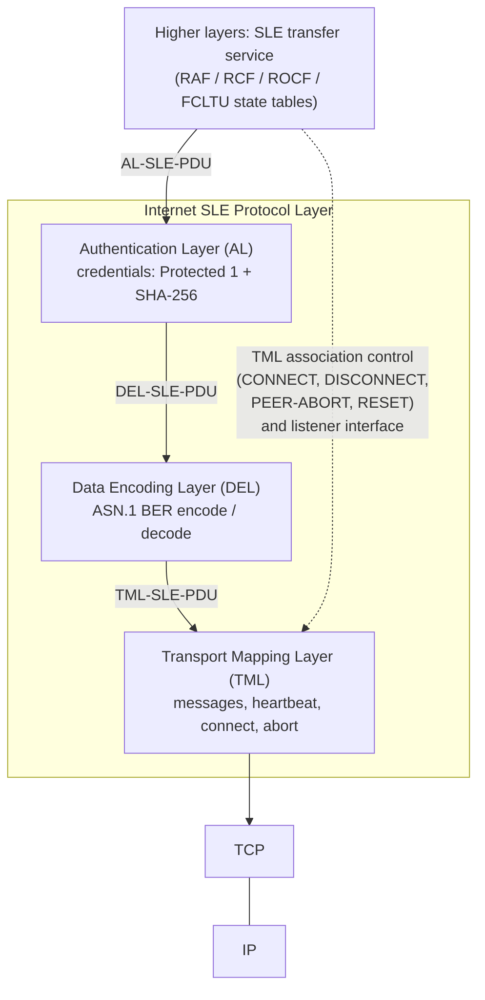
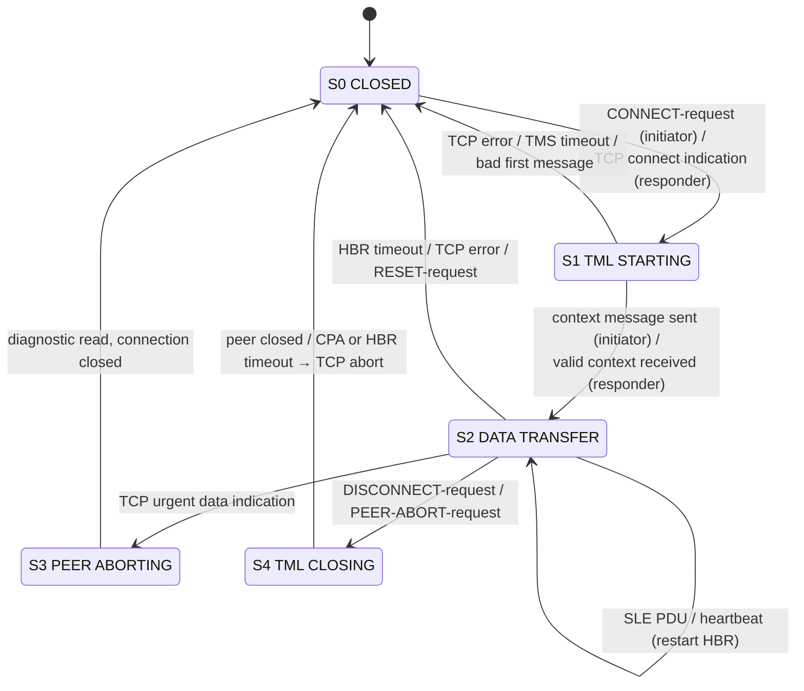
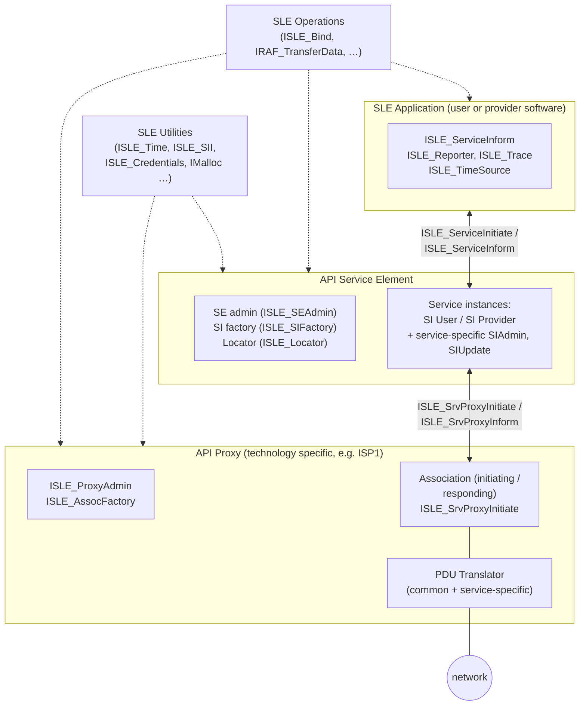

# SLE over TCP/IP (ISP1) and the SLE API

The SLE transfer service specifications define *what* is exchanged: operations, parameters and
ASN.1 types. They deliberately say nothing about the network. They require only an underlying
service that delivers PDUs in sequence, completely and with integrity, without duplication, with
flow control, and with notice of disruption.[^raf-comms] Two further CCSDS documents close that
gap. The **Internet SLE Protocol One** (ISP1, CCSDS 913.1-B-2) is a Recommended Standard that maps
SLE associations onto TCP connections.[^isp-purpose] The **SLE Application Program Interface**
(CCSDS 914.0-M-2) is a Recommended Practice that defines a C++ component architecture, so that SLE
user and provider software can be built from interchangeable packages.[^api-purpose] The 2006
concept report already described the API in the same layered way: an API Proxy for the
communications technology beneath an API Service Element for the service logic.[^csc-api]

The SLE concepts used here (associations, BIND, PEER-ABORT, credentials) are introduced on the
[SLE overview](index.md). The services carried are described on
[return services](return-services.md) and [FCLTU](fcltu.md).

!!! info "At a glance"
    | Item | ISP1 | SLE API |
    |---|---|---|
    | Document | CCSDS 913.1-B-2, Blue Book, September 2015[^isp-ctl] | CCSDS 914.0-M-2, Magenta Book, September 2015, Technical Corrigendum 1 (August 2016)[^api-ctl] |
    | Supersedes | 913.1-B-1 (September 2008), now historical 913.1-B-1-S[^isp-ctl][^isp-e10] | 914.0-M-1 (October 2008)[^api-ctl] |
    | Main change in current issue | One-way hash changed from SHA-1 to SHA-256[^isp-ctl] | Text updated to current service versions; Cor. 1 points to 913.1-B for the hash algorithm[^api-ctl] |
    | Layers / components | Authentication Layer, Data Encoding Layer, Transport Mapping Layer over TCP/IP[^isp-arch] | API Proxy, API Service Element, SLE Operations, SLE Utilities, plus the SLE Application[^api-pkgs] |
    | Encoding | ASN.1 BER (credentials hashed over DER)[^isp-del][^isp-al] | Technology hidden in the Proxy[^api-proxy] |
    | One association = | one TCP connection[^isp-arch] | one Association object in the Proxy[^api-proxy] |

## ISP1 architecture

ISP1 sits between the "higher layers" and TCP/IP. The higher layers are the SLE transfer service
logic: they build and analyse PDUs and run the state tables. ISP1 itself has three
sublayers:[^isp-arch]



Diagram based on figure 2-1 and the interface descriptions of CCSDS 913.1-B-2.[^isp-arch][^isp-if]

Two design rules shape the whole protocol:

* **One SLE association uses exactly one TCP connection.** Association establishment and release
  involve only the TML. Once established, every PDU passes through the DEL and the AL.[^isp-arch][^isp-tcp]
* **PEER-ABORT bypasses encoding.** The PEER-ABORT invocation is never BER-encoded. The TML sends
  its one-octet diagnostic as TCP urgent data.[^isp-del-desc][^isp-abort-desc]

ISP1 leaves open how its configuration parameters are defined, agreed, stored and made available
to an implementation.[^isp-arch]

## Authentication Layer

The AL adds credentials to outgoing PDUs and checks them on incoming ones, according to the
instance's authentication level: 'all' (every invocation and return except the PEER-ABORT
invocation), 'bind' (BIND invocation and return only) or 'none'.[^isp-al-desc] It uses the
"Protected 1" simple authentication procedure, with these inputs:[^isp-al]

* a **user name** of 3 to 16 characters, identical to the authority identifier in the BIND
  (`initiator-identifier` for the initiator, `responder-identifier` for the responder);
* a **password** of 6 to 16 octets;
* the **current time**, as an 8-octet CCSDS Day Segmented code without P-field;
* a **random number** from 0 to 2,147,483,647.

These four values are DER-encoded as a `HashInput` and hashed with SHA-256. The result is called
"the protected". The credentials carry the time, the random number and the digest, but not the user
name, which is already in the BIND.[^isp-al]

```text
HashInput ::= SEQUENCE              -- DER-encoded, then hashed with SHA-256
{ time          OCTET STRING (SIZE(8))      -- CDS, no P-field
, randomNumber  INTEGER (0 .. 2147483647)
, userName      VisibleString
, passWord      OCTET STRING
}

ISP1Credentials ::= SEQUENCE        -- carried inside Credentials 'used' [1] OCTET STRING
{ time          OCTET STRING (SIZE (8))
, randomNumber  INTEGER (0 .. 2147483647)
, theProtected  OCTET STRING (SIZE (20..32))  -- 32 for SHA-256; 20 allowed for SHA-1 peers
}
```

ASN.1 quoted from figures 3-1 and 3-2 of CCSDS 913.1-B-2.[^isp-al][^isp-del]

The receiver first checks that the credential time is within an acceptable delay of its own clock.
This maximum delay is a configuration parameter. It then recomputes the digest using the peer's
user name and password, and compares the two.[^isp-al][^isp-al-desc] The 20-octet option exists so
that implementations can stay compatible with peers built to the SHA-1 based 913.1-B-1.[^isp-del]
If authentication fails, the higher layers apply the transfer service rule: the PDU is ignored, as if
it had never arrived.[^raf-authfail]

**Worked example (illustrative values, real algorithm).** Take user name `MCS-USER`, password
`01 23 45 67 89 AB CD EF`, time `62 40 02 93 2E 7B 01 C8` (2026-11-12 12:00:00.123456 UTC; see
[return services](return-services.md#earth-receive-time)) and random number 0x12345678. The DER
`HashInput` is:

```text
30 24                                    SEQUENCE, 36 octets
   04 08 62 40 02 93 2E 7B 01 C8         time
   02 04 12 34 56 78                     randomNumber
   1A 08 4D 43 53 2D 55 53 45 52         userName "MCS-USER" (VisibleString)
   04 08 01 23 45 67 89 AB CD EF         passWord
```

Its SHA-256 digest is `C69510D1403E0E97C55A59F4D741C97DE919020E9CE006AC2303046B944C3020`. The
`ISP1Credentials` value is `30 32 04 08 62 40 02 93 2E 7B 01 C8 02 04 12 34 56 78 04 20` followed
by the 32 digest octets, 52 octets in all. Inside an SLE PDU this becomes `Credentials` →
`used [1]`, encoded `81 34` followed by those 52 octets. This wiki computed these bytes from the
ASN.1 definitions. The credentials are invented and are not from any real system.

!!! warning "Inference"
    The final step assumes the IMPLICIT TAGS encoding of the `Credentials` CHOICE alternative
    `used [1] OCTET STRING` (context-specific primitive tag 1 = 0x81). This follows from the RAF
    common types module,[^raf-cred] but ISP1 does not print a complete encoded example.

ISP1 is frank about the limits of this scheme. It provides authentication and access control only.
Confidentiality, integrity beyond what TCP gives, and strong authentication must come from a secure
channel through which ISP1 traffic is tunnelled, or from end-to-end protection of the mission
data.[^isp-sec][^isp-sec2]

## Data Encoding Layer

The DEL encodes and decodes every SLE PDU except the PEER-ABORT invocation. It uses the ASN.1 types
of the applicable service specification and the **Basic Encoding Rules**.[^isp-del-desc][^isp-del]
The first PDU on a new association must be a BIND invocation. Its `service-type` and
`version-number` tell the DEL which ASN.1 modules to use for everything that follows on the same
association. An unsupported service type or version is reported to the higher layers, which then
apply the BIND rules (for example 'service type not supported').[^isp-del-desc][^isp-del]

The top-level CHOICE tags of each service's user-to-provider and provider-to-user PDUs tell the
receiver which operation a PDU carries. These tags are listed on the
[return services](return-services.md#operations) and [FCLTU](fcltu.md#operations) pages.

**Worked example (illustrative, constructed from the ASN.1).** A RAF user sends STOP with
`invoke-ID` 5 and no credentials. `rafStopInvocation [2]` is a `SleStopInvocation`, which is a
SEQUENCE of `invokerCredentials` and `invokeId`.[^raf-in] With IMPLICIT TAGS, the alternative tag
replaces the SEQUENCE tag. Credentials 'unused' is `[0] NULL`, and the invoke-ID is an INTEGER:

```text
A2 05          [2] constructed (rafStopInvocation), length 5
   80 00       invokerCredentials = unused [0] NULL
   02 01 05    invokeId = 5
```

!!! warning "Inference"
    This encoding follows from the RAF ASN.1 modules (tag `[2]`, IMPLICIT TAGS, `Credentials`
    CHOICE, `InvokeId ::= IntUnsignedShort`).[^raf-in][^raf-cred][^raf-common] The common PDUs
    module, also under IMPLICIT TAGS, defines `SleStopInvocation` as a SEQUENCE of
    `invokerCredentials` and `invokeId` only.[^raf-stop] The library has no SLE capture to confirm
    the bytes.

## Transport Mapping Layer

### TML messages

TCP carries a byte stream, so the TML frames everything in **TML messages**: an 8-octet header
followed by a body of any length (not necessarily a multiple of four). All integers are big
endian.[^isp-msg][^isp-endian]

<div class="bitfield" data-title="TML message header (8 octets)" data-width="32"
     data-fields='[{"n":"Type ID","b":8,"d":"1 = SLE PDU, 2 = TML context, 3 = TML heartbeat"},
                   {"n":"Reserved","b":24,"v":"0"},
                   {"n":"Length","b":32,"d":"Number of octets in the message body (unsigned, big endian)"}]'></div>

| Type ID | Message | Body |
|---|---|---|
| 1 | SLE PDU message | One BER-encoded SLE PDU (never a PEER-ABORT) |
| 2 | TML context message | 12 octets: protocol ID, version, heartbeat parameters |
| 3 | TML heartbeat message | Empty (length 0) |

Sources: table 3-1 and §3.3.2.[^isp-msg][^isp-msg-desc]

<div class="bitfield" data-title="TML context message body (12 octets)" data-width="32"
     data-fields='[{"n":"Protocol ID","b":32,"v":"0x49535031","d":"ASCII I S P 1"},
                   {"n":"Reserved","b":24,"v":"0"},
                   {"n":"Version","b":8,"v":"1"},
                   {"n":"Heartbeat interval (s)","b":16,"d":"0 = heartbeat disabled"},
                   {"n":"Dead factor","b":16,"d":"Heartbeat intervals without traffic before the link is declared dead"}]'></div>

Field layout from figure 3-4.[^isp-msg]

**Worked examples (byte layouts from the standard, parameter values illustrative):**

| Message | Bytes |
|---|---|
| Context, heartbeat 30 s, dead factor 5 | `02 00 00 00 00 00 00 0C 49 53 50 31 00 00 00 01 00 1E 00 05` |
| Heartbeat | `03 00 00 00 00 00 00 00` |
| SLE PDU carrying the RAF STOP above | `01 00 00 00 00 00 00 07 A2 05 80 00 02 01 05` |
| PEER-ABORT 'return timeout' | one byte `06` sent as TCP urgent data (no TML header) |

The PEER-ABORT code 6 is the 'return timeout' value of `PeerAbortDiagnostic`.[^raf-pa-codes][^isp-abort]

### Heartbeat

TCP cannot tell an idle connection from a dead one. Some TCP implementations offer keep-alive
probes, but the Internet host requirements (STD 3, ISP1 reference [E7]) require their default
interval to be at least two hours, so ISP1 defines its own heartbeat.[^isp-hb-desc] Two parameters control it. The `heartbeat-interval` is the longest a TML
may stay silent, in seconds. The `dead-factor` is the number of intervals without any incoming
message after which the connection is declared dead. Two timers implement it:[^isp-hb]

* **HBT** (heartbeat transmit) runs for the heartbeat interval and is restarted on every message
  sent. When it expires, the TML sends a heartbeat message.
* **HBR** (heartbeat receive) runs for the interval × dead factor and is restarted on every message
  received. When it expires, the TML aborts TCP and reports a protocol abort with diagnostic
  'heartbeat receive timeout' (132).

With the illustrative values above, an idle TML sends a heartbeat every 30 s and gives up after
150 s of silence. A heartbeat interval of 0 disables the mechanism.[^isp-hb] The heartbeat is how
ISP1 meets the transfer services' requirement to detect communications failure, which they then
treat as a 'protocol abort'.[^raf-commfail]

### Connection establishment

```mermaid
sequenceDiagram
    participant I as Initiating TML (user)
    participant R as Responding TML (provider)
    Note over R: TML-START-LISTEN: passive open on the<br/>socket mapped from the responder port
    I->>R: TCP connect (socket from responder-port-identifier)
    Note over R: start TMS (start-up) timer
    I->>R: TML context message ('ISP1', v1, HB interval, dead factor)
    Note over I: start HBT and HBR;<br/>TML-CONNECT-confirmation
    Note over R: check header, protocol ID, version,<br/>heartbeat ranges, then start HBT;<br/>TML-CONNECT-indication
    I->>R: SLE PDU message: BIND invocation (BER)
    Note over R: first valid SLE PDU: stop TMS, start HBR
    R->>I: SLE PDU message: BIND return
    loop association lifetime
        I-->>R: SLE PDUs / heartbeats
        R-->>I: SLE PDUs / heartbeats
    end
```

Sequence based on §2.5.3–2.5.4 and §3.3.4 of CCSDS 913.1-B-2.[^isp-conn-desc][^isp-conn]

On the responding side, any failed check on the first message ends the connection silently with
TCP-ABORT and no TML diagnostic. This happens for a header that does not parse, a first message
that is not a context message, the wrong protocol ID or version, or a TMS timeout before the
context message and the first SLE PDU arrive.[^isp-conn] If the heartbeat parameters are out of
range, §2.5.3 describes a PEER-ABORT with the TML diagnostic 'heartbeat unacceptable' (Annex A
code 130, 'heartbeat parameters not acceptable'). The detailed §3.3.4 instead only says that the
TML starts its timer "if the values are acceptable", and §2.5.4.2 says it aborts with TCP-ABORT.[^isp-hb-desc][^isp-conn-desc][^isp-conn] The start-up
timer is ISP1's only defence against unauthenticated users holding resources open.[^isp-sec2] If
the TMS timer expires after the context message but before a valid SLE PDU, the TML also informs
the higher layers with a protocol abort.[^isp-conn]

**Redundant hosts.** A responder port identifier may map to several sockets. The initiator then
connects to all of them at once, keeps the first that succeeds, and aborts the others. This relies
on only one responding host listening at any time, and the standard leaves open how that is
ensured.[^isp-redundant][^isp-redundant2]

### Release and abort

| Procedure | Trigger | What the TML does |
|---|---|---|
| Orderly release (initiator) | TML-DISCONNECT-request after UNBIND | Closes the TCP connection[^isp-release] |
| Orderly release (responder) | TML-DISCONNECT-request after UNBIND return | Stops HBT, restarts HBR, and waits for the peer to close. Aborts if data arrive or HBR expires[^isp-release] |
| Peer abort | TML-PEER-ABORT-request | Sends the diagnostic as one urgent byte, stops HBT and HBR, starts **CPA** (close after peer abort). Discards incoming data, closes when the peer closes, and aborts TCP if CPA expires[^isp-abort] |
| Receiving an abort | TCP urgent data indication | Discards data up to the urgent byte and reads it. Codes 0–127 give PEER-ABORT-indication; TML codes give PROTOCOL-ABORT-indication. Then closes[^isp-abort] |
| Simultaneous aborts | Urgent data after sending one's own | Discards up to and including the urgent byte, closes, and does not report the peer's diagnostic[^isp-abort] |
| Silent abort | TML-RESET-request (for example on return timeout) | TCP-ABORT, nothing sent[^isp-abort] |
| Protocol abort | TCP error, send timeout, or peer close before DISCONNECT or urgent data | PROTOCOL-ABORT-indication[^isp-pabort] |

If the TCP API does not support ABORT, ISP1 allows TCP-ABORT to have the same effect as a normal
disconnect.[^isp-abort]

### Diagnostic code ranges and TML codes

PEER-ABORT diagnostics are a single octet. Codes 0 to 127 belong to the transfer service
specifications, 128 to 199 to ISP1, and 200 to 255 to implementations.[^isp-diag-desc]

| Code | TML diagnostic |
|---|---|
| 128 | TML protocol error (for example a context message received after start-up) |
| 129 | Badly formatted TML message |
| 130 | Heartbeat parameters not acceptable |
| 131 | Association establishment timeout |
| 132 | Heartbeat receive timeout |
| 133 | Unexpected disconnect by peer |
| 134 | Premature disconnect during peer abort |
| 135 | Timeout during peer abort |
| 199 | Other reason |

Sources: Annex A and §3.3.7.[^isp-codes][^isp-pdu]

### TML state machine



Diagram based on the states, events and predicates of §4.3–4.5; the normative table on PDF
pp. 62–65 has many more transitions.[^isp-states][^isp-table]

### Configuration

| Side | Per system | Per association |
|---|---|---|
| Initiator | Responder port identifier → one or more (IP address, TCP port) | Proposed heartbeat interval, proposed dead factor, CPA timeout |
| Responder | Responder port identifier → local socket | Acceptable heartbeat interval and dead factor ranges, TML start-up timeout, CPA timeout |
| AL (if level is 'all' or 'bind') | — | Local identifier and password, peer identifier and password, maximum credential age |

Sources: §2.3 and §2.5.8.[^isp-al-desc][^isp-config]

ISP1 recommends leaving the initiator's local socket unspecified (ephemeral port), and notes that a
responder may filter source addresses, for example with a firewall.[^isp-conn-desc]

### ISP1 and its ESA precursor

ISP1 grew out of ESA work. Its precursor was ESA's *Specification of an SLE API Proxy for TCP/IP and
ASN.1* (SLES-SW-API-0002-TOS-GCI, issue 1.1, February 2001), which took its authentication scheme and
service instance identifier from ESA's *SLE C++ Application Program Interface for Transfer
Services* (SLES-SW-API-0001-TOS-GCI, December 2000).[^isp-annexb][^isp-refs] When ISP1 was
published, all known SLE implementations were based on the ESA proxy specification. Two
differences remain:[^isp-annexb]

* That generation used draft service specifications with BIND version 1 (RAF 911.1-R-1.7, RCF
  911.2-R-1.7, CLTU 912.1-R-1.99h), whose ASN.1 differs. An initiator talking to such a responder
  must send version 1 and use the old types. The BIND encoding itself did not change.
* Old service instance identifiers distinguished `vcf=` and `mcf=`. The standard uses `rcf=`, so a
  timely online RCF instance was `vcf=onlt1` or `mcf=onlt1` and is now `rcf=onlt1`.

## The SLE API (CCSDS 914.0-M-2)

### Purpose and scope

The SLE API is a C++ API, independent of the communications technology, for applications that
implement SLE services in either the user or the provider role. It also aims to simplify gateways
between different technologies. Its goal is that an API package for a platform can be supplied to
a new SLE user and integrated with little investment.[^api-purpose] It defines components,
their functions, their interfaces and their externally visible behaviour, but not implementations,
internal design or the communications technology.[^api-scope] Service-specific API books
complement the core:[^api-scope][^api-refs]

| Book | Service |
|---|---|
| CCSDS 915.1-M-2 | RAF API |
| CCSDS 915.2-M-2 | RCF API |
| CCSDS 915.5-M-2 | ROCF API |
| CCSDS 916.1-M-2 | FCLTU API |
| CCSDS 916.3-M-2 | FSP API |

Two optional features of the service standards are deliberately left out. BIND version negotiation
is not supported: an unsupported version is simply rejected. Provider-initiated binding is not
supported either, although the management parameters for it exist.[^api-scope2]

### Generations of SLE services supported

| Generation | Services and BIND version | Peer TML |
|---|---|---|
| 1 | RAF, RCF, FCLTU version 1 | ESOC *Specification of a SLE API Proxy for TCP/IP and ASN.1* (SLES-SW-API-0002-TOS-GCI issue 1.1) |
| 2 | RAF, RCF, FCLTU version 2; ROCF and FSP version 1 | ISP1 (913.1) |
| 3 | RAF, RCF, ROCF, FCLTU and FSP version 4 | ISP1 (913.1) |

Generations 1 and 2 are kept only for backward compatibility and may be dropped. Provisions are
marked [Gn:] in the text.[^api-gen]

!!! warning "Not covered by the library"
    The 2023 service issues used elsewhere on these pages define BIND version 6 (see the
    [overview](index.md#bind-unbind-and-peer-abort-in-detail)). This 2015 API book lists
    generations only up to version 4. Whether a later API issue covers versions 5 and 6 is
    not stated in the available sources.

### Components



Diagram based on figures 2-2 and 2-3 and §2.3 of CCSDS 914.0-M-2.[^api-pkgs][^api-proxy]

* **API Proxy.** All technology-specific functions live here, hidden from clients. The Proxy also
  enforces system-level access control and authenticates peers. `ISLE_ProxyAdmin` configures it.
  `ISLE_AssocFactory` creates Associations, which exchange PDUs through `ISLE_SrvProxyInitiate` and
  the client-supplied `ISLE_SrvProxyInform`. The PDU Translator converts between API operation
  objects and the transfer encoding; it is the only part of the Proxy that depends on the service
  type. A Proxy declares its technology with a *Protocol ID*, and the service element can use
  several proxies.[^api-proxy][^api-protocol]
* **API Service Element.** It holds the service instances. A service instance checks that PDUs
  fit its role, service type and version. For return services, a *SI User* unpacks each
  TRANSFER-BUFFER into individual TRANSFER-DATA and SYNC-NOTIFY operations. A *SI Provider* fills
  the transfer buffer, runs the release timer, performs the timely online discard, and answers
  GET-PARAMETER and status reporting itself.[^api-si-user][^api-si-prov]
* **SLE Operations.** These are operation objects for each SLE operation, such as `ISLE_Bind`,
  `ISLE_Unbind`, `ISLE_PeerAbort`, `ISLE_Stop`, `ISLE_ScheduleStatusReport`, `ISLE_TransferBuffer`
  and `IRAF_TransferData`, all derived from `ISLE_Operation` or `ISLE_ConfirmedOperation`.[^api-ops]
* **SLE Utilities.** Helper objects for time, service instance identifiers, credentials, security
  attributes and memory (`IMalloc`, a subset of the COM memory manager).[^api-util][^api-malloc]
* **SLE Application.** Supplied by the user of the API, not part of it. It must provide
  `ISLE_ServiceInform`, logging (`ISLE_Reporter`), optional tracing (`ISLE_Trace`) and a time
  source.[^api-app][^api-e7]

All interfaces derive from a COM-style `IUnknown`, so objects are navigated with
`QueryInterface()`. Each interface has a GUID. Compatibility between applications built against
different API issues is guaranteed only for interfaces with the same GUID.[^api-com][^api-gen-compat]

### Flow control and buffering

The API pushes the SLE buffering rules down into the service element and the Proxy, so that
applications see only operations:[^api-si-user][^api-si-prov][^api-queue]

* **Inbound limits.** An Association stops reading from the network when more than N1 received
  PDUs, or N2 ≤ N1 TRANSFER-DATA or TRANSFER-BUFFER PDUs, are waiting for the client. This builds
  back-pressure on TCP.
* **Outbound queue.** A positive transmission request means only "queued". On request, the
  Association reports actual transmission. It can also remove TRANSFER-BUFFER PDUs that have not
  started transmission. This is how the timely online discard is implemented: if the previous
  buffer has not been sent, it is discarded and the next buffer starts with a 'data discarded due
  to excessive backlog' notification.
* **Application back-pressure.** In complete online and offline modes, and for forward services,
  the service instance returns a code telling the application to suspend data transfer. It calls
  `ResumeDataTransfer()` on `ISLE_ServiceInform` when transfer can continue.

```mermaid
sequenceDiagram
    participant App as Provider application
    participant SI as SI Provider (service element)
    participant As as Association (proxy)
    App->>SI: TRANSFER-DATA (frame n)
    SI->>SI: add to transfer buffer;<br/>start release timer if first
    Note over SI: buffer full or<br/>release timer expired
    SI->>As: TRANSFER-BUFFER invocation
    As-->>SI: queued
    App->>SI: TRANSFER-DATA (frame n+k)
    Note over SI: next buffer due but previous<br/>not yet transmitted (timely online)
    SI->>As: discard queued TRANSFER-BUFFER
    As-->>SI: discarded
    SI->>As: TRANSFER-BUFFER ('data discarded' + new frames)
```

Illustrative sequence based on §2.3.3.5 of CCSDS 914.0-M-2.[^api-si-prov]

### Sequential and concurrent behaviour

Every component exposes one of two threading models, through `ISLE_Sequential` or
`ISLE_Concurrent`. *Sequential* means only one flow of control passes an interface at a time. The
application then has to provide an event loop and timers (`ISLE_EventMonitor`,
`ISLE_TimerHandler`). *Concurrent* means several threads may call in at once; the term maps to
UML's "concurrent or guarded". A service element can use different models towards the application
and towards the proxy. An implementation must support at least one model, and an application must
handle the control interface of the model it uses.[^api-seq][^api-e5][^api-e7]

### Pass-through mode for gateways

As an option, the Proxy supports a *pass-through* mode for gateways. In this mode it does not insert
its own application identifier into BIND invocations and returns, but forwards the identifiers in
the operation objects. This keeps end-to-end identification and authentication between the real
user and the real provider.[^api-pass]

### States

The Proxy's association state table uses five states: S1 UNBOUND, S2 BIND PEND, S3 BOUND, S4 LOC
UNBIND PEND and S5 REM UNBIND PEND.[^api-assoc-states] The service instance state tables reuse the
transfer services' main states ('unbound', 'ready', 'active') and add sub-states that track
pending returns between the application and the proxy.[^api-si-states]

### Options and limits

| Component | Parameter | Minimum an implementation must support |
|---|---|---|
| Proxy | Concurrent bound associations per process / per system | 1 / 1 |
| Proxy | Ports for outgoing BIND per process; ports for incoming BIND per process / per system | 1 each |
| Proxy | Queued incoming PDUs; queued incoming TRANSFER-DATA or BUFFER (per association / per process) | 1/1 each |
| Proxy | Queued outgoing PDUs; pending remote returns per association | 1 each |
| Proxy | **Maximum PDU size** | **100 KB** |
| Service element | Concurrent service instances, bound instances, proxies, pending remote and local returns | 1 each |

Sources: Annex E tables E-3 and E-4.[^api-limits] The service element must support the user role,
the provider role, or both (options SEO-1a/b/c), and sequential, concurrent or both flows of control
(SEO-2a/b/c).[^api-e5]

!!! warning "Inference"
    The 100 KB PDU minimum matters for return services. A transfer buffer of 200 RAF
    TRANSFER-DATA invocations (the RAF conformance minimum[^raf-conf]) of 1,115-octet Solar Orbiter
    frames already holds 223,000 octets of frame data, more than twice the 100 KB minimum, before
    any annotation or encoding overhead. An implementation built to the minimum
    would therefore need a smaller `transfer-buffer-size` for that mission. Real products are
    expected to support higher limits.[^api-limits]

## ESA and the SLE API

Both documents record ESA's early role. The ISP1 precursor and the original C++ API specification
were ESA documents (SLES-SW-API-0002-TOS-GCI and SLES-SW-API-0001-TOS-GCI). Generation 1 of the
CCSDS API keeps interoperability with peers that follow the ESOC TML specification.[^isp-annexb][^isp-refs][^api-gen]
The ECSS communications handbook points to the ESA ground operations software portal, which
includes "the ESA SLE Gateway".[^hb-gw] SCOS-2000 reaches SLE providers through the NCTRS and NIS
rather than by embedding an SLE API directly, as described on the [SLE overview](index.md#how-esas-ground-segment-uses-sle).

!!! warning "Inference"
    "ESA SLE API" usually refers to an ESA-developed implementation of this Recommended Practice.
    Its version history, licensing and use inside NIS are not stated in the available sources.

## Related pages

* [SLE overview](index.md), [return services](return-services.md), [FCLTU](fcltu.md)
* [NCTRS, NIS and the ground station interface](../../scos2000/nctrs-nis.md),
  [SCOS-2000 architecture](../../scos2000/architecture.md)
* [Time codes](../time-codes.md) for the CDS time used in credentials
* Library: [CCSDS 913.1-B-2](../../library/ccsds-913-1-913x1b2.md),
  [CCSDS 914.0-M-2](../../library/ccsds-914-0-914x0m2c1.md); all sources in the
  [reference catalogue](../../references/index.md); terms in the [glossary](../../glossary.md)

[^raf-comms]: [CCSDS 911.1-B-5, SLE RAF Service](../../library/ccsds-911-1-911x1b5e1.md), §1.3.1 Applicability (communications service requirements), PDF pp. 9–10.
[^isp-purpose]: [CCSDS 913.1-B-2, SLE Internet Protocol for Transfer Services](../../library/ccsds-913-1-913x1b2.md), §1.1–1.2 Purpose and scope, PDF pp. 10–11.
[^api-purpose]: [CCSDS 914.0-M-2, API for SLE Transfer Services—Core Specification](../../library/ccsds-914-0-914x0m2c1.md), §1.1 Purpose, PDF p. 11.
[^isp-ctl]: [CCSDS 913.1-B-2](../../library/ccsds-913-1-913x1b2.md), Document Control, PDF p. 7.
[^api-ctl]: [CCSDS 914.0-M-2](../../library/ccsds-914-0-914x0m2c1.md), Document Control, PDF p. 7.
[^isp-e10]: [CCSDS 913.1-B-2](../../library/ccsds-913-1-913x1b2.md), Annex E reference [E10], PDF p. 73.
[^isp-arch]: [CCSDS 913.1-B-2](../../library/ccsds-913-1-913x1b2.md), §2.2 Architectural model and figure 2-1, PDF pp. 19–20.
[^api-pkgs]: [CCSDS 914.0-M-2](../../library/ccsds-914-0-914x0m2c1.md), §2.3.1 Structure and figure 2-2, PDF pp. 29–30.
[^isp-del]: [CCSDS 913.1-B-2](../../library/ccsds-913-1-913x1b2.md), §3.2 Data Encoding Layer and figure 3-2, PDF p. 46.
[^isp-al]: [CCSDS 913.1-B-2](../../library/ccsds-913-1-913x1b2.md), §3.1 Authentication Layer and figure 3-1, PDF pp. 44–46.
[^api-proxy]: [CCSDS 914.0-M-2](../../library/ccsds-914-0-914x0m2c1.md), §2.3.2.1 API Proxy overview and figure 2-3, PDF pp. 30–31.
[^isp-if]: [CCSDS 913.1-B-2](../../library/ccsds-913-1-913x1b2.md), §2.6 Interfaces, tables 2-1 to 2-7, PDF pp. 29–31.
[^isp-tcp]: [CCSDS 913.1-B-2](../../library/ccsds-913-1-913x1b2.md), §3.3.1 Technology, PDF p. 47.
[^isp-del-desc]: [CCSDS 913.1-B-2](../../library/ccsds-913-1-913x1b2.md), §2.4 Data Encoding Layer, PDF p. 22.
[^isp-abort-desc]: [CCSDS 913.1-B-2](../../library/ccsds-913-1-913x1b2.md), §2.5.5 Aborting connections, PDF p. 27.
[^isp-al-desc]: [CCSDS 913.1-B-2](../../library/ccsds-913-1-913x1b2.md), §2.3 Authentication Layer, PDF pp. 21–22.
[^raf-authfail]: [CCSDS 911.1-B-5](../../library/ccsds-911-1-911x1b5e1.md), §4.1.7 Failing authentication, PDF p. 102.
[^raf-cred]: [CCSDS 911.1-B-5](../../library/ccsds-911-1-911x1b5e1.md), Annex A2.1 `Credentials` (IMPLICIT TAGS module), PDF p. 115.
[^isp-sec]: [CCSDS 913.1-B-2](../../library/ccsds-913-1-913x1b2.md), §2.7.1–2.7.2.5 Security background and concerns, PDF pp. 40–41.
[^isp-sec2]: [CCSDS 913.1-B-2](../../library/ccsds-913-1-913x1b2.md), §2.7.2.6–2.7.3, PDF p. 42.
[^raf-in]: [CCSDS 911.1-B-5](../../library/ccsds-911-1-911x1b5e1.md), Annex A2.6 RAF incoming PDUs (`rafStopInvocation [2] SleStopInvocation`), PDF p. 132.
[^raf-common]: [CCSDS 911.1-B-5](../../library/ccsds-911-1-911x1b5e1.md), Annex A2.1 `InvokeId`, `IntUnsignedShort`, PDF p. 116.
[^raf-stop]: [CCSDS 911.1-B-5](../../library/ccsds-911-1-911x1b5e1.md), Annex A2.3 SLE transfer service common PDUs (`SleStopInvocation`), PDF pp. 122–123.
[^isp-msg]: [CCSDS 913.1-B-2](../../library/ccsds-913-1-913x1b2.md), §3.3.2 TML messages, table 3-1, figures 3-3 and 3-4, PDF pp. 47–48.
[^isp-endian]: [CCSDS 913.1-B-2](../../library/ccsds-913-1-913x1b2.md), §3.3.2.2.6, PDF p. 49.
[^isp-msg-desc]: [CCSDS 913.1-B-2](../../library/ccsds-913-1-913x1b2.md), §2.5.2 TML messages, PDF pp. 23–24.
[^raf-pa-codes]: [CCSDS 911.1-B-5](../../library/ccsds-911-1-911x1b5e1.md), Annex A2.2 `PeerAbortDiagnostic`, PDF p. 121.
[^isp-abort]: [CCSDS 913.1-B-2](../../library/ccsds-913-1-913x1b2.md), §3.3.6.1–3.3.6.2 Peer abort and silent abort, PDF pp. 53–54.
[^isp-hb-desc]: [CCSDS 913.1-B-2](../../library/ccsds-913-1-913x1b2.md), §2.5.3 Monitoring of the status of the TCP connection, PDF pp. 24–25.
[^isp-hb]: [CCSDS 913.1-B-2](../../library/ccsds-913-1-913x1b2.md), §3.3.3 Heartbeat mechanism, PDF p. 49.
[^raf-commfail]: [CCSDS 911.1-B-5](../../library/ccsds-911-1-911x1b5e1.md), §4.1.5 Communications failure, PDF pp. 100–101.
[^isp-conn-desc]: [CCSDS 913.1-B-2](../../library/ccsds-913-1-913x1b2.md), §2.5.4 Connection establishment and release, PDF pp. 25–26.
[^isp-conn]: [CCSDS 913.1-B-2](../../library/ccsds-913-1-913x1b2.md), §3.3.4 Connection establishment, PDF pp. 50–52.
[^isp-redundant]: [CCSDS 913.1-B-2](../../library/ccsds-913-1-913x1b2.md), §2.5.7 Redundant hosts, PDF p. 28.
[^isp-redundant2]: [CCSDS 913.1-B-2](../../library/ccsds-913-1-913x1b2.md), §3.3.8 Connection establishment to redundant hosts, PDF pp. 55–56.
[^isp-release]: [CCSDS 913.1-B-2](../../library/ccsds-913-1-913x1b2.md), §3.3.5 Orderly connection release, PDF p. 52.
[^isp-pabort]: [CCSDS 913.1-B-2](../../library/ccsds-913-1-913x1b2.md), §3.3.6.3 Protocol abort, PDF p. 55.
[^isp-diag-desc]: [CCSDS 913.1-B-2](../../library/ccsds-913-1-913x1b2.md), §2.5.6 Error reporting, PDF p. 27.
[^isp-codes]: [CCSDS 913.1-B-2](../../library/ccsds-913-1-913x1b2.md), Annex A TML diagnostic codes, PDF p. 66.
[^isp-pdu]: [CCSDS 913.1-B-2](../../library/ccsds-913-1-913x1b2.md), §3.3.7 SLE PDU transfer, PDF p. 55.
[^isp-states]: [CCSDS 913.1-B-2](../../library/ccsds-913-1-913x1b2.md), §4.3–4.5 States, events and predicates, PDF pp. 58–60.
[^isp-table]: [CCSDS 913.1-B-2](../../library/ccsds-913-1-913x1b2.md), §4.7 State table, PDF pp. 62–65.
[^isp-config]: [CCSDS 913.1-B-2](../../library/ccsds-913-1-913x1b2.md), §2.5.8 TML configuration, PDF pp. 28–29.
[^isp-annexb]: [CCSDS 913.1-B-2](../../library/ccsds-913-1-913x1b2.md), Annex B Differences with earlier implementations, PDF pp. 67–68.
[^isp-refs]: [CCSDS 913.1-B-2](../../library/ccsds-913-1-913x1b2.md), Annex E informative references [E2]–[E6], PDF p. 73.
[^api-scope]: [CCSDS 914.0-M-2](../../library/ccsds-914-0-914x0m2c1.md), §1.2.1 Items covered, PDF p. 11.
[^api-refs]: [CCSDS 914.0-M-2](../../library/ccsds-914-0-914x0m2c1.md), §1.7 normative references [10]–[14], PDF pp. 21–22.
[^api-scope2]: [CCSDS 914.0-M-2](../../library/ccsds-914-0-914x0m2c1.md), §1.2.2 Conformance to CCSDS Recommended Standards, PDF p. 12.
[^api-gen]: [CCSDS 914.0-M-2](../../library/ccsds-914-0-914x0m2c1.md), §1.3 Applicability, PDF pp. 12–13.
[^api-protocol]: [CCSDS 914.0-M-2](../../library/ccsds-914-0-914x0m2c1.md), §2.3.2.2.3.1 Protocol ID and §2.3.3 (several proxies), PDF pp. 32–34 and 47.
[^api-si-user]: [CCSDS 914.0-M-2](../../library/ccsds-914-0-914x0m2c1.md), §2.3.3.4 Internal class SI User, PDF p. 54.
[^api-si-prov]: [CCSDS 914.0-M-2](../../library/ccsds-914-0-914x0m2c1.md), §2.3.3.5 Internal class SI Provider, PDF pp. 55–56.
[^api-ops]: [CCSDS 914.0-M-2](../../library/ccsds-914-0-914x0m2c1.md), §2.3.6 Package SLE Operations, PDF pp. 70–77.
[^api-util]: [CCSDS 914.0-M-2](../../library/ccsds-914-0-914x0m2c1.md), §2.3.7 Package SLE Utilities, PDF pp. 78–80.
[^api-malloc]: [CCSDS 914.0-M-2](../../library/ccsds-914-0-914x0m2c1.md), §3.5.2 Memory management, PDF p. 138.
[^api-app]: [CCSDS 914.0-M-2](../../library/ccsds-914-0-914x0m2c1.md), §2.3.5 Package SLE Application, PDF pp. 66–70.
[^api-e7]: [CCSDS 914.0-M-2](../../library/ccsds-914-0-914x0m2c1.md), Annex E7 SLE applications, PDF p. 339.
[^api-com]: [CCSDS 914.0-M-2](../../library/ccsds-914-0-914x0m2c1.md), §2.2 (component model, `IUnknown`, `QueryInterface()`, COM conventions), PDF pp. 26–28.
[^api-gen-compat]: [CCSDS 914.0-M-2](../../library/ccsds-914-0-914x0m2c1.md), Annex E4 Backward compatibility (GUIDs), PDF p. 335.
[^api-queue]: [CCSDS 914.0-M-2](../../library/ccsds-914-0-914x0m2c1.md), §2.3.2.3.2.6–2.3.2.3.2.8 queuing, removal of transfer buffers, inbound limits, PDF p. 37.
[^api-seq]: [CCSDS 914.0-M-2](../../library/ccsds-914-0-914x0m2c1.md), §2.3.4 Common control interfaces (sequential and concurrent behaviour), PDF pp. 59–60.
[^api-e5]: [CCSDS 914.0-M-2](../../library/ccsds-914-0-914x0m2c1.md), Annex E5 Options, table E-2, PDF pp. 335–337.
[^api-pass]: [CCSDS 914.0-M-2](../../library/ccsds-914-0-914x0m2c1.md), §3.2.7 Pass-through mode of operation, PDF pp. 99–100.
[^api-assoc-states]: [CCSDS 914.0-M-2](../../library/ccsds-914-0-914x0m2c1.md), §4.4.2 Association states, PDF p. 160.
[^api-si-states]: [CCSDS 914.0-M-2](../../library/ccsds-914-0-914x0m2c1.md), §4.5.3.1 Provider side states, PDF pp. 174–175.
[^api-limits]: [CCSDS 914.0-M-2](../../library/ccsds-914-0-914x0m2c1.md), Annex E6 Limits, tables E-3 and E-4, PDF pp. 338–339.
[^raf-conf]: [CCSDS 911.1-B-5](../../library/ccsds-911-1-911x1b5e1.md), Annex C table C-2 (transfer buffer minimum 200 invocations), PDF p. 141.
[^hb-gw]: [ECSS-E-HB-50A Communications guidelines](../../library/ecss-e-hb-50a-15november2008.md), §7.3 Ground components, PDF p. 142.
[^csc-api]: [CCSDS 910.3-G-3, Cross Support Concept Part 1](../../library/ccsds-910x3g3-sle-cross-support.md), §4.7 The SLE application program interface, PDF pp. 37–38.
