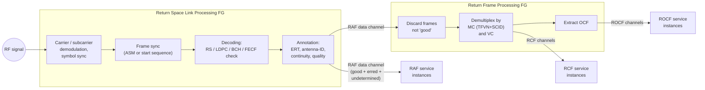
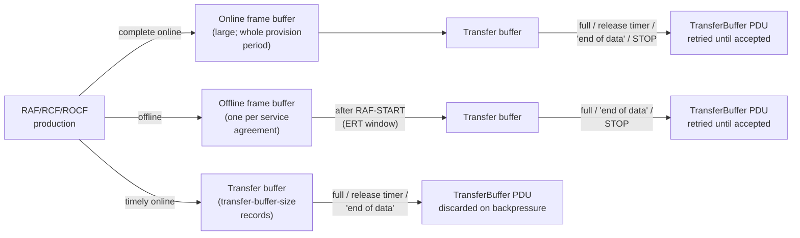
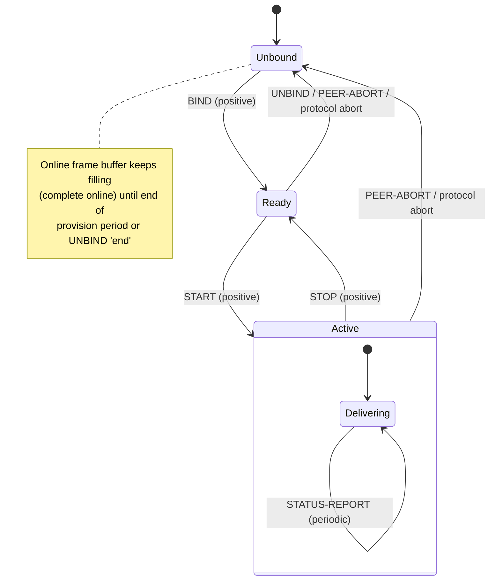
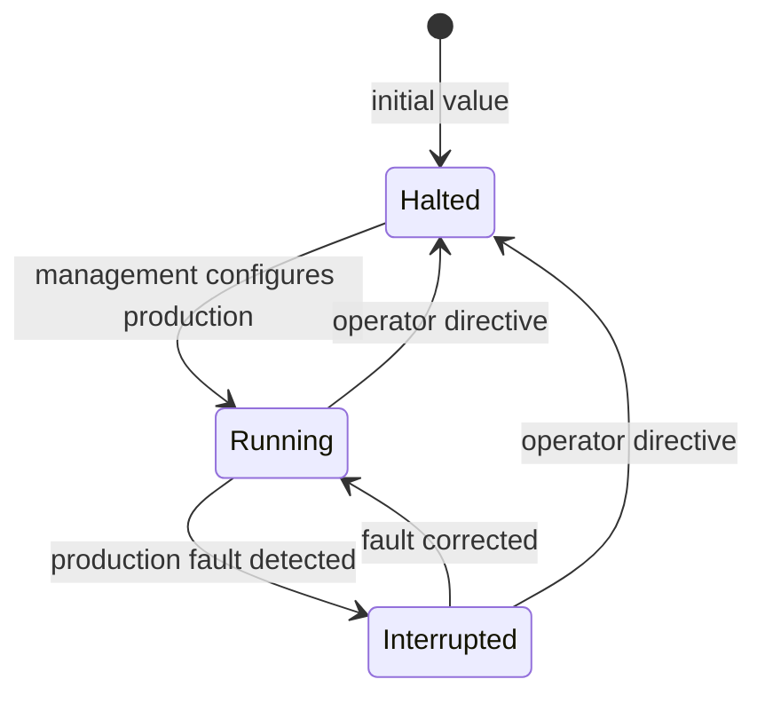
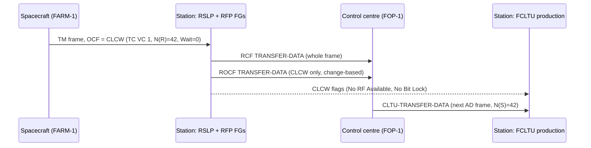
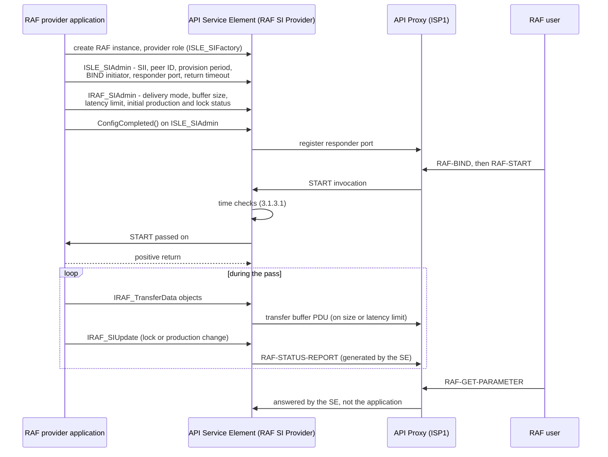

# SLE return services: RAF, RCF and ROCF

The SLE **return** services carry what a ground station receives from a spacecraft to the users
who need it. **Return All Frames** (RAF) delivers every telemetry frame of one physical channel,
including frames that failed decoding if the user asks for them.[^raf-purpose] **Return Channel
Frames** (RCF) delivers only the good frames of one Master Channel or one Virtual Channel.[^rcf-purpose]
**Return Operational Control Fields** (ROCF) delivers only the 4-octet Operational Control Fields
(OCFs) of those frames, typically the CLCWs that the spacecraft uses to report the state of its
telecommand receiver.[^rocf-purpose] The three services share the same operations, delivery modes,
buffering rules and state machine. They differ in what they select and what they annotate.

This page assumes the concepts on the [SLE overview](index.md): providers and users, service
instances, BIND/UNBIND/PEER-ABORT, and access control. The architecture behind them is on
[the cross support reference model and service management](service-management.md), and the
software side on [ISP1 and the SLE API](isp1-and-api.md). The frames themselves are described on
[TM Space Data Link Protocol](../tm-sdlp.md), [AOS](../aos.md) and [USLP](../uslp.md), and the
coding that the station undoes on [TM synchronization and channel coding](../tm-coding.md).

!!! info "At a glance"
    | Item | RAF | RCF | ROCF |
    |---|---|---|---|
    | Specification (library issue) | CCSDS 911.1-B-5, July 2023[^raf-ctl] | CCSDS 911.2-B-4, July 2023[^rcf-ctl] | CCSDS 911.5-B-4, July 2023[^rocf-ctl] |
    | Data unit delivered | Whole frame (TM, AOS or USLP), good or erred | Whole good frame of the selected MC or VC | 32-bit OCF of each good frame of the selected MC or VC |
    | Produced by | Return Space Link Processing FG | + Return Frame Processing FG | + Return Frame Processing FG |
    | Selection at START | `requested-frame-quality` | `requested-global-VCID` | GVCID + `control-word-type`, `tc-vcid`, `update-mode` |
    | `ApplicationIdentifier` / service-type | `rtnAllFrames (0)` | `rtnChFrames (2)` | `rtnChOcf (4)` |
    | SII service attribute | `raf` (OID arc 22) | `rcf` (46) | `rocf` (49) |
    | BIND `version-number` in this issue | 6 | 6 | 6 |
    | Delivery modes | timely online, complete online, offline (one per instance)[^raf-sm] | same | same |

    Sources for the SII arcs and application identifiers: the common ASN.1 modules.[^raf-sii-oid][^raf-appid]

## Where the services sit in the ground station

All three services start from the same processing chain. The **Return Space Link Processing**
functional group (RSLP-FG) receives the RF signal and produces the RAF data channel: it
demodulates the carrier and subcarrier, recovers symbols, synchronises frames, decodes them, and
annotates each frame with its earth receive time (ERT), antenna, quality and continuity. The
**Return Frame Processing** functional group (RFP-FG) consumes that RAF data channel. It discards
every frame whose quality is not 'good', demultiplexes the rest into Master Channels and Virtual
Channels, and, for ROCF, decommutates the OCF from each frame.[^raf-rslp][^rcf-rfp][^rocf-rfp]



Diagram based on the functional views of the three specifications.[^raf-rslp][^rcf-rfp][^rocf-rfp]

The [cross support reference model](index.md#the-cross-support-reference-model) gives the full
function lists of the two groups. Real implementations may provide only a subset of a group's
services and functions; the service specifications say which functions each service needs.[^csrm-rfg]

| Return Space Link Processing SLE-FG | Return Frame Processing SLE-FG |
|---|---|
| Uses the ground element's antenna steering and acquires the RF carrier | Consumes one RAF data channel |
| Demodulates the carrier into one or more physical channels (symbol streams) | Demultiplexes it into Master Channels by MCID (frame version number + SCID) and annotates each MC frame |
| Frame-synchronises and extracts the frames; convolutional decoding may come before or after frame sync | Demultiplexes each Master Channel into Virtual Channels by GVCID (MCID + VCID) and annotates each VC frame |
| Error-decodes: optional convolutional decoding, derandomisation, Reed-Solomon decoding and CRC check | Decommutates the OCF and the frame secondary header, per MC or per VC |
| Annotates each frame into an RAF SLE-SDU and injects it into the RAF channel of its physical channel | Stores enough data for later offline reconstruction, relative either to the source RAF channel or to each product channel |
| Decommutates the AOS insert zone into the Return Insert channel | Retrieves stored data and rebuilds the channels for offline instances |
| Stores and later retrieves enough data to rebuild the RAF channel for offline instances | |

Source: §4.3.2.1.1 and §4.3.2.1.2 of the reference model.[^csrm-rfg] The model names RAF and the
Return VC Frames service as the two return services used for cross support between functional
groups; like every service exposed between groups, both are also available to the MDOS.[^csrm-rfg] The 2005 model lists Master Channel and Virtual Channel frame services,
and Master Channel and Virtual Channel OCF services, as four distinct services. RCF and ROCF each
merge one pair.[^rcf-purpose][^rocf-purpose] The model's Master Channel OCF and FSH channels exist
only for TM (version 1) master channels, and its VC-FSH channel only for TM virtual channels.[^csrm-chan]

The services assume a stable physical channel. At any one time all frames on a channel must use
the same coding options and, for TM, the same frame length, and the station learns these through
service management rather than from the data.[^raf-coding][^raf-quality-notes] The reference model
gives the sharpest example: Reed-Solomon coding must be present on all frames of a physical
channel or on none, even where the space link standards would allow a mix.[^csrm-rfg] The concept report
puts it from the other side: to offer channel frames, a provider must implement both the frame
processing and the space link processing functional groups.[^csc-ret-fg]

### What "good" means

The RSLP-FG annotates a frame as **good** if, after decoding, it consists only of valid
Reed-Solomon or LDPC codewords, or, for a frame that uses neither code, if its Frame Error Control
Field checks correctly. A USLP frame is good if it passes the USLP frame validation checks (except
for the checks of §4.3.10.3.4 c) of the USLP standard). If Reed-Solomon is the outer code of a
concatenated scheme, the same rule applies.[^raf-quality][^rcf-good] **Erred** means that at least
one codeword is invalid or the FECF fails. **Undetermined** means the coding scheme is unknown or
unsupported, or the result is not provided, and the exact meaning is implementation
dependent.[^raf-quality] The optional Header Error Control field of AOS frames is disregarded when
the RAF service reports frame quality.[^raf-quality-notes]

### What exactly is in the `data` parameter

The RAF specification defines precisely how a frame is trimmed before delivery. RCF and ROCF only
ever deliver good frames, so only the first case applies to them.[^raf-data][^rcf-data]

| Frame quality and coding | What RAF puts in `data` |
|---|---|
| good, Reed-Solomon | Frame with the RS check symbols removed |
| good, LDPC | Frame with parity bits and trailing fill bits removed |
| good, BCH | Error Control octet of each BCH codeword removed, and fill bits of the last codeword removed |
| erred, convolutional / turbo / LDPC / uncoded | Output of the decoder, the same length as a good frame (for an uncoded frame, the frame as acquired) |
| erred, Reed-Solomon | The entire candidate codeblock as presented to the RS decoder, unmodified, so offline re-decoding may still succeed |
| erred, BCH | The decoder output; fill bits cannot be removed, so the length may differ |
| undetermined | A data unit of frame length identified during frame synchronisation; frame or codeblock, in the symbol or bit domain, implementation dependent |

The Attached Sync Marker is never included.[^raf-data2] If the frames are protected with the Space
Data Link Security protocol, the protection is transparent to the service, and security headers and
trailers are left to the applications that consume the frames.[^raf-data2] See
[SDLS](../sdls.md).

The ROCF `data` parameter is the OCF extracted from the frame, nothing else.[^rocf-td]

## Annotation: what the station adds to each data unit

Each delivered frame or OCF is wrapped in a TRANSFER-DATA invocation that carries the station's
annotation.[^raf-td][^rcf-td][^rocf-td]

| Parameter | RAF | RCF | ROCF | Content |
|---|:-:|:-:|:-:|---|
| `invoker-credentials` | M | M | M | Authentication data (or 'unused') |
| `earth-receive-time` | M | M | M | UTC time of the frame's leading edge at the antenna (below) |
| `antenna-ID` | M | M | M | Which antenna acquired the frame: an OID (global form) or 1 to 16 octets (local form); values agreed by CM and UM |
| `data-link-continuity` | M | M | M | −1, 0, or an estimate of missing frames (rules differ per service, below) |
| `delivered-frame-quality` | M | — | — | good (0), erred (1), undetermined (2) |
| `private-annotation` | M | M | M | 'null' or 1 to 128 octets with a meaning agreed in advance |
| `data` | M | M | M | Frame (RAF, RCF) or OCF (ROCF), up to 65,536 octets |

Sources: parameter tables,[^raf-td][^rcf-td][^rocf-td] ASN.1 types.[^raf-out][^raf-structs][^raf-common]

### Earth receive time

The ERT of a frame is the UTC time at which the leading edge of the first bit of the Attached Sync
Marker (or, for USLP and other codes delimited that way, of the start sequence) that immediately
precedes the frame reached the phase centre of the receiving antenna. The `antenna-ID` exists
precisely to identify that reference point.[^raf-ert] With punctured convolutional codes the number
of symbols per information bit varies, so missions must allow for jitter in the ERT.[^raf-ert] The
ERT must be accurate to within 1 millisecond of true UTC; this is a mandatory conformance
requirement.[^raf-conf]

ESA's SCOS-2000 time correlation technical note relies on this definition. It takes its definition
of frame reception time from SLE and states that for SLE providers the frame reception time is the
ERT, so the ground delay term in the correlation is zero by definition.[^tco-sle] See
[time correlation](../../scos2000/time-correlation.md).

All SLE times are CCSDS Day Segmented (CDS) codes with an implicit P-field and a 1958-01-01 epoch.
The ASN.1 `Time` type is a CHOICE of two encodings:[^raf-time-asn][^raf-time]

<div class="bitfield" data-title="TimeCCSDS: ccsdsFormat [0], 8 octets (implicit P-field 0x41)" data-width="32"
     data-fields='[{"n":"Day","b":16,"d":"Days since 1958-01-01 00:00:00 UTC"},
                   {"n":"Milliseconds of day","b":32,"d":"Milliseconds of the day"},
                   {"n":"Microseconds of millisecond","b":16,"d":"0 to 999; set to 0 if not used"}]'></div>

<div class="bitfield" data-title="TimeCCSDSpico: ccsdsPicoFormat [1], 10 octets (implicit P-field 0x42)" data-width="32"
     data-fields='[{"n":"Day","b":16,"d":"Days since 1958-01-01 00:00:00 UTC"},
                   {"n":"Milliseconds of day","b":32},
                   {"n":"Picoseconds of millisecond","b":32,"d":"0 to 999,999,999; set to 0 if not used"}]'></div>

**Worked example (illustrative).** A frame whose ASM reached the antenna at 2026-11-12 12:00:00.123456
UTC has day 25,152 (0x6240), millisecond-of-day 43,200,123 (0x02932E7B) and 456 microseconds
(0x01C8). In the 8-octet format the ERT is `62 40 02 93 2E 7B 01 C8`. In the picosecond format the
last four octets become 456,000,000 ps, giving `62 40 02 93 2E 7B 1B 2E 02 00`. The arithmetic
follows the field definitions above. The CDS code itself is described on the
[time codes page](../time-codes.md).

### Data link continuity

`data-link-continuity` tells the user whether frames were lost before this one. The encoding is an
integer from −1 to 16,777,215.[^raf-out]

* **RAF:** −1 means the first frame after production started, 0 means the frame directly follows
  the last frame acquired, and a positive value is an estimate of the number of frames missed (1 if
  no better estimate exists). RAF production does *not* read frame headers to compute it, so this
  reflects frame synchronisation, not counters.[^raf-dlc]
* **RCF and ROCF** compute it from the frame counters of the selected channel:[^rcf-dlc][^rocf-dlc]

| Selected channel | Value |
|---|---|
| First frame after production start, or an AOS or USLP Master Channel (no MC counter) | −1 |
| TM Master Channel | (MCFC<sub>n</sub> − MCFC<sub>n−1</sub> − 1) mod 256 |
| TM Virtual Channel | (VCFC<sub>n</sub> − VCFC<sub>n−1</sub> − 1) mod 256 |
| AOS Virtual Channel | (VCFC<sub>n</sub> − VCFC<sub>n−1</sub> − 1) mod 16,777,216 |
| USLP VC, non-truncated header | (VCFC<sub>n</sub> − VCFC<sub>n−1</sub> − 1) mod 2<sup>8 × VC count length</sup> |
| USLP VC, truncated header | −1 |

For TM the count is only correct for gaps under 256 frames. Longer gaps must be resolved using the
ERT and the nominal frame rate. The AOS VC Frame Count Cycle field is ignored.[^rcf-dlc]

**Worked example (illustrative values, real Solar Orbiter frame format).** Solar Orbiter TM frames
are TFVN 0 frames with 8-bit MC and VC frame counts, modulo 256.[^solo-tm] Suppose the previous VC0
frame delivered by an RCF instance had VCFC 0xFE and the next one has 0x02. The provider reports
(2 − 254 − 1) mod 256 = 3, meaning frames 0xFF, 0x00 and 0x01 were lost. Solar Orbiter also
extends the VC count by 24 bits in its frame secondary header,[^solo-fsh] but RCF does not use that
extension: the TM rule above is modulo 256.

!!! warning "Inference"
    Because RCF ignores the secondary-header extension, a control centre that needs an exact
    gap count longer than 255 frames for Solar Orbiter would have to compare the 24-bit
    secondary-header counts itself. The standard's own suggestion is to use the ERT and the
    nominal frame rate.[^rcf-dlc] Whether ESA's ground software does this is not stated in the
    available sources.

## Delivery modes and buffering

Each return service instance is configured, by service management, for exactly one delivery
mode.[^raf-sm] The three modes behave very differently when the ground network cannot keep up.
The reference model describes the same three modes in more abstract terms. Its timely online mode
uses two user-settable delay thresholds, one for a warning and one for deletion, instead of the
single latency limit described below; the two are compared on the
[overview](index.md#delivery-modes-in-the-reference-model).[^csrm-modes]



Diagram based on §3.1.9 of the RAF specification; RCF and ROCF use identical rules.[^raf-timely][^raf-complete][^raf-offline]

### The transfer buffer and the release timer

In all modes, TRANSFER-DATA and SYNC-NOTIFY invocations are collected in a **transfer buffer**
and sent together as one `TransferBuffer` PDU, which is a `SEQUENCE OF` annotated frames and
synchronous notifications in insertion order.[^raf-timely][^raf-out] When the first record goes into
an empty buffer, the provider starts the **release timer**, whose duration is the
`latency-limit`. The buffer is sent when it holds `transfer-buffer-size` records, when the release
timer expires (online modes), or when an 'end of data' notification is inserted.[^raf-timely]
Every other operation (returns, status reports) bypasses the buffer and is sent as soon as
possible.[^raf-timely2] A conforming transfer buffer must hold at least 200 TRANSFER-DATA
invocations.[^raf-conf]

### Timely online

Timely online mode trades completeness for latency. If the communications service applies
backpressure (it will not accept the PDU, or would block the provider), the provider **discards**
the whole `TransferBuffer` PDU, clears the buffer, inserts a 'data discarded due to excessive
backlog' notification, and restarts the release timer. While that notification is in the buffer,
the buffer size is temporarily increased by one, so that a buffer of size one still lets some
telemetry through instead of carrying only discard notices.[^raf-timely2] On RAF-STOP the buffer
is flushed immediately. On abort it is cleared.[^raf-timely2]

### Complete online

Complete online mode attempts to deliver every frame, in order, with the minimum delay the network
allows.[^raf-complete] Frames first go into a large **online frame buffer** that starts filling as
soon as both the provision period and the space link session have started. Filling continues for
the whole provision period whether or not a user is bound, and stops only if the association is
released with UNBIND 'end'.[^raf-complete2] Records move from the online frame buffer to the
transfer buffer while the instance is 'active'. A full transfer buffer is retried until the network
accepts it.[^raf-complete2]

Two consequences follow:

* After a STOP or a lost association, the user can re-bind and issue a new START with a start time
  in the past to retrieve what was buffered. Frames older than that start time are removed.[^raf-complete2]
* A record taken from the online frame buffer cannot be taken again, so data in a transfer buffer
  that was lost in an abort are gone. The standard deliberately chose this over an
  application-level acknowledgement, which would hurt throughput, and expects such gaps to be filled
  offline.[^raf-complete2]

If the online frame buffer itself overflows (for example during a long outage), the oldest records
are discarded (how many is set by service management) and a 'data discarded' notification is
queued. A conforming online frame buffer must hold at least 100,000 TRANSFER-DATA invocations.
The buffer is emptied at the end of the provision period.[^raf-complete3][^raf-conf]

### Offline

Offline mode delivers frames acquired earlier, for an ERT window the user chooses. Frames are kept
in an **offline frame buffer**, ideally one per service agreement, so deleting data affects all
offline instances of that agreement and no others.[^raf-offline] Each provider must document the
delay before a frame becomes available offline. At START the provider extracts records from the
earliest ERT ≥ `start-time` in original order. Delivery continues until the buffer is full, a frame
with ERT > `stop-time` is found (which generates 'end of data'), the user stops, or the association
aborts. Full transfer buffers are retried until accepted.[^raf-offline][^raf-offline2] Offline
START requires both times to be non-null. `stop-time` plus the offline processing latency must
already be in the past. SYNC-NOTIFY in offline mode only ever reports 'end of data', and
SCHEDULE-STATUS-REPORT is rejected.[^raf-start-times][^raf-notify][^raf-ssr] A conforming offline
buffer must hold at least 1,000,000 TRANSFER-DATA invocations.[^raf-conf]

The reference model explains the storage choice behind offline delivery. An SLE system can store
the full *user data* of a session, so that the MDOS chooses what to retrieve only when it
retrieves it, or only the *user service data* that the MDOS named in advance. The first is more
flexible for the user, but its cost grows as the share of data actually retrieved falls, so real
systems may restrict or not offer it. The frame processing group's description makes the same
choice concrete: storage relative to the source RAF channel needs no advance selection, storage
relative to each product channel (MC, VC, OCF or FSH) does, and some implementations can afford
only the second. What matters for cross support is what the MDOS and the SLE system agree, not how the
system stores internally.[^csrm-modes][^csrm-rfg]

**Worked example (illustrative numbers).** A timely online RAF instance has `latency-limit` = 1 s
and `transfer-buffer-size` = 200. The spacecraft sends 1115-octet Solar Orbiter frames[^solo-tm] at
about 8 frames per second. The release timer, not the size limit, triggers transmission: each
`TransferBuffer` PDU carries about 8 frames and leaves the station about 1 s after its first frame
was acquired. If the wide area link stalls for 10 s, roughly ten PDUs are discarded. The user sees
one 'data discarded due to excessive backlog' notification at the point of the gap (repeated
discards without an intervening delivery produce only one notification[^raf-notify]), followed by fresh frames,
and `data-link-continuity` on the first frame after the gap shows the frame-sync view of
continuity. The same outage in complete online mode would delay the frames but deliver them all,
as long as the online frame buffer did not overflow.

## Operations

The return services use the operation set described on the [overview](index.md#operations-common-to-all-transfer-services).
The table shows the RAF version. RCF and ROCF are identical apart from the service prefix.[^raf-ops]

| Operation | Invoker | Confirmed | Valid in states | ASN.1 tag (user→provider / provider→user) |
|---|---|---|---|---|
| BIND | user or provider (per instance) | yes | 1 | `[100]` invocation, `[101]` return |
| UNBIND | initiator | yes | 2 | `[102]`, `[103]` |
| START | user | yes | 2 | `[0]` invocation, `[1]` return |
| STOP | user | yes | 3 | `[2]` invocation, `[3]` return |
| TRANSFER-DATA | provider | no | 3 | inside `[8]` `TransferBuffer` (`annotatedFrame [0]`) |
| SYNC-NOTIFY | provider | no | 3 | inside `[8]` `TransferBuffer` (`syncNotification [1]`) |
| SCHEDULE-STATUS-REPORT | user | yes | 2, 3 | `[4]`, `[5]` |
| STATUS-REPORT | provider | no | 2, 3 | `[9]` |
| GET-PARAMETER | user | yes | 2, 3 | `[6]`, `[7]` |
| PEER-ABORT | either | no | 2, 3 | `[104]` |

Sources: operations and states,[^raf-ops][^raf-td][^raf-ssr][^raf-sr][^raf-gp] PDU tags.[^raf-in][^raf-out]

### START

START moves the provider from 'ready' to 'active' and sets the delivery criteria.[^raf-start]

| Parameter | RAF | RCF | ROCF | Meaning |
|---|:-:|:-:|:-:|---|
| `invoke-ID` | M | M | M | Echoed in the return |
| `start-time` | M | M | M | `ConditionalTime`: 'null' (`undefined [0]`) or a time; only frames with ERT ≥ start-time |
| `stop-time` | M | M | M | 'null' or a time; stop when the next frame's ERT is later |
| `requested-frame-quality` | M | — | — | good frames only (0), erred frames only (1), all frames (2) |
| `requested-global-VCID` | — | M | M | TFVN + SCID + VCID, or VCID 'any' for a Master Channel |
| `control-word-type` | — | — | M | all control words, clcw (with a `tc-vcid`), not clcw |
| `tc-vcid` | — | — | C | Present only for 'clcw'; a TC VC number, or 'null' for all TC VCs |
| `update-mode` | — | — | M | continuous (0) or change-based (1) |

Sources: START tables and parameters.[^raf-start][^rcf-start][^rocf-start]

The time rules are the same for all three services.[^raf-start-times]

* **Online:** only frames of this instance's space link session are delivered, whatever the
  times. A null start time means "from the next frame". A null stop time means "until STOP or the
  end of the association". A non-null start time must fall within the provision period, and a
  non-null stop time must not be later than its end.
* **Offline:** neither time may be null. The start time must be earlier than the stop time. The
  stop time plus the offline processing latency must be earlier than the current time. Only frames
  already acquired when START is invoked can be delivered.

| START diagnostic | RAF | RCF | ROCF | ASN.1 |
|---|:-:|:-:|:-:|---|
| duplicate Invoke-ID | ✓ | ✓ | ✓ | `common` 100 |
| out of service (production 'halted') | ✓ | ✓ | ✓ | `specific` 0 |
| unable to comply (fault) | ✓ | ✓ | ✓ | `specific` 1 |
| invalid start time | ✓ | ✓ | ✓ | `specific` 2 |
| invalid stop time | ✓ | ✓ | ✓ | `specific` 3 |
| missing time value (offline null time) | ✓ | ✓ | ✓ | `specific` 4 |
| invalid global-VCID | — | ✓ | ✓ | `specific` 5 |
| invalid control word type | — | — | ✓ | `specific` 6 |
| invalid tc-vcid | — | — | ✓ | `specific` 7 |
| invalid update-mode | — | — | ✓ | `specific` 8 |
| other reason | ✓ | ✓ | ✓ | `common` 127 |

Sources: diagnostics,[^raf-start-diag][^rcf-start-diag][^rocf-start-diag] codes.[^raf-structs2][^rocf-structs][^raf-common]
After 'unable to comply' the user may retry later. If complex management decides the problem is not
transient, the provider may abort the association.[^raf-start-eff]

### STOP

STOP takes the provider back to 'ready'. In complete online and offline modes, frames already
handed to the communications service are still delivered after the STOP return. The user must not
ignore them if it wants complete delivery.[^raf-complete2] In timely online mode the transfer
buffer is flushed at once.[^raf-timely2]

### SYNC-NOTIFY

SYNC-NOTIFY reports events in the same stream as the frames, so the order of notifications and
frames reflects the real chronology: an event reported between two frames happened between their
ERTs.[^raf-notify]

| `notification-type` | ASN.1 `Notification` | `notification-value` | Rules |
|---|---|---|---|
| loss of frame synchronization | `lossFrameSync [0]` | `LockStatusReport`: time of the in-lock to out-of-lock transition, carrier, subcarrier and symbol-sync lock status | At most once per lock status observation period (documented by the provider); no notice for re-lock (the next frame implies it); not in offline mode |
| production status change | `productionStatusChange [1]` | running (0), interrupted (1), halted (2) | Not in offline mode |
| data discarded due to excessive backlog | `excessiveDataBacklog [2]` | none | Timely online discard or complete online buffer overflow; one notice per run of discards; not in offline mode |
| end of data | `endOfData [3]` | none | All modes: session ended, or all frames up to the stop time delivered |

Lock statuses use `LockStatus`: in-lock (0), out-of-lock (1), not in use (2, subcarrier only),
unknown (3). Sources: notification rules and values,[^raf-notify][^raf-notify2] ASN.1.[^raf-structs2]

### SCHEDULE-STATUS-REPORT and STATUS-REPORT

The user can ask for one report 'immediately', for reports 'periodically' every `reporting-cycle`
seconds (a positive response also sends one at once), or for reports to 'stop'. Periodic reporting
is off after each BIND. The operation is rejected in offline mode ('not supported in this delivery
mode'), with 'already stopped' if a stop is requested while nothing is scheduled, and with 'invalid
reporting cycle' if the cycle is outside the agreed range.[^raf-ssr][^raf-ssr2]

| STATUS-REPORT field | RAF | RCF | ROCF | ASN.1 type |
|---|:-:|:-:|:-:|---|
| number-of-error-free-frames-delivered | ✓ | — | — | `IntUnsignedLong` |
| number-of-frames-delivered | ✓ | ✓ | — | `IntUnsignedLong` |
| number-of-frames-processed | — | — | ✓ | frames of the requested GVCID examined for OCFs |
| number-of-ocfs-delivered | — | — | ✓ | OCFs delivered |
| frame-sync-lock-status | ✓ | ✓ | ✓ | in-lock, out-of-lock, unknown |
| symbol-sync-lock-status | ✓ | ✓ | ✓ | in-lock, out-of-lock, unknown |
| subcarrier-lock-status | ✓ | ✓ | ✓ | in-lock, out-of-lock, not in use, unknown |
| carrier-lock-status | ✓ | ✓ | ✓ | in-lock, out-of-lock, unknown |
| production-status | ✓ | ✓ | ✓ | running, interrupted, halted |

Counters run from the start of the provision period, across associations.[^raf-sr][^rcf-sr][^rocf-sr][^raf-term]
The ROCF frames-processed counter equals the number of frames an RCF instance with the same GVCID
would deliver while active.[^rocf-sr]

### GET-PARAMETER

GET-PARAMETER reads one configuration parameter. Unknown names are rejected with 'unknown
parameter' (`specific` 0).[^raf-gp] The tables list every readable parameter, the ASN.1 CHOICE tag
of the positive result, and the `ParameterName` code that identifies it in the invocation.

| RAF parameter | Result tag | `ParameterName` | Value |
|---|---|---|---|
| transfer-buffer-size | `parBufferSize [0]` | `bufferSize (4)` | number of invocations the transfer buffer holds |
| delivery-mode | `parDeliveryMode [1]` | `deliveryMode (6)` | rtnTimelyOnline 0, rtnCompleteOnline 1, rtnOffline 2 |
| latency-limit | `parLatencyLimit [2]` | `latencyLimit (15)` | seconds (online) or `offline [1] NULL` |
| reporting-cycle | `parReportingCycle [3]` | `reportingCycle (26)` | off, or seconds |
| requested-frame-quality | `parReqFrameQuality [4]` | `requestedFrameQuality (27)` | value set by START, else first element of the permitted set |
| return-timeout-period | `parReturnTimeout [5]` | `returnTimeoutPeriod (29)` | 1 to 600 s |
| permitted-frame-quality-set | `parPermittedFrameQuality [6]` | `permittedFrameQuality (302)` | set of 1 to 3 qualities |
| minimum-reporting-cycle | `parMinReportingCycle [7]` | `minReportingCycle (301)` | 1 to 600 s |

| RCF parameter | Result tag | `ParameterName` |
|---|---|---|
| transfer-buffer-size | `[0]` | `bufferSize (4)` |
| delivery-mode | `[1]` | `deliveryMode (6)` |
| latency-limit | `[2]` | `latencyLimit (15)` |
| permitted-global-VCID-set | `[3]` | `permittedGvcidSet (24)` |
| reporting-cycle | `[4]` | `reportingCycle (26)` |
| requested-global-VCID | `[5]` | `requestedGvcid (28)` |
| return-timeout-period | `[6]` | `returnTimeoutPeriod (29)` |
| minimum-reporting-cycle | `[7]` | `minReportingCycle (301)` |

| ROCF parameter | Result tag | `ParameterName` |
|---|---|---|
| transfer-buffer-size | `[0]` | `bufferSize (4)` |
| delivery-mode | `[1]` | `deliveryMode (6)` |
| latency-limit | `[2]` | `latencyLimit (15)` |
| permitted-global-VCID-set | `[3]` | `permittedGvcidSet (24)` |
| permitted-control-word-type-set | `[4]` | `permittedControlWordTypeSet (101)` |
| permitted-tc-vcid-set | `[5]` | `permittedTcVcidSet (102)` |
| permitted-update-mode-set | `[6]` | `permittedUpdateModeSet (103)` |
| reporting-cycle | `[7]` | `reportingCycle (26)` |
| requested-global-VCID | `[8]` | `requestedGvcid (28)` |
| requested-control-word-type | `[9]` | `requestedControlWordType (104)` |
| requested-tc-vcid | `[10]` | `requestedTcVcid (105)` |
| requested-update-mode | `[11]` | `requestedUpdateMode (106)` |
| return-timeout-period | `[12]` | `returnTimeoutPeriod (29)` |
| minimum-reporting-cycle | `[13]` | `minReportingCycle (301)` |

Sources: parameter tables,[^raf-params][^rcf-params][^rocf-params] ASN.1.[^raf-gp-asn][^rcf-gp-asn][^rocf-gp-asn][^raf-pn]
The "requested" values report the START settings while 'active', and otherwise the first element of
the corresponding permitted set.[^rcf-params][^rocf-params] Table 3-1 of each specification records
which parameters only service management can set (delivery mode, latency limit, buffer sizes, permitted
sets, timeouts, provision period, version) and which the user sets (frame quality or GVCID through
START, reporting cycle through SCHEDULE-STATUS-REPORT).[^raf-config]

## State machine and production status

The provider state machine has the three states described on the
[overview](index.md#the-generic-state-machine): 'unbound', 'ready' and 'active'. What survives the
end of an association matters for return services. Status information from a previous association is
lost, with three exceptions: the online frame buffer of a complete online instance (unless the UNBIND
reason was 'end'), the offline frame buffer, and the status report statistics, which accumulate over
the whole provision period.[^raf-term]



Diagram based on the RAF state diagram and the effects-of-termination rules.[^raf-states][^raf-term][^raf-complete2]

**Production status** describes the return physical channel, independently of any association. It
starts as 'halted', because production is not yet configured for the instance. It becomes 'running'
when management configures it (antenna at the acquisition point, frequency plan, data rate, decoding),
'interrupted' on a production fault, 'running' again when the fault is fixed, and 'halted' from any
state by operator action.[^raf-prod]



Diagram based on figure B-1 and table B-1 of the RAF specification.[^raf-prod]

| Production status | Effect on operations |
|---|---|
| halted | BIND and START rejected with 'out of service' |
| running | none |
| interrupted | none; START is accepted, but no frames flow until production is running again |

Source: table B-2 and its note.[^raf-prod2]

## Selecting channels: the global VCID

RCF and ROCF select a channel with a **global VCID** (GVCID): the Transfer Frame Version Number,
the spacecraft identifier and a VCID or 'any'. TFVN and SCID together form the Master Channel
identifier, so VCID 'any' selects a whole Master Channel.[^rcf-gvcid] The physical channel is not
named in START; it comes from the service package, which fixes the RAF data channel feeding the
RFP-FG.[^rcf-gvcid]

```text
GvcId ::= SEQUENCE
{ spacecraftId   INTEGER (0 .. 65535)   -- TM 0..1023, AOS 0..255, USLP 0..65535
, versionNumber  INTEGER (0 | 1 | 12)   -- TM '00'B, AOS '01'B, USLP '1100'B
, vcId CHOICE { masterChannel [0] NULL, virtualChannel [1] VcId }
}
VcId ::= INTEGER (0 .. 63)              -- TM VCIDs are 0..7
```

ASN.1 quoted in excerpt from the RCF and ROCF structures modules.[^rcf-gvcid-asn][^rocf-structs]

Service management defines a `permitted-global-VCID-set` as a set of `MasterChannelComposition`
entries. Each entry names a Master Channel either alone or with a list of 1 to 8 (TM) or 1 to 64
(AOS, USLP) virtual channels. One instance may permit a single MC, a single VC, a set of VCs, or one
MC plus a set of VCs. If the set lists an MC with no VCs, the user cannot ask for one of its
VCs.[^rcf-gvcid][^rcf-mcc]

<div class="bitfield" data-title="TM Transfer Frame primary header fields that form the GVCID (first 16 of 48 bits)" data-width="16"
     data-fields='[{"n":"TFVN","b":2,"v":"00","g":"Master Channel ID","d":"Transfer Frame Version Number; GVCID versionNumber 0"},
                   {"n":"Spacecraft ID","b":10,"g":"Master Channel ID","d":"GVCID spacecraftId (TM range 0..1023)"},
                   {"n":"VCID","b":3,"d":"GVCID virtualChannel 0..7; VCID any selects the Master Channel"},
                   {"n":"OCF flag","b":1,"d":"1 if the frame carries an Operational Control Field (needed by ROCF)"}]'></div>

Field layout from the concept report's TM frame figure.[^csc-tmframe] See
[TM SDLP](../tm-sdlp.md) for the full header.

**Worked example (real Solar Orbiter values).** Solar Orbiter's TM frames use TFVN 0b00 and the
CCSDS spacecraft identifier 0x28A (650). VC0 carries real-time TM, VC1 to VC3 playback, VC4
high-priority real-time TM, VC5 the critical event log, and VC7 only idle frames.[^solo-tm][^solo-vc]
An RCF instance for real-time telemetry would therefore be started with `requested-global-VCID` =
`{spacecraftId 650, versionNumber 0, vcId virtualChannel 0}`. A Master Channel instance for all
VCs would use `vcId masterChannel NULL`. The values come from the Solar Orbiter ICD, but which
instances ESA actually configures is not stated in the available sources.

## ROCF and the CLCW

### What the OCF carries

A TM, AOS or USLP frame may end with a 32-bit **Operational Control Field**. Its first bit is the
*control word type*: 0 means the field holds a **Communications Link Control Word** (CLCW), the
report of the spacecraft's COP-1 receiving end (FARM). 1 means some other report. ROCF's 'not clcw'
type is the one to use to obtain Frame Security Reports.[^rocf-cwt][^rocf-fsr][^clcw-type]

<div class="bitfield" data-title="CLCW in the OCF (32 bits)" data-width="32"
     data-fields='[{"n":"Type","b":1,"v":"0","d":"Control Word Type: 0 = CLCW"},
                   {"n":"Version","b":2,"v":"00","d":"CLCW version 1"},
                   {"n":"Status","b":3,"d":"Mission specific"},
                   {"n":"COP","b":2,"v":"01","d":"COP in Effect: 01 = COP-1"},
                   {"n":"TC VC ID","b":6,"d":"Telecommand virtual channel this CLCW reports on (the ROCF tc-vcid)"},
                   {"n":"Spare","b":2,"v":"00"},
                   {"n":"No RF","b":1,"d":"No RF Available flag"},
                   {"n":"No Bit Lock","b":1},
                   {"n":"Lockout","b":1},
                   {"n":"Wait","b":1},
                   {"n":"Retransmit","b":1},
                   {"n":"FARM-B count","b":2,"d":"Two least significant bits of the FARM-B counter"},
                   {"n":"Spare","b":1,"v":"0"},
                   {"n":"Report value N(R)","b":8,"d":"Next expected frame sequence number"}]'></div>

Field layout from CCSDS 232.0-B-4.[^clcw-fields] The semantics of each flag for the FOP-1 machine
are explained on the [COP-1 page](../cop-1.md).

### Selecting OCFs

ROCF START adds three criteria to the GVCID.[^rocf-cwt][^rocf-tcvcid]

* `control-word-type`: 'all control word types' delivers every OCF. 'clcw' delivers only OCFs with
  type bit 0. 'not clcw' delivers only those with type bit 1. In ASN.1, `ControlWordType` is a CHOICE
  of `allControlWords [0] NULL`, `clcw [1] TcVcid` and `notClcw [2] NULL`. The CLCW choice carries
  the TC VC selection inside it.[^rocf-structs]
* `tc-vcid`: present only for 'clcw'. It selects CLCWs that report on one telecommand VC, or all
  of them if 'null' (`noTcVC [0] NULL`).[^rocf-tcvcid][^rocf-structs2]
* `update-mode`: 'continuous' delivers every OCF that matches. 'change-based' delivers an OCF only
  if its content differs from the last one with the same `tc-vcid` put into the transfer buffer, or
  if none has been delivered since the last START.[^rocf-tcvcid]

If filtering suppresses some OCFs, `data-link-continuity` still reports a discontinuity only when the
*frame* was the first after a gap on the channel. In USLP the OCF may be absent from some frames, so
counters can falsely suggest a gap.[^rocf-dlc]

### How CLCWs reach the control centre

A ground segment can see CLCWs by three routes, and the SLE documents describe all three:

1. **Inside frames delivered by RAF or RCF.** The OCF is part of every delivered frame, so the
   control centre can extract the CLCW itself. Solar Orbiter sets the OCF flag in every frame and
   always puts a CLCW in it.[^solo-ocf]
2. **Through ROCF.** A user that only needs the command link status, such as a separate commanding
   facility, can subscribe to the CLCWs of one TC VC without receiving the frames. Change-based mode
   then delivers a CLCW only when something changes.[^rocf-tcvcid]
3. **Inside the station.** The concept report describes ROCF supplying the CLCW to the forward
   providers: the CLTU provider needs it to know whether the physical uplink is available, and the
   VC or packet provider needs it to decide on COP-1 retransmissions.[^csc-fwd] The reference model
   formalises this: the users of its MC-OCF and VC-OCF transfer ports are the Forward TC VC Data
   Insertion and Forward TC Space Link Processing functional groups as well as MUEs, and the
   production of Forward CLTU includes a consumer OCF port.[^csrm-rtnports][^csrm-fcltu] The FCLTU production
   process itself can consume CLCWs from a configured GVCID and physical channel; see
   [FCLTU](fcltu.md#production-plop-and-the-clcw). With [FSP](fsp.md) the provider also runs
   FOP-1, so the station's VC Data Insertion function uses the CLCW to retransmit frames.[^fsp-vcdi]



Illustrative sequence; the values are invented and the internal station path is shown only conceptually.[^csc-fwd][^rocf-tcvcid]

**Worked example (Solar Orbiter TC VC numbering, illustrative CLCW).** Solar Orbiter uses TC VC 1
for decoder 1 and TC VC 2 for decoder 2, and requires the CLCW TC VC identifiers to match the TC
frames.[^solo-tcvc][^solo-ocf] An ROCF instance that follows decoder 1 would therefore use
`requested-global-VCID` = MC 650 (VCID 'any'), `control-word-type` = clcw with `tc-vcid` = 1, and
`update-mode` = change-based. A delivered OCF such as `01 04 00 2A` would decode as: type 0,
version 00, status 000, COP-1 (01), TC VC 1, all flags clear, FARM-B count 0, N(R) = 0x2A = 42. The
bytes are invented for illustration.

## Implementing RAF with the SLE API (CCSDS 915.1-M-2)

The SLE API core (914.0-M-2) is generic. A separate Recommended Practice for each service adds
what that service needs. For RAF this is CCSDS 915.1-M-2, *Space Link Extension—Application
Program Interface for Return All Frames Service*, issue 2 of September 2015, which replaced issue 1
of October 2008.[^rafapi-ctl] It extends two components, the API Service Element and SLE
Operations, and requires the API Proxy to encode and decode the RAF PDUs.[^rafapi-ovw] Its aim is
interoperability between applications and API products, and between user and provider
applications that both use the API, so that different API products can be exchanged.[^rafapi-rat]
The general API architecture is on [ISP1 and the SLE API](isp1-and-api.md#the-sle-api-ccsds-9140-m-2).

### Which RAF versions it covers

| API generation | RAF BIND `version-number` | RAF specification | Peer transport mapping |
|---|---|---|---|
| Generation 1 | 1 | Draft 911.1-R-1.7 (September 1999) | ESOC *Specification of a SLE API Proxy for TCP/IP and ASN.1*, SLES-SW-API-0002-TOS-GCI issue 1.1 |
| Generation 2 | 2 | 911.1-B-2-S (dated December 2004 by the API book, November 2004 by the RAF document control; historical since January 2010) | ISP1, 913.1-B-2 |
| Generation 3 | 4 | 911.1-B-3 (January 2010) | ISP1, 913.1-B-2 |

Sources: applicability, normative and informative references of 915.1-M-2, and the document control of 911.1-B-5.[^rafapi-gen][^rafapi-refs][^rafapi-c2][^raf-ctl]
Generations 1 and 2 are kept for backward compatibility for a limited time.[^rafapi-gen] The RAF
issue in this library, 911.1-B-5, defines version 6.[^raf-version] Which API issue, if any, covers
versions 5 and 6 is not stated in the available sources.

### What the API adds for RAF

The package *RAF Service Instances* adds two classes. **RAF SI User** handles the RAF operation
objects and adds nothing else to the generic user-side service instance. **RAF SI Provider** adds
two interfaces: `IRAF_SIAdmin`, through which the provider application sets the RAF configuration,
and `IRAF_SIUpdate`, through which it must report every change of production and lock status.[^rafapi-pkg]
The provider-side instance then answers RAF-GET-PARAMETER by itself, generates RAF-STATUS-REPORT
by itself, and handles the transfer buffer. The operation factory offered to the application
cannot even create status report or transfer buffer objects.[^rafapi-pkg][^rafapi-fac]

| Configuration parameter (`IRAF_SIAdmin`) | Used by the service element for |
|---|---|
| `delivery-mode` | Transfer buffer handling (enables or disables discarding), PDU checks, GET-PARAMETER returns |
| `latency-limit` (online modes only, seconds) | Release of the transfer buffer in timely and complete online modes; GET-PARAMETER |
| `transfer-buffer-size` | Number of TRANSFER-DATA and SYNC-NOTIFY invocations per transfer buffer PDU; GET-PARAMETER |
| initial production status, and initial frame-sync, symbol-sync, subcarrier and carrier lock status | Initial values of the status report (not needed in offline mode) |

Sources: table 2-1, §3.1.1 and A4.1.[^rafapi-pkg][^rafapi-cfg][^rafapi-siadmin] The remaining
configuration, such as the return timeout period, goes through the generic `ISLE_SIAdmin`. All
parameters must be set before `ISLE_SIAdmin::ConfigCompleted()` is called; the service element
then checks them against the ranges of the RAF specification only, since service management may
narrow them further. They cannot be changed afterwards and survive UNBIND, PEER-ABORT and protocol
abort.[^rafapi-cfg] Clause 3.1.1.2 calls the buffer size a number of "TRANSFER–BUFFER" and
SYNC-NOTIFY invocations, while A4.1 and the GET-PARAMETER method speak of TRANSFER-DATA
invocations, which matches the RAF specification.[^rafapi-cfg][^rafapi-siadmin][^raf-params]

The service element keeps the status information itself, as table 2-2 and §3.1.2 define:[^rafapi-status][^rafapi-siupdate]

| Status parameter | How the API maintains it |
|---|---|
| number-of-error-free-frames-delivered | Zero at configuration; incremented, when a transfer buffer PDU is actually transmitted, by its TRANSFER-DATA invocations with quality 'good'. Discarded buffers do not count. |
| number-of-frames-delivered | Same rule, counting every TRANSFER-DATA invocation. In timely online mode both counts can be lower than the frames the application passed in. |
| requested-frame-quality | 'undefined' at configuration; copied from an accepted RAF-START; 'undefined' again after STOP, PEER-ABORT or protocol abort |
| frame-sync, symbol-sync, subcarrier and carrier lock status; production status | Set by the application through `IRAF_SIUpdate` at every change, whatever the state of the instance. In offline mode the application may skip this; the values then stay 'invalid' (production status) and 'unknown' (locks). |

Apart from `requested-frame-quality`, none of these is reset by UNBIND, PEER-ABORT or a protocol
abort, which matches the specification's rule that statistics accumulate over the provision
period.[^rafapi-status][^raf-term]

### Operation objects and their C++ types

| RAF operation | Operation object interface | Package | GUID |
|---|---|---|---|
| RAF-BIND, RAF-UNBIND | `ISLE_Bind`, `ISLE_Unbind` | SLE Operations (core) | (core) |
| RAF-START | `IRAF_Start` | RAF Operations | `{2F5AEB20-7C28-11d3-9F15-00104B4F22C0}` |
| RAF-STOP | `ISLE_Stop` | SLE Operations | (core) |
| RAF-TRANSFER-DATA | `IRAF_TransferData` | RAF Operations | `{2F5AEB21-…}` |
| RAF-SYNC-NOTIFY | `IRAF_SyncNotify` | RAF Operations | `{2F5AEB22-…}` |
| transfer buffer (pseudo-operation) | `ISLE_TransferBuffer` | SLE Operations | (core) |
| RAF-SCHEDULE-STATUS-REPORT | `ISLE_ScheduleStatusReport` | SLE Operations | (core) |
| RAF-STATUS-REPORT | `IRAF_StatusReport` | RAF Operations | `{2F5AEB23-…}` |
| RAF-GET-PARAMETER | `IRAF_GetParameter` | RAF Operations | `{2F5AEB24-…}` |
| RAF-PEER-ABORT | `ISLE_PeerAbort` | SLE Operations | (core) |
| (service instance) | `IRAF_SIAdmin`, `IRAF_SIUpdate` | RAF Service Instances | `{2F5AEB25-…}`, `{2F5AEB26-…}` |

Sources: table 2-3 and the interface headers of annex A; all RAF GUIDs share the suffix
`-7C28-11d3-9F15-00104B4F22C0`.[^rafapi-ops][^rafapi-annex] The header file `RAF_Types.h`
mirrors the ASN.1 enumerations and adds a value `invalid` (−1) to each, returned while a value is
unset or not applicable:[^rafapi-types]

| C++ type | Values |
|---|---|
| `RAF_FrameQuality` | `rafFQ_good` 0, `rafFQ_erred` 1, `rafFQ_undetermined` 2 |
| `RAF_RequestedFrameQuality` | `rafRQ_goodFramesOnly` 0, `rafRQ_erredFramesOnly` 1, `rafRQ_allFrames` 2 |
| `RAF_ParFrameQuality` (GET-PARAMETER) | the same three, plus `rafPQ_undefined` 3, reported while the instance is 'ready' |
| `RAF_LockStatus` | `rafLS_inLock` 0, `rafLS_outOfLock` 1, `rafLS_notInUse` 2 (subcarrier only), `rafLS_unknown` 3 |
| `RAF_NotificationType` | `rafNT_lossFrameSync` 0, `rafNT_productionStatusChange` 1, `rafNT_excessiveDataBacklog` 2, `rafNT_endOfData` 3 |
| `RAF_ProductionStatus` | `rafPS_running` 0, `rafPS_interrupted` 1, `rafPS_halted` 2 |
| `RAF_ParameterName` | `rafPN_bufferSize` 4, `rafPN_deliveryMode` 6, `rafPN_latencyLimit` 15, `rafPN_reportingCycle` 26, `rafPN_requestedFrameQuality` 27, `rafPN_returnTimeoutPeriod` 29 |
| `RAF_AntennaIdFormat` | `rafAF_global` 0 (object identifier), `rafAF_local` 1 (octet string of 1 to 16 octets)[^rafapi-td] |
| `RAF_DeliveryMode` | timely online, complete online, offline (the core `SLE_DeliveryMode` values) |

`IRAF_TransferData` uses −2 for a data link continuity that has not been set, so that the valid
values −1, 0 and positive stay distinct. Its invocation checks require an ERT, an antenna ID, a
continuity above −2, a frame quality, data, and a private annotation of 1 to 128 octets if
present.[^rafapi-td]

### Checks split between the API and the application

On the provider side the service element checks a RAF-START before passing it on, and answers it
negatively itself if a check fails:[^rafapi-start]

* offline mode: the start time must not be null, the stop time must not be null, and the stop
  time must be earlier than the current time;
* online mode: a start time, if given, must lie within the scheduled provision period, and a stop
  time, if given, must not be later than its end;
* the operation object itself checks that the start time is earlier than the stop time.

The service element does not check production status, because it can change before the
application sees the PDU. The offline processing latency check is left to the application too.[^rafapi-start]
For SYNC-NOTIFY it refuses, in offline mode, the 'loss of frame synchronization', 'production
status change' and 'data discarded' types, and in timely online mode the 'data discarded' type.[^rafapi-sync]

!!! warning "Inference"
    At first sight the timely online rule is surprising, because the RAF specification uses
    exactly this notification for the timely online discard.[^raf-notify] The API core explains it:
    in timely online mode the service element itself discards the unsent transfer buffer and starts
    the next one with the 'data discarded' notification.[^api-si-prov] An application-supplied
    notice would therefore duplicate the API's own. The RAF API book does not give this reason;
    it only notes that the user side cannot make the check.[^rafapi-sync]

Because the API performs some START checks earlier than the specification's diagnostic order
implies, 915.1 documents the split order, as the RAF standard requires of any implementation that
deviates:[^rafapi-seq][^raf-result]

| Set by the API service element | Set by the application |
|---|---|
| 'duplicate invoke id', 'invalid start time', 'invalid stop time', 'missing time value' | 'out of service', 'unable to comply', 'invalid stop time' (offline, when an offline processing latency is used), 'other' |



Illustrative sequence based on the API core configuration rules and the RAF API responsibilities;
the API core defines the exact method signatures.[^api-config][^rafapi-pkg][^rafapi-cfg][^rafapi-app]

### What changed after the issue the API is based on

The 2015 API book follows RAF 911.1-B-3. Comparing it with the 2023 issue in this library shows
these differences:

| Topic | RAF API 915.1-M-2 (based on 911.1-B-3) | RAF 911.1-B-5 (2023) |
|---|---|---|
| BIND version | up to 4 (generation 3)[^rafapi-gen] | 6[^raf-version] |
| GET-PARAMETER names | six: bufferSize, deliveryMode, latencyLimit, reportingCycle, requestedFrameQuality, returnTimeoutPeriod[^rafapi-types] | also `permittedFrameQuality (302)` and `minReportingCycle (301)`[^raf-gp-asn][^raf-pn] |
| requested-frame-quality before START | 'undefined' (`rafPQ_undefined` 3)[^rafapi-types][^rafapi-siupdate] | the first element of `permitted-frame-quality-set`; the ASN.1 value range is 0 to 2 only[^raf-params][^raf-gp-asn] |
| latency-limit in offline mode | method returns 0[^rafapi-gp] | 'null' (`offline [1] NULL`)[^raf-params] |
| reporting-cycle when periodic reporting is off | method returns 0[^rafapi-gp] | 'null'[^raf-params] |

!!! warning "Inference"
    The two extra GET-PARAMETER names and the "first element of the permitted set" rule are
    probably additions of a RAF issue later than B-3, which explains why the 2015 API does not
    know them. The intermediate issue 911.1-B-4 is not in the library to confirm which issue
    introduced them. The 0 values for 'null' look like a representation choice of the C++
    interface.

## Solar Orbiter and ESA context

### How SCOS-2000 represents received frames

The Solar Orbiter MIB defines internal ground packets on APID 1966 that hold the parts of each
received frame other than its data field. Three packet types, "Good", "Bad" and "Idle mini-transfer
frame", map naturally onto frame quality and idle frames.[^mib-mtf]

| SPID | Type/Subtype | Description |
|---|---|---|
| [66980](../../explorer/index.md#/solo/packet/66980) | 161/5 | Good mini-transfer frame |
| [66981](../../explorer/index.md#/solo/packet/66981) | 161/4 | Bad mini-transfer frame |
| [66982](../../explorer/index.md#/solo/packet/66982) | 161/3 | Idle mini-transfer frame |

The good-frame packet lays out the 6-octet TM primary header (TFVN, SCID, VCID, OCF flag, MC and VC
counts, data field status), the 4-octet secondary header (ID and 24-bit extension), the CLCW from
octet 10 (every field, with separate decoded copies for TC VC 1 and VC 2), the FECF at octet 14, and
then "ERT sec", "ERT msec" and "ERT psec" at octets 16, 20 and 24.[^mib-mtf]

| Octet.bit | Parameter | Description | PTC/PFC |
|---|---|---|---|
| 0.0 | [NYG00641](../../explorer/index.md#/solo/param/NYG00641) | TF Version number | 2/2 |
| 0.2 | [NYG00642](../../explorer/index.md#/solo/param/NYG00642) | Spacecraft Id. | 3/6 (10 bits) |
| 1.4 | [NYG00643](../../explorer/index.md#/solo/param/NYG00643) | VC Id. | 2/3 |
| 2.0, 3.0 | [NYG00645](../../explorer/index.md#/solo/param/NYG00645), [NYG00646](../../explorer/index.md#/solo/param/NYG00646) | MCF Count, VCF Count | 3/4 |
| 7.0 | [NYGG0653](../../explorer/index.md#/solo/param/NYGG0653) | TF Secondary Header Data | 3/13 (24 bits) |
| 10.0 | [NYGD0655](../../explorer/index.md#/solo/param/NYGD0655) | Control Word Type | 1/0 |
| 11.0 | [NYGD0659](../../explorer/index.md#/solo/param/NYGD0659) | VC Id (of the CLCW) | 3/2 (6 bits) |
| 12.0 | [NYGDA661](../../explorer/index.md#/solo/param/NYGDA661) | VC1 No RF available | 2/1, text calibration CYGT0661TM (RF / NO RF) |
| 12.1 | [NYGDA662](../../explorer/index.md#/solo/param/NYGDA662) | VC1 No Bit Lock | 2/1, CYGT0662TM |
| 13.0 | [NYGD0668](../../explorer/index.md#/solo/param/NYGD0668) | Report Value | 3/4 (8 bits) |
| 14.0 | [NYGG0669](../../explorer/index.md#/solo/param/NYGG0669) | Frame Error Cntrl Field | 3/12 (16 bits) |
| 16.0, 20.0, 24.0 | [NYG00538](../../explorer/index.md#/solo/param/NYG00538), [NYG00539](../../explorer/index.md#/solo/param/NYG00539), [NYG00540](../../explorer/index.md#/solo/param/NYG00540) | ERT sec, ERT msec, ERT psec | 3/14 each |

Offsets are counted from the end of the SCOS-2000 TM header, as for every
[PLF](../../mib/tables/plf.md) entry;[^icd-plf] PTC/PFC meanings are on
[parameter types](../../mib/parameter-types.md). See also [monitoring in the MIB](../../mib/monitoring.md).

!!! warning "Inference"
    Octets 0 to 15 are exactly a Solar Orbiter frame (6 + 4 + 1099 + 4 + 2 = 1115 octets[^solo-tm])
    with its 1099-octet data field removed. "Mini-transfer frame" therefore seems to mean the frame
    without its data field, plus the reception time. The split into good, bad and idle mirrors the
    RAF `delivered-frame-quality` values and the VC7 idle frames. The ERT fields have the same
    resolution as SLE's picosecond time code. None of this is stated in the available sources,
    which do not document how the NCTRS builds these packets.

??? example "SQL used"
    ```sql
    -- Solar Orbiter MIB release 25925PFM (2025-09-16)
    SELECT PID_SPID, PID_TYPE, PID_STYPE, PID_APID, PID_DESCR
      FROM pid WHERE PID_SPID IN (66980, 66981, 66982);

    SELECT l.PLF_NAME, p.PCF_DESCR, l.PLF_OFFBY, l.PLF_OFFBI,
           p.PCF_PTC, p.PCF_PFC, p.PCF_CURTX
      FROM plf l JOIN pcf p ON p.PCF_NAME = l.PLF_NAME
     WHERE l.PLF_SPID = 66980
     ORDER BY CAST(l.PLF_OFFBY AS INT), CAST(l.PLF_OFFBI AS INT);
    ```

### Opening an RCF link from SCOS-2000

The NIS throw event [EGENRTMO](../../explorer/index.md#/solo/command/EGENRTMO) ("GENERIC OPEN TM
LINK") opens a return link on ESA's network interface system. Its fields mirror RCF-START: a
service type, a TFVN, an SCID and a VCID, a channel type that chooses between a virtual channel and
a master channel, start and stop times each preceded by a "used" flag, and the service instance
identifier.[^mib-te][^icd-ctype]

<div class="bitfield" data-title="EGENRTMO NIS throw event, first 224 bits (Solar Orbiter MIB)" data-width="32"
     data-fields='[{"n":"Event ID","b":16,"v":"20","d":"ENISTE02, OPEN_LINK (CNISX205TC)"},
                   {"n":"SLE service type","b":8,"v":"2","d":"ENISTE03, RCF (CNISX207TC)"},
                   {"n":"TF version","b":8,"v":"0","d":"ENISTE14, default from CPC"},
                   {"n":"S/C identifier","b":16,"v":"650","d":"ENISTE15, default from CPC"},
                   {"n":"V/C identifier","b":8,"v":"0","d":"ENISTE16"},
                   {"n":"Channel type","b":8,"v":"0","d":"ENISTE18, VIRTUAL 0 / MASTER 1 (CNISX214TC)"},
                   {"n":"Mode","b":8,"v":"0","d":"ENISTE06, PROCESS 0 / INPUT 1 / DATAFLOW 2 (CNISX211TC)"},
                   {"n":"Link priority","b":8,"v":"0","d":"ENISTE07"},
                   {"n":"Start time used","b":8,"v":"0","g":"Start time"},
                   {"n":"Start time (word 1)","b":32,"v":"0","g":"Start time"},
                   {"n":"Start time (word 2)","b":32,"v":"0","g":"Start time"},
                   {"n":"End time used","b":8,"v":"0","g":"End time"},
                   {"n":"End time (word 1)","b":32,"v":"0","g":"End time","d":"CDF_DESCR in the MIB reads “Start time”"},
                   {"n":"End time (word 2)","b":32,"v":"0","g":"End time","d":"CDF_DESCR in the MIB reads “Start time”"}]'></div>

The two 32-bit words after "End Time Used" are labelled "Start time" in the MIB's CDF
descriptions, like the two words after "Start Time Used". This page labels them as end time
words from their position; the MIB itself does not say so.[^mib-te]

After bit 224 come three ASCII fields, "sagr=144.spack=", "NN11-PERM.rsl-f" (two 15-character
fields) and a variable-length "g=1.rcf=onlc0001". Together they spell the RCF service instance
identifier `sagr=144.spack=NN11-PERM.rsl-fg=1.rcf=onlc0001`, valid in the 911.2 Annex A syntax;
the `onlc` prefix presumably denotes a complete online instance (see the
[overview](index.md#the-service-instance-identifier)).[^mib-te][^rcf-sii] The companion command
[EGENRTMC](../../explorer/index.md#/solo/command/EGENRTMC) ("GENERIC CLOSE TM LINK") carries only
the event ID CLOSE_LINK (21), the service type and the same identifier. The April 2020 release holds
identical definitions.[^mib2020]

!!! warning "Inference"
    The TFVN, SCID, VCID and channel-type fields correspond one-to-one to the RCF `GvcId` (with
    'MASTER' playing the role of `masterChannel`). The two "used" flags followed by two 32-bit
    words look like the two `ConditionalTime` values of RCF-START. This suggests that the NIS turns
    this event into an RCF-BIND and RCF-START towards the station. The NIS Throw Events ICD that
    defines these fields (EGOS-NIS-NIS-ICD-0003, referenced by the SCOS-2000 import ICD[^icd-rd]) is
    not in this library. The meaning of "Mode" and "Link priority" is not stated in the available
    sources.

??? example "SQL used"
    ```sql
    SELECT CDF_CNAME, CDF_ELTYPE, CDF_DESCR, CDF_ELLEN, CDF_BIT,
           CDF_PNAME, CDF_INTER, CDF_VALUE
      FROM cdf WHERE CDF_CNAME IN ('EGENRTMO', 'EGENRTMC')
     ORDER BY CDF_CNAME, CAST(CDF_BIT AS INT);

    SELECT CPC_NAME, CPC_DESCR, CPC_PTC, CPC_PFC, CPC_CATEG, CPC_PAFREF, CPC_DEFVAL
      FROM cpc WHERE CPC_NAME IN ('ENISTE03','ENISTE06','ENISTE07','ENISTE14',
                                  'ENISTE15','ENISTE16','ENISTE18');

    SELECT PAS_NUMBR, PAS_ALTXT, PAS_ALVAL FROM pas
     WHERE PAS_NUMBR IN ('CNISX205TC','CNISX207TC','CNISX211TC','CNISX214TC')
     ORDER BY PAS_NUMBR, CAST(PAS_ALVAL AS INT);
    ```

The MIB tables involved are documented under [CCF](../../mib/tables/ccf.md),
[CDF](../../mib/tables/cdf.md), [CPC](../../mib/tables/cpc.md) and [PAS](../../mib/tables/pas.md).
A fuller description of NIS throw events is on the [FCLTU page](fcltu.md#scos-2000-the-nis-and-throw-events).

### SLE service identifiers in ESA data products

Telemetry that reaches users through ESA's data distribution still records the SLE channel. The
Rosetta and Mars Express data delivery ICD defines an 8-bit "SLE Type" at octet 16 of its DDS packet
header:[^mex-sle]

| SLE Type | Real-Time (RT) | Real-Time Flow Control (RTFC) | Off-Line |
|---|---|---|---|
| SLC | 0 | 4 | 8 |
| MC | 1 | 5 | 9 |
| VC | 2 | 6 | 10 |
| Bad Frames | 3 | 7 | 11 |

The EDDS raw TM header keeps an 8-bit `SleServiceID` (field 17) "for backward compatibility with the
GDDS", and the GDDS binary packet header carries a one-octet "SLE Service".[^euicd-sle] See
[EDDS formats](../../scos2000/edds-formats.md) and [GDDS and DDIDs](../../scos2000/gdds-and-ddids.md).

!!! warning "Inference"
    The three columns plausibly correspond to SLE's timely online, complete online ("flow
    control", meaning no discarding) and offline delivery modes. "MC", "VC" and "Bad Frames" fit RCF
    master channel, RCF virtual channel and RAF erred frames. "SLC" may mean the whole space link
    channel (RAF). The ICD does not define these terms.

## Security

The return services use the common access control and authentication rules of the
[overview](index.md#security-access-control-and-authentication). Their specific risk is
confidentiality and integrity of the data. The RAF specification relies on unspecified mechanisms
above the service (between the spacecraft application and its ground peer), in the underlying
communications service, or in bilaterally agreed extras such as encryption of the `data` parameter.
Without them, telemetry crossing the wide area network could be read or substituted without
detection. The stated consequences of not applying security are degraded or lost telemetry
reception, or altered telemetry.[^raf-threat] [SDLS](../sdls.md) is one such mechanism, applied
within the frames themselves.[^raf-data2]

## Related pages

* [SLE overview](index.md), [FCLTU](fcltu.md), [FSP](fsp.md), [ISP1 and the SLE API](isp1-and-api.md)
* [Cross support reference model and service management](service-management.md)
* [TM SDLP](../tm-sdlp.md), [TM coding](../tm-coding.md), [COP-1](../cop-1.md), [Time codes](../time-codes.md)
* [Space link identifiers](../space-link-identifiers.md) (the SCIDs and VCIDs in a GVCID), [Radio frequency, modulation and ranging](../rf-and-ranging.md) and [Security in CCSDS space links](../security.md#impact-on-sle-cross-support)
* [Downlink: from spacecraft to user](../../overview/downlink.md)
* [Solar Orbiter mission](../../missions/solar-orbiter/index.md) and its [MIB](../../missions/solar-orbiter/mib.md)
* Library: [911.1-B-5](../../library/ccsds-911-1-911x1b5e1.md), [911.2-B-4](../../library/ccsds-911-2-911x2b4e1.md),
  [911.5-B-4](../../library/ccsds-911-5-911x5b4e1.md), [910.4-B-2](../../library/ccsds-910-4-910x4b2e1s.md),
  [915.1-M-2](../../library/ccsds-915-1-915x1m2.md); terms in the [glossary](../../glossary.md).

[^raf-purpose]: [CCSDS 911.1-B-5, SLE Return All Frames Service](../../library/ccsds-911-1-911x1b5e1.md), §1.1 Purpose, PDF p. 9.
[^rcf-purpose]: [CCSDS 911.2-B-4, SLE Return Channel Frames Service](../../library/ccsds-911-2-911x2b4e1.md), §1.1 Purpose (replaces the Rtn MC and Rtn VC Frames services), PDF p. 9.
[^rocf-purpose]: [CCSDS 911.5-B-4, SLE Return Operational Control Fields Service](../../library/ccsds-911-5-911x5b4e1.md), §1.1 and §2.1 Overview, PDF pp. 9 and 25–26.
[^raf-ctl]: [CCSDS 911.1-B-5](../../library/ccsds-911-1-911x1b5e1.md), Document Control, PDF p. 6.
[^rcf-ctl]: [CCSDS 911.2-B-4](../../library/ccsds-911-2-911x2b4e1.md), Document Control, PDF p. 6.
[^rocf-ctl]: [CCSDS 911.5-B-4](../../library/ccsds-911-5-911x5b4e1.md), Document Control, PDF p. 6.
[^raf-sm]: [CCSDS 911.1-B-5](../../library/ccsds-911-1-911x1b5e1.md), §2.3 Service management, PDF p. 25.
[^raf-sii-oid]: [CCSDS 911.1-B-5](../../library/ccsds-911-1-911x1b5e1.md), Annex A2.4 service instance identifier object identifiers, PDF p. 124.
[^raf-appid]: [CCSDS 911.1-B-5](../../library/ccsds-911-1-911x1b5e1.md), Annex A2.2 `ApplicationIdentifier`, PDF p. 120.
[^raf-rslp]: [CCSDS 911.1-B-5](../../library/ccsds-911-1-911x1b5e1.md), §2.4.1 Return Space Link Processing FG, PDF pp. 26–27.
[^rcf-rfp]: [CCSDS 911.2-B-4](../../library/ccsds-911-2-911x2b4e1.md), §2.4.1 Return Frame Processing FG, PDF pp. 27–28.
[^rocf-rfp]: [CCSDS 911.5-B-4](../../library/ccsds-911-5-911x5b4e1.md), §2.4.1 Return Frame Processing FG, PDF pp. 28–30.
[^raf-coding]: [CCSDS 911.1-B-5](../../library/ccsds-911-1-911x1b5e1.md), §1.3.2.2, PDF p. 10.
[^raf-quality-notes]: [CCSDS 911.1-B-5](../../library/ccsds-911-1-911x1b5e1.md), §3.6.2.6 notes 1–5, PDF p. 80.
[^csc-ret-fg]: [CCSDS 910.3-G-3, Cross Support Concept Part 1](../../library/ccsds-910x3g3-sle-cross-support.md), §4.2.2, PDF p. 27.
[^raf-quality]: [CCSDS 911.1-B-5](../../library/ccsds-911-1-911x1b5e1.md), §3.6.2.6 delivered-frame-quality, PDF p. 79.
[^rcf-good]: [CCSDS 911.2-B-4](../../library/ccsds-911-2-911x2b4e1.md), §2.4.2 RCF service production and provision, PDF p. 29.
[^raf-data]: [CCSDS 911.1-B-5](../../library/ccsds-911-1-911x1b5e1.md), §3.6.2.8 data, PDF pp. 80–81.
[^rcf-data]: [CCSDS 911.2-B-4](../../library/ccsds-911-2-911x2b4e1.md), §3.6.2.7 data, PDF p. 82.
[^raf-data2]: [CCSDS 911.1-B-5](../../library/ccsds-911-1-911x1b5e1.md), §3.6.2.8 notes 1–3, PDF p. 82.
[^rocf-td]: [CCSDS 911.5-B-4](../../library/ccsds-911-5-911x5b4e1.md), §3.6 ROCF-TRANSFER-DATA and table 3-6, PDF pp. 83–86.
[^raf-td]: [CCSDS 911.1-B-5](../../library/ccsds-911-1-911x1b5e1.md), §3.6 RAF-TRANSFER-DATA and table 3-6, PDF pp. 77–78.
[^rcf-td]: [CCSDS 911.2-B-4](../../library/ccsds-911-2-911x2b4e1.md), §3.6 RCF-TRANSFER-DATA and table 3-6, PDF pp. 79–80.
[^raf-out]: [CCSDS 911.1-B-5](../../library/ccsds-911-1-911x1b5e1.md), Annex A2.7 RAF outgoing PDUs (`RafProviderToUserPdu`, `RafTransferBuffer`, `RafTransferDataInvocation`), PDF pp. 134–136.
[^raf-structs]: [CCSDS 911.1-B-5](../../library/ccsds-911-1-911x1b5e1.md), Annex A2.5 RAF structures (`AntennaId`), PDF p. 128.
[^raf-common]: [CCSDS 911.1-B-5](../../library/ccsds-911-1-911x1b5e1.md), Annex A2.1 common types (`Diagnostics`, `SpaceLinkDataUnit`), PDF pp. 116 and 118.
[^raf-ert]: [CCSDS 911.1-B-5](../../library/ccsds-911-1-911x1b5e1.md), §3.6.2.3 earth-receive-time and §3.6.2.4 antenna-ID, PDF p. 78.
[^raf-conf]: [CCSDS 911.1-B-5](../../library/ccsds-911-1-911x1b5e1.md), Annex C table C-2, PDF p. 141.
[^tco-sle]: [SCOS-2000 time correlation TN (EGOS-MCS-S2K-TN-1030)](../../library/tn-1030-time-correlation.md), definitions of frame reception time and ground delay, PDF p. 26.
[^raf-time-asn]: [CCSDS 911.1-B-5](../../library/ccsds-911-1-911x1b5e1.md), Annex A2.1 `Time`, `TimeCCSDS`, `TimeCCSDSpico`, PDF p. 118.
[^raf-time]: [CCSDS 911.1-B-5](../../library/ccsds-911-1-911x1b5e1.md), §3.1.7 Time, PDF p. 49.
[^raf-dlc]: [CCSDS 911.1-B-5](../../library/ccsds-911-1-911x1b5e1.md), §3.6.2.5 data-link-continuity, PDF pp. 78–79.
[^rcf-dlc]: [CCSDS 911.2-B-4](../../library/ccsds-911-2-911x2b4e1.md), §3.6.2.5 data-link-continuity, PDF pp. 80–81.
[^rocf-dlc]: [CCSDS 911.5-B-4](../../library/ccsds-911-5-911x5b4e1.md), §3.6.2.5 data-link-continuity, PDF pp. 84–86.
[^solo-tm]: [Solar Orbiter Space/Ground ICD SOL.S.ASTR.TN.00079 issue 7](../../library/sol-s-astr-tn-00079-07.md), §4.3 Telemetry Frame (frame length 1115 octets, TFVN, SCID 650, frame counts), PDF pp. 27–29.
[^solo-fsh]: [SOL.S.ASTR.TN.00079 issue 7](../../library/sol-s-astr-tn-00079-07.md), §4.3 TM Transfer Frame Secondary Header, PDF p. 30.
[^raf-timely]: [CCSDS 911.1-B-5](../../library/ccsds-911-1-911x1b5e1.md), §3.1.9.1.1–3.1.9.1.8 timely online delivery mode, PDF pp. 50–51.
[^raf-complete]: [CCSDS 911.1-B-5](../../library/ccsds-911-1-911x1b5e1.md), §3.1.9.2.1–3.1.9.2.8 complete online delivery mode, PDF pp. 52–53.
[^raf-offline]: [CCSDS 911.1-B-5](../../library/ccsds-911-1-911x1b5e1.md), §3.1.9.3.1–3.1.9.3.5 offline delivery mode, PDF pp. 56–57.
[^raf-timely2]: [CCSDS 911.1-B-5](../../library/ccsds-911-1-911x1b5e1.md), §3.1.9.1.9–3.1.9.1.13, PDF p. 52.
[^raf-complete2]: [CCSDS 911.1-B-5](../../library/ccsds-911-1-911x1b5e1.md), §3.1.9.2.4–3.1.9.2.14 and notes, PDF pp. 53–55.
[^raf-complete3]: [CCSDS 911.1-B-5](../../library/ccsds-911-1-911x1b5e1.md), §3.1.9.2.15–3.1.9.2.20, PDF p. 55.
[^raf-offline2]: [CCSDS 911.1-B-5](../../library/ccsds-911-1-911x1b5e1.md), §3.1.9.3.6–3.1.9.3.7, PDF pp. 57–58.
[^raf-start-times]: [CCSDS 911.1-B-5](../../library/ccsds-911-1-911x1b5e1.md), §3.4.2.5 start-time and §3.4.2.6 stop-time, PDF pp. 71–73.
[^raf-notify]: [CCSDS 911.1-B-5](../../library/ccsds-911-1-911x1b5e1.md), §3.7 RAF-SYNC-NOTIFY (purpose, notification-type), PDF pp. 82–84.
[^raf-ssr]: [CCSDS 911.1-B-5](../../library/ccsds-911-1-911x1b5e1.md), §3.8.1 RAF-SCHEDULE-STATUS-REPORT purpose, PDF p. 86.
[^raf-ops]: [CCSDS 911.1-B-5](../../library/ccsds-911-1-911x1b5e1.md), §2.6.4.1 table 2-1, PDF p. 32.
[^raf-sr]: [CCSDS 911.1-B-5](../../library/ccsds-911-1-911x1b5e1.md), §3.9 RAF-STATUS-REPORT and table 3-9, PDF pp. 90–92.
[^raf-gp]: [CCSDS 911.1-B-5](../../library/ccsds-911-1-911x1b5e1.md), §3.10 RAF-GET-PARAMETER, PDF pp. 93–96.
[^raf-in]: [CCSDS 911.1-B-5](../../library/ccsds-911-1-911x1b5e1.md), Annex A2.6 RAF incoming PDUs (`RafUsertoProviderPdu`, `RafStartInvocation`), PDF pp. 132–133.
[^raf-start]: [CCSDS 911.1-B-5](../../library/ccsds-911-1-911x1b5e1.md), §3.4 RAF-START and table 3-4, PDF pp. 70–71.
[^rcf-start]: [CCSDS 911.2-B-4](../../library/ccsds-911-2-911x2b4e1.md), §3.4 RCF-START and table 3-4, PDF pp. 71–72.
[^rocf-start]: [CCSDS 911.5-B-4](../../library/ccsds-911-5-911x5b4e1.md), §3.4 ROCF-START and table 3-4, PDF p. 74.
[^raf-start-diag]: [CCSDS 911.1-B-5](../../library/ccsds-911-1-911x1b5e1.md), §3.4.2.9 diagnostic, PDF pp. 73–74.
[^rcf-start-diag]: [CCSDS 911.2-B-4](../../library/ccsds-911-2-911x2b4e1.md), §3.4.2.9 diagnostic, PDF p. 75.
[^rocf-start-diag]: [CCSDS 911.5-B-4](../../library/ccsds-911-5-911x5b4e1.md), §3.4.2.12 diagnostic, PDF p. 79.
[^raf-structs2]: [CCSDS 911.1-B-5](../../library/ccsds-911-1-911x1b5e1.md), Annex A2.5 (`DiagnosticRafStart`, `FrameQuality`, `LockStatus`, `LockStatusReport`, `Notification`), PDF p. 129.
[^rocf-structs]: [CCSDS 911.5-B-4](../../library/ccsds-911-5-911x5b4e1.md), Annex A2.5 ROCF structures (`ControlWordType`, `DiagnosticRocfStart`, `GvcId`), PDF p. 134.
[^raf-start-eff]: [CCSDS 911.1-B-5](../../library/ccsds-911-1-911x1b5e1.md), §3.4.3 Effects, PDF p. 74.
[^raf-notify2]: [CCSDS 911.1-B-5](../../library/ccsds-911-1-911x1b5e1.md), §3.7.2.4 notification-value, PDF pp. 84–85.
[^raf-ssr2]: [CCSDS 911.1-B-5](../../library/ccsds-911-1-911x1b5e1.md), §3.8.2–3.8.3, table 3-8, PDF pp. 87–89.
[^rcf-sr]: [CCSDS 911.2-B-4](../../library/ccsds-911-2-911x2b4e1.md), §3.9 RCF-STATUS-REPORT and table 3-9, PDF p. 91.
[^rocf-sr]: [CCSDS 911.5-B-4](../../library/ccsds-911-5-911x5b4e1.md), §3.9 ROCF-STATUS-REPORT, table 3-9 and §3.9.2.3, PDF pp. 95–96.
[^raf-term]: [CCSDS 911.1-B-5](../../library/ccsds-911-1-911x1b5e1.md), §2.6.4.3–2.6.4.4 Termination and effects of termination, PDF pp. 33–34.
[^raf-params]: [CCSDS 911.1-B-5](../../library/ccsds-911-1-911x1b5e1.md), table 3-11 RAF parameters, PDF p. 95.
[^rcf-params]: [CCSDS 911.2-B-4](../../library/ccsds-911-2-911x2b4e1.md), table 3-11 RCF parameters, PDF p. 96.
[^rocf-params]: [CCSDS 911.5-B-4](../../library/ccsds-911-5-911x5b4e1.md), table 3-11 ROCF parameters, PDF pp. 100–101.
[^raf-gp-asn]: [CCSDS 911.1-B-5](../../library/ccsds-911-1-911x1b5e1.md), Annex A2.5 `RafGetParameter`, `RafParameterName`, `RafProductionStatus`, `TimeoutPeriod`, PDF pp. 130–131.
[^rcf-gp-asn]: [CCSDS 911.2-B-4](../../library/ccsds-911-2-911x2b4e1.md), Annex A2.5 `RcfGetParameter`, PDF p. 132.
[^rocf-gp-asn]: [CCSDS 911.5-B-4](../../library/ccsds-911-5-911x5b4e1.md), Annex A2.5 `RocfGetParameter` and `RocfParameterName`, PDF pp. 136–137.
[^raf-pn]: [CCSDS 911.1-B-5](../../library/ccsds-911-1-911x1b5e1.md), Annex A2.1 `ParameterName`, PDF p. 117.
[^raf-config]: [CCSDS 911.1-B-5](../../library/ccsds-911-1-911x1b5e1.md), §3.1.8 Setting of parameters, table 3-1, PDF pp. 49–50.
[^raf-states]: [CCSDS 911.1-B-5](../../library/ccsds-911-1-911x1b5e1.md), §2.6.4.2 and figure 2-4, PDF pp. 32–33.
[^raf-prod]: [CCSDS 911.1-B-5](../../library/ccsds-911-1-911x1b5e1.md), Annex B, figure B-1, table B-1 and B2.3, PDF pp. 137–138.
[^raf-prod2]: [CCSDS 911.1-B-5](../../library/ccsds-911-1-911x1b5e1.md), Annex B note 3 and table B-2, PDF p. 139.
[^rcf-gvcid]: [CCSDS 911.2-B-4](../../library/ccsds-911-2-911x2b4e1.md), §3.4.2.7 requested-global-VCID, PDF pp. 74–75.
[^rcf-gvcid-asn]: [CCSDS 911.2-B-4](../../library/ccsds-911-2-911x2b4e1.md), Annex A2.5 `GvcId` and `VcId`, PDF pp. 130 and 133.
[^rcf-mcc]: [CCSDS 911.2-B-4](../../library/ccsds-911-2-911x2b4e1.md), Annex A2.5 `MasterChannelComposition`, PDF p. 131.
[^csc-tmframe]: [CCSDS 910.3-G-3](../../library/ccsds-910x3g3-sle-cross-support.md), §4.2.1 figure 4-2 TM transfer frame structure, PDF p. 26.
[^solo-vc]: [SOL.S.ASTR.TN.00079 issue 7](../../library/sol-s-astr-tn-00079-07.md), §4.3 Virtual Channel ID and VC priority scheme, PDF p. 28.
[^rocf-cwt]: [CCSDS 911.5-B-4](../../library/ccsds-911-5-911x5b4e1.md), §3.4.2.7–3.4.2.8 GVCID and control-word-type, PDF pp. 76–77.
[^rocf-fsr]: [CCSDS 911.5-B-4](../../library/ccsds-911-5-911x5b4e1.md), §1.6.1.9.4 Delivery criteria (note, items d–f, Frame Security Report), PDF p. 17.
[^clcw-type]: [CCSDS 232.0-B-4, TC Space Data Link Protocol](../../library/ccsds-232-0-232x0b4e1c1.md), §4.2.1.2 Control Word Type, PDF p. 81.
[^clcw-fields]: [CCSDS 232.0-B-4](../../library/ccsds-232-0-232x0b4e1c1.md), §4.2.1.1–4.2.1.7 CLCW fields, PDF pp. 80–82.
[^rocf-tcvcid]: [CCSDS 911.5-B-4](../../library/ccsds-911-5-911x5b4e1.md), §3.4.2.9 tc-vcid and §3.4.2.10 update-mode, PDF p. 78.
[^rocf-structs2]: [CCSDS 911.5-B-4](../../library/ccsds-911-5-911x5b4e1.md), Annex A2.5 `RequestedUpdateMode`, `TcVcid`, PDF pp. 135 and 137.
[^solo-ocf]: [SOL.S.ASTR.TN.00079 issue 7](../../library/sol-s-astr-tn-00079-07.md), §4.3 Operational Control Field Flag and Operational Control Field, PDF pp. 29–30.
[^csc-fwd]: [CCSDS 910.3-G-3](../../library/ccsds-910x3g3-sle-cross-support.md), §4.3.1 List of forward telecommand SLE services, PDF p. 28.
[^solo-tcvc]: [SOL.S.ASTR.TN.00079 issue 7](../../library/sol-s-astr-tn-00079-07.md), §3.4 TC Transfer Frame (VC identifiers of the two TC decoders), PDF p. 21.
[^mib-mtf]: [Solar Orbiter MIB release MIB__20250916M25925PFMS001_SOL](../../library/mib-20250916m25925pfms001-sol.md), tables `pid` (SPIDs 66980–66982, APID 1966), `plf` and `pcf`; queries by this wiki.
[^mib-te]: [Solar Orbiter MIB release MIB__20250916M25925PFMS001_SOL](../../library/mib-20250916m25925pfms001-sol.md), tables `ccf`, `cdf`, `cpc` and `pas` for EGENRTMO and EGENRTMC; queries by this wiki.
[^icd-plf]: [SCOS-2000 Database Import ICD issue 7.0](../../library/icd-7-0-final.md), §3.3.2.5.1 Parameters location in fixed packets: plf, field 3 PLF_OFFBY, PDF p. 97.
[^icd-ctype]: [SCOS-2000 Database Import ICD issue 7.0](../../library/icd-7-0-final.md), §3.3.3.2.1 `CCF_CTYPE` values 'T' and 'N', PDF p. 135.
[^rcf-sii]: [CCSDS 911.2-B-4](../../library/ccsds-911-2-911x2b4e1.md), Annex A2.4 service instance identifier (`rcf`, `onlc`/`onlt`/`offl`), PDF pp. 124–126.
[^mib2020]: [Solar Orbiter MIB release MIB__20200416M10720PFMS001_SOL](../../library/mib-20200416m10720pfms001-sol.md), same queries on the April 2020 release.
[^icd-rd]: [SCOS-2000 Database Import ICD issue 7.0](../../library/icd-7-0-final.md), reference documents RD-18 and RD-19, PDF p. 20.
[^mex-sle]: [Rosetta/Mars Express DDID MEX-ESC-IF-5003 issue B5](../../library/mex-esc-if-5003-b5.md), §7.6.2 DDS packet header, octet 16 SLE Type, PDF pp. 62–63.
[^euicd-sle]: [EDDS External User ICD (library copy v25)](../../library/euicd-v25.md), §6.1.1 EDDS raw header field 17 and GDDS packet header mapping, PDF pp. 41 and 46–47.
[^raf-threat]: [CCSDS 911.1-B-5](../../library/ccsds-911-1-911x1b5e1.md), §2.8.3 Potential threats and attack scenarios, PDF p. 44.
[^csrm-rfg]: [CCSDS 910.4-B-2, Cross Support Reference Model—Part 1: SLE Services](../../library/ccsds-910-4-910x4b2e1s.md), §4.3.2.1 Return SLE functional groups (a–c), §4.3.2.1.1 Return Space Link Processing and §4.3.2.1.2 Return Frame Processing SLE-FG, PDF pp. 44–48.
[^csrm-chan]: [CCSDS 910.4-B-2](../../library/ccsds-910-4-910x4b2e1s.md), Annex A3.2 Return space data channels, table A-4, PDF pp. 86–87.
[^csrm-modes]: [CCSDS 910.4-B-2](../../library/ccsds-910-4-910x4b2e1s.md), §3.4.2.1.2 Return online delivery and §3.4.2.2.2 Return offline delivery, PDF pp. 34–37.
[^csrm-rtnports]: [CCSDS 910.4-B-2](../../library/ccsds-910-4-910x4b2e1s.md), §5.4.2 Return transfer ports and table 5-1 (users of the Rtn-MCOCF and Rtn-VCOCF ports), PDF pp. 70–71.
[^csrm-fcltu]: [CCSDS 910.4-B-2](../../library/ccsds-910-4-910x4b2e1s.md), §5.6.2.2 Forward CLTU service (consumer Rtn-MCOCF or Rtn-VCOCF port), PDF p. 79.
[^fsp-vcdi]: [CCSDS 912.3-B-3, SLE Forward Space Packet Service](../../library/ccsds-912-3-912x3b3s.md), §2.4.1.2 Forward TC VC Data Insertion SLE-FG (CLCW-driven retransmission), PDF pp. 30–31.
[^rafapi-ctl]: [CCSDS 915.1-M-2, SLE API for the Return All Frames Service](../../library/ccsds-915-1-915x1m2.md), Document Control, PDF p. 7.
[^rafapi-ovw]: [CCSDS 915.1-M-2](../../library/ccsds-915-1-915x1m2.md), §2.1 Introduction, PDF p. 17.
[^rafapi-rat]: [CCSDS 915.1-M-2](../../library/ccsds-915-1-915x1m2.md), §1.4 Rationale, PDF pp. 10–11.
[^rafapi-gen]: [CCSDS 915.1-M-2](../../library/ccsds-915-1-915x1m2.md), §1.3 Applicability (generations 1 to 3), PDF p. 10.
[^rafapi-refs]: [CCSDS 915.1-M-2](../../library/ccsds-915-1-915x1m2.md), §1.7 References ([2] = 911.1-B-3, January 2010), PDF p. 16.
[^rafapi-c2]: [CCSDS 915.1-M-2](../../library/ccsds-915-1-915x1m2.md), Annex C informative references [C2], [C3] and [C5], PDF p. 66.
[^raf-version]: [CCSDS 911.1-B-5](../../library/ccsds-911-1-911x1b5e1.md), §3.2.2.8.7 version-number (value 6), PDF p. 63.
[^rafapi-pkg]: [CCSDS 915.1-M-2](../../library/ccsds-915-1-915x1m2.md), §2.2.1–2.2.4 Package RAF Service Instances, figure 2-1 and table 2-1, PDF pp. 17–20.
[^rafapi-fac]: [CCSDS 915.1-M-2](../../library/ccsds-915-1-915x1m2.md), §3.1.4 Service instance specific operation factory and notes, PDF p. 33.
[^rafapi-cfg]: [CCSDS 915.1-M-2](../../library/ccsds-915-1-915x1m2.md), §3.1.1 Service instance configuration (3.1.1.1–3.1.1.8), PDF pp. 28–29.
[^rafapi-siadmin]: [CCSDS 915.1-M-2](../../library/ccsds-915-1-915x1m2.md), Annex A4.1 `IRAF_SIAdmin`, PDF pp. 58–60.
[^rafapi-status]: [CCSDS 915.1-M-2](../../library/ccsds-915-1-915x1m2.md), §2.2.5 table 2-2 and §3.1.2 Status information (3.1.2.1–3.1.2.11), PDF pp. 20–21 and 29–31.
[^rafapi-siupdate]: [CCSDS 915.1-M-2](../../library/ccsds-915-1-915x1m2.md), Annex A4.2 `IRAF_SIUpdate` and initial parameter values, PDF pp. 61–64.
[^rafapi-ops]: [CCSDS 915.1-M-2](../../library/ccsds-915-1-915x1m2.md), §2.3 Package RAF Operations, table 2-3 and figure 2-2, PDF pp. 21–23.
[^rafapi-annex]: [CCSDS 915.1-M-2](../../library/ccsds-915-1-915x1m2.md), Annex A3 RAF operation objects and A4 service instance interfaces (Name, GUID, Inheritance), PDF pp. 40–64.
[^rafapi-types]: [CCSDS 915.1-M-2](../../library/ccsds-915-1-915x1m2.md), Annex A2 RAF type definitions (`RAF_Types.h`), PDF pp. 37–39.
[^rafapi-td]: [CCSDS 915.1-M-2](../../library/ccsds-915-1-915x1m2.md), Annex A3.2 RAF transfer data operation (methods, initial values, invocation checks), PDF pp. 43–47.
[^rafapi-start]: [CCSDS 915.1-M-2](../../library/ccsds-915-1-915x1m2.md), §3.1.3.1 RAF START checks and notes, PDF p. 32.
[^rafapi-sync]: [CCSDS 915.1-M-2](../../library/ccsds-915-1-915x1m2.md), §3.1.3.2 RAF SYNC NOTIFY checks and note, PDF p. 33.
[^api-si-prov]: [CCSDS 914.0-M-2, API for SLE Transfer Services—Core Specification](../../library/ccsds-914-0-914x0m2c1.md), §2.3.3.5 Internal class SI Provider (transfer buffer, timely online discard), PDF pp. 55–56.
[^rafapi-seq]: [CCSDS 915.1-M-2](../../library/ccsds-915-1-915x1m2.md), §3.4 Sequence of diagnostic codes, PDF pp. 34–35.
[^raf-result]: [CCSDS 911.1-B-5](../../library/ccsds-911-1-911x1b5e1.md), §3.1.1 Result of operations and §3.1.3.4–3.1.3.5 order of checks, PDF pp. 45–46.
[^api-config]: [CCSDS 914.0-M-2](../../library/ccsds-914-0-914x0m2c1.md), §3.3.2.2 Configuration of service instances (`ISLE_SIAdmin`, `ConfigCompleted()`, responder port registration), PDF pp. 109–110.
[^rafapi-app]: [CCSDS 915.1-M-2](../../library/ccsds-915-1-915x1m2.md), §3.3 SLE application obligations, PDF p. 34.
[^rafapi-gp]: [CCSDS 915.1-M-2](../../library/ccsds-915-1-915x1m2.md), Annex A3.5 `IRAF_GetParameter` (methods and initial values), PDF pp. 54–57.
