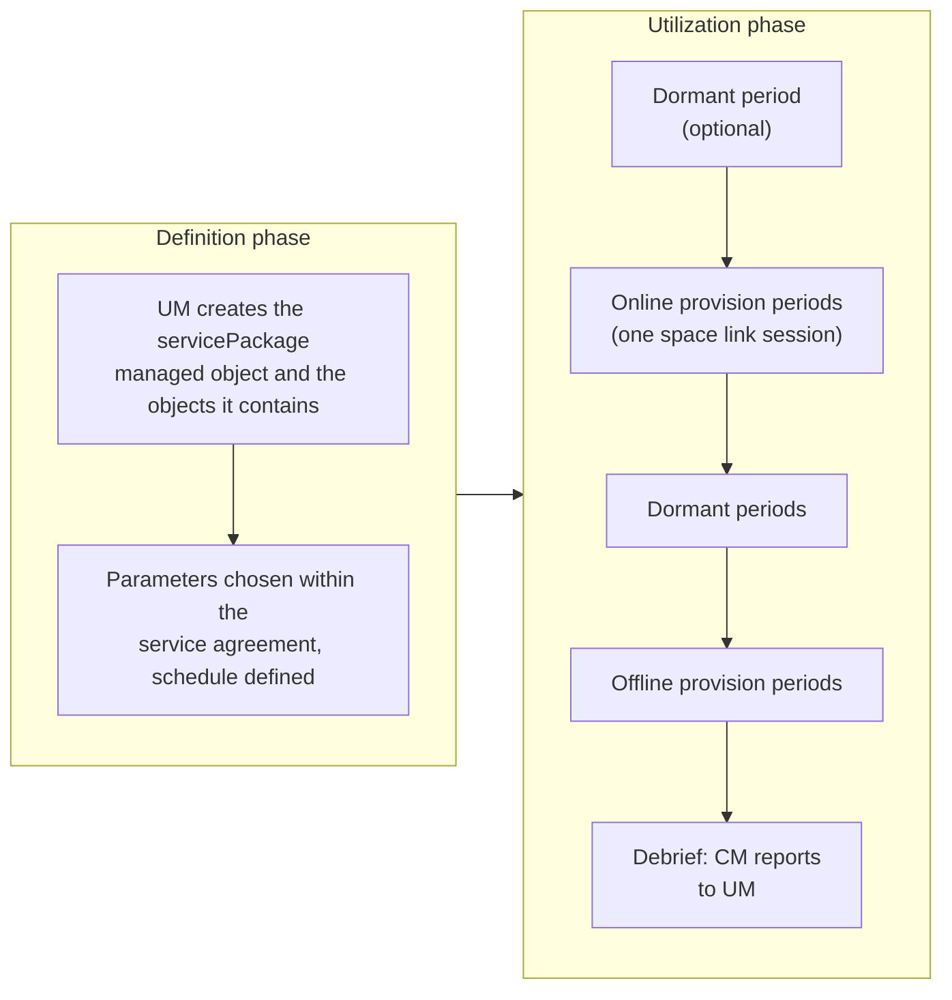
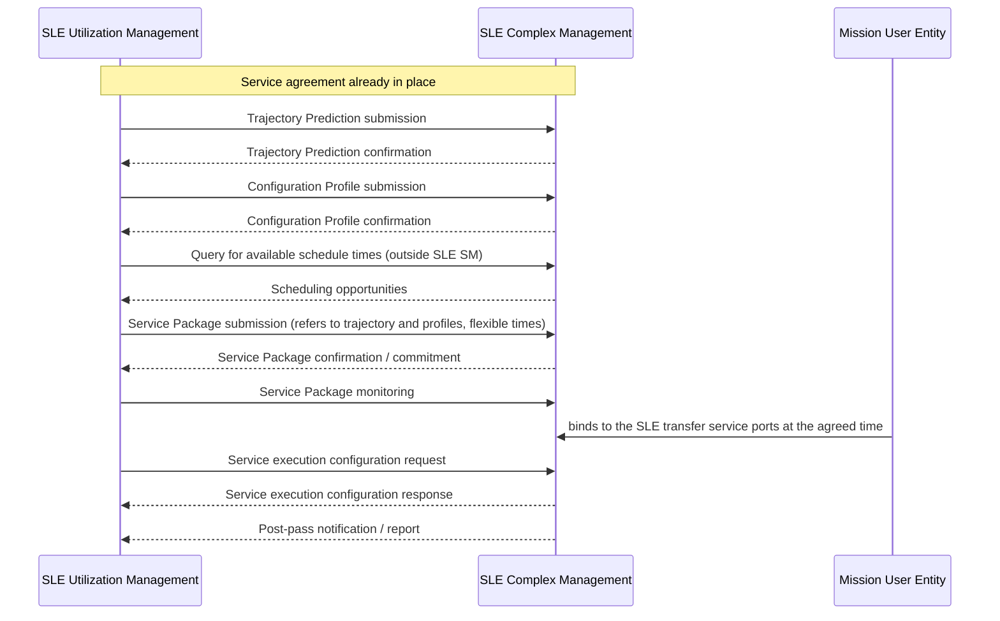
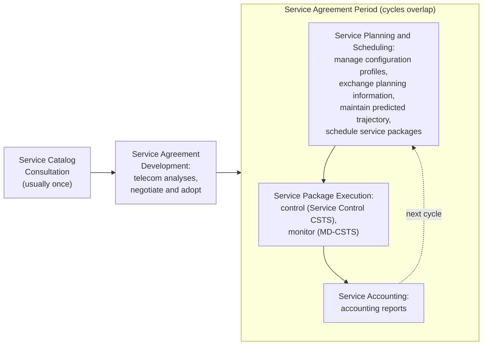
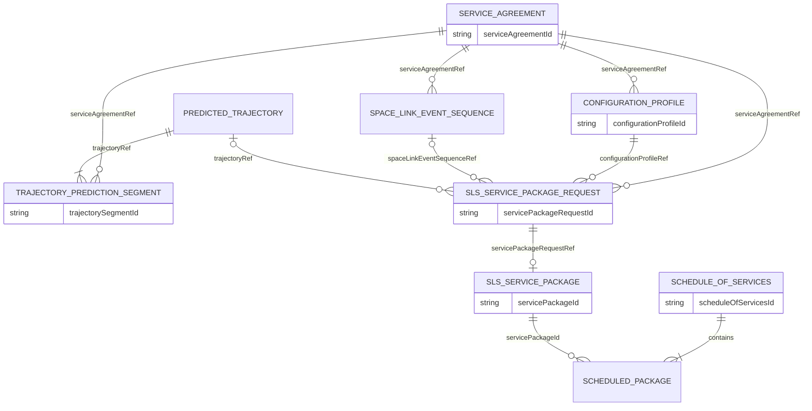
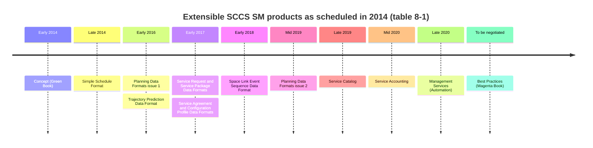
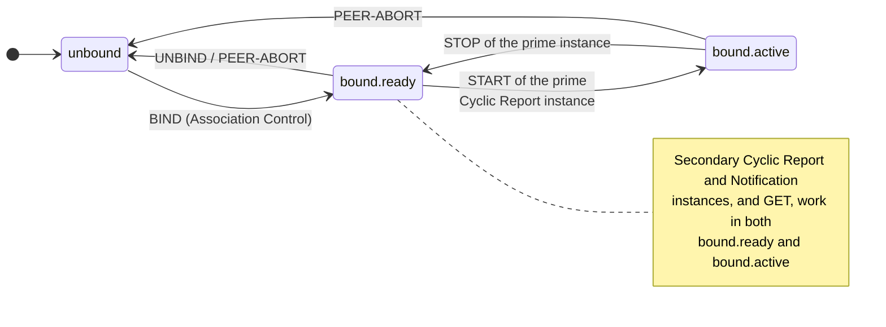
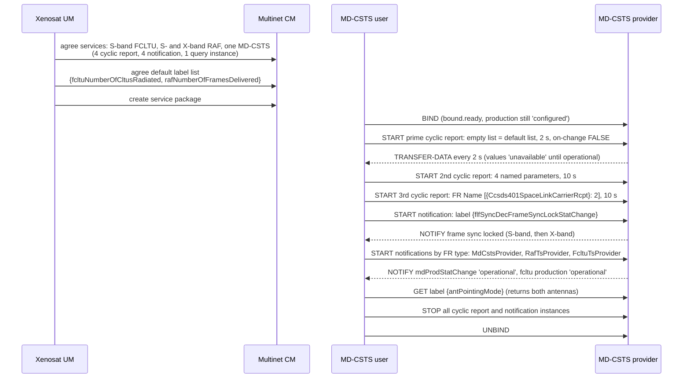

# SLE cross support reference model and service management

Every [SLE](index.md) transfer service runs inside an agreed framework. A mission (the user) and
a ground network operator (the provider) agree which services exist, when they exist and how they
are configured. Only then can a mission user entity bind to a RAF, FCLTU or [FSP](fsp.md)
instance. This page covers that framework. It starts with the CCSDS **Cross Support Reference
Model**, which defines the vocabulary every SLE book uses. It then follows the **service
management** standards built on that model, from the original SLE service management concept to
the extensible Space Communication Cross Support (SCCS) service management suite. It ends with
the **Monitored Data** transfer service used to watch a pass in progress, and with ESA's
operational experience at ESTRACK.

!!! info "At a glance: the documents"
    | Document | What it is | Status in the library copy |
    |---|---|---|
    | CCSDS 910.4-B-2 *Cross Support Reference Model—Part 1: SLE Services* | The SLE architecture: environment, data units and channels, functional groups, complexes, service instances, packages, agreements, ports | Issue 2, October 2005, editorial correction 1 July 2007; carries the "Historical Document" banner[^sm-csrm-ctl] |
    | CCSDS 910.3-G-3 *Cross Support Concept—Part 1: SLE Services* | Explains SLE, including the SLE service management concept | Green Book, March 2006[^sm-csc-sm] |
    | CCSDS 902.0-G-1 *Extensible SCCS Service Management—Concept* | The concept and roadmap for the second-generation service management suite | Green Book, Issue 1, September 2014[^sm-g-ctl] |
    | CCSDS 902.4-B-1 *Service Package Data Formats* (SPDF) | XML format that tells a mission which service packages were scheduled | Cover dated September 2026, but every page after the cover is headed "Proposed Draft"[^sm-sp-status] |
    | CCSDS 922.1-B-2 *CSTS Monitored Data Service* (MD-CSTS) | Cross Support Transfer Service that reports monitored parameters and events of a service package | Issue 2, September 2022; issue 1 April 2017[^sm-md-ctl] |
    | SpaceOps 2025 paper #16 *ESTRACK Deep Space Cross Support using CCSDS Service Management* | ESOC experience with standard and draft service management formats | Conference paper, 2025[^sm-eo-abs] |

## Part 1: the Cross Support Reference Model (910.4-B-2)

### Scope and the three kinds of cross support

Cross support means one agency uses part of another agency's resources to complement its own
when operating a spacecraft.[^sm-csrm-cs] The reference model names three kinds of cross support
service on the ground and planned one part of the reference model for each:[^sm-csrm-cs]

| Kind | Content | Reference model part |
|---|---|---|
| SLE services | Extend the CCSDS space link services onto the ground | Part 1 (this document) |
| Ground communications services | Ground communications support, for example relaying operational data | Part 2 |
| Ground domain services | Services on spacecraft-operations data that does not map onto space link data structures, for example tracking, database exchange and mission planning | Part 3 |

Part 1 makes four assumptions: a single mission, a single spacecraft, CCSDS-compliant TM and TC,
and all ground users affiliated with one mission management entity. It does not model the sharing
of ground systems between missions, though it does not forbid it. It excludes the processing of
packet contents, and it does not model the ground communications that SLE relies on.[^sm-csrm-scope]
The model is a guideline for agency standards, not the design of a real system.[^sm-csrm-scope]

### The environment

| Term | Definition in the reference model |
|---|---|
| Space element | Source of return data and sink of forward data; one spacecraft with its platform and payloads. Each spacecraft of a multi-spacecraft mission is a separate space element. |
| Physical channel | The capability to carry one stream of bits in one direction |
| Space link | One or both of a forward and a return RF carrier channel, each giving one or more physical channels |
| Space link session | A continuous period in which the SLE system makes one or more physical channels of a space link usable |
| Ground element | The Mission Data Operation System (MDOS) plus the SLE system (plus components out of scope) |
| SLE system | Extends transfer and delivery between the space link ground termination and the MDOS, to specifications issued by the MDOS |
| MDOS | Source of forward and sink of return data. It contains one SLE Utilization Management and one or more Mission User Entities (MUEs), and may work with several SLE systems. |
| SLE Utilization Management (SLE-UM) | Negotiates the provision of transfer services with the SLE system, and controls and monitors it |

Source: SLE system environment.[^sm-csrm-env]

SLE services are of two types. **Transfer services** move SLE data channels between the space
element and the MDOS. The **management service** controls the scheduling and provision of
transfer service instances.[^sm-csrm-svc] Within one mission, the model speaks of *instances* of
services, and many instances of both types can exist at once.[^sm-csrm-svc]

### Data units and data channels

The SLE system exchanges **Space Link Data Units** (SL-DUs) with the space element. Inside the
SLE system and towards the MDOS, it carries **SLE Service Data Units** (SLE-SDUs). An SLE-SDU
wraps an SL-DU with annotation, control information, or both. A control-only SLE-SDU may produce
an SL-DU, for example a COP directive that sends an Unlock to the spacecraft, or may matter only
on the ground.[^sm-csrm-du] Annotation examples are ground reception time and quality for return
data, and requested transmission time and uplink path for forward data.[^sm-csrm-du] A **data
channel** is a uniquely identified stream of data units of one type. SL data channels and SLE data
channels have the same types and identifiers, and SLE channels add the annotation.[^sm-csrm-du][^sm-csrm-chan]

The forward channels that matter for telecommand, from annex A:

| Forward SLE data channel | SL-DU | Unique identifier | SLE service |
|---|---|---|---|
| Forward physical channel (V1 asynchronous, V2 synchronous) | Baseband symbol stream | Physical channel ID | not exposed |
| CLTU channel (V1 physical channels only) | CLTU | CLTU ID | [Forward CLTU](fcltu.md) |
| TC Transfer Frame channel (V1 VCs) | TC Transfer Frame | GVCID | Forward TC Frame |
| TC-VCA channel (V1 VCs) | Frame Data Unit | GVCID | Forward TC-VCA |
| TC Multiplex channel (V1 VCs) | Segment | GVCID and MAP identifier | not exposed |
| Forward Space Packet channel | Space Packet | GVCID and APID: 0–2046 for V1 GVCIDs; 0–2031 and 2046 for V2 GVCIDs | [Forward Space Packet](fsp.md) |

Source: table A-5.[^sm-csrm-a5] The telecommand SL-DU types are CLTU, TC Transfer Frame, Frame
Data Unit, Segment and Space Packet. On the return side, the channels run from the physical
channel through RAF, Master Channel (MCID) and Virtual Channel (GVCID) down to OCF, FSH, bitstream
and space packet channels.[^sm-csrm-a2][^sm-csrm-a4]

### The baseline transfer services and delivery modes

The reference model lists 20 baseline transfer services. Each one delivers one type of SLE data
channel.[^sm-csrm-svclist]

| Group | Services |
|---|---|
| Return (10) | Return All Frames; Return Insert (AOS); Return Master Channel Frames; Return MC-OCF; Return MC-FSH (Packet Telemetry); Return VC Frames; Return VC-OCF; Return VC-FSH (Packet Telemetry); Return Bitstream (AOS); Return Space Packet |
| Forward AOS (6) | Forward Bitstream; Forward VCA; Forward Space Packet; Forward Proto Transfer Frame; Forward Insert; Forward Coded Transfer Frame |
| Forward Telecommand (4) | TC-VCA; Forward Space Packet; Telecommand Frame; CLTU |

Only some of these have their own Recommended Standards. The [SLE overview](index.md#the-sle-transfer-services)
lists the published ones.

| Mode | Behaviour |
|---|---|
| Forward online | During the forward space link session only. Two qualities: *complete and in-sequence* (follows the routing control instructions, such as the multiplexing scheme, with sequence kept and no ground-induced errors, omissions or duplicates) and *expedited* (in sequence received, no ground errors, but data may be lost). Cannot extend past the end of the session. |
| Return online, complete | In sequence, no ground errors, no omissions, even if data arrives faster than it can be delivered (needs reserved buffering). May extend past the session. |
| Return online, timely | Two mechanisms: notification when delivery delay exceeds T<sub>delay-notify</sub> (and again on recovery); deletion of the queue when it exceeds T<sub>delete</sub>. The user can disable both. |
| Forward offline | The whole data set must reach the SLE system before it is transmitted to the space element during the session. It is transmitted complete and in sequence at a time set by SLE management. |
| Return offline | Delivered during or after the session, as a stored data set. Storage is either *user data storage* (everything received, with selection later) or *user service data storage* (only the service data chosen up front). |

Source: delivery modes.[^sm-csrm-modes] Offline delivery is arranged, like online delivery,
through the service package.[^sm-csrm-modes]

### Provision, production and ports

Two definitions run through every SLE book:

* **Provision**: an SLE system *provides* a transfer service when it exposes the operations needed
  to obtain it. Provision is characterised by which data channels are transferred, when, and with
  what quality of service.[^sm-csrm-pp]
* **Production**: the transformations between the RF carrier and the transferred SLE data
  channels.[^sm-csrm-pp]

An SLE system has **transfer ports** and **management ports**. A transfer port is either a user
port (T-U) or a provider port (T-P), never both. Ports are asymmetric, and each service runs
between exactly one pair of ports.[^sm-csrm-pp] The ports are named *consumer* or *supplier* by
the direction of data flow. For return services the provider is the supplier. For forward
services the provider is the **consumer**, because the user supplies the data.[^sm-csrm-ports]

The model defines four kinds of transfer-port operations. These are the abstract ancestors of the
concrete SLE operations:[^sm-csrm-optypes][^sm-csrm-ports]

| Operation type | Invoked by | Purpose | Concrete examples in the SLE books |
|---|---|---|---|
| Transfer_Data | The supplier (provider for return, user for forward) | Carries an SLE-SDU | RAF-TRANSFER-DATA, FSP-TRANSFER-DATA |
| Transfer_Set | The user | Initialises or updates attributes of the user's instance | START parameters, INVOKE-DIRECTIVE |
| Transfer_Get | The user | Reads status and configuration of the instance | GET-PARAMETER |
| Transfer_Notification | The provider | Status and accounting reports | STATUS-REPORT, ASYNC-NOTIFY |

!!! warning "Inference"
    The right-hand column is this page's mapping, not the reference model's. The reference model
    defines only the abstract types and their naming rule: the port type name plus "Data", "Set",
    "Get" or "Notification", for example `Fwd-SP-TransferData`.[^sm-csrm-optypes][^sm-csrm-ports]

The forward transfer ports, from table 5-2, show which functional group serves which user:

| Port type | Service | Provider SLE-FG (consumer) | User (supplier) |
|---|---|---|---|
| CLTU-Transfer | Forward CLTU | Forward TC Space Link Processing | Forward CLTU Generation, MUE |
| TCFrame-Transfer | Forward Telecommand Frame | Forward CLTU Generation | Forward TC VC Data Insertion, MUE |
| TCVCA-Transfer | Forward TC VCA | Forward TC VC Data Insertion | MUE |
| Fwd-SP-Transfer | Forward Space Packet | Forward AOS VC Data Insertion, Forward TC VC Data Insertion | MUE |
| Fwd-Coded Transfer Frame-Transfer | Forward Coded Transfer Frame | Forward AOS Space Link Processing | MUE |
| Fwd-Proto Transfer Frame-Transfer | Forward Proto Transfer Frame | Forward AOS Space Link Processing | Forward AOS VC Data Insertion, MUE |
| Fwd-Insert-Transfer | Forward Insert | Forward AOS Space Link Processing | MUE |
| Fwd-VCA-Transfer | Forward VCA | Forward AOS VC Data Insertion | MUE |
| Fwd-Bit-Transfer | Forward Bitstream | Forward AOS VC Data Insertion | MUE |

Source: table 5-2. The TC VC Data Insertion and TC Space Link Processing groups also have OCF
consumer ports, through which they receive the CLCWs.[^sm-csrm-t52] Two RF-carrier port types
(Rtn-RF-Transfer, Fwd-RF-Transfer) face the spacecraft. Each has a single TransferData
operation.[^sm-csrm-rf]

### Functional groups and their management ports

The functional view breaks an SLE system into eight **SLE Functional Groups** (SLE-FGs). Each has
transfer ports and one Function-Management provider port (FM-P).[^sm-csrm-fg][^sm-csrm-fgports]

| Category | SLE-FG | Management port (supplier) |
|---|---|---|
| Return | Return Space Link Processing | Rtn-SpLinkProc-Mgmt |
| Return | Return Frame Processing | Rtn-FrameProc-Mgmt |
| Return | Return Frame Data Extraction | Rtn-FrameData-Mgmt |
| Forward AOS | Forward AOS VC Data Insertion | Fwd-AOSData-Mgmt |
| Forward AOS | Forward AOS Space Link Processing | Fwd-AOSSpLinkProc-Mgmt |
| Forward TC | Forward TC VC Data Insertion | TCData-Mgmt |
| Forward TC | Forward CLTU Generation | CLTUGen-Mgmt |
| Forward TC | Forward TC Space Link Processing | TCSpLinkProc-Mgmt |

Sources: tables 4-1 to 4-3 and 5-3.[^sm-csrm-fg][^sm-csrm-t53] On a management port, the
functional group supplies Management_Notification, and Complex Management invokes Management_Set and
Management_Get.[^sm-csrm-t53] The forward TC group rules that matter for telecommanding (one
sequence-controlled service per VC, segmented packets only with sequence control) are on the
[FSP page](fsp.md#where-fsp-sits-the-forward-tc-functional-groups). For each service, section 5.6
lists which groups and ports take part. FSP, for example, has an AOS profile and a TC
profile.[^sm-csrm-fsp]

### The cross support view: complexes, packages and agreements

Real SLE systems are built from physical systems run by different agencies or organisations. The
cross support view models each of them as an **SLE Complex**: a set of SLE-FGs under one
management authority.[^sm-csrm-cx]

| Concept | Definition |
|---|---|
| SLE Complex | A set of SLE-FGs under a single management authority, with one established relationship to the MDOS during cross support |
| SLE Utilization Management | The single MDOS entity that every complex talks to. It arranges data transfer with the complexes and monitors it, and is part of the Mission Management Entity. |
| SLE Complex Management | Negotiates service packages with UM. It also controls and monitors production and provision by the complex's SLE-FGs, distributes set-up parameters to them, and consolidates their reports for UM. |
| SLE transfer service instance | The provision by a complex of the capability to transfer one or more SLE data channels of one type, all related to the same space link session |
| SLE Service Package | The set of transfer service instances, with the characteristics of their production, that one complex provides to one or more users. Its online services are restricted to one space link session. |
| SLE Service Agreement | The transfer and management services a complex provides to an MDOS, and the conditions. Only one is in effect between a given complex and mission at a time. |

Sources: cross support view definitions.[^sm-csrm-cx][^sm-csrm-um][^sm-csrm-si][^sm-csrm-cm][^sm-csrm-sa]

A complex exposes at least one user and one provider transfer port, and exactly one Complex
Management port. A real system that serves several missions offers one such port per
mission.[^sm-csrm-cmport] A package only describes the part of production done by the complex that
provides it. When a chain of complexes supports a mission, each complex has its own package with
UM.[^sm-csrm-si]

```mermaid
flowchart LR
    SE(("Space<br/>element"))
    subgraph SYS["SLE system"]
        subgraph A["SLE Complex A"]
            CMA["Complex Mgmt A"]
            FGA1["SLE-FG<br/>(e.g. TC Space Link<br/>Processing)"]
            FGA2["SLE-FG"]
        end
        subgraph B["SLE Complex B"]
            CMB["Complex Mgmt B"]
            FGB["SLE-FG<br/>(e.g. TC VC Data<br/>Insertion)"]
        end
    end
    subgraph MDOS["MDOS"]
        UM["SLE Utilization<br/>Management"]
        M1["MUE m1"]
        M2["MUE m2"]
    end
    SE <-- "space link" --> FGA1
    FGA1 <-- "T-P / T-U" --> FGB
    FGB <-- "T-P / T-U" --> M1
    FGA2 <-- "T-P / T-U" --> M2
    UM -. "M-U / M-P:<br/>service agreement,<br/>service packages" .- CMA
    UM -. "M-U / M-P" .- CMB
    CMA -. "FG management" .- FGA1
    CMA -. "FG management" .- FGA2
    CMB -. "FG management" .- FGB
```



Diagram based on figures 4-9 to 4-12 (complex ports, binding of transfer and management ports,
composite example).[^sm-csrm-cmport][^sm-csrm-bind][^sm-csrm-sa]

### Time spans and phases

The reference model defines three nested periods:[^sm-csrm-time]

* **Service agreement period**: when a complex lets UM create packages and provides their services.
  It often covers the whole operational life (several packages a day, hundreds or thousands in
  total). It can also be short, for example launch support, a manoeuvre or an emergency.
* **Service package lifetime**: when the complex provides the services of one package. Its
  instances exist only during this time.
* **Service instance provision period**: when the capability to transfer the instance's channels
  is provided. Online instances belong to one space link session, but may start before it and end
  after it. Offline instances can be anywhere in the agreement period.



Diagram based on figure 4-16 and clauses 4.5.2.1–4.5.2.2.[^sm-csrm-phases][^sm-csrm-util]

During the definition phase, the attributes of the managed objects select:[^sm-csrm-phases]
(a) the transfer services within the agreement; (b) the interfaces where they are offered; (c)
which services this or other complexes must provide; (d) mission-specific production
configuration; (e) the eventual users (MUEs or other complexes); (f) the schedule of online and
offline instances; and (g) the reporting by CM to UM. During utilization, provision is controlled
two ways: MUEs invoke control operations on their instances, and UM invokes management operations
on the complex.[^sm-csrm-util]

### Security in the reference model

Issue 2 added a cross support security section covering six areas:[^sm-csrm-sec]

| Area | SLE transfer services | SLE service management |
|---|---|---|
| Data privacy | Not provided; to be ensured above or below SLE (for example by encrypting the PDU) | XML encryption may be considered |
| Data integrity | In-sequence, complete, flow-controlled transfer; strict operation sequence; credentials over the whole PDU can be agreed | Sequence numbers |
| Authentication | Credentials in the PDUs (procedure in the cross support concept); algorithms out of scope; secure key distribution needed | Digital signatures recommended |
| Access control | Initiator and responder identifiers | Unique identification parameters created by UM and carried in each message to CM |
| Availability | Not provided; depends on the underlying network | CM may reject requests; denial of service left to routers and firewalls |
| Auditing | Not specified; the SLE API logs access attempts | Not specified; agencies expected to keep audit trails |

Service-specific threats and consequences are left to each service book. For FSP, see the
[FSP security section](fsp.md#security). For the wider picture, see
[security in CCSDS space links](../security.md).[^sm-csrm-sec]

## Part 2: SLE service management in the Cross Support Concept (910.3-G-3)

The Cross Support Concept explains what SLE service management was meant to cover. Of the five
OSI management functional areas, it includes four:[^sm-csc-areas]

| OSI area | In SLE service management |
|---|---|
| Configuration | The largest part: UM and CM define service packages (input and output channels, processing parameters, storage) |
| Accounting | Per-package reports of data received, sent and processed by the complex |
| Fault | Notification of faults affecting services; detection and repair inside the complex stay hidden |
| Security | Credentials, access control to cross support interfaces, authentication of requests |
| Performance | Excluded: an internal matter for the complex's operator |

The guiding considerations were these. Mission needs drive the concept. The user is isolated from
the provider's internals. Services are presented the same way whatever the provider offers.
Reporting gives enough accountability. Automation and low operating cost are design aims. Adoption
can be incremental.[^sm-csc-areas][^sm-csc-cons] The [SLE overview](index.md#sle-service-management)
summarises the services (service agreement, configuration profile, trajectory prediction, service
package) and the nominal timeline. The nominal use case runs as follows:



Diagram based on figure 5-12 and its description.[^sm-csc-uc] Registration of a user with a
provider (credentials, contacts, general bounds) comes before the service agreement, possibly
years earlier. The cross support concept states that SLE service management does not cover
registration.[^sm-csc-sa]

## Part 3: from SLE service management to SCCS service management

The first standard for this management interface, the *SCCS Service Management Service
Specification* (CCSDS 910.11-B-1, August 2009), and its operations concept (910.14-G-1) are not in
this library.[^sm-g-v1] The 2006 cross support concept cites the same number as a draft, the *SLE
Service Management Service Specification* 910.11-R-1 (Red Book, March 2006).[^sm-csc-ref9] The
name changed from SLE to SCCS service management with the version-1 specification.[^sm-g-annexb]
The extensible concept explains what version 1 covered and why it is being replaced.
Version 1 offered the Service Package, Trajectory Prediction, Configuration Profile and Service
Agreement management services, using Version-1 information entities.[^sm-g-v1][^sm-g-ms] ESTRACK
used 910.11-B-1 "whenever possible" for its interfaces.[^sm-eo-intro]

Annex B of the extensible concept maps the old terms to the new ones:[^sm-g-annexb]

| Cross Support Reference Model / SCCS SM version 1 | Extensible SCCS SM enterprise model | Note |
|---|---|---|
| Space element (one spacecraft) | Space User Node | The Space User CSSS may contain several nodes |
| MDOS | Earth User CSSS | MDOS is only the functional view; the new model adds a physical view of Earth User Nodes |
| SLE-specific transfer service user functions | Terrestrial Link Processing, Data Forwarding, Data Store, Application | Abstracted |
| SLE Utilization Management | Utilization Management (UM) of the Earth User CSSS | Essentially the same |
| SLE Complex (renamed SCCS Complex in version 1) | Provider CSSS | Generalised to all radiometric services |
| SLE Complex Management | Provision Management (PM) of the Provider CSSS | Essentially the same |
| (implicit) | Mission = Earth User CSSS + Space User CSSS | Made explicit |

The Monitored Data CSTS uses yet another name: its "Cross Support Complex" corresponds to the
**Earth Space Link Terminal (ESLT)** of the SCCS architecture.[^sm-md-purpose]

## Part 4: the extensible SCCS service management concept (902.0-G-1)

### Why a new suite

The concept names two groups of shortcomings in version 1. Its scope covered only requesting and
scheduling services, not the other management activities over a mission's relationship with a
provider. Its structure could not absorb new space communication technologies or new service
management techniques.[^sm-g-why] SCCS SM covers the physical and data link layer aspects of
space link services. In the near term it is focused on single-hop Earth–space links, which the
SCCS architecture calls the **ABA** configuration (Mission A supported by provider B) and which
match IOAG Service Catalog 1. The **SSI** (Solar System Internetwork) configuration adds
space–space and space–planet links with internetworking, and matches Service Catalog
2.[^sm-g-ctx] In SSI, data is routed through the provider by internetwork address. The concept
says it logically includes SSI, but many SSI details were still undefined, so the SSI
configuration is outside the scope of this version and the first standards focus on Service
Catalog 1.[^sm-g-ctx][^sm-g-aba]

The enterprise model splits service management between two functions. **Utilization Management**
belongs to the Earth User CSSS, and **Provision Management** to the Provider CSSS. Each takes part
in service catalog consultation, mission telecom analysis, service agreement negotiation and
adoption, service planning and scheduling, service package execution, and service
accounting.[^sm-g-um] The model adds two management functions to the Earth User CSSS. Mission
Planning relies on UM to acquire and configure the provider's services, and on Space User
Management to configure and control the spacecraft side.[^sm-g-mp]

### The mission support lifecycle



Diagram based on figure 4-1 and section 4.[^sm-g-life][^sm-g-sap][^sm-g-exec]

Several service agreements may run at once, for example one per mission phase (pre-launch tests,
LEOP, cruise, landing), and their periods may overlap.[^sm-g-sad] Configuration profiles are
expected to change rarely, perhaps never after the agreement is adopted.[^sm-g-sap] Trajectory
prediction segments may come from a third party such as a flight dynamics facility, and may even
be updated during a pass. They only have to arrive in time to be turned into acquisition
data.[^sm-g-traj] During execution, UM may control well-constrained aspects (bit rate, modulation
index, a frequency sweep) through the **Service Control CSTS**. It monitors through the **MD-CSTS**
([below](#part-6-the-monitored-data-csts-9221-b-2)).[^sm-g-exec] Within a single transfer service,
FSP's [throw events](fsp.md#fsp-throw-event) cover similar changes: the example events of the FSP
book switch command modulation and change the uplink bit rate or modulation index.[^sm-fsp-te]

### Information entities

All management information is exchanged as **information entities** (IEs), almost all of them in
XML.[^sm-g-ie-gen] The concept defines:

| IE | Purpose | Direction | Planned book (8.2) |
|---|---|---|---|
| Service Catalog | Services a provider offers, in standard attributes; may be registered with [SANA](../space-link-identifiers.md) | Provider publishes | Service Catalog (h) |
| Planning Request | Ask for visibility, conflicts, rates, RFI or costs, before or after the agreement | Mission → Provider | Planning Data Formats (c) |
| Provisional Plan | Uncommitted but feasible plan in reply | Provider → Mission | Planning Data Formats (c) |
| Service Agreement | Types, amounts and ranges of services for the agreement period: frequencies, modulation, protocols, coding, transfer services, contact durations, apertures, data stores | Mutual; operational copy kept by provider | SA and Configuration Profile (f) |
| Configuration Profile | Reusable parameter set (RF, coding, link protocol, transfer services, radiometric, SM functions); validated against the agreement | Mission → Provider | SA and Configuration Profile (f) |
| Communications Geometry | Visibility, nodes, apsides, sunlight events | Either way | Planning Data Formats (c) |
| Sustainable Data Rates & Volume Estimates | Predicted sustainable rates and volumes | Provider → Mission | Planning Data Formats (c) |
| Radio Frequency Interference | Predicted entry into and exit from RFI regions | Either way | Planning Data Formats (c) |
| Resource Conflicts | Conflict periods (only where schedules may be shared) | Provider → Mission | Planning Data Formats (c) |
| Cost Estimates | Predicted costs | Provider → Mission | Planning Data Formats (c) |
| Space Link Event Sequence | Planned changes of the spacecraft's link configuration (carrier and data-transport availability, reconfigurations), absolute or relative times; optional | Mission → PM | Space Link Event Sequence (g) |
| Resource Availability | Future periods when provider resources can be scheduled; optional | Provider → Mission | Simple Schedule Format (b) |
| Trajectory Prediction Segment | Predicted state vectors; CCSDS OPM, OEM or OMM in ASCII or XML | Mission (or proxy) → Provider; provider apertures the other way | Trajectory Prediction (d) |
| Service Package Request | Services wanted (by configuration profile reference) plus flexibilities and constraints; SLS, Retrieval or Forward Offline | Mission → Provider | Service Request and Service Package (e) |
| Service Package | What was scheduled: times, initial configuration, apertures, transfer service instance identifiers, Functional Resource Names; grouped into Service Package Sets | Provider → Mission | Service Request and Service Package (e) |
| Schedule of Services | Summary of a period (antennas, activities, SLS times) | Provider → Mission | Simple Schedule Format (b) |
| Service Package Execution Event Notification | Events before or during execution, for example missing trajectory data, or early termination | Provider → Mission | Service Request and Service Package (e) |
| Accounting Report | Services delivered, quality and quantities (content still to be determined) | Provider → Mission | Service Accounting (i) |

Sources: sections 5.2 to 5.19 and the deliverables list in 8.2.[^sm-g-ie1][^sm-g-ie2][^sm-g-ie3][^sm-g-ie4][^sm-g-road]

The entities point to each other through identifiers:



Diagram based on figure 5-1 and its relationships a) to i). Retrieval and Forward Offline package
requests and packages follow the same pattern, but without event sequence or trajectory
references. The Predicted Trajectory is a provider-internal product, not an exchanged
entity.[^sm-g-xref]

### Extensibility: abstract service components and functional resources

Each IE has **extension points**. These are places where technology-specific management
information can be inserted, with each extension constrained to a defined type.[^sm-g-ext] For
the service agreement and the configuration profile, the extension points are **Abstract Service
Components** (ASCs). ASCs are layers of space communication functionality whose interfaces stay
the same as technologies change. A technology-specific specialisation is a **Service Component**
(SC). For example, an SC for the TM synchronization and channel coding standard carries the
Reed-Solomon and turbo decoder parameters.[^sm-g-ext]

| Abstract Service Component (figure 6-1) | Group | Maps to (enterprise model, Provider CSSS) |
|---|---|---|
| Aperture | Space link interface | Space Link Processing |
| Forward Physical Channel Transmission | Space link interface | Space Link Processing |
| Forward Synchronization and Channel Encoding | Space link interface | Space Link Processing |
| Forward Space Link Protocol Transmission | Space link interface | Space Link Processing |
| Return Physical Channel Reception | Space link interface | Space Link Processing |
| Return Synchronization and Channel Decoding | Space link interface | Space Link Processing |
| Return Space Link Protocol Reception | Space link interface | Space Link Processing |
| SLS Data Delivery Production | Ground link interface | Data Forwarding |
| SLS Radiometric Data Production | Ground link interface | Application Service |
| Offline Data Storage | Ground link interface | Data Store and Data Forwarding |
| Data Transfer Services (SLE, CSTS, radiometric and file transfer) | Ground link interface | Data Forwarding |
| Space Internetworking | Ground link interface | Data Forwarding |
| Service Management Functions (MD-CSTS and the future SC-CSTS) | Service management | Application Service |

Sources: figure 6-1 and its descriptions. The concept itself calls the mappings rough.[^sm-g-asc][^sm-g-ascmap]
ASCs carry no parameters of their own. Each SC is made of **Functional Resource (FR) Types**. Each
FR type has configuration parameters, monitored parameters, notifiable events and real-time
control directives, and a published identifier. An FR instance is named by its FR Type plus an FR
Instance Number. That **Functional Resource Name** is what MD-CSTS reports
against.[^sm-g-ascmap][^sm-g-fr]

The concept defines six kinds of configuration for an ESLT: SLS, SLS data delivery, retrieval data
delivery, forward offline data delivery, SLS radiometric and retrieval radiometric. Only the SLS
configurations include the layered stack of aperture, physical channel, synchronization and coding,
and link protocol.[^sm-g-6cfg]

!!! example "The telecommand mission example (from the concept)"
    The mission uses TC on the forward link and TM on the return link. Its service agreement allows
    each SLS service package **up to five SLE FSP instances or one F-CLTU instance**, plus one
    RAF, three RCF, one ROCF, one Tracking Data CSTS and one MD-CSTS. Zero to five instances of
    the *FSP TS Provider* FR type feed VC packet requests into one *TC Encoding, VC Packet
    Processing, and VC Generation* FR.[^sm-g-tc2] The Earth user sends either packets or CLTUs,
    but uses only one mode in any one package.[^sm-g-tc1] Configuration profiles then make the
    choice. One SLS profile has three FSP, one RAF, two RCF, one TD-CSTS and one MD-CSTS instance.
    Another has one F-CLTU, one RAF, one ROCF, one TD-CSTS and one MD-CSTS instance. A profile
    also fixes a single initial value for every parameter whose agreement allows a range.[^sm-g-tc2][^sm-g-tc3]
    Retrieval packages may contain one RAF, three RCF and one TD-CSTS instance.[^sm-g-tc1]

### Service packages and scheduling

There are three kinds of service package. The **SLS** package covers services that need an active
space link. The **Retrieval** package covers delivery of stored return data, with or without an
SLS running. The **Forward Offline** package covers upload of forward data to the provider before
the SLS that will carry it. Version 1 had no Forward Offline package.[^sm-g-sp3] Providers
schedule in two ways:[^sm-g-sched]

* **Specific-period scheduling.** The mission asks for SLSes at or around given times. The request
  can be made flexible with a preferred start time plus *start-time lead* and *lag*, a *preferred*
  and *minimum duration*, and the relative timing of carriers (for example, the forward carrier
  for at least *n* minutes inside the return carrier). Process options are **waitlisting** (keep
  trying until a waitlist period expires), improvement after scheduling up to a **freeze
  interval**, and **service scenarios** (nominal plus contingency configurations reserved together,
  for example for LEOP).
* **Rule-based scheduling**, also called generic or *standing order* scheduling. Mission and
  provider agree rules, such as "6 return carriers per week, 15–30 min each, 6–30 h apart". PM then
  generates tentative packages, which UM may delete. The concept names this as the primary mode of
  the NASA Near Earth Network and **ESTRACK**. The **Recurrent Service Package Request** combines
  the two: rules for a stated horizon, optionally with allowed and forbidden windows.

The extensible SLS Service Package Request keeps *what* is requested separate from *how* it may be
scheduled. A Space Communication Service Set holds one or more Space Communication Service
Requests, each pointing to one configuration profile. A Flexibilities and Constraints component
holds rules, each pointing to the requests it applies to. Every provider that adopts the format
must support the minimal rule, a fixed start and stop time per request. Providers may add their own
rules at this extension point. Trajectory references are another likely extension point, because
deep-space packages may need the trajectories of both the spacecraft and a celestial
body.[^sm-g-spr]

The planning IEs (Provisional Plan, Communications Geometry, Sustainable Data Rates, RFI, Resource
Conflicts, Cost Estimates), the Space Link Event Sequence and the Accounting Report all follow an
**Event Timeline** stereotype. This is a time-ordered series of events. Each event has an
identifier unique within the service agreement and an event time. The time is instantaneous or has
a duration, carries an uncertainty window, and is absolute or relative. Each event also has an
extension point for type-specific data, such as the aperture of a visibility event.[^sm-g-etl]

### Management services and the roadmap

The concept is to be phased in. First, standard IEs are used inside providers' own management
services, which may adapt version-1 operations to carry the new entities. Standard management
services follow later, aimed at about 2020.[^sm-g-ms] The roadmap of 2014 planned these products:



Diagram based on table 8-1.[^sm-g-road8]

The 2026 SPDF draft shows how the suite turned out. Its figure 1-1 places SPDF among these books:
Concept 902.0-G-1, Simple Schedule Format (SSF) 902.1-B-1, Communications Planning Information
Formats (CPIF) 902.2-B-1, SPDF 902.4-B-1, Service Agreement and Configuration Profile Data Formats
(SACP) 902.5-B-1, Event Sequence Data Format (EVSQ) 902.6-B-1, Service Catalog (SECA) 902.7-M-1,
Service Management Accounting (SMAC) 902.8-B-1, Service Management Utilization Request Formats
(SMURF) 902.9-B-1, Service Management Automation Support Handling (SMASH) 902.10-O-1, Best
Practices (BPR) 902.11-M-1, Common Data Entities (CDE) 902.12-M-1 and Abstract Event Definition
(AED) 902.13-M-1.[^sm-sp-suite] SPDF's reference list confirms some of them: SACP 902.5-B-1
(proposed), CDE 902.12-M-2 (February 2026), EVSQ 902.6-B-1 (proposed), AED 902.13-M-1 Cor. 1
(February 2024), SMURF 902.9-B-1 (forthcoming) and SSF 902.1-B-2 (forthcoming).[^sm-sp-refs]

The name-to-number pairs above were checked against the rendered figure, not only the extracted
text. The figure gives CDE as 902.12-M-1, while the reference list cites issue 2,
902.12-M-2.[^sm-sp-suite][^sm-sp-refs] The ESOC SpaceOps paper cites the Simple Schedule Format
as 902.1-B-1 of May 2018 and the SMURF draft as white book 902.9-W-0.06 of July 2018.[^sm-eo-fmt]

!!! warning "Inference"
    The 2014 roadmap's single "Service Request and Service Package" book appears to have become
    two books, SMURF (requests) and SPDF (packages). No book number for the Trajectory Prediction
    format appears in the available sources.

## Part 5: Service Package Data Formats (902.4-B-1)

!!! warning "Status of this document"
    The library copy is dated September 2026 and labelled Blue Book Issue 1. Every page header
    says "Proposed Draft". The authority page gives the location as "Not Applicable" and says the
    statement of authority will be added when the standard is finalised. The document control
    lists it as the current proposed draft of December 2025.[^sm-sp-status] Treat its content as
    a draft.

SPDF tells user missions which requested service packages were scheduled. It covers the apertures,
the configuration and the absolute timing that came out of the mission's constraints or the
provider's use of the allowed flexibility.[^sm-sp-purpose] It covers formats and content only, not
how they are exchanged.[^sm-sp-purpose] As a feedback message, it closes the loop on Service
Package Requests. It can confirm settings, pin down values the request left open, give the times
when services will be available and say where they will be provided.[^sm-sp-uc]

| | Type 1 | Type 2 |
|---|---|---|
| Configuration | By reference: configuration profile reference, optional trajectory, event sequence and DDOR scan pattern references | Contained: full configuration profile contents, plus event sequence and DDOR scan pattern if needed |
| Changed parameters | Listed separately (resource, parameter, new value) against the referenced profile or sequence | Written directly into the contained data |
| Motivation | Compact, like the Simple Schedule Format | Migration from legacy systems that send all parameters |

Sources: 1.1.2.2, 2.1 and 2.2.3–2.2.4.[^sm-sp-purpose][^sm-sp-types][^sm-sp-t12] The two types
are functionally equivalent. Provider and user choose one in the service agreement or by other
means. An SPDF instance may batch several packages, which should all be of the same
type.[^sm-sp-types][^sm-sp-common]

### Structure and fields

Structure of an SPDF instance (class names from figure 3-1; the tree is this page's summary):

```text
ServicePkgEntity                       (specialises SrvMgtInfoEntity of CDE)
├── ServicePkgHeader                   (specialises SrvMgtHeader)
└── ServicePkgBody                     (specialises SrvMgtData)
    └── ServicePkg [0..*]
        ├── ApertureLocation           exactly one of:
        │   ├── ApertureReference                  siteRef, apertureRef
        │   └── ApertureCelestialBodyPosition      body, lat, long, altitude, name
        └── AbstractOnlineSrvPkg       trajectoryRef, sicfRef; exactly one of:
            ├── OnlineSrvPkgType1      eventSequenceRef, modified event-sequence parameters,
            │   └── OnlineSrvPkgType1Details [1..*]  configurationProfileRef,
            │                                        DDOR scan pattern reference, modified profile parameters
            └── OnlineSrvPkgType2      AbstractEventSeqWrapper [0..1],
                └── OnlineSrvPkgType2Details [1..*]  AbstractConfigProfileWrapper,
                                                     AbstractDDORScanPatternWrapper [0..1]
```

Source: figure 3-1 and ICS conditions C1–C3 and C6. This is a class view, not XML element
names.[^sm-sp-fig][^sm-sp-ics]

| Class | Parameter | Type | Rule |
|---|---|---|---|
| SrvMgtHeader (inherited) | `originatingOrganization` | string | mandatory; SANA-registered |
| | `generationTime` | CCSDS Time Code B | mandatory |
| | `version` | int ≥ 0 | mandatory |
| | `startTime`, `endTime` | CCSDS Time Code B | optional; must span all contained services |
| | `purpose`, `description`, `securityClassification` | string | optional |
| ServicePkgHeader | `servicePkgUsage` | enumeration | mandatory: INTERFACE-TEST, OPERATIONAL or OTHER |
| ServicePkgBody | `spaceUserNode` | string | mandatory; spacecraft name registered in SANA |
| | `serviceReqRef` | string | mandatory; for SMURF requests, the request's `ServiceReqID` |
| ServicePkg | `servicePackageID` | string | mandatory |
| | `beginningOfTrack`, `endOfTrack` | CCSDS ASCII Time Code B | mandatory |
| | `servicePackageStatus` | string | optional; recommended values CREATED, SCHEDULED, DELETED, ARCHIVED, EXECUTING, ABORTED |
| ApertureReference | `siteRef` [1], `apertureRef` [0..1] | string | SANA-registered |
| ApertureCelestialBodyPosition | `celestialBody` [1], `celestialBodyLat` −90 to 90 [1], `celestialBodyLong` −360 < x < 360 [1], `celestialBodyAltitude` ≥ 0 [0..1], `apertureName` [0..1] | string / double | |
| AbstractOnlineSrvPkg | `trajectoryRef`, `sicfRef` | string | optional |

Sources: figure 3-1 and tables 3-1 to 3-3.[^sm-sp-fig][^sm-sp-t31][^sm-sp-t33] Most classes are
"fully described" in the Common Data Entities book (902.12-M-2), which is not in this
library.[^sm-sp-refs][^sm-sp-t33]

The ICS proforma adds two pairs of mutually exclusive conditions. Exactly one of ApertureReference
and ApertureCelestialBodyPosition must be present (C1/C2). Exactly one of OnlineSrvPkgType1 and
OnlineSrvPkgType2 must be present (C3/C6). A DDORScanPatternWrapper is required whenever the
abstract DDOR wrapper is present (C7).[^sm-sp-ics] Unregistered values for the
`originatingOrganization`, `spaceUserNode`, `siteRef` and `apertureRef` parameters are allowed but
discouraged. They are prefixed `UNR::`.[^sm-sp-sana] The normative schema is
`902x04b01-SPDF.xsd`, which includes `902x12m02-CDE.xsd`. Both come from the SANA SCCS-SM XML
schema registry, and a GitHub release tagged `SANA_Release-20260526` also holds them.[^sm-sp-xsd]
Security is left to the systems and networks that carry the messages. The document warns that
tampering with resource-availability information could, in severe cases, cost the
mission.[^sm-sp-sec]

## Part 6: the Monitored Data CSTS (922.1-B-2)

### What it does

MD-CSTS is a Cross Support Transfer Service, built on the CSTS Specification Framework (921.1-B-2,
not in this library). With it, a mission can receive cyclic or on-change reports of monitored
parameters, receive notifications of events, and query current values. All of these relate to the
cross support services of a service package.[^sm-md-purpose][^sm-md-sum] It delivers only current
values and stores no history.[^sm-md-sum] A package may contain several MD-CSTS instances, and
each can see every monitored parameter and event of the package, including its own. The MD-CSTS
instances are themselves monitored functional resources.[^sm-md-func][^sm-md-xs] Formally, monitoring a package is a UM job, done
here with a transfer service rather than a management service. A principal investigator could also
use it, for example to correlate instrument data with link status.[^sm-md-xs]

| Procedure | Version | Instances | Approach | Operations |
|---|---|---|---|---|
| Association Control | SFW 2 | exactly 1 | adopted from the framework | BIND, UNBIND, PEER-ABORT (framework) |
| On-Change-Option Cyclic Report **(prime)** | 2 | 1 or more | refined and extended from Cyclic Report | START (extended, blocking), STOP (blocking), TRANSFER-DATA (non-blocking) |
| Information Query | 2 | 0 or 1 | refined | GET (non-blocking) |
| Notification | 2 in table 3-1 (text: 1) | 0 or more | refined | START, STOP (blocking), NOTIFY (non-blocking) |

Sources: 3.2, table 3-1 and tables 4-1, 5-1 and 6-1.[^sm-md-procs][^sm-md-oco][^sm-md-iq][^sm-md-ntf]



Diagram based on 3.3 (stateful prime procedure state machine of the framework) and the scenario in
2.5.[^sm-md-state][^sm-md-scen]

!!! warning "Inference"
    The exact transitions (for example whether UNBIND is allowed from bound.active) are in the
    CSTS Specification Framework, which is not in the library. The diagram shows only what the MD
    book's scenario states.

### Naming monitored items

Parameters and events are named by OIDs. A **Parameter Name** combines a Parameter Identifier (a
published OID for the parameter type) with a **Functional Resource Name** (FR Type OID plus FR
Instance Number). Event Names work the same way. FR instance numbers come from scheduling, so they
are not fixed in advance.[^sm-md-names] The book writes these as text, for example
`[[{Antenna}: 1]: {antPointingMode}]` for the pointing mode of antenna instance 1.[^sm-md-scen1]

A cyclic-report START (or a GET, or a Notification START) can select by individual names, by
**labels** (a parameter type for all instances), by a named or default **label list** agreed by
service management, by **FR Name** (all parameters of one instance) or by **FR Type** (all
instances of a type). Optionally, it can also select procedure configuration parameters. Any
unknown item makes the START fail, and the unknown items are returned.[^sm-md-sel] Several cyclic
report instances can run at once with different lists and cycles.[^sm-md-sel]

**On-change option.** Each START of the cyclic report carries `on-change-option`. With FALSE,
every report contains every subscribed value. With TRUE, the first report is complete, and later
reports contain only parameters whose value *or qualifier* changed since they were last reported.
A value that changes and changes back between two reports is not sent.[^sm-md-ocosem][^sm-md-ocostart]

### Service management parameters and production status

| Classifier | Sets |
|---|---|
| `mdInitiatorId`, `mdResponderId`, `mdServiceInstanceId`, `mdResponderPortId` | Association Control identifiers |
| `mdNamedLabelLists` | The one set of parameter label lists shared by all cyclic report and query instances; at most one is the default |
| `mdMinAllowedDeliveryCycle` | Shortest allowed reporting cycle |
| `mdNamedEventLists` | Event label lists for Notification; at most one default |
| `mdResponseTimeout` | Service-level response timeout; reportable through cyclic report and query |
| `mdProdStat` / `mdProdStatChange` | Production status parameter and its change event |

Sources: sections 7 and 8.[^sm-md-smpar][^sm-md-fr] MD-CSTS does not support the framework's
"production configuration change" event, because the service itself can report configuration
changes.[^sm-md-fr] Its production status values are refined for monitoring. *Configured* means
set up to reach the package's monitorable resources. *Operational* means at least one of them can
be reached. *Interrupted* means none can be reached, possibly temporarily. *Halted* means stopped
by management.[^sm-md-prod]

### Object identifiers

| Item | OID or position |
|---|---|
| MD service root `monitoredData` | {… ccsds(4) css(4) csts(1) services(2) monitoredData(1)} |
| Procedure type `ocoCyclicReport` | {monitoredDataServiceProcedures 1}, that is {monitoredData 3 1} |
| MD-CSTS Provider FR type subtrees | {MdCstsProvider 1} parameters, {MdCstsProvider 2} events, {MdCstsProvider 3} directives |
| Standard FR types (`crossSupportFunctionalities`) | 1.3.112.4.4.2.1 |
| Antenna / 401 Carrier Transmission / TC PLOP, Sync and Channel Encoding (examples) | …2.1.10100 / …2.1.20100 / …2.1.30100 |
| Forward CLTU TS Provider (example) | 1.3.112.4.4.2.1.80200; `fcltuSvcInstanceState` …80200.1.3.1 (unbound 0, ready 1, active 2); `fcltuNumberOfCltusRadiated` …80200.1.17.1; `fcltuProdStatChange` …80200.2.1.1 (configured 0, operational 1, interrupted 2, halted 3) |

Sources: annex B and annex F (informative; the SANA registry is normative and may differ). The last
OID component is the version, 1.[^sm-md-oid][^sm-md-annexf][^sm-md-fcltu]

### The book's scenario



Diagram based on the operational scenario in 2.5.[^sm-md-scen][^sm-md-scen1][^sm-md-scen2]

The example shows MD-CSTS watching an [FCLTU](fcltu.md) service from outside it. The FCLTU
instance's state and radiated-CLTU count, and the uplink carrier frequency, are visible to the
mission without any FCLTU operation.[^sm-md-scen1][^sm-md-annexf]

## Part 7: ESTRACK in practice (SpaceOps 2025)

The ESOC paper describes the service management interfaces of the ESTRACK Scheduling Office (ESO).
The number of ESA spacecraft flying has tripled in twenty years, while ESTRACK capacity stayed
stable. Deep-space demand now exceeds the network's capacity at peak periods. ESTRACK therefore
acts both as a user of six external providers and as a provider (and broker) to five external
partners.[^sm-eo-abs][^sm-eo-intro]

**Planning.** The ESTRACK Planning System (EPS) solves all users' **standing orders** together.
Standing orders are planning requirements and constraints from each mission agreement, translated
into EPS configuration. The result is a baseline booking covering typically 4 weeks for the LEO
network and up to 12 months for deep space. Users then add, modify or delete bookings.[^sm-eo-eps]
This is the rule-based scheduling that the extensible concept attributes to
ESTRACK.[^sm-g-sched] Every change request is checked for validity (format, ID, privilege),
conflict, technical feasibility (service available on that terminal, visibility) and, for external
providers, availability. Valid requests then follow the EMSP request state machine.[^sm-eo-eps]
The ESTRACK Management System web Portal (EMSP) handles all external interfaces, both as user and
as provider, through the web or system-to-system, using REST or files.[^sm-eo-eps][^sm-eo-users]

**Closing the loop.** Providers change bookings without warning (LEOP, maintenance, failures), and
negotiations for deep space can last months. Immediate per-request confirmation therefore cannot
keep two databases consistent. ESTRACK uses the provider's **Simple Schedule Format** list of
everything it has agreed to support.[^sm-eo-loop][^sm-eo-spdf] Building inter-network
synchronisation correctly took two years for each of two generations of software.[^sm-eo-sync]

**What every interface has in common.** Across 6 agencies and 5 commercial entities, ESTRACK found
the same minimal set:[^sm-eo-data]

| Item | Typical content |
|---|---|
| SC | User name, usually the spacecraft code name |
| GS | Resource name: site or terminal |
| BOT | Start of support (beginning of track) |
| EOT | End of support (end of track) |
| Service / Comment | A pre-agreed ASCII string, or free text |
| plus | Service parameters (for example rates, coding), user ID, provider ID |

These map directly onto the SPDF fields above (`spaceUserNode`, aperture reference,
`beginningOfTrack`, `endOfTrack`, configuration profile reference, `servicePackageID`,
`serviceReqRef`).

!!! warning "Inference"
    That mapping is this page's comparison of the paper's list with 902.4-B-1. The paper does not
    make it.

**Formats and protocols.** Since 2017, ESTRACK has used the published SSF and the draft SMURF
(white book 0.06) for all new interfaces. It shields its core from partners' variants with XML
plus XSL transforms, one independent translator per interface.[^sm-eo-fmt][^sm-eo-shield] There are
two request styles. The legacy one is **replace all**: a time range plus a list of supports, which
deletes everything else in the range. SMURF's **add/modify/delete** handles single requests, which
suits a yearly deep-space plan where under 1 % changes, but makes the booking system more
complex.[^sm-eo-proc]

**Service definition** is the least standardised part. Interfaces use agreed keywords (such as
XBand, SBand, Mode1, Mode2), with extra parameters for DDOR, MSPA or complex links. A network
operator must still be able to set up the service from instructions read over a voice
loop.[^sm-eo-svc] Each ESTRACK service type has a **scheduling template** of automated tasks. A
published catalogue of **user scheduled events** (absolute-time actions such as starting or
stopping the uplink or a recording) has become a de facto standard for occultations and link
changes.[^sm-eo-exec]

!!! warning "Inference"
    These user scheduled events play much the same role as the Space Link Event Sequence entity of
    the extensible concept, which lists planned link changes at absolute or relative
    times.[^sm-g-ie3] The paper does not make this comparison.

**Lessons.** Exchange the minimum, and leave complex configuration to documents. Expose only tested
configurations. Keep file exchange next to REST, because firewall changes can break live
protocols.[^sm-eo-lessons] A catalogue of every possible service field proved hard to maintain.
The CCSDS functional service levels (online telemetry, uplink, ranging and so on) were awkward,
and a single agreed "TTC" service name worked better.[^sm-eo-lessons] Individual request
confirmation (SPDF) was rated essential when the EPS was designed, but was never used, and only one
of ESTRACK's providers supports it.[^sm-eo-spdf] The paper expects request formats (format, basic parameters, service-definition
parameters) to be standardisable now. Services themselves will stay bilateral, and standing orders
are best kept proprietary. The SMURF flexible-request fields (earliest start, latest end, minimum
and maximum duration) are not yet implemented anywhere.[^sm-eo-fwd] The conclusion names SMAC,
SACP and SMASH as the next topics.[^sm-eo-concl]

## Service agreement and package identifiers in the Solar Orbiter MIB

The public Solar Orbiter MIB carries one direct trace of this machinery. The NIS command
[EGENRTCO](../../explorer/index.md#/solo/command/EGENRTCO) "GENERIC OPEN TC LINK" stores the SLE
service instance identifier in three fixed-value elements. They join up as
`sagr=144.spack=NN11-PERM.fsl-fg=1.cltu=cltu01`. The TM link commands
[EGENRTMO](../../explorer/index.md#/solo/command/EGENRTMO) and
[EGENRTMC](../../explorer/index.md#/solo/command/EGENRTMC) carry
`sagr=144.spack=NN11-PERM.rsl-fg=1.rcf=onlc0001`. The forward CLTU instance and the return RCF
instance therefore name the same agreement and the same package. The values are identical in the
2025-09-16 and 2020-04-16 releases.[^sm-mib][^sm-mib2020] The first two attributes name the
**service agreement** (`sagr`) and the **service package** (`spack`) defined by the reference
model. They are followed by the forward or return functional group and the service instance,
using the syntax of the SLE service books.[^sm-fsp-siid][^sm-csrm-si] The
[SLE overview](index.md#the-service-instance-identifier) explains the syntax. The
[FSP page](fsp.md#fsp-in-esas-ground-segment-and-the-solar-orbiter-mib) covers the TC link
command, and [the return services page](return-services.md) the RCF instance.

!!! warning "Inference"
    The `-PERM` suffix suggests a standing (permanent) package used for every pass, rather than one
    package per pass. Neither the MIB nor the library documents state this.

??? example "SQL used"
    ```sql
    -- Fixed-value elements of the TC link opening command (both MIB releases)
    SELECT CDF_BIT, CDF_ELLEN, CDF_PNAME, CDF_VALUE
      FROM cdf WHERE CDF_CNAME = 'EGENRTCO' ORDER BY CAST(CDF_BIT AS INT);
    -- ENISTE35 'sagr=144.spack=' | ENISTE38 'NN11-PERM.fsl-f' | ENISTE37 'g=1.cltu=cltu01'

    -- Joined identifier of all four NIS link commands
    SELECT CDF_CNAME, group_concat(CDF_VALUE, '') FROM
      (SELECT CDF_CNAME, CDF_VALUE FROM cdf
        WHERE CDF_CNAME IN ('EGENRTCO','EGENRTCC','EGENRTMO','EGENRTMC')
          AND CDF_PNAME IN ('ENISTE35','ENISTE38','ENISTE37')
        ORDER BY CDF_CNAME, CAST(CDF_BIT AS INT))
     GROUP BY CDF_CNAME;
    -- EGENRTCC/EGENRTCO sagr=144.spack=NN11-PERM.fsl-fg=1.cltu=cltu01
    -- EGENRTMC/EGENRTMO sagr=144.spack=NN11-PERM.rsl-fg=1.rcf=onlc0001

    SELECT CPC_NAME, CPC_DESCR, CPC_PTC, CPC_PFC FROM cpc
     WHERE CPC_NAME IN ('ENISTE35','ENISTE37','ENISTE38');
    ```
    Tables: [cdf](../../mib/tables/cdf.md), [cpc](../../mib/tables/cpc.md).

## Notes on the source texts

* 910.4-B-2: the document control lists the current issue as "CCSDS 910.0-B-2".[^sm-csrm-ctl] The
  TC profile of FSP (5.6.2.9.2) begins "The production of the TC-VCA service…".[^sm-csrm-fsp]
* 902.0-G-1 speaks of "Fifteen Abstract Service Components" in 2.4.2 and "twelve" a page later,
  while figure 6-1 shows thirteen.[^sm-g-ext][^sm-g-asc] The Offline Data Storage ASC is also
  called "Offline Data Delivery Production" in the text.[^sm-g-ascmap] 5.12 points to
  deliverable 8.2 c) for the Space Link Event Sequence format, but the roadmap lists that book as
  8.2 g).[^sm-g-ie3][^sm-g-road]
* 902.4-B-1: the header note in 2.2.2 lists test, provisional and operational uses, but table 3-1
  allows INTERFACE-TEST, OPERATIONAL and OTHER.[^sm-sp-common][^sm-sp-t31] ICS condition C3
  refers to OnlineSrvPkgType2 as A2.1.5.13 and C6 to OnlineSrvPkgType1 as A2.1.5.10, but those
  clauses hold AbstractModCProfParm and AbstractModESeqParm. The ICS also marks `apertureRef` and
  `eventSequenceRef` mandatory where figure 3-1 gives them as [0..1], and it lists no
  `sicfRef`.[^sm-sp-ics][^sm-sp-fig] The description of ApertureCelestialBodyPosition repeats that
  of ApertureReference.[^sm-sp-t33] The expansion of "SICF" is not stated in the available
  sources.
* 922.1-B-2: the Notification procedure version is '1' in 3.2.13 but 2 in table
  3-1.[^sm-md-procs] The scenario uses `fcltuTsNumberOfCltusRadiated` where annex F has
  `fcltuNumberOfCltusRadiated`, and `fcltuTsProdStatChange` where annex F has
  `fcltuProdStatChange`. It also reports a RAF production status of 'running', which is not one
  of the ProdStat values.[^sm-md-scen1][^sm-md-scen2][^sm-md-fcltu] Annex F gives the TC PLOP events
  node as "(1.3.112.4.4.2.1/4/2)".[^sm-md-annexf]

## Related pages

* [SLE concept and architecture](index.md): environment, services, BIND, states
* [SLE forward service: FSP](fsp.md) and [FCLTU](fcltu.md)
* [SLE return services: RAF, RCF and ROCF](return-services.md)
* [ISP1 and the SLE API](isp1-and-api.md)
* [NCTRS, NIS and the ground station interface](../../scos2000/nctrs-nis.md): throw events, tracking data
* [RF and ranging](../rf-and-ranging.md) and [time code formats](../time-codes.md)
* [Space link identifiers](../space-link-identifiers.md) (SCIDs and SANA registries)
* [Security in CCSDS space links](../security.md)
* [The standards landscape](../../overview/standards-map.md)
* [Solar Orbiter](../../missions/solar-orbiter/index.md) and its [MIB](../../missions/solar-orbiter/mib.md)
* [Glossary](../../glossary.md)

[^sm-csrm-ctl]: [CCSDS 910.4-B-2, Cross Support Reference Model—Part 1: SLE Services](../../library/ccsds-910-4-910x4b2e1s.md), Historical-document cover sheet and Document Control, PDF pp. 1 and 7.
[^sm-csc-sm]: [CCSDS 910.3-G-3, Cross Support Concept—Part 1: SLE Services](../../library/ccsds-910x3g3-sle-cross-support.md), cover and §5.1 SLE service management overview, PDF pp. 1–2 and 39–40.
[^sm-g-ctl]: [CCSDS 902.0-G-1, Extensible SCCS Service Management—Concept](../../library/ccsds-902-0-902x0g1.md), cover and Authority page, PDF pp. 1 and 3.
[^sm-sp-status]: [CCSDS 902.4-B-1, Service Package Data Formats](../../library/ccsds-902-4-902x4b1.md), cover, Authority, Statement of Intent and Document Control, PDF pp. 1–4 and 7.
[^sm-md-ctl]: [CCSDS 922.1-B-2, CSTS Monitored Data Service](../../library/ccsds-922-1-922x1b2.md), Document Control, PDF p. 7.
[^sm-eo-abs]: [Unal et al., ESTRACK Deep Space Cross Support using CCSDS Service Management, SpaceOps 2025 #16](../../library/spaceops-0016-estrack-deep-space-cross-support-using-ccsds-servi.md), Abstract, PDF p. 1.
[^sm-csrm-cs]: [CCSDS 910.4-B-2](../../library/ccsds-910-4-910x4b2e1s.md), §2.2 Cross support context, PDF p. 20.
[^sm-csrm-scope]: [CCSDS 910.4-B-2](../../library/ccsds-910-4-910x4b2e1s.md), §1.2 Scope and §1.3 Applicability, PDF p. 13.
[^sm-csrm-env]: [CCSDS 910.4-B-2](../../library/ccsds-910-4-910x4b2e1s.md), §3.2 SLE system environment a)–i), PDF pp. 25–27.
[^sm-csrm-svc]: [CCSDS 910.4-B-2](../../library/ccsds-910-4-910x4b2e1s.md), §3.4 Space Link Extension services and notes, PDF p. 31.
[^sm-csrm-du]: [CCSDS 910.4-B-2](../../library/ccsds-910-4-910x4b2e1s.md), §3.3 a)–f) data exchange, SL-DUs, SLE-SDUs and data channels, with notes to figures 3-4 and 3-5, PDF pp. 28–31.
[^sm-csrm-chan]: [CCSDS 910.4-B-2](../../library/ccsds-910-4-910x4b2e1s.md), Annex A3.1 Types of space data channels, PDF p. 86.
[^sm-csrm-a5]: [CCSDS 910.4-B-2](../../library/ccsds-910-4-910x4b2e1s.md), Annex A3.3 and table A-5 Forward SLE data channels, PDF pp. 89 and 91.
[^sm-csrm-a2]: [CCSDS 910.4-B-2](../../library/ccsds-910-4-910x4b2e1s.md), Annex A2 tables A-1 to A-3 (SL-DU types), PDF pp. 83–85.
[^sm-csrm-a4]: [CCSDS 910.4-B-2](../../library/ccsds-910-4-910x4b2e1s.md), Annex A3.2 and table A-4 Return SLE data channels, PDF pp. 86–87.
[^sm-csrm-svclist]: [CCSDS 910.4-B-2](../../library/ccsds-910-4-910x4b2e1s.md), §3.4.1 Overview of SLE transfer services, PDF pp. 31–33.
[^sm-csrm-modes]: [CCSDS 910.4-B-2](../../library/ccsds-910-4-910x4b2e1s.md), §3.4.2 SLE transfer service delivery modes, PDF pp. 33–37.
[^sm-csrm-pp]: [CCSDS 910.4-B-2](../../library/ccsds-910-4-910x4b2e1s.md), §4.2.2–4.2.3 Provision and production, ports of an SLE system, PDF pp. 40–41.
[^sm-csrm-ports]: [CCSDS 910.4-B-2](../../library/ccsds-910-4-910x4b2e1s.md), §5.4.1–5.4.3 SLE transfer service ports (consumer and supplier roles, who invokes which operation type, naming), PDF pp. 70–73.
[^sm-csrm-optypes]: [CCSDS 910.4-B-2](../../library/ccsds-910-4-910x4b2e1s.md), §5.2.2 Transfer port operation types and §5.3 SLE service specification, PDF p. 69.
[^sm-csrm-t52]: [CCSDS 910.4-B-2](../../library/ccsds-910-4-910x4b2e1s.md), table 5-2 Forward SLE transfer ports and note, PDF p. 73.
[^sm-csrm-rf]: [CCSDS 910.4-B-2](../../library/ccsds-910-4-910x4b2e1s.md), §5.4.4 RF carrier transfer ports, PDF pp. 73–74.
[^sm-csrm-fg]: [CCSDS 910.4-B-2](../../library/ccsds-910-4-910x4b2e1s.md), §4.3.1.1 and tables 4-1 to 4-3, PDF pp. 41–42.
[^sm-csrm-fgports]: [CCSDS 910.4-B-2](../../library/ccsds-910-4-910x4b2e1s.md), §4.3.1.2–4.3.1.3 Ports and binding rules of SLE-FGs, PDF pp. 42–44.
[^sm-csrm-t53]: [CCSDS 910.4-B-2](../../library/ccsds-910-4-910x4b2e1s.md), §5.5 and table 5-3 SLE management ports, PDF pp. 74–75.
[^sm-csrm-fsp]: [CCSDS 910.4-B-2](../../library/ccsds-910-4-910x4b2e1s.md), §5.6.2.9 Forward Space Packet service (AOS and TC profiles), PDF pp. 81–82.
[^sm-csrm-cx]: [CCSDS 910.4-B-2](../../library/ccsds-910-4-910x4b2e1s.md), §4.4.1.1 SLE Complexes, PDF pp. 55–56.
[^sm-csrm-um]: [CCSDS 910.4-B-2](../../library/ccsds-910-4-910x4b2e1s.md), §4.4.1.2 SLE Utilization Management, PDF p. 56.
[^sm-csrm-si]: [CCSDS 910.4-B-2](../../library/ccsds-910-4-910x4b2e1s.md), §4.4.1.2.1–4.4.1.2.3 Transfer service instance and service package definitions and notes, PDF p. 57.
[^sm-csrm-cm]: [CCSDS 910.4-B-2](../../library/ccsds-910-4-910x4b2e1s.md), §4.4.2.1 SLE Complex objects and Complex Management, PDF p. 58.
[^sm-csrm-sa]: [CCSDS 910.4-B-2](../../library/ccsds-910-4-910x4b2e1s.md), §4.4.3 SLE service agreement and figure 4-12, PDF pp. 61–62.
[^sm-csrm-cmport]: [CCSDS 910.4-B-2](../../library/ccsds-910-4-910x4b2e1s.md), §4.4.2.2–4.4.2.4 Ports of an SLE Complex and of Complex Management, PDF pp. 59–60.
[^sm-csrm-bind]: [CCSDS 910.4-B-2](../../library/ccsds-910-4-910x4b2e1s.md), §4.4.2.5 Binding rules and figures 4-10 to 4-11, PDF pp. 60–61.
[^sm-csrm-time]: [CCSDS 910.4-B-2](../../library/ccsds-910-4-910x4b2e1s.md), §4.5.1 Definitions (agreement period, package lifetime, provision period, online and offline), PDF pp. 62–64.
[^sm-csrm-phases]: [CCSDS 910.4-B-2](../../library/ccsds-910-4-910x4b2e1s.md), §4.5.2–4.5.2.1 Phases and definition phase, figures 4-16 and 4-17, PDF pp. 65–66.
[^sm-csrm-util]: [CCSDS 910.4-B-2](../../library/ccsds-910-4-910x4b2e1s.md), §4.5.2.2 Utilization phase, PDF p. 67.
[^sm-csrm-sec]: [CCSDS 910.4-B-2](../../library/ccsds-910-4-910x4b2e1s.md), §2.4 Cross support security, PDF pp. 22–24.
[^sm-csc-areas]: [CCSDS 910.3-G-3](../../library/ccsds-910x3g3-sle-cross-support.md), §5.2 Scope of SLE service management and §5.3 considerations, PDF pp. 41–42.
[^sm-csc-cons]: [CCSDS 910.3-G-3](../../library/ccsds-910x3g3-sle-cross-support.md), §5.3 SLE service management considerations, PDF pp. 41–42.
[^sm-csc-uc]: [CCSDS 910.3-G-3](../../library/ccsds-910x3g3-sle-cross-support.md), §5.6.1.2 Use case example and figure 5-12, PDF pp. 52–53.
[^sm-csc-sa]: [CCSDS 910.3-G-3](../../library/ccsds-910x3g3-sle-cross-support.md), §5.6.2 Service agreement establishment, PDF p. 53.
[^sm-g-v1]: [CCSDS 902.0-G-1](../../library/ccsds-902-0-902x0g1.md), §1.1–1.2 and references [1]–[2], PDF pp. 11–12 and 18.
[^sm-g-ms]: [CCSDS 902.0-G-1](../../library/ccsds-902-0-902x0g1.md), §7.1–7.2 Management services, PDF p. 101.
[^sm-eo-intro]: [SpaceOps 2025 #16](../../library/spaceops-0016-estrack-deep-space-cross-support-using-ccsds-servi.md), §1 Introduction and reference [1], PDF pp. 2 and 9.
[^sm-g-annexb]: [CCSDS 902.0-G-1](../../library/ccsds-902-0-902x0g1.md), Annex B Comparison with the CSRM and figure B-1, PDF pp. 111–112.
[^sm-md-purpose]: [CCSDS 922.1-B-2](../../library/ccsds-922-1-922x1b2.md), §1.1 Purpose and note on Cross Support Complex/ESLT, PDF p. 12.
[^sm-g-why]: [CCSDS 902.0-G-1](../../library/ccsds-902-0-902x0g1.md), §1.2 Background (shortcomings of Version-1 SCCS SM), PDF pp. 11–12.
[^sm-g-ctx]: [CCSDS 902.0-G-1](../../library/ccsds-902-0-902x0g1.md), §1.3 Scope (ABA and SSI configurations, IOAG Service Catalogs #1 and #2), PDF pp. 12–13.
[^sm-g-aba]: [CCSDS 902.0-G-1](../../library/ccsds-902-0-902x0g1.md), §3.2 Organizational domains (ABA and SSI configurations), PDF pp. 31–32.
[^sm-g-um]: [CCSDS 902.0-G-1](../../library/ccsds-902-0-902x0g1.md), §3.3 Functional view and figure 3-2, PDF pp. 34–35.
[^sm-g-mp]: [CCSDS 902.0-G-1](../../library/ccsds-902-0-902x0g1.md), §3.3 figure 3-1 and Mission Planning / Space User Management functions, PDF p. 33.
[^sm-g-life]: [CCSDS 902.0-G-1](../../library/ccsds-902-0-902x0g1.md), §4.1–4.2 lifecycle phases and figure 4-1, PDF pp. 42–43.
[^sm-g-sad]: [CCSDS 902.0-G-1](../../library/ccsds-902-0-902x0g1.md), §4.3 Service agreement development, PDF pp. 43–44.
[^sm-g-sap]: [CCSDS 902.0-G-1](../../library/ccsds-902-0-902x0g1.md), §4.4.1–4.4.2.2 Service agreement period, planning and configuration profiles, PDF p. 44.
[^sm-g-traj]: [CCSDS 902.0-G-1](../../library/ccsds-902-0-902x0g1.md), §4.4.2.4 Maintain predicted trajectory, PDF pp. 45–46.
[^sm-g-exec]: [CCSDS 902.0-G-1](../../library/ccsds-902-0-902x0g1.md), §4.4.2.5–4.4.4 Scheduling, execution (control and monitoring) and accounting, PDF pp. 46–47.
[^sm-g-ie-gen]: [CCSDS 902.0-G-1](../../library/ccsds-902-0-902x0g1.md), §5.1 Information entities general, PDF p. 48.
[^sm-g-ie1]: [CCSDS 902.0-G-1](../../library/ccsds-902-0-902x0g1.md), §5.2–5.6 Service Catalog, Planning Request, Provisional Plan, Service Agreement, Configuration Profile, PDF pp. 48–52.
[^sm-g-ie2]: [CCSDS 902.0-G-1](../../library/ccsds-902-0-902x0g1.md), §5.7–5.11 Communications Geometry, Sustainable Data Rates, RFI, Resource Conflicts, Cost Estimates, PDF pp. 52–56.
[^sm-g-ie3]: [CCSDS 902.0-G-1](../../library/ccsds-902-0-902x0g1.md), §5.12–5.14 Space Link Event Sequence, Resource Availability, Trajectory Prediction Segment, PDF pp. 56–59.
[^sm-g-ie4]: [CCSDS 902.0-G-1](../../library/ccsds-902-0-902x0g1.md), §5.15–5.19 Service Package Request, Service Package, Schedule of Services, Execution Event Notification, Accounting Report, PDF pp. 59–62.
[^sm-g-road]: [CCSDS 902.0-G-1](../../library/ccsds-902-0-902x0g1.md), §8.2 Deliverables a)–k), PDF pp. 103–105.
[^sm-g-xref]: [CCSDS 902.0-G-1](../../library/ccsds-902-0-902x0g1.md), §5.20 Information entity cross-referencing framework and figure 5-1, PDF pp. 62–65.
[^sm-g-ext]: [CCSDS 902.0-G-1](../../library/ccsds-902-0-902x0g1.md), §2.4.1–2.4.2 Extension points, abstract service components and service components, PDF pp. 27–28.
[^sm-g-asc]: [CCSDS 902.0-G-1](../../library/ccsds-902-0-902x0g1.md), figure 6-1 Abstract Service Components for ESLTs, PDF p. 72.
[^sm-g-ascmap]: [CCSDS 902.0-G-1](../../library/ccsds-902-0-902x0g1.md), §6.2.2 ASC descriptions and mappings, PDF pp. 73–75.
[^sm-g-fr]: [CCSDS 902.0-G-1](../../library/ccsds-902-0-902x0g1.md), §6.2.4.1 Functional resources within service components and figure 6-9, PDF pp. 83–84.
[^sm-g-6cfg]: [CCSDS 902.0-G-1](../../library/ccsds-902-0-902x0g1.md), §6.2.2 six configuration types and layered model, PDF pp. 68–69.
[^sm-g-tc1]: [CCSDS 902.0-G-1](../../library/ccsds-902-0-902x0g1.md), §6.2.3.2 Telecommand mission example (service components), PDF pp. 80–81.
[^sm-g-tc2]: [CCSDS 902.0-G-1](../../library/ccsds-902-0-902x0g1.md), §6.2.4.2 Telecommand mission example (functional resources, configuration profiles), PDF p. 85.
[^sm-g-tc3]: [CCSDS 902.0-G-1](../../library/ccsds-902-0-902x0g1.md), §6.2.4.2 figures 6-11 to 6-13 and text, PDF p. 87.
[^sm-g-sp3]: [CCSDS 902.0-G-1](../../library/ccsds-902-0-902x0g1.md), §6.3.1 Three kinds of service package, PDF p. 94.
[^sm-g-sched]: [CCSDS 902.0-G-1](../../library/ccsds-902-0-902x0g1.md), §6.3.2 Current and in-development scheduling approaches, PDF pp. 95–97.
[^sm-g-spr]: [CCSDS 902.0-G-1](../../library/ccsds-902-0-902x0g1.md), §6.3.3 Extensibility of the service package request and figure 6-17, PDF pp. 97–99.
[^sm-g-etl]: [CCSDS 902.0-G-1](../../library/ccsds-902-0-902x0g1.md), §6.4 Extensibility of planning data IEs (Event Timeline stereotype), PDF pp. 99–100.
[^sm-g-road8]: [CCSDS 902.0-G-1](../../library/ccsds-902-0-902x0g1.md), §8 table 8-1 Schedule of extensible SCCS SM products, PDF p. 107.
[^sm-sp-suite]: [CCSDS 902.4-B-1](../../library/ccsds-902-4-902x4b1.md), §1.1.2.1 and figure 1-1 SPDF in the context of SCCS SM, PDF p. 9.
[^sm-sp-refs]: [CCSDS 902.4-B-1](../../library/ccsds-902-4-902x4b1.md), §1.8 References [1]–[10], PDF pp. 13–14.
[^sm-sp-purpose]: [CCSDS 902.4-B-1](../../library/ccsds-902-4-902x4b1.md), §1.1–1.2 Purpose, scope, service packages and applicability, PDF pp. 9–10.
[^sm-sp-uc]: [CCSDS 902.4-B-1](../../library/ccsds-902-4-902x4b1.md), §1.3.2 Use case—mission planning, PDF p. 11.
[^sm-sp-types]: [CCSDS 902.4-B-1](../../library/ccsds-902-4-902x4b1.md), §2.1 Overview (Type 1 and Type 2), PDF p. 15.
[^sm-sp-t12]: [CCSDS 902.4-B-1](../../library/ccsds-902-4-902x4b1.md), §2.2.3–2.2.4 and §3.3.2, §3.4.2 Type 1 and Type 2 requirements, PDF pp. 16–17, 29 and 33.
[^sm-sp-common]: [CCSDS 902.4-B-1](../../library/ccsds-902-4-902x4b1.md), §2.2.1–2.2.2 Service package data format and common portions, PDF pp. 15–16.
[^sm-sp-fig]: [CCSDS 902.4-B-1](../../library/ccsds-902-4-902x4b1.md), §3.2.1 and figure 3-1 SPDF class diagram, PDF pp. 18–19.
[^sm-sp-ics]: [CCSDS 902.4-B-1](../../library/ccsds-902-4-902x4b1.md), Annex A2.1.5 Requirements list, conditions C1–C3, C6 and C7, PDF pp. 40–44.
[^sm-sp-t31]: [CCSDS 902.4-B-1](../../library/ccsds-902-4-902x4b1.md), §3.2.2–3.2.3 and table 3-1 ServicePkgHeader, PDF pp. 19–20.
[^sm-sp-t33]: [CCSDS 902.4-B-1](../../library/ccsds-902-4-902x4b1.md), §3.2.4–3.2.10 and tables 3-2 and 3-3 (body, ServicePkg, aperture and online classes), PDF pp. 21–24.
[^sm-sp-sana]: [CCSDS 902.4-B-1](../../library/ccsds-902-4-902x4b1.md), Annex B2 SANA considerations (B2.5 unregistered values), PDF pp. 48–49.
[^sm-sp-xsd]: [CCSDS 902.4-B-1](../../library/ccsds-902-4-902x4b1.md), Annex C XML schema organization and packaging, PDF p. 50.
[^sm-sp-sec]: [CCSDS 902.4-B-1](../../library/ccsds-902-4-902x4b1.md), Annex B1 Security considerations, PDF pp. 46–48.
[^sm-md-sum]: [CCSDS 922.1-B-2](../../library/ccsds-922-1-922x1b2.md), §2.1 Service summary, PDF p. 25.
[^sm-md-func]: [CCSDS 922.1-B-2](../../library/ccsds-922-1-922x1b2.md), §2.2.1–2.2.2 Functional description and service production, PDF pp. 26–30.
[^sm-md-xs]: [CCSDS 922.1-B-2](../../library/ccsds-922-1-922x1b2.md), §2.4 Cross support view, figure 2-2 and note, PDF pp. 34–36.
[^sm-md-procs]: [CCSDS 922.1-B-2](../../library/ccsds-922-1-922x1b2.md), §3.2 Procedures and table 3-1, PDF pp. 48–50.
[^sm-md-oco]: [CCSDS 922.1-B-2](../../library/ccsds-922-1-922x1b2.md), §4.5 and table 4-1 On-Change-Option Cyclic Report required operations, PDF p. 55.
[^sm-md-iq]: [CCSDS 922.1-B-2](../../library/ccsds-922-1-922x1b2.md), §5.5 and table 5-1 Information Query required operations, PDF p. 59.
[^sm-md-ntf]: [CCSDS 922.1-B-2](../../library/ccsds-922-1-922x1b2.md), §6.5 and table 6-1 Notification required operations, PDF p. 62.
[^sm-md-state]: [CCSDS 922.1-B-2](../../library/ccsds-922-1-922x1b2.md), §3.3 MD-CSTS state machine, PDF p. 50.
[^sm-md-scen]: [CCSDS 922.1-B-2](../../library/ccsds-922-1-922x1b2.md), §2.5.2–2.5.3.2 Operational scenario: agreement, binding and prime cyclic report, PDF pp. 37–41.
[^sm-md-names]: [CCSDS 922.1-B-2](../../library/ccsds-922-1-922x1b2.md), §2.2.2 Parameter Names, Event Names and Functional Resource Names, PDF pp. 28–29.
[^sm-md-scen1]: [CCSDS 922.1-B-2](../../library/ccsds-922-1-922x1b2.md), §2.5.2 Functional resource instances, parameters and default label list, PDF pp. 37–39.
[^sm-md-sel]: [CCSDS 922.1-B-2](../../library/ccsds-922-1-922x1b2.md), §2.2.3.2–2.2.3.4 Cyclic reporting, event notifications and query, PDF pp. 30–33.
[^sm-md-ocosem]: [CCSDS 922.1-B-2](../../library/ccsds-922-1-922x1b2.md), §4.1.2 concept and §4.4.3.1 transferring-data refinement, PDF pp. 51 and 54.
[^sm-md-ocostart]: [CCSDS 922.1-B-2](../../library/ccsds-922-1-922x1b2.md), §4.5.3 START extension and on-change-option, PDF pp. 55–56.
[^sm-md-smpar]: [CCSDS 922.1-B-2](../../library/ccsds-922-1-922x1b2.md), §7 Setting of service management and configuration parameters, PDF pp. 63–64.
[^sm-md-fr]: [CCSDS 922.1-B-2](../../library/ccsds-922-1-922x1b2.md), §8 Service-level functional resource parameters and events, PDF pp. 65–67.
[^sm-md-prod]: [CCSDS 922.1-B-2](../../library/ccsds-922-1-922x1b2.md), §9.1–9.3 mdProdStat refinement, PDF pp. 68–69.
[^sm-md-oid]: [CCSDS 922.1-B-2](../../library/ccsds-922-1-922x1b2.md), Annex B Service object identifiers module, PDF pp. 92–93.
[^sm-md-annexf]: [CCSDS 922.1-B-2](../../library/ccsds-922-1-922x1b2.md), Annex F1–F4 Example functional resource type OID registry, PDF pp. 102–106.
[^sm-md-fcltu]: [CCSDS 922.1-B-2](../../library/ccsds-922-1-922x1b2.md), Annex F5 tables F-3 and F-4 Forward CLTU TS Provider, PDF pp. 106–108.
[^sm-md-scen2]: [CCSDS 922.1-B-2](../../library/ccsds-922-1-922x1b2.md), §2.5.3.3–2.5.3.10 secondary cyclic reports, notifications, query, stop and unbind, PDF pp. 41–47.
[^sm-eo-eps]: [SpaceOps 2025 #16](../../library/spaceops-0016-estrack-deep-space-cross-support-using-ccsds-servi.md), §2 Inside the box: ESTRACK Scheduling Office tools and processes, figure 1, PDF pp. 2–3.
[^sm-eo-users]: [SpaceOps 2025 #16](../../library/spaceops-0016-estrack-deep-space-cross-support-using-ccsds-servi.md), §3.2 Interfacing with users, PDF p. 4.
[^sm-eo-loop]: [SpaceOps 2025 #16](../../library/spaceops-0016-estrack-deep-space-cross-support-using-ccsds-servi.md), §3.1 Overall process, PDF p. 3.
[^sm-eo-spdf]: [SpaceOps 2025 #16](../../library/spaceops-0016-estrack-deep-space-cross-support-using-ccsds-servi.md), §5.2 individual request confirmation and SPDF, PDF p. 8.
[^sm-eo-sync]: [SpaceOps 2025 #16](../../library/spaceops-0016-estrack-deep-space-cross-support-using-ccsds-servi.md), §3.1 two generations of synchronisation applications, PDF p. 4.
[^sm-eo-data]: [SpaceOps 2025 #16](../../library/spaceops-0016-estrack-deep-space-cross-support-using-ccsds-servi.md), §4.1 Data, PDF pp. 5–6.
[^sm-eo-fmt]: [SpaceOps 2025 #16](../../library/spaceops-0016-estrack-deep-space-cross-support-using-ccsds-servi.md), §4.2 Format and references [2]–[3], PDF pp. 6 and 9.
[^sm-eo-shield]: [SpaceOps 2025 #16](../../library/spaceops-0016-estrack-deep-space-cross-support-using-ccsds-servi.md), §3.3 Interfacing with provider and figure 2 XSL shielding, PDF pp. 4–5.
[^sm-eo-proc]: [SpaceOps 2025 #16](../../library/spaceops-0016-estrack-deep-space-cross-support-using-ccsds-servi.md), §4.3 Process, PDF p. 6.
[^sm-eo-svc]: [SpaceOps 2025 #16](../../library/spaceops-0016-estrack-deep-space-cross-support-using-ccsds-servi.md), §4.4 Service definition, PDF pp. 6–7.
[^sm-eo-exec]: [SpaceOps 2025 #16](../../library/spaceops-0016-estrack-deep-space-cross-support-using-ccsds-servi.md), §4.5 Support execution, PDF p. 7.
[^sm-eo-lessons]: [SpaceOps 2025 #16](../../library/spaceops-0016-estrack-deep-space-cross-support-using-ccsds-servi.md), §5.1–5.2 Lessons learned, PDF pp. 7–8.
[^sm-eo-fwd]: [SpaceOps 2025 #16](../../library/spaceops-0016-estrack-deep-space-cross-support-using-ccsds-servi.md), §6 Way forward, PDF pp. 8–9.
[^sm-eo-concl]: [SpaceOps 2025 #16](../../library/spaceops-0016-estrack-deep-space-cross-support-using-ccsds-servi.md), §7 Conclusion, PDF p. 9.
[^sm-mib]: [Solar Orbiter MIB, release 2025-09-16](../../library/mib-20250916m25925pfms001-sol.md), tables `cdf` and `cpc` (commands EGENRTCO, EGENRTCC, EGENRTMO, EGENRTMC; parameters ENISTE35, ENISTE37, ENISTE38); queries on this page.
[^sm-mib2020]: [Solar Orbiter MIB, release 2020-04-16](../../library/mib-20200416m10720pfms001-sol.md), tables `cdf` and `cpc`; same query.
[^sm-fsp-siid]: [CCSDS 912.3-B-3, SLE Forward Space Packet Service](../../library/ccsds-912-3-912x3b3s.md), Annex A2.4 Service instance identifier definition (sagr, spack, fsl-fg/rsl-fg and service attributes, including `rcf` values "onlc", "onlt" or "offl" plus an instance number), PDF pp. 152–155.
[^sm-fsp-te]: [CCSDS 912.3-B-3](../../library/ccsds-912-3-912x3b3s.md), §3.11.1.1 note 1 and Annex H table H-1 (Set Mod, Change Rate, Change Index, Change Rate/Index), PDF pp. 117 and 199.
[^sm-csc-ref9]: [CCSDS 910.3-G-3](../../library/ccsds-910x3g3-sle-cross-support.md), §1.7 References, entry [9], PDF p. 12.
