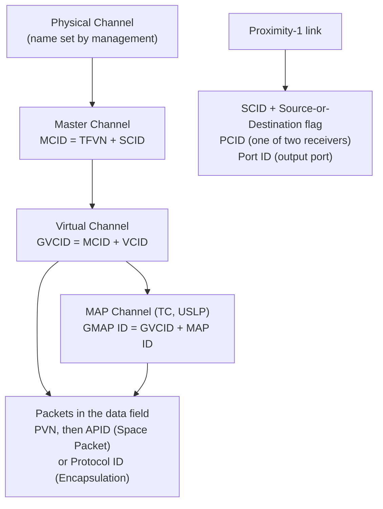

# Space link identifiers: SCIDs, VCIDs, APIDs and SANA

Every CCSDS space link protocol labels its data units with **identifiers**. These are small numeric
fields that say which kind of frame or packet this is, which spacecraft it belongs to, and which channel
or application it is for. Some values are defined by CCSDS in the protocol standards. Some are
assigned by CCSDS when an agency asks for one. Others are left to each project.[^sli-purpose][^sli-mgmt] This page lists
all of them, gives their sizes and reserved values, explains the procedure by which the **Space
Assigned Numbers Authority (SANA)** assigns spacecraft identifiers, and shows what the identifiers look
like in a real mission database, the Solar Orbiter [MIB](../mib/index.md).

!!! info "Status of the sources"
    CCSDS 135.0-B-4 *Space Link Identifiers* (October 2009) collected the identifiers in one Blue Book.
    The copy in this wiki's library is stamped **CCSDS Historical Document**: it is no longer current.
    The CCSDS overview Green Book (2023) states that **SANA replaces the retired Space Link
    Identifiers Blue Book**: the identifier names and values now live in SANA registries. SCID
    assignment follows the Magenta Book CCSDS 320.0-M-7.[^sli-hist][^g4-sana] This page therefore uses
    135.0-B-4 for structure and history and the current protocol Blue Books for values, and says where
    they differ.

## Three ways of managing an identifier

CCSDS manages each identifier in one of three ways, so that values can be added or changed without
editing the protocol standards:[^sli-mgmt][^sli-defs]

| Method | Who sets the values | Examples |
|---|---|---|
| **Defined by CCSDS** | Fixed in the protocol specification | Transfer Frame Version Number, Packet Version Number, Proximity-1 Port IDs, Encapsulation Protocol IDs |
| **Assigned by CCSDS** | Given out on request by agencies, under a separate procedure | Spacecraft Identifier (SCID) |
| **Managed by projects** | Each project, independently. CCSDS may reserve a few values for cross-agency use | VCID, MAP ID, APID, CFDP Entity ID |

Lossless data compression, SCPS-FP and the TM and TC synchronization and channel coding standards use
no identifiers and are left out.[^sli-mgmt]

## The identifier hierarchy

The data link protocols nest their identifiers. A **Physical Channel**, one stream of bits in one
direction, is named only by management and never appears in a frame. Frames with the same **Master
Channel Identifier (MCID)** form a Master Channel. Usually that is the whole Physical Channel, but
several spacecraft can share one Physical Channel as several Master Channels with the same TFVN. Frames
with the same **Global Virtual Channel Identifier (GVCID)** form a Virtual Channel. In TC and USLP,
frames that also share a **MAP ID** form a MAP Channel.[^g4-ids][^tm-addr][^tc-addr][^u-addr]

$$\begin{aligned}
\text{MCID} &= \text{TFVN} + \text{SCID}\\
\text{GVCID} &= \text{MCID} + \text{VCID}\\
\text{GMAP ID} &= \text{GVCID} + \text{MAP ID} \quad\text{(TC and USLP)}
\end{aligned}$$



*Channel nesting of TM, TC, AOS and USLP, and the Proximity-1 triad.*[^g4-ids][^g4-triad]

Packets add their own naming level. The **APID** of a [Space Packet](space-packet.md) is unique only
inside one *naming domain*, which usually corresponds to one spacecraft or one element of a
constellation. Each project allocates the APIDs of its own domain.[^spp-addr]

## Identifier fields by protocol

| Identifier | TM (132.0) | TC (232.0) | AOS (732.0) | Proximity-1 (211.0) | USLP (732.1) |
|---|---|---|---|---|---|
| TFVN | bits 0–1 = `00` | bits 0–1 = `00` | bits 0–1 = `01` | bits 0–1 = `10` | bits 0–3 = `1100` |
| SCID | bits 2–11 (10 bits) | bits 6–15 (10 bits) | bits 2–9 (8 bits) | bits 6–15 (10 bits) | bits 4–19 (16 bits) |
| VCID | bits 12–14 (3 bits, 0–7) | bits 16–21 (6 bits, 0–63) | bits 10–15 (6 bits, 0–63) | — | bits 21–26 (6 bits, 0–63) |
| MAP ID | — | segment header bits 2–7 (6 bits, 0–63) | — | — | bits 27–30 (4 bits, 0–15) |
| Source-or-Destination | — | — | — | bit 20 | bit 20 |
| PCID | — | — | — | bit 16 (0–1) | — |
| Port ID | — | — | — | bits 17–19 (0–7) | — |
| Reserved VCID | none | none | 63 = OID frames | — | 63 = OID frames |

Bit positions from the frame header clauses of each Blue Book. Ranges agree with table 3-1 of the
overview Green Book.[^tm-hdr][^tc-hdr][^tc-seg][^aos-hdr][^px-hdr][^u-hdr][^u-vcid][^g4-ids2]

<div class="bitfield" data-title="AOS Transfer Frame, first 16 bits (identification)" data-width="16" data-caption="CCSDS 732.0-B-4 clause 4.1.2.2 and 4.1.2.3"
     data-fields='[{"n":"TFVN","b":2,"v":"01","g":"MCID (10 bits)"},{"n":"Spacecraft ID","b":8,"g":"MCID (10 bits)","d":"8-bit SCID, assigned by SANA"},{"n":"VCID","b":6,"d":"0-62 free; 63 (all ones) = Only Idle Data frames"}]'></div>

<div class="bitfield" data-title="Proximity-1 Version-3 frame, first 21 bits (identification)" data-width="32" data-caption="CCSDS 211.0-B-6 clause 3.2.2; frame length and sequence number follow"
     data-fields='[{"n":"TFVN","b":2,"v":"10"},{"n":"QoS","b":1},{"n":"PDU","b":1},{"n":"DFC","b":2},{"n":"Spacecraft ID","b":10,"d":"Source or destination, per the S/D bit"},{"n":"PCID","b":1},{"n":"Port ID","b":3},{"n":"S/D","b":1,"d":"0 = SCID is source, 1 = SCID is destination"}]'></div>

<div class="bitfield" data-title="USLP Transfer Frame primary header, first 31 bits (identification)" data-width="32" data-caption="CCSDS 732.1-B-3 clauses 4.1.2.2 to 4.1.2.5"
     data-fields='[{"n":"TFVN","b":4,"v":"1100","g":"MCID (20 bits)"},{"n":"Spacecraft ID","b":16,"g":"MCID (20 bits)"},{"n":"S/D","b":1,"d":"Source-or-Destination Identifier"},{"n":"VCID","b":6,"d":"63 reserved for OID frames"},{"n":"MAP ID","b":4,"d":"Up to 16 MAP channels per VC"}]'></div>

The TM and TC identification prefixes are drawn on the [CCSDS overview](index.md#channels-and-identifiers)
and on the [TM](tm-sdlp.md) and [TC](tc-sdlp.md) pages.

### Transfer Frame Version Numbers

The TFVN tells receivers which frame format follows. It is defined by CCSDS. A Physical Channel must not
mix frames of different versions.[^sli-tfvn][^g4-ids]

| Version | Binary | Frame | Defined in |
|---|---|---|---|
| 1 | `00` | TM Transfer Frame | CCSDS 132.0 |
| 1 | `00` | TC Transfer Frame | CCSDS 232.0 |
| 2 | `01` | AOS Transfer Frame | CCSDS 732.0 |
| 3 | `10` | Proximity-1 (Version-3) Transfer Frame | CCSDS 211.0 |
| 4 | `1100` | USLP (Version-4) Transfer Frame | CCSDS 732.1 |

The first four rows come from 135.0-B-4. TM and TC share version 1 and are told apart by the TM Attached
Sync Marker or the TC Start Sequence.[^sli-tfvn][^tm-hdr] USLP took the last free 2-bit value, `11`, and
appended `00` to form a 4-bit TFVN, `1100`. This leaves room for future versions.[^u-tfvn] A Proximity-1
receiver uses the same two bits to accept Version-3 (`10`) or Version-4 (`11`) frames and rejects `00`
and `01`.[^px-val]

### Spacecraft identifiers per frame version

The SCID field size depends on the frame version, so CCSDS 320.0-M-7 keeps a separate SCID table for
each TFVN:[^scid-tfvn]

| Version | TFVN | SCID range | Bits | Protocols |
|---|---|---|---|---|
| 1 | `00` | 0–1023 | 10 | TC and TM |
| 2 | `01` | 0–255 | 8 | AOS |
| 3 | `10` | 0–1023 | 10 | Proximity-1 |
| 4 | `1100` | 0–65 535 | 16 | USLP |

Linking a spacecraft to a TFVN is a managed parameter. A spacecraft that uses protocols with different
TFVNs may need two or more distinct SCIDs.[^scid-tfvn] In USLP the 20-bit global SCID (TFVN.SCID, the
same thing as the MCID) runs from `0xC0000` to `0xCFFFF`.[^u-sana]

The SCID is **static throughout all mission phases** in TM and TC.[^tm-hdr][^tc-hdr] The TM Blue Book
adds that SCIDs are unique only within the spacecraft's frequency band. The same value may be given to
another spacecraft in another band.[^tm-hdr] In TM, TC and AOS the SCID names the spacecraft associated
with the data. Proximity-1 and USLP add a **Source-or-Destination Identifier**: `0` means the SCID is the
sender, `1` means it is the intended receiver.[^px-sd][^u-sd] ECSS-E-ST-50C requires that all
telecommands carry an identifier of the destination spacecraft. All telemetry must carry an identifier
of the source spacecraft, which ground systems normally keep as an annotation. Frames must identify the
spacecraft and link, and the frame version number can identify the link.[^e50-tc][^e50-tm][^e50-link]

## Assigning SCIDs: CCSDS 320.0-M-7

The **CCSDS Spacecraft Identification Field Code Assignment Control Procedures** govern how SCIDs are
requested, assigned and given back. They also define who may take part and how SCIDs may be used. Issue 7
(November 2017, with Technical Corrigendum 1 of July 2019) applies to TC, TM, AOS, Proximity-1 and USLP.
All organisations that need a SCID for CCSDS space communication must follow it.[^scid-purpose]

| Issue | Date | Change from the document control page |
|---|---|---|
| 320.0-B-1 to -B-6 | 1993 to 2013 | "CCSDS Global Spacecraft Identification Field" Blue Books |
| 320.0-M-7 | November 2017 | Adds the frequency band as a qualifier (Q-SCID); replaces the paper request form by the SANA web form; becomes a Recommended Practice (Magenta Book) |
| Cor. 1 | July 2019 | Adds USLP (version 4) frames; frequency bins now use ITU ranges; editorial updates |

Restated from the document control pages.[^scid-dc][^scid-dc2]

### Why SCIDs are qualified

The SCID fields of version 1 to 3 frames are only 8 or 10 bits long, and they must tell apart all the
spacecraft that are operating at the same time. The SCID therefore cannot be a permanent identifier, and
SCIDs must be reused. The procedures are meant to ensure that data from one spacecraft is never mistaken
for another's, and that commands are never acted on by the wrong spacecraft.[^scid-why] Missions with
different frequency bands are already isolated, so each band can be treated as a separate namespace.
Hence:[^scid-why][^scid-defs]

* **GSCID** (global spacecraft identifier) = TFVN . SCID, where "." means concatenation.
* **Q-SCID** (qualified spacecraft identifier) = FB . TFVN . SCID, where FB is the frequency band.
* Each TFVN has its own assignment table, and each frequency band within a TFVN has its own table.
* A spacecraft that uses more than one protocol or band may receive several Q-SCIDs. SANA tries, but
  does not guarantee, to give the same number in each domain.
* Every registered spacecraft also receives a permanent ISO **object identifier**. The SCID is valid only
  during operations, but the object identifier is permanent.

The frequency bands follow ITU usage for Earth exploration-satellite (EESS), space research (SRS) and
space operation (SOS) services. SANA uses frequency band designators for them:[^scid-fb]

| Range | Band | Near-Earth downlink allocation (SANA designator) | Deep-space downlink allocation (designator) |
|---|---|---|---|
| 300–1000 MHz | UHF | UHF | UHF |
| 1–2 GHz | L | 1.525–1.535 GHz SOS (L) | L |
| 2–3 GHz | S | 2.200–2.290 GHz EESS, SRS, SOS (S-NE) | 2.290–2.300 GHz SRS-DS (S-DS) |
| 6–10 GHz | X | 8.025–8.400 GHz EESS and 8.450–8.500 GHz SRS (X-NE) | 8.400–8.450 GHz SRS-DS (X-DS) |
| 22–32.5 GHz | Ka | 25.250–27.500 GHz Inter-Satellite Service (restricted to space research and Earth exploration data) and 25.500–27.000 GHz EESS, SRS (Ka-NE) | 31.800–32.300 GHz SRS-DS (Ka-DS) |
| 32.5–40.5 GHz | Ka | 37.000–38.000 GHz SRS and 37.500–40.500 GHz EESS, secondary (Ka-S) | 37.000–38.000 GHz SRS (Ka-S) |
| Optical | 1064 nm, 1550 nm | to be supplied (O1, O2) | to be supplied (O1, O2) |

Abridged from table 2-1, which also lists HF, VHF, C, Ku, K, V, W and millimetre bands. Only downlink
frequencies are shown. A request states the uplink and downlink bands separately, and only one SCID is
needed if both use the same TFVN and band.[^scid-fb][^scid-fb2][^scid-req]

### Roles

| Role | Duties |
|---|---|
| CCSDS Secretariat | Resolves issues the procedures do not cover; finds an Agency Representative for requests from organisations without a CCSDS agency; keeps the lists of agencies and Heads of Delegation |
| Agency Head of Delegation (HoD) | Appoints the agency's **Agency Representative (AR)** and keeps the AR's contact data up to date in SANA |
| Agency Representative | Submits Q-SCID requests, deals with SANA on them, watches the agency's missions, and relinquishes their Q-SCIDs no later than **two months** after the end of the operational phase |
| SANA | Keeps the agency, HoD and AR lists; reviews, logs and assigns Q-SCIDs per band; assigns object identifiers; keeps separate Q-SCID registries per band and TFVN; recovers Q-SCIDs of finished missions for reuse |

Section 3.1.[^scid-roles][^scid-roles2][^scid-sana]

### Request, assignment, use and relinquishment


*Sections 3.2 to 3.5.*[^scid-req][^scid-assign][^scid-life][^scid-rel]

* **Requests.** Only the designated AR may request, using the online form at the SANA site, one form per
  request. Organisations without a CCSDS agency go through the Secretariat. The form gives the TFVN and
  the uplink and downlink bands, not exact frequencies. E-mail is accepted only in exceptional
  cases.[^scid-req]
* **Assignment.** SANA alone assigns, based on availability. Each Q-SCID is unique within its TFVN and
  band while assigned, and assignments are made spacecraft by spacecraft. Requests to reserve blocks for
  unspecified spacecraft are refused, but a multi-spacecraft mission may receive several Q-SCIDs. A
  specific number is honoured only in exceptional cases and only if free, so requesters should check the
  registry first.[^scid-assign][^scid-assign2]
* **Simulators.** SANA no longer assigns SCIDs for simulation, test or ground assemblies, because they
  never radiate. Missions may manage such SCIDs internally. Protoflight models and simulators may receive
  their own object identifier, treated as a "non-radiating" Q-SCID, but no separate SCID.[^scid-sim][^scid-assign2]
* **Lifetime.** A Q-SCID may be used through all active phases. Soon after telemetry is received, the
  SCID should be replaced by the permanent object identifier or another agency identifier, because
  SCIDs are reused and identifying archived data by SCID is problematic.[^scid-life]
* **Relinquishment.** The AR and the mission manager decide when operations are complete. The AR marks
  "RELINQUISH current GSCID" on the form. SANA puts the number at the bottom of the stack of free SCIDs,
  so that it is reused as late as possible.[^scid-rel]

### The SANA spacecraft identifier registry

Annex A describes the registry: one table per Q-SCID version, with these columns:[^scid-reg][^scid-reg2]

| Column | Content |
|---|---|
| Spacecraft Name | Up to 64 characters, assigned by the agency |
| Channel | TC, TLM, AOS or Other |
| Version Number(s) | From table 1-1; may be extended for new protocols |
| SCID | Hex, from 001 to the maximum for the version |
| GSCID | Hex, per frequency band |
| Object ID | ISO object identifier under `1.3.112.4.7` |
| Requestor Name, Affiliation, Affiliation Country | Must match the AR, Organization and ISO country registries |
| Last Request Date, Registered by, Status | Status: Assigned, Returned, object identifier only, or null |
| Spacecraft Name Abbreviation and Alias(es) | Agency abbreviation, pre- and post-launch names |
| S/C Transmitting and Receiving Frequency Band(s) | Band designators from table 2-1 |
| Expected Launch Date, Expected Mission End Date, Note | Dates in `yyyy-mm-dd`; the end date can be extended on request |

The registration rules allow a request for an object identifier only, which helps organisations that do
not use CCSDS link protocols but want a registered designator. If a request names a band that has no bin
yet, SANA creates bins for it in all TFVNs. Requests are accepted only from organisations of type member
agency, observer agency or affiliate, and only from persons with the AR role.[^scid-reg2][^scid-reg3]

!!! note "Who assigns, in the Blue Books"
    The TM, AOS and USLP Blue Books say that SANA assigns SCIDs under CCSDS 320.0-M. The TC Blue Book
    (issue 4, 2021) still says the CCSDS Secretariat assigns them. Under 320.0-M-7, all Q-SCID
    assignments are made by SANA.[^tm-hdr][^aos-hdr][^u-hdr][^tc-hdr][^scid-assign]

## Virtual channel and MAP identifiers

VCIDs and MAP IDs are **managed by projects**. They need not be numbered consecutively.[^sli-tab71][^tm-vcid][^tc-hdr][^tc-seg]

* **TM**: 3 bits, VCIDs 0 to 7, none reserved. A frame with only idle data is marked by the First
  Header Pointer value `11111111110`, not by a VCID.[^tm-vcid][^tm-oid]
* **TC**: 6 bits, none reserved. The MAP ID is in the segment header (bits 2–7). If MAPs are not used
  but a segment header is present, the MAP ID is a constant.[^tc-hdr][^tc-seg]
* **AOS**: 6 bits. All zeros if only one VC is used. **VCID 63 (all ones) is reserved** for Only Idle Data
  (OID) frames. This was the only VCID that 135.0-B-4 reserved.[^aos-hdr][^sli-vcid]
* **USLP**: 6 bits. VCIDs 0 to 62 are free, and VCID 63 is reserved for OID frames, which also use MAP ID
  0. MAP IDs are 4 bits (1 to 16 MAP channels). Each SDU is on one MAP at a time and must be finished
  before another MAP's SDU starts on the same VC. SANA lists USLP VCIDs as unmanaged.[^u-vcid][^u-map][^u-sana]
* **Proximity-1** has no VCID. With Version-4 frames over Proximity-1, the most significant VCID bit
  stands for the PCID, which leaves 32 VCIDs.[^u-proxvc]

## Proximity-1 identifiers

[Proximity-1](proximity-1.md) uses a triad: the SCID with its source-or-destination flag, a **PCID** that
selects one of two receivers, and a **Port ID** that routes user data to a logical or physical port
inside the receiving spacecraft.[^g4-triad][^px-addr] Port IDs are **defined by CCSDS**. 135.0-B-2 (2005)
added them, and 135.0-B-3 clarified the meaning of the packets port.[^sli-dc][^sli-tab71] The last
published assignment is:[^sli-port]

| Port ID | Forward link (both PCIDs) | Return link (both PCIDs) |
|---|---|---|
| `000` | Bitstream | Bitstream |
| `001` | Hardware commands | Reserved by CCSDS |
| `010` | Packets (Space Packet, SCPS-NP, Encapsulation, IPv4) | Packets |
| `011`–`111` | Reserved by CCSDS | Reserved by CCSDS |

The current Proximity-1 Blue Book refers to the SANA registry for the reserved Port IDs. Its issue 6
required no SANA action and keeps the existing registries.[^px-port][^px-sana]

## Packet-level identifiers

### Packet Version Numbers

Every packet carried by a Space Data Link Protocol starts with a 3-bit **Packet Version Number**. Its
values are defined by CCSDS and held in SANA. Receivers use the PVN to find each packet's length
field:[^sli-pvn][^sli-len][^g4-pvn]

| PVN | Binary | Packet | Length field (bits from packet start) | Meaning of the length |
|---|---|---|---|---|
| 1 | `000` | Space Packet | 32–47 | Data field octets minus 1 (add 7 for the whole packet) |
| 2 | `001` | SCPS-NP | 3–16 | Total octets including the header (minimum 4) |
| 8 | `111` | Encapsulation Packet | 8–15, 16–31 or 32–63 | Total octets including the header |

### Application Process Identifier (APID)

The APID is bits 5–15 of the Space Packet primary header: 11 bits, 0 to 2047. It names the *managed data
path* and may identify the sending or receiving application on a spacecraft. Missions decide whether it
means source, destination or packet type.[^spp-apid][^spp-addr2] APIDs are **managed by projects**,
need not be consecutive, and are unique only within their naming domain. A mission with several
processors or spacecraft must sub-allocate the single domain or extend it through its own secondary
header fields.[^spp-apid][^spp-addr2][^sli-apid]

<div class="bitfield" data-title="Space Packet primary header, first 16 bits (packet identification)" data-width="16" data-caption="CCSDS 133.0-B-2 clause 4.1.3"
     data-fields='[{"n":"PVN","b":3,"v":"000","d":"Packet Version Number 1"},{"n":"Type","b":1,"d":"0 = telemetry, 1 = telecommand"},{"n":"Sec Hdr","b":1,"d":"Secondary header flag; 0 for idle packets"},{"n":"APID","b":11,"d":"0-2046 unmanaged by SANA; 2047 = idle packet"}]'></div>

Reserved APIDs have shrunk over time:[^sli-apid][^spp-sana]

| Source | Reserved APIDs |
|---|---|
| CCSDS 135.0-B-4 (2009), table 5-2 | 2040–2044 possible future use; 2045 CFDP; 2046 ISO 8473; 2047 idle packet |
| CCSDS 133.0-B-2 (2020) and the SANA policy it set | 0–2046 unmanaged; 2047 idle packet (`11111111111`) only |

Issue 1 of the Space Packet Protocol reserved APIDs for carrying PDUs of other protocols such as CFDP and
LTP. Issue 2 made that coupling mission-specific and removed those reservations from the SANA
registry.[^sli-apid][^spp-apid][^spp-sana]

### Encapsulation and other protocol identifiers

The [Encapsulation Packet](encapsulation.md) names its payload with a 3-bit **Encapsulation Protocol ID**
(bits 3–5). The value `000` marks an Encapsulation Idle Packet, `110` means the 4-bit extension field
identifies the protocol, and `111` means mission-specific private data. The recognised values are held in
SANA.[^epp-pid][^epp-sana] 135.0-B-4 listed `010` IPE, `011` CFDP, and `001`, `100` and `101` reserved. All
extended IDs `0000`–`1111` were reserved at the time.[^sli-pid] Its annex A defined the **Internet
Protocol Extension (IPE)**: a header of one or more octets after the Encapsulation header. The least
significant bit of each octet is `0` if another octet follows and `1` in the last octet, so only odd values
are valid (33 IPv4, 87 IPv6, 97–113 header-compression formats).[^sli-ipe][^sli-ipe2] USLP adds a 5-bit
**USLP Protocol Identifier (UPID)** in its data field header. SANA manages the values
`00000`–`11111`.[^u-sana]

### Other identifiers in 135.0-B-4

| Protocol | Identifier | Method |
|---|---|---|
| CFDP | Entity ID | Managed by projects, no value reserved |
| SCPS-TP | Connection Identifier | Managed by projects, no value reserved |
| SCPS-NP | Domain Identifier | Assigned by CCSDS (no procedure defined) |
| SCPS-NP | End System Identifier, Path Identifier | Managed by projects |
| SCPS-NP | Transport Protocol Identifier | Defined by CCSDS |
| TM | Frame Secondary Header Version Number | Defined by CCSDS: `00` = version 1 |
| TC | CLCW Version Number | Defined by CCSDS: `00` = version 1 |

Tables 3-1, 4-1, 6-1, 7-1, 7-4 and 7-5.[^sli-cfdp][^sli-np][^sli-tab71][^sli-fsh] The [CFDP](cfdp.md) and
[COP-1](cop-1.md) pages describe these fields in their protocols.

### Security aspects

135.0-B-4 defines no confidentiality, integrity, authentication, access control, availability or
auditing measures for the identifiers. It refers to the individual protocols for these.[^sli-sec] See
[security in CCSDS space links](security.md).

## Identifiers in the Solar Orbiter database

Solar Orbiter is the mission whose real database is published with this wiki (see
[the Solar Orbiter MIB](../missions/solar-orbiter/mib.md)). Its TM/TC interface control document fixes the
link identifiers, and the MIB shows how SCOS-2000 uses them.[^icd-tcf][^mib25]

### Spacecraft, virtual channels and MAP IDs

| Identifier | Solar Orbiter value | Source |
|---|---|---|
| SCID | `0x28A` = 650 for both TM and TC; the same ID for the flight model, the ETB and the OBC-DM | ICD §3.4, §4.3 |
| TC VCIDs | 1 (`000001`) for TC decoder 1, 2 (`000010`) for decoder 2, used the same way in the CLCWs | ICD §3.4 |
| TC MAP IDs | 0 for CPDU (high-priority) commands, 1 for all other commands; MAP IDs never address the active CSW processor | ICD §3.3.1 |
| TM VCIDs | 0 real-time, 1 OBC playback, 2 and 3 SSMM playback, 4 real-time high priority, 5 critical event log, 7 idle frames only | ICD §4.3 |
| TM idle frames | VC 7, First Header Pointer `11111111110` | ICD §4.3 |

Sources: Solar Orbiter TM/TC and packet structure ICD.[^icd-seg][^icd-tcf][^icd-tmf][^icd-tmf2]

!!! note "A small inconsistency in the ICD"
    The ICD says the suggested TC VCID values are "Zero and One", but the two values it lists are
    `000001` and `000010`, that is 1 and 2.[^icd-tcf] The MIB uses 1 and 2 (below).

None of the MIB tables queried for this page holds the SCID or the VCIDs as a configuration value. The
MIB does, however, decode them where they appear in telemetry. The packet "Good mini-transfer frame"
(SPID 66980, TM(161,5) on APID 1966: process ID 122, in the ICD's EGSE range 112–127, and packet
category 14, "Reserved OCC/EGSE") lays out the TM frame header: a 2-bit TF
version number at bit 0, a 10-bit "Spacecraft Id." at byte 0 bit 2 (`PCF_PTC` 3, `PCF_PFC` 6), a 3-bit
"VC Id." at byte 1 bit 4, then the frame counts, data field status, secondary header and the CLCW. Bad
and idle frames have their own SPIDs, 66981 and 66982.[^mib25][^i70-ptc][^icd-annex8][^icd-pid] These positions are exactly bits
0–1, 2–11 and 12–14 of the TM primary header.[^tm-hdr] In the CLCW part, 18 parameters are split per TC
virtual channel ("VC1 ..." and "VC2 ..."). Each is valid only when the CLCW's 6-bit VC Id
(`NYGD0659`) equals 1 or 2, through `PCF_VALID` and `PCF_VALPAR`. A textual calibration shows the value as
"VC 1" or "VC 2".[^mib25][^i70-valid] The OBC's own housekeeping, TM(3,25) "DMS OBC Status Slow", reports
the VCIDs of both decoders' CLCWs (`PDEC_CLCW.A.VCID`, `PDEC_CLCW.B.VCID`).[^mib25] Ground-generated packets
carry a 16-bit "GS Spacecraft ID" (TM(165,1), APID 1966), matching the NCTRS packet headers described on
[NCTRS and NIS](../scos2000/nctrs-nis.md).[^mib25]

See the packets in the explorer: [good mini-transfer frame](../explorer/index.md#/solo/packet/66980),
[`NYGD0659`](../explorer/index.md#/solo/param/NYGD0659) and
[`NYGDA659`](../explorer/index.md#/solo/param/NYGDA659).

!!! warning "Inference"
    The "mini-transfer frame" packet has fields for the frame header (6 octets), a 4-octet secondary
    header (8-bit ID at octet 6 and 24-bit data at octet 7), the CLCW at octet 10, the frame error
    control field at octet 14 and the earth reception time from octet 16. These are exactly the
    header and trailer fields that the ICD puts in every Solar Orbiter TM frame: a secondary header with
    an 8-bit ID and a 24-bit extension of the VC frame count, a CLCW in the Operational Control Field
    and a Frame Error Control Word.[^icd-tmf2] The packet apparently carries a TM frame *without its
    data field*, so that the control system can monitor frame-level identifiers and the CLCW of every
    frame. The MIB also defines "Good", "Bad" and "Idle complete transfer frame" packets (SPIDs 1000006,
    1000002 and 1000003, type 0, APID 1), which fits this reading of "mini".[^mib25] This is deduced from
    the parameter offsets and descriptions. The packets are not described in the documents in this
    wiki's library.

On the telecommand side the MIB does carry the MAP ID. The ICD defines `CCF_HIPRI` as marking a
high-priority command whose MAP ID is forced to the value in `CCF_MAPID` (0–63), and which cannot be
time-tagged on board or aggregated with others. `CCF_MAPID` is irrelevant unless `CCF_HIPRI` is
`Y`.[^i70-hipri] In the September 2025 release:[^mib25]

| `CCF_PKTID` (header) | `CCF_HIPRI` | `CCF_MAPID` | Commands | APID | What they are |
|---|---|---|---:|---|---|
| `HPC1_TC` (HPC_TC_Packet_Header) | Y | 0 | 125 | 44 | CPDU high-priority (HPC-1) commands, e.g. `ZBC04001` "Select PM A EEPROM Image 1" |
| `NO_HDR` (TCP Header for CF/CS) | Y | (empty) | 5 | none | Frame-level directives: `UNLOCK` and `SETVR` (control frames, `CCF_CTYPE` F), `RESET`, `TC_ONLY` and `REIN_TTR` (control segments, R) |
| `NOM_TC` (NOM_DH_TC_Packet_Header) | N | empty, 1 or 54 | 5 318 | 30 APIDs | Ordinary PUS commands |
| `NOS2KHDR` (NIS Throw Events) | N | (empty) | 6 | 1964 | NIS throw events (`CCF_CTYPE` N), type 251, never uplinked |

MAP ID 0 for the 125 CPDU commands matches the ICD (process ID 2 is "High Priority TC Functions to CPDU
(MAP ID = 0)").[^icd-seg][^icd-pid] The `NO_HDR` entries have no APID because they are not packets. The ICD
defines `CCF_CTYPE` F as a BC frame (Unlock and Set V(R)) and R as a control segment, whose PCDF/CDF
entries describe a frame data field, not a packet.[^i70-ctype] These are the [COP-1](cop-1.md) control
commands. 128 ordinary commands carry `CCF_MAPID` 1 and 77 carry 54, all with `CCF_HIPRI` = N.[^mib25]

!!! warning "Inference"
    The values 1 and 54 in non-high-priority commands have no effect under the ICD rule above. The
    value 1 is the MAP ID that the Solar Orbiter ICD assigns to all normal (non-CPDU) commands, so those
    128 entries merely restate the MAP ID the commands use anyway.[^icd-seg] The 77 commands with 54 are
    all on APID 876, whose process ID is 54 (an EPD process). This suggests that an instrument team's
    tool copied the process ID into the field. The 2020 release already has the same pattern (115
    commands with 1, 77 with 54).[^mib20]

### APIDs in the MIB

SCOS-2000 extends the APID beyond 11 bits for its own purposes. `PID_APID` and `CCF_APID` are 0–2047 for
spacecraft packets and commands, and 2048–65 535 for anything else, such as packets generated by
SCOS-2000 or by SCOE equipment.[^i70-pidapid][^i70-ccfapid] When a command is encoded, its packet header
comes from the `tcp`/`pcdf` tables. A `pcdf` element of type `A` takes its value from `CCF_APID`, and the
source sequence counter is kept per APID.[^i70-pcdf] In the Solar Orbiter headers `NOM_TC` and `HPC1_TC`,
that element is the 11-bit field at bit 5, after a fixed version `000` and type bit `1`. The secondary
header flag is 1 for PUS commands and 0 for CPDU commands, and the sequence flags are fixed at `11`.[^mib25]
`CCF_RAPID` may name a redundant APID for redundant units. Solar Orbiter uses none.[^i70-rapid][^mib25]
The optional `dst` table routes commands per APID and sends everything else to the NCTRS. Its only Solar
Orbiter row sends APID 1372 (SPICE) to `EGSE.TC.0x8800`, discussed on
[SCOS-2000 as EGSE](../scos2000/egse.md).[^i70-dst][^mib25]

Solar Orbiter divides the 11-bit APID into a 7-bit **process ID** and a 4-bit **packet category**. All
telecommands use category 12.[^icd-annex8][^icd-pid]

<div class="bitfield" data-title="Solar Orbiter APID (11 bits)" data-width="16" data-caption="SOL.S.ASTR.TN.00079 issue 7, annex 8"
     data-fields='[{"n":"Process ID","b":7,"d":"0 time, 2 OBC hardware, 10-14 CSW, 15 OBCP, 16 thermal control, 30-32 SSMM, 40-41 STR, 49 payload broadcast, 50-104 instruments, 112-127 EGSE"},{"n":"Category","b":4,"d":"12 for all telecommands; 0-15 for telemetry"}]'></div>

The MIB follows this exactly. Every command with an APID uses category 12, on 32 distinct APIDs:[^mib25]

| TC APID | Process | Owner (ICD annex 8) | Commands | TM APIDs of the same process |
|---:|---:|---|---:|---:|
| 44 | 2 | OBC hardware, CPDU | 125 | 1 |
| 172 | 10 | CSW data management | 1 971 | 9 |
| 188 | 11 | CSW AOCS | 454 | 7 |
| 204, 220, 236, 268 | 12, 13, 14, 16 | CSW payload, platform and system control; OBC software thermal control | 78, 118, 966, 84 | 7 each |
| 492, 508, 524 | 30–32 | SSMM (operational, debug A, debug B) | 182, 14, 14 | 8, 5, 5 |
| 652, 668 | 40, 41 | Star trackers A, B | 49, 49 | 6, 6 |
| 796 | 49 | Payload broadcast | 5 | 0 |
| 812, 876 | 50, 54 | EPD | 40, 78 | 5, 6 |
| 924 | 57 | EUI | 122 | 6 |
| 1020 | 63 | MAG | 126 | 2 |
| 1084 | 67 | METIS | 126 | 7 |
| 1164 | 72 | PHI | 199 | 5 |
| 1212–1308 (step 16) | 75–81 | RPW | 67, 22, 20, 19, 5, 2, 3 | 2 to 6 |
| 1324 | 82 | SOLOHI | 102 | 8 |
| 1372 | 85 | SPICE | 91 | 4 |
| 1452 | 90 | STIX | 98 | 6 |
| 1532 | 95 | SWA | 200 | 2 |
| 1948, 1964 | 121, 122 | EGSE range | 14, 6 | 2, 15 |

Process 15 (OBCP) has no command APID. Fourteen of the 32 command APIDs also appear as telemetry APIDs.
These are category-12 science packets of instruments and the EGSE APID 1964 (process 122). This is legal,
because the Packet Type bit tells a telecommand (`1`) from telemetry (`0`) with the same APID.[^mib25][^spp-type]

On the telemetry side, the 2025 release defines 11 150 packets on 293 APIDs (0 to 2065), with 287 of them
below 2048. The 2020 release has 9 027 packets on 268 APIDs (0 to 2047). Neither release uses the APIDs
2040–2046 that 135.0-B-4 once reserved. Both use only 2047, for the idle packet, and APID 0 for the time
report TM(9,2).[^mib25][^mib20][^sli-apid] Six packets above 2047 (2048–2065) are ground-generated
`LMS_...` packets, analysed on [the Solar Orbiter MIB page](../missions/solar-orbiter/mib.md#special-apids),
which also breaks down all TM APIDs by component. The command APID set is identical in the 2020 and 2025
releases.[^mib25][^mib20]

The instrument databases follow the same plan (see [SWA](../missions/solar-orbiter/swa.md),
[STIX](../missions/solar-orbiter/stix.md) and the
[instrument interface documents](../missions/solar-orbiter/instrument-interfaces.md)). The SWA database (v6.5.0) has 613 TM packets on 15 APIDs
(1525–1596, processes 95–99) and 201 commands, all on APID 1532. STIX (v2.26.38) has 246 TM packets on 9
APIDs (1441–1509) and 100 commands on APIDs 1452 (process 90) and 796, the payload broadcast
APID.[^swa65][^stix][^icd-pid] Explorer links: [APID 1532 (SWA)](../explorer/index.md#/swa65/apid/1532),
[APID 1452 (STIX)](../explorer/index.md#/stix/apid/1452),
[APID 44 (CPDU)](../explorer/index.md#/solo/apid/44),
[`SETVR`](../explorer/index.md#/solo/command/SETVR).

??? example "SQL used"
    ```sql
    -- solo-2025-09-16.sqlite (MIB 20250916M25925PFMS001)
    SELECT count(*), count(DISTINCT PID_APID), min(CAST(PID_APID AS INT)), max(CAST(PID_APID AS INT)),
           count(DISTINCT CASE WHEN CAST(PID_APID AS INT) < 2048 THEN PID_APID END) FROM pid;
                                                   -- 11150 | 293 | 0 | 2065 | 287
    SELECT PID_APID, count(*) FROM pid
     WHERE CAST(PID_APID AS INT) BETWEEN 2040 AND 2046;               -- (no rows)
    SELECT CAST(CCF_APID AS INT) & 15, count(*), count(DISTINCT CCF_APID)
      FROM ccf WHERE CCF_APID <> '' GROUP BY 1;                       -- 12 | 5449 | 32
    SELECT CCF_PKTID, CCF_APID, CCF_HIPRI, CCF_MAPID, count(*) FROM ccf
     GROUP BY 1, 2, 3, 4 ORDER BY CAST(CCF_APID AS INT);
    SELECT CCF_CNAME, CCF_CTYPE, CCF_DESCR FROM ccf WHERE CCF_PKTID = 'NO_HDR';
    SELECT * FROM tcp;  SELECT * FROM pcdf ORDER BY PCDF_TCNAME, CAST(PCDF_BIT AS INT);
    SELECT count(*) FROM ccf WHERE CCF_RAPID <> '';                   -- 0
    SELECT * FROM dst;                                                -- 1372|EGSE.TC.0x8800
    -- TC APIDs with the TM APIDs of the same process
    WITH tc AS (SELECT CAST(CCF_APID AS INT) a, count(*) n FROM ccf WHERE CCF_APID <> '' GROUP BY 1),
         tm AS (SELECT CAST(PID_APID AS INT) >> 4 p, count(DISTINCT PID_APID) na FROM pid GROUP BY 1)
    SELECT tc.a, tc.a >> 4, tc.n, tm.na FROM tc LEFT JOIN tm ON tm.p = tc.a >> 4 ORDER BY tc.a;
    SELECT count(DISTINCT CCF_APID) FROM ccf
     WHERE CCF_APID <> '' AND CCF_APID IN (SELECT PID_APID FROM pid);  -- 14
    -- frame-level identifiers decoded in telemetry
    SELECT p.PLF_NAME, c.PCF_DESCR, p.PLF_OFFBY, p.PLF_OFFBI, c.PCF_PTC, c.PCF_PFC
      FROM plf p JOIN pcf c ON c.PCF_NAME = p.PLF_NAME
     WHERE p.PLF_SPID = '66980' ORDER BY CAST(PLF_OFFBY AS INT), CAST(PLF_OFFBI AS INT);
    SELECT PCF_NAME, PCF_DESCR, PCF_VALID, PCF_VALPAR, PCF_CURTX FROM pcf
     WHERE PCF_VALID = 'NYGD0659';                                    -- 18 rows
    SELECT * FROM txp WHERE TXP_NUMBR = 'CYGT0659TM';                 -- 1 VC 1 / 2 VC 2
    SELECT PID_SPID, PID_TYPE, PID_STYPE, PID_APID, PID_DESCR FROM pid
     WHERE PID_DESCR LIKE '%transfer frame%';      -- 3 complete (APID 1) + 3 mini (APID 1966)
    -- solo-2020-04-16.sqlite
    SELECT count(*), count(DISTINCT PID_APID), max(CAST(PID_APID AS INT)) FROM pid;  -- 9027 | 268 | 2047
    SELECT CCF_HIPRI, CCF_MAPID, count(*) FROM ccf GROUP BY 1, 2;
    -- swa-idb-v6.5.0.sqlite and stix-idb-2.26.38.sqlite
    SELECT count(*), count(DISTINCT PID_APID), min(CAST(PID_APID AS INT)), max(CAST(PID_APID AS INT)) FROM pid;
    SELECT count(*), group_concat(DISTINCT CCF_APID) FROM ccf;
    ```

## Related pages

* Protocols: [TM](tm-sdlp.md), [TC](tc-sdlp.md), [AOS](aos.md), [USLP](uslp.md),
  [Proximity-1](proximity-1.md), [Space Packet](space-packet.md), [Encapsulation](encapsulation.md).
* [CCSDS overview](index.md), [COP-1](cop-1.md), [CFDP](cfdp.md).
* Mission: [Solar Orbiter](../missions/solar-orbiter/index.md#application-process-identifiers),
  [the Solar Orbiter MIB](../missions/solar-orbiter/mib.md), [How Solar Orbiter uses PUS](../missions/solar-orbiter/pus-usage.md).
* MIB tables: [pid](../mib/tables/pid.md), [ccf](../mib/tables/ccf.md), [tcp](../mib/tables/tcp.md),
  [pcdf](../mib/tables/pcdf.md), [dst](../mib/tables/dst.md), [pcf](../mib/tables/pcf.md), [plf](../mib/tables/plf.md);
  [MIB parameter types](../mib/parameter-types.md).
* Library: [CCSDS 135.0-B-4](../library/ccsds-135-0-135x0b4s.md), [CCSDS 320.0-M-7](../library/ccsds-320-0-320x0m7c1.md),
  [CCSDS 133.0-B-2](../library/ccsds-133-0-133x0b2e2.md); [glossary](../glossary.md); [references](../references/index.md).

[^sli-hist]: [CCSDS 135.0-B-4, Space Link Identifiers](../library/ccsds-135-0-135x0b4s.md), cover pages ("CCSDS Historical Document"), PDF pp. 1–3.
[^sli-purpose]: [CCSDS 135.0-B-4](../library/ccsds-135-0-135x0b4s.md), Foreword and §1.1–1.4 Purpose, scope, applicability and rationale, PDF pp. 6, 11.
[^sli-dc]: [CCSDS 135.0-B-4](../library/ccsds-135-0-135x0b4s.md), Document Control, PDF p. 8.
[^sli-defs]: [CCSDS 135.0-B-4](../library/ccsds-135-0-135x0b4s.md), §1.6 Definitions (assigned, defined, managed by projects), PDF p. 12.
[^sli-mgmt]: [CCSDS 135.0-B-4](../library/ccsds-135-0-135x0b4s.md), §2.1–2.4 Management of space link identifiers, PDF pp. 15–16.
[^sli-sec]: [CCSDS 135.0-B-4](../library/ccsds-135-0-135x0b4s.md), §2.5 Security aspects of the space link identifiers, PDF pp. 16–17.
[^sli-cfdp]: [CCSDS 135.0-B-4](../library/ccsds-135-0-135x0b4s.md), §3 table 3-1 and §4 table 4-1 (CFDP and SCPS-TP), PDF pp. 18–19.
[^sli-apid]: [CCSDS 135.0-B-4](../library/ccsds-135-0-135x0b4s.md), §5 tables 5-1 and 5-2 Reserved Application Process Identifiers, PDF p. 20.
[^sli-np]: [CCSDS 135.0-B-4](../library/ccsds-135-0-135x0b4s.md), §6 table 6-1 Identifiers used by SCPS-NP, PDF p. 21.
[^sli-tab71]: [CCSDS 135.0-B-4](../library/ccsds-135-0-135x0b4s.md), §7.1 table 7-1 Identifiers used by Space Data Link Protocols, PDF p. 22.
[^sli-tfvn]: [CCSDS 135.0-B-4](../library/ccsds-135-0-135x0b4s.md), §7.2 table 7-2 Defined Transfer Frame Version Numbers and notes, PDF pp. 22–23.
[^sli-vcid]: [CCSDS 135.0-B-4](../library/ccsds-135-0-135x0b4s.md), §7.3 table 7-3 Reserved Virtual Channel Identifiers, PDF p. 23.
[^sli-fsh]: [CCSDS 135.0-B-4](../library/ccsds-135-0-135x0b4s.md), §7.4–7.5 tables 7-4 and 7-5 (Frame Secondary Header and CLCW version numbers), PDF pp. 23–24.
[^sli-pvn]: [CCSDS 135.0-B-4](../library/ccsds-135-0-135x0b4s.md), §7.6 table 7-6 Defined Packet Version Numbers, PDF pp. 24–25.
[^sli-pid]: [CCSDS 135.0-B-4](../library/ccsds-135-0-135x0b4s.md), §7.7 tables 7-7a and 7-7b Protocol Identifiers, PDF pp. 25–26.
[^sli-port]: [CCSDS 135.0-B-4](../library/ccsds-135-0-135x0b4s.md), §7.8 tables 7-8a and 7-8b Proximity-1 Port ID assignments, PDF p. 27.
[^sli-ipe]: [CCSDS 135.0-B-4](../library/ccsds-135-0-135x0b4s.md), annex A2–A3.2 CCSDS IP Extension, figure A-2, PDF pp. 28–31.
[^sli-ipe2]: [CCSDS 135.0-B-4](../library/ccsds-135-0-135x0b4s.md), annex A table A-1 Enumerations for the IPE header values, PDF p. 32.
[^sli-len]: [CCSDS 135.0-B-4](../library/ccsds-135-0-135x0b4s.md), annex D table D-1 Location of packet length field, PDF p. 37.
[^scid-dc]: [CCSDS 320.0-M-7 Cor. 1, Spacecraft Identification Field Code Assignment Control Procedures](../library/ccsds-320-0-320x0m7c1.md), Document Control, PDF p. 7.
[^scid-dc2]: [CCSDS 320.0-M-7 Cor. 1](../library/ccsds-320-0-320x0m7c1.md), Document Control (Technical Corrigendum 1), PDF p. 8.
[^scid-purpose]: [CCSDS 320.0-M-7 Cor. 1](../library/ccsds-320-0-320x0m7c1.md), §1.1 Purpose and §1.2 Applicability, PDF p. 10.
[^scid-defs]: [CCSDS 320.0-M-7 Cor. 1](../library/ccsds-320-0-320x0m7c1.md), §1.4 Definitions (AR, frequency band, GSCID, object identifier, Q-SCID, SCID), PDF p. 11.
[^scid-tfvn]: [CCSDS 320.0-M-7 Cor. 1](../library/ccsds-320-0-320x0m7c1.md), §1.4 (TFVN) and table 1-1 Bit structure of currently defined TFVN fields, PDF p. 12.
[^scid-why]: [CCSDS 320.0-M-7 Cor. 1](../library/ccsds-320-0-320x0m7c1.md), §2.1 Purpose of the CCSDS Q-SCID, PDF p. 14.
[^scid-sim]: [CCSDS 320.0-M-7 Cor. 1](../library/ccsds-320-0-320x0m7c1.md), §2.1 (simulators and object identifiers), PDF p. 15.
[^scid-fb]: [CCSDS 320.0-M-7 Cor. 1](../library/ccsds-320-0-320x0m7c1.md), §2.2 Background and table 2-1 ITU frequency bands, PDF pp. 15–16.
[^scid-fb2]: [CCSDS 320.0-M-7 Cor. 1](../library/ccsds-320-0-320x0m7c1.md), §2.2 (uplink and downlink bands), PDF p. 17.
[^scid-roles]: [CCSDS 320.0-M-7 Cor. 1](../library/ccsds-320-0-320x0m7c1.md), §3.1.1–3.1.3 SCID management system, Secretariat and HoD responsibilities, PDF p. 18.
[^scid-roles2]: [CCSDS 320.0-M-7 Cor. 1](../library/ccsds-320-0-320x0m7c1.md), §3.1.3.3–3.1.5 HoD, AR and SANA responsibilities, PDF p. 19.
[^scid-sana]: [CCSDS 320.0-M-7 Cor. 1](../library/ccsds-320-0-320x0m7c1.md), §3.1.5 (continued) and §3.1.6 SANA registry extensions, PDF p. 20.
[^scid-life]: [CCSDS 320.0-M-7 Cor. 1](../library/ccsds-320-0-320x0m7c1.md), §3.2 Q-SCID code lifetime and note, PDF pp. 20–21.
[^scid-req]: [CCSDS 320.0-M-7 Cor. 1](../library/ccsds-320-0-320x0m7c1.md), §3.3 SCID assignment request procedures, PDF p. 21.
[^scid-assign]: [CCSDS 320.0-M-7 Cor. 1](../library/ccsds-320-0-320x0m7c1.md), §3.4.1–3.4.4 SCID code assignment procedures, PDF p. 21.
[^scid-assign2]: [CCSDS 320.0-M-7 Cor. 1](../library/ccsds-320-0-320x0m7c1.md), §3.4.5–3.4.7.4 and notes, PDF p. 22.
[^scid-rel]: [CCSDS 320.0-M-7 Cor. 1](../library/ccsds-320-0-320x0m7c1.md), §3.5 SCID relinquishing procedures, PDF pp. 22–23.
[^scid-reg]: [CCSDS 320.0-M-7 Cor. 1](../library/ccsds-320-0-320x0m7c1.md), annex A SANA considerations, CCSDS Spacecraft Identifier registry, PDF p. 24.
[^scid-reg2]: [CCSDS 320.0-M-7 Cor. 1](../library/ccsds-320-0-320x0m7c1.md), annex A (registry columns, continued, and registration rules), PDF p. 25.
[^scid-reg3]: [CCSDS 320.0-M-7 Cor. 1](../library/ccsds-320-0-320x0m7c1.md), annex A, CCSDS Agency registry and Contact registry, PDF p. 26.
[^g4-sana]: [CCSDS 130.0-G-4, Overview of Space Communications Protocols](../library/ccsds-130-0-130x0g4e1.md), §3.2.2 Identifiers used by data link protocols, PDF p. 26.
[^g4-ids]: [CCSDS 130.0-G-4](../library/ccsds-130-0-130x0g4e1.md), §3.2.2 and figure 3-1 Relationships between channels, PDF pp. 26–27.
[^g4-triad]: [CCSDS 130.0-G-4](../library/ccsds-130-0-130x0g4e1.md), §3.2.2 (Proximity-1 triad of identifiers), PDF p. 27.
[^g4-ids2]: [CCSDS 130.0-G-4](../library/ccsds-130-0-130x0g4e1.md), table 3-1 Identifiers of Space Data Link Protocols, PDF p. 28.
[^g4-pvn]: [CCSDS 130.0-G-4](../library/ccsds-130-0-130x0g4e1.md), §3.2.1 (Packet Version Numbers in SANA), PDF p. 24.
[^tm-addr]: [CCSDS 132.0-B-3, TM Space Data Link Protocol](../library/ccsds-132-0-132x0b3.md), §2.1.3 Addressing, PDF p. 18.
[^tm-hdr]: [CCSDS 132.0-B-3](../library/ccsds-132-0-132x0b3.md), §4.1.2.1–4.1.2.3 Primary header, MCID, TFVN, SCID and VCID, figure 4-2, PDF pp. 61–62.
[^tm-vcid]: [CCSDS 132.0-B-3](../library/ccsds-132-0-132x0b3.md), §4.1.2.3 Virtual Channel Identifier, notes, PDF pp. 62–63.
[^tm-oid]: [CCSDS 132.0-B-3](../library/ccsds-132-0-132x0b3.md), §4.1.4.6.1 First Header Pointer of an OID Transfer Frame, PDF p. 69.
[^tc-addr]: [CCSDS 232.0-B-4, TC Space Data Link Protocol](../library/ccsds-232-0-232x0b4e1c1.md), §2.1.3 Addressing, PDF pp. 19–20.
[^tc-hdr]: [CCSDS 232.0-B-4](../library/ccsds-232-0-232x0b4e1c1.md), §4.1.2.5–4.1.2.6 Spacecraft Identifier and Virtual Channel Identifier, PDF pp. 72–73.
[^tc-seg]: [CCSDS 232.0-B-4](../library/ccsds-232-0-232x0b4e1c1.md), §4.1.3.2.2.3 Multiplexer Access Point Identifier, PDF p. 76.
[^aos-hdr]: [CCSDS 732.0-B-4, AOS Space Data Link Protocol](../library/ccsds-732-0-732x0b4.md), §4.1.2.2–4.1.2.3 MCID, TFVN, SCID and VCID with notes, PDF pp. 58–59.
[^u-addr]: [CCSDS 732.1-B-3, Unified Space Data Link Protocol](../library/ccsds-732-1-732x1b3e1.md), §2.1.3 Addressing, figure 2-2, PDF p. 25.
[^u-hdr]: [CCSDS 732.1-B-3](../library/ccsds-732-1-732x1b3e1.md), §4.1.2.1–4.1.2.2 Primary header, MCID, TFVN and SCID, figure 4-2, PDF pp. 90–91.
[^u-tfvn]: [CCSDS 732.1-B-3](../library/ccsds-732-1-732x1b3e1.md), annex C1.2 Transfer Frame Version Number, PDF p. 181.
[^u-sd]: [CCSDS 732.1-B-3](../library/ccsds-732-1-732x1b3e1.md), §4.1.2.3 Source-or-Destination Identifier, PDF pp. 91–92.
[^u-vcid]: [CCSDS 732.1-B-3](../library/ccsds-732-1-732x1b3e1.md), §4.1.2.4 Virtual Channel Identifier and note, PDF p. 92.
[^u-map]: [CCSDS 732.1-B-3](../library/ccsds-732-1-732x1b3e1.md), §4.1.2.5 MAP Identifier and notes; §4.1.4.1.6–4.1.4.1.8 OID frames, PDF pp. 92, 99.
[^u-sana]: [CCSDS 732.1-B-3](../library/ccsds-732-1-732x1b3e1.md), annex E2 SANA considerations (UPID, MAP ID, SCID, TFVN, VCID), PDF pp. 190–191.
[^u-proxvc]: [CCSDS 732.1-B-3](../library/ccsds-732-1-732x1b3e1.md), annex C1.7 Physical Channel ID and C4, PDF pp. 182, 185.
[^px-hdr]: [CCSDS 211.0-B-6, Proximity-1 Space Link Protocol—Data Link Layer](../library/ccsds-211-0-211x0b6e1.md), §3.2.2.1 and figure 3-3 Transfer Frame Header, PDF pp. 30–31.
[^px-sd]: [CCSDS 211.0-B-6](../library/ccsds-211-0-211x0b6e1.md), §3.2.2.9 Source-or-Destination Identifier, table 3-2, PDF p. 34.
[^px-val]: [CCSDS 211.0-B-6](../library/ccsds-211-0-211x0b6e1.md), §6.7.2 Frame validation, PDF p. 94.
[^px-addr]: [CCSDS 211.0-B-6](../library/ccsds-211-0-211x0b6e1.md), §2.1.7 Addressing, PDF p. 25.
[^px-port]: [CCSDS 211.0-B-6](../library/ccsds-211-0-211x0b6e1.md), §3.2.2.8 Port Identifier, note 2, PDF p. 34.
[^px-sana]: [CCSDS 211.0-B-6](../library/ccsds-211-0-211x0b6e1.md), annex E2 SANA consideration, PDF p. 148.
[^spp-addr]: [CCSDS 133.0-B-2, Space Packet Protocol](../library/ccsds-133-0-133x0b2e2.md), §2.1.3 Addressing, PDF p. 18.
[^spp-addr2]: [CCSDS 133.0-B-2](../library/ccsds-133-0-133x0b2e2.md), §2.1.1 Architecture (APID naming domain), PDF pp. 16–17.
[^spp-apid]: [CCSDS 133.0-B-2](../library/ccsds-133-0-133x0b2e2.md), §4.1.3.3.4 Application Process Identifier and notes, PDF pp. 33–34.
[^spp-type]: [CCSDS 133.0-B-2](../library/ccsds-133-0-133x0b2e2.md), §4.1.3.3.2 Packet Type, PDF p. 33.
[^spp-sana]: [CCSDS 133.0-B-2](../library/ccsds-133-0-133x0b2e2.md), annex B2.1 SANA considerations (APID registry policy), PDF p. 48.
[^epp-pid]: [CCSDS 133.1-B-3, Encapsulation Packet Protocol](../library/ccsds-133-1-133x1b3e1.md), §4.1.2.3 Encapsulation Protocol ID and notes, PDF p. 25.
[^epp-sana]: [CCSDS 133.1-B-3](../library/ccsds-133-1-133x1b3e1.md), annex A2 SANA considerations, PDF p. 31.
[^e50-tc]: [ECSS-E-ST-50C Rev.2, Communications](../library/ecss-e-st-50c-rev-2-5december2024.md), §5.4.10 Telecommand destination identification (ECSS-E-ST-50_0970237), PDF p. 38.
[^e50-tm]: [ECSS-E-ST-50C Rev.2](../library/ecss-e-st-50c-rev-2-5december2024.md), §5.5.3 Telemetry source identification (ECSS-E-ST-50_0970047), PDF p. 39.
[^e50-link]: [ECSS-E-ST-50C Rev.2](../library/ecss-e-st-50c-rev-2-5december2024.md), §5.6.13.1–5.6.13.2 Spacecraft and link identification, data unit identifier, PDF p. 47.
[^icd-seg]: [SOL.S.ASTR.TN.00079 issue 7, Solar Orbiter TM-TC and Packet Structure ICD](../library/sol-s-astr-tn-00079-07.md), §3.3 and §3.3.1 TC segment header (MAP IDs), PDF p. 18.
[^icd-tcf]: [SOL.S.ASTR.TN.00079 issue 7](../library/sol-s-astr-tn-00079-07.md), §3.4 Telecommand Frame (spacecraft ID, virtual channel ID), PDF p. 21.
[^icd-tmf]: [SOL.S.ASTR.TN.00079 issue 7](../library/sol-s-astr-tn-00079-07.md), §4.3 Telemetry Frame (spacecraft ID, virtual channel usage and priority), PDF pp. 27–28.
[^icd-tmf2]: [SOL.S.ASTR.TN.00079 issue 7](../library/sol-s-astr-tn-00079-07.md), §4.3 Telemetry Frame (data field status, idle-frame First Header Pointer), PDF pp. 29–30.
[^icd-annex8]: [SOL.S.ASTR.TN.00079 issue 7](../library/sol-s-astr-tn-00079-07.md), §13 Annex 8 and figure 13.1-1 Packet category allocation, PDF p. 272.
[^icd-pid]: [SOL.S.ASTR.TN.00079 issue 7](../library/sol-s-astr-tn-00079-07.md), §13.1 figure 13.1-2 Process ID allocation, PDF pp. 272–274.
[^i70-ptc]: [SCOS-2000 Database Import ICD issue 7.0](../library/icd-7-0-final.md), Appendix A, table 4 Parameter type and format codes supported by SCOS-2000 (PTC 2 PFC n = n bits; PTC 3 PFC 0–12 = PFC + 4 bits), PDF pp. 214–224.
[^i70-valid]: [ICD 7.0](../library/icd-7-0-final.md), §3.3.2.1.1 pcf, fields `PCF_VALID` and `PCF_VALPAR`, PDF pp. 45, 52.
[^i70-pidapid]: [ICD 7.0](../library/icd-7-0-final.md), §3.3.2.4.1 pid, field `PID_APID`, PDF p. 84.
[^i70-pcdf]: [ICD 7.0](../library/icd-7-0-final.md), §3.3.3.1.1–3.3.3.1.3 tcp, pcpc and pcdf (`PCDF_TYPE` 'A' from `CCF_APID`; counters per APID), PDF pp. 128–130.
[^i70-ctype]: [ICD 7.0](../library/icd-7-0-final.md), §3.3.3.2.1 ccf, field `CCF_CTYPE`, PDF pp. 134–135.
[^i70-ccfapid]: [ICD 7.0](../library/icd-7-0-final.md), §3.3.3.2.1 ccf, field `CCF_APID`, PDF p. 136.
[^i70-hipri]: [ICD 7.0](../library/icd-7-0-final.md), §3.3.3.2.1 ccf, fields `CCF_HIPRI` and `CCF_MAPID`, PDF p. 139.
[^i70-rapid]: [ICD 7.0](../library/icd-7-0-final.md), §3.3.3.2.1 ccf, field `CCF_RAPID`, PDF p. 140.
[^i70-dst]: [ICD 7.0](../library/icd-7-0-final.md), §3.3.3.2.1.1 Command routing: dst, PDF pp. 141–142.
[^mib25]: [Solar Orbiter MIB release 20250916M25925PFMS001](../library/mib-20250916m25925pfms001-sol.md), tables `pid`, `ccf`, `tcp`, `pcdf`, `dst`, `pcf`, `plf`, `txp` (queried for this page; see "SQL used").
[^mib20]: [Solar Orbiter MIB release 20200416M10720PFMS001](../library/mib-20200416m10720pfms001-sol.md), tables `pid` and `ccf` (queried for this page).
[^swa65]: [SWA instrument database v6.5.0](../library/swa-idb-v6-5-0.md), tables `pid` and `ccf` (queried for this page).
[^stix]: [STIX instrument database v2.26.38](../library/stix-idb-v2-26-38-raw.md), tables `pid` and `ccf` (queried for this page).
