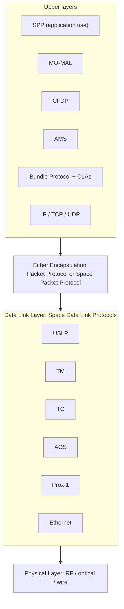
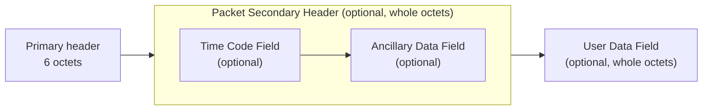
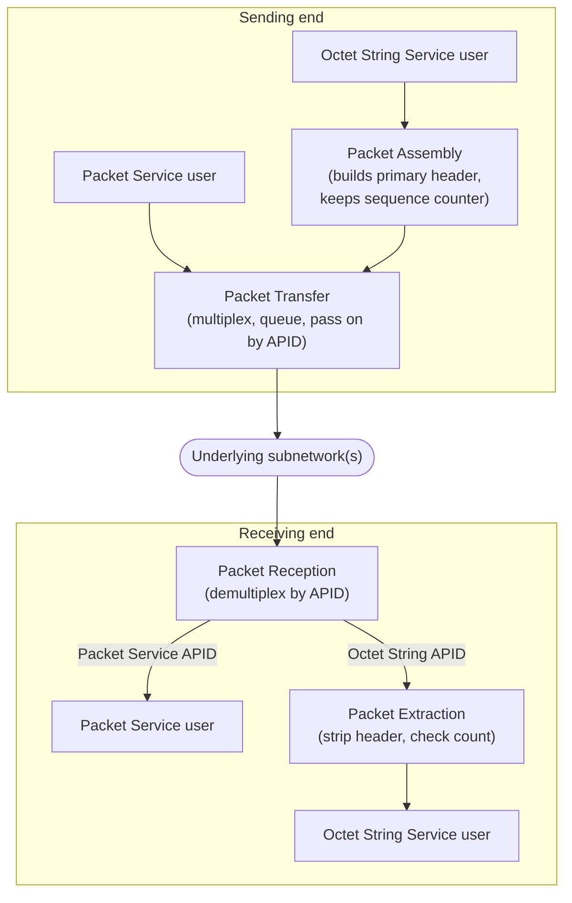

# Space Packet Protocol (CCSDS 133.0-B-2)

The **Space Packet** is the basic data unit of almost every CCSDS-compliant spacecraft. Every
housekeeping report, event message, memory dump and telecommand that the
[SCOS-2000](../scos2000/index.md) control system handles for an ESA mission travels in one. The
Space Packet Protocol (SPP) defines that data unit and two simple services that carry it. The
packet starts with a fixed 6-octet header that names the data stream (the
[APID](../glossary.md)), says whether the packet is telemetry or a telecommand, counts packets,
and gives the length. Everything after that header belongs to the user application.[^spp-arch][^spp-features]
The protocol is deliberately small. Its rationale is that a single, common data structure for
variable-length application data can be created, stored on board, sent over one or more space
links and handled in ground systems.[^spp-rationale]

This page follows CCSDS 133.0-B-2 (June 2020, with Editorial Changes 1 and 2), the issue held in
the [library](../library/ccsds-133-0-133x0b2e2.md).[^spp-doc] For the wider picture, see the
[CCSDS protocol stack overview](index.md). For the PUS fields carried inside the packet, see
[PUS packet structures](../ecss/pus/packets.md).

!!! info "At a glance"
    | Property | Value |
    |---|---|
    | Packet Version Number (PVN) | `0b000` (Version 1 CCSDS Packet)[^spp-pvn] |
    | Primary header | 6 octets, mandatory[^spp-pdu] |
    | Packet Data Field | 1 to 65 536 octets[^spp-pdu] |
    | Total packet length | 7 to 65 542 octets[^spp-pdu] |
    | Addressing | 11-bit APID, unique only in its naming domain[^spp-addr] |
    | Idle Packet APID | 2047 (`0b11111111111`)[^spp-pid] |
    | Sequence count | 14 bits, per APID, modulo 16 384[^spp-psc] |
    | Services | Packet Service, Octet String Service[^spp-svc-summary] |
    | Security | None in SPP; use SDLS or the Bundle Security Protocol[^spp-sec] |

## Where the protocol sits

The CCSDS reference model shows SPP twice. At the top it is an **Application Layer** protocol
whose packets carry user data directly. Lower down it is a **"shim"** that can carry the data
units of other protocols, a role it shares with the
[Encapsulation Packet Protocol](encapsulation.md). Editorial Change 1 of 2020 corrected the
figure to make clear that the choice between EPP and SPP in that shim position is
exclusive.[^spp-arch][^spp-doc] The 2023 Overview of Space Communications Protocols also lists SPP
among the CCSDS Application Layer protocols.[^g4-app]



*Redrawn after CCSDS 133.0-B-2 figure 2-1.*[^spp-arch]

SPP **defines no path, network or routing function** and has no networking capability of its
own. Every forwarding decision depends on the subnetworks underneath and on the mission's own
meaning for each APID.[^spp-arch] Over a space link the packets ride on the Packet Services of the
Space Data Link Protocols ([TM](tm-sdlp.md), [TC](tc-sdlp.md), [AOS](aos.md), Proximity-1 and
[USLP](uslp.md)) or on the Bundle Protocol. SPP can also run between on-board instruments and data
stores over the SOIS Packet Service, over local message buses, and over terrestrial TCP/IP
sockets.[^spp-lower]

### The managed data path

Before any packet flows, design or management has to configure the route it takes from source to
destination. CCSDS calls this route a **managed data path**, and only the management system can
reconfigure it. A managed data path has one source end system, one or more destination end
systems, one or more subnetworks and, where several subnetworks are involved, the intermediate
systems that join them. The only help SPP gives for routing is the APID.[^spp-mdp][^spp-defs]

The 2023 overview makes the same point from the network side. At each relay, some mechanism
outside SPP looks at the APID and forwards the packet according to its instructions. There is no
end-point address and no interoperable forwarding mechanism. On the ground, Space Packets are
usually moved with a [Space Link Extension](sle/index.md) service.[^g4-fwd]

### APID naming domains

An APID is unique only within one **naming domain**, which usually corresponds to one spacecraft
or one element of a constellation. Each project allocates the APIDs in its own domain. A mission
with several processors, a "fractionated" spacecraft or several spacecraft must either share out
the one APID domain or extend it with mission-specific fields in the packet secondary
header.[^spp-addr][^spp-arch] Missions may use the APID to mean the source, the destination or
the type of a packet stream. CCSDS leaves that choice to the mission.[^spp-arch]

## Service characteristics

Both SPP services are **preconfigured, unidirectional, asynchronous, unconfirmed, incomplete and
non-sequence-preserving**:[^spp-svc-common]

| Characteristic | What it means for a user |
|---|---|
| Preconfigured | Data moves only along a managed data path set up in advance by management. |
| Unidirectional | One end sends and the other receives. Two-way exchange needs two managed data paths. |
| Asynchronous | No timing rules, although the provider may limit the generation rate. |
| Unconfirmed | The sender gets no acknowledgement from the receiving end. |
| Incomplete | Neither completeness nor retransmission is guaranteed. |
| Non-sequence-preserving | The order of SDUs may change along the path. |

SDUs given to one SAP are processed in the order they were submitted. No order is kept between
different SAPs. CCSDS does not define flow control between user and provider. SPP has no
quality-of-service mechanism of its own, so end-to-end performance depends on the subnetworks
along the path.[^spp-svc-common]

The protocol entity does three things. It generates or validates the header that identifies the
data. It starts the transfer through the subnetworks. It multiplexes and demultiplexes several
managed data paths onto one subnetwork connection. It explicitly does **not** set up or release
connections, segment SDUs, retransmit, control flow, or provide quality-of-service
features.[^spp-functions]

## The two services

| Service | SDU | SAP address | SDU size |
|---|---|---|---|
| Packet Service | Space Packet, already formatted by the user | APID | 7 to 65 542 octets |
| Octet String Service | Delimited octet string; SPP builds the packet | APID | 1 to 65 536 octets |

*Service summary after CCSDS 133.0-B-2 table 2-1 and clause 3.2.*[^spp-svc-summary][^spp-sdu]

Projects may set lower maximum lengths, taking into account the largest SDU that every subnetwork
on the path can carry.[^spp-sdu] The two ends of a path need not use the same service type. An
Octet String request at the source may be delivered through the Packet Service at the
destination. In the Packet Service the Space Packet is both the SDU and the PDU.[^spp-svc-summary]

### Packet Service

The user hands over a complete Space Packet built according to clause 4.1, and the provider moves
it unchanged.[^spp-pkt-svc]

| Primitive | Parameters | Notes |
|---|---|---|
| `PACKET.request` | Space Packet, APID, QoS Requirement (optional) | Asks the provider to send the packet. |
| `PACKET.indication` | Space Packet, APID, Packet Loss Indicator (optional) | Delivers the packet. The effect on the user is undefined. |

* **APID** is mandatory. It identifies the source, destination or type of the packet, and its
  meaning is mission-specific.[^spp-pkt-svc]
* **Packet Loss Indicator** is optional. It tells the receiving user that a gap in the Packet
  Sequence Count shows one or more packets were lost. An implementation that provides it must
  declare it at design time and use it the same way on all sides.[^spp-pkt-svc]
* **QoS Requirement** is optional. It selects a quality-of-service level when a subnetwork
  offers several. Over the [TC Space Data Link Protocol](tc-sdlp.md) it chooses between Type-A
  (sequence-controlled) and Type-B (expedited) transfer of each packet.[^spp-pkt-svc]

### Octet String Service

The user supplies an octet string. The provider builds exactly one Space Packet for each
`OCTET_STRING.request`, using managed parameters that include either a Packet Sequence Count or a
Packet Name.[^spp-os-svc]

| Primitive | Parameters |
|---|---|
| `OCTET_STRING.request` | Octet String, APID, Secondary Header Indicator, Packet Type, Packet Sequence Count/Packet Name |
| `OCTET_STRING.indication` | Octet String, APID, Secondary Header Indicator, Data Loss Indicator (optional) |

The **Secondary Header Indicator** tells the provider whether the octet string begins with a
Packet Secondary Header, and the provider copies it into the Secondary Header Flag.[^spp-os-svc]
When the Packet Type is `1` (telecommand), the request also carries the sequence count or packet
name.[^spp-os-svc] An octet string always goes into the User Data Field of a single packet. The
service cannot segment, so the Sequence Flags are always `0b11` wherever the Octet String Service
is used on a path.[^spp-sdu][^spp-psc]

## The Space Packet

A Space Packet is a **Packet Primary Header** of 6 octets followed by a **Packet Data Field** of
1 to 65 536 octets. The data field holds an optional **Packet Secondary Header** and/or a **User
Data Field**, and at least one of the two must be present.[^spp-pdu][^spp-pdf]

<div class="bitfield" data-title="Space Packet primary header (48 bits)" data-width="16" data-caption="CCSDS 133.0-B-2 clause 4.1.3" data-fields='[{"n":"Packet Version Number","b":3,"v":"000","g":"Version","d":"Always 000 for a Space Packet (Version 1 CCSDS Packet)"},{"n":"Packet Type","b":1,"g":"Packet Identification","d":"0 = telemetry (reporting), 1 = telecommand (requesting)"},{"n":"Sec. Hdr Flag","b":1,"g":"Packet Identification","d":"1 = Packet Secondary Header present; 0 for Idle Packets"},{"n":"APID","b":11,"g":"Packet Identification","d":"Application Process Identifier; 2047 reserved for Idle Packets"},{"n":"Sequence Flags","b":2,"g":"Packet Sequence Control","d":"00 continuation, 01 first, 10 last, 11 unsegmented"},{"n":"Packet Sequence Count or Packet Name","b":14,"g":"Packet Sequence Control","d":"Count modulo 16384 per APID; TC packets may carry a Packet Name instead"},{"n":"Packet Data Length","b":16,"g":"Packet Data Length","d":"Octets in the Packet Data Field minus one"}]'></div>

| Field | Bits (position) | Values | Meaning and rationale |
|---|---|---|---|
| Packet Version Number | 3 (bits 0 to 2) | `0b000` | Marks the data unit as a Space Packet. The field leaves room for other packet structures, such as the Encapsulation Packet with PVN `0b111`.[^spp-pvn][^epp-pvn] |
| Packet Type | 1 (bit 3) | `0` TM, `1` TC | Separates telemetry (reporting) packets from telecommand (requesting) packets. The project defines what counts as each.[^spp-pid] |
| Secondary Header Flag | 1 (bit 4) | `0` or `1` | Shows whether a Packet Secondary Header is present. It is fixed per APID and managed data path for a Mission Phase, and it is `0` for Idle Packets.[^spp-pid] |
| Application Process Identifier | 11 (bits 5 to 15) | 0 to 2047 | Names the managed data path. 2047 (all ones) is reserved for Idle Packets. Other values need not be consecutive.[^spp-pid] |
| Sequence Flags | 2 (bits 16 and 17) | `0b00`, `0b01`, `0b10`, `0b11` | Continuation, first or last segment of a larger set of user data, or unsegmented. Users need not use them.[^spp-psc] |
| Packet Sequence Count or Packet Name | 14 (bits 18 to 31) | 0 to 16 383 | TM packets carry a count per APID. TC packets carry either a count or a Packet Name, which may be any 14-bit pattern.[^spp-psc] |
| Packet Data Length | 16 (bits 32 to 47) | 0 to 65 535 | Length count C, equal to the number of octets in the Packet Data Field minus one.[^spp-len] |

The bits of every field are numbered from the first one transmitted, which is bit 0. Where a field
holds a number, bit 0 is the most significant bit. Octets are numbered from zero, and spare bits
are always `0`.[^spp-bits]

### Packet Version Number

The three PVN bits are always `0b000`. This identifies the "Version 1 CCSDS Packet", the name the
standard gives the Space Packet.[^spp-pvn] The PVN matters at the data link layer. The
[TM](tm-sdlp.md), [TC](tc-sdlp.md) and [AOS](aos.md) protocols carry directly only packets whose
PVN CCSDS has authorized. A receiving entity uses the PVN to hand each extracted packet to the
right user.[^g4-pvn][^tm-extract] Protocol data units without an authorized PVN reach the link
through the [Encapsulation Packet Protocol](encapsulation.md).[^g4-pvn]

### Packet Type

Bit 3 is `0` for a telemetry or reporting packet and `1` for a telecommand or requesting packet.
The exact definitions belong to the project.[^spp-pid] The ECSS communications handbook observes
that the split is not always obvious, for example on a link between two spacecraft.[^hb-spp]

### Secondary Header Flag

Bit 4 is `1` when a Packet Secondary Header is present and `0` when it is not. For a given APID
and managed data path it must stay the same for a whole Mission Phase, so the receiver can rely on
it. It is always `0` in an Idle Packet.[^spp-pid]

!!! note "Naming in older documents"
    ECSS-E-70-41A (PUS-A) and the Solar Orbiter packet ICD call this bit the **Data Field Header Flag**.
    The Solar Orbiter MIB names the bit-4 element `DataFieldHeaderFlag` and keeps the name
    "Secondary Header Flag" for a different bit inside the PUS data field header (see
    [below](#how-pus-builds-on-the-space-packet)).[^pusa-tc][^solo-tc-hdr][^mib]

### Application Process Identifier (APID)

Bits 5 to 15 hold the APID, the naming mechanism for the managed data path. An APID may identify
one sending or receiving application process inside a spacecraft. The only value with a fixed
meaning is 2047 (`0b11111111111`), which marks Idle Packets.[^spp-pid] Issue 1 of the standard had
reserved APIDs for carrying CFDP and LTP data units. Issue 2 removed them, so the link between an
APID and a carried protocol is now mission-specific, and the SANA APID registry now reserves only
the idle value.[^spp-pid] The registry policy recorded in Annex B is that 0 to 2046 are unmanaged
and 2047 is reserved by the Blue Book.[^spp-sana]

ECSS adds rules of its own. In [PUS-C](../ecss/pus/index.md) every application process
identifier is at most 2046. APID 2047 is reserved for idle packets and APID 0 for spacecraft time
packets, and PUS-C refers to the SANA registry for other reserved values.[^pusc-ap] PUS-A
already reserved APID 0 for the time packet and the all-ones value for idle
packets.[^pusa-tm]

### Sequence Flags

Bits 16 and 17 describe segmentation, as shown in the table. Their use is optional. A Packet
Service user may use them to show that a packet carries one segment of a larger body of
application data.[^spp-psc]

| Value | Meaning |
|---|---|
| `0b00` | Continuation segment |
| `0b01` | First segment |
| `0b10` | Last segment |
| `0b11` | Unsegmented user data |

PUS-C always uses `0b11`, so every PUS packet stands alone.[^pusc-74] PUS-A calls the TM bits
"grouping flags", for use when several packets from one application process are sent as a group.
All standard PUS-A packets are stand-alone.[^pusa-tm]

### Packet Sequence Count or Packet Name

Bits 18 to 31 carry a **Packet Sequence Count** in every telemetry packet. In a telecommand packet
they carry either a count or a **Packet Name**.[^spp-psc] The count numbers the packets that one
user application (one APID) generates. Each APID has its own counter. The count runs continuously
modulo 16 384 and must not be reset before 16 383 unless that cannot be avoided.[^spp-psc] The
standard notes these consequences:[^spp-psc]

1. The count lets the receiver put back in order packets that transport shuffled, and lets it
   spot missing packets within each APID.
2. After an unavoidable reset, the receiver can no longer tell whether a sequence is complete.
3. A time code in the secondary header gives an unambiguous order over long periods. It has to
   advance at least once in each 16 384-packet cycle of the counter.
4. A Packet Name identifies one packet among others in the same communications session and may
   be any 14-bit pattern.

$$
\text{count}_{n+1} = (\text{count}_n + 1) \bmod 2^{14}
$$

### Packet Data Length

Bits 32 to 47 hold the length count C, one less than the number of octets in the Packet Data
Field:[^spp-len]

$$
C = N_{\text{data field}} - 1 \qquad\Longrightarrow\qquad N_{\text{packet}} = C + 7
$$

The smallest legal packet (C = 0) is 7 octets: 6 octets of header and 1 octet of data. The largest
(C = 65 535) is 65 542 octets.[^spp-pdu][^spp-len] A receiver adds 7 to the count to find where the next packet starts. A
TM or AOS packet extractor relies on exactly this. The position and meaning of the length field
must be known to the data link service provider, which uses it with the frame's First Header
Pointer to delimit packets.[^tm-pkt][^g2-tm-pkts]

## The Packet Data Field

### Packet Secondary Header

If present, the secondary header follows the primary header with no gap. It is an integral number
of octets. It is mandatory when there is no User Data Field and optional otherwise. Its contents
are specified by the source end user and made known to destination users by
management.[^spp-pdf] It contains one of three options:[^spp-pdf]

* a **Time Code Field** only;
* an **Ancillary Data Field** only;
* a Time Code Field followed by an Ancillary Data Field.

The option chosen stays the same for a managed data path across all Mission Phases.[^spp-pdf]



* **Time Code Field**: one of the CCSDS segmented or unsegmented binary time codes of
  [CCSDS 301.0-B](time-codes.md), for example CUC or CDS. The code chosen is fixed for the managed
  data path. The P-field (preamble) may be left out if the code's characteristics never change,
  and it must be present if they can change. Whether the P-field is present is also fixed, and
  when present it comes immediately before the T-field.[^spp-tc]
* **Ancillary Data Field**: an integral number of octets whose contents CCSDS does not specify.
  It may carry information needed to interpret the user data, mission-specific header fields, or
  an extension of the APID naming domain.[^spp-anc]

For ESA missions the secondary header that matters most is the
[PUS](../ecss/pus/index.md) one, which carries the service type, subtype and time tag (see
[below](#how-pus-builds-on-the-space-packet)).

!!! warning "Inference"
    CCSDS 133.0-B-2 lists PUS neither as a secondary header format nor in its SANA registry
    description. Treating the PUS secondary header as an "Ancillary Data Field" whose layout
    management makes known follows from clause 4.1.4.2. The documents themselves do not say so.

### User Data Field

If present, the User Data Field follows the secondary header, or the primary header when there is
no secondary header. It is mandatory when there is no secondary header and is an integral number
of octets. In a normal packet it holds application data. In an Idle Packet it holds idle data,
whose bit pattern the mission chooses.[^spp-anc]

## Idle Packets

An **Idle Packet** has APID 2047 and a Secondary Header Flag of `0`, and its data field holds
idle data, a fixed-length pattern that the project chooses.[^spp-defs][^spp-pid] The TM, AOS and
USLP data link protocols create Idle Packets when needed to keep their data transport processes
synchronized.[^spp-pdu] In TM and AOS, a frame that has to go out at its release time without
enough user packets may be filled with an SPP Idle Packet or an
[Encapsulation Idle Packet](encapsulation.md#encapsulation-idle-packets). The shortest SPP Idle
Packet is 7 octets. If the gap is smaller, the Idle Packet spills over into the next frame's data
field.[^tm-idle] At the receiving end, Idle Packets are discarded.[^tm-extract]

## Protocol procedures

The standard describes four abstract functions. They show logical relationships only and do not
imply any hardware or software design.[^spp-send][^spp-recv]



* **Packet Assembly** (sending end, one instance per Octet String entity). It builds the primary
  header, turns the Secondary Header Indicator into the Secondary Header Flag, and keeps the
  sequence counter.[^spp-send]
* **Packet Transfer** (one per sending end system). It multiplexes packets from Packet Assembly
  and Packet Service users into a queue in an order set by management. CCSDS does not specify the
  ordering algorithm, which projects define from factors such as priority and release rate. It then
  reads each APID to find the receiving entity and passes the packet to a lower-layer service,
  possibly to several entities.[^spp-send]
* **Packet Reception** (one per receiving end system). It receives packets and demultiplexes them
  by APID. It delivers them intact to Packet Service users, or passes them to Packet Extraction for
  Octet String users.[^spp-recv]
* **Packet Extraction** (one per Octet String entity). It removes the primary header, produces the
  Secondary Header Indicator, checks that the sequence count is continuous, and sets the optional
  Data Loss Indicator.[^spp-recv]

## Carrying Space Packets over a space link

How a packet sits inside Transfer Frames depends on the data link protocol:

* **[TM](tm-sdlp.md) and [AOS](aos.md)**: packets are concatenated into fixed-length frames until a
  frame is full. A packet that does not fit is split, and the rest continues in the next frame of
  the same Virtual Channel. The First Header Pointer marks the first packet header in each frame.
  Idle Packets fill frames when there is not enough user data.[^g2-tm-pkts]
* **[TC](tc-sdlp.md)**: when MAP channels are used, a packet too long for one frame is segmented,
  and its parts go in consecutive frames of the MAP channel with nothing interleaved. Without MAPs
  there is no segmentation, and each frame holds one or more complete packets. Receivers use each
  packet's length field to separate several packets in one frame.[^g2-tc-pkts]

Packets of different versions can share one Virtual Channel. The service provider multiplexes
them into one packet stream and delivers each by its PVN.[^g2-pvn][^tm-extract] The TM protocol's
managed parameters for packet transfer are the valid PVNs, the maximum packet length, and whether
incomplete packets must be delivered to the user.[^tm-mp]

!!! tip "Why missions cap the packet length"
    While a long packet is being sent, other packets on the same Virtual Channel wait. PUS-C
    therefore notes that a mission may set a maximum telemetry packet length much shorter than
    the 65 542 octets the protocol allows.[^pusc-712] The ECSS communications handbook adds two more
    reasons. Losing one frame loses the whole packet it was part of. On slow telecommand links, an
    on-board application cannot use a long packet until all of it has arrived.[^hb-spp] Solar
    Orbiter caps TM packets at 4112 octets and TC packets at 248 octets (see
    [below](#solar-orbiter-case-study)).

## Managed parameters

Parameters that rarely change, and whose change means a major reconfiguration, are handled by
management rather than in the packet, which saves bandwidth. The management system itself is not
specified.[^spp-mp]

| Managed parameter (table 5-1) | Allowed values |
|---|---|
| Maximum Packet Length (octets) | Integer |
| Packet Multiplexing Scheme (sending systems only) | Mission-specific |
| Service Type (per APID, at sending and receiving ends) | Packet Service or Octet String Service |
| Packet Secondary Header Contents (per APID with a secondary header) | Mission-specific, for example by reference to a SANA registry entry |

*After CCSDS 133.0-B-2 table 5-1.*[^spp-mp]

Table 5-1 notes that the Packet Type is set by the Packet Service user or supplied as a parameter
of the Octet String request.[^spp-mp] The PICS proforma's management table (A-6) differs slightly.
It lists a mandatory **Packet Type of Outgoing Packets** (`0` or `1`). It applies the multiplexing
scheme to sending *and intermediate* systems and marks it optional. It has no row for the secondary
header contents.[^spp-pics]

!!! warning "Inference"
    The differences between table 5-1 and PICS table A-6 look editorial rather than intended. An
    implementer filling in a PICS should treat both lists as relevant.

## Conformance (PICS) summary

| Items | Feature | Status |
|---|---|---|
| SPP-1, SPP-2 | Space Packet SDU; Octet String SDU | M |
| SPP-3 to SPP-5 | Packet Service parameters: APID (M); Packet Loss Indicator (O); QoS Requirement (O) | M / O |
| SPP-6 to SPP-9 | Octet String Service parameters: Octet String, APID, Secondary Header Indicator (M); Data Loss Indicator (O) | M / O |
| SPP-10 to SPP-13 | All four primitives | M |
| SPP-14 to SPP-16 | Space Packet, primary header, Packet Data Field | M |
| SPP-17, SPP-18 | Secondary header (mandatory if there is no user data); User Data Field (mandatory if there is no secondary header) | C1, C2 |
| SPP-19 to SPP-22 | Packet Assembly, Transfer, Extraction and Reception functions | M |
| SPP-23 to SPP-26 | Maximum packet length; packet type of outgoing packets; multiplexing scheme (O); service type | M / O |

*Condensed from CCSDS 133.0-B-2 Annex A tables A-1 to A-6.*[^spp-pics]

## SANA registries and security

Issue 2 changed the existing SANA APID registry and added a registry of **Space Packet Protocol
Secondary Header Format Documents**. Each entry records the format name, the submitting
organization, a point of contact, the format source document and an optional URN. The working
group's designated expert reviews entries. The registry does not change what goes on the wire.
The Secondary Header Indicator of clause 3.4.2.3, which sets the Secondary Header Flag, remains
the only sign that a secondary header is present, and which registered format applies is a
managed parameter.[^spp-sana] The standard prefers that the
format's source document describe the structure in a CCSDS notation such as SOIS Electronic Data
Sheets or [XTCE](xtce.md).[^spp-sana]

SPP provides no security. Authentication, confidentiality and integrity come from
[SDLS](sdls.md) at the data link layer or from the Bundle Security Protocol at the network
layer.[^spp-sec]

## How PUS builds on the Space Packet

The ECSS [Packet Utilization Standard](../ecss/pus/index.md) completes SPP and ECSS-E-ST-50 by
defining the application-level interface between ground and space.[^pusc-intro] PUS uses Space
Packets for every request (telecommand) and report (telemetry) exchanged between ground and
on-board application processes. It leaves on-board exchanges to the mission.[^pusc-71] Once an
application process has generated a packet, nobody may change it.[^pusc-742] The table shows how
each primary-header field is used.

| Primary-header field | PUS-C usage (ECSS-E-ST-70-41C clause 7.4) |
|---|---|
| Packet Version Number | 0 ("version 1 CCSDS packet")[^pusc-74] |
| Packet Type | 0 for TM, 1 for TC[^pusc-74] |
| Secondary Header Flag | 1 for every standard packet except spacecraft time packets (TM) and CPDU command packets (TC)[^pusc-74] |
| APID | The on-board application process that sends a report or receives a request. At most 2046. APID 0 is the time reporting process, 2047 is idle.[^pusc-ap][^pusc-time] |
| Sequence Flags | Always `0b11` (stand-alone)[^pusc-74] |
| Sequence Count / Name | TM: incremented by 1 per packet released, wrapping from 2^14^−1 to 0. TC: a count or name that, with the source ID, identifies the packet uniquely.[^pusc-74] |
| Packet Data Length | Packet data field length minus one, so the whole packet is 6 octets longer[^pusc-74] |

### PUS-C secondary headers (ECSS-E-ST-70-41C, 2016)

The **telemetry packet secondary header** starts with these fixed fields:[^pusc-tmsh]

<div class="bitfield" data-title="PUS-C TM packet secondary header, fixed part (56 bits)" data-width="16" data-caption="Followed by the time field (format declared by the mission) and an optional spare field" data-fields='[{"n":"TM PUS version","b":4,"v":"2","d":"Version 0 was ESA PSS-07-101, version 1 ECSS-E-70-41A"},{"n":"S/C time ref. status","b":4,"d":"0 if the process cannot report the time reference status"},{"n":"Service type ID","b":8},{"n":"Message subtype ID","b":8},{"n":"Message type counter","b":16,"d":"Per destination and message type; 0 if not supported"},{"n":"Destination ID","b":16,"d":"Application process user identifier of the addressee"}]'></div>

The time field holds the report's time tag, in a format declared when the time service is
specified. A spare field may follow to pad the header to whole words.[^pusc-tmsh] The
**telemetry user data field** is the source data, an optional spare field for padding to the
declared word size, and an optional 16-bit **packet error control** field. Whether TM
checksums are used, and whether the CRC or the ISO 16-bit checksum, is decided when the
standard is tailored for the mission.[^pusc-tmud]

The **telecommand packet secondary header** is:[^pusc-tcsh]

<div class="bitfield" data-title="PUS-C TC packet secondary header, fixed part (40 bits)" data-width="8" data-caption="Followed by an optional spare field" data-fields='[{"n":"TC PUS version","b":4,"v":"2"},{"n":"Ack flags","b":4,"d":"bit 3 acceptance, bit 2 start, bit 1 progress, bit 0 completion"},{"n":"Service type ID","b":8},{"n":"Message subtype ID","b":8},{"n":"Source ID","b":16,"d":"Application process user identifier of the issuer"}]'></div>

The four acknowledgement bits ask for reports of successful acceptance (bit 3), start (bit 2),
progress (bit 1) and completion (bit 0) of execution.[^pusc-tcsh] The **telecommand user data
field** is the application data, an optional spare field and a **mandatory** packet error
control field, either CRC or ISO checksum as declared for the mission. On board, it is
checked against the received packet.[^pusc-tcud]

### PUS-A data field headers (ECSS-E-70-41A, 2003)

PUS-A based its packets on the older CCSDS Packet Telemetry (102.0-B-5) and Telecommand
(203.0-B-2) packet definitions and called the secondary header the **data field
header**.[^pusa-tc][^pusa-tm]

<div class="bitfield" data-title="PUS-A TC data field header, fixed part (24 bits)" data-width="8" data-caption="Followed by an optional Source ID (mission-defined length) and spare bits" data-fields='[{"n":"CCSDS Sec. Hdr Flag","b":1,"v":"0","d":"Set to 0: the PUS header is a non-CCSDS-defined secondary header"},{"n":"TC PUS Version","b":3,"v":"1"},{"n":"Ack","b":4,"d":"acceptance, start, progress, completion"},{"n":"Service Type","b":8},{"n":"Service Subtype","b":8}]'></div>

The TM data field header is a spare bit, a 3-bit PUS version (1), 4 spare bits, the service
type and subtype, an optional packet sub-counter, an optional destination ID, the time (CUC or
CDS, set by mission constants) and spare bits.[^pusa-tm] The TC packet error control is
mandatory. The TM packet error control is optional and fixed per application process. PUS-A
reserves service types 0 to 127 for the standard and 128 to 255 for missions.[^pusa-tc][^pusa-tm]
It requires a separate sequence count for each telecommand source and APID, and copies the TC
packet's sequence control into the acknowledgement report.[^pusa-tc]

### PUS-C Rev.1 draft (DIR1, 2024)

The December 2024 draft (DIR1) separates ground and on-board identifiers. Any
application process identifier may go up to 65 535, while an on-board one stays at or below
2046 to fit the 11-bit APID. Ground application process identifiers run from 2048 to 65 535, and
no identifier may name both a ground and an on-board process. The draft also references CCSDS
133.0-B-2 for the idle APID.[^pusr1-ap] See [PUS-A vs PUS-C](../ecss/pus/pus-a-vs-pus-c.md).

### Request IDs, CPDU packets and the PUS CRC

Two PUS details refer straight back to the primary header:

* A [ST[01] request verification](../ecss/pus/st01-request-verification.md) report names the
  request it verifies by its **request ID**, which is a copy of the telecommand's packet ID and
  packet sequence control fields (PVN, type, secondary header flag, APID, sequence flags, count).
  The request ID alone is not unique, because the request's source is in the report's destination
  ID.[^pusc-st01]
* A **CPDU command packet** is a bare Space Packet. Its secondary header flag is `0`, its APID is
  the CPDU's, its sequence flags are `0b11` and its count or name is 0. It has no secondary header,
  and its packet error control is the same 16-bit CRC used in the telecommand frame's error
  control field.[^pusc-cpdu] See [ST[02] device access](../ecss/pus/st02-device-access.md).

The PUS CRC is CRC-16-CCITT with generator $x^{16}+x^{12}+x^5+1$. The register starts at all ones
and covers the whole packet except the error control field. The standard gives test vectors such
as `00 00` giving `1D 0F` and `AB CD EF 01` giving `04 A2`.[^pusc-crc]

## Solar Orbiter case study

The public [Solar Orbiter MIB](../missions/solar-orbiter/mib.md) (release 2025-09-16) and the
spacecraft's *TM-TC and Packet Structure ICD* (SOL.S.ASTR.TN.00079 issue 7) show how one ESA
mission fills in each field. All figures below come from this wiki's own SQL queries on the MIB
(see "SQL used") or from the cited ICD pages.

### APID = Process ID + Packet Category

Solar Orbiter splits the 11-bit APID into a **7-bit Process ID (PID)**, which names the on-board
application, and a **4-bit Packet Category (PCAT)**. On telecommands, PCAT is fixed at
12.[^solo-tc-hdr][^solo-tm]

<div class="bitfield" data-title="Solar Orbiter APID structure (11 bits)" data-width="16" data-caption="SOL.S.ASTR.TN.00079 clauses 3.2.1.1 and 4.2.1.1" data-fields='[{"n":"Process ID (PID)","b":7,"d":"Application: 0 time, 2 OBC hardware (CPDU), 10 DMS, 11 AOCS, 12 payload, 13 platform, 14 system control, 15 OBCP, 16 thermal, 30 SSMM, 50-104 instruments, 112-127 EGSE"},{"n":"Packet Category (PCAT)","b":4,"d":"12 for all TCs; for TM, see the category table"}]'></div>

| PCAT | Solar Orbiter use[^solo-apid] | TM packet definitions in MIB (top service types) |
|---|---|---|
| 0 | Time packet (service 9) | APID 0 only: SPID 9999 "Time Report" |
| 1 | TC verification (service 1) | 1890 (1809 of them service 1) |
| 2 | High-priority TM HK (platform only) | 192 |
| 3 | Table generation (variable-length tabular reports) | 409 |
| 4 | Routine housekeeping (3,25) | 725 |
| 5 | Functional cyclic, on ground request | 186 |
| 6 | Functional non-cyclic, on ground request | 214 |
| 7 | Events (service 5) and (17,2) | 5726 (5709 of them service 5) |
| 8 | Diagnostic (3,26) | 131 |
| 9 | Dump TM (service 6) | 311 (298 of them service 6) |
| 10 | File transfer (service 13) | 358 |
| 11 | Context (service 22) | 328 |
| 12 | Private science (service 21) TM, and all TCs | 437 (334 of them service 21) |
| 13 | Spare | 15 |
| 14 | Reserved OCC/EGSE | 22 |
| 15 | Idle packets (platform only) | 198 |

*MIB counts are rows of the [`pid`](../mib/tables/pid.md) table with APIDs from 1 to 2046,
grouped by `PID_APID mod 16`.*[^mib]

!!! warning "Inference"
    For the categories 1, 7, 9 and 12, the MIB mostly follows the ICD's rules (see the counts in
    the table). Some categories that the ICD reserves for one service hold packets of other
    services. The clearest case is service 5 (events), which the ICD reserves for PCAT 7. Of the
    7156 service-5 definitions in the MIB, 1447 sit in other categories, for example 350 in PCAT
    10 (file transfer), 326 in PCAT 11 (context), 98 in PCAT 12 and 132 in PCAT 15 (idle). PCAT 15
    also holds 66 service-141 definitions. All but 14 of these 1447 sit on APIDs whose process IDs
    (122, 123 and 124) fall in the range 112 to 127 that the ICD allocates to EGSE. The 14
    exceptions are in PCAT 3 (table generation) on on-board process IDs. The category rules
    apparently do not govern the ground-equipment packets. The ICD does not say so
    explicitly.[^mib][^solo-apid]

Every telecommand APID in the MIB follows this rule. All 32 numeric
[`CCF_APID`](../mib/tables/ccf.md) values have PCAT 12. Five more commands have no APID at all,
because they are control segments and control frames rather than packets (see the `NO_HDR` header
below). Examples are APID
[172](../explorer/index.md#/solo/apid/172) (PID 10, data management, 1971 commands), APID
[236](../explorer/index.md#/solo/apid/236) (PID 14, system control, 966 commands) and APID
[44](../explorer/index.md#/solo/apid/44) (PID 2, the CPDU high-priority commands).[^mib][^solo-apid]

### The TC packet header as the MIB defines it

SCOS-2000 builds the start of each encoded telecommand from a **packet header definition**
([`tcp`](../mib/tables/tcp.md), [`pcpc`](../mib/tables/pcpc.md),
[`pcdf`](../mib/tables/pcdf.md)). Each element is fixed (`F`) or filled from the command record
(`A` APID, `T` type, `S` subtype, `K` acknowledgement flags), or the command subsystem sets it (`P`,
for example the length and sequence counter).[^icd-tcp] Solar Orbiter's nominal header `NOM_TC`
(used by 5318 commands) is 80 bits. It is the 48-bit CCSDS primary header followed by a 32-bit
PUS-A data field header:[^mib]

<div class="bitfield" data-title="Solar Orbiter NOM_TC packet header from the MIB pcdf table (80 bits)" data-width="16" data-caption="Real definition from MIB release 2025-09-16; PCDF_TYPE in brackets" data-fields='[{"n":"Version Number [F]","b":3,"v":"0","g":"CCSDS primary header"},{"n":"Type [F]","b":1,"v":"1","g":"CCSDS primary header"},{"n":"DataFieldHeaderFlag [F]","b":1,"v":"1","g":"CCSDS primary header"},{"n":"APID [A]","b":11,"g":"CCSDS primary header","d":"From CCF_APID"},{"n":"Sequence Flag [F]","b":2,"v":"3","g":"CCSDS primary header"},{"n":"Sequence Count [P]","b":14,"g":"CCSDS primary header","d":"Set by SCOS-2000 (PH_SSC)"},{"n":"Packet Length [P]","b":16,"g":"CCSDS primary header","d":"Set by SCOS-2000 (PH_LEN)"},{"n":"Secondary Header Flag [F]","b":1,"v":"0","g":"PUS-A data field header"},{"n":"PUS Version [F]","b":3,"v":"1","g":"PUS-A data field header"},{"n":"Ack [K]","b":4,"g":"PUS-A data field header","d":"From CCF_ACK"},{"n":"Service Type [T]","b":8,"g":"PUS-A data field header","d":"From CCF_TYPE"},{"n":"Service Subtype [S]","b":8,"g":"PUS-A data field header","d":"From CCF_STYPE"},{"n":"Source ID [O]","b":8,"g":"PUS-A data field header","d":"Header parameter DFH_SRC"}]'></div>

The header `HPC1_TC` (125 commands, all on APID 44, flagged high priority with `CCF_MAPID` 0) is
only the 48-bit primary header, with the DataFieldHeaderFlag set to 0. This is the CPDU "HPC-1"
command that goes straight to the Command Pulse Distribution Unit on MAP 0.[^mib][^solo-seg]
`NO_HDR` ("TCP Header for CF/CS") is used by 5 commands whose `CCF_CTYPE` is `R`, a control
segment, or `F`, a control frame (BC frames such as FARM Unlock and Set V(R)). For such commands
the import ICD says that the PCDF and CDF entries define the frame data field instead of a packet
header and application data field.[^icd-ctype] In the Solar Orbiter MIB the `NO_HDR` header has
no `pcdf` rows, so only the `cdf` rows describe the frame data field. `UNLOCK`, for example, is a
single fixed octet of value 0.[^mib] `NOS2KHDR` (6 commands, `CCF_CTYPE` `N`) carries NIS throw
events on APID 1964. The ICD says that the NIS executes these itself and does not forward them to
the ground station equipment.[^mib][^icd-ctype]

These features match the ICD. Version `0b000`, type 1, a data field header on every command except
CPDU commands, sequence flags `0b11`, a CCSDS secondary header flag of 0 inside the data field
header, and a PUS version of 1.[^solo-tc-hdr][^solo-tc-dfh] Three details deserve a note:

* **Acknowledgement flags.** The ICD allows only the acceptance and completion bits on Solar
  Orbiter and requires the start and progress bits to be zero.[^solo-tc-dfh] In the MIB,
  `CCF_ACK = 9` (`0b1001`, acceptance plus completion) for 5225 of the 5318 `NOM_TC` commands, `1`
  for 78 and `0` for 15.[^mib]
* **Sequence count.** The ICD says the count is kept per APID *and* Source ID, and that on-board
  applications do not check it.[^solo-tc-hdr] The SCOS-2000 import ICD says the multiplexer keeps
  the source sequence counter for each APID.[^icd-tcp]
* **Source ID.** Ground sources have reserved values: mission timeline 110, TC sequences 111,
  recovery actions 112, back-up timeline 113, direct commands 120, and spares 121 and 122. On-board
  sources are 15 (OBCP), 14 (system control) and 11 (AOCS).[^solo-src] In the April 2020 MIB the
  Source ID was a fixed area with value 0. In the 2025 release it is a header parameter
  (`DFH_SRC`) with element type `O`.[^mib2020][^mib] The separate SWA instrument database fixes it
  at `0x78`, which is 120, "direct commands".[^swa]

!!! warning "Inference"
    The element type `O` does not appear in the `PCDF_TYPE` codes of the SCOS-2000 import ICD
    issues 5.1, 6.7, 6.9 and 7.0 in the library (`F`, `A`, `T`, `S`, `K`, `P`). Its exact meaning
    is not stated in the available sources. Changing the Source ID from a fixed value to a
    parameter is consistent with letting the ground system set different source IDs (for example
    120 for direct commands and 110 for the mission timeline).[^icd-tcp][^solo-src]

### Lengths, time packets and idle packets

* **TC.** The packet data field is at most 242 octets: 4 octets of data field header, 236 of
  application data and 2 of packet error control. A complete TC packet is therefore at most 248
  octets.[^solo-tc-hdr] The PEC is the CRC-16 with all-ones preset described above, with the same
  test vectors.[^solo-crc] SCOS-2000's default maximum command size (`CMDP_MAX_BLOCK_SIZE`) is the
  same 248 octets.[^icd-maxcmd]
* **TM.** A packet is at most 4112 octets. The data field is at most 4106 octets: 10 octets of data
  field header and 4096 of source data. Packets longer than the 1099-octet TM frame data field are
  split across frames.[^solo-tm] The 10-octet data field header (shown [below](#the-tm-data-field-header))
  carries a PUS version of 1, an 8-bit Destination ID and a CUC time with 4 octets of coarse and 2
  of fine time.[^solo-tm-dfh] In the MIB, 11 138 of the 11 150
  packet definitions have `PID_DFHSIZE = 16`, which is 6 octets of primary header plus 10 of data
  field header, the offset at which SCOS-2000 starts processing variable packets.[^mib][^icd-pid]
* **Sequence count and grouping.** A TM source sequence count is kept per APID and Destination ID.
  It starts at zero at power-on and wraps from 2^14^−1 to 0. The ground raises an alarm on every
  gap. The grouping flags mark sets of self-contained packets that together answer one
  command.[^solo-tm]
* **Time packet.** APID 0 has no data field header. Its 8-octet data field (C = 7) holds a 1-octet
  S-field (rate), the P-field `0b00101110` (CUC with 4 coarse and 2 fine octets) and a 6-octet
  T-field.[^solo-time] In the MIB it is SPID [9999](../explorer/index.md#/solo/packet/9999), with
  `PID_DFHSIZE = 6` and `TPCF_SIZE = 14`.[^mib]
* **Idle packet.** APID all ones, version 0, type 0, data field header flag 0, random filler
  data.[^solo-idle] The MIB defines it as SPID [66986](../explorer/index.md#/solo/packet/66986) on
  APID 2047.[^mib]
* **No TM packet error control.** The ICD's TM source packet figure shows the packet data field as
  the 80-bit data field header plus source data only, while its TC packet figure ends with a 16-bit
  packet error control field. The 4106-octet maximum is likewise all header and source data, and
  Annex 6 describes the packet error control as the two trailing octets of a *TC*
  packet.[^solo-tm][^solo-tc-hdr][^solo-crc] The MIB agrees. `PID_CHECK`, which tells SCOS-2000
  whether to check a packet error control field, is 0 for every definition except six
  ground-equipment records (the three APID-1 frame records described below and three MATIS packets
  on APID 1966).[^mib][^icd-pidcheck]

#### The TM data field header

<div class="bitfield" data-title="Solar Orbiter TM data field header (80 bits)" data-width="16" data-caption="SOL.S.ASTR.TN.00079 figure 4.2-2 (PUS-A layout without the optional packet sub-counter)" data-fields='[{"n":"Spare","b":1,"v":"0"},{"n":"PUS Version","b":3,"v":"001"},{"n":"Spare","b":4,"v":"0000"},{"n":"Service Type","b":8},{"n":"Service Subtype","b":8},{"n":"Destination ID","b":8,"d":"Copy of the TC Source ID for most solicited TM; 0 (ground) otherwise"},{"n":"S/C Time (CUC, 4 coarse + 2 fine octets)","b":48}]'></div>

The fields are 1 spare bit, the 3-bit PUS version (`0b001`), 4 spare bits, the 8-bit service type
and subtype, an 8-bit Destination ID and a 48-bit CUC time, 80 bits in all. Compared with PUS-A,
the optional packet sub-counter is not used.[^solo-tm-dfh][^pusa-tm] The Destination ID of a report
that answers a telecommand is a copy of the command's Source ID, except in packet categories 2, 3,
4, 8 and 9, which always carry 0 (ground). Telemetry produced for a process in another software
item carries that process's ID, and all other telemetry carries 0.[^solo-src]

!!! warning "Inference"
    The MIB packet size of the TM(1,1) report (SPID
    [14181](../explorer/index.md#/solo/packet/14181), `TPCF_SIZE = 20`) is exactly 6 + 10 + 4
    octets, with its two 16-bit source parameters at octets 16 and 18 and no room for a checksum.
    This supports the reading above.[^mib] `TPCF_SIZE` is only informative, and SCOS-2000 does not
    use it. The ICD recommends including the 64- or 76-byte SCOS-2000 packet header in it, which
    the Solar Orbiter values (14 and 20) evidently do not, so they appear to count the source packet
    alone.[^icd-tpcf]

### APIDs outside the 11-bit range

The MIB also defines six packets on APIDs 2048 to 2065, named "LMS_..." low and high frequency.
They cannot appear in a Space Packet header. The SCOS-2000 import ICD keeps APIDs 0 to 2047 for
packets from the spacecraft and allows 2048 to 65 535 for packets made by SCOS-2000 applications
or other control domains such as SCOE equipment.[^mib][^icd-pid] Three more definitions on APID 1
with `PID_DFHSIZE = 0` describe "good", "bad" and "idle complete transfer frames".

Three similar definitions with `PID_DFHSIZE = 6` on APID 1966 (process ID 122, in the EGSE range)
describe "good", "bad" and "idle mini-transfer frames".[^mib][^solo-apid]

!!! warning "Inference"
    Those APID-1 and APID-1966 definitions record frame quality made on the ground and are not
    packets sent by the spacecraft. The MIB descriptions suggest this, but no source in the library
    documents it.

## Worked example: a Solar Orbiter connection test

This example builds a TC(17,1) "Perform Connection Test" for the data management application.
**The byte values are illustrative.** The field values come from the MIB command
[`ZCD01101`](../explorer/index.md#/solo/command/ZCD01101) (type 17, subtype 1, APID 172, `CCF_ACK`
9, no parameters) and from the `NOM_TC` header above. The sequence count (0) and Source ID (120,
direct commands) are chosen for the illustration.[^mib][^solo-src] See also the full
[TC worked example](../overview/worked-example-tc.md).

| Octets | Hex | Field breakdown |
|---|---|---|
| 0 and 1 | `18 AC` | `000` version · `1` TC · `1` data field header present · APID `00010101100` = 172 |
| 2 and 3 | `C0 00` | Sequence flags `11` · sequence count 0 |
| 4 and 5 | `00 05` | Packet data length C = 5, so the data field is 6 octets and the packet 12 octets |
| 6 | `19` | CCSDS secondary header flag `0` · PUS version `001` · ack `1001` (acceptance + completion) |
| 7 | `11` | Service type 17 |
| 8 | `01` | Service subtype 1 |
| 9 | `78` | Source ID 120 |
| 10 and 11 | `EA 91` | Packet error control: CRC-16 over octets 0 to 9 |

The CRC was computed by this wiki with the algorithm of ECSS-E-ST-70-41C annex B.1, and the same
code reproduces all four test vectors in table B-2. Running the check over all 12 octets gives a
zero syndrome.[^pusc-crc]

If accepted, the data management application answers with a TM(1,1) acceptance report on APID
[161](../explorer/index.md#/solo/apid/161) (PID 10, PCAT 1), SPID 14181 in the MIB.[^mib] Its
primary header would begin `08 A1` (version 0, TM, data field header present, APID 161), then
`C1 23` with an illustrative count, then `00 0D` (a 14-octet data field). The 10-octet data field
header would start `10 01 01` (PUS version 1, service 1, subtype 1) and carry Destination ID `78`,
the TC's Source ID copied back as the ICD requires for service-1 reports, followed by the 6-octet
time.[^solo-tm-dfh][^solo-src] The 4-octet source data then echoes `18 AC C0 00`, the packet ID and
sequence control of the telecommand. This is the PUS request ID that ties the report to the
request.[^pusc-st01][^pusa-tc]

??? example "SQL used"
    ```sql
    -- solo-2025-09-16.sqlite (MIB__20250916M25925PFMS001_SOL)
    SELECT * FROM tcp;
    SELECT * FROM pcpc;
    SELECT * FROM pcdf ORDER BY PCDF_TCNAME, CAST(PCDF_BIT AS INT);
    SELECT CCF_PKTID, COUNT(*) FROM ccf GROUP BY 1;            -- NOM_TC 5318, HPC1_TC 125, NOS2KHDR 6, NO_HDR 5
    SELECT CAST(CCF_APID AS INT) AS a, CAST(CCF_APID AS INT)/16 AS pid, CAST(CCF_APID AS INT)%16 AS pcat,
           COUNT(*), GROUP_CONCAT(DISTINCT CCF_PKTID)
      FROM ccf WHERE CCF_APID <> '' GROUP BY 1 ORDER BY 1;      -- 32 numeric APIDs, all PCAT 12
    SELECT COUNT(*) FROM ccf WHERE CCF_APID = '';               -- 5 (the NO_HDR commands)
    SELECT CCF_CNAME, CCF_DESCR, CCF_CTYPE, CCF_APID FROM ccf WHERE CCF_PKTID IN ('NO_HDR','NOS2KHDR');  -- R/F; N
    SELECT COUNT(*) FROM pcdf WHERE PCDF_TCNAME = 'NO_HDR';     -- 0
    SELECT * FROM cdf WHERE CDF_CNAME IN (SELECT CCF_CNAME FROM ccf WHERE CCF_PKTID = 'NO_HDR');
    SELECT CCF_PKTID, CCF_HIPRI, CCF_MAPID, COUNT(*) FROM ccf GROUP BY 1,2,3;
    SELECT CCF_ACK, COUNT(*) FROM ccf WHERE CCF_PKTID='NOM_TC' GROUP BY 1;   -- 9: 5225, 1: 78, 0: 15
    SELECT CCF_MAPID, CCF_PKTID, COUNT(*) FROM ccf GROUP BY 1,2;
    SELECT COUNT(*), COUNT(DISTINCT PID_APID) FROM pid;         -- 11150 rows, 293 APIDs
    SELECT PID_DFHSIZE, COUNT(*) FROM pid GROUP BY 1;           -- 16: 11138, 6: 6, 0: 6
    SELECT CAST(PID_APID AS INT)%16 pcat, PID_TYPE, COUNT(*) FROM pid
      WHERE CAST(PID_APID AS INT) BETWEEN 1 AND 2046 GROUP BY 1,2 ORDER BY 1,3 DESC;
    SELECT PID_APID, CAST(PID_APID AS INT)/16 AS pid, PID_TYPE, COUNT(*) FROM pid
      WHERE CAST(PID_APID AS INT)%16 IN (10,15) AND PID_TYPE IN ('5','141') GROUP BY 1,3;
    SELECT COUNT(*), SUM(CAST(PID_APID AS INT)/16 BETWEEN 112 AND 127) FROM pid
      WHERE PID_TYPE = '5' AND CAST(PID_APID AS INT)%16 <> 7
        AND CAST(PID_APID AS INT) BETWEEN 1 AND 2046;           -- 1447, 1433 on EGSE process IDs
    SELECT COUNT(*) FROM pid WHERE PID_TYPE = '5';              -- 7156
    SELECT PID_SPID, PID_APID, PID_DESCR, PID_DFHSIZE FROM pid
      WHERE CAST(PID_APID AS INT) >= 2047 OR PID_APID IN ('0','1') OR PID_DFHSIZE IN ('0','6');
    SELECT PID_CHECK, COUNT(*) FROM pid GROUP BY 1;             -- 0: 11144, 1: 6
    SELECT * FROM tpcf WHERE TPCF_SPID IN ('9999','14181');    -- 14 and 20 octets
    SELECT PLF_NAME, PLF_OFFBY, PLF_OFFBI FROM plf WHERE PLF_SPID='14181';
    -- solo-2020-04-16.sqlite: SELECT * FROM pcdf WHERE PCDF_TCNAME='NOM_TC';   -- Source ID F, value 0
    -- swa-idb.sqlite:         SELECT * FROM pcdf;                              -- Source ID F, value 78 (hex)
    ```

## Edition history

| Edition | Date | Main points |
|---|---|---|
| CCSDS 133.0-B-1 | September 2003 | First issue, now superseded.[^spp-doc] It replaced three earlier packet definitions that shared the same PVN: the Source Packet of Packet Telemetry, the TC Packet of Packet Telecommand and the Version-1 CCSDS Packet of AOS.[^hb-spp] |
| CCSDS 133.0-B-2 | June 2020 | Removes networking terminology and implied function, and brings the text up to date with modern practice.[^spp-doc] The reserved CFDP and LTP APIDs are dropped, and a SANA registry of secondary header formats is added.[^spp-pid][^spp-sana] |
| EC 1 | October 2020 | Corrects figure 2-1: adds a missing arrowhead and makes the choice between EPP and SPP exclusive.[^spp-doc] |
| EC 2 | September 2024 | Fixes duplicated table-of-contents entries and moves to A4 pages.[^spp-doc] |

The networking language that Issue 2 removed can still be seen in ECSS-E-HB-50A (2008), which
describes Issue 1. That text uses a **Logical Data Path** named by a **Path ID**, made of the APID
plus an optional **APID Qualifier** that is not in the packet. Over a space link the qualifier was
the link's Master Channel Identifier. It also places SPP in the Network Layer and calls its main
function "routing".[^hb-spp] Issue 2 replaces this with the **managed data path** and states that
SPP has no routing function.[^spp-mdp][^spp-arch] PUS-C (2016) still cites Issue 1. The 2024
Rev.1 draft cites Issue 2 in its normative references and in the APID notes, although its
introduction still names CCSDS 133.0-B-1.[^pusc-71][^pusr1-ap]

## Related pages

* [CCSDS protocol stack overview](index.md) and [Encapsulation Packet Protocol](encapsulation.md)
* [TM Space Data Link Protocol](tm-sdlp.md), [TC Space Data Link Protocol](tc-sdlp.md),
  [Time code formats](time-codes.md)
* [PUS packet structures](../ecss/pus/packets.md), [PUS-A vs PUS-C](../ecss/pus/pus-a-vs-pus-c.md)
* [MIB monitoring](../mib/monitoring.md) (packet identification with `pid` and `pic`) and
  [MIB commanding](../mib/commanding.md) (`tcp`, `pcdf`, `ccf`)
* [How Solar Orbiter uses PUS](../missions/solar-orbiter/pus-usage.md),
  [Downlink walkthrough](../overview/downlink.md), [Uplink walkthrough](../overview/uplink.md)

[^spp-doc]: [CCSDS 133.0-B-2, Space Packet Protocol](../library/ccsds-133-0-133x0b2e2.md), Document Control, PDF p. 7.
[^spp-rationale]: [CCSDS 133.0-B-2](../library/ccsds-133-0-133x0b2e2.md), §1.4 Rationale, PDF p. 11.
[^spp-defs]: [CCSDS 133.0-B-2](../library/ccsds-133-0-133x0b2e2.md), §1.6.1.3 to §1.6.1.5 (definitions of APID, Idle Packet, managed data path, idle data), PDF pp. 12–13.
[^spp-bits]: [CCSDS 133.0-B-2](../library/ccsds-133-0-133x0b2e2.md), §1.6.3 Conventions and figure 1-1, PDF p. 14.
[^spp-arch]: [CCSDS 133.0-B-2](../library/ccsds-133-0-133x0b2e2.md), §2.1.1 Architecture and figure 2-1, PDF pp. 16–17.
[^spp-mdp]: [CCSDS 133.0-B-2](../library/ccsds-133-0-133x0b2e2.md), §2.1.1 (managed data path), PDF p. 18.
[^spp-features]: [CCSDS 133.0-B-2](../library/ccsds-133-0-133x0b2e2.md), §2.1.2 Protocol Features, PDF p. 18.
[^spp-addr]: [CCSDS 133.0-B-2](../library/ccsds-133-0-133x0b2e2.md), §2.1.3 Addressing, PDF p. 18.
[^spp-svc-common]: [CCSDS 133.0-B-2](../library/ccsds-133-0-133x0b2e2.md), §2.2.1 Common Features of Services, PDF pp. 19–20.
[^spp-svc-summary]: [CCSDS 133.0-B-2](../library/ccsds-133-0-133x0b2e2.md), §2.2.2 and table 2-1, PDF pp. 20–21.
[^spp-functions]: [CCSDS 133.0-B-2](../library/ccsds-133-0-133x0b2e2.md), §2.3.1 General Functions, PDF p. 21.
[^spp-lower]: [CCSDS 133.0-B-2](../library/ccsds-133-0-133x0b2e2.md), §2.4 Services Assumed from Lower Layers, PDF p. 23.
[^spp-sdu]: [CCSDS 133.0-B-2](../library/ccsds-133-0-133x0b2e2.md), §3.2.2 and §3.2.3 (Space Packet and Octet String SDUs), PDF pp. 24–25.
[^spp-pkt-svc]: [CCSDS 133.0-B-2](../library/ccsds-133-0-133x0b2e2.md), §3.3 Packet Service, PDF pp. 25–27.
[^spp-os-svc]: [CCSDS 133.0-B-2](../library/ccsds-133-0-133x0b2e2.md), §3.4 Octet String Service, PDF pp. 28–30.
[^spp-pdu]: [CCSDS 133.0-B-2](../library/ccsds-133-0-133x0b2e2.md), §4.1.2 Space Packet Requirements and notes, PDF p. 31.
[^spp-pvn]: [CCSDS 133.0-B-2](../library/ccsds-133-0-133x0b2e2.md), §4.1.3.1 and §4.1.3.2 Packet Version Number, figure 4-2, PDF p. 32.
[^spp-pid]: [CCSDS 133.0-B-2](../library/ccsds-133-0-133x0b2e2.md), §4.1.3.3 Packet Identification Field (Packet Type, Secondary Header Flag, APID and notes), PDF pp. 33–34.
[^spp-psc]: [CCSDS 133.0-B-2](../library/ccsds-133-0-133x0b2e2.md), §4.1.3.4 Packet Sequence Control Field, PDF pp. 34–35.
[^spp-len]: [CCSDS 133.0-B-2](../library/ccsds-133-0-133x0b2e2.md), §4.1.3.5 Packet Data Length, PDF p. 36.
[^spp-pdf]: [CCSDS 133.0-B-2](../library/ccsds-133-0-133x0b2e2.md), §4.1.4.1 and §4.1.4.2.1 (Packet Data Field, Packet Secondary Header), PDF pp. 36–37.
[^spp-tc]: [CCSDS 133.0-B-2](../library/ccsds-133-0-133x0b2e2.md), §4.1.4.2.2 Time Code Field, PDF pp. 37–38.
[^spp-anc]: [CCSDS 133.0-B-2](../library/ccsds-133-0-133x0b2e2.md), §4.1.4.2.3 Ancillary Data Field and §4.1.4.3 User Data Field, PDF p. 38.
[^spp-send]: [CCSDS 133.0-B-2](../library/ccsds-133-0-133x0b2e2.md), §4.2 Protocol Procedures at the Sending End, PDF pp. 39–40.
[^spp-recv]: [CCSDS 133.0-B-2](../library/ccsds-133-0-133x0b2e2.md), §4.3 Protocol Procedures at the Receiving End, PDF pp. 40–41.
[^spp-mp]: [CCSDS 133.0-B-2](../library/ccsds-133-0-133x0b2e2.md), §5 Managed Parameters and table 5-1, PDF p. 42.
[^spp-pics]: [CCSDS 133.0-B-2](../library/ccsds-133-0-133x0b2e2.md), Annex A, tables A-1 to A-6, PDF pp. 46–47.
[^spp-sec]: [CCSDS 133.0-B-2](../library/ccsds-133-0-133x0b2e2.md), Annex B1 Security Considerations, PDF p. 48.
[^spp-sana]: [CCSDS 133.0-B-2](../library/ccsds-133-0-133x0b2e2.md), Annex B2 SANA Considerations (B2.1 to B2.4), PDF pp. 48–50.
[^epp-pvn]: [CCSDS 133.1-B-3, Encapsulation Packet Protocol](../library/ccsds-133-1-133x1b3e1.md), §4.1.2.2 Packet Version Number, PDF p. 24.
[^g4-app]: [CCSDS 130.0-G-4, Overview of Space Communications Protocols](../library/ccsds-130-0-130x0g4e1.md), §2.2.7 Application Layer, PDF p. 23.
[^g4-pvn]: [CCSDS 130.0-G-4](../library/ccsds-130-0-130x0g4e1.md), §3.2.1 General Features of Data Link Protocols, PDF p. 24.
[^g4-fwd]: [CCSDS 130.0-G-4](../library/ccsds-130-0-130x0g4e1.md), §4.2 End-to-End Data Forwarding Using Packets Defined by CCSDS, PDF p. 37.
[^g2-pvn]: [CCSDS 130.2-G-3, Space Data Link Protocols, Summary of Concept and Rationale](../library/ccsds-130-2-130x2g3.md), §3.3.2.1 and §3.3.2.3, PDF p. 26.
[^g2-tc-pkts]: [CCSDS 130.2-G-3](../library/ccsds-130-2-130x2g3.md), §4.5.2 Transfer of Packets by the TC Space Data Link Protocol, PDF p. 39.
[^g2-tm-pkts]: [CCSDS 130.2-G-3](../library/ccsds-130-2-130x2g3.md), §4.5.3 Transfer of Packets by the TM and AOS Space Data Link Protocols, PDF p. 39.
[^tm-pkt]: [CCSDS 132.0-B-3, TM Space Data Link Protocol](../library/ccsds-132-0-132x0b3.md), §3.2.2 Packet, PDF p. 32.
[^tm-idle]: [CCSDS 132.0-B-3](../library/ccsds-132-0-132x0b3.md), §4.2.2.5 and note, PDF p. 75.
[^tm-extract]: [CCSDS 132.0-B-3](../library/ccsds-132-0-132x0b3.md), §4.3.2.5 and notes (Packet Extraction Function), PDF p. 82.
[^tm-mp]: [CCSDS 132.0-B-3](../library/ccsds-132-0-132x0b3.md), §5.4 and table 5-4 Managed Parameters for Packet Transfer, PDF p. 90.
[^pusc-intro]: [ECSS-E-ST-70-41C (15 April 2016)](../library/ecss-e-st-70-41c-15april2016.md), Introduction, PDF p. 8.
[^pusc-ap]: [ECSS-E-ST-70-41C](../library/ecss-e-st-70-41c-15april2016.md), §5.4.2.1 Application process, requirements b to e and notes, PDF pp. 39–40.
[^pusc-time]: [ECSS-E-ST-70-41C](../library/ecss-e-st-70-41c-15april2016.md), §6.9.2.3 (time reporting hosted by APID 0, note on packets without secondary header), PDF p. 161.
[^pusc-71]: [ECSS-E-ST-70-41C](../library/ecss-e-st-70-41c-15april2016.md), §7.1.1 Packets, PDF p. 425.
[^pusc-712]: [ECSS-E-ST-70-41C](../library/ecss-e-st-70-41c-15april2016.md), §7.1.2.2 Telemetry link, PDF p. 426.
[^pusc-74]: [ECSS-E-ST-70-41C](../library/ecss-e-st-70-41c-15april2016.md), §7.4.1 Overview of the CCSDS Space Packet and figure 7-6, PDF pp. 438–439.
[^pusc-742]: [ECSS-E-ST-70-41C](../library/ecss-e-st-70-41c-15april2016.md), §7.4.2 General, PDF p. 439.
[^pusc-tmsh]: [ECSS-E-ST-70-41C](../library/ecss-e-st-70-41c-15april2016.md), §7.4.3.1 Telemetry packet secondary header and figure 7-7, PDF pp. 439–441.
[^pusc-tmud]: [ECSS-E-ST-70-41C](../library/ecss-e-st-70-41c-15april2016.md), §7.4.3.2 Telemetry user data field and figure 7-8, PDF pp. 441–442.
[^pusc-tcsh]: [ECSS-E-ST-70-41C](../library/ecss-e-st-70-41c-15april2016.md), §7.4.4.1 Telecommand packet secondary header and figure 7-9, PDF pp. 442–443.
[^pusc-tcud]: [ECSS-E-ST-70-41C](../library/ecss-e-st-70-41c-15april2016.md), §7.4.4.2 Telecommand user data field and figure 7-10, PDF p. 444.
[^pusc-st01]: [ECSS-E-ST-70-41C](../library/ecss-e-st-70-41c-15april2016.md), §8.1.2.1 TM[1,1] and figure 8-1 (request ID), PDF p. 445.
[^pusc-cpdu]: [ECSS-E-ST-70-41C](../library/ecss-e-st-70-41c-15april2016.md), §9.3.1 CPDU request, PDF pp. 608–609.
[^pusc-crc]: [ECSS-E-ST-70-41C](../library/ecss-e-st-70-41c-15april2016.md), Annex B.1 (CRC), §B.1.1 to §B.1.6 and table B-2, PDF pp. 615–618.
[^pusa-tc]: [ECSS-E-70-41A (30 January 2003)](../library/ecss-e-70-41a-30jan2003-pus.md), §5.3 Telecommand packet structure, PDF pp. 42–45.
[^pusa-tm]: [ECSS-E-70-41A](../library/ecss-e-70-41a-30jan2003-pus.md), §5.4 Telemetry source packet structure, PDF pp. 46–49.
[^pusr1-ap]: [ECSS-E-ST-70-41C Rev.1 DIR1 (11 December 2024)](../library/ecss-e-st-70-41c-rev1-dir1.md), §5.4.2.1 Application process, requirements b to f and notes, PDF pp. 39–40; Introduction (CCSDS 133.0-B-1), PDF p. 9; normative reference to CCSDS 133.0-B-2, PDF p. 12.
[^hb-spp]: [ECSS-E-HB-50A (15 November 2008)](../library/ecss-e-hb-50a-15november2008.md), §4.10.1 and §4.10.2 (Space Packet Protocol: purpose, LDP, options, APID allocation, long packets), PDF pp. 86–88.
[^icd-tcp]: [SCOS-2000 Database Import ICD issue 7.0](../library/icd-7-0-final.md), §3.3.3.1 Packet Headers (tcp, pcpc, pcdf; PCDF_TYPE codes and the remark on header parameters), PDF pp. 127–131.
[^icd-maxcmd]: [SCOS-2000 Database Import ICD issue 7.0](../library/icd-7-0-final.md), §3.3.3.2 remark on CMDP_MAX_BLOCK_SIZE, PDF p. 132.
[^icd-ctype]: [SCOS-2000 Database Import ICD issue 7.0](../library/icd-7-0-final.md), §3.3.3.2.1 ccf table, field CCF_CTYPE (codes R, F, S, T and N), PDF pp. 134–135.
[^icd-pid]: [SCOS-2000 Database Import ICD issue 7.0](../library/icd-7-0-final.md), §3.3.2.4.1 pid table, PID_APID (PDF p. 84) and PID_DFHSIZE (PDF p. 87).
[^icd-tpcf]: [SCOS-2000 Database Import ICD issue 7.0](../library/icd-7-0-final.md), tpcf table, TPCF_SIZE, PDF pp. 95–96.
[^icd-pidcheck]: [SCOS-2000 Database Import ICD issue 7.0](../library/icd-7-0-final.md), §3.3.2.4.1 pid table, PID_CHECK, PDF p. 89.
[^solo-tc-hdr]: [SOL.S.ASTR.TN.00079 issue 7, Solar Orbiter TM-TC and Packet Structure ICD](../library/sol-s-astr-tn-00079-07.md), figure 3.2-1 TC Source Packet Structure and §3.2.1 TC Packet Header (PUS-24 to PUS-43), PDF pp. 15–16.
[^solo-tc-dfh]: [SOL.S.ASTR.TN.00079](../library/sol-s-astr-tn-00079-07.md), §3.2.2 TC Packet Data Field (PUS-49 to PUS-83), PDF pp. 16–17.
[^solo-seg]: [SOL.S.ASTR.TN.00079](../library/sol-s-astr-tn-00079-07.md), §3.3.1 TC Segment Header (MAP ID 0 = CPDU, 1 = normal) and §3.3.1.1 CPDU Telecommands, PDF pp. 18–19.
[^solo-tm]: [SOL.S.ASTR.TN.00079](../library/sol-s-astr-tn-00079-07.md), §4.1 Telemetry Overview (PUS-176), figure 4.2-1 TM Source Packet Structure and §4.2.1 TM Packet Header (PUS-182 to PUS-211), PDF pp. 23–25.
[^solo-tm-dfh]: [SOL.S.ASTR.TN.00079](../library/sol-s-astr-tn-00079-07.md), §4.2.2.1 TM Data Field Header, figure 4.2-2 and PUS-216 to PUS-233, PDF p. 26.
[^solo-time]: [SOL.S.ASTR.TN.00079](../library/sol-s-astr-tn-00079-07.md), Annex 4 §9.1 Standard Spacecraft Time Source Packet, PDF pp. 265–266.
[^solo-idle]: [SOL.S.ASTR.TN.00079](../library/sol-s-astr-tn-00079-07.md), Annex 5 §10.1 Idle Packet Structure, PDF p. 267.
[^solo-crc]: [SOL.S.ASTR.TN.00079](../library/sol-s-astr-tn-00079-07.md), Annex 6 §11.1 CRC Checksum Algorithms, PDF pp. 268–269.
[^solo-apid]: [SOL.S.ASTR.TN.00079](../library/sol-s-astr-tn-00079-07.md), Annex 8 §13.1 Application Process ID Assignment (figures 13.1-1 and 13.1-2, PUS-14184), PDF pp. 272–275.
[^solo-src]: [SOL.S.ASTR.TN.00079](../library/sol-s-astr-tn-00079-07.md), §13.2 Source ID and §13.3 Destination ID with figure 13.3-1, PDF pp. 275–277.
[^mib]: [Solar Orbiter MIB release MIB__20250916M25925PFMS001_SOL](../library/mib-20250916m25925pfms001-sol.md), tables tcp, pcpc, pcdf, ccf, cdf, pid, pic, plf and tpcf; this wiki's queries (see "SQL used").
[^mib2020]: [Solar Orbiter MIB release MIB__20200416M10720PFMS001_SOL](../library/mib-20200416m10720pfms001-sol.md), table pcdf (header NOM_TC); this wiki's query.
[^swa]: [Solar Orbiter SWA instrument database (ASCII)](../library/swa-idb-ascii.md), tables tcp and pcdf (header NOM_TC, Source ID fixed at hexadecimal 78); this wiki's query.
