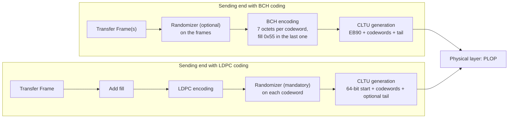
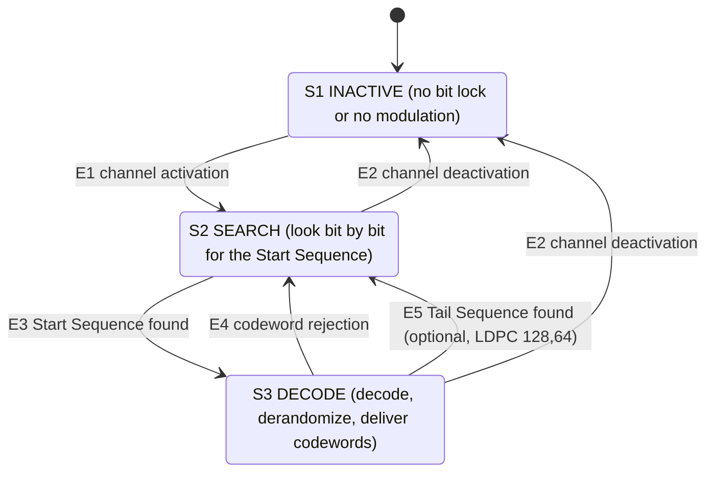
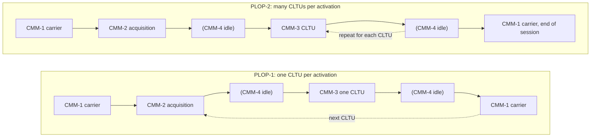

# TC synchronization and channel coding: the CLTU (CCSDS 231.0-B-4)

Before a [TC Transfer Frame](tc-sdlp.md) is radiated it passes through the **Synchronization and
Channel Coding Sublayer**. This sublayer adds error-control coding, makes the start of the data
recognisable in a continuous bit stream, keeps enough bit transitions for the receiver's bit
synchroniser, and optionally repeats the transmission. Its data unit is the **Communications Link
Transmission Unit** (CLTU): a Start Sequence, an integer number of codewords, and a Tail Sequence. The
same Recommended Standard also defines the **Physical Layer Operations Procedures** (PLOP-1 and
PLOP-2) that the transmitter follows to switch the carrier, the acquisition and idle patterns and the
CLTUs on and off.[^cc-purpose][^cc-arch][^cc-def-cltu]

This page follows CCSDS 231.0-B-4 (Blue Book, July 2021) and its companion Green Book CCSDS 230.1-G-3
(October 2021), which explains the rationale and gives performance data and worked examples, plus the
ECSS communications handbook and the Solar Orbiter documentation and [MIB](../mib/index.md).[^cc-cover][^gb-cover]

!!! info "TC coding at a glance"
    | Item | BCH option | LDPC option |
    |---|---|---|
    | Code | Modified BCH (63,56), expurgated Hamming, min. distance 4 | (128,64) or (512,256), rate 1/2, systematic |
    | Codeword | 8 octets: 56 information bits, 7 complemented parity bits, 1 filler bit | 128 or 512 bits |
    | Decoding | Error-detecting (TED) or error-correcting (SEC), hard decision | Usually soft decision (about 2 dB better) |
    | Randomizer | Optional (strongly advised), applied to frames before encoding | Mandatory, applied to each codeword after encoding |
    | Start Sequence | 16 bits, `0xEB90` | 64 bits, `0x034776C7272895B0` |
    | Tail Sequence | 64 bits, `0xC5C5C5C5C5C5C579` | (128,64): optional 128 bits; (512,256): none |
    | Physical layer procedure | PLOP-2 for missions planned after September 2010; PLOP-1 only for legacy | same |

    Sources: CCSDS 231.0-B-4 §3 to §7, Green Book §3.5 and §4.4.[^bch-format][^ldpc-ov][^cltu-start][^cltu-tail][^plop-intro][^gb-hamming][^gb-ldpc-rf]

## Architecture and functions

The sublayer sits between the data link protocol sublayer ([TC-SDLP](tc-sdlp.md) or
[USLP](uslp.md)) and the physical layer, whose main specification is the CCSDS radio frequency and
modulation standard.[^cc-arch] It provides four functions:[^cc-functions][^cc-functions2]

* **error-control coding** with either the modified BCH code or one of two LDPC codes; the BCH code can
  be decoded in an error-detecting or an error-correcting mode, while the LDPC codes are typically
  decoded from soft symbols and work at a lower signal-to-noise ratio;
* **synchronization** through the CLTU, whose Start Sequence can also resolve the ambiguity between
  `0` and `1` when the modulation does not; plus the PLOP for activating and deactivating the
  physical channel;
* **pseudo-randomizing** (optional with BCH) to raise the bit transition density;
* **repeated transmissions** (optional), requested through the service interface.

The Green Book lists the purposes behind these functions: protect the data against corruption on the
link, mark its start and end so the receiver can find it, let the receiver resolve the sense of 1 and
0, let it acquire bit synchronization with an acquisition pattern and keep it during data and between
data units. One instance of the sublayer serves one physical channel.[^gb-purpose]



Order of operations after figures 2-2 and 2-3 of the Blue Book and figure 4-3 of the Green Book.[^cc-org-tx][^gb-ldpc-fill]
At the receiving end the order is reversed: search for the Start Sequence, then (BCH) decode and
derandomize, or (LDPC) derandomize the noisy codewords and decode; the output is Transfer Frames,
possibly incomplete or followed by fill.[^cc-org-rx]

## Service interface

The sublayer offers one unidirectional service per physical channel, with a single user; frames from
different users are not multiplexed at this level.[^svc-ov] Two primitives exist:[^svc-prim]

* `ChannelAccess.request (Frame(s), Repetitions)` at the sending end. *Frames* is one or more TC
  Transfer Frames, or a single USLP frame. *Repetitions* is optional; when supported it is an integer
  ≥ 1 giving the **total** number of times the CLTU is transferred (3 means three transfers, not four).
  With Repetitions > 1 the frames should not include Type-BD frames, and the option should be limited
  to links with long light time.[^svc-params][^svc-req]
* `ChannelAccess.indication (Frames)` at the receiving end. The delivered *Frames* may contain an
  incomplete frame or trailing fill, which the data link protocol discards.[^svc-params][^svc-ind]

One request produces one CLTU, and the sublayer does not look at frame boundaries or length fields: to
it, the Frames parameter is one block of data.[^gb-iface] The Green Book describes an equivalent
interface at the receiving end in terms of a *Data Start* signal, true while octets of a CLTU are being
delivered and false (*Data Stop*) after a decoder failure or loss of the channel.[^gb-iface-rx]

## The BCH code

### Codeword format

A BCH codeword is 64 bits long: 56 information bits (randomized if the randomizer is used), the
**complements** of 7 parity bits, and one filler bit that is always `0`, so that the codeword is a whole
number of octets.[^bch-format]

<div class="bitfield" data-title="BCH codeword (64 bits)" data-width="32"
     data-fields='[{"n":"Information bits I0 to I55","b":56,"d":"7 octets of frame data, randomized if the randomizer is in use, or fill 0x55 in the last codeword"},{"n":"Parity P0 to P6 (complemented)","b":7,"d":"Complements of the 7 parity bits; complementing helps bit synchronization and detection of bit slips"},{"n":"Filler","b":1,"v":"0","d":"Makes the codeword 8 octets; always zero"}]'></div>

The parity bits are complemented to help maintain bit synchronization and to detect bit
slippage.[^bch-format] The ECSS handbook gives the reason this matters: an all-zero frame encoded
without randomization produces codewords of 56 zeros, 7 ones and a zero, a square-wave-like pattern
with long runs that transponders can fail to track.[^hb-diff6]

### Encoding

The code is a systematic (63,56) modified Bose-Chaudhuri-Hocquenghem code with generator
polynomial[^bch-enc]

$$g(x) = x^7 + x^6 + x^2 + 1$$

The encoder shift register starts at zero; the 56 information bits pass straight through while the
register computes the remainder, then the 7 parity bits are shifted out, complemented, and the filler bit
is appended.[^bch-enc] The Green Book explains the choice. A basic Hamming code with 6 check bits has
63-bit codewords, 57 information bits, minimum distance 3 and generator $g_1(x) = x^6 + x + 1$; keeping
only its even-parity codewords gives the *expurgated* (63,56) code with
$g(x) = g_1(x)\,(x + 1) = x^7 + x^6 + x^2 + 1$ and minimum distance 4. Used for detection it detects up to
three errors and every odd number of errors; used for correction it corrects one error and detects
two.[^gb-hamming]

Earlier CCSDS recommendations also allowed 40, 48 and 56-bit codewords with the same 8-bit error control
field; they were dropped in June 2000 because the 64-bit codeword is the most efficient:[^gb-oldlen]

| Codeword length | Data bits | Bandwidth overhead |
|---|---|---|
| 64 bits | 56 | 14 % |
| 56 bits (obsolete) | 48 | 17 % |
| 48 bits (obsolete) | 40 | 20 % |
| 40 bits (obsolete) | 32 | 25 % |

### Fill data

The frames are cut into 7-octet pieces, ignoring frame boundaries. If the last piece is short, **fill**
completes the last codeword: alternating bits starting with `0`, so each fill octet is `0x55`. Only the
last codeword of a CLTU can contain fill, at most six octets. Fill is not removed by the decoder; the
data link layer removes it when it delimits the frames. With randomization, fill may be added before or
after randomizing; either way the receiver derandomizes it, so unrandomized fill does not come out as
`0x55`.[^bch-fill][^gb-split][^gb-rnd-rx]

### Decoding modes: TED and SEC

The receiver decodes BCH codewords in one of two modes, chosen per physical channel:[^bch-dec][^cc-mp]

* **Triple Error Detection (TED)**, the error-detecting mode: any detected error rejects the codeword.
  One, two or three errors are always detected. No error is accepted in the Start Sequence.
* **Single Error Correction (SEC)**, in full *Single Error Correction and Double Error Detection*: one
  error is corrected, two are detected. One error is accepted in the Start Sequence.

In both modes the received filler bit is ignored.[^gb-ted][^gb-sec] A TED decoder can simply recompute
the parity from the first 56 bits and compare it with the inverted next 7 bits. A SEC decoder computes the
6-bit Hamming syndrome (with $x^6 + x + 1$) and an overall parity bit (the $x + 1$ factor) and decides as
follows:[^gb-ted][^gb-sec-table]

| Parity of errors (EOD output P) | Syndrome non-zero (SB) | Decision |
|---|---|---|
| even (0) | no (0) | No error detected: accept |
| even (0) | yes (1) | Even number of errors: reject the codeword |
| odd (1) | no (0) | Odd number of errors in an apparently correct codeword: reject |
| odd (1) | yes (1) | Single error: correct it at the position found by the syndrome, accept |

Correction lowers the rejection rate but increases undetected errors: in SEC mode a codeword with three
errors can be "corrected" into one with four, a case TED mode would have detected. The Green Book's
exhaustive simulation shows all 63 single errors corrected, all 1953 double errors detected, and of the
39,711 triple errors none undetected in TED but 39,060 undetected in SEC; four errors escape both modes
in 9,765 of 595,665 cases.[^gb-ue-src][^gb-ue-sim] This is why the [Frame Error Control
Field](tc-sdlp.md#frame-error-control-field) is particularly advisable with SEC.[^gb-fecf]

An obsolete **Filler Bit Augmentation** algorithm once used the filler bit (always `0` in a codeword but
`1` at the end of the tail) to inhibit correction and so recognise the old tail pattern more reliably. The
current tail pattern is one bit further from the nearest codewords, so the algorithm is no longer part of
the standard.[^gb-fba]

## The LDPC codes

LDPC codes give more coding gain than the BCH code. Two systematic, rate-1/2 binary codes
are defined, (n = 128, k = 64) and (n = 512, k = 256). Both are transparent, so phase ambiguity can be
resolved from the Start Sequence or after decoding, and their undetected error rates lie orders of
magnitude below their detected error rates, especially with the FECF. Because LDPC coding alone does not
guarantee enough bit transitions, the pseudo-randomizer is mandatory with it.[^ldpc-ov]

**Structure.** Each code is defined by an m × n parity-check matrix H built from M × M blocks, with
M = k/4 = n/8 (16 for the short code, 64 for the long one): identity, zero and powers of Φ, the first
right circular shift of the identity, added modulo 2. An encoder maps k information bits to an n-bit
codeword satisfying all m = n − k parity checks. Codewords may be generated either by multiplying with a
block-circulant generator matrix derived from H, or from the hexadecimal rows of the dense matrix W given
in the standard, with the other rows obtained by circular shifts.[^ldpc-spec][^ldpc-enc] For the
(128,64) code the four defining rows of W are:[^ldpc-enc]

| W row | Hexadecimal value |
|---|---|
| 1 | `0E69 166B EF4C 0BC2` |
| 17 | `7766 137E BB24 8418` |
| 33 | `C480 FEB9 CD53 A713` |
| 49 | `4EAA 22FA 465E EA11` |

**Design rationale.** Uplinks now carry far more than short commands: software and FPGA reloads, file
uploads, even crew video. The Green Book sorts the uses into four modes and states that the TC codes
target the first two; for the others some missions have used the TM LDPC codes:[^gb-modes]

| Mode | Purpose | Block length (kb) | Throughput (kb/s) |
|---|---|---|---|
| A | Emergency | 0.1 | 0.01 |
| B | Command / ARQ | 0.1–1 | 1–4 |
| C | File upload | 1–4 | 1000 |
| D | Human support | > 4 | 20000 |

Rate 1/2 balanced complexity, gain and the number of parity bits to store and send. Binary codes were
chosen over non-binary GF(256) codes, which are 1.0 to 1.3 dB better, because the decoder is on board
where complexity counts. A protograph-plus-circulant construction allows fast, simple encoders and
well-structured decoders, with circulants chosen by a variant of Progressive Edge Growth. The minimum
weight of the (128,64) code is 14 (16 codewords of that weight) and of the (512,256) code about 40.[^gb-ldpc-design][^gb-ldpc-weights]
The LDPC codes work at a lower SNR than BCH because of the lower rate (1/2 instead of 0.89), soft-decision
decoding (a rule of thumb of about 2 dB) and longer codewords; the spacecraft receiver then has to hold
symbol synchronization at a lower SNR.[^gb-ldpc-rf]

**Fill and randomization.** Fill (`0x55` pattern) is added *before* encoding and is encoded and
randomized with the frame.[^ldpc-fill] The randomizer is placed *after* the encoder because the codes are
quasi-cyclic: a codeword shifted by one symbol, as after a slip of the receiver's tracking loop, can look
like another valid codeword and be mis-corrected; randomizing the codeword prevents this. Unlike TM,
there are no synchronization markers between codewords, since synchronization is established at the
start of each CLTU.[^gb-ldpc-fill]

!!! warning "Inference: how much LDPC fill?"
    A (128,64) codeword carries 8 octets of information, so at most 7 octets of fill are needed. A note
    in the Green Book says there may be "up to 7 octets or 15 octets" of fill depending on the
    code.[^gb-rnd-rx-ldpc] For the (512,256) code, whose information block is 32 octets, the maximum
    should be 31 octets, and the Green Book's own annex F2 example 2 adds 26 fill octets to a 70-octet
    frame to fill three (512,256) codewords.[^gb-ldpc-ex] This wiki therefore reads "15 octets" as an
    error in that note; the sources do not say so explicitly.

**Decoding.** Soft symbols are recommended (about 2 dB better), but belief-propagation decoders also
work on hard symbols; the Green Book discusses flooding, layered and Most Reliable Basis
decoders.[^ldpc-dec][^gb-decoders]

## The CLTU

The CLTU carries the codewords as one contiguous series. Its contents are the frame or frames from the
layer above, plus any fill.[^cltu-struct]

<div class="bitfield" data-title="CLTU with BCH coding, two codewords (208 bits)" data-width="64"
     data-fields='[{"n":"Start Sequence","b":16,"v":"0xEB90","g":"Start"},{"n":"Codeword 1: information (7 octets)","b":56,"g":"Codeword 1"},{"n":"Parity","b":7,"g":"Codeword 1"},{"n":"F","b":1,"v":"0","g":"Codeword 1"},{"n":"Codeword 2: information, ends with fill 0x55","b":56,"g":"Codeword 2"},{"n":"Parity","b":7,"g":"Codeword 2"},{"n":"F","b":1,"v":"0","g":"Codeword 2"},{"n":"Tail Sequence","b":64,"v":"0xC5C5C5C5C5C5C579","g":"Tail"}]'
     data-caption="N codewords in general; drawn with N = 2"></div>

<div class="bitfield" data-title="CLTU with LDPC (128,64) coding, one codeword and optional tail (320 bits)" data-width="64"
     data-fields='[{"n":"Start Sequence","b":64,"v":"0x034776C7272895B0","g":"Start"},{"n":"Randomized LDPC codeword (128 symbols)","b":128,"g":"Codeword"},{"n":"Tail Sequence (optional)","b":128,"v":"0x55555556AAAAAAAA5555555555555555","g":"Tail"}]'
     data-caption="The (512,256) code uses 512-symbol codewords and never a tail"></div>

### Start Sequence

The Start Sequence delimits the start of the encoded data.[^cltu-start]

| Coding | Pattern | Hexadecimal | Inverse (for ambiguity resolution) |
|---|---|---|---|
| BCH | `1110 1011 1001 0000` (16 bits) | `0xEB90` | `0x146F` |
| LDPC | 64 bits | `0x0347 76C7 2728 95B0` | `0xFCB8 8938 D8D7 6A4F` |

Patterns from §5.2.2; inverses from the Green Book.[^cltu-start][^gb-inverse] Both patterns have low
autocorrelation side lobes, so a shifted or partial match is unlikely, and they are clearly distinct from
the acquisition and idle patterns: six bit errors (five if one error is tolerated) would be needed to turn
part of an idle sequence into the BCH Start Sequence.[^gb-start][^gb-premature] The LDPC sequence is longer
for better detection at low SNR.[^gb-ldpc-fill] If the physical layer cannot tell 1 from 0 (with some
modulations), the receiver searches for both the pattern and its inverse, and on finding the inverse it
inverts all following bits until it next returns to the search.[^cltu-ambig][^gb-inverse]

### Tail Sequence

With BCH coding, the 64-bit Tail Sequence `0xC5C5C5C5C5C5C579` (seven octets `0xC5` and one `0x79`) is
built to be an uncorrectable pattern, so that it stops the decoder.[^cltu-tail] It has the length of a
codeword. Without errors it has odd parity and a zero syndrome, and with one error even parity and a
non-zero syndrome, so it is rejected in both modes; it is missed only when channel errors turn it into
an acceptable codeword: 651 of the 39,711 three-error patterns (both modes), and in SEC mode all 1953
two-error patterns.[^gb-tail-fmt][^gb-tail-par] The resulting probabilities of missing it are, at a
channel bit error rate of 10⁻⁵, about 6.5 × 10⁻¹³ in TED mode and 1.95 × 10⁻⁷ in SEC
mode.[^gb-tail-prob]

History: before November 1995 the tail was alternating `0x55` octets, which was easier to miss; the
shorter tails of the obsolete codeword lengths disappeared in June 2000.[^gb-tail-old]

With LDPC coding a conventional decoder reliably fails when it runs past the end of a CLTU, which
ends the CLTU without a tail. A 128-bit tail `5555 5556 AAAA AAAA 5555 5555 5555 5555` is optional for
the (128,64) code, for decoders that do not have that property; it can be found by decoder failure or by
pattern matching before derandomization. The (512,256) code never uses a tail.[^cltu-tail][^gb-ldpc-tail]

### Length of a CLTU

| Case | CLTU length (octets) | Minimum |
|---|---|---|
| BCH, N codewords | 2 + 8 (N + 1) | 18 (N = 1) |
| BCH, from total frame length L | 10 + 8 × ⌊(L + 6) / 7⌋ | |
| LDPC (128,64), no tail | 16 N + 8 | 24 (N = 1) |
| LDPC (128,64), with tail | 16 N + 24 | |
| LDPC (512,256) | 64 N + 8 | |

Formulas from the Green Book.[^gb-len-bch][^gb-len-ldpc][^gb-iface] Examples there: frames totalling 1189
octets need 170 codewords and give a 1370-octet CLTU; a single maximum-size 1024-octet frame needs 147
codewords and gives 1186 octets. The standard sets no upper limit itself but makes the maximum CLTU
length a managed parameter, and the SLE Forward CLTU service has a similar per-instance
limit.[^gb-iface][^gb-len-bch]

!!! note "One frame per CLTU in ECSS practice"
    CCSDS allows several frames in one CLTU. ECSS-E-ST-50-04C (2008) required exactly one, because
    more codewords per CLTU raise the rejection probability and because European on-board hardware
    did not support several frames per CLTU in its frame delimiting procedure.[^hb-diff3] For systematic
    retransmissions the Blue Book also advises a single frame per CLTU: losing one frame loses all
    following frames of the same CLTU.[^svc-req] ECSS now adopts the CCSDS coding standard through the
    adoption notice ECSS-E-AS-50-24, which ECSS-E-ST-50C Rev.1 lists as based on CCSDS 231.0-B-3
    (September 2017, the issue before the one described here) and as superseding clauses 8
    (synchronization and coding sublayer) and 9 (physical layer) of ECSS-E-ST-50-04C.[^e50-an] That
    notice is not in this wiki's library, so whether it keeps the one-frame rule and the other
    ECSS-E-ST-50-04C choices listed on this page is not stated in the available sources.

## The pseudo-randomizer

To keep bit synchronization the receiver needs a minimum bit transition density, so the data must be
"sufficiently random". The pseudo-randomizer is the preferred way to achieve this for every
CCSDS-recommended combination of modulation and coding. With BCH it is required unless the designer
verifies correct operation without it; its use is fixed and known in advance for a physical channel
(a managed parameter, never signalled). With LDPC it is always applied.[^rnd-ov]

The random sequence comes from the **Bit Transition Generator** (BTG), an 8-stage shift register preset
to all ones, with polynomial[^rnd-desc]

$$h(x) = x^8 + x^6 + x^4 + x^3 + x^2 + x + 1$$

The sequence repeats every 255 bits (2⁸ − 1, the maximum for an 8-bit register) and starts
`1111 1111 0011 1001 1001 1110 0101 1010 0110 1000`, that is `FF 39 9E 5A 68`. Randomizing is an
exclusive OR, so derandomizing is the same operation.[^rnd-desc][^gb-rnd]

| | With BCH coding | With LDPC coding |
|---|---|---|
| What is randomized | The Transfer Frame(s) only, before encoding | Each codeword, after encoding |
| BTG reset (sending end) | At the start of the frames of each CLTU (each `ChannelAccess.request`); frame boundaries ignored | At the start of every codeword |
| Fill | Randomized or not, as the implementation chooses | Randomized with the frame |
| Receiving end | XOR the 56 information bits of each successfully decoded codeword; BTG held at all ones until the Start Sequence is found and reset after any decoding failure | XOR (or sign-flip of soft symbols) on each noisy codeword before decoding; reset after each codeword |
| Never randomized | Start and Tail Sequences, acquisition and idle sequences, BCH parity | Start and Tail Sequences, acquisition and idle sequences |

Restated from §6.3 of the Blue Book and §9.2 and §9.3 of the Green Book.[^rnd-apply][^rnd-apply-rx][^gb-rnd-tx][^gb-rnd-rx][^gb-rnd-apply]

**Rationale.** Early TC coding had no randomizer because commands were short and full of transitions.
Large memory loads with few transitions caused bit synchronization problems, so randomization was added
in November 1995.[^gb-rnd-bg] Its polynomial differs from the TM randomizer, which interacts slightly with
the TM Reed-Solomon code; the TC sequence avoids that interaction.[^gb-rnd-tm] The Green Book suggests a
way to disable randomization during early ground testing, so that engineers can read familiar binary
data.[^gb-rnd] ECSS-E-ST-50-04C always required the randomizer, citing problems on earlier missions, while
noting that some European on-board hardware did not support it.[^hb-diff6]

## Receiving end: the CLTU reception logic

The receiver is a three-state machine, driven by the physical layer (bit lock) and by its own
decoder.[^rx-logic][^rx-tables]



After figure 5-3 and tables 5-1, 5-2.[^rx-logic][^rx-tables]

| Event | Name | Definition |
|---|---|---|
| E1 | Channel activation | Carrier modulation detected and bit lock achieved: channel symbols present |
| E2 | Channel deactivation | Bit lock or signal lost; any partial codeword is discarded |
| E3 | Start Sequence found | Marks the first codeword of a CLTU; the Start Sequence itself is discarded |
| E4 | Codeword rejection | Uncorrected errors: no data from this codeword is passed on; ends the CLTU |
| E5 | Tail Sequence found | Optional for LDPC (128,64): tail detected by pattern; search resumes after it |

After a rejection without a tail in use, the search must restart at the beginning of the rejected
codeword (it may hold the next Start Sequence); with a tail it may restart after it. With BCH it is
standard practice to rely on the tail causing a codeword rejection; with LDPC one may detect the tail with
a correlator, allowing for inversion.[^rx-tables][^rx-notes][^gb-decode]

What the data link layer receives is not yet clean frames: fill has not been removed, the last frame may
be truncated, nothing has been validated, and the Spacecraft ID has not been checked. Those are the jobs
of the Frame Delimiting and Fill Removal and the Frame Validation Check procedures of
[TC-SDLP](tc-sdlp.md#procedures-at-the-receiving-end).[^gb-delivered][^sdlp-afr]

### Probability of losing a CLTU

The Green Book defines the target service as at most one rejected frame in 10³ (the *command
threshold*) and at most one undetected erroneous frame in 10⁹.[^gb-criteria] At system level, ECSS-E-ST-50C
requires the probability of accepting an erroneous telecommand to stay below 10⁻² divided by the
number of telecommands expected in the mission.[^e50-err] Some of its figures, at a
channel bit error rate of 10⁻⁵:[^gb-start-prob][^gb-ted-rej][^gb-sec-rej][^gb-pf2][^gb-ue-tab]

| Quantity | TED mode, no Start Sequence error accepted | SEC mode, one Start Sequence error accepted |
|---|---|---|
| Start Sequence not recognised | 1.60 × 10⁻⁴ | 1.20 × 10⁻⁸ |
| CLTU rejected, 37 codewords | 2.30 × 10⁻² | 7.22 × 10⁻⁶ |
| CLTU rejected, 147 codewords (one 1024-octet frame) | 8.85 × 10⁻² | 2.87 × 10⁻⁵ |
| Last or only frame rejected, PLOP-2, 37 codewords (frames up to 259 octets), all causes | 2.32 × 10⁻² | 7.43 × 10⁻⁶ |
| Undetected error in a 10-codeword frame, no CRC | 9.53 × 10⁻¹⁶ | 3.90 × 10⁻¹⁰ |
| Undetected error in a 10-codeword frame, with CRC | 3.99 × 10⁻³² | 1.16 × 10⁻²⁴ |

The trade-off is plain: SEC rejects thousands of times fewer CLTUs, at the cost of an undetected error
rate that only the CRC brings back to negligible levels. ECSS-E-ST-50-04C therefore always used SEC,
always accepted one error in the Start Sequence, and made the FECF mandatory.[^hb-diff7][^hb-diff5][^hb-diff4]

ECSS-E-ST-50C Rev.1 turns this into link requirements: uplink budgets assume a bit error rate of 10⁻⁵
at the input of the telecommand decoder; at that rate the uplink frame rejection rate for a 256-octet
frame shall be below 10⁻⁵, and the standard notes that with the BCH mechanisms of ECSS-E-AS-50-24 a
1024-octet frame then has a rejection rate above 10⁻⁵ (the LDPC option performs better). With BCH
coding and frame error control the probability of an undetected frame error can be kept below
10⁻¹⁸, and below 10⁻⁸ without it.[^e50-ul]

!!! warning "Inference"
    Against the Green Book figures above, a 256-octet frame (37 codewords) meets the 10⁻⁵ target only
    in SEC mode with one Start Sequence error accepted (about 7.4 × 10⁻⁶ with PLOP-2), not in TED mode
    (about 2.3 × 10⁻²), and a 1024-octet frame in SEC mode (about 2.9 × 10⁻⁵) misses it, as the ECSS
    note says. The comparison is this wiki's.

## Physical Layer Operations Procedures

A communications session starts when the carrier is switched on and ends when it is removed. The PLOP
defines the sequence of **Carrier Modulation Modes** (CMMs) used meanwhile. PLOP-2 shall be used for
missions whose planning began after September 2010; PLOP-1 may remain in ground equipment for legacy
missions.[^plop-intro]

| Data format | Definition |
|---|---|
| Acquisition Sequence | Alternating ones and zeros (starting with either) as a preamble for symbol synchronization; length set by the mission, preferred minimum 16 octets, not necessarily whole octets[^plop-acq] |
| CLTU | As above; with BCH each codeword gives at least 2 transitions, and if the receiver needs more, randomization or a suitable modulation must provide them[^plop-cltu] |
| Idle Sequence | Alternating ones and zeros of any length, to keep symbol synchronization when no CLTU is sent; no longer constrained to start with 0 since the current tail was introduced[^plop-idle] |

| Mode | Carrier state |
|---|---|
| CMM-1 | Unmodulated carrier only |
| CMM-2 | Carrier modulated with the Acquisition Sequence |
| CMM-3 | Carrier modulated with a CLTU |
| CMM-4 | Carrier modulated with the Idle Sequence |

Table 7-1 of the Blue Book.[^plop-cmm] The preferred 128-bit acquisition length was chosen to give a
0.9999 probability of acquiring bit synchronization at the command threshold with the hardware then in
use.[^gb-acq] During CMM-1 the sender uses the CLCW **No RF Available** flag, and during CMM-2 it may use
the optional **No Bit Lock** flag, to follow the state of the spacecraft receiver.[^gb-cmm]



Sequences after figures 7-1 and 7-2.[^plop1][^plop2]

* **PLOP-1** returns the channel to CMM-1 after every CLTU, forcing the receiver into INACTIVE. Each
  CLTU therefore needs its own acquisition sequence, which costs throughput but guarantees that a missed
  tail cannot affect the next CLTU.[^plop1][^gb-plop-sel][^gb-plop1]
* **PLOP-2** keeps the channel modulated; each CLTU ends only through its Tail Sequence (and optional
  idle), which puts the receiver back into SEARCH. The channel is deactivated only after a series of
  CLTUs.[^plop2]

!!! warning "Synchronization lockout with PLOP-2"
    If the receiver misses a Start Sequence (or a codeword fails) it searches while the rest of the CLTU
    is still arriving. A chance Start Sequence pattern across the last bits of the last codeword and the
    first bits of the tail then sends it into DECODE at the wrong place; the next 64 bits it tries to
    decode are the rest of the tail and, when no idle sequence follows, the beginning of the next
    Start Sequence, so the following CLTU is lost. A minimum **one-octet Idle Sequence** between CLTUs
    removes the risk, and the SLE Forward CLTU service has a parameter for the idle duration after a
    CLTU. The risk is higher when one Start Sequence error is accepted or when the inverse pattern is
    also searched.[^plop2][^gb-lockout]

The Green Book adds that the PLOP has no formal service interface in the standard, and points to the
[SLE Forward CLTU service](sle/fcltu.md) as a useful model, citing as an example its minimum delay
between one CLTU and the next.[^gb-plop-if] The configuration parameters of that service include
`plop-in-effect`, `acquisition-sequence-length`, `plop-1-idle-sequence-length`, `minimum-delay-time`,
`maximum-cltu-length` and the CLCW-based `rf-available-required` and `bit-lock-required`
checks.[^fcltu-params]

For ECSS missions, ECSS-E-ST-50-04C fixed several of these options: PLOP-2 in preference to PLOP-1,
an idle sequence of at least 8 bits between CLTUs, an acquisition sequence of at least 128 bits, and a
mandatory No Bit Lock flag.[^hb-plop][^hb-diff8][^hb-diff9][^hb-diff11]

## Repeated transmissions

Systematic retransmission, added in 2010, is an optional feature of the sending end only; the receiving
sublayer is unaffected. The standard does not say how it is implemented (generate once and send N times,
or regenerate each time).[^gb-sys-intro][^gb-sys-param] It complements the automatic go-back-n
retransmission of [COP-1](cop-1.md), which is efficient near Earth but leaves the uplink idle for most of
a deep-space round trip.[^gb-gbn][^gb-longwait]

| Option | Pattern for frames A to F | Strength | Weakness |
|---|---|---|---|
| Systematic retransmission, Repetitions = 3 | `AAABBBCCCDDDEEEFFF` | Sporadic losses rarely hit all copies of one frame | A burst can wipe out all copies of one frame |
| Early COP-1 retransmission (short T1) | `ABCDEF ABCDEF ABCDEF` | Resists bursts | An early loss in a cycle causes the rest of that cycle to be rejected |

After §10.3.3 of the Green Book.[^gb-sysopt][^gb-early] Neither is universal; mission designers may combine
them and optimise patterns and repetition factors by simulation. Typical uses are deep-space missions
with sporadic losses, spacecraft near solar conjunction, and spacecraft that cannot hold attitude so that
a low-gain antenna points away intermittently. The two mechanisms are independent: systematic
retransmission works on a physical channel, COP-1 on a virtual channel, and duplicates are simply
discarded by FARM-1.[^gb-sysopt][^gb-scen][^gb-indep][^cop-dup] Restricting each request to a single frame improves
the result further.[^gb-frames-param]

## Managed parameters

| Managed parameter | Allowed values | Applies to |
|---|---|---|
| Error Correcting Code Type | BCH, LDPC | both |
| Maximum CLTU Length (octets) | Integer | both |
| Maximum value for the Repetitions parameter | Integer (1 means the option is not available) | both |
| Physical Layer Operations Procedure | PLOP-1, PLOP-2 | both |
| Decoding Mode | Error-Detecting, Error-Correcting | BCH |
| Allowed Number of Errors in Start Sequence | 0, 1 | BCH |
| Randomizer | Used, Not used | BCH |
| Code length | (128,64), (512,256) | LDPC |
| Tail Sequence | Used, Not used (only for (128,64)) | LDPC |

Tables 8-1 to 8-3.[^cc-mp] For LDPC no error count for the Start Sequence and no decoding mode are
specified: soft-symbol detection and decoding make them meaningless.[^cc-mp-ldpc]

## Worked examples

### Real CLTUs from the Green Book

The Green Book annex F gives TC frames and the resulting CLTUs for spacecraft `0x1B`, with and without
randomization; fill is not randomized in these examples, and in each octet the most significant bit is
sent first.[^gb-annexf] Example 1 is the Unlock frame on VC 0:[^gb-ex1]

| Part | Unrandomized | Randomized |
|---|---|---|
| TC Transfer Frame | `30 1B 00 07 00 00 4C A9` | (same frame) |
| Start Sequence | `EB 90` | `EB 90` |
| 1st codeword | `30 1B 00 07 00 00 4C A4` | `CF 22 9E 5D 68 E9 4A FC` |
| 2nd codeword | `A9 55 55 55 55 55 55 7A` | `5C 55 55 55 55 55 55 F4` |
| Tail Sequence | `C5 C5 C5 C5 C5 C5 C5 79` | `C5 C5 C5 C5 C5 C5 C5 79` |

Reading the first codeword: seven frame octets, then `A4` = `1010010 0`, that is the complemented parity
`1010010` (true parity `0101101`) and the filler bit `0`. The 8-octet frame needs ⌊(8 + 6)/7⌋ = 2
codewords, the second holding the last frame octet `A9` and six fill octets, for a 26-octet CLTU. In the
randomized CLTU the first octet `CF` is `30` XOR `FF` and the second `22` is `1B` XOR `39`, the first two
octets of the BTG sequence; the parity octet is recomputed over the randomized data, and the fill keeps its
`0x55` value.[^gb-ex1][^rnd-desc]

!!! tip "Reproducing the examples"
    This wiki implemented the CRC-16 FECF, the BCH encoder (register preset to zero, parity
    complemented, filler 0) and the BTG, using the recurrence
    $s_{n+8} = s_{n+6} \oplus s_{n+4} \oplus s_{n+3} \oplus s_{n+2} \oplus s_{n+1} \oplus s_n$
    from an all-ones start, which reproduces `FF 39 9E 5A 68`,
    and checked them against Green Book examples 1, 2, 6, 12 and 15, both unrandomized and randomized:
    all codewords match.[^gb-ex1][^gb-ex2][^gb-ex6][^gb-ex12][^gb-ex15]

### Real LDPC CLTUs from the Green Book

Annex F2 of the Green Book gives sending-end test vectors for the LDPC codes. Because only the sending
end is standardized, and an error-correcting decoder can hide implementation errors, it recommends
testing interoperability by checking that two encoders produce identical output symbol by symbol.
Example 1 uses a 70-octet ASCII text string as a stand-in for a Transfer Frame and the (128,64) code:
two fill octets are added, the 72 octets become nine codewords, each codeword is randomized with the
BTG reset to all ones, and the 64-bit Start Sequence and the optional 128-bit tail are added, giving a
1344-bit (168-octet) CLTU. Its real bytes begin `03 47 76 C7 27 28 95 B0` (the Start Sequence), then
`AC 51 F1 28 1C C9 44 99 …` (the first randomized codeword), and end with the tail
`55 55 55 56 AA AA AA AA 55 55 55 55 55 55 55 55`. A receiver decodes the text followed by `UU`, the two
fill octets `0x55`, which this sublayer does not remove. Example 2 encodes the same string with the
(512,256) code: 26 fill octets and three 512-bit codewords.[^gb-ldpc-ex] The CLTU length matches the
formula above: 16 × 9 + 24 = 168 octets.

### A Solar Orbiter Unlock CLTU (illustrative)

Solar Orbiter uses spacecraft ID `0x28A`, TC virtual channels 1 and 2 (one per on-board decoder) and
frames of at most 256 octets.[^tn-frame] With the `UNLOCK` data field defined in the MIB (one octet
`00`), the frame on VC1 and its CLTU are:[^mib-unlock]

| Part | Octets |
|---|---|
| TC Transfer Frame (BC, VC1, N(S) = 0) | `32 8A 04 07 00 00 81 C3` |
| Start Sequence | `EB 90` |
| 1st codeword | `32 8A 04 07 00 00 81 70` |
| 2nd codeword | `C3 55 55 55 55 55 55 2A` |
| Tail Sequence | `C5 C5 C5 C5 C5 C5 C5 79` |
| Same CLTU, randomized | `EB 90` · `CD B3 9A 5D 68 E9 87 28` · `36 55 55 55 55 55 55 A4` · tail |

A Set V(R) with V\*(R) = 16 on VC1 becomes the frame `32 8A 04 09 00 82 00 10 49 25` and the codewords
`32 8A 04 09 00 82 00 66` and `10 49 25 55 55 55 55 1E`.

!!! warning "Inference"
    These bytes are computed by this wiki with the implementation checked above; they are not captured
    spacecraft data. Whether Solar Orbiter uses the randomizer, which BCH decoding mode its decoders use,
    and which PLOP the ground stations apply are not stated in the Solar Orbiter documents read for this
    page. A maximum-size 256-octet frame needs ⌊(256 + 6)/7⌋ = 37 codewords and a 306-octet CLTU, the
    37-codeword row of the Green Book rejection tables above.[^gb-ted-rej]

### What the Solar Orbiter decoders report

The Solar Orbiter MIB decodes two status words of each packet telecommand decoder (PDEC) that relate
to this sublayer:[^mib-pdec]

* `PDEC_MON` (for decoder A at octets 22–24 of SPID [19500](../explorer/index.md#/solo/packet/19500)
  "DMS OBC Status Fast" and at octets 38–40 of SPID [19541](../explorer/index.md#/solo/packet/19541)):
  [`NCD0Z037`](../explorer/index.md#/solo/param/NCD0Z037) *Lock* with textual calibration
  `0 = No_Start_Seq`, `1 = Start_Seq`, and six inputs `TC0` to `TC5`, each with a *Dis* flag (`No_Dis`,
  `Dis`) and a *Status* (`Inactive`, `Active`, `Timed_out`).
* `PDEC_FARCP` (SPID [36997](../explorer/index.md#/solo/packet/36997)): besides the frame analysis
  described on the [TC-SDLP page](tc-sdlp.md#demultiplexing-farm-and-delivery), a 6-bit *CbCnt*, a 3-bit
  *ErrCnt*, a *Channel* field calibrated `TcA (DST-1)`, `TcB (DST-2)`, `TcAux (Test)`, and the outcome
  `ABANDONED_CLTU`.

!!! warning "Inference"
    *Lock* = `Start_Seq` presumably reports that the CLTU reception logic has found a Start Sequence
    (DECODE state); *CbCnt* and *ErrCnt* look like codeblock and corrected-error counts of the last
    CLTU; `DST-1` and `DST-2` presumably name the two deep-space transponders feeding decoder inputs.
    The decoder documentation that would confirm these meanings is not among the available sources.

??? example "SQL used"
    Queries ran with `sqlite3 -readonly` on `solo-2025-09-16.sqlite` (release
    MIB__20250916M25925PFMS001_SOL).

    ```sql
    -- decoder status words and their layout
    SELECT PCF_NAME, PCF_DESCR, PCF_PTC, PCF_PFC, PCF_CURTX FROM pcf
      WHERE PCF_DESCR LIKE 'PDEC_MON.A%' OR PCF_DESCR LIKE 'PDEC_FARCP.A%' OR PCF_DESCR LIKE 'TC Decoder A.Pdec%';
    SELECT p.PLF_NAME, c.PCF_DESCR, p.PLF_SPID, p.PLF_OFFBY, p.PLF_OFFBI
      FROM plf p JOIN pcf c ON c.PCF_NAME = p.PLF_NAME
      WHERE p.PLF_NAME LIKE 'NCD0Z03%' OR p.PLF_NAME LIKE 'NBC0Z01%'
      ORDER BY p.PLF_SPID, cast(p.PLF_OFFBY AS int), cast(p.PLF_OFFBI AS int);
    SELECT PID_SPID, PID_APID, PID_TYPE, PID_STYPE, PID_PI1_VAL, PID_DESCR FROM pid
      WHERE PID_SPID IN (19500, 19541, 36997);
    -- textual calibrations
    SELECT f.TXF_NUMBR, f.TXF_DESCR, p.TXP_FROM, p.TXP_ALTXT
      FROM txf f JOIN txp p ON p.TXP_NUMBR = f.TXF_NUMBR
      WHERE f.TXF_NUMBR IN ('CBCX0001TM','CBCX0002TM','CBCTZ010TM','CBCTZ012TM','CBCTZ013TM','CBCTZ014TM')
      ORDER BY 1, cast(p.TXP_FROM AS int);
    -- the UNLOCK and SETVR frame data fields used in the examples
    SELECT * FROM cdf WHERE CDF_CNAME IN ('UNLOCK','SETVR') ORDER BY CDF_CNAME, cast(CDF_BIT AS int);
    ```

[^cc-purpose]: [CCSDS 231.0-B-4, TC Synchronization and Channel Coding](../library/ccsds-231-0-231x0b4e1.md), §1.1 "Purpose", PDF p. 11.
[^cc-arch]: [CCSDS 231.0-B-4](../library/ccsds-231-0-231x0b4e1.md), §2.1 "Architecture" and figure 2-1, PDF p. 18.
[^cc-def-cltu]: [CCSDS 231.0-B-4](../library/ccsds-231-0-231x0b4e1.md), §1.6.1.3, definitions of CLTU, PLOP and Start Sequence, PDF pp. 14–15.
[^cc-cover]: [CCSDS 231.0-B-4](../library/ccsds-231-0-231x0b4e1.md), cover (Blue Book, July 2021), PDF p. 1.
[^gb-cover]: [CCSDS 230.1-G-3, TC Synchronization and Channel Coding, Summary of Concept and Rationale](../library/ccsds-230-1-230x1g3e1.md), cover and §2.1, PDF pp. 1 and 17.
[^bch-format]: [CCSDS 231.0-B-4](../library/ccsds-231-0-231x0b4e1.md), §3.2 "Codeword Format" and figure 3-1, PDF p. 24.
[^ldpc-ov]: [CCSDS 231.0-B-4](../library/ccsds-231-0-231x0b4e1.md), §4.1 "Overview" and §4.2.1, PDF p. 27.
[^cltu-start]: [CCSDS 231.0-B-4](../library/ccsds-231-0-231x0b4e1.md), §5.2.2 "Start Sequence", PDF p. 31.
[^cltu-tail]: [CCSDS 231.0-B-4](../library/ccsds-231-0-231x0b4e1.md), §5.2.4 "Tail Sequence", PDF p. 32.
[^plop-intro]: [CCSDS 231.0-B-4](../library/ccsds-231-0-231x0b4e1.md), §7.1 "Introduction", PDF p. 39.
[^gb-hamming]: [CCSDS 230.1-G-3](../library/ccsds-230-1-230x1g3e1.md), §3.5 "The BCH Code", PDF pp. 26–27.
[^gb-ldpc-rf]: [CCSDS 230.1-G-3](../library/ccsds-230-1-230x1g3e1.md), §4.4 "Impact on the Radio Frequency and Modulation Layer", PDF pp. 32–33.
[^cc-functions]: [CCSDS 231.0-B-4](../library/ccsds-231-0-231x0b4e1.md), §2.2.1–2.2.3, PDF pp. 18–19.
[^cc-functions2]: [CCSDS 231.0-B-4](../library/ccsds-231-0-231x0b4e1.md), §2.2.4 "Pseudo-Randomizing" and §2.2.5 "Repeated Transmissions", PDF p. 20.
[^gb-purpose]: [CCSDS 230.1-G-3](../library/ccsds-230-1-230x1g3e1.md), §2.2 "Purpose", PDF p. 18.
[^cc-org-tx]: [CCSDS 231.0-B-4](../library/ccsds-231-0-231x0b4e1.md), §2.3.1 and figures 2-2, 2-3, PDF pp. 20–22.
[^gb-ldpc-fill]: [CCSDS 230.1-G-3](../library/ccsds-230-1-230x1g3e1.md), §4.3 "Fill Data and the Pseudorandomizer" and figure 4-3, PDF pp. 31–32.
[^cc-org-rx]: [CCSDS 231.0-B-4](../library/ccsds-231-0-231x0b4e1.md), §2.3.2 and figures 2-4, 2-5, PDF pp. 22–23.
[^svc-ov]: [CCSDS 231.0-B-4](../library/ccsds-231-0-231x0b4e1.md), annex A2 "Overview of the Service", PDF p. 46.
[^svc-prim]: [CCSDS 231.0-B-4](../library/ccsds-231-0-231x0b4e1.md), annex A4.1, PDF p. 47.
[^svc-params]: [CCSDS 231.0-B-4](../library/ccsds-231-0-231x0b4e1.md), annex A3 "Service Parameters", PDF p. 46.
[^svc-req]: [CCSDS 231.0-B-4](../library/ccsds-231-0-231x0b4e1.md), annex A4.2 "ChannelAccess.request", notes and effect on receipt, PDF pp. 47–48.
[^svc-ind]: [CCSDS 231.0-B-4](../library/ccsds-231-0-231x0b4e1.md), annex A4.3 "ChannelAccess.indication", PDF p. 48.
[^gb-iface]: [CCSDS 230.1-G-3](../library/ccsds-230-1-230x1g3e1.md), §3.2 "Formal Interface to Data Link Protocol Sublayer", PDF pp. 23–24.
[^gb-iface-rx]: [CCSDS 230.1-G-3](../library/ccsds-230-1-230x1g3e1.md), §8.6.1 "Definition of the Interface", PDF p. 57.
[^hb-diff6]: [ECSS-E-HB-50A](../library/ecss-e-hb-50a-15november2008.md), §4.7.4.7 "Difference 6" (randomization), PDF p. 71.
[^bch-enc]: [CCSDS 231.0-B-4](../library/ccsds-231-0-231x0b4e1.md), §3.3 "Encoding Procedure" and figure 3-2, PDF pp. 24–25.
[^gb-oldlen]: [CCSDS 230.1-G-3](../library/ccsds-230-1-230x1g3e1.md), §3.3.2 "Obsolete Codeword Lengths" and table 3-1, PDF p. 25.
[^bch-fill]: [CCSDS 231.0-B-4](../library/ccsds-231-0-231x0b4e1.md), §3.4 "Fill Data", PDF p. 25.
[^gb-split]: [CCSDS 230.1-G-3](../library/ccsds-230-1-230x1g3e1.md), §3.4 "Breaking the Frames into Fixed-Length Pieces" and figure 3-2, PDF pp. 25–26.
[^gb-rnd-rx]: [CCSDS 230.1-G-3](../library/ccsds-230-1-230x1g3e1.md), §9.2.3 "At the Receiving End, When BCH Coding Is Used" and note, PDF pp. 62–63.
[^bch-dec]: [CCSDS 231.0-B-4](../library/ccsds-231-0-231x0b4e1.md), §3.5 "Decoding Procedure", PDF p. 26.
[^cc-mp]: [CCSDS 231.0-B-4](../library/ccsds-231-0-231x0b4e1.md), §8.2, tables 8-1 to 8-3, PDF pp. 44–45.
[^gb-ted]: [CCSDS 230.1-G-3](../library/ccsds-230-1-230x1g3e1.md), §8.5.2 "Error Detection Mode for BCH Coding", PDF pp. 51–52.
[^gb-sec]: [CCSDS 230.1-G-3](../library/ccsds-230-1-230x1g3e1.md), §8.5.3.1 "Overview" (SEC mode), PDF p. 52.
[^gb-sec-table]: [CCSDS 230.1-G-3](../library/ccsds-230-1-230x1g3e1.md), §8.5.3.2 and table 8-2 "Codeword Decisions for Error Correction Mode Decoder", PDF pp. 52–55.
[^gb-ue-src]: [CCSDS 230.1-G-3](../library/ccsds-230-1-230x1g3e1.md), §11.5.2 "Sources of Undetected Errors" and table 11-10, PDF p. 88.
[^gb-ue-sim]: [CCSDS 230.1-G-3](../library/ccsds-230-1-230x1g3e1.md), §11.5.2, table 11-12 "Error Detection Performance for a Codeword in SEC and TED Modes", PDF p. 89.
[^gb-fecf]: [CCSDS 230.1-G-3](../library/ccsds-230-1-230x1g3e1.md), §8.6.2.3 "Frame Error Control Field", PDF p. 58.
[^gb-fba]: [CCSDS 230.1-G-3](../library/ccsds-230-1-230x1g3e1.md), §8.5.3.3 "The Obsolete Filler Bit Augmentation Algorithm", PDF pp. 55–56.
[^ldpc-spec]: [CCSDS 231.0-B-4](../library/ccsds-231-0-231x0b4e1.md), §4.2 "Specification" (parity-check matrices), PDF pp. 27–28.
[^ldpc-enc]: [CCSDS 231.0-B-4](../library/ccsds-231-0-231x0b4e1.md), §4.3 "Encoding Procedure" and table 4-1, PDF p. 28.
[^gb-modes]: [CCSDS 230.1-G-3](../library/ccsds-230-1-230x1g3e1.md), §4.1 and table 4-1 "Four Modes of Operation for Uplink Codes", PDF p. 28.
[^gb-ldpc-design]: [CCSDS 230.1-G-3](../library/ccsds-230-1-230x1g3e1.md), §4.2 "Code Design and Selection", PDF pp. 28–30.
[^gb-ldpc-weights]: [CCSDS 230.1-G-3](../library/ccsds-230-1-230x1g3e1.md), §4.2 (weight distributions), PDF p. 31.
[^ldpc-fill]: [CCSDS 231.0-B-4](../library/ccsds-231-0-231x0b4e1.md), §4.4 "Fill Data", PDF p. 29.
[^gb-rnd-rx-ldpc]: [CCSDS 230.1-G-3](../library/ccsds-230-1-230x1g3e1.md), §9.2.4 "At the Receiving End, When LDPC Coding Is Used" and note, PDF p. 63.
[^ldpc-dec]: [CCSDS 231.0-B-4](../library/ccsds-231-0-231x0b4e1.md), §4.5 "Decoding Procedure", PDF p. 29.
[^gb-decoders]: [CCSDS 230.1-G-3](../library/ccsds-230-1-230x1g3e1.md), §8.5.1 (decoding algorithms) and §11.1, PDF pp. 50–51 and 72.
[^cltu-struct]: [CCSDS 231.0-B-4](../library/ccsds-231-0-231x0b4e1.md), §5.1–5.2.1 and figures 5-1, 5-2, PDF p. 30.
[^gb-inverse]: [CCSDS 230.1-G-3](../library/ccsds-230-1-230x1g3e1.md), §8.4.2 "Resolving the Sense of 0 and 1" and figures 8-2, 8-3, PDF pp. 48–49.
[^gb-start]: [CCSDS 230.1-G-3](../library/ccsds-230-1-230x1g3e1.md), §5.4 "Start Sequence" and §6.4, PDF pp. 35 and 38.
[^gb-premature]: [CCSDS 230.1-G-3](../library/ccsds-230-1-230x1g3e1.md), §11.4.3.2, note on premature starts, PDF p. 75.
[^cltu-ambig]: [CCSDS 231.0-B-4](../library/ccsds-231-0-231x0b4e1.md), §5.1.2, PDF p. 30.
[^gb-tail-fmt]: [CCSDS 230.1-G-3](../library/ccsds-230-1-230x1g3e1.md), §5.5.1 "Tail Sequence Format", PDF pp. 35–36.
[^gb-tail-par]: [CCSDS 230.1-G-3](../library/ccsds-230-1-230x1g3e1.md), §11.4.5 and table 11-6 "Parity and Syndrome When Tail Sequence Has Errors", PDF pp. 80–81.
[^gb-tail-prob]: [CCSDS 230.1-G-3](../library/ccsds-230-1-230x1g3e1.md), annex E, table E-12 "Probabilities of Missing a Tail Sequence (Current Pattern)", 64-bit row, PDF p. 133.
[^gb-tail-old]: [CCSDS 230.1-G-3](../library/ccsds-230-1-230x1g3e1.md), §5.5.2–5.5.3 "Earlier Tail Sequence Lengths" and "Earlier Tail Sequence Pattern", PDF p. 36.
[^gb-ldpc-tail]: [CCSDS 230.1-G-3](../library/ccsds-230-1-230x1g3e1.md), §6.5.1 "Tail Sequence Format", PDF p. 39.
[^gb-len-bch]: [CCSDS 230.1-G-3](../library/ccsds-230-1-230x1g3e1.md), §5.2 "Length of a CLTU" and figure 5-1, PDF p. 34.
[^gb-len-ldpc]: [CCSDS 230.1-G-3](../library/ccsds-230-1-230x1g3e1.md), §6.2 "Length of a CLTU" (LDPC), PDF p. 37.
[^hb-diff3]: [ECSS-E-HB-50A](../library/ecss-e-hb-50a-15november2008.md), §4.7.4.4 "Difference 3", PDF pp. 69–70.
[^rnd-ov]: [CCSDS 231.0-B-4](../library/ccsds-231-0-231x0b4e1.md), §6.1 "Overview", PDF p. 36.
[^rnd-desc]: [CCSDS 231.0-B-4](../library/ccsds-231-0-231x0b4e1.md), §6.2 "Randomizer Description" and figure 6-1, PDF pp. 36–37.
[^gb-rnd]: [CCSDS 230.1-G-3](../library/ccsds-230-1-230x1g3e1.md), §9.1 "Overview" and §9.3.1 "The Random Sequence", PDF pp. 61 and 63.
[^rnd-apply]: [CCSDS 231.0-B-4](../library/ccsds-231-0-231x0b4e1.md), §6.3.1–6.3.2, PDF p. 37.
[^rnd-apply-rx]: [CCSDS 231.0-B-4](../library/ccsds-231-0-231x0b4e1.md), §6.3.3–6.3.4, PDF pp. 37–38.
[^gb-rnd-tx]: [CCSDS 230.1-G-3](../library/ccsds-230-1-230x1g3e1.md), §9.2.1–9.2.2 (sending end), PDF pp. 61–62.
[^gb-rnd-apply]: [CCSDS 230.1-G-3](../library/ccsds-230-1-230x1g3e1.md), §9.3.2–9.3.5 (applying the random sequence), PDF pp. 64–65.
[^gb-rnd-bg]: [CCSDS 230.1-G-3](../library/ccsds-230-1-230x1g3e1.md), §9.4.1 "Adding Randomization to the Recommendations", PDF p. 65.
[^gb-rnd-tm]: [CCSDS 230.1-G-3](../library/ccsds-230-1-230x1g3e1.md), §9.4.2 "Relationship to TM Randomization", PDF p. 66.
[^rx-logic]: [CCSDS 231.0-B-4](../library/ccsds-231-0-231x0b4e1.md), §5.3 "CLTU Reception Logic" and figure 5-3, PDF p. 33.
[^rx-tables]: [CCSDS 231.0-B-4](../library/ccsds-231-0-231x0b4e1.md), tables 5-1 and 5-2, PDF p. 34.
[^rx-notes]: [CCSDS 231.0-B-4](../library/ccsds-231-0-231x0b4e1.md), §5.3, notes 1 and 2, PDF p. 35.
[^gb-decode]: [CCSDS 230.1-G-3](../library/ccsds-230-1-230x1g3e1.md), §8.2–8.5.1 (reception logic, states and decode state), PDF pp. 47–50.
[^gb-delivered]: [CCSDS 230.1-G-3](../library/ccsds-230-1-230x1g3e1.md), §8.6.2 "Delivered Frames", PDF pp. 58–59.
[^sdlp-afr]: [CCSDS 232.0-B-4, TC Space Data Link Protocol](../library/ccsds-232-0-232x0b4e1c1.md), §4.4.9 "All Frames Reception Function", PDF pp. 103–106.
[^cop-dup]: [CCSDS 232.1-B-2 Cor. 1, COP-1](../library/ccsds-232-1-232x1b2e2c1.md), §5.1.9.3, notes 1 and 2, PDF p. 41.
[^e50-err]: [ECSS-E-ST-50C Rev.1](../library/ecss-e-st-50c-rev-1-1march2021.md), §5.4.3 "Erroneous telecommand rejection", PDF p. 37.
[^e50-ul]: [ECSS-E-ST-50C Rev.1](../library/ecss-e-st-50c-rev-1-1march2021.md), §5.6.11.5 "Uplink assumed bit error rate (BER)", §5.6.11.6 "Uplink frame rejection rate" and §5.6.11.7 "Probability of accepting corrupted uplink frames", with notes, PDF pp. 45–46.
[^e50-an]: [ECSS-E-ST-50C Rev.1](../library/ecss-e-st-50c-rev-1-1march2021.md), table of ECSS adoption notices and superseded standards (row ECSS-E-AS-50-24), PDF p. 20.
[^gb-pf2]: [CCSDS 230.1-G-3](../library/ccsds-230-1-230x1g3e1.md), §11.4.6.3 "Sequence of CLTUs (PLOP-2)" and table 11-9 "Frame Rejection Probabilities, PF2X and PF2Y", PDF pp. 85–86.
[^gb-ldpc-ex]: [CCSDS 230.1-G-3](../library/ccsds-230-1-230x1g3e1.md), annex F2 "LDPC Coded Frames and CLTUs", examples 1 and 2 and tables F-1, F-2, PDF pp. 151–152.
[^gb-criteria]: [CCSDS 230.1-G-3](../library/ccsds-230-1-230x1g3e1.md), §11.2 "Performance Criteria", PDF p. 72.
[^gb-start-prob]: [CCSDS 230.1-G-3](../library/ccsds-230-1-230x1g3e1.md), §11.4.3.3 and table 11-1, PDF pp. 75–76.
[^gb-ted-rej]: [CCSDS 230.1-G-3](../library/ccsds-230-1-230x1g3e1.md), §11.4.4.2 and table 11-2 "Probability PCX of Codeword Rejection in TED Mode", PDF pp. 76–77.
[^gb-sec-rej]: [CCSDS 230.1-G-3](../library/ccsds-230-1-230x1g3e1.md), §11.4.4.3 and table 11-5 "Probability PCY of Codeword Rejection in SEC Mode", PDF pp. 78–79.
[^gb-ue-tab]: [CCSDS 230.1-G-3](../library/ccsds-230-1-230x1g3e1.md), tables 11-13 to 11-16 (undetected error in a frame, TED and SEC, with and without CRC), PDF pp. 90–93.
[^hb-diff7]: [ECSS-E-HB-50A](../library/ecss-e-hb-50a-15november2008.md), §4.7.4.8 "Difference 7" (SEC decoding), PDF p. 71.
[^hb-diff5]: [ECSS-E-HB-50A](../library/ecss-e-hb-50a-15november2008.md), §4.7.4.6 "Difference 5" (one-bit Start Sequence error), PDF p. 70.
[^hb-diff4]: [ECSS-E-HB-50A](../library/ecss-e-hb-50a-15november2008.md), §4.7.4.5 "Difference 4" (FECF mandatory), PDF p. 70.
[^plop-acq]: [CCSDS 231.0-B-4](../library/ccsds-231-0-231x0b4e1.md), §7.2.2 "Acquisition Sequence", PDF p. 39.
[^plop-cltu]: [CCSDS 231.0-B-4](../library/ccsds-231-0-231x0b4e1.md), §7.2.3 "CLTU", PDF p. 40.
[^plop-idle]: [CCSDS 231.0-B-4](../library/ccsds-231-0-231x0b4e1.md), §7.2.4 "Idle Sequence" and note, PDF p. 40.
[^plop-cmm]: [CCSDS 231.0-B-4](../library/ccsds-231-0-231x0b4e1.md), §7.3 and table 7-1 "Carrier Modulation Modes", PDF pp. 40–41.
[^gb-acq]: [CCSDS 230.1-G-3](../library/ccsds-230-1-230x1g3e1.md), §11.4.2 "Bit Synchronization Factor", PDF pp. 73–74.
[^gb-cmm]: [CCSDS 230.1-G-3](../library/ccsds-230-1-230x1g3e1.md), §7.2.4.2–7.2.4.5 (CMM-1 to CMM-4), PDF p. 42.
[^plop1]: [CCSDS 231.0-B-4](../library/ccsds-231-0-231x0b4e1.md), §7.4 "PLOP-1" and figure 7-1, PDF pp. 41–42.
[^plop2]: [CCSDS 231.0-B-4](../library/ccsds-231-0-231x0b4e1.md), §7.5 "PLOP-2" and figure 7-2, PDF pp. 42–43.
[^gb-plop-sel]: [CCSDS 230.1-G-3](../library/ccsds-230-1-230x1g3e1.md), §7.5 "Selection of PLOP-1 or PLOP-2", PDF p. 45.
[^gb-plop1]: [CCSDS 230.1-G-3](../library/ccsds-230-1-230x1g3e1.md), §8.7.1 "PLOP-1", PDF p. 59.
[^gb-lockout]: [CCSDS 230.1-G-3](../library/ccsds-230-1-230x1g3e1.md), §8.7.2 "PLOP-2" (failing to detect a tail, synchronization lockout), PDF pp. 59–60.
[^gb-plop-if]: [CCSDS 230.1-G-3](../library/ccsds-230-1-230x1g3e1.md), §7.6 "Formal Interface to Sublayer Above", PDF p. 45.
[^fcltu-params]: [CCSDS 912.1-B-5, SLE Forward CLTU Service](../library/ccsds-912-1-912x1b5e1.md), §3.1.9 and table 3-1 "Setting of FCLTU Service Configuration Parameters", PDF pp. 47–48, and table 3-11 "FCLTU Service Parameters", PDF pp. 92–93.
[^hb-plop]: [ECSS-E-HB-50A](../library/ecss-e-hb-50a-15november2008.md), §4.7.3.8 "Physical layer" and §4.7.6.6 "Physical layer operation procedure (PLOP)", PDF pp. 68 and 76.
[^hb-diff8]: [ECSS-E-HB-50A](../library/ecss-e-hb-50a-15november2008.md), §4.7.4.9 "Difference 8" (idle sequence between CLTUs), PDF pp. 71–72.
[^hb-diff9]: [ECSS-E-HB-50A](../library/ecss-e-hb-50a-15november2008.md), §4.7.4.10–4.7.4.11 "Difference 9" and "Difference 10", PDF p. 72.
[^hb-diff11]: [ECSS-E-HB-50A](../library/ecss-e-hb-50a-15november2008.md), §4.7.4.12 "Difference 11" (No Bit Lock flag), PDF pp. 72–73.
[^gb-sys-intro]: [CCSDS 230.1-G-3](../library/ccsds-230-1-230x1g3e1.md), §10.1 "Introduction", PDF p. 67.
[^gb-sys-param]: [CCSDS 230.1-G-3](../library/ccsds-230-1-230x1g3e1.md), §10.2.1–10.2.2 (service interface, Repetitions parameter), PDF pp. 67–68.
[^gb-gbn]: [CCSDS 230.1-G-3](../library/ccsds-230-1-230x1g3e1.md), §10.3.2 "COP-1 Automatic Retransmission", PDF pp. 68–69.
[^gb-longwait]: [CCSDS 230.1-G-3](../library/ccsds-230-1-230x1g3e1.md), §10.3.3.1 "Long Wait", PDF p. 69.
[^gb-sysopt]: [CCSDS 230.1-G-3](../library/ccsds-230-1-230x1g3e1.md), §10.3.3.2 "Option for Systematic Retransmission" and §10.3.3.4 "Choosing an Option", PDF pp. 69–70.
[^gb-early]: [CCSDS 230.1-G-3](../library/ccsds-230-1-230x1g3e1.md), §10.3.3.3 "Option for Early Automatic Retransmission", PDF p. 70.
[^gb-scen]: [CCSDS 230.1-G-3](../library/ccsds-230-1-230x1g3e1.md), §10.3.4 "Scenarios Using Systematic Retransmission", PDF pp. 70–71.
[^gb-indep]: [CCSDS 230.1-G-3](../library/ccsds-230-1-230x1g3e1.md), §10.4 "Independence of the Systematic Retransmission", PDF p. 71.
[^gb-frames-param]: [CCSDS 230.1-G-3](../library/ccsds-230-1-230x1g3e1.md), §10.2.3 "Frames Parameter", PDF p. 68.
[^cc-mp-ldpc]: [CCSDS 231.0-B-4](../library/ccsds-231-0-231x0b4e1.md), table 8-3 and note, PDF p. 45.
[^gb-annexf]: [CCSDS 230.1-G-3](../library/ccsds-230-1-230x1g3e1.md), annex F1 "BCH Coded Frames and CLTUs", PDF p. 134.
[^gb-ex1]: [CCSDS 230.1-G-3](../library/ccsds-230-1-230x1g3e1.md), annex F, Example 1 "Type BC Frame with Control Command Unlock", PDF p. 135.
[^gb-ex2]: [CCSDS 230.1-G-3](../library/ccsds-230-1-230x1g3e1.md), annex F, Example 2, PDF p. 136.
[^gb-ex6]: [CCSDS 230.1-G-3](../library/ccsds-230-1-230x1g3e1.md), annex F, Example 6, PDF p. 140.
[^gb-ex12]: [CCSDS 230.1-G-3](../library/ccsds-230-1-230x1g3e1.md), annex F, Example 12, PDF p. 146.
[^gb-ex15]: [CCSDS 230.1-G-3](../library/ccsds-230-1-230x1g3e1.md), annex F, Example 15, PDF p. 149.
[^tn-frame]: [Solar Orbiter TM-TC and Packet Structure ICD, SOL.S.ASTR.TN.00079 issue 7](../library/sol-s-astr-tn-00079-07.md), §3.4 "Telecommand Frame", PDF pp. 21–22.
[^mib-unlock]: [Solar Orbiter MIB release MIB__20250916M25925PFMS001_SOL](../library/mib-20250916m25925pfms001-sol.md), tables ccf and cdf (UNLOCK, SETVR); queries by this wiki.
[^mib-pdec]: [Solar Orbiter MIB release MIB__20250916M25925PFMS001_SOL](../library/mib-20250916m25925pfms001-sol.md), tables pcf (NCD0Z031–NCD0Z03D, NBC0Z011–NBC0Z019), plf (SPIDs 19500, 19541, 36997), pid, txf and txp (CBCX0001TM, CBCTZ010TM, CBCTZ012TM–CBCTZ014TM); queries by this wiki.
