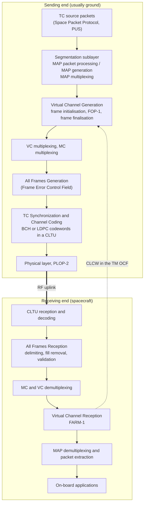
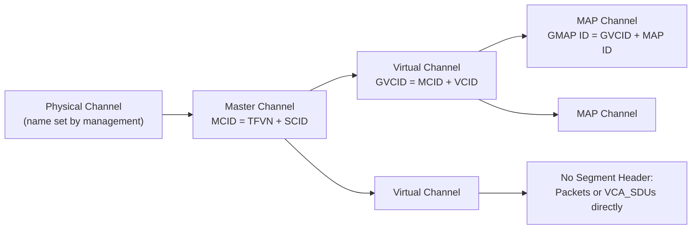
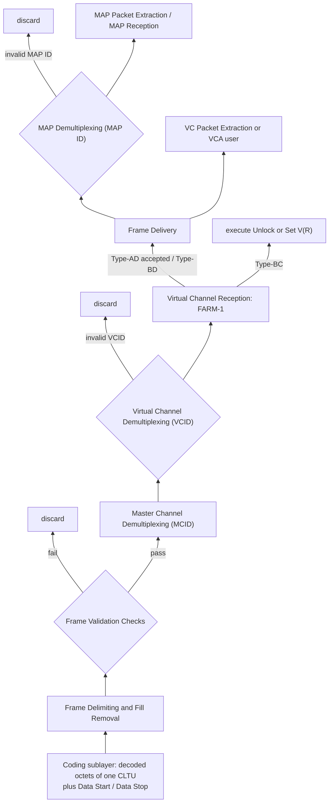

# TC Space Data Link Protocol (CCSDS 232.0-B-4)

The **TC Space Data Link Protocol** (TC-SDLP) is the CCSDS data link layer protocol for the forward
link: it carries telecommands and other data from a ground station (or another spacecraft) to a
spacecraft. Its protocol data unit is the variable-length **TC Transfer Frame**. In the uplink chain it
sits below the network-layer [Space Packet Protocol](space-packet.md) and above
[TC synchronization and channel coding](tc-coding-cltu.md), which wraps each frame into a
[CLTU](tc-coding-cltu.md) for radiation. Its retransmission engine, [COP-1](cop-1.md), turns a noisy radio
link into an in-order, gap-free and duplicate-free command channel, and its optional
[SDLS](sdls.md) interface adds authentication and encryption.[^sdlp-purpose][^sdlp-arch]

This page follows issue 4 of the Blue Book (October 2021, including Technical Corrigendum 1 of October
2023), the CCSDS overview Green Book on space data link protocols, the ECSS adoption notice
ECSS-E-AS-50-25C Rev.1, the superseded ECSS standard ECSS-E-ST-50-04C (31 July 2008) that it replaced,
the ECSS communications handbook, and the real Solar Orbiter TM/TC ICD and
[MIB](../mib/index.md).[^sdlp-cover][^an-scope][^e5004-cover]

| Issue | Date | Notes from the document control page |
|---|---|---|
| 232.0-B-1 | September 2003 | Original issue |
| 232.0-B-2 | September 2010 | Issue 2 |
| 232.0-B-3 | September 2015 | Issue 3 |
| 232.0-B-4 | October 2021 | Corrections and clarifications; new normative annex A, the Protocol Implementation Conformance Statement (PICS) proforma |
| Cor. 1 | October 2023 | Expands the discussion of the order of processing between TC, COP-1 and SDLS (§6.5.2) |
| EC 1 | October 2024 | Editorial: a callout in table 6-1, figure 6-3 typography, annex A layout, change bars, A4 page size |

Document history restated from the front matter of the copy in this wiki's library.[^sdlp-history]

!!! info "TC-SDLP at a glance"
    | Item | Value |
    |---|---|
    | Layer | Data Link Protocol Sublayer of the data link layer |
    | Protocol data units | TC Transfer Frame (forward) and CLCW (return, a report) |
    | Frame length | Variable, 6 to 1024 octets (8 to 1024 with the Frame Error Control Field) |
    | Primary header | 5 octets: version, bypass flag, control command flag, spare, SCID, VCID, length, sequence number |
    | Multiplexing levels | Master Channel (SCID), Virtual Channel (VCID, 64 per master channel), MAP channel (MAP ID, 64 per VC) |
    | Reliability | Type-A (sequence-controlled, go-back-n ARQ by COP-1) and Type-B (expedited, sent once) |
    | Error detection | Optional 16-bit CRC (mandatory in the ECSS adoption) plus the coding sublayer below |
    | Security | Optional SDLS Security Header and Trailer |

    Sources: frame structure, header and services of CCSDS 232.0-B-4; minimum lengths from the ECSS
    handbook.[^sdlp-frame][^sdlp-ph][^hb-diff4]

## Where TC-SDLP sits

CCSDS divides the data link layer into two sublayers. TC-SDLP is the *Data Link Protocol Sublayer* and
provides framing, multiplexing, segmentation and retransmission. The *Synchronization and Channel
Coding Sublayer* below it provides error-correcting coding, delimiting of codewords and optional bit
transition generation; for TC-SDLP that sublayer must be CCSDS 231.0 ([TC coding and the
CLTU](tc-coding-cltu.md)).[^sdlp-arch] TC frames have variable length so that short messages can be received
with little delay, which is the opposite choice from the fixed-length [TM](tm-sdlp.md) and [AOS](aos.md)
frames used on the return link.[^gb-frames]

The functional split follows figures 2-3, 2-4 and 6-3 of the Blue Book; the drawing is this wiki's
condensed view.[^sdlp-org][^sdlp-sdls-order]

The protocol has three duties: segmentation and blocking of user data units, transmission control (the
retransmission performed by the [Communications Operation Procedure](cop-1.md)) and sharing of one
physical channel among many users through virtual channels and MAPs. Splitting large data units into
small pieces improves throughput on a noisy link because only small pieces have to be resent; blocking
does the opposite for very small units.[^sdlp-features] The protocol does not establish or release
connections, and it does not manage or configure SDLS.[^sdlp-functions]

## Addressing: master, virtual and MAP channels

Three identifiers in the frame header address a frame: the Transfer Frame Version Number (TFVN), the
Spacecraft Identifier (SCID) and the Virtual Channel Identifier (VCID). Their concatenations define
nested channels:[^sdlp-addr]

| Identifier | Composition | Identifies | Notes |
|---|---|---|---|
| MCID (Master Channel Identifier) | TFVN + SCID | A Master Channel | Usually one master channel per physical channel |
| GVCID (Global Virtual Channel Identifier) | MCID + VCID | A Virtual Channel | A VC is the set of frames with the same GVCID |
| GMAP ID (Global MAP Identifier) | GVCID + MAP ID | A MAP Channel | Only if the optional Segment Header is used |
| Physical Channel Name | Set by management | A physical channel | Not carried in any header |

All frames with the same MCID on a physical channel form a Master Channel. A physical channel may carry
several master channels if they share the same TFVN.[^sdlp-addr] The *Multiplexer Access Point
Identifier* (MAP ID) in the optional Segment Header subdivides one virtual channel into up to 64 MAP
channels.[^sdlp-addr2] The CCSDS overview report explains why two levels exist: virtual channels let one
physical channel carry streams with different priority and latency, and MAPs do the same inside one
virtual channel and also provide segmentation of data units that are longer than a frame.[^gb-prio][^gb-map]

Diagram after the channel relationships of §2.1.3 and the channel tree of figure 2-5.[^sdlp-addr2][^sdlp-tree]

## Service types: Type-A and Type-B

Every data transfer service (except the two frame services) offers two **service types**, chosen per
service data unit in the request primitive:[^sdlp-stypes]

* **Sequence-Controlled Service (Type-A)**. An Automatic Repeat reQuest (ARQ) procedure of the
  go-back-n type, with sequence control at both ends and a standard report (the CLCW) returned by the
  receiver. With high probability no data unit is lost, duplicated or delivered out of order. The
  guarantee holds per virtual channel and per MAP: data units sent on different virtual channels, or on
  different MAPs of one virtual channel, can arrive in a different order from the one in which they were
  submitted.[^sdlp-typea]
* **Expedited Service (Type-B)**. Each data unit is sent once, without retransmission, and delivery is
  not guaranteed. It is meant for exceptional situations such as spacecraft recovery, or for use under a
  higher-layer protocol that retransmits by itself. Despite its name it is neither a faster nor a
  required way to send urgent data; if a reliable Type-A service is available it should be
  used.[^sdlp-typeb]

The CCSDS overview report adds the operational view: COP-1 works well near Earth, where the round trip
is short, but in deep space the sender waits a long time with an idle uplink before any automatic
retransmission; systematic retransmission in the coding sublayer, a shorter COP-1 timer, or a
higher-layer protocol can help.[^gb-rel][^gb-deep] The Type-B service is also the tool for blind commanding when
no telemetry is available.[^gb-blind] ECSS-E-ST-50C requires a service that guarantees in-sequence
delivery of telecommands, commanding in the blind, and a probability of accepting an erroneous
telecommand below 10⁻² divided by the number of telecommands expected in the mission.[^e50-tc]

!!! warning "Mixing Type-A and Type-B on one MAP"
    Some receivers do not distinguish Type-A from Type-B data at the receiving end. If both are used at
    the same time on one MAP channel, frames of a Type-B data unit can interleave with the segments of a
    Type-A data unit and prevent its reassembly. For such implementations the sending end should end any
    Type-A transfer before starting a Type-B transfer on the same virtual channel.[^sdlp-mix]

## Services and primitives

TC-SDLP provides six data transfer services and one management service. Two work on a MAP channel,
three on a virtual channel, one on a master channel; the COP Management Service controls COP-1 of one
virtual channel.[^sdlp-services]

| Service | Service data unit | Service types | SAP address | SDLS | Primitives |
|---|---|---|---|---|---|
| MAP Packet (MAPP) | Packet with a CCSDS-authorised Packet Version Number | A and B | GMAP ID + PVN | All features | `MAPP.request`, `MAPP_Notify.indication`, `MAPP.indication` |
| Virtual Channel Packet (VCP) | Packet | A and B | GVCID + PVN | All | `VCP.request`, `VCP_Notify.indication`, `VCP.indication` |
| MAP Access (MAPA) | MAP_SDU (private format, any length) | A and B | GMAP ID | All | `MAPA.request`, `MAPA_Notify.indication`, `MAPA.indication` |
| Virtual Channel Access (VCA) | VCA_SDU (private format, fits one frame) | A and B | GVCID | All | `VCA.request`, `VCA_Notify.indication`, `VCA.indication` |
| Virtual Channel Frame (VCF) | Partially formatted TC Transfer Frame | Not applicable | GVCID | None | `VCF.request`, `VCF.indication` |
| Master Channel Frame (MCF) | Partially formatted TC Transfer Frame | Not applicable | MCID | None | `MCF.request`, `MCF.indication` |
| COP Management | Directives | Not applicable | GVCID | Not applicable | `Directive.request`, `Directive_Notify.indication`, `Async_Notify.indication` |

Table restated from table 2-1 and the primitive lists of §3.3 to §3.9.[^sdlp-services][^sdlp-prims]

* **MAPP and VCP** carry packets. A user is identified by its PVN plus GMAP ID (or GVCID); packets of
  different versions can share a channel and are multiplexed into one stream. If the provider blocks
  several packets into one frame, it must know where the length field of each packet is, so that the
  receiver can cut them apart again.[^sdlp-mapp][^sdlp-packet]
* **MAPA** carries privately formatted data units whose length is not limited by the frame size,
  because the MAP generation function segments them. **VCA** carries privately formatted units that must
  each fit into one frame data field. Only one user may use either service on a channel.[^sdlp-mapa][^sdlp-sdu]
* **VCF and MCF** let an independent, certified entity hand over frames that it built itself; the
  provider fills in what is missing. The Frame Error Control Field of such frames is empty when submitted,
  and the provider does not distinguish service types: the user has to provide Type-A or Type-B behaviour
  itself.[^sdlp-vcf][^sdlp-frame-sdu]
* **COP Management** lets an authorised user drive [FOP-1](cop-1.md) with directives. Most directives
  only change the internal state of FOP-1; two of them generate Type-BC frames carrying the control
  commands Unlock and Set V(R).[^sdlp-copmgmt][^sdlp-directive]

The request primitives carry the data unit, its address, a user-supplied **SDU ID** (echoed in later
notifications) and the **Service Type**. Notifications report a **Notification Type** whose values are
defined in COP-1. At the receiving end, packet services may add a **Packet Quality Indicator** (complete
or partial packet), and, with SDLS, a **Verification Status Code** where a non-zero value means the
security protocol detected an error in a frame addressed to the channel.[^sdlp-params]

The Blue Book restricts which services may coexist:[^sdlp-restrict]

1. If the MCF service exists on a master channel, no other data transfer service may exist on it.
2. If the VCF, VCA or VCP service exists on a virtual channel, no other data transfer service may exist on that virtual channel.
3. On one MAP channel, the MAPA and MAPP services are mutually exclusive.
4. The COP Management Service may not coexist with the VCF service on the same virtual channel, nor with the MCF service.

## The TC Transfer Frame

A TC Transfer Frame consists of a mandatory 5-octet primary header, a mandatory data field of up to 1019
octets (1017 if the Frame Error Control Field is present) and an optional 2-octet Frame Error Control
Field (FECF). An implementation may support a lower maximum on a particular virtual
channel.[^sdlp-frame] Because the frame length is variable, the header has to carry it; on the
fixed-length TM frame this is not needed.[^hb-tcframe]

### Transfer Frame Primary Header

The primary header has eight fields in a fixed order and length:[^sdlp-ph]

| Field | Bits (position) | Values | Meaning and rationale |
|---|---|---|---|
| Transfer Frame Version Number | 2 (0–1) | `0b00` | Identifies the TC Version 1 asynchronous frame defined by this standard.[^sdlp-tfvn] |
| Bypass Flag | 1 (2) | `0`, `1` | `0`: Type-A frame, subject to the normal Frame Acceptance Checks of the FARM. `1`: Type-B frame, acceptance checks bypassed. Frame Validation Checks apply in both cases.[^sdlp-bypass] |
| Control Command Flag | 1 (3) | `0`, `1` | `0`: the data field holds a Frame Data Unit (Type-D, "data"). `1`: it holds control information used to configure the FARM (Type-C).[^sdlp-ccflag] |
| Reserved Spare | 2 (4–5) | `0b00` | Reserved for future use.[^sdlp-spare] |
| Spacecraft Identifier | 10 (6–15) | 0–1023 | Assigned by the CCSDS Secretariat; identifies the spacecraft the data belongs to and does not change between mission phases.[^sdlp-scid] |
| Virtual Channel Identifier | 6 (16–21) | 0–63 | Identifies the virtual channel. No numbering rule: VCs need not be consecutive.[^sdlp-vcid] |
| Frame Length | 10 (22–31) | 0–1023 | Length count C = total octets in the frame − 1, from the first header bit to the last bit of the FECF (or of the data field if there is no FECF). Caps a frame at 1024 octets.[^sdlp-flen] |
| Frame Sequence Number N(S) | 8 (32–39) | 0–255 | Assigned by COP-1; lets the FARM check the order of Type-A frames. Maintained separately per virtual channel. COP-1 sets it to all zeros in Type-B frames.[^sdlp-fsn] |

The two flags combine into the three frame types that COP-1 knows:[^sdlp-types]

| Bypass | Control Command | Frame type | Data field | Use |
|---|---|---|---|---|
| 0 | 0 | **Type-AD** | Frame Data Unit, Frame Acceptance Checks applied | Sequence-Controlled (AD) Service |
| 0 | 1 | — | — | Reserved for future application |
| 1 | 0 | **Type-BD** | Frame Data Unit, acceptance checks bypassed | Expedited (BD) Service |
| 1 | 1 | **Type-BC** | Control command, acceptance checks bypassed | Controls the Sequence-Controlled Service |

!!! example "Reading a header: Green Book example 1 (real bytes from the source)"
    The CCSDS TC coding Green Book gives the Unlock frame `30 1B 00 07 00 00 4C A9` for spacecraft
    `0x1B`, virtual channel 0.[^gb-ex1] The first five octets decode as:

    | Octets | Bits | Field | Value |
    |---|---|---|---|
    | `30` | `00 1 1 00 00` | Version, Bypass, Ctrl Cmd, Spare, SCID bits 6–7 | Version 0, Type-BC frame |
    | `30 1B` | `..00 0001 1011` | Spacecraft ID (10 bits) | `0x01B` = 27 |
    | `00 07` | `000000 0000000111` | VCID (6 bits), Frame Length (10 bits) | VC 0, C = 7, so 8 octets |
    | `00` | `00000000` | Frame Sequence Number | 0, as for every Type-B frame |

    The remaining octets are the data field `00` (the Unlock command) and the FECF `4C A9`. The field
    split is this wiki's reading of the published bytes.

### Transfer Frame Data Field and Frame Data Units

The data field follows the header without a gap, contains a whole number of octets, and holds either one
**Frame Data Unit** (FDU, Type-D frames) or control command information (Type-C frames).[^sdlp-tfdf] An FDU
is either plain user data or a **Segment Header** followed by user data; an FDU with a Segment Header is
called a *Segment*.[^sdlp-fdu][^sdlp-seg-req]

| Virtual channel configuration | The user data of one FDU may be |
|---|---|
| With Segment Header (MAPs in use) | one complete packet, several packets, part of a packet, one complete MAP_SDU, part of a MAP_SDU |
| Without Segment Header | one complete packet, several packets, one complete VCA_SDU |

The Segment Header is required on any virtual channel that has more than one MAP, or that carries data
units longer than one frame can hold. Otherwise it is optional, but once used on a virtual channel it
must appear in every frame carrying an FDU on that channel. Its presence is a managed parameter of the
virtual channel, and it never appears in frames carrying control commands.[^sdlp-seg-req][^sdlp-seghdr]

### Segment Header and MAP channels

| Sequence Flags (bit 0, bit 1) | Meaning |
|---|---|
| `0b01` | First portion of a service data unit on one MAP |
| `0b00` | Continuing portion of a service data unit on one MAP |
| `0b10` | Last portion of a service data unit on one MAP |
| `0b11` | No segmentation: one complete service data unit, or several complete packets |

The Sequence Flags give the position of the segment's user data inside the original data unit. The
6-bit MAP ID (bits 2–7) names the MAP channel; if a virtual channel uses the Segment Header but not
several MAPs, the MAP ID is set to a constant. There is no numbering rule for MAP IDs.[^sdlp-seqflags]
The ECSS handbook stresses that the flags carry no sequence count, so reassembly assumes that segments
arrive in order and without gaps, and recommends the sequence-controlled service for any MAP that uses
segmentation.[^hb-seg]

!!! example "A segment carrying one packet (real bytes from the source)"
    Green Book example 12 is a Type-AD frame (SCID `0x1B`, VC 0, N(S) = 0) with the 11-octet data field
    `C0 10 00 C0 00 00 03 2E AF 8A 06`.[^gb-ex12] In this wiki's reading, `C0` = `0b11 000000` is a
    Segment Header (no segmentation, MAP 0) and the following ten octets are a Space Packet: primary
    header `10 00 C0 00 00 03` (version 0, telecommand, APID 0, standalone, data length field 3 so four
    data octets) and data `2E AF 8A 06`.

## Control commands: Unlock and Set V(R)

Type-BC frames carry one of two control commands. Their effect on the FARM is specified by
[COP-1](cop-1.md):[^sdlp-cc]

* **Unlock** (`0x00`) takes the FARM of a virtual channel out of Lockout and clears its Wait and
  Retransmit flags; it does not change V(R).
* **Set V(R)** (`0x82 0x00 nn`) sets the FARM's expected sequence number V(R) to `nn`. The value should
  be the N(S) that the sender will put into its next Type-A frame on that virtual channel.

All other bit patterns are reserved by CCSDS.[^sdlp-cc][^cop-farm] The full FARM behaviour on each command, including
the rule that Set V(R) is ignored (but counted) while the FARM is locked out, is on the [COP-1](cop-1.md)
page.

!!! example "The control commands in the real Solar Orbiter MIB"
    The Solar Orbiter MIB defines both control frames as commands with `CCF_CTYPE = F` ("control frame",
    a BC frame) and the special header `NO_HDR`, so their `cdf` entries describe the frame data field
    instead of a packet:[^icd-ctype][^mib-bc]

    | Command | Description (`CCF_DESCR`) | Elements (`cdf`) | Resulting data field |
    |---|---|---|---|
    | [`UNLOCK`](../explorer/index.md#/solo/command/UNLOCK) | FARM UNLOCK directive | fixed area, 8 bits, value `0` | `00` |
    | [`SETVR`](../explorer/index.md#/solo/command/SETVR) | SETV( R ) Directive | fixed area, 16 bits, value `8200`; editable parameter `VR`, 8 bits, default 0 | `82 00 nn` |

    Fixed-area values in `CDF_VALUE` are hexadecimal, so `8200` is exactly the Set V(R) code.[^icd-cdfval]
    Both commands are flagged `CCF_HIPRI = Y` with no MAP ID. The SCOS-2000 ICD strongly recommends
    attaching BC-frame commands to a global interlock on at least the second uplink verification stage,
    so that no further commands leave the ground before AD mode is set up; in this release both have
    `CCF_ILSCOPE = N` (no interlock), and `CCF_ILSTAGE = N`, which is not one of the stage codes (R, U,
    O, A, C) that issue 7.0 of the ICD lists. Whether interlocking is handled elsewhere in the Solar
    Orbiter control system is not stated in the available sources.[^icd-ctype][^icd-il][^mib-bc] See [Commanding in the MIB](../mib/commanding.md)
    for the full `ccf` and `cdf` description.

## Frame Error Control Field

The optional FECF occupies the two octets after the data field. Its presence is set by management for
the whole physical channel: if present, it is in every frame of that physical channel throughout a
mission phase. It detects errors introduced during transmission and data handling; whether to use it
depends on the required data quality and on the coding options chosen below.[^sdlp-fecf]

The field is a systematic (n, n−16) cyclic redundancy code computed over the whole frame except the FECF
itself:[^sdlp-fecf-enc]

$$\text{FECF} = \left[X^{16}\,M(X) + X^{(n-16)}\,L(X)\right] \bmod G(X), \qquad G(X) = X^{16} + X^{12} + X^{5} + 1, \qquad L(X) = \sum_{i=0}^{15} X^i$$

M(X) is the frame without the FECF, most significant (first transmitted) bit first, and the L(X) term
presets the shift register to all ones before encoding. At the receiver the syndrome
$S(X) = [X^{16}C^*(X) + X^{n}L(X)] \bmod G(X)$ over the whole received frame is zero when no error is
detected.[^sdlp-fecf-enc][^sdlp-fecf-dec] The TC coding Green Book notes that the same CRC code is used
in other CCSDS frames.[^gb-fecf]

!!! tip "Implementation in a few lines (illustrative)"
    A byte-wise implementation is: start with `crc = 0xFFFF`; for each octet `b`, `crc ^= b << 8`, then
    eight times shift left and XOR with `0x1021` whenever the bit shifted out was 1; keep 16 bits.
    This wiki checked that this gives the published FECF values of the Green Book examples, for example
    `4C A9` for `30 1B 00 07 00 00` and `F6 F0` for `30 1B 00 09 00 82 00 00`.[^gb-ex1][^gb-ex2]

The CCSDS overview report recommends the FECF whenever the error detection of the coding sublayer
alone is not enough.[^gb-cop] The TC coding Green Book quantifies it: with the BCH code decoded in
single-error-correction mode and no CRC, the probability of an undetected error in a 10-codeword frame
is about 3.9 × 10⁻¹⁰ at a channel bit error rate of 10⁻⁵, while with the CRC it drops to about
1.2 × 10⁻²⁴.[^gb-ue] The ECSS handbook gives the same reasoning for making the field mandatory in
the European standards, which always use SEC decoding (see
[ECSS adoption](#ecss-adoption-ecss-e-as-50-25c-rev1)).[^hb-diff4]

ECSS-E-ST-50-04C, which already made the FECF part of every TC frame, states what the code guarantees on
an encoded block shorter than 32,768 bits (4096 octets, so any TC frame): every error pattern with an
odd number of bit errors and every pattern of two bit errors is detected, every single burst of 16 bits
or less is detected if no other error occurs in the block, and a random pattern with an even number of
errors (four or more) escapes with a probability of about 2⁻¹⁵, roughly 3 × 10⁻⁵. It also forbids using
the field for error correction, and its informative annex A draws the shift-register encoder and decoder
with all register bits preset to one.[^e5004-fecf][^e5004-crc]

## The CLCW: the report returned to the sender

The second protocol data unit of TC-SDLP is the **Communications Link Control Word** (CLCW), a 32-bit
report from the FARM to the FOP. It is usually carried in the Operational Control Field (OCF) of
[TM](tm-sdlp.md) or [AOS](aos.md) frames on the return link; TC-SDLP does not specify how it is
delivered. Each virtual channel in use has its own CLCW, and some minimum reporting rate is needed for
COP-1 to work.[^sdlp-clcw]

Every field, the meaning of each flag, how the FOP reacts to it and how Solar Orbiter exposes it in its
telemetry are explained on the [COP-1](cop-1.md#the-clcw) page.[^sdlp-clcw]

## Procedures at the sending end

The sending end is organised into eight functions. The upper four form the *Segmentation Sublayer* and
the lower four the *Transfer Sublayer*; a real system need not contain all of them.[^sdlp-org]

| Function | Instance per | What it does |
|---|---|---|
| MAP Packet Processing | MAP channel carrying packets | Segments packets longer than a set length into FDUs, each with a Segment Header; or adds a Segment Header to one packet; if blocking is allowed, puts several complete packets behind one Segment Header. Portions of one packet travel in consecutive frames of the MAP and are never interleaved with other packets of that MAP. Packets of several versions are first merged into one stream.[^sdlp-mappf] |
| MAP Generation | MAP channel carrying MAP_SDUs | Same segmentation rules for private MAP_SDUs; no blocking.[^sdlp-mapgen] |
| MAP Multiplexing | VC with several MAPs | Orders FDUs of the MAPs into one queue. The algorithm (priority, release rate, isochronous needs) is defined by the project, not by CCSDS.[^sdlp-mapmux] |
| VC Packet Processing | VC carrying packets without Segment Header | Builds FDUs holding one or more complete packets; blocking if allowed; no segmentation.[^sdlp-vcpp] |
| Virtual Channel Generation | Virtual channel | The "heart" of the protocol: Frame Initialisation (static header fields), FOP-1 (transmission control, sequence numbers, control commands, directives), Frame Finalisation (fills in the rest, such as N(S)).[^sdlp-vcgen] |
| Virtual Channel Multiplexing | Master channel with several VCs | Multiplexes frames of the VCs and of any VCF users; algorithm set by the project.[^sdlp-vcmux] |
| Master Channel Multiplexing | Physical channel with several MCs | Multiplexes master channels and any MCF users; algorithm set by the project.[^sdlp-mcmux] |
| All Frames Generation | Physical channel | Computes the FECF, groups one or more frames into the data unit given to the coding sublayer, sets the delivery rate, and may request systematic retransmissions.[^sdlp-afg] |

The CCSDS overview report notes one exception to "the project chooses the multiplexing algorithm": when
the SLE [Forward Space Packet](sle/fsp.md) service is used on the ground, the algorithm defined by that service must be
used for virtual and MAP channels.[^gb-prio] How Solar Orbiter uses MAPs and blocking is described
[below](#the-solar-orbiter-profile).

**Blocking and segmentation rules in ECSS-E-ST-50-04C.** The superseded ECSS standard spelled out a few
blocking and segmentation rules in detail. Blocking takes only complete packets, never
reorders them to fill a frame better, may mix packets of different Packet Version Numbers, and must not
put packets for the sequence-controlled and the expedited service into the same data unit; the
implementation may cap the time a packet waits for companions. The deblocking function reads each
packet's version number to find its length field. All segments of one user data unit share the MAP and
the service type, and the segmentation sublayer turns COP-1's per-frame confirmations into one result
per user data unit: Positive Confirm only when every segment was positively confirmed, Negative Confirm
when COP-1 signalled a Negative Confirm for one or more segments.[^e5004-block][^e5004-seg][^e5004-notif]

### Systematic retransmissions

The interface to the coding sublayer, `ChannelAccess.request`, has an optional **Repetitions**
parameter: the coding sublayer sends the same data unit that many times. Management sets one value for
frames carrying Type-A data and one for frames carrying COP control commands (Type-BC) on each virtual
channel, and an upper limit per physical channel. Frames carrying Type-B data (Type-BD) are always sent
with Repetitions = 1.[^sdlp-sysrx][^sdlp-afg] The mechanism targets deep-space links with long light
times; its use and trade-offs are discussed on the [CLTU page](tc-coding-cltu.md#repeated-transmissions).
The reception probability improves most when each data unit holds a single frame.[^sdlp-afg]

## Procedures at the receiving end

The receiving end mirrors the sending end, from the bottom up.[^sdlp-rx-org]

Flow after §4.4 and table 6-1 of the Blue Book; the drawing is this wiki's.[^sdlp-rx-org][^sdlp-sdls-order]

### All Frames Reception: delimiting and fill removal

The coding sublayer delivers the decoded octets of one CLTU, declared clean, together with a *Data
Start* signal that stays true while it transfers octets and goes false (*Data Stop*) when decoding fails
or the channel drops. The first octet after Data Start is the first octet of the first frame, so the
receiver can delimit each frame by reading successive Frame Length fields.[^sdlp-delim] Then:[^sdlp-delim2]

* if the octets received before Data Stop exactly match the Frame Length values, each frame goes on to
  validation;
* if fewer octets arrived than the Frame Length announces, the incomplete frame is discarded;
* if more octets arrived, the surplus is taken as fill added by the coding sublayer to complete the last
  codeword, and is discarded.

The receiving coding sublayer cannot distinguish fill from data, so this protocol must strip it. With BCH
coding there are at most six fill octets. Fewer than five cannot look like a frame header; five or six
could, but the fill pattern `0x55` in a Frame Length position announces a frame longer than the octets
received, so the validation checks reject it.[^sdlp-delim2]

### Frame Validation Checks

Every reconstituted frame, Type-A or Type-B, must pass all of these tests or it is discarded:[^sdlp-fvc]

1. an expected Transfer Frame Version Number;
2. one of the expected MCIDs (version number and spacecraft ID);
3. no header values inconsistent with the features implemented on that spacecraft;
4. a Frame Length consistent with the number of octets present;
5. if the FECF is present, a recomputed CRC equal to the received FECF.

The SCID check matters because several spacecraft with identical RF characteristics may all decode the
same uplink; only the addressed one accepts the frame. Since a corrupted frame can carry a corrupted
SCID, the undetected error rate must be low enough to protect against accepting foreign
data.[^gb-scid]

ECSS-E-ST-50-04C split the same work into three procedures that run in a fixed order on each *candidate
frame*: frame delimiting and fill removal (discard if shorter than the 8-octet minimum or than its Frame
Length, strip any surplus as fill), then the frame error control procedure (discard on a CRC error),
then frame header validation (version `0b00`, a valid Bypass/Control Command combination, the receiving
spacecraft's SCID, a valid VCID, no values inconsistent with the implemented features). Virtual channel
demultiplexing comes after delimiting and before FARM-1, its position relative to the other two being
left to the implementation, and the VCID check may be done there.[^e5004-rxproc][^e5004-delim][^e5004-hdr]
It adds a practical example: when virtual channels serve several telecommand units, demultiplexing can
simply mean that each unit discards the frames not addressed to it.[^e5004-vcmux]

### Demultiplexing, FARM and delivery

The master channel demultiplexer routes by MCID, the virtual channel demultiplexer by VCID (frames with
an invalid VCID are discarded). The Virtual Channel Reception function runs the FARM, which performs the
Frame Acceptance Checks on Type-AD frames, executes control commands from Type-BC frames and produces
the values for the CLCW. FDUs from accepted Type-AD frames are delivered only after passing the
acceptance checks; FDUs from Type-BD frames are delivered immediately.[^sdlp-vcrx][^sdlp-vcdemux]
The MAP demultiplexer routes FDUs by MAP ID and discards invalid ones. The MAP Packet Extraction
function rebuilds packets using the Sequence Flags and, when blocking is allowed, the packet length
fields, and delivers them by PVN; incomplete packets need not be delivered in cross support. The MAP
Reception function rebuilds MAP_SDUs, and VC Packet Extraction splits blocked packets with their length
fields.[^sdlp-mapx][^sdlp-mapdemux][^sdlp-vcpx]

!!! example "Frame analysis on the real Solar Orbiter decoder"
    The Solar Orbiter MIB decodes a status word of each on-board packet telecommand decoder, `PDEC_FARCP`
    (for example `NBC0Z012` *PDEC_FARCP.A.FrameAna* and `NBC0Z013` *PDEC_FARCP.A.IReason*, carried in the
    high-priority telemetry packet SPID [36997](../explorer/index.md#/solo/packet/36997), APID 34). Their
    textual calibrations list the possible outcomes:[^mib-farcp]

    | `FrameAna` (calibration [`CBCX0001TM`](../explorer/index.md#/solo/calib/txt/CBCX0001TM)) | `IReason` (calibration [`CBCX0002TM`](../explorer/index.md#/solo/calib/txt/CBCX0002TM)) |
    |---|---|
    | 0 `ABANDONED_CLTU` | 0 `NO_ILLEGAL_RPT` |
    | 1 `FRM_DIRTY` | 1 `ERROR_VERSION` |
    | 2 `FRM_ILLEGAL_1R` | 2 `ILLEGAL_COMBIN` |
    | 3 `FRM_ILLEGAL_MR` | 3 `WRONG_SC_ID` |
    | 4 `AD_DIS_LOCKOUT` | 4 `VC_ID_MSB_NOK` |
    | 5 `AD_DIS_WAIT` | 5 `VC_ID_LSB_NOK` |
    | 6 `AD_DIS_NS_VR` | 6 `NS_BC_BD_NOT_Z` |
    | 7 `FRM_ACCEPTED` | 7 `BAD_BC_CMD_FMT` |

!!! warning "Inference"
    The `IReason` labels map naturally onto the Frame Validation Checks above: wrong version number,
    the reserved flag combination `0b01`, wrong spacecraft ID, an unexpected VCID, a non-zero N(S) in a
    BC or BD frame (which COP-1 always sets to zero), and a malformed control command. The `FrameAna`
    labels look like FARM outcomes: Type-AD frames discarded because of Lockout, Wait or N(S) ≠ V(R),
    and accepted frames. The decoder documentation that would confirm these meanings is not among the
    available sources.

## Managed parameters

Parameters that change rarely, and whose change means a major reconfiguration, are set by management
instead of being sent in every frame. The Blue Book lists them per channel level; COP-1 parameters are
listed in [COP-1](cop-1.md#managed-parameters).[^sdlp-mp]

**Physical channel**[^sdlp-mp]

| Managed parameter | Allowed values |
|---|---|
| Physical Channel Name | Character string |
| Maximum Transfer Frame Length (octets) | Integer |
| Transfer Frame Version Number | 1 (binary `00`) |
| Valid Spacecraft IDs | Set of integers |
| MC Multiplexing Scheme | Mission specific |
| Presence of Frame Error Control | Present, Absent |
| Maximum number of frames given to the coding sublayer as one data unit | Integer |
| Maximum length of the data unit given to the coding sublayer | Integer |
| Maximum bit rate accepted by the coding sublayer | Real number per second |
| Maximum value of the Repetitions parameter | Integer |

**Master channel**: maximum frame length (integer up to 1024), Spacecraft ID, valid VCIDs (set of
integers 0 to 63), VC multiplexing scheme (mission specific).[^sdlp-mp-mc]

**Virtual channel**[^sdlp-mp-vc]

| Managed parameter | Allowed values |
|---|---|
| Maximum Transfer Frame Length (octets) | Integer up to 1024 |
| Spacecraft ID | Integer |
| VCID | 0 to 63 |
| COP in Effect | 1 |
| CLCW Version Number | 1 |
| CLCW Reporting Rate | Real number per second |
| Presence of Segment Header | Present, Absent |
| Data Field Content (without Segment Header) | Packets, VCA_SDU |
| Valid MAP IDs (with Segment Header) | Set of integers 0 to 63 |
| MAP Multiplexing Scheme (with Segment Header) | Mission specific |
| Blocking (without Segment Header, packets) | Permitted, Prohibited |
| Repetitions for frames carrying Type-A data | Integer |
| Repetitions for frames carrying COP control commands | Integer |

**MAP channel**: maximum FDU length (integer up to 1019), Spacecraft ID, VCID, MAP ID (0 to 63), data
field content (Packets or MAP_SDU), blocking (permitted or prohibited, for packets), segmentation
(permitted or prohibited), maximum MAP_SDU length (if segmentation is permitted).[^sdlp-mp-map]

**Packet transfer** (VC or MAP used by a packet service): valid PVNs, maximum packet length, and whether
incomplete packets must be delivered to the receiving user.[^sdlp-mp-map]

The CCSDS overview report adds that the values are mission specific and that the CCSDS Space Assigned
Numbers Authority (SANA) keeps registries of the parameters and their reserved values.[^gb-mp] The
identifier registries and the SCID assignment procedure are described on
[Space link identifiers](space-link-identifiers.md).

## The SDLS option

A TC-SDLP entity may optionally support the [Space Data Link Security](sdls.md) protocol, which
provides authentication and confidentiality at the data link layer. The choice is made per virtual
channel, or per MAP when Segment Headers are used, through managed parameters; a channel without SDLS
uses exactly the frame format above.[^sdlp-sdls-ov][^sdlp-sdls-feat]

* The primary header and the Segment Header are unchanged; the Segment Header stays outside the
  security envelope, and the Security Header follows it (or the primary header if there is no Segment
  Header).[^sdlp-sdls-hdr]
* The maximum data field length becomes 1024 octets minus the primary header, Security Header, and,
  when present, Segment Header, Security Trailer and FECF.[^sdlp-sdls-df]
* Type-C frames (Unlock, Set V(R)) never carry SDLS fields.[^sdlp-sdls-hdr]
* The FECF follows the Security Trailer, or the data field if there is no trailer.[^sdlp-sdls-fecf]

**Order of processing.** At the sending end the Virtual Channel Generation function runs Frame
Initialisation (leaving room for the security fields), then the SDLS *ApplySecurity* function, then
FOP-1, then Frame Finalisation, which writes the values from ApplySecurity into the header and
trailer.[^sdlp-sdls-tx] At the receiving end FARM-1 runs first, then the SDLS *ProcessSecurity* function
(verify the MAC, decrypt), then delivery. A frame rejected by ProcessSecurity is discarded, and the
Verification Status Code may inform the user; SDLS errors are reported back in a Frame Security Report
carried in the return-link OCF.[^sdlp-sdls-rx][^sdlp-sdls-order][^tm-ocf]

!!! danger "Anti-replay and mixed AD/BD traffic"
    With authentication, a retransmitted Type-AD frame has a lower anti-replay sequence number than a
    Type-BD frame sent in between, so the receiver's anti-replay check rejects the retransmission and
    reports it, wrongly, as a security failure. Mixing Type-AD and Type-BD frames on one SDLS-protected
    virtual channel is therefore not advised, unless BD frames are sent only after all AD frames have
    been accepted. Several virtual channels sharing one SDLS Security Association is not
    supported.[^sdlp-sdls-rx][^sdlp-sdls-sa]

The additional managed parameters are, per virtual channel (without Segment Headers) or per MAP: presence
of the Security Header, presence of the Security Trailer, and the length of each in octets. If the
Security Header is present, SDLS is in use for that channel.[^sdlp-sdls-mp]

## ECSS adoption (ECSS-E-AS-50-25C Rev.1)

ECSS adopts CCSDS 232.0-B-4 through the adoption notice ECSS-E-AS-50-25C Rev.1 (13 January 2023).
Together with ECSS-E-AS-50-24C ([TC coding](tc-coding-cltu.md)) and ECSS-E-AS-50-26C ([COP-1](cop-1.md))
it replaces the earlier ECSS-E-ST-50-04C, whose clauses 5 (segmentation sublayer) and 6 (transfer
sublayer) held an equivalent frame definition.[^an-change][^an-context][^e50-an] The notice changes the
following:[^an-fecf][^an-nbl][^an-tables]

| CCSDS clause | ECSS change |
|---|---|
| 4.1.1 b, c; 4.1.4.1; table 5-1 | The FECF is **mandatory**; the data field maximum is 1017 octets; the FECF presence parameter can only be "Present" |
| 4.1.3.2.1.4 (new note 2) | With the PAC, an FDU may carry a MAP Reset command and then consists of a Segment Header only, with no user data |
| Table 5-4 | Maximum FDU length 1017 octets instead of 1019 |
| 4.2.1.8.3 | The No Bit Lock flag is always used: `0` when at least one spacecraft demodulator of the physical channel has bit lock, `1` when none has; it always reports the actual physical channel state, even in the CLCW of an inactive virtual channel |
| 4.4.1.6, 4.4.2.5, 4.4.9 (new) | Optional **Packet Assembly Controller** (PAC) for reassembly |
| 6.3.7 | With SDLS, the FECF is likewise mandatory |

Annex A of the notice lists further differences from ECSS-E-ST-50-04C that are not requirements: the
formal service interface, the SDLS option, the normative managed parameters (they were informative
"mission configuration parameters" before), and the PICS proforma.[^an-annex] The companion notice for
the coding sublayer, ECSS-E-AS-50-24C Rev.1, keeps one frame per CLTU, so on ECSS links one request to the
coding sublayer carries exactly one TC frame ([details](tc-coding-cltu.md#ecss-lineage-from-ecss-e-st-50-04c-to-ecss-e-as-50-24c)).[^an24-oneframe]

### The superseded ECSS-E-ST-50-04C (2008)

Before the adoption notices, ECSS-E-ST-50-04C *Space data links - Telecommand protocols
synchronization and channel coding* (31 July 2008, after a first issue ECSS-E-50-04A of 14 November
2007) specified the whole TC link in one book: segmentation sublayer (clause 5), transfer sublayer
(clause 6), COP-1 (clause 7), coding sublayer (clause 8) and PLOP (clause 9). Its protocol profile showed
no security sublayer, but allowed a project to insert one through tailoring, and its performance annex
warns that such a sublayer can change the error detection figures.[^e5004-cover][^e5004-log][^e5004-ov][^e5004-perf]
It was the ECSS form of the 2003 CCSDS books 231.0-B-1, 232.0-B-1 and 232.1-B-1, and its annex C lists
where it differed from them within the scope of this page:[^e5004-ccsds]

| Topic | CCSDS (2003 books) | ECSS-E-ST-50-04C |
|---|---|---|
| Layering | Assume the transfer sublayer below the segmentation sublayer (and vice versa) | Makes some assumptions about the sublayer below, without requiring it to be the transfer sublayer |
| Reassembly | No Packet Assembly Controller | Optional PAC, so the minimum TC Segment is one octet instead of two |
| Frames per CLTU | Several allowed | Exactly one |
| FECF | Optional, minimum frame 6 octets | Always present, minimum frame 8 octets |
| No Bit Lock Flag | Optional and mission-specific | Defined and always used |
| Names | Segment, Service Data Unit, User Data | TC Segment, user data unit, Segment Data Field |

Four of these ECSS choices survive as modifications in the adoption notices: the PAC, the mandatory
FECF and the No Bit Lock rule through ECSS-E-AS-50-25C Rev.1, and the single frame per CLTU through
ECSS-E-AS-50-24C Rev.1.[^an-fecf][^an-nbl][^an-tables][^an24-oneframe] Its informative
annex E listed the *mission configuration parameters* whose counterparts are the normative managed
parameters of sections 5 and 6.6 of the CCSDS book: for example the use of TC Segments and the MAP IDs per virtual channel, the blocking,
segmentation and PAC use per MAP, and the valid Packet Version Numbers.[^e5004-mcp][^an-annex]

**The PSS-04-107 roots.** Annex B of ECSS-E-ST-50-04C compares it with ESA's Packet Telecommand Standard
PSS-04-107 (issue 2, April 1992). Within the scope of this page it lists:[^e5004-pss]

* PSS-04-107 used TC Segments on every virtual channel, had no packet blocking, and assumed a transfer
  layer below its *Segmentation Layer*.
* It defined telecommand authentication with an optional *Segment Trailer*; ECSS-E-ST-50-04C left
  authentication out of scope and dropped the trailer (CCSDS now offers [SDLS](#the-sdls-option)).
* Its frames were at most 256 octets: the Frame Length occupied bits 24–31 and bits 22–23 were a
  reserved field. ECSS-E-ST-50-04C widened the field to bits 22–31 and notes that frames built to the
  earlier definition remain valid.[^e5004-flen]
* It specified the older COP-1A; ECSS-E-ST-50-04C specifies COP-1B, which differs only at the sending
  end (see [COP-1](cop-1.md#ecss-adoption-ecss-e-as-50-26c)).
* Field names changed: *Frame Header* became Transfer Frame Primary Header, *Version Number* the
  Transfer Frame Version Number, *Reserved Field A* the Reserved Spare, *Reserved Field B* part of the
  Frame Length, and *Frame Data Field* the Transfer Frame Data Field; "Command" became "Communications"
  in COP-1, CLCW and CLTU.

The history of the PSS standards and their path into CCSDS and ECSS is told on
[From ESA PSS to CCSDS and ECSS](../overview/history.md).

### Packet Assembly Controller and MAP Reset

The PAC, inherited from an older ESA PSS standard, reassembles packets or MAP_SDUs and handles
exceptions.[^hb-diff2] Each PAC instance uses a pair of MAP IDs: the **data MAP** has its most significant bit at
`0` (0 to 31) and the **control MAP** has the same low five bits with the MSB at `1`, so control MAP =
data MAP + 32.[^an-pac][^an-pacmap] The PAC keeps a reassembly status flag and a lockout flag, reports
both (with the data MAP ID) to the sending end in a format the standard does not fix, and enters lockout
when it sees an invalid control segment or one of these illegal Sequence Flag successions:[^an-paclock][^an-pacstatus]

| Previous segment | Followed by | Result |
|---|---|---|
| First `01` | First `01` or Unsegmented `11` | Lockout |
| Continuing `00` | First `01` or Unsegmented `11` | Lockout |
| Last `10` | Continuing `00` or Last `10` | Lockout |
| Unsegmented `11` | Continuing `00` or Last `10` | Lockout |

In lockout the PAC delivers nothing until it receives a **MAP Reset** command: a one-octet *control
segment* consisting only of a Segment Header with Sequence Flags `0b11` and the control MAP ID. On a MAP
Reset the PAC discards any partial data unit, clears the reassembly flag and leaves lockout. It is used,
for example, to recover after link breaks or aborted transfers.[^an-pacreset][^an-ctrlseg]
The ECSS handbook explains the consequences: the minimum segment length becomes one octet instead of two,
each PAC uses up two MAP IDs, European hardware implements the PAC, European missions generally do not
use segmentation, and the one-octet control segment can affect interoperability, for example with the SLE
Forward Space Packet service.[^hb-diff2][^hb-pac]

The adoption notice re-inserts into the CCSDS book what ECSS-E-ST-50-04C §5.5.4 already specified, with
the same MAP pairing, flags, lockout successions, status report and MAP Reset; both texts note that the
name "packet" assembly controller is inherited from earlier standards and that the function serves any
data unit carried in segments. The 2008 text adds a few clarifications that the notice does not repeat:
it reassembles from the Sequence Flags and the segment lengths alone,
without reading any length field inside the user data; its lockout has nothing to do with the FARM-1
Lockout state; it is not used at all when segmentation is off; and no service type (sequence-controlled
or expedited) is prescribed for sending a control segment.[^e5004-pac][^e5004-seg][^an-pac]

!!! example "MAP Reset in the real Solar Orbiter MIB"
    The MIB defines the command [`RESET`](../explorer/index.md#/solo/command/RESET) "PAC RESET directive"
    with `CCF_CTYPE = R` (control segment, "Reset Map Command") and three elements: a 2-bit fixed area
    `3`, a 1-bit fixed area `1` and an editable 5-bit parameter `RESETMAP` with default 1.[^mib-ctrlseg]
    That is exactly a Segment Header `0b11` + `1` + `00001`, the octet `0xE1`: Sequence Flags "no
    segmentation" and control MAP 33, paired with data MAP 1, the MAP of normal Solar Orbiter commands.
    Two other `R` commands, [`REIN_TTR`](../explorer/index.md#/solo/command/REIN_TTR) "Reinit TTR" and
    [`TC_ONLY`](../explorer/index.md#/solo/command/TC_ONLY) "CPDU TC_Only", are one-octet segments with
    MSB `0` and MAP IDs 5 and 6 (octets `0xC5` and `0xC6`).[^mib-ctrlseg]

!!! warning "Inference"
    The octet values are computed by this wiki from the `cdf` bit positions and values. The purpose of
    the MAP 5 and MAP 6 control segments (apparently decoder-specific functions of the Solar Orbiter
    telecommand and telemetry hardware) is not stated in the available sources. The Green Book's
    Type-BD example 15, whose whole data field is `E1`, has the same shape as a MAP Reset for data
    MAP 1.[^gb-ex15]

## The Solar Orbiter profile

The Solar Orbiter TM/TC and Packet Structure ICD (Airbus, SOL.S.ASTR.TN.00079, issue 7) tailors
TC-SDLP as follows:[^tn-frame][^tn-frame2][^e5004-flen]

| Item | Solar Orbiter value | Source rule |
|---|---|---|
| Version number | `0b00` | as CCSDS |
| Bypass / Control Command flags | AD, BD and BC frames; it must be possible to send Type-A and Type-B frames on the same VC | as CCSDS |
| Spacecraft ID | `0x28A` = 650, the same for the flight model, ETB and OBC-DM | assigned CCSDS SCID |
| Virtual channels | Two, one per on-board TC decoder: VC1 = decoder 1 = `0b000001`, VC2 = decoder 2 = `0b000010`, used consistently in the CLCWs | VCs address the two decoders |
| Maximum frame length | 256 octets, so Frame Length bits 22–23 are always `00` (an 8-bit "ESA Frame Length Field") | The PSS-04-107 layout, valid under the 10-bit field ([above](#the-superseded-ecss-e-st-50-04c-2008)) |
| Frame Sequence Number | V(S) for AD frames, `0x00` for BC and BD frames | COP-1 |
| Frame data field | One complete TC segment | Segment Header always present |
| Sequence Flags | Always `0b11`: no packet segmentation | |
| MAP IDs | MAP 0 = "CPDU" (commands for the Command Pulse Distribution Unit), MAP 1 = "Normal" (all other commands); MAPs are not used to address the active central software processor | |
| Blocking | Packet aggregation where possible: several complete packets in one segment, located with their length fields | |

!!! note "Which VCIDs? A wording inconsistency in the ICD"
    The ICD requirement on the TC Virtual Channel ID still says that "the suggested values are Zero and
    One" but then lists VC1 = `0b000001` and VC2 = `0b000010`. Its change record (in which the extracted
    text runs deleted and inserted words together) appears to show that the values were changed from
    VC0/VC1 to VC1/VC2 without updating that sentence; it also contains a note, not present in the
    current requirement text, that called the values provisional until RUAG provided definitive
    ones.[^tn-frame][^tn-vcchange] This reading of the change record is this wiki's. This page uses
    1 and 2, which is also what the MIB expects: its per-VC CLCW monitoring parameters (for example
    [`NYGDA663`](../explorer/index.md#/solo/param/NYGDA663) *VC1 Lockout*) are valid only when the CLCW
    VC Id equals 1 or 2.[^mib-vcid] Avoiding the all-zeros VCID also follows the ECSS handbook, which
    advises against all-zeros and all-ones TC VCIDs because a failed or unpowered decoder can produce
    such CLCWs.[^hb-vcid]

Giving each decoder its own virtual channel matches the example that ECSS-E-ST-50-04C gives of virtual
channel demultiplexing, in which each telecommand unit discards the frames not addressed to it; the
Solar Orbiter ICD says only that the two VCIDs address the two decoders.[^e5004-vcmux][^tn-frame]

The CPDU in the on-board computer can generate command pulses directly from ground telecommands
received on MAP 0 (HPC-1 commands), without the central software, so that vital units can be switched
on or off even when the software is not running.[^tn-seg][^tn-cpdu] This is the data-link half of the
ECSS requirement that essential telecommands be decodable and distributable when all other systems,
including the CDMU, are non-operational.[^e50-ess] In the MIB the 125 CPDU commands
(for example [`ZBC04001`](../explorer/index.md#/solo/command/ZBC04001) "Select PM A EEPROM Image 1")
carry `CCF_HIPRI = Y` and `CCF_MAPID = 0` on APID 44. In the ICD a telecommand APID is a 7-bit
process ID followed by a 4-bit packet category fixed to 12, so 44 is process ID 2, which the APID
plan assigns to the on-board computer hardware for "High Priority TC Functions to CPDU (MAP ID =
0)".[^mib-cpdu][^tn-apidfmt][^tn-apid] In the SCOS-2000 database, `CCF_HIPRI = Y`
means that the MAP ID is forced to the value in `CCF_MAPID`, that the command cannot be time-tagged
on board and that it cannot be blocked with other commands; `CCF_MAPID` is ignored for all other
commands.[^icd-hipri] The same five frame-level commands and 125 CPDU commands are present in the
April 2020 release.[^mib-2020]

!!! warning "Inference"
    Solar Orbiter's maximum TC packet is 6 + 242 = 248 octets.[^tn-len] A 256-octet frame holds
    256 − 5 (header) − 2 (FECF) − 1 (Segment Header) = 248 octets of segment data, so one maximum-size
    packet fills one maximum-size frame exactly. The arithmetic is this wiki's and assumes the FECF is
    present, as ECSS requires; the ICD pages read for this page do not state the FECF use explicitly.

!!! example "A Solar Orbiter Unlock frame (illustrative, computed by this wiki)"
    Using SCID `0x28A`, VC1 and the `UNLOCK` data field from the MIB, the Type-BC frame is
    `32 8A 04 07 00 00 81 C3`: `0b00 1 1 00 1010001010` = `32 8A` (version, Bypass = 1, Control
    Command = 1, spare, SCID), `0b000001 0000000111` = `04 07` (VC1, C = 7, so 8 octets), N(S) `00`,
    data `00`, FECF `81 C3`. The FECF was computed with the algorithm above, which reproduces the
    Green Book examples; these bytes are not captured spacecraft data. The CLTU that carries it is shown
    on the [CLTU page](tc-coding-cltu.md#worked-examples).

## Relationship to other standards

* **[COP-1](cop-1.md)** (CCSDS 232.1-B-2) is the normative specification of FOP-1 and FARM-1; where the
  TC-SDLP text and COP-1 differ, COP-1 prevails.[^sdlp-cop]
* **[TC synchronization and channel coding](tc-coding-cltu.md)** (CCSDS 231.0) must be used below
  TC-SDLP; all frames of a physical channel use the same coding options, chosen so that the probability
  of misidentifying MCID, VCID or MAP ID, and of rejecting frames, stays below mission-specified
  values. One request to that sublayer hands over one or more TC frames, which become one
  CLTU; in ECSS it is always exactly one frame.[^sdlp-lower][^cc-svc][^an24-oneframe] The 2026 corrigendum
  of CCSDS 231.0-B-4 lists changes only to the optional LDPC (128,64) tail sequence (§5.2.4.2), so this
  interface is unchanged.[^cor1-dc]
* **[TM](tm-sdlp.md) and [AOS](aos.md)** frames carry the CLCW back in their OCF. A Type-1 report (type
  flag `0`) in the OCF is a CLCW; a Type-2 report may carry an SDLS Frame Security Report.[^tm-ocf]
* **[USLP](uslp.md)** can also run COP-1 and uses the same coding sublayer.[^cop-scope]
* **[SLE Forward CLTU](sle/fcltu.md)** delivers the CLTUs built from these frames to the ground station;
  the CCSDS services described here may be extended on the ground by SLE services.[^sdlp-common]
* **[PUS](../ecss/pus/packets.md)** telecommand packets are the usual content of TC frames; see
  [ST\[02\] Device access](../ecss/pus/st02-device-access.md) for software-distributed CPDU commands.
* **HDLC** is the obvious terrestrial comparison. The CCSDS overview report explains the difference:
  space data link protocols assume strong coding and synchronization underneath and keep frame formats
  compatible with traditional receiving equipment, while HDLC was designed for nearly error-free wire
  links.[^gb-hdlc]

The end-to-end path of a command, from the SCOS-2000 stack to on-board execution, is described in
[Uplink](../overview/uplink.md) and [Worked example: building a real Solar Orbiter
telecommand](../overview/worked-example-tc.md). Abbreviations are collected in the [glossary](../glossary.md).

[^sdlp-purpose]: [CCSDS 232.0-B-4, TC Space Data Link Protocol](../library/ccsds-232-0-232x0b4e1c1.md), §1.1 "Purpose" and §1.2 "Scope", PDF p. 11.
[^sdlp-arch]: [CCSDS 232.0-B-4](../library/ccsds-232-0-232x0b4e1c1.md), §2.1.1 "Architecture" and figure 2-1, PDF p. 17.
[^sdlp-cover]: [CCSDS 232.0-B-4](../library/ccsds-232-0-232x0b4e1c1.md), cover (Blue Book, October 2021, includes Technical Corrigendum 1 of October 2023), PDF p. 1.
[^sdlp-history]: [CCSDS 232.0-B-4](../library/ccsds-232-0-232x0b4e1c1.md), "Document Control", PDF p. 7.
[^an-scope]: [ECSS-E-AS-50-25C Rev.1](../library/ecss-e-as-50-25c-rev-1-13january2023.md), clause 1 "Scope", PDF p. 5.
[^sdlp-frame]: [CCSDS 232.0-B-4](../library/ccsds-232-0-232x0b4e1c1.md), §4.1.1 "TC Transfer Frame" and figure 4-1, PDF p. 69.
[^sdlp-ph]: [CCSDS 232.0-B-4](../library/ccsds-232-0-232x0b4e1c1.md), §4.1.2.1 and figure 4-2, PDF p. 70.
[^hb-diff4]: [ECSS-E-HB-50A](../library/ecss-e-hb-50a-15november2008.md), §4.7.4.5 "Difference 4", PDF p. 70.
[^gb-frames]: [CCSDS 130.2-G-3, Space Data Link Protocols](../library/ccsds-130-2-130x2g3.md), §4.1.2–4.1.3, PDF p. 32.
[^sdlp-org]: [CCSDS 232.0-B-4](../library/ccsds-232-0-232x0b4e1c1.md), §2.3.2 and figures 2-3, 2-4, PDF pp. 29–30.
[^sdlp-sdls-order]: [CCSDS 232.0-B-4](../library/ccsds-232-0-232x0b4e1c1.md), §6.4.2.2, figure 6-3 and table 6-1, PDF pp. 116–118.
[^sdlp-features]: [CCSDS 232.0-B-4](../library/ccsds-232-0-232x0b4e1c1.md), §2.1.2.1 "Efficient Data Transfer", PDF p. 18.
[^sdlp-functions]: [CCSDS 232.0-B-4](../library/ccsds-232-0-232x0b4e1c1.md), §2.3.1 "General Functions", PDF p. 28.
[^sdlp-addr]: [CCSDS 232.0-B-4](../library/ccsds-232-0-232x0b4e1c1.md), §2.1.3 "Addressing", PDF p. 19.
[^sdlp-addr2]: [CCSDS 232.0-B-4](../library/ccsds-232-0-232x0b4e1c1.md), §2.1.3 (GMAP ID) and figure 2-2, PDF p. 20.
[^gb-prio]: [CCSDS 130.2-G-3](../library/ccsds-130-2-130x2g3.md), §3.2.3 "Priority and Latency", PDF p. 22.
[^gb-map]: [CCSDS 130.2-G-3](../library/ccsds-130-2-130x2g3.md), §4.3.6 "Multiplexer Access Point Identifier", PDF p. 36.
[^sdlp-tree]: [CCSDS 232.0-B-4](../library/ccsds-232-0-232x0b4e1c1.md), §2.3.2 and figure 2-5 "Channel Tree", PDF pp. 30–31.
[^sdlp-stypes]: [CCSDS 232.0-B-4](../library/ccsds-232-0-232x0b4e1c1.md), §2.2.2.1 "Overview" (service types), PDF p. 22.
[^sdlp-typea]: [CCSDS 232.0-B-4](../library/ccsds-232-0-232x0b4e1c1.md), §2.2.2.2 "Sequence-Controlled Service (Type-A Service)", PDF p. 22.
[^sdlp-typeb]: [CCSDS 232.0-B-4](../library/ccsds-232-0-232x0b4e1c1.md), §2.2.2.3 "Expedited Service (Type-B Service)" and its notes, PDF p. 23.
[^gb-rel]: [CCSDS 130.2-G-3](../library/ccsds-130-2-130x2g3.md), §3.2.2.2 "Reliability Provided by TC-SDLP", PDF p. 20.
[^gb-blind]: [CCSDS 130.2-G-3](../library/ccsds-130-2-130x2g3.md), §5.5 "Can COP-1 be applied to blind commanding?", PDF p. 41.
[^gb-deep]: [CCSDS 130.2-G-3](../library/ccsds-130-2-130x2g3.md), §5.4 "Can COP-1 be applied to deep space commanding?" (shorter COP-1 timer, multiple transmissions), PDF p. 41.
[^e50-tc]: [ECSS-E-ST-50C Rev.1](../library/ecss-e-st-50c-rev-1-1march2021.md), §5.4.2, §5.4.3 and §5.4.7, PDF pp. 37–38.
[^sdlp-mix]: [CCSDS 232.0-B-4](../library/ccsds-232-0-232x0b4e1c1.md), §2.2.2.2, note on mixing Type-A and Type-B, PDF p. 23.
[^sdlp-services]: [CCSDS 232.0-B-4](../library/ccsds-232-0-232x0b4e1c1.md), §2.2.3.1 and table 2-1, PDF p. 24.
[^sdlp-prims]: [CCSDS 232.0-B-4](../library/ccsds-232-0-232x0b4e1c1.md), §3.3.3.1, §3.4.3.1, §3.5.3.1, §3.6.3.1, §3.7.3.1, §3.8.3.1 and §3.9.3.1 (lists of primitives), PDF pp. 38, 44, 49, 54, 58, 61 and 65.
[^sdlp-mapp]: [CCSDS 232.0-B-4](../library/ccsds-232-0-232x0b4e1c1.md), §2.2.3.2–2.2.3.3, PDF p. 25.
[^sdlp-packet]: [CCSDS 232.0-B-4](../library/ccsds-232-0-232x0b4e1c1.md), §3.2.2 "Packet", PDF pp. 34–35.
[^sdlp-mapa]: [CCSDS 232.0-B-4](../library/ccsds-232-0-232x0b4e1c1.md), §2.2.3.4–2.2.3.5, PDF pp. 25–26.
[^sdlp-sdu]: [CCSDS 232.0-B-4](../library/ccsds-232-0-232x0b4e1c1.md), §3.2.3–3.2.4 (MAP_SDU, VCA_SDU), PDF p. 35.
[^sdlp-vcf]: [CCSDS 232.0-B-4](../library/ccsds-232-0-232x0b4e1c1.md), §2.2.3.6–2.2.3.7 (VCF and MCF services), PDF pp. 26–27.
[^sdlp-frame-sdu]: [CCSDS 232.0-B-4](../library/ccsds-232-0-232x0b4e1c1.md), §3.2.5 "TC Transfer Frame", PDF p. 35.
[^sdlp-copmgmt]: [CCSDS 232.0-B-4](../library/ccsds-232-0-232x0b4e1c1.md), §2.2.3.8 and §3.9 "COP Management Service", PDF pp. 27 and 64–65.
[^sdlp-directive]: [CCSDS 232.0-B-4](../library/ccsds-232-0-232x0b4e1c1.md), §3.9.3.2 "Directive.request", note, PDF p. 66.
[^sdlp-params]: [CCSDS 232.0-B-4](../library/ccsds-232-0-232x0b4e1c1.md), §3.3.2.6–3.3.2.10 (SDU ID, Service Type, Notification Type, Packet Quality Indicator, Verification Status Code), PDF pp. 37–38.
[^sdlp-restrict]: [CCSDS 232.0-B-4](../library/ccsds-232-0-232x0b4e1c1.md), §2.2.4 "Restrictions on Services", PDF pp. 27–28.
[^hb-tcframe]: [ECSS-E-HB-50A](../library/ecss-e-hb-50a-15november2008.md), §4.7.3.6 "Transfer sublayer" (fields of the TC Transfer Frame), PDF pp. 66–67.
[^sdlp-tfvn]: [CCSDS 232.0-B-4](../library/ccsds-232-0-232x0b4e1c1.md), §4.1.2.2, PDF p. 70.
[^sdlp-bypass]: [CCSDS 232.0-B-4](../library/ccsds-232-0-232x0b4e1c1.md), §4.1.2.3.1 "Bypass Flag", PDF p. 71.
[^sdlp-ccflag]: [CCSDS 232.0-B-4](../library/ccsds-232-0-232x0b4e1c1.md), §4.1.2.3.2 "Control Command Flag", PDF p. 71.
[^sdlp-spare]: [CCSDS 232.0-B-4](../library/ccsds-232-0-232x0b4e1c1.md), §4.1.2.4 "Reserved Spare", PDF p. 72.
[^sdlp-scid]: [CCSDS 232.0-B-4](../library/ccsds-232-0-232x0b4e1c1.md), §4.1.2.5 "Spacecraft Identifier", PDF p. 72.
[^sdlp-vcid]: [CCSDS 232.0-B-4](../library/ccsds-232-0-232x0b4e1c1.md), §4.1.2.6 "Virtual Channel Identifier", PDF p. 73.
[^sdlp-flen]: [CCSDS 232.0-B-4](../library/ccsds-232-0-232x0b4e1c1.md), §4.1.2.7 "Frame Length", PDF p. 73.
[^sdlp-fsn]: [CCSDS 232.0-B-4](../library/ccsds-232-0-232x0b4e1c1.md), §4.1.2.8 "Frame Sequence Number" and notes, PDF p. 73.
[^sdlp-types]: [CCSDS 232.0-B-4](../library/ccsds-232-0-232x0b4e1c1.md), §4.1.2.3.3 and table 4-1, PDF p. 72.
[^gb-ex1]: [CCSDS 230.1-G-3, TC Synchronization and Channel Coding, Summary of Concept and Rationale](../library/ccsds-230-1-230x1g3e1.md), annex F, Example 1 "Type BC Frame with Control Command Unlock", PDF p. 135.
[^gb-ex2]: [CCSDS 230.1-G-3](../library/ccsds-230-1-230x1g3e1.md), annex F, Example 2 "Type BC Frame with Control Command Set V(R)", PDF p. 136.
[^gb-ex12]: [CCSDS 230.1-G-3](../library/ccsds-230-1-230x1g3e1.md), annex F, Example 12 "Type AD Frame for Data on the Sequence-Controlled Service", PDF p. 146.
[^gb-ex15]: [CCSDS 230.1-G-3](../library/ccsds-230-1-230x1g3e1.md), annex F, Example 15 "Type BD Frame for Data on the Expedited Service", PDF p. 149.
[^sdlp-tfdf]: [CCSDS 232.0-B-4](../library/ccsds-232-0-232x0b4e1c1.md), §4.1.3.1, PDF p. 74.
[^sdlp-fdu]: [CCSDS 232.0-B-4](../library/ccsds-232-0-232x0b4e1c1.md), §4.1.3.2.1.1–4.1.3.2.1.3, PDF p. 74.
[^sdlp-seg-req]: [CCSDS 232.0-B-4](../library/ccsds-232-0-232x0b4e1c1.md), §4.1.3.2.1.4 and note, PDF pp. 74–75.
[^sdlp-seghdr]: [CCSDS 232.0-B-4](../library/ccsds-232-0-232x0b4e1c1.md), §4.1.3.2.2.1 and figure 4-3, PDF p. 75.
[^sdlp-seqflags]: [CCSDS 232.0-B-4](../library/ccsds-232-0-232x0b4e1c1.md), §4.1.3.2.2.2–4.1.3.2.2.3 and table 4-2, PDF pp. 75–76.
[^hb-seg]: [ECSS-E-HB-50A](../library/ecss-e-hb-50a-15november2008.md), §4.7.6.1 "Segmentation function of the segmentation sublayer", PDF p. 75.
[^sdlp-cc]: [CCSDS 232.0-B-4](../library/ccsds-232-0-232x0b4e1c1.md), §4.1.3.3 "Control Commands" (Unlock, Set V(R), other bit combinations), PDF pp. 76–77.
[^icd-ctype]: [SCOS-2000 Database Import ICD, issue 7.0](../library/icd-7-0-final.md), §3.3.3.2.1, field CCF_CTYPE, PDF pp. 134–135.
[^icd-il]: [SCOS-2000 Database Import ICD, issue 7.0](../library/icd-7-0-final.md), §3.3.3.2.1, fields CCF_ILSCOPE and CCF_ILSTAGE, PDF pp. 137–138.
[^icd-cdfval]: [SCOS-2000 Database Import ICD, issue 7.0](../library/icd-7-0-final.md), §3.3.3.2.3, fields CDF_INTER and CDF_VALUE, PDF pp. 157–158.
[^mib-bc]: [Solar Orbiter MIB release MIB__20250916M25925PFMS001_SOL](../library/mib-20250916m25925pfms001-sol.md), tables ccf (UNLOCK, SETVR) and cdf; queries by this wiki (see the SQL on the [COP-1](cop-1.md) page).
[^sdlp-fecf]: [CCSDS 232.0-B-4](../library/ccsds-232-0-232x0b4e1c1.md), §4.1.4.1 and notes, PDF p. 77.
[^sdlp-fecf-enc]: [CCSDS 232.0-B-4 Cor. 1](../library/ccsds-232-0-232x0b4e1c1.md), §4.1.4.2 "Frame Error Control Field Encoding Procedure", PDF pp. 77–78.
[^sdlp-fecf-dec]: [CCSDS 232.0-B-4](../library/ccsds-232-0-232x0b4e1c1.md), §4.1.4.3 "Frame Error Control Field Decoding Procedure", PDF p. 79.
[^gb-fecf]: [CCSDS 230.1-G-3](../library/ccsds-230-1-230x1g3e1.md), §8.6.2.3 "Frame Error Control Field", PDF p. 58.
[^gb-cop]: [CCSDS 130.2-G-3](../library/ccsds-130-2-130x2g3.md), §4.4.2.1, PDF p. 37.
[^gb-ue]: [CCSDS 230.1-G-3](../library/ccsds-230-1-230x1g3e1.md), §11.5.3–11.5.4, tables 11-14 and 11-16, PDF pp. 91 and 93.
[^sdlp-clcw]: [CCSDS 232.0-B-4](../library/ccsds-232-0-232x0b4e1c1.md), §4.2.1 "Communications Link Control Word" and figure 4-6, PDF pp. 80–86.
[^sdlp-mappf]: [CCSDS 232.0-B-4](../library/ccsds-232-0-232x0b4e1c1.md), §4.3.1 "MAP Packet Processing Function", PDF pp. 87–88.
[^sdlp-mapgen]: [CCSDS 232.0-B-4](../library/ccsds-232-0-232x0b4e1c1.md), §4.3.2 "MAP Generation Function", PDF p. 89.
[^sdlp-mapmux]: [CCSDS 232.0-B-4](../library/ccsds-232-0-232x0b4e1c1.md), §4.3.3 "MAP Multiplexing Function", PDF p. 90.
[^sdlp-vcpp]: [CCSDS 232.0-B-4](../library/ccsds-232-0-232x0b4e1c1.md), §4.3.4 "VC Packet Processing Function", PDF p. 91.
[^sdlp-vcgen]: [CCSDS 232.0-B-4](../library/ccsds-232-0-232x0b4e1c1.md), §4.3.5 "Virtual Channel Generation Function", PDF pp. 92–93.
[^sdlp-vcmux]: [CCSDS 232.0-B-4](../library/ccsds-232-0-232x0b4e1c1.md), §4.3.6 "Virtual Channel Multiplexing Function", PDF p. 94.
[^sdlp-mcmux]: [CCSDS 232.0-B-4](../library/ccsds-232-0-232x0b4e1c1.md), §4.3.7 "Master Channel Multiplexing Function", PDF pp. 94–95.
[^sdlp-afg]: [CCSDS 232.0-B-4](../library/ccsds-232-0-232x0b4e1c1.md), §4.3.8 "All Frames Generation Function" and notes, PDF pp. 95–96.
[^sdlp-sysrx]: [CCSDS 232.0-B-4](../library/ccsds-232-0-232x0b4e1c1.md), §2.4.2 "Systematic Retransmissions", PDF p. 33.
[^sdlp-rx-org]: [CCSDS 232.0-B-4](../library/ccsds-232-0-232x0b4e1c1.md), §4.4 and figure 4-19, PDF p. 97.
[^sdlp-delim]: [CCSDS 232.0-B-4](../library/ccsds-232-0-232x0b4e1c1.md), §4.4.9.1–4.4.9.2.3 and note on Data Start, PDF pp. 103–104.
[^sdlp-delim2]: [CCSDS 232.0-B-4](../library/ccsds-232-0-232x0b4e1c1.md), §4.4.9.2.4–4.4.9.2.6 and notes 1–3, PDF p. 105.
[^sdlp-fvc]: [CCSDS 232.0-B-4](../library/ccsds-232-0-232x0b4e1c1.md), §4.4.9.3 "Frame Validation Check Procedure", PDF p. 106.
[^gb-scid]: [CCSDS 230.1-G-3](../library/ccsds-230-1-230x1g3e1.md), §8.6.2.4 "Spacecraft Identifier", PDF p. 59.
[^sdlp-vcrx]: [CCSDS 232.0-B-4](../library/ccsds-232-0-232x0b4e1c1.md), §4.4.5–4.4.6 (Virtual Channel Reception, Frame Delivery), PDF pp. 100–101.
[^sdlp-vcdemux]: [CCSDS 232.0-B-4](../library/ccsds-232-0-232x0b4e1c1.md), §4.4.7–4.4.8 (VC and MC demultiplexing), PDF pp. 101–102.
[^sdlp-mapx]: [CCSDS 232.0-B-4](../library/ccsds-232-0-232x0b4e1c1.md), §4.4.1–4.4.2 (MAP Packet Extraction, MAP Reception), PDF pp. 97–98.
[^sdlp-mapdemux]: [CCSDS 232.0-B-4](../library/ccsds-232-0-232x0b4e1c1.md), §4.4.3 "MAP Demultiplexing Function", PDF p. 99.
[^sdlp-vcpx]: [CCSDS 232.0-B-4](../library/ccsds-232-0-232x0b4e1c1.md), §4.4.4 "VC Packet Extraction Function", PDF p. 100.
[^mib-farcp]: [Solar Orbiter MIB release MIB__20250916M25925PFMS001_SOL](../library/mib-20250916m25925pfms001-sol.md), tables pcf (NBC0Z011–NBC0Z019), plf (SPID 36997, octets 34–37), pid and txf/txp (CBCX0001TM, CBCX0002TM); queries by this wiki (see the SQL on the [CLTU](tc-coding-cltu.md) page).
[^sdlp-mp]: [CCSDS 232.0-B-4](../library/ccsds-232-0-232x0b4e1c1.md), §5 notes and §5.1, table 5-1, PDF p. 107.
[^sdlp-mp-mc]: [CCSDS 232.0-B-4](../library/ccsds-232-0-232x0b4e1c1.md), §5.2, table 5-2, PDF p. 108.
[^sdlp-mp-vc]: [CCSDS 232.0-B-4](../library/ccsds-232-0-232x0b4e1c1.md), §5.3, table 5-3, PDF p. 109.
[^sdlp-mp-map]: [CCSDS 232.0-B-4](../library/ccsds-232-0-232x0b4e1c1.md), §5.4–5.5, tables 5-4 and 5-5, PDF p. 110.
[^gb-mp]: [CCSDS 130.2-G-3](../library/ccsds-130-2-130x2g3.md), §5.3 "What are the managed parameters on a CCSDS space data link?", PDF p. 40.
[^sdlp-sdls-ov]: [CCSDS 232.0-B-4](../library/ccsds-232-0-232x0b4e1c1.md), §6.1–6.3.1, PDF p. 111.
[^sdlp-sdls-feat]: [CCSDS 232.0-B-4](../library/ccsds-232-0-232x0b4e1c1.md), §2.1.2.3 "Optional Space Data Link Security Protocol", PDF p. 19.
[^sdlp-sdls-hdr]: [CCSDS 232.0-B-4](../library/ccsds-232-0-232x0b4e1c1.md), §6.3.2–6.3.4 and figures 6-1, 6-2, PDF pp. 112–113.
[^sdlp-sdls-df]: [CCSDS 232.0-B-4](../library/ccsds-232-0-232x0b4e1c1.md), §6.3.5 "Transfer Frame Data Field in a Frame with SDLS", PDF p. 114.
[^sdlp-sdls-fecf]: [CCSDS 232.0-B-4](../library/ccsds-232-0-232x0b4e1c1.md), §6.3.6–6.3.7 (Security Trailer, FECF with SDLS), PDF pp. 114–115.
[^sdlp-sdls-tx]: [CCSDS 232.0-B-4](../library/ccsds-232-0-232x0b4e1c1.md), §6.4.2.1 and §6.4.2.3–6.4.2.6, PDF pp. 115–116.
[^sdlp-sdls-rx]: [CCSDS 232.0-B-4 Cor. 1](../library/ccsds-232-0-232x0b4e1c1.md), §6.5.2.1–6.5.2.2 and note on anti-replay, PDF pp. 120–121.
[^tm-ocf]: [CCSDS 132.0-B-3, TM Space Data Link Protocol](../library/ccsds-132-0-132x0b3.md), §4.1.5 "Operational Control Field", PDF pp. 70–71.
[^sdlp-sdls-sa]: [CCSDS 232.0-B-4](../library/ccsds-232-0-232x0b4e1c1.md), §6.4.7.1 "Discussion", PDF p. 119.
[^sdlp-sdls-mp]: [CCSDS 232.0-B-4](../library/ccsds-232-0-232x0b4e1c1.md), §6.6, tables 6-2 and 6-3, PDF pp. 123–124.
[^an-change]: [ECSS-E-AS-50-25C Rev.1](../library/ecss-e-as-50-25c-rev-1-13january2023.md), change log, PDF p. 3.
[^an-context]: [ECSS-E-AS-50-25C Rev.1](../library/ecss-e-as-50-25c-rev-1-13january2023.md), clause 2 "Context information", PDF p. 6.
[^e50-an]: [ECSS-E-ST-50C Rev.1](../library/ecss-e-st-50c-rev-1-1march2021.md), table of adoption notices and superseded clauses, PDF p. 20.
[^an-fecf]: [ECSS-E-AS-50-25C Rev.1](../library/ecss-e-as-50-25c-rev-1-13january2023.md), table 4-1, rows 4.1.1b, 4.1.1c, 4.1.3.2.1.4 (notes 1 and 2) and 4.1.4.1.1–4.1.4.1.3, PDF pp. 8–9.
[^an-nbl]: [ECSS-E-AS-50-25C Rev.1](../library/ecss-e-as-50-25c-rev-1-13january2023.md), table 4-1, rows 4.2.1.8.3.1–4.2.1.8.3.4, PDF pp. 10–11.
[^an-tables]: [ECSS-E-AS-50-25C Rev.1](../library/ecss-e-as-50-25c-rev-1-13january2023.md), table 4-1, rows 4.4.1.6, 4.4.2.5, 4.4.9, tables 5-1 and 5-4, and 6.3.7, PDF pp. 11, 19 and 20.
[^an-annex]: [ECSS-E-AS-50-25C Rev.1](../library/ecss-e-as-50-25c-rev-1-13january2023.md), annex A "Differences from ECSS-E-ST-50-04C", PDF pp. 21–22.
[^an-pac]: [ECSS-E-AS-50-25C Rev.1](../library/ecss-e-as-50-25c-rev-1-13january2023.md), table 4-1, row 4.4.9.1 "Overview" of the Packet Assembly Controller, PDF p. 12.
[^an-pacmap]: [ECSS-E-AS-50-25C Rev.1](../library/ecss-e-as-50-25c-rev-1-13january2023.md), table 4-1, rows 4.4.9.2.1–4.4.9.2.3, PDF pp. 13–14.
[^an-paclock]: [ECSS-E-AS-50-25C Rev.1](../library/ecss-e-as-50-25c-rev-1-13january2023.md), table 4-1, rows 4.4.9.3.1–4.4.9.3.3 and note on incorrect sequences, PDF pp. 14–15.
[^an-pacstatus]: [ECSS-E-AS-50-25C Rev.1](../library/ecss-e-as-50-25c-rev-1-13january2023.md), table 4-1, rows 4.4.9.3.4–4.4.9.3.7, PDF pp. 16–17.
[^an-pacreset]: [ECSS-E-AS-50-25C Rev.1](../library/ecss-e-as-50-25c-rev-1-13january2023.md), table 4-1, rows 4.4.9.3.8–4.4.9.3.9, PDF pp. 17–18.
[^an-ctrlseg]: [ECSS-E-AS-50-25C Rev.1](../library/ecss-e-as-50-25c-rev-1-13january2023.md), table 4-1, rows 4.4.9.4.1–4.4.9.4.4 "Control segment and MAP Reset command", PDF pp. 18–19.
[^hb-diff2]: [ECSS-E-HB-50A](../library/ecss-e-hb-50a-15november2008.md), §4.7.4.3 "Difference 2", PDF p. 69.
[^hb-pac]: [ECSS-E-HB-50A](../library/ecss-e-hb-50a-15november2008.md), §4.7.3.5 "Segmentation sublayer at the receiving end", PDF p. 65.
[^mib-ctrlseg]: [Solar Orbiter MIB release MIB__20250916M25925PFMS001_SOL](../library/mib-20250916m25925pfms001-sol.md), tables ccf (RESET, REIN_TTR, TC_ONLY) and cdf; queries by this wiki (see the SQL on the [COP-1](cop-1.md) page).
[^tn-frame]: [Solar Orbiter TM-TC and Packet Structure ICD, SOL.S.ASTR.TN.00079 issue 7](../library/sol-s-astr-tn-00079-07.md), §3.4 "Telecommand Frame", PDF pp. 20–22.
[^tn-frame2]: [Solar Orbiter TM-TC and Packet Structure ICD](../library/sol-s-astr-tn-00079-07.md), §3.3 "Telecommand Segments", §3.3.1 "TC Segment Header" and §3.3.2 "TC Segment Data Field", PDF pp. 18–19.
[^tn-seg]: [Solar Orbiter TM-TC and Packet Structure ICD](../library/sol-s-astr-tn-00079-07.md), §3.3.1 (MAP IDs), PDF p. 18.
[^tn-cpdu]: [Solar Orbiter TM-TC and Packet Structure ICD](../library/sol-s-astr-tn-00079-07.md), §3.3.1.1 "CPDU Telecommands", PDF pp. 18–19.
[^e50-ess]: [ECSS-E-ST-50C Rev.1](../library/ecss-e-st-50c-rev-1-1march2021.md), §5.4.4 "Essential telecommand distribution", PDF p. 37.
[^mib-cpdu]: [Solar Orbiter MIB release MIB__20250916M25925PFMS001_SOL](../library/mib-20250916m25925pfms001-sol.md), table ccf (CCF_HIPRI, CCF_MAPID, CCF_APID); queries by this wiki.
[^tn-apid]: [Solar Orbiter TM-TC and Packet Structure ICD](../library/sol-s-astr-tn-00079-07.md), Annex 8 §13.1 "Application Process ID Assignment", PDF p. 272.
[^tn-apidfmt]: [Solar Orbiter TM-TC and Packet Structure ICD](../library/sol-s-astr-tn-00079-07.md), §3.2.1.1 "TC Packet ID" (Process ID and Packet Category fields of the APID), PDF p. 15.
[^tn-vcchange]: [Solar Orbiter TM-TC and Packet Structure ICD](../library/sol-s-astr-tn-00079-07.md), annex change record, entry PUS-155 (section 3.4, Virtual Channel ID, new and old text), PDF p. 296.
[^mib-vcid]: [Solar Orbiter MIB release MIB__20250916M25925PFMS001_SOL](../library/mib-20250916m25925pfms001-sol.md), table pcf (NYGDA658–NYGDA668 and NYGDB658–NYGDB668, PCF_VALID = NYGD0659, PCF_VALPAR = 1 or 2) and txp (CYGT0659TM: 1 = "VC 1", 2 = "VC 2"); queries by this wiki.
[^hb-vcid]: [ECSS-E-HB-50A](../library/ecss-e-hb-50a-15november2008.md), §4.7.6.2 "Virtual channel identifiers", PDF p. 75.
[^icd-hipri]: [SCOS-2000 Database Import ICD, issue 7.0](../library/icd-7-0-final.md), §3.3.3.2.1, fields CCF_HIPRI and CCF_MAPID, PDF p. 139.
[^mib-2020]: [Solar Orbiter MIB release MIB__20200416M10720PFMS001_SOL](../library/mib-20200416m10720pfms001-sol.md), table ccf (CCF_CTYPE F and R, CCF_HIPRI, CCF_MAPID); queries by this wiki.
[^tn-len]: [Solar Orbiter TM-TC and Packet Structure ICD](../library/sol-s-astr-tn-00079-07.md), §3.2.1.3 "TC Packet Length", PDF p. 16.
[^cop-farm]: [CCSDS 232.1-B-2 Cor. 1](../library/ccsds-232-1-232x1b2e2c1.md), §6.3.2.2 "Control Commands" and table 6-1 "FARM-1 State Table", events E7 and E8, PDF pp. 68–70.
[^sdlp-cop]: [CCSDS 232.0-B-4](../library/ccsds-232-0-232x0b4e1c1.md), §2.3.3 "Communications Operation Procedure (COP)" and caution, PDF pp. 31–32.
[^sdlp-lower]: [CCSDS 232.0-B-4](../library/ccsds-232-0-232x0b4e1c1.md), §2.4.1 and §2.4.3, PDF pp. 32–33.
[^cc-svc]: [CCSDS 231.0-B-4, TC Synchronization and Channel Coding](../library/ccsds-231-0-231x0b4e1.md), annex A3 "Service Parameters" and A4.2.4, PDF pp. 46 and 48.
[^cop-scope]: [CCSDS 232.1-B-2 Cor. 1, Communications Operation Procedure-1](../library/ccsds-232-1-232x1b2e2c1.md), §1.3 "Applicability", PDF p. 11.
[^sdlp-common]: [CCSDS 232.0-B-4](../library/ccsds-232-0-232x0b4e1c1.md), §2.2.1 "Common Features of Services" and note, PDF p. 21.
[^gb-hdlc]: [CCSDS 130.2-G-3](../library/ccsds-130-2-130x2g3.md), §5.1 "How do the space data link protocols differ from HDLC?", PDF p. 40.
[^e5004-cover]: [ECSS-E-ST-50-04C, Space data links - Telecommand protocols synchronization and channel coding](../library/ecss-e-st-50-04c31july2008.md), cover and clause 1 "Scope", PDF pp. 1 and 12.
[^e5004-log]: [ECSS-E-ST-50-04C](../library/ecss-e-st-50-04c31july2008.md), change log (ECSS-E-50-04A of 14 November 2007, B never issued, C of 31 July 2008), PDF p. 3.
[^e5004-ov]: [ECSS-E-ST-50-04C](../library/ecss-e-st-50-04c31july2008.md), clause 4 "Overview", §4.1–4.7, including the note on security sublayers in §4.2, PDF pp. 17–20.
[^e5004-perf]: [ECSS-E-ST-50-04C](../library/ecss-e-st-50-04c31july2008.md), annex D §D.1 "Introduction" (added sublayers can change the performance), PDF p. 137.
[^e5004-ccsds]: [ECSS-E-ST-50-04C](../library/ecss-e-st-50-04c31july2008.md), annex C "Differences from CCSDS recommendations", §C.1–C.2 and table C-1, PDF pp. 134–136.
[^e5004-mcp]: [ECSS-E-ST-50-04C](../library/ecss-e-st-50-04c31july2008.md), annex E §E.3–E.5 (mission configuration parameters of a virtual channel, a MAP and packet types), PDF pp. 151–154.
[^e5004-pss]: [ECSS-E-ST-50-04C](../library/ecss-e-st-50-04c31july2008.md), annex B "Changes from ESA-PSS-04-107", §B.2 and tables B-1 and B-2, PDF pp. 131–133.
[^e5004-flen]: [ECSS-E-ST-50-04C](../library/ecss-e-st-50-04c31july2008.md), §6.2.2.8 "Frame Length" and note on the earlier 256-octet definition, PDF p. 41.
[^e5004-block]: [ECSS-E-ST-50-04C](../library/ecss-e-st-50-04c31july2008.md), §5.4 "Blocking of packets", §5.4.1–5.4.6, PDF pp. 26–28.
[^e5004-seg]: [ECSS-E-ST-50-04C](../library/ecss-e-st-50-04c31july2008.md), §5.5.1–5.5.4.1 (segmentation, reassembly and PAC overview), PDF pp. 28–30.
[^e5004-notif]: [ECSS-E-ST-50-04C](../library/ecss-e-st-50-04c31july2008.md), §5.3 "Transfer notification", PDF pp. 24–25.
[^e5004-fecf]: [ECSS-E-ST-50-04C](../library/ecss-e-st-50-04c31july2008.md), §6.2.4 "Frame Error Control Field", §6.2.4.1 notes 1 and 2 and §6.2.4.3 b, PDF pp. 43–44.
[^e5004-crc]: [ECSS-E-ST-50-04C](../library/ecss-e-st-50-04c31july2008.md), annex A "Frame error control", §A.1–A.3 and figures A-1, A-2, PDF pp. 129–130.
[^e5004-rxproc]: [ECSS-E-ST-50-04C](../library/ecss-e-st-50-04c31july2008.md), §6.1.2.3 and table 6-2 "Receiving-end procedures in the transfer sublayer", PDF pp. 36–37.
[^e5004-delim]: [ECSS-E-ST-50-04C](../library/ecss-e-st-50-04c31july2008.md), §6.6 "Frame delimiting and fill removal procedure" and §6.7 "Frame error control procedure at the receiving end", PDF pp. 51–52.
[^e5004-hdr]: [ECSS-E-ST-50-04C](../library/ecss-e-st-50-04c31july2008.md), §6.8 "Frame header validation procedure", PDF pp. 52–53.
[^e5004-vcmux]: [ECSS-E-ST-50-04C](../library/ecss-e-st-50-04c31july2008.md), §6.9.3 "Demultiplexing", PDF p. 54.
[^e5004-pac]: [ECSS-E-ST-50-04C](../library/ecss-e-st-50-04c31july2008.md), §5.5.4 "Packet assembly controller", §5.5.4.1–5.5.4.7, PDF pp. 30–33.
[^an24-oneframe]: [ECSS-E-AS-50-24C Rev.1, Adoption Notice of CCSDS 231.0-B-4](../library/ecss-e-as-50-24c-rev-1-13january2023.md), table 4-1, rows "Note 2 to Transfer Frame definition in 1.6.1.3" and "A3", PDF pp. 8 and 16.
[^cor1-dc]: [CCSDS 231.0-B-4 Cor. 1, TC Synchronization and Channel Coding, Technical Corrigendum 1](../library/ccsds-231-0-231x0b4e1c1.md), "Document Control" (Cor. 1, July 2026: changes to 5.2.4.2), PDF p. 7.
