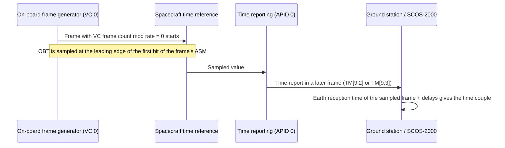
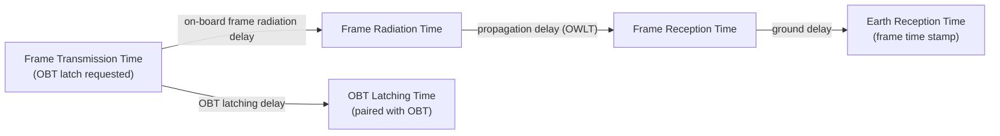
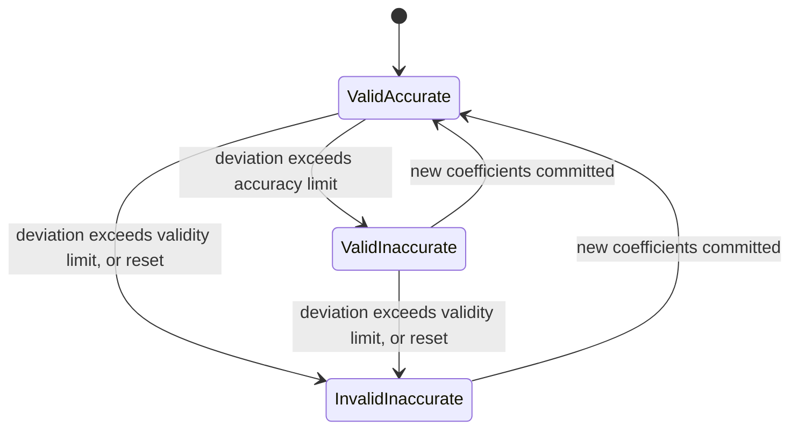

# Time code formats (CCSDS 301.0-B-4)

Every telemetry packet that reaches a control centre carries a time stamp, and many
telecommands carry a time at which something must happen on board. CCSDS 301.0-B-4 defines the
small set of **time codes** used to put those times on the wire. A time code is a digital
representation of time that uses the SI second as its basic unit.[^scope] The standard defines
one **unsegmented** code, the CCSDS Unsegmented time Code (**CUC**), which is a pure binary
count from an epoch. It also defines three **segmented** codes, in which the count is spread over
cascaded counters with different moduli: the CCSDS Day Segmented code (**CDS**), the CCSDS
Calendar Segmented code (**CCS**) and the ASCII calendar codes.[^scope] Agency-defined codes can
also be identified through the same preamble mechanism.[^agency]

This page explains each code bit by bit. It then follows the codes into the rest of the chain:
the [Space Packet](space-packet.md) secondary header, the PUS absolute and relative time
[parameter types](../ecss/pus/parameter-types.md) (PTC 9 and PTC 10), the
[ST[09] time management](../ecss/pus/st09-time-management.md) time reports, the
[SCOS-2000 MIB](../mib/parameter-types.md), and
[SCOS-2000 time correlation](../scos2000/time-correlation.md), which turns on-board time into
UTC. Solar Orbiter is the running example throughout.

!!! info "At a glance"
    | Property | Value |
    |---|---|
    | Document | CCSDS 301.0-B-4, Blue Book, Issue 4, November 2010 (Editorial Change 1, February 2014)[^doc] |
    | Structure of every binary code | optional **P-field** (preamble) + **T-field** (time), each an integral number of octets[^fields] |
    | CUC | binary count of seconds and binary fractions; recommended epoch 1958-01-01 TAI; no leap seconds[^cuc-t] |
    | CDS | day count + milliseconds of day (+ optional µs or ps); UTC based[^cds] |
    | CCS | BCD calendar segments (year, month/day or day of year, h, m, s, decimal fractions); UTC based[^ccs] |
    | ASCII | `YYYY-MM-DDThh:mm:ss.d…dZ` (A) or `YYYY-DDDThh:mm:ss.d…dZ` (B); no P-field[^ascii-a][^ascii-b] |
    | Interpretation levels | Level 1 (fully self-defined) to Level 4 (length only)[^levels] |
    | PUS use | PTC 9 absolute time, PTC 10 relative time, CUC or CDS[^pus-abs][^pus-rel] |
    | Solar Orbiter on-board time | CUC, 4 coarse + 2 fine octets, P-field `0x2E`, zero reference 2000-01-01 00:00[^solo-obt][^solo-a4] |

## Document history

CCSDS first issued the time code formats in January 1987, with Issue 2 in April 1990 and Issue 3 in
January 2002. Issue 4 (November 2010) added a **second P-field octet for CUC** and a new
section on security. Editorial Change 1 (February 2014) corrected an error on page v.[^doc] Older
ESA documents still cite earlier issues: ECSS-E-70-41A (PUS-A, 2003) refers to CCSDS
301.0-B-2.[^pusa-ptc9] ECSS-E-ST-70-41C (PUS-C, 2016) refers to 301.0-B-4.[^pus-abs]

## Concepts

### Preamble field and time field

Every binary CCSDS time code is a **P-field** (time code preamble field) followed by a
**T-field** (time specification field). The P-field identifies the code and its options. The
standard advises including it whenever the receiver may not know which code is in use. Both
fields are always an integral number of octets.[^fields]

The P-field can be **explicit** (sent with the T-field) or **implicit** (not sent). When it is
implicit, the code does not identify itself and the receiver must learn the format "by other
means".[^pfield] In practice those means are a mission constant or a database definition. PUS
calls this the *implicit P-field value*, which must be declared for the mission.[^st9-cuc] In the
SCOS-2000 MIB it is the parameter's PTC/PFC pair.[^icd-ptc9]

### Interpretation levels

CCSDS 301.0-B-4 grades codes by how much a receiver can understand without outside
help:[^levels]

| Level | Name | What is self-defined |
|---|---|---|
| 1 | Complete unambiguous interpretation | structure **and** a CCSDS-recommended epoch, so absolute time can be compared between sources |
| 2 | Partial interpretation | structure only; the epoch comes from an external source, so only relative times can be interpreted |
| 3 | Recognition of increasing time value | only the length; the value increases monotonically except at rollover |
| 4 | No interpretation | only the length |

Table B-2 of the standard summarises which services each level supports: absolute time
interpretation, relative time interpretation and ordering of events from one source.[^services]

| Code | Absolute time | Relative time | Ordering |
|---|---|---|---|
| CUC Level 1, CDS Level 1, CCS Level 1, ASCII | yes | yes | yes |
| CUC Level 2, CDS Level 2 | no | yes | yes |
| Level 3 (agency-defined) | no | no | yes |
| Level 4 (agency-defined) | no | no | no |

### Bit numbering

As in all CCSDS standards, bit 0 is the first bit transmitted and the most significant bit of
any counter. An 8-bit group is called an **octet**.[^bits] The bit-field diagrams on this page
follow that convention.

## The P-field: first octet

When the P-field is explicit, its mandatory first octet has the same overall layout for every
binary code:[^pfield]

<div class="bitfield" data-title="P-field, first octet (all binary codes)" data-width="8" data-caption="CCSDS 301.0-B-4 clause 3.1.1" data-fields='[{"n":"Ext","b":1,"d":"Extension flag: 1 means another P-field octet follows"},{"n":"Time code ID","b":3,"d":"001 CUC L1, 010 CUC L2, 100 CDS, 101 CCS, 110 agency-defined; 000, 011, 111 reserved"},{"n":"Detail bits","b":4,"d":"Code-specific options (lengths, epoch, resolution)"}]'></div>

The **extension flag** (bit 0) shows whether another P-field octet follows. Every extension octet
starts with its own extension flag, so the P-field can be chained: `0` marks the last octet and
`1` means another octet follows.[^pfield] Bits 1 to 3 hold the **time code identification**.
The values `0b000`, `0b011` and `0b111` are reserved for future use.[^pfield] The full
allocation is in table B-3:[^categories]

| Bits 1-3 | Code | Category |
|---|---|---|
| `000` | reserved | - |
| `001` | CUC, 1958-01-01 epoch | Level 1 |
| `010` | CUC, agency-defined epoch | Level 2 |
| `011` | reserved | - |
| `100` | CDS | Level 1 or 2 (epoch bit) |
| `101` | CCS | Level 1 |
| `110` | agency-defined code | Level 3 or 4 |
| `111` | reserved | - |
| none | ASCII | Level 1 (table B-3 lists "Level 1 or 3") |

The ASCII codes have no P-field at all, because the format can be recognised by parsing the
characters.[^pfield][^ascii-p]

## CCSDS Unsegmented time Code (CUC)

### T-field

The CUC T-field is a run of contiguous octets that counts whole **basic time units** from an
epoch. It can be followed by octets that count the elapsed **binary fraction** of the basic unit.
Each octet is 8 bits of one long binary counter that rolls over modulo 256 into its neighbour, and
the code increases monotonically without reversion.[^cuc-t] The integer part is usually called
**coarse time** and the fractional part **fine time**. PUS uses these names.[^pus-abs]

The basic unit intended for correlation with Earth clocks is the second. The unit, the epoch and
the number of coarse and fine octets are metadata. They come from the P-field if the code
identifies itself, and from outside otherwise.[^cuc-t] For a Level 1 code, CCSDS recommends
the epoch **1958 January 1 (TAI)** with the TAI second as unit. Such a code is **not UTC
based, and leap-second corrections do not apply**.[^cuc-t]

With $C_1 \ldots C_n$ the coarse octets (most significant first) and $F_1 \ldots F_m$ the fine
octets, the time since the epoch is:

$$ t = \sum_{i=1}^{n} C_i \cdot 256^{\,n-i} + \sum_{j=1}^{m} F_j \cdot 256^{-j} $$

PUS gives exactly this formula for the full 4+3 octet case (PFC 18).[^pus-abs-tab]

### P-field

<div class="bitfield" data-title="CUC P-field, octet 1" data-width="8" data-caption="CCSDS 301.0-B-4 clause 3.2.2" data-fields='[{"n":"Ext","b":1,"d":"0 = no second octet, 1 = octet 2 follows"},{"n":"Time code ID","b":3,"d":"001 = 1958 epoch (Level 1), 010 = agency-defined epoch (Level 2)"},{"n":"Coarse octets - 1","b":2,"d":"0..3 means 1..4 octets of basic time"},{"n":"Fine octets","b":2,"d":"0..3 octets of fractional time"}]'></div>

<div class="bitfield" data-title="CUC P-field, octet 2 (optional, added in Issue 4)" data-width="8" data-caption="CCSDS 301.0-B-4 clause 3.2.2" data-fields='[{"n":"Ext","b":1,"d":"0 = last P-field octet, 1 = further octet"},{"n":"Add. coarse","b":2,"d":"Additional octets of basic time, added to octet 1"},{"n":"Add. fine","b":3,"d":"Additional octets of fractional time, added to octet 1"},{"n":"Mission","b":2,"d":"Reserved for mission definition"}]'></div>

Octet 1 alone describes 1 to 4 coarse octets and 0 to 3 fine octets. Issue 4 added octet 2,
which adds up to 3 more coarse octets and up to 7 more fine octets.[^cuc-p][^doc] The
combined range is therefore 1 to 7 coarse octets and 0 to 10 fine octets. PUS-C quotes a similar
range: it says CCSDS "offers means" for 1 to 7 coarse and 1 to 10 fine octets, and that PUS itself
implements 1 to 4 coarse and 1 to 10 fine octets.[^pus-abs]

!!! example "Reading CUC P-fields (constructed examples)"
    | P-field | Bits | Meaning |
    |---|---|---|
    | `0x1E` | `0 001 11 10` | CUC Level 1 (1958 TAI epoch), 4 coarse + 2 fine octets |
    | `0x2E` | `0 010 11 10` | CUC Level 2 (agency epoch), 4 coarse + 2 fine octets. Solar Orbiter uses this value (see below). |
    | `0x2F` | `0 010 11 11` | CUC Level 2, 4 coarse + 3 fine octets (the PUS "full CUC") |
    | `0x9E 0x20` | `1 001 11 10`, `0 01 000 00` | CUC Level 1 with octet 2: 4+1 = 5 coarse, 2+0 = 2 fine |

    The bit patterns follow from clause 3.2.2.[^cuc-p] Only `0x2E` is a value documented for a real
    mission.[^solo-a4]

### Resolution and ambiguity period

The ambiguity period is the time between two recurrences of the same code value.[^glossary] For
CUC it is set by the number of coarse octets. The resolution is set by the number of fine
octets. The figures below are this wiki's arithmetic from the counter widths:

| Coarse octets | Rolls over after | | Fine octets | Resolution |
|---|---|---|---|---|
| 1 | 256 s | | 1 | $2^{-8}$ s ≈ 3.9 ms |
| 2 | 65 536 s ≈ 18.2 h | | 2 | $2^{-16}$ s ≈ 15.3 µs |
| 3 | $2^{24}$ s ≈ 194 days | | 3 | $2^{-24}$ s ≈ 59.6 ns |
| 4 | $2^{32}$ s ≈ 136 years | | 4 | $2^{-32}$ s ≈ 0.23 ns |

PUS-A annex C, transcribed from ESA PSS-04-106, describes the classic ESA spacecraft elapsed time
in these terms. It is a CUC with 1 to 4 coarse octets and a resolution of $2^0$, $2^{-8}$,
$2^{-16}$ or $2^{-24}$ s. Its P-field always starts `0b0010` (agency epoch), the unit is the TAI
second, and the epoch is arbitrary because the ground correlates the count to UTC.[^pusa-annexc]

### Why CUC exists

Because CUC is the state of one binary counter with no discontinuities, time differences can be
computed by direct arithmetic. That makes it the natural choice for spacecraft clock
measurement.[^rat-cuc] Its main limitation is the converse: it **cannot represent UTC**, because
UTC jumps at each leap second.[^rat-cds]

## CCSDS Day Segmented time code (CDS)

### T-field

CDS splits time into right-adjusted binary counters:[^cds]

| Segment | Width | Range |
|---|---|---|
| Day | 16 or 24 bits | 0 to $2^{16}-1$ or 0 to $2^{24}-1$ |
| Milliseconds of day | 32 bits | 0 to 86 399 999; 0 to 86 400 999 or 86 398 999 on a leap-second day |
| Submilliseconds (optional) | 16 bits (µs of ms) or 32 bits (ps) | µs of ms: 0 to 999 |

The ranges are those of annex A.[^ranges] The day counter counts from **1958 January 1, starting
at 0**. An agency-defined epoch is allowed as a Level 2 code. Because CDS is **UTC based, leap
seconds must be handled**: a positive leap second makes that day 86 401 seconds long, so the
millisecond counter reaches 86 400 999.[^cds][^ranges]

### P-field

<div class="bitfield" data-title="CDS P-field (one octet)" data-width="8" data-caption="CCSDS 301.0-B-4 clause 3.3.2" data-fields='[{"n":"Ext","b":1,"v":"0"},{"n":"Time code ID","b":3,"v":"100"},{"n":"Epoch","b":1,"d":"0 = 1958 January 1 (Level 1), 1 = agency-defined (Level 2)"},{"n":"Day len","b":1,"d":"0 = 16-bit day segment, 1 = 24-bit day segment"},{"n":"Sub-ms","b":2,"d":"00 none (ms), 01 16-bit (µs), 10 32-bit (ps), 11 reserved"}]'></div>

The submillisecond bits set the resolution: millisecond, microsecond or picosecond.[^cds]
Typical values are `0x40` (16-bit day, no submilliseconds, 1958 epoch) and `0x41` (the same with
microseconds). These two values are constructed from the clause.

### Rationale

Most terrestrial measurements are in UTC, so events on board usually end up time-tagged in UTC.
CDS in its simplest form is just two binary counters. That keeps it convenient for computers, and
the millisecond unit fills 28 of the 32 bits of its segment. CCSDS calls CDS the most "machine
friendly" of the UTC codes. The recommended epoch 1958 January 1 is Julian date 2436203.5, the
epoch of TAI. A 1950 January 1 epoch differs from it by exactly 2922.0 days. The 24-bit day
segment is meant for special uses such as astronomy.[^rat-cds]

!!! example "CDS worked example (illustrative bytes)"
    Encode 2025-09-16T12:00:00.123456 UTC with P-field `0x41` (16-bit day, µs, 1958 epoch):

    | Segment | Value | Octets |
    |---|---|---|
    | Day since 1958-01-01 | 24 730 | `60 9A` |
    | ms of day | 43 200 123 | `02 93 2E 7B` |
    | µs of ms | 456 | `01 C8` |

    T-field: `60 9A 02 93 2E 7B 01 C8` (8 octets). This is the layout PUS calls PTC 9 PFC 2.[^pus-abs-tab]
    The values were computed by this wiki for illustration.

## CCSDS Calendar Segmented time code (CCS)

### T-field

CCS uses **binary coded decimal** (BCD): each 8-bit segment holds two decimal digits. There are
two variations, both Level 1 and both UTC based with leap-second correction:[^ccs]

| Variation | Segments (bits) |
|---|---|
| Month of year / day of month | YR (16), MO (8), DOM (8), h (8), m (8), s (8), then optional $10^{-2}$ s … $10^{-12}$ s (8 each) |
| Day of year | YR (16), DOY (16), h, m, s (8 each), then optional subsecond segments (8 each) |

The year A.D. needs 16 bits (four BCD digits). In the day-of-year variation, the DOY segment is 16
bits because all segments are whole octets, and its four most significant bits are always
zero.[^ccs]

### P-field

<div class="bitfield" data-title="CCS P-field (one octet)" data-width="8" data-caption="CCSDS 301.0-B-4 clause 3.4.2" data-fields='[{"n":"Ext","b":1,"v":"0"},{"n":"Time code ID","b":3,"v":"101"},{"n":"Cal","b":1,"d":"0 = month/day of month, 1 = day of year"},{"n":"Resolution","b":3,"d":"Number of optional subsecond segments: 000 = 1 s, 001 = 10^-2 s, ... 110 = 10^-12 s, 111 not used"}]'></div>

The resolution field gives the number of decimal subsecond segments, from none (1 s) to six
($10^{-12}$ s).[^ccs-p] CCS suits applications in which people often read the code, for example
when time is converted to characters for display. It is less efficient than CDS for
arithmetic.[^rat-ccs]

!!! example "CCS worked example (illustrative bytes)"
    2025-09-16T12:00:00.123456 UTC, month/day variation, microsecond resolution: P-field
    `0b0_101_0_011` = `0x53`, T-field `20 25 09 16 12 00 00 12 34 56`. Each octet reads directly as
    two decimal digits. Constructed by this wiki from clause 3.4.[^ccs][^ccs-p]

## ASCII calendar segmented time codes

The ASCII codes are strings of one-octet ASCII characters. They are UTC based, intended to match
civil time, and use the Gregorian calendar epoch of 1 A.D. on the prime meridian.[^ascii-a]

| Code | Format | Example from the standard |
|---|---|---|
| ASCII Time Code A (month/day) | `YYYY-MM-DDThh:mm:ss.d…dZ` | `1988-01-18T17:20:43.123456Z` |
| ASCII Time Code B (day of year) | `YYYY-DDDThh:mm:ss.d…dZ` | `1988-018T17:20:43.123456Z` |

Subfield ranges are: year 0001 to 9999, month 01 to 12, day of month 01 to 28/29/30/31, day of
year 001 to 365 or 366, hour 00 to 23, minute 00 to 59, second 00 to 59 (58 or 60 during leap
seconds). Any number of decimal fraction digits may follow the period. The `Z` terminator is
optional, and every subfield keeps its leading zeros.[^ascii-a][^ascii-b] Both variations are
subsets of ISO 8601.[^rat-ascii]

The standard also sets rules for **subsets**, so that a calendar-only or time-only string can be
used:[^ascii-sub]

1. The calendar part (left of `T`) and the time part (right of `T`) may be used on their own if
   the context makes the meaning clear. The `T` is then dropped.
2. A subset may be shortened. If subfields are removed on the left, their separators stay. If they
   are removed on the right, their separators go.
3. A subset may not contain a partial subfield. In particular the year is always four digits. Each
   fractional digit counts as a complete subfield.
4. When a calendar subset and a time subset are joined with `T`, the calendar part must not be
   truncated on the right and the time part must not be truncated on the left.
5. Using these formats for anything other than instants in UTC, for example as counters, is
   outside the standard.

For the example date above, code A gives `2025-09-16T12:00:00.123456Z` and code B gives
`2025-259T12:00:00.123456Z` (day 259). These strings were constructed by this wiki. Ground
software uses the ASCII codes wherever a human or a text file is involved. The rationale cites
text editors, exchange of text files between unlike systems, and direct printing.[^rat-ascii]

## Agency-defined codes (Levels 3 and 4)

A code that is not CCSDS-recommended can still carry a P-field with time code identification
`110`. The T-field is then any number of octets, read as one binary number. It is Level 3 if the
number increases monotonically (except at recycle) and Level 4 otherwise.[^agency]

<div class="bitfield" data-title="Agency-defined code P-field (one octet)" data-width="8" data-caption="CCSDS 301.0-B-4 clause 3.6.2" data-fields='[{"n":"Ext","b":1,"v":"0"},{"n":"Time code ID","b":3,"v":"110"},{"n":"T-field length - 1","b":4,"d":"0..15 means 1..16 octets"}]'></div>

Annex E gives the NASA **PB-5J** code as an example. It has a 16-bit truncated Julian day, a
24-bit second of day and optional 16-bit ms, µs and ns segments, followed by an 8-bit ID code.
Fill bits pad each segment to an octet boundary. Its P-field values are `0b0110` followed by the
length codes `0101`, `0111`, `1001` and `1011` for the 6, 8, 10 and 12 octet forms.[^pb5j] The
Truncated Julian Date counts from 1968-05-24.0 (JD 2440000.5).[^glossary-mjd]

## Choosing a code

CCSDS compares the four recommended codes against three criteria: whether they can represent leap
seconds without ambiguity (UTC compatible), whether they are efficient for computers, and whether
people can read them:[^criteria]

| Code | Segmented? | UTC compatible | Computer efficient | Human readable |
|---|---|---|---|---|
| CUC | no | no | yes | no |
| CDS | yes | yes | yes | no |
| CCS | yes | yes | no | yes |
| ASCII | yes | yes | no | yes |

The standard deliberately does not prescribe a code for each application, and it leaves timing
accuracy to the responsible authority.[^applic] Annex B explains why time matters so much: time
is usually the only link between instrument data and independently produced ancillary data
such as orbit and attitude.[^rat-general]

## Time scales and leap seconds

The informative glossary (annex C) takes its definitions from ITU-R TF.686-2.[^glossary]

* **TAI** (International Atomic Time) is kept by the BIPM from atomic clocks. Its epoch was set
  to agree approximately with UT1 on 1 January 1958, and its rate follows the SI second.[^gl-tai]
* **UTC** runs at the same rate as TAI but differs from it by a whole number of seconds. It is
  adjusted by positive or negative **leap seconds** to stay close to UT1.[^glossary]
* **DTAI** = TAI − UTC is the correction to add to UTC to obtain TAI.[^gl-tai]
* The **Modified Julian Date** is JD − 2 400 000.5. The constant 2 436 203.5 gives 1958 January 1,
  the origin of TAI and the epoch of both CUC and CDS.[^glossary-mjd]

Annex D gives the conversion $T_i = U_i + L_i$. Here $T_i$ is TAI, $U_i$ is UTC in seconds and
$L_i$ is the accumulated leap seconds since 1972. Its table runs from $L$ = 10 s (from 1972-01-01)
to $L$ = 34 s (from 2009-01-01).[^taiutc] Later leap seconds are not listed in the available
sources. Differencing two UTC times therefore needs a leap-second table, while differencing two
TAI-based CUC values does not.[^taiutc]

[SCOS-2000 time correlation](../scos2000/time-correlation.md) meets the same issue from another
side. GPS time does not include leap seconds, so a GPS-disciplined on-board clock keeps a known,
growing offset from UTC. The ground monitors that offset as a "synchronisation" status.[^tco-sync]

## Security considerations

Issue 4 added a security section. Time values can be operationally critical, for example the time
of a manoeuvre burn, and an unauthenticated or corrupted time code uploaded to a spacecraft could
change its time basis. The standard places integrity, authentication and confidentiality outside
its scope and expects them from the application, network or data link layers.[^sec] On the data
link, [SDLS](sdls.md) is the CCSDS answer.

## Time codes inside packets

### In the Space Packet secondary header

CCSDS 133.0-B-2 allows the Packet Secondary Header to hold a **Time Code Field**, an Ancillary
Data Field, or both in that order. The Time Code Field must be one of the CCSDS segmented or
unsegmented binary codes, an integral number of octets, and fixed for a managed data path
throughout the mission. The P-field may be omitted if the code's characteristics never change.
If it is present, it immediately precedes the T-field.[^spp-tc] The Packet Sequence Count can be
combined with the time code to order packets over a long mission. The time code then needs
enough resolution to change at least once per sequence-count cycle.[^spp-psc]

### PUS absolute time (PTC 9)

In PUS-C, every packet field that carries an absolute time is of PTC 9. Its value is a positive
number of seconds and fractions from an epoch. With CUC, the epoch is either the CCSDS 1958
epoch or an agency epoch. With an agency epoch the field is in effect a free-running counter
that the ground converts using time correlation coefficients. With CDS, the 1958 epoch is
mandatory.[^pus-abs] The format codes are:[^pus-abs-tab]

| PFC | Format | Length |
|---|---|---|
| 0 | explicit P-field followed by CUC or CDS | variable |
| 1 | CDS, 2-octet day, no µs | 6 octets |
| 2 | CDS, 2-octet day, with µs (day, ms of day, µs of ms) | 8 octets |
| 3 to 18 | CUC, coarse = ⌊(PFC + 1) / 4⌋ octets, fine = (PFC + 1) mod 4 octets; implicit P-field | 1 to 7 octets |
| 19 to 46 | CUC, coarse = ⌊(PFC − 12) / 7⌋ octets, fine = 4 + (PFC − 12) mod 7 octets; implicit P-field | 5 to 14 octets |

The formula for PFC 3 to 18 gives 3 → 1+0, 6 → 1+3, 7 → 2+0, 11 → 3+0, 15 → 4+0, 17 → 4+2 and
18 → 4+3 (coarse+fine octets). The formula for PFC 19 to 46 gives 19 → 1+4, 25 → 1+10, 26 → 2+4
and 46 → 4+10.[^pus-abs-tab] PUS-A (2003) defined only PFC 0 to 18 for absolute time, with the same
formula. Its CUC and CDS references point to CCSDS 301.0-B-2.[^pusa-ptc9]

### PUS relative time (PTC 10)

A relative time (PTC 10) is a signed offset in seconds. It is measured either from an event that
other fields in the packet identify, or between two absolute times. Negative offsets are the two's
complement of the positive value, so the first coarse octet of a positive offset is at most
127.[^pus-rel] PUS-C allows PFC 2 (8-octet CDS layout) and PFC 3 to 18, with the same CUC formula
as for absolute time.[^pus-rel-tab]

!!! warning "PUS-A and PUS-C number relative-time PFCs differently"
    In PUS-A, relative time uses PFC 0 (explicit P-field) and PFC 1 to 16, with coarse =
    ⌊(PFC + 3) / 4⌋ and fine = (PFC + 3) mod 4.[^pusa-ptc9] In PUS-C it uses PFC 3 to 18 with
    coarse = ⌊(PFC + 1) / 4⌋.[^pus-rel-tab] The SCOS-2000 ICD 7.0 lists PTC 10 with PFC 3 and up,
    each with the same coarse/fine split as the PTC 9 entry of the same PFC.[^icd-ptc10] A database
    that mixes both conventions would decode relative times wrongly. For example, the Solar Orbiter
    MIB uses PTC 10 PFC 6, which SCOS-2000 reads as 1 coarse + 3 fine octets (4 octets), while the
    PUS-A formula would give 2 coarse + 1 fine octets (3 octets).[^icd-ptc10][^pusa-ptc9][^mib]

### The time field of the PUS TM secondary header

In PUS-C every TM packet except the spacecraft time packets has a secondary header. Its **time**
field is an absolute time whose PFC is declared with the mission's time service. Each application
process sets it to the time tag of the report, using the on-board reference time.[^tm-sec][^ap-time]
Each process also declares whether it time-tags a report before or after collecting the
parameter values.[^ap-time] If supported, the 4-bit **spacecraft time reference status** reports
the state of the on-board time reference used for the tag. It is 0 when not supported.[^tm-sec2]
The TC secondary header has no time field.[^tc-sec] Telecommand times appear in the application
data instead, for example release times in
[ST[11] time-based scheduling](../ecss/pus/st11-time-based-scheduling.md).[^st11-rel] Full
header layouts are on [PUS packet structures](../ecss/pus/packets.md).

## ST[09] time reports: how the ground learns the on-board time

The [time management service](../ecss/pus/st09-time-management.md) exists so that the ground can
correlate the spacecraft time reference with UTC. With that correlation the ground can
reconstruct the on-board time of every other event the spacecraft reports.[^st9-scope] A time
reporting subservice supports **exactly one** format: CUC (suited to counter-style clocks) or CDS
(suited to clocks synchronised to TAI or UTC).[^st9-scope][^st9-cap]

### Sampling rule

The time reports are generated by the application process with **APID 0**. Each report travels
in a space packet **without a secondary header**, so APID 0 can carry nothing else.[^st9-apid][^st9-pkt]



The subservice samples the time reference for each TM transfer frame on
[virtual channel](tm-sdlp.md) 0 whose virtual channel frame count, modulo the generation rate, is
0. The sample is taken at the leading edge of the first bit of that frame's attached
synchronisation marker. The report's T-field is set to the sampled value. A rate change applies
immediately to the next qualifying frame. PUS-C does not require the time packet to go down in the
frame that triggered it.[^st9-sample][^st9-rate] The rate is $2^n$ frames with $n$ = 0 to 8 (1 to 256
frames). The rate exponential value is changed by **TC[9,1]**.[^st9-rate][^st9-tc1]

### Report layouts

=== "PUS-C (2016)"

    TM[9,2] CUC time report and TM[9,3] CDS time report have the same source data field: an
    optional rate exponential value (unsigned integer), the spacecraft time (absolute time,
    formatted as CUC or CDS, with or without P-field as declared), and an optional spacecraft time
    reference status (deduced).[^st9-tm][^st9-cuc]

=== "PUS-A (2003) / ESA PSS-04-106"

    The time report (9,2) contains an optional 1-octet Rate, the Satellite Time in CUC with
    implicit or explicit P-field, and an optional Status. The implicit P-field is the mission
    constant `<MISSION_TIME_CODE>`.[^pusa-9] Annex C describes the standard time source packet in
    more detail. The first data octet carries the sampling rate in bits 4 to 7, as codes `0000` (1
    frame) to `1000` (256 frames). It is followed by the P-field and T-field, then any
    mission-defined time-system octets.[^pusa-c3] The ground station must time-tag the reception
    of the same attached-sync-marker bit in CDS-coded UTC.[^pusa-c4]

### Solar Orbiter's time packet

Solar Orbiter's time packet has the same S-field, P-field and T-field layout as the PUS-A annex C
standard time source packet.[^pusa-c3][^solo-a4] Its On-Board Computer keeps the OBT, the
spacecraft's **zero time reference is 00:00 on 1 January 2000**, and the OBT is CUC with 4 coarse
and 2 fine octets.[^solo-obt] At power-up the OBT starts from 0. It is then set to real time by
**TC(9,128) Set OBT**, which can load an absolute value or add or subtract a delta.[^solo-obt][^solo-9128]
The time packet has APID 0 and no data field header. Its data field is 8 octets long (packet
length field C = 7).[^solo-a4]

<div class="bitfield" data-title="Solar Orbiter standard spacecraft time source packet, data field (64 bits)" data-width="16" data-caption="SOL.S.ASTR.TN.00079 Annex 4, PUS-3016 to PUS-3022; after the 6-octet primary header with APID 0" data-fields='[{"n":"S-field spare","b":4,"v":"0000","g":"S-field"},{"n":"Rate","b":4,"g":"S-field","d":"Generation frequency of the time packet (2^n VC0 frames)"},{"n":"P-field","b":8,"v":"00101110","g":"P-field","d":"CUC, agency epoch, 4 coarse + 2 fine octets"},{"n":"Coarse time (s)","b":32,"g":"T-field","d":"Unsegmented binary count of seconds"},{"n":"Fine time","b":16,"g":"T-field","d":"Binary fraction of a second (2^-16 s)"}]'></div>

Annex 4 relates the T-field to the leading edge of the first ASM bit of the VC 0 frame "with a
virtual channel frame count of 0".[^solo-a4] This is the same wording as PUS-A annex C. PUS-A
clause 13.2 extends it to every later VC 0 frame whose frame count modulo the generation rate is
0.[^pusa-c4][^pusa-9] The [Solar Orbiter MIB](../missions/solar-orbiter/mib.md)
describes the same packet as SPID 9999 "Time Report": type 9, subtype 2, APID 0, PID_TIME = `Y`,
PID_DFHSIZE = 6. Its [plf](../mib/tables/plf.md) entries place three
[pcf](../mib/tables/pcf.md) parameters at octets 6, 7 and 8:[^mib]

| Offset (octets) | Parameter | Description | PTC/PFC | Calibration |
|---|---|---|---|---|
| 6 | [NCD09021](../explorer/index.md#/solo/param/NCD09021) | OBCHP_Time Rep S-Field | 2/8 | textual [CCDT0043TX](../explorer/index.md#/solo/calib/txt/CCDT0043TX): 0 = EVERY_TMFR … 8 = EVERY_256_TMFR |
| 7 | [NCD09022](../explorer/index.md#/solo/param/NCD09022) | OBCHP_Time Rep P-Field | 3/4 | none |
| 8 | [NCD09023](../explorer/index.md#/solo/param/NCD09023) | OBCHP_OBT | 9/17 | none (PCF_CORR blank, so the ICD default `Y` applies) |

The rate is changed by [ZCD00901](../explorer/index.md#/solo/command/ZCD00901) "Change Time
Report Generation Rate" (TC(9,1)). Its single editable parameter PCD09011 is an 8-bit value
(PTC 2, PFC 8).[^mib][^solo-91] Solar Orbiter also uses private subtypes: TC(9,129) "Accept Time
Synchronisation" and TC(9,130) "Start Time Synchronisation to User". With these, the central
software distributes the OBT of the next synchronisation signal (PPS, MIL-STD-1553 major frame or
SpaceWire time code) to other packet terminals.[^solo-9129]

!!! example "Decoding a Solar Orbiter time packet data field (illustrative bytes)"
    Data field `05 2E 30 5C 0D C0 80 00`:

    1. S-field `0x05`. Bits 4-7 = 5, so the rate is $2^5$ = 32 frames. NCD09021 calibrates it as `EVERY_32_TMFR`.[^mib]
    2. P-field `0x2E` = `0 010 11 10`: CUC, agency epoch, 4 coarse and 2 fine octets.[^solo-a4]
    3. Coarse `0x305C0DC0` = 811 339 200 s. Fine `0x8000` = 0.5 s.
    4. Counted from the 2000-01-01 00:00 zero reference, that is nominally 2025-09-16 12:00:00.5.
       This is **not yet UTC**. The OBT is a free-running count set by TC(9,128), so SCOS-2000 must
       apply its time correlation coefficients to obtain UTC.[^solo-obt][^pus-abs]

    The bytes were chosen by this wiki and are not taken from a real downlink.

## Time codes in the SCOS-2000 MIB

The MIB gives every time parameter a PTC/PFC pair from Appendix A of the
[Database Import ICD](../mib/parameter-types.md). The time types are:[^icd-ptc9][^icd-ptc10]

| PTC | PFC | SCOS-2000 meaning | Length |
|---|---|---|---|
| 9 | 0 | absolute time with explicit P-field. **Not supported by SCOS-2000** | variable |
| 9 | 1 | CDS without µs (supported from R5.0) | 6 octets |
| 9 | 2 | CDS with µs. **Command parameters only**, not monitoring parameters | 8 octets |
| 9 | 3 to 18 | CUC, as in PUS (for example 15 = 4 coarse, 17 = 4+2, 18 = 4+3) | 1 to 7 octets |
| 9 | 30 | Unix time: 4 octets of seconds since 1970-01-01 00:00:00 and 4 octets of microseconds. Not defined in PUS | 8 octets |
| 10 | 3 to 18 | relative time, CUC | 1 to 7 octets |

Two [pcf](../mib/tables/pcf.md) fields control how times are interpreted.[^icd-corr][^icd-obtid]

* **PCF_CORR**: `Y` (default) applies time correlation to an absolute time parameter. `N` extracts
  it without correlation. Relative times must be `N`.
* **PCF_OBTID**: which on-board clock's format and correlation to use. Clocks are numbered 1 to N.
  If the field is blank, the MISCconfig variable `TCO_DEFAULT_OBT_ID` applies. If there is no OBT
  ID and PCF_CORR = `N`, the epoch comes from the MISC variable `TCO_ESA_EPOCH`.

The [cpc](../mib/tables/cpc.md) table has the same pair of fields for command parameters
(CPC_CORR, CPC_OBTID), and display formats `T` (absolute) and `D` (relative).[^icd-cpc]

### What the Solar Orbiter MIB actually uses

| Table | PTC/PFC | Rows | Notes |
|---|---|---|---|
| pcf | 9/15 (CUC 4+0) | 2 116 | PCF_CORR blank (default `Y`) |
| pcf | 9/17 (CUC 4+2) | 1 677 | PCF_CORR blank (default `Y`); includes NCD09023 OBCHP_OBT |
| pcf | 9/2 (CDS with µs) | 1 | NYG02204 "GS Acceptance Time", PCF_CORR = `N` |
| pcf | 9/30 (Unix) | 2 | NYG02101/NYG02102 "Period From/To" in SPID 66840 "Time Correlation Report" (APID 1966) |
| pcf | 10/17, 10/15, 10/6 | 37, 4, 6 | all PCF_CORR = `N`, as the ICD requires |
| cpc | 9/15, 9/17, 10/17 | 35, 23, 1 | for example PCD0B043 "Time Tag" (9/17) and PCD0B071 "Relative time" (10/17) |

The counts are from this wiki's queries.[^mib] Every absolute CUC time on Solar Orbiter has 4
coarse octets, which matches the single 4+2 OBT format of the spacecraft ICD.[^solo-obt] Relative
times are not all 4-coarse: the 6 parameters of PTC 10 PFC 6 (for example NIM00093 "FIB DataRdy
Assert Time") use 1 coarse and 3 fine octets.[^mib][^icd-ptc10]

!!! warning "Inference"
    The ICD says that CDS with microseconds (PTC 9 PFC 2) is supported only for command
    parameters.[^icd-ptc9] The one Solar Orbiter monitoring parameter of that type, NYG02204, sits in
    SPID 66850 "TM Packet used by the Releaser G/S response". Its `NYG` prefix and APID 1966 suggest
    a ground-generated packet rather than spacecraft telemetry. Neither the ICD nor the Solar
    Orbiter documents describe these packets. The same applies to the Unix-time (PFC 30) fields.

## From OBT to UTC: SCOS-2000 time correlation

Time correlation links the On-Board Time (OBT) of an event with the time SCOS-2000 assigns to it.
The packetiser needs it to time-stamp packets, and the releaser needs it to encode time-tagged
telecommands.[^tco-ctx] The full mechanism is on [Time correlation in
SCOS-2000](../scos2000/time-correlation.md). This section gives the parts that depend on time
codes.

### The delay chain

The on-board time in a time packet is latched when a qualifying frame starts. The ground station
stamps that frame with its **Earth Reception Time (ERT)**. SCOS-2000 works back to the **Frame
Transmission Time (FTT)** and then to the **OBT Latching Time (OLT)**:[^tco-mech][^tco-defs]

$$ \mathrm{FTT} = \mathrm{ERT} - d_{\mathrm{ground}} - d_{\mathrm{propagation}} - d_{\mathrm{on\text{-}board\ radiation}} $$
$$ \mathrm{OLT} = \mathrm{FTT} + d_{\mathrm{latching}} $$

The pair (OBT from the time packet, OLT in UTC) is a **time couple**.[^tco-mech] For SLE service
providers the ground delay is zero by definition, because ERT already equals the frame reception
time at the antenna.[^tco-defs] The propagation delay is the one-way light time.[^tco-defs]



*Redrawn after TN-1030 figure 5.*[^tco-defs]

Because the time packet arrives in a later frame than the one it describes, the packetiser
remembers frames whose counter is a multiple of N. It accepts a time packet only if the stored FTT
lies within a configurable window (MISC variables `TCO_FAR_FTT_PLAUSIBILITY_LIMIT` and
`TCO_CLOSE_FTT_PLAUSIBILITY_LIMIT`) before the FTT of the frame carrying the report. Otherwise no
time couple is made.[^tco-plaus] The OBT is extracted in its configured format. The library
supports CUC (parameterised by PFC) and CDS, and missions can subclass `TCOtimeFormat` for
others.[^tco-fmt]

### Coefficients

Two algorithms produce the conversion coefficients:[^tco-alg]

* **Free running clock**: a least-squares fit over a buffer of time couples,
  $\mathrm{UTC}(\mathrm{OBT}) = \mathrm{UTC}_N + \mathrm{Gradient}\cdot(\mathrm{OBT}-\mathrm{OBT}_N) + \mathrm{Offset}$.
* **Synchronised on-board clock** (for example GPS disciplined): the gradient is fixed at 1 and
  only the offset is computed from the last time couple,
  $\mathrm{UTC}(\mathrm{OBT}) = \mathrm{UTC}_N + \mathrm{OBT} - \mathrm{OBT}_N - \mathrm{Offset}$.

Both are evaluated relative to the last time couple used, ($\mathrm{OBT}_N$, $\mathrm{UTC}_N$), to
keep time resolution.[^tco-alg] Each new time couple gives a **deviation**: the couple's UTC minus
the UTC computed from its OBT with the current coefficients. The deviation is compared with an
accuracy limit and a looser validity limit:[^tco-dev]



*Redrawn after TN-1030 figure 6.*[^tco-state]

In automatic mode the coefficients are recomputed without operator action. TN-1030 describes the
trigger inconsistently. Sections 4 and 6.2, and the summary that closes §6.3.2.1.1, say it fires
when the deviation exceeds half the accuracy limit.[^tco-dev][^tco-state][^tco-auto] Step 6 of the
engine's step list gives the condition as a deviation above the accuracy interval but not above the
validity interval.[^tco-auto] The overview in §3.1 speaks of the deviation exceeding "the specified
thresholds for the validity".[^tco-ctx] The available sources do not say which wording matches the
software. While deviations exceed the validity interval, time couples are still processed but are
kept out of the recalculation buffer. After `TCO_AUTORESET_INVALID_DEVIATIONS` consecutive invalid
couples, the buffer is cleared, validity checking is suspended, and a new correlation starts once
two new time couples have arrived.[^tco-auto] For synchronised clocks, a separate **synchronisation status**
compares the computed offset with the expected offset, for example the GPS-UTC difference, within
the accuracy limit. It is assessed only when new coefficients are generated.[^tco-sync][^tco-state]

### The packets SCOS-2000 stores

The time correlation server files two internal packet types. TN-1030 gives their layouts. Times
in these packets use SCOS-2000's internal Unix-style `TDSsunTime` (seconds and microseconds,
plus picoseconds for `TDSsunTime_pico`), counted from the MISC variable `TCO_ESA_EPOCH`. If that
variable cannot be read, the fallback is `DEFAULT_ESA_EPOCH`, which is hard-coded in the
software:[^tco-pkts]

| Time couple packet field | Bits | Position | | Coefficient packet field | Bits | Position |
|---|---|---|---|---|---|---|
| OBT (TDSsunTime) | 64 | 0 | | Version (= 1) | 8 | 0 |
| OLT (TDSsunTime_pico) | 96 | 8 | | Algorithm (1 difference, 2 least squares) | 32 | 1 |
| FTT | 96 | 20 | | Synchronisation check flag | 8 | 5 |
| ERT | 96 | 32 | | Validity (0/1) | 8 | 6 |
| Light time delay (double) | 64 | 44 | | Accuracy (0/1) | 8 | 7 |
| On-board frame radiation delay | 64 | 52 | | Synchronisation (0/1) | 8 | 8 |
| OBT latching delay | 64 | 60 | | Spare | 24 | 9 |
| Ground station delay | 64 | 68 | | Gradient (IEEE double) | 64 | 12 |
| Ground station ID | 32 | 76 | | Offset (obsolete) | 64 | 20 |
| Deviation (double) | 64 | 80 | | OBT_N, UTC_N (doubles) | 64 each | 28, 36 |
| | | | | Display offset | 64 | 44 |

TN-1030 also lists the SPIDs used for testing: 1000005 (time report), 1000098 (time couple) and
1000099 (coefficients).[^tco-spid] The Solar Orbiter MIB defines its own versions under APID 1966,
type 164. SPID 66841 "TCO Time_Couples OBT" holds OBT (8-octet string), OLT, FTT and ERT
(12-octet strings), light time, on-board frame radiation delay, ground station delay, station ID,
deviation, two frame counters, the OBT size and a **raw OBT of PTC 9 PFC 17**. SPID 66842
"TCO_Coefficients OBT" holds validity, accuracy, gradient, offset, OBT_N, UTC_N and two
statistics (STD, STE).[^mib]

!!! warning "Inference"
    The Solar Orbiter time-couple layout (offsets 16 to 99) matches TN-1030 table 1 shifted by a
    16-octet header, except that there is no separate "OBT Latching Delay" field and there are extra
    frame-counter and raw-OBT fields. Its coefficient layout differs from TN-1030 table 2 more
    noticeably: it has no version, algorithm, synchronisation-check or synchronisation fields, it has
    one "offset" field where TN-1030 has both an obsolete offset and a display offset, and it adds
    STD and STE. This
    may reflect an older SCOS-2000 release or a mission extension. The available sources do not say
    which.

### Time stamps on archived packets

The packetiser can time-stamp each filed packet in one of three ways: by filing time (useful for
replay tests), by the FTT of the frame carrying the packet header, or by the packet's own
on-board time converted to UTC through the time correlation API.[^tco-stamp] Downstream systems
receive these times in their own formats. For example, the [EDDS](../scos2000/edds-formats.md)
binary format lists a TM header field 8 "Generation Time" (time-correlated on-board generation
time), typed "CCSDS CUC" in the field table.[^edds-tm] In the EUICD's GDDS binary file example, that
field is 8 octets: seconds since 1970-01-01 followed by microseconds, the same split as MIB PTC 9
PFC 30.[^edds-time][^icd-ptc9]

## SQL used

??? example "SQL used"
    ```sql
    -- solo-2025-09-16.sqlite (MIB__20250916M25925PFMS001_SOL)
    SELECT * FROM pid WHERE PID_TYPE='9';                                   -- SPID 9999 Time Report, APID 0, DFHSIZE 6, TIME Y
    SELECT p.*, c.PCF_DESCR, c.PCF_PTC, c.PCF_PFC, c.PCF_CORR
      FROM plf p JOIN pcf c ON c.PCF_NAME=p.PLF_NAME WHERE PLF_SPID='9999'; -- NCD09021/22/23 at octets 6/7/8
    SELECT * FROM txp WHERE TXP_NUMBR='CCDT0043TX';                         -- 0..8 -> EVERY_TMFR .. EVERY_256_TMFR
    SELECT PCF_PTC, PCF_PFC, PCF_CORR, COUNT(*) FROM pcf
      WHERE PCF_PTC IN ('9','10') GROUP BY 1,2,3;                           -- 9/15 2116, 9/17 1677, 9/2 1, 9/30 2, 10/x 47
    SELECT CPC_PTC, CPC_PFC, COUNT(*) FROM cpc WHERE CPC_PTC IN ('9','10') GROUP BY 1,2;
    SELECT CCF_CNAME, CCF_DESCR, CCF_TYPE, CCF_STYPE FROM ccf WHERE CCF_TYPE='9';
    SELECT c.CDF_PNAME, p.CPC_DESCR, p.CPC_PTC, p.CPC_PFC FROM cdf c
      LEFT JOIN cpc p ON p.CPC_NAME=c.CDF_PNAME WHERE c.CDF_CNAME='ZCD00901';
    SELECT * FROM pid WHERE PID_APID='1966';                                -- SPIDs 66840, 66841, 66842, 66850
    SELECT l.PLF_NAME, c.PCF_DESCR, c.PCF_PTC, c.PCF_PFC, l.PLF_OFFBY FROM plf l
      JOIN pcf c ON c.PCF_NAME=l.PLF_NAME WHERE l.PLF_SPID IN ('66841','66842')
      ORDER BY l.PLF_SPID, CAST(l.PLF_OFFBY AS INT);
    ```

## Related pages

* [Space Packet Protocol](space-packet.md) and [PUS packet structures](../ecss/pus/packets.md): where the time fields sit.
* [PUS parameter types](../ecss/pus/parameter-types.md) and [MIB parameter types](../mib/parameter-types.md): the full PTC/PFC catalogue.
* [ST[09] Time management](../ecss/pus/st09-time-management.md) and [ST[11] Time-based scheduling](../ecss/pus/st11-time-based-scheduling.md).
* [Time correlation in SCOS-2000](../scos2000/time-correlation.md) and [How Solar Orbiter uses PUS](../missions/solar-orbiter/pus-usage.md).
* [XTCE](xtce.md) describes absolute and relative time parameter types with an epoch (TAI by name, or a date).

[^scope]: [CCSDS 301.0-B-4, Time Code Formats](../library/ccsds-301-0-301x0b4e1.md), §1.1 Purpose and overview and §1.2 Scope, PDF p. 9.
[^levels]: [CCSDS 301.0-B-4](../library/ccsds-301-0-301x0b4e1.md), §1.3 Categorizing of CCSDS time code formats, PDF pp. 9–10.
[^applic]: [CCSDS 301.0-B-4](../library/ccsds-301-0-301x0b4e1.md), §1.4 Applicability, PDF p. 10.
[^bits]: [CCSDS 301.0-B-4](../library/ccsds-301-0-301x0b4e1.md), §1.5 Bit numbering convention and nomenclature, PDF pp. 10–11.
[^doc]: [CCSDS 301.0-B-4](../library/ccsds-301-0-301x0b4e1.md), Document Control, PDF p. 7.
[^sec]: [CCSDS 301.0-B-4](../library/ccsds-301-0-301x0b4e1.md), §2.1 to §2.4 Security, PDF pp. 12–13.
[^fields]: [CCSDS 301.0-B-4](../library/ccsds-301-0-301x0b4e1.md), §3 Time code formats (introduction), PDF p. 14.
[^pfield]: [CCSDS 301.0-B-4](../library/ccsds-301-0-301x0b4e1.md), §3.1.1 Preamble field (P-field), PDF p. 14.
[^cuc-t]: [CCSDS 301.0-B-4](../library/ccsds-301-0-301x0b4e1.md), §3.2.1 CUC T-field description, PDF p. 15.
[^cuc-p]: [CCSDS 301.0-B-4](../library/ccsds-301-0-301x0b4e1.md), §3.2.2 CUC P-field description (octets 1 and 2), PDF p. 15.
[^cds]: [CCSDS 301.0-B-4](../library/ccsds-301-0-301x0b4e1.md), §3.3.1 CDS T-field and §3.3.2 CDS P-field, PDF p. 16.
[^ccs]: [CCSDS 301.0-B-4](../library/ccsds-301-0-301x0b4e1.md), §3.4.1 CCS T-field (both calendar variations), PDF p. 17.
[^ccs-p]: [CCSDS 301.0-B-4](../library/ccsds-301-0-301x0b4e1.md), §3.4.2 CCS P-field, PDF pp. 17–18.
[^ascii-a]: [CCSDS 301.0-B-4](../library/ccsds-301-0-301x0b4e1.md), §3.5.1 and §3.5.1.1 ASCII Time Code A, PDF p. 19.
[^ascii-b]: [CCSDS 301.0-B-4](../library/ccsds-301-0-301x0b4e1.md), §3.5.1.2 ASCII Time Code B, PDF p. 20.
[^ascii-sub]: [CCSDS 301.0-B-4](../library/ccsds-301-0-301x0b4e1.md), §3.5.1.3 Subsets of the complete time codes, rules a to f, PDF pp. 20–21.
[^ascii-p]: [CCSDS 301.0-B-4](../library/ccsds-301-0-301x0b4e1.md), §3.5.2 ASCII P-field, PDF p. 21.
[^agency]: [CCSDS 301.0-B-4](../library/ccsds-301-0-301x0b4e1.md), §3.6 Agency-defined codes, §3.6.1 and §3.6.2, PDF p. 22.
[^ranges]: [CCSDS 301.0-B-4](../library/ccsds-301-0-301x0b4e1.md), Annex A, Range of time code segment counters, PDF p. 24.
[^rat-general]: [CCSDS 301.0-B-4](../library/ccsds-301-0-301x0b4e1.md), Annex B, §B1 General, PDF p. 26.
[^criteria]: [CCSDS 301.0-B-4](../library/ccsds-301-0-301x0b4e1.md), Annex B, §B1 and table B-1 Applicability of the criteria, PDF p. 26.
[^services]: [CCSDS 301.0-B-4](../library/ccsds-301-0-301x0b4e1.md), Annex B, §B2 and table B-2 Time code services, PDF p. 27.
[^categories]: [CCSDS 301.0-B-4](../library/ccsds-301-0-301x0b4e1.md), Annex B, table B-3 Service categories of time codes, PDF p. 28.
[^rat-cuc]: [CCSDS 301.0-B-4](../library/ccsds-301-0-301x0b4e1.md), Annex B, §B3.1 CCSDS Unsegmented (CUC), PDF p. 28.
[^rat-cds]: [CCSDS 301.0-B-4](../library/ccsds-301-0-301x0b4e1.md), Annex B, §B3.2 CCSDS Day Segmented (CDS), PDF pp. 28–29.
[^rat-ccs]: [CCSDS 301.0-B-4](../library/ccsds-301-0-301x0b4e1.md), Annex B, §B3.3 CCSDS Calendar Segmented (CCS), PDF p. 29.
[^rat-ascii]: [CCSDS 301.0-B-4](../library/ccsds-301-0-301x0b4e1.md), Annex B, §B3.4 CCSDS ASCII, PDF pp. 29–30.
[^glossary]: [CCSDS 301.0-B-4](../library/ccsds-301-0-301x0b4e1.md), Annex C, entries Ambiguity period, Coordinated Universal Time and Leap second, PDF pp. 31–34.
[^gl-tai]: [CCSDS 301.0-B-4](../library/ccsds-301-0-301x0b4e1.md), Annex C, entries DTAI and International Atomic Time (TAI), PDF p. 33.
[^glossary-mjd]: [CCSDS 301.0-B-4](../library/ccsds-301-0-301x0b4e1.md), Annex C, entries Modified Julian Date and Truncated Julian Date, PDF pp. 34–36.
[^taiutc]: [CCSDS 301.0-B-4](../library/ccsds-301-0-301x0b4e1.md), Annex D, Conversion between TAI and UTC, PDF pp. 39–40.
[^pb5j]: [CCSDS 301.0-B-4](../library/ccsds-301-0-301x0b4e1.md), Annex E, §E1 PB-5J, PDF p. 42.
[^pus-abs]: [ECSS-E-ST-70-41C](../library/ecss-e-st-70-41c-15april2016.md), §7.3.10 Absolute time, requirements a to d and notes, PDF p. 435.
[^pus-abs-tab]: [ECSS-E-ST-70-41C](../library/ecss-e-st-70-41c-15april2016.md), §7.3.10, table 7-10 PFC for absolute time values and notes 1 to 3, PDF p. 436.
[^pus-rel]: [ECSS-E-ST-70-41C](../library/ecss-e-st-70-41c-15april2016.md), §7.3.11 Relative time, requirements a and b, PDF p. 436.
[^pus-rel-tab]: [ECSS-E-ST-70-41C](../library/ecss-e-st-70-41c-15april2016.md), §7.3.11c and table 7-11 PFC for relative time values, PDF p. 437.
[^ap-time]: [ECSS-E-ST-70-41C](../library/ecss-e-st-70-41c-15april2016.md), §5.4.2.1 requirements f to h (time tagging of reports by application processes), PDF p. 40.
[^tm-sec]: [ECSS-E-ST-70-41C](../library/ecss-e-st-70-41c-15april2016.md), §7.4.3.1 Telemetry packet secondary header, requirements a to c, j and k, PDF pp. 439–441.
[^tm-sec2]: [ECSS-E-ST-70-41C](../library/ecss-e-st-70-41c-15april2016.md), §7.4.3.1 requirements d and e (spacecraft time reference status), PDF p. 440.
[^tc-sec]: [ECSS-E-ST-70-41C](../library/ecss-e-st-70-41c-15april2016.md), §7.4.4.1 Telecommand packet secondary header and figure 7-9, PDF p. 442.
[^st11-rel]: [ECSS-E-ST-70-41C](../library/ecss-e-st-70-41c-15april2016.md), §6.11 ST[11] time-based scheduling, scheduled activity and release time, PDF pp. 168–169.
[^st9-scope]: [ECSS-E-ST-70-41C](../library/ecss-e-st-70-41c-15april2016.md), §6.9.1 ST[09] time management, scope, PDF p. 160.
[^st9-apid]: [ECSS-E-ST-70-41C](../library/ecss-e-st-70-41c-15april2016.md), §6.9.2.3 Application process (APID 0) and note, PDF p. 161.
[^st9-rate]: [ECSS-E-ST-70-41C](../library/ecss-e-st-70-41c-15april2016.md), §6.9.3 Spacecraft time reference, requirements b to f and notes, PDF pp. 161–162.
[^st9-cap]: [ECSS-E-ST-70-41C](../library/ecss-e-st-70-41c-15april2016.md), §6.9.4.1 Capability, PDF p. 162.
[^st9-cuc]: [ECSS-E-ST-70-41C](../library/ecss-e-st-70-41c-15april2016.md), §6.9.4.2 Time reporting in CUC format and §6.9.4.3 in CDS format, PDF pp. 163–164.
[^st9-sample]: [ECSS-E-ST-70-41C](../library/ecss-e-st-70-41c-15april2016.md), §6.9.4.4 Time report generation process, requirements a to e, PDF pp. 164–165.
[^st9-tc1]: [ECSS-E-ST-70-41C](../library/ecss-e-st-70-41c-15april2016.md), §6.9.5.1.1 Set the time report generation rate, PDF p. 165, and §8.9.2.1 TC[9,1], PDF pp. 493–494.
[^st9-pkt]: [ECSS-E-ST-70-41C](../library/ecss-e-st-70-41c-15april2016.md), §8.9.1 General (spacecraft time packets: no secondary header, APID 0), PDF p. 493.
[^st9-tm]: [ECSS-E-ST-70-41C](../library/ecss-e-st-70-41c-15april2016.md), §8.9.2.2 TM[9,2] CUC time report and §8.9.2.3 TM[9,3] CDS time report, figures 8-89 and 8-90, PDF p. 494.
[^pusa-ptc9]: [ECSS-E-70-41A (30 January 2003)](../library/ecss-e-70-41a-30jan2003-pus.md), §23.5.9 Absolute time parameter (PTC = 9) and §23.5.10 Relative time parameter (PTC = 10), PDF pp. 198–199.
[^pusa-9]: [ECSS-E-70-41A](../library/ecss-e-70-41a-30jan2003-pus.md), §13.1 to §13.3 Time management service, Change Time Report Generation Rate (9,1) and Time Report (9,2), PDF pp. 95–96.
[^pusa-annexc]: [ECSS-E-70-41A](../library/ecss-e-70-41a-30jan2003-pus.md), Annex C, §C.1 and §C.2 Presentation of spacecraft elapsed time, PDF pp. 217–218.
[^pusa-c3]: [ECSS-E-70-41A](../library/ecss-e-70-41a-30jan2003-pus.md), Annex C, §C.3 Standard spacecraft time source packet, PDF p. 219.
[^pusa-c4]: [ECSS-E-70-41A](../library/ecss-e-70-41a-30jan2003-pus.md), Annex C, §C.4 Spacecraft time correlation procedures, PDF pp. 219–220.
[^spp-tc]: [CCSDS 133.0-B-2, Space Packet Protocol](../library/ccsds-133-0-133x0b2e2.md), §4.1.4.2.1.5 to §4.1.4.2.2.5 Packet Secondary Header and Time Code Field, PDF pp. 37–38.
[^spp-psc]: [CCSDS 133.0-B-2](../library/ccsds-133-0-133x0b2e2.md), §4.1.3.4.3 Packet Sequence Count or Packet Name, note 3, PDF p. 35.
[^icd-ptc9]: [SCOS-2000 Database Import ICD issue 7.0](../library/icd-7-0-final.md), Appendix A parameter types, PTC 9 PFC 0 to 18 and 30, PDF pp. 219–221.
[^icd-ptc10]: [SCOS-2000 Database Import ICD issue 7.0](../library/icd-7-0-final.md), Appendix A parameter types, PTC 10 entries, PDF pp. 221–223.
[^icd-corr]: [SCOS-2000 Database Import ICD issue 7.0](../library/icd-7-0-final.md), §3.3.2.1.1 pcf field 20 PCF_CORR, PDF p. 53.
[^icd-obtid]: [SCOS-2000 Database Import ICD issue 7.0](../library/icd-7-0-final.md), §3.3.2.1.1 pcf field 21 PCF_OBTID, PDF p. 54.
[^icd-cpc]: [SCOS-2000 Database Import ICD issue 7.0](../library/icd-7-0-final.md), §3.3.3.2.2 cpc fields CPC_DISPFMT, CPC_CORR and CPC_OBTID, PDF pp. 144–150.
[^tco-ctx]: [SCOS-2000 Time Correlation Technical Note EGOS-MCS-S2K-TN-1030 v1.0](../library/tn-1030-time-correlation.md), §3.1 General context, PDF pp. 10–11.
[^tco-mech]: [TN-1030](../library/tn-1030-time-correlation.md), §4 Time correlation mechanisms, PDF pp. 13–14.
[^tco-dev]: [TN-1030](../library/tn-1030-time-correlation.md), §4 (deviation, accuracy and validity, automatic mode), PDF pp. 14–15.
[^tco-sync]: [TN-1030](../library/tn-1030-time-correlation.md), §4 (synchronisation status monitoring, GPS example), PDF p. 15.
[^tco-alg]: [TN-1030](../library/tn-1030-time-correlation.md), §4.1 Algorithm, PDF p. 16.
[^tco-stamp]: [TN-1030](../library/tn-1030-time-correlation.md), §5 Time correlation packetizer (three time-stamping options), PDF p. 17.
[^tco-spid]: [TN-1030](../library/tn-1030-time-correlation.md), §3.1 (SPIDs 1000005, 1000098, 1000099), PDF p. 11.
[^tco-pkts]: [TN-1030](../library/tn-1030-time-correlation.md), §5.2, §5.2.1 Time couple packet (table 1) and §5.2.2 Time correlation packet (table 2), PDF pp. 20–25.
[^tco-defs]: [TN-1030](../library/tn-1030-time-correlation.md), §6.1 Times and delays used in time correlation and figure 5, PDF pp. 26–27.
[^tco-state]: [TN-1030](../library/tn-1030-time-correlation.md), §6.2 Methods of time correlation, figures 6 and 7, PDF pp. 27–29.
[^tco-plaus]: [TN-1030](../library/tn-1030-time-correlation.md), §6.3.2.1.1 TPKTMtcoEngine, steps 1 to 3, PDF pp. 31–32.
[^tco-auto]: [TN-1030](../library/tn-1030-time-correlation.md), §6.3.2.1.1 steps 5 to 7 (auto-update and auto-reset) and the closing summary, PDF pp. 32–33.
[^tco-fmt]: [TN-1030](../library/tn-1030-time-correlation.md), §6.3.1.5 TPKTMtcoEngine (PDF p. 30), §6.4.1 System design (missions can create their own formats, PDF p. 35) and §6.4.2.4 to §6.4.2.6 TCOtimeFormat, CUC and CDS (PDF p. 38).
[^solo-obt]: [SOL.S.ASTR.TN.00079 issue 7, Solar Orbiter TM-TC and Packet Structure ICD](../library/sol-s-astr-tn-00079-07.md), §5.10 Service 9: Time Management, objective and description, PDF p. 95.
[^solo-91]: [SOL.S.ASTR.TN.00079](../library/sol-s-astr-tn-00079-07.md), §5.10.1 TC(9,1) and §5.10.2 TM(9,2), PDF pp. 96–97.
[^solo-9128]: [SOL.S.ASTR.TN.00079](../library/sol-s-astr-tn-00079-07.md), §5.10.3 TC(9,128) Set OBT, PDF p. 97.
[^solo-9129]: [SOL.S.ASTR.TN.00079](../library/sol-s-astr-tn-00079-07.md), §5.10.4 TC(9,129) and §5.10.5 TC(9,130), PDF pp. 97–98.
[^solo-a4]: [SOL.S.ASTR.TN.00079](../library/sol-s-astr-tn-00079-07.md), Annex 4 §9.1 Standard Spacecraft Time Source Packet (PUS-2997 to PUS-3022), PDF pp. 265–266.
[^edds-tm]: [EDDS External User ICD (EUICD), EGOS-GEN-EDDS-ICD-1001 version 24.0](../library/euicd-v25.md), §6.1.2.1 TM, table 16 TM packet raw header fields, PDF pp. 40–41.
[^edds-time]: [EUICD version 24.0](../library/euicd-v25.md), §6.1.3.1 GDDS binary file example (TM), table 23 and the note on generation time, PDF pp. 46–47.
[^mib]: [Solar Orbiter MIB release MIB__20250916M25925PFMS001_SOL](../library/mib-20250916m25925pfms001-sol.md), tables pid, plf, pcf, txp, cpc, ccf and cdf; this wiki's queries (see "SQL used").
