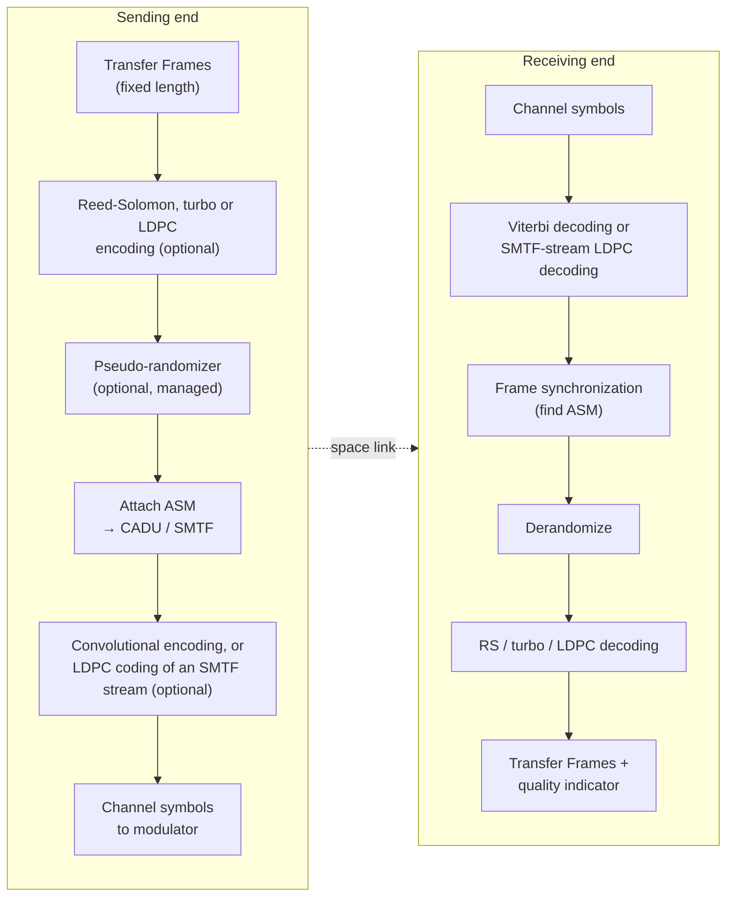
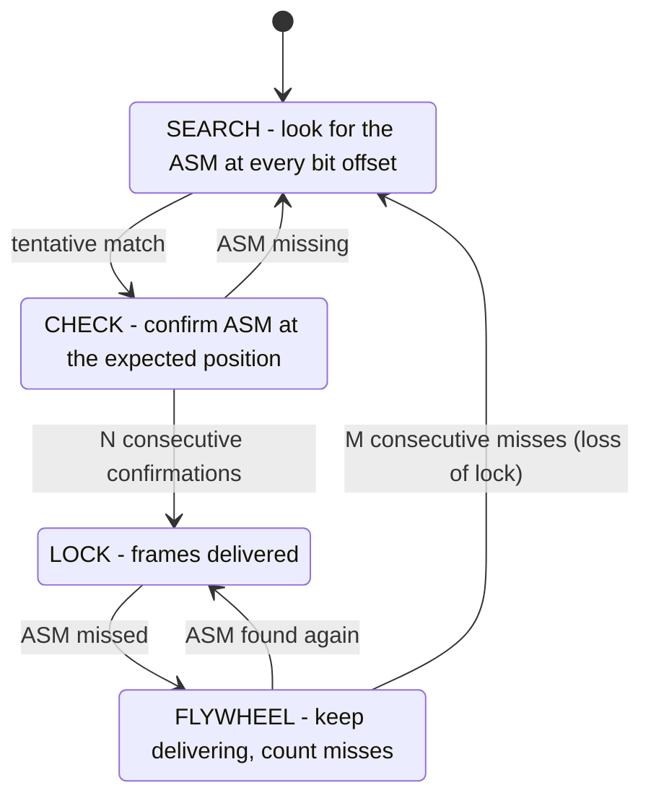
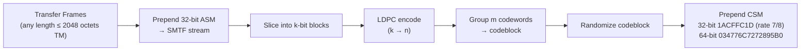
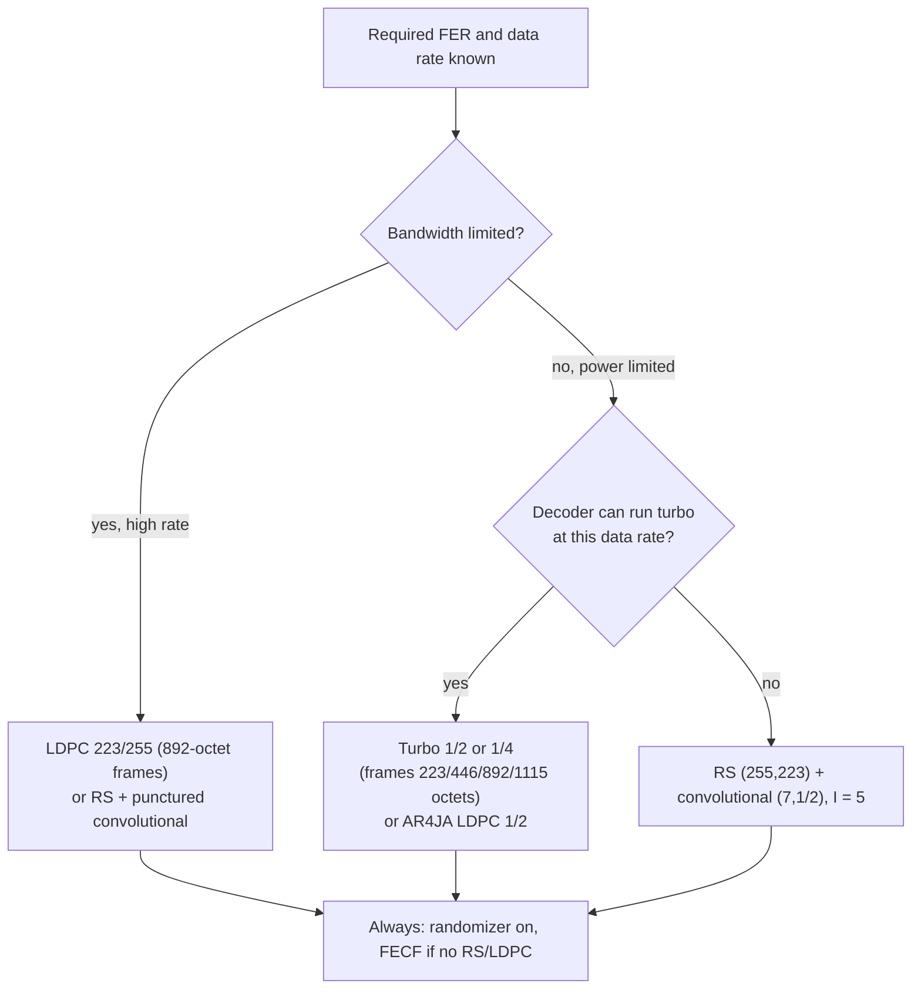

# TM synchronization and channel coding (CCSDS 131.0-B-5)

**TM Synchronization and Channel Coding** is the CCSDS standard for the lower sublayer of the Data
Link Layer on telemetry links. It takes the fixed-length Transfer Frames produced by the
[TM](tm-sdlp.md), [AOS](aos.md) or [USLP](uslp.md) Space Data Link Protocol and turns them into a
continuous stream of channel symbols that survives a weak, noisy radio link: it marks where each frame
starts (the **Attached Sync Marker**), optionally protects the frame with an error-correcting code, and
scrambles the bits with a **pseudo-randomizer** so that the receiver can stay locked.[^c-purpose][^c-arch]
The ECSS communications handbook quantifies what is at stake: depending on the scheme, coding lowers
the $E_b/N_0$ needed for a frame error rate of 10⁻⁴ by roughly 4 to 12 dB.[^hb-gains]

!!! info "At a glance"
    | Item | Value |
    |---|---|
    | Issue followed here | CCSDS 131.0-B-5, September 2023 (B-1 2003, B-2 2011, B-3 2017, B-4 2022); B-5 revises the pseudo-randomizer[^c-ctl] |
    | Newer issue | CCSDS 131.0-B-6, April 2026 (Editorial Correction 1, May 2026): slicing for all block codes, a turbo channel interleaver, a mandatory randomizer; see [Newer issue](#newer-issue-ccsds-1310-b-6-2026)[^b6-ctl] |
    | Applies to | TM, AOS and USLP Transfer Frames, space-to-ground, space-to-space and (AOS/USLP) ground-to-space[^c-purpose][^c-uplink] |
    | Sync marker | 32-bit ASM `0x1ACFFC1D`; longer markers for turbo and some LDPC codes[^c-asm] |
    | Codes | Convolutional (7,1/2) and punctured 2/3–7/8; Reed-Solomon (255,223) and (255,239); concatenated RS + convolutional; turbo 1/2–1/6; LDPC 1/2, 2/3, 4/5 and 223/255[^c-func] |
    | Randomizer | 131071-bit sequence, $h(x)=x^{17}+x^{14}+1$; 255-bit legacy option, $h(x)=x^8+x^7+x^5+x^3+1$[^c-rand-seq] |
    | Frame lengths | Up to 2048 octets (TM/AOS) uncoded or convolutional; fixed lengths for RS, turbo and LDPC[^c-len] |
    | ECSS equivalent | ECSS-E-ST-50-01C (2008), superseded by the adoption notice ECSS-E-AS-50-21; its Rev.2 (5 December 2024) adopts 131.0-B-5 with amendments to five clauses, see [ECSS versions](#ecss-versions-e-st-50-01c-and-the-adoption-notice)[^e50-adopt][^as21-log][^as21-req] |

## Role of the sublayer

The sublayer performs three functions: **error-control coding** (including the frame validation that
tells the upper layer whether a decoded frame can be trusted), **synchronization** (delimiting frames
or codeblocks with a marker) and **pseudo-randomizing** (guaranteeing bit transitions and a clean
spectrum).[^c-func] The TM SDLP assumes exactly these services from below, and requires that all
frames of a Physical Channel use the same coding options so that the receiver can decode them.[^b3-lower]

The order of operations is fixed. At the sending end, block codes come first, then randomization, then
the marker, and convolutional coding (or slicing into LDPC codeblocks) is last because it works on a
continuous stream; the receiver undoes the steps in reverse.[^c-org][^c-rand-ov]



Receivers may synchronize before Viterbi decoding when the basic rate-1/2 code is used, so the
receiving-end figure is a logical model rather than a required implementation.[^c-org]

### The service

The sublayer offers a single service: one-way transfer of fixed-length frames at a constant frame rate
on a Physical Channel, with optional error detection and correction, and only one user per Physical
Channel. Its primitives are `ChannelAccess.request (Frame)` at the sending end and
`ChannelAccess.indication (Frame, Quality Indicator, Sequence Indicator)` at the receiving end. The
**Quality Indicator** flags an uncorrectable error in the frame; the **Sequence Indicator** flags that
frames were lost because frame synchronization was lost.[^c-svc]

### History and the ECSS view

Issue 5 (September 2023) revises the pseudo-randomizer to avoid spectral spikes on high-rate links:
a 131071-bit sequence becomes the standard one and the old 255-bit sequence remains only for backward
compatibility.[^c-ctl][^c-rand-seq] Issue 6 (April 2026) reorganizes the standard around optional
Transfer Frame slicing, adds a channel interleaver for turbo codewords and makes the randomizer
mandatory. The rest of this page follows Issue 5; Issue 6 is summarized in
[its own section](#newer-issue-ccsds-1310-b-6-2026) at the end.[^b6-ctl]

ECSS originally published its own subset as ECSS-E-ST-50-01, which kept fewer options (Reed-Solomon
E=8 only with 4D-8PSK-TCM and interleaving depth 8; turbo only at rates 1/2 and 1/4).[^hb-cdiff][^e01-rs8][^e01-tc]
ECSS-E-ST-50C Rev.1 (2021) lists ECSS-E-AS-50-21, an adoption notice of the CCSDS Blue Book itself, as
superseding ECSS-E-ST-50-01C. Rev.1 of the notice (13 January 2023) adopted CCSDS 131.0-B-4, and Rev.2
(5 December 2024) adopts 131.0-B-5, the issue this page follows.[^e50-adopt][^as25-ctx][^as21-log]
Whether ECSS has adopted 131.0-B-6 is not stated in the available sources. The ECSS texts are compared
[below](#ecss-versions-e-st-50-01c-and-the-adoption-notice); see also
[ECSS-E-ST-50C communications](../ecss/e-st-50-communications.md).

## Why code at all

Channel coding lets data cross a noisy channel so that the possible messages stay distinguishable: for
the same error rate it needs less energy per information bit, or for the same energy it gives a lower
error rate.[^g1-why] The Green Book adds three operational benefits: compressed data, which is far more
sensitive to errors, becomes usable; adaptive (self-identifying) telemetry becomes safe; and anomalies in
the decoded data can be trusted to be real, which enables more unattended operations.[^g1-why]

### Measuring performance

Codes are compared on the Additive White Gaussian Noise (AWGN) channel as a function of the
bit-energy-to-noise ratio $E_b/N_0$. Three error rates are used: the Bit Error Rate (BER), the Word Error
Rate (WER, per codeword) and the Frame Error Rate (FER). Only for independent errors does
$\text{FER} = 1-(1-\text{BER})^L$ hold for an $L$-bit frame, which is true for uncoded data but not
after any of the recommended codes, because decoders make errors in bursts.[^g1-meas]

Shannon's capacity limits bound what any code can do. For a binary-input AWGN channel the low-BER
asymptotes are about 0.2 dB for rate 1/2, −0.5 dB for 1/3, −0.8 dB for 1/4 and −1.1 dB for 1/6, against
−1.6 dB for rate → 0. Finite block lengths cost more: 1000-bit blocks are about 1.3 dB better than
100-bit blocks, 10,000-bit blocks just over 0.5 dB better again, and 100,000-bit blocks another
0.2 dB.[^g1-limits] These numbers explain why the newer codes use large blocks.

| Scheme (frame 8920 bits, AWGN, BPSK) | Bandwidth vs uncoded | Coding gain at FER 10⁻⁴ | at FER 10⁻⁶ |
|---|---|---|---|
| (255,223) Reed-Solomon only | 1.14 | 5.4 dB | 6.2 dB |
| Punctured convolutional 7/8 | 1.14 | 3.8 dB | 3.9 dB |
| Punctured convolutional 5/6 | 1.2 | 4.9 dB | not available |
| RS + punctured convolutional 7/8 | 1.31 | 6.8 dB | 7.7 dB |
| Punctured convolutional 3/4 | 1.33 | 5.3 dB | 5.4 dB |
| RS + punctured convolutional 5/6 (I = 5) | 1.37 | 7.5 dB | 8.4 dB (extrapolated) |
| Punctured convolutional 2/3 | 1.5 | 5.8 dB | not available |
| RS + punctured convolutional 3/4 (I = 5) | 1.52 | 8.2 dB | 9.6 dB |
| RS + punctured convolutional 2/3 (I = 5) | 1.71 | 8.8 dB | 9.8 dB (extrapolated) |
| Basic convolutional (7,1/2) | 2 | 6.1 dB | 6.6 dB |
| Turbo rate 1/2, $k$ = 8920 | 2 | 10.8 dB | 11.6 dB |
| RS + basic convolutional 1/2 (I = 5) | 2.28 | 9.4 dB | 10.8 dB |
| Turbo rate 1/4, $k$ = 8920 | 4 | 11.7 dB | 12.5 dB |

The table restates Table 5-2 of the ECSS communications handbook, which repeats Table D-2 of
ECSS-E-ST-50-01C value for value; uncoded BPSK would need 11.9 dB (FER 10⁻⁴) or 13.0 dB (FER 10⁻⁶), and
the gains already account for the higher symbol rate. The convolutional figures assume 8-bit soft
decisions and the turbo figures an APP decoder with at least 6-bit channel symbols, 8-bit metrics and
10 iterations; no synchronization losses are included.[^hb-gains][^e01-gain] For the E = 8 code ECSS
gives a separate case: the (255,239) code with I = 8 and 4D-8PSK trellis-coded modulation gains 7.7 dB
at 2 bits per channel symbol (bandwidth 1.60 × uncoded) or 6.2 dB at 2.5 (1.28 ×), for FER 10⁻⁷ and
15,296-bit frames.[^e01-gain]
The Green Book's own summary: the convolutional code gains about 5.5 dB over uncoded data at BER 10⁻⁵,
the Reed-Solomon outer code adds about 2.0 dB, and the rate-1/2 turbo code with 8920-bit blocks comes
within about 1 dB of the rate-1/2 Shannon limit and beats the concatenated code by about 1.5 dB.[^g1-perf]

## Frame synchronization: the Attached Sync Marker

### CADU and ASM placement

The **Attached Sync Marker** (ASM) is a known bit pattern placed immediately before every frame,
codeblock or codeword, with no gap after the preceding one. The ASM plus what follows it is the
**Channel Access Data Unit** (CADU):[^c-sync-ov][^c-asm][^c-asm-loc]

| Coding scheme | CADU = ASM + … | ASM attached to |
|---|---|---|
| None, or convolutional only | the Transfer Frame | each Transfer Frame |
| Reed-Solomon, or concatenated | the Reed-Solomon codeblock | each codeblock |
| Turbo | the turbo codeword | each codeword |
| LDPC applied to a Transfer Frame | the LDPC codeword | each codeword |
| LDPC applied to a stream of SMTFs | (CSM and the LDPC codeblock) | each Transfer Frame (ASM), each codeblock (CSM) |

The ASM is never fed into the Reed-Solomon, turbo or LDPC encoder; it is attached to the encoded block.
For Reed-Solomon this prevents the encoder from regenerating a copy of the marker in the check symbols
for certain repetitive data, which would confuse the frame synchronizer.[^c-asm-loc] With convolutional
coding, the ASM is convolutionally encoded together with the frame; in the concatenated scheme it is
encoded by the inner code but not by the outer code.[^c-asm] The ASM is not part of the Transfer Frame
and does not count in its length.[^c-len][^hb-tf]

### ASM bit patterns

| Used with | Length | Pattern (hex) |
|---|---|---|
| Uncoded, convolutional, Reed-Solomon, concatenated, LDPC rate 223/255, all LDPC of SMTF streams | 32 bits | `1ACFFC1D` |
| Turbo rate 1/2; LDPC rates 1/2, 2/3, 4/5 applied to frames | 64 bits | `034776C7272895B0` |
| Turbo rate 1/3 | 96 bits | `25D5C0CE8990F6C9461BF79C` |
| Turbo rate 1/4 | 128 bits | `034776C7272895B0FCB88938D8D76A4F` |
| Turbo rate 1/6 | 192 bits | `25D5C0CE8990F6C9461BF79CDA2A3F31766F0936B9E40863` |
| Embedded stream (e.g. forward playback of recorded frames) | 32 bits | `352EF853` |

All patterns are restated from section 9 of the standard.[^c-asm][^c-asm-emb] The turbo markers grow as
$32/r$ bits, the same factor as the codeword, which keeps synchronization performance roughly
independent of the code rate.[^c-tc-sync][^g1-fsync]

<div class="bitfield" data-title="Attached Sync Marker 0x1ACFFC1D (32 bits)" data-width="32"
     data-fields='[{"n":"1","b":4,"v":"0001"},{"n":"A","b":4,"v":"1010"},{"n":"C","b":4,"v":"1100"},{"n":"F","b":4,"v":"1111"},
                   {"n":"F","b":4,"v":"1111"},{"n":"C","b":4,"v":"1100"},{"n":"1","b":4,"v":"0001"},{"n":"D","b":4,"v":"1101"}]'
     data-caption="Bit 0 (first transmitted) is the leftmost bit"></div>

<div class="bitfield" data-title="64-bit ASM 0x034776C7272895B0 (turbo 1/2, LDPC 1/2-4/5)" data-width="32"
     data-fields='[{"n":"0","b":4,"v":"0000"},{"n":"3","b":4,"v":"0011"},{"n":"4","b":4,"v":"0100"},{"n":"7","b":4,"v":"0111"},
                   {"n":"7","b":4,"v":"0111"},{"n":"6","b":4,"v":"0110"},{"n":"C","b":4,"v":"1100"},{"n":"7","b":4,"v":"0111"},
                   {"n":"2","b":4,"v":"0010"},{"n":"7","b":4,"v":"0111"},{"n":"2","b":4,"v":"0010"},{"n":"8","b":4,"v":"1000"},
                   {"n":"9","b":4,"v":"1001"},{"n":"5","b":4,"v":"0101"},{"n":"B","b":4,"v":"1011"},{"n":"0","b":4,"v":"0000"}]'></div>

The ASM can also resolve the "sense" of the data (true versus inverted bits) when the modulation leaves
that ambiguity.[^c-func] The embedded pattern `0x352EF853` exists so that a stream of recorded frames
inserted in the data field of real-time frames does not contain the main marker; ECSS uses it for its
legacy asynchronously inserted playback data.[^c-asm-emb][^e03-async] ECSS-E-ST-50-01C forbids the
embedded marker with turbo-coded frames and lists its use as a mission configuration parameter.[^e01-asm][^e01-mcp]
The text of Issue 6 no longer lists this pattern: its section 9 ends with §9.4 and has no counterpart
of §9.6.[^b6-csm]

### Where the marker can be found

The domain in which the receiver looks for the ASM depends on the code:[^c-sync-ov]

| Code | ASM acquired in |
|---|---|
| Basic (7,1/2) convolutional, alone or concatenated | channel symbols (before decoding) or decoded bits |
| Punctured convolutional, alone or concatenated | decoded bits only |
| Turbo | channel symbols only |
| LDPC applied to frames | channel symbols only |
| LDPC applied to a stream of SMTFs | decoded bits (codeblocks are first found with the CSM) |

For the rate-1/2 convolutional code, the 52-symbol invariant part of the encoded marker lets the
receiver establish node synchronization and frame synchronization in one step. A turbo decoder cannot
find a marker in the decoded-bit domain because each constituent decoder is too weak and the iterations
need the codeword boundaries first; channel-symbol-domain synchronization in turn needs longer markers
and faster processing.[^g1-fsync]

### How frame synchronizers work

The Green Book describes two families of frame synchronizer:[^g1-fsimpl]



* **State-machine synchronizers** search expensively for a marker, verify a number of subsequent
  markers before declaring lock, and tolerate a number of missed markers ("flywheel") before going back
  to search. They are cheap once locked, but a symbol slip costs several frames.[^g1-fsimpl]
* **Argmax synchronizers** continuously score every possible offset once per frame interval and pick
  the best; they have no lock state. Massey showed that the optimal metric is not plain soft correlation;
  a simple approximation counts only symbols with the wrong sign, weighted by their magnitude. Using two
  consecutive markers improves performance further.[^g1-fsimpl]
* For BPSK the synchronizer can run for both polarities to resolve the 180° ambiguity; QPSK and higher
  orders need four or more hypotheses.[^g1-fsimpl]

With a single 64-symbol marker, soft or hard correlation limits a rate-1/2 LDPC link at FERs below
about 10⁻³, which is why the better metrics matter.[^g1-fsimpl] The N and M thresholds in the diagram
are implementation choices, not values from the standard.

### The ASM as a time reference

Because the leading edge of the first ASM bit is a precise, recognizable instant, the ESA Packet
Telemetry Standard (as quoted in the Rosetta and Mars Express interface document) uses it for time
correlation: the on-board clock is sampled when the ASM of a specific VC 0 frame is sent and the ground
station time-tags the reception of the same bit.[^mex-tc] SCOS-2000 defines frame radiation time, frame
reception time and the ground delay with respect to that edge.[^tco] See
[time correlation](../scos2000/time-correlation.md).

## Pseudo-randomization

### Why randomize

Every receiver needs a data stream that is random enough: a sufficient density of bit transitions for
the bit synchronizer, no strong spectral lines, and no patterns that upset codeword synchronization and
frame validation.[^c-rand-ov] None of the codes guarantees this alone. The inverter on one output of the
basic convolutional code helps with BPSK but not with QPSK multiplexing or punctured codes; Reed-Solomon
and LDPC codes, being quasi-cyclic, can also decode wrongly after false codeblock synchronization if the
data are not randomized.[^c-cc-gen][^c-rs-gen][^c-ldpc-gen] CCSDS therefore makes the randomizer
**required unless the system designer verifies** that the system works without it, and both CCSDS and
ECSS record that missions have had telemetry problems because they skipped it.[^c-rand-ov][^hb-crp][^e01-rand]
Issue 6 removes the escape clause: the randomizer becomes mandatory with every coding option and
*Absent* disappears from its managed parameter (see [Issue 6](#randomizer-and-markers-in-issue-6)).[^b6-rand][^b6-mp]
ECSS-E-ST-50-01C (2008) had made presence or absence a managed property of the physical channel, never
signalled in the telemetry. It also warns that a Reed-Solomon decoder fed with randomized data that was
not derandomized, or the reverse, can perform meaningless corrections and deliver the frame as valid,
in particular with I = 5.[^e01-rand][^e01-rs]

### How it works

Each bit of the codeblock, codeword or frame (not the ASM) is exclusive-ORed with a standard
pseudo-random sequence. The generator restarts at the beginning of every codeblock, codeword or frame,
during the ASM, so the ASM also synchronizes the randomizer. On the receiving end, derandomization is the
same exclusive-OR on hard bits, or a sign inversion of soft symbols.[^c-rand-ov][^c-rand-sync] The
randomizer is applied after Reed-Solomon, turbo or LDPC encoding and before convolutional encoding, and
its presence is a managed parameter of the Physical Channel, never signalled in the data.[^c-rand-ov]

| Sequence | Polynomial | Seed | First 40 bits |
|---|---|---|---|
| 131071 bits (default since B-5) | $h(x) = x^{17} + x^{14} + 1$ | `11000111000111000` | `0001 1100 0111 0001 1011 1001 0001 1011 1010 1001` |
| 255 bits (legacy, backward compatibility) | $h(x) = x^8 + x^7 + x^5 + x^3 + 1$ | all ones | `1111 1111 0100 1000 0000 1110 1100 0000 1001 1010` |

Both rows restate §10.4.[^c-rand-seq] The seed of the long sequence was chosen for performance and to
avoid a long run of ones at the start; the short sequence may cause spectral lines at 1/255 of the symbol
rate and may not guarantee compliance with ITU power-flux-density limits.[^c-rand-seq] For LDPC coding
of an SMTF stream, the whole LDPC codeblock (after encoding) is randomized from its first bit, without
reset at codeword boundaries, and the CSM is not randomized.[^c-smtf-rand]

!!! note "Why the randomizer changed"
    The Green Book (2020) explains the problem: with the 255-bit randomizer and a QPSK link, the
    transmitted sequence repeats every 510 bits, producing spurious lines spaced by $R_b / 510$. Keeping
    that spacing below the 4 kHz ITU resolution bandwidth limits the bit rate to about 2.04 Mb/s. Idle
    frames filled with zeros make it worse, since the randomizer output then dominates the transmitted
    signal. It discusses a 15-cell LFSR (period 32767) and filling idle frame data fields with a
    free-running pseudo-noise sequence.[^g1-hdr] ECSS-E-ST-50-01C and the ECSS handbook had already
    flagged high-rate links above about 2 megasymbols per second as a problem with no agreed ECSS
    solution.[^e01-rand][^hb-crp] CCSDS 132.0-B-3 (2021) now mandates PN-filled OID frames, and
    131.0-B-5 (2023) the 131071-bit sequence; the 2024 ECSS adoption notice records that the long
    sequence replaces the 255-bit one of ECSS-E-ST-50-01 unless legacy compatibility requires
    otherwise.[^b3-oid][^c-ctl][^as21-diff]

The Green Book also notes that integration and test teams may like to see un-randomized data, and
suggests a randomizer that can be switched off during early testing.[^g1-randuse]

## Convolutional coding

### The basic (7,1/2) code

| Characteristic | Value |
|---|---|
| Code rate | 1/2 |
| Constraint length $K$ | 7 bits (6 memory cells, 64 states) |
| Connection vectors | $G_1$ = `1111001` (171 octal), $G_2$ = `1011011` (133 octal) |
| Symbol inversion | on the $G_2$ output |
| Output order | $C_1(1), \overline{C_2}(1), C_1(2), \overline{C_2}(2), \ldots$ |
| Decoding | maximum likelihood (Viterbi); soft decisions with at least 3-bit quantization recommended |

The values are those of §3.3 and §3.2.4; the memory and state count follow from $K = m + 1$ and
$2^m$ states.[^c-cc-basic][^c-cc-gen][^g1-cc] With suppressed-carrier modulation, NRZ-L or NRZ-M may be
used; if differential encoding (NRZ-L to NRZ-M) is wanted, it should be done at the encoder input,
because differential encoding after a convolutional encoder costs considerable performance.[^c-cc-basic][^g1-transp] The ASM is always inserted before convolutional encoding, and the
FECF must validate the frame unless an outer Reed-Solomon code is used, because a Viterbi decoder whose
correction capability is exceeded can emit undetected error bursts.[^c-cc-gen]

**Rationale.** An exhaustive search in the 1970s showed that, among rate-1/2 codes with $K \le 7$, only
this code (and symmetric equivalents) reaches a free distance $d_{free} = 10$; the best $K = 6$ code
reaches 8 and $K = 8$ cannot do better than 10. Since Viterbi decoding effort doubles with every unit
of $K$, $K = 7$ was the sweet spot of the technology of the time.[^g1-cc] The code is **transparent**:
inverting the input inverts the output, so a BPSK receiver locked 180° out of phase simply produces
inverted bits, which known headers reveal. The $G_2$ inverter bounds the number of consecutive symbols
without a transition to 14. ESA, NASA-GSFC and NASA-JPL historically used different parity orders or
inversions; CCSDS kept one convention.[^g1-cc]

**Decoding.** The Viterbi algorithm keeps one survivor path per state ($2^{K-1} = 64$) and has a cost
linear in the number of bits.[^g1-viterbi] With 8-bit soft quantization it is within 0.2 dB of
unquantized performance, while hard decisions lose more than 2 dB. The usual rule of thumb is a
truncation (decision) length of about $5K$; for rate 1/2, 30 bits (five times the memory $m$) already
costs very little and 60 bits is nearly optimal.[^g1-ccperf]

### Punctured codes

To save bandwidth, symbols of the rate-1/2 code are deleted according to a fixed pattern, giving rates
2/3, 3/4, 5/6 or 7/8 (without the $G_2$ inversion):[^c-cc-punct]

| Rate | Pattern C1 | Pattern C2 | Transmitted sequence |
|---|---|---|---|
| 2/3 | `1 0` | `1 1` | C1(1) C2(1) C2(2) … |
| 3/4 | `1 0 1` | `1 1 0` | C1(1) C2(1) C2(2) C1(3) … |
| 5/6 | `1 0 1 0 1` | `1 1 0 1 0` | C1(1) C2(1) C2(2) C1(3) C2(4) C1(5) … |
| 7/8 | `1 0 0 0 1 0 1` | `1 1 1 1 0 1 0` | C1(1) C2(1) C2(2) C2(3) C2(4) C1(5) C2(6) C1(7) … |

A Viterbi decoder handles punctured codes by inserting neutral values at the deleted positions.[^g1-viterbi]
The price is about 2.4 dB between rate 1/2 and rate 7/8, and high rates need longer truncation depths
(about 80 bits for 5/6 and 90 bits for 7/8, instead of 60).[^g1-ccperf] ECSS recommends the basic code
whenever the bandwidth allows it.[^hb-crp]

## Reed-Solomon coding

### Code parameters

| Parameter | Value |
|---|---|
| Symbol size $J$ | 8 bits |
| Error-correction capability $E$ | 16 or 8 symbols per codeword |
| Codeword length $n$ | $2^J - 1 = 255$ symbols |
| Information symbols $k$ | $n - 2E$: 223 ($E$ = 16) or 239 ($E$ = 8) |
| Field generator | $F(x) = x^8 + x^7 + x^2 + x + 1$ over GF(2) |
| Code generator | $g(x) = \prod_{j=128-E}^{127+E} \left(x - \alpha^{11j}\right)$ over GF(2⁸), $F(\alpha) = 0$ |
| Representation | dual basis (Berlekamp), $z_0$ transmitted first |
| Interleaving depth $I$ | 1, 2, 3, 4, 5 or 8 (normally fixed per Physical Channel and Mission Phase) |

The values restate §4.3.[^c-rs-param][^c-rs-il][^c-rs-dual] The code is systematic: the $kI$ information
symbols pass unchanged and $2EI$ check symbols are appended.[^c-rs-param][^c-rs-disc]

**Rationale.** A Reed-Solomon code with minimum distance $d = n - k + 1$ corrects any $E = (n-k)/2$
symbol errors, regardless of how many bits inside a symbol are wrong, so it is excellent against bursts
and poor on its own against random AWGN errors.[^g1-rs] The 8-bit symbol matches octet-based frames and
the decoder technology; $E = 16$ was chosen because it performed best when concatenated with the (7,1/2)
code, and $E = 8$ was added later for a higher rate. The generator polynomials are palindromes, which
halves the multipliers in the encoder, and the dual-basis representation further simplifies the
hardware.[^g1-rs] The parity overhead of (255,223) is about 15 %.[^g1-rs]

**Decoding.** The Reed-Solomon decoder is a bounded-distance decoder. Three outcomes are possible: at
most $E$ symbol errors are corrected; more errors are usually **detected** (the decoder knows it failed
and can flag the frame); rarely, the received word falls within distance $E$ of another codeword and is
decoded wrongly. For (255,223) this last probability is of the order of $1/E!$, about $5 \times 10^{-14}$,
which is why the Reed-Solomon decoder alone can validate frames; for $E = 8$ the margin is much smaller.[^g1-rsdec][^g1-crc]
The ECSS handbook quotes decoder-error probabilities of about 10⁻¹³ for $E = 16$ and 10⁻⁵ for $E = 8$,
the reason ECSS restricted $E = 8$ to 4D-8PSK-TCM links with $I = 8$.[^hb-cdiff] Decoders can also accept
erasures, which count half as much as errors ($2t + e \le 2E$).[^g1-rsdec]

### Interleaving

With interleaving depth $I$, $I$ codewords are interleaved symbol by symbol: the symbol stream entering
the encoder is distributed round-robin to $I$ encoders, and the check symbols are emitted the same way.
A burst of channel errors is then spread across $I$ codewords instead of overwhelming one.[^c-rs-disc][^g1-rsil]
For $I = 2$, the transmitted order is: symbol 1 of codeword 1, symbol 1 of codeword 2, symbol 2 of
codeword 1, symbol 2 of codeword 2, and so on, followed by the interleaved check symbols. The
information symbols still appear in their original order, so the code remains systematic at codeblock
level.[^c-rs-disc]

### Codeblock, virtual fill and frame lengths

The transmitted codeblock is the Transfer Frame followed by the $2EI$ check symbols, preceded by the
32-bit ASM. A frame shorter than $kI$ symbols is handled by **virtual fill**: $Q$ leading zero symbols
are assumed by both encoder and decoder but never transmitted.[^c-rs-il][^c-rs-part] Virtual fill must be
all zeros, fixed for the Mission Phase, inserted only at the start of the codeblock and only in
multiples of $I$ symbols ($8I$ bits).[^c-rs-part] The allowed frame lengths in octets are therefore

$$L = (255 - 2E - q)\, I$$

with $q$ virtual-fill symbols per codeword; if 32-bit alignment is needed, the codeblock length
$(255 - q) I$ must also be a multiple of 4.[^c-len]

| $I$ | 1 | 2 | 3 | 4 | 5 | 8 |
|---|---|---|---|---|---|---|
| Frame length, $E$ = 16, no fill | 223 | 446 | 669 | 892 | **1115** | 1784 |
| Frame length, $E$ = 8, no fill | 239 | 478 | 717 | 956 | 1195 | 1912 |

The table is computed by this wiki from the equation above (octets).[^c-len] For example, with $E = 16$
and $I = 5$ the check symbols are always 1280 bits and the transmitted codeblock is 10,200 bits, so the
CADU is 10,232 bits.[^c-rs-part] The Green Book's virtual-fill example uses $q = 3$: an 8800-bit frame,
120 bits of virtual fill and a 10,080-bit transmitted codeblock.[^g1-rs] The standard notes that only
the unshortened codeblock gives full performance and that more virtual fill means more codeblocks per
second for the decoder to handle.[^c-rs-il] The Green Book qualifies this: shortening generally, but not
always, degrades performance, and on the AWGN channel with Reed-Solomon alone it can even help, which is
not the case in the concatenated system.[^g1-rs][^g1-rsdec]

Because the Reed-Solomon code loses its transparency when virtual fill is used, the data sense (true
or inverted) must be resolved before decoding: with NRZ-L the 32-bit ASM does this, NRZ-M data are
self-resolving.[^c-rs-dual][^g1-rs]

## Concatenated coding

The **concatenated** scheme uses a Reed-Solomon code as the outer code and a convolutional code as the
inner code.[^c-concat] It works because of the way Viterbi decoders fail: when the decoder leaves the
correct trellis path it produces a burst of errors from a few bits to several constraint lengths long,
with a little over half the bits wrong. Three or four such errors typically fall into one 8-bit
Reed-Solomon symbol, which the outer
code corrects as a single symbol error, and moderate interleaving spreads the longer bursts over several
codewords.[^g1-concat] An interleaving depth of 5 already gives near-ideal performance.[^g1-concatperf]

The ASM is encoded by the inner convolutional code but not by the outer code.[^c-asm] Frame lengths are
the same as for Reed-Solomon alone.[^c-len] The Green Book adds a practical warning: some commercial
Viterbi decoders, because of their node-synchronization thresholds, cannot work below about
$E_b/N_0$ = 4 dB at rate 1/2, which must be budgeted as an implementation loss.[^g1-concat]

## Turbo codes

### Specification

| Characteristic | Value |
|---|---|
| Type | Systematic parallel concatenated turbo code: two recursive convolutional components plus the uncoded information |
| Component codes | 16 states each (4 memory cells, $K = 5$) |
| Nominal rates $r$ | 1/2, 1/3, 1/4, 1/6 |
| Information block length $k$ | 1784, 3568, 7136, 8920 bits (223 × 1, 2, 4, 5 octets) |
| Codeword length | $n = (k + 4)/r$ (4 trellis-termination bits) |
| Backward connection vector | $G_0$ = `10011` for both components |
| Forward vectors, rates 1/2 and 1/3 | $G_1$ = `11011`; rate 1/2 punctures every other parity symbol of each component |
| Forward vectors, rate 1/4 | $G_2$ = `10101`, $G_3$ = `11111` (component a); $G_1$ = `11011` (component b) |
| Forward vectors, rate 1/6 | $G_1, G_2, G_3$ (component a); $G_1, G_3$ (component b) |
| Synchronization | ASM of $32/r$ bits before each codeword |
| Frame validation | FECF mandatory |

The rows restate §6.3; $K = 5$ is from the Green Book.[^c-tc-spec][^c-tc-enc][^c-tc-sync][^c-tc-gen][^g1-turbo]

| $k$ (bits) | $n$, rate 1/2 | rate 1/3 | rate 1/4 | rate 1/6 |
|---|---|---|---|---|
| 1784 | 3576 | 5364 | 7152 | 10728 |
| 3568 | 7144 | 10716 | 14288 | 21432 |
| 7136 | 14280 | 21420 | 28560 | 42840 |
| 8920 | 17848 | 26772 | 35696 | 53544 |

(Table 6-2 of the standard.)[^c-tc-spec] The block lengths were chosen for compatibility with
Reed-Solomon codeblocks of interleaving depth 1, 2, 4 and 5.[^c-tc-spec] The frame **is** the information block: the Transfer Frame length
must be 223, 446, 892 or 1115 octets, the only lengths whose performance CCSDS has validated.[^c-len]

**Encoding.** The $k$ bits are buffered and read twice: in natural order into component encoder a, and
in a permuted order into component encoder b. Both start from all-zero registers, run for $k+4$ bit
times, and during the last 4 the input switches to the feedback so that the registers return to zero
(trellis termination), still emitting symbols. For rate 1/3 the output is (out 0a, out 1a, out 1b)
repeated; rate 1/2 alternates (out 0a, out 1a, out 0a, out 1b).[^c-tc-enc] The permutation is defined by
a rule rather than a table, which was preferred for on-board implementation.[^g1-turbo] With
$k = k_1 k_2$, $k_1 = 8$, $k_2 = k/8$ and the primes $p_1 \ldots p_8$ = 31, 37, 43, 47, 53, 59, 61, 67,
for $s = 1 \ldots k$:[^c-tc-perm]

$$
\begin{aligned}
m &= (s-1) \bmod 2, &
i &= \left\lfloor \frac{s-1}{2k_2} \right\rfloor, &
j &= \left\lfloor \frac{s-1}{2} \right\rfloor - i\,k_2,\\
t &= (19i + 1) \bmod \frac{k_1}{2}, &
q &= t \bmod 8 + 1, &
c &= (p_q\, j + 21m) \bmod k_2,
\end{aligned}
$$

$$\pi(s) = 2\left(t + c\,\frac{k_1}{2} + 1\right) - m$$

and the $s$-th bit read into encoder b is bit $\pi(s)$ of the information block.[^c-tc-perm]

### Performance and caveats

* With 10 decoder iterations, a BER of 10⁻⁶ needs about −0.1 dB, 0.15 dB, 0.4 dB and 1.1 dB of
  $E_b/N_0$ for rates 1/6, 1/4, 1/3 and 1/2; the same thresholds give a FER of about 10⁻⁴. FER equals
  WER here because one codeword carries exactly one frame.[^g1-turboperf]
* At 8920 bits and BER 10⁻⁶, the corresponding turbo codes improve on the DSN's concatenated codes by
  0.9 to 1.6 dB.[^g1-turboperf]
* Decoding is iterative, with two soft-input soft-output APP decoders exchanging extrinsic information;
  the reference curves assume at least 6-bit channel symbols and 8-bit metrics. Stopping rules raise
  average decoder speed by 50 to 100 % at almost no cost in $E_b/N_0$. Latency is at least one block.[^g1-turbo][^g1-turboperf]
* Turbo curves flatten at an **error floor**; the CCSDS codes were designed to push it down to perhaps
  10⁻⁹ BER, against about 10⁻⁵ for the original turbo codes.[^g1-floor]
* Turbo codes are vulnerable to **burst noise** (for example a tumbling spacecraft or RF interference),
  a weakness inherited from the convolutional components; a channel interleaver would help, and Issue 5
  specifies none. Issue 6 (2026) adds an optional row-column channel interleaver of depth 4 for exactly
  this reason (see [Turbo channel interleaver](#turbo-channel-interleaver-issue-6)).[^g1-burst][^b6-ci]
* The codes are non-transparent, so differential encoding cannot be used and phase ambiguity must be
  resolved (with the ASM) before decoding.[^c-tc-sync]
* A wide class of turbo codes is covered by a patent of France Télécom and Télédiffusion de France;
  the standard notes that the US patent (5,446,747) expired in 2012.[^c-pat]

ECSS-E-ST-50-01 kept only rates 1/2 and 1/4: rate 1/6 gains only about 0.2 dB over 1/4 at FER 10⁻⁴ while
expanding the bandwidth greatly, and rate 1/3 sits between the two.[^hb-cdiff][^e01-tc] The 2024
adoption notice lists the extra rates only as an informative difference from the superseded standard and
contains no amendment restricting them.[^as21-req][^as21-diff] Turbo codes suit
power-limited links beyond low Earth orbit; the ECSS handbook notes that real-time turbo decoding was
hard above about 20 Mbit/s at the time.[^c-uplink][^hb-gains]

## LDPC codes

Low-Density Parity-Check codes are defined by a sparse parity-check matrix and decoded iteratively
by belief propagation.[^c-ldpc-gen][^g1-ldpcdec] CCSDS specifies two applications: coding each Transfer
Frame (section 7) and coding a stream of sync-marked frames (section 8).

### The rate-223/255 code "C2"

The (8160,7136) code, of rate about 7/8, is derived from a basic (8176,7156) code whose parity-check
matrix is a 2 × 16 array of 511 × 511 circulants of row weight 2 (a regular (4,32) code, rank 1020).
It is expurgated to (8176,7154), shortened by 18 virtual-fill zeros and extended by 2 zero bits:[^c-ldpc-c2][^g1-ldpcmat]

| Part | 18 virtual fill zeros | 7136 information bits | 1022 parity bits | 2 zero fill bits |
|---|---|---|---|---|
| Transmitted | no | yes | yes | yes |

The 7136-bit information length is a 892-octet Transfer Frame, the same as the (255,223) Reed-Solomon
code with $I = 4$, and all parameters are multiples of 32. It is used with the 32-bit ASM, and the only
allowed frame length is 892 octets.[^c-ldpc-c2][^c-ldpc-gen][^c-len] The Green Book describes it as the
near-Earth code: very high rate, fast convergence and limited complexity for data rates of hundreds of
Mb/s in a 375 MHz band.[^g1-ldpc]

### The AR4JA family (rates 1/2, 2/3, 4/5)

Nine codes from the AR4JA (Accumulate, Repeat-by-4, and Jagged Accumulate) family target deep space.[^g1-ldpc]
Their parity-check matrices are built from $M \times M$ permutation submatrices, the last $M$ code symbols
are punctured, and they use the 64-bit ASM.[^c-ldpc-ar4ja][^c-ldpc-gen]

| $k$ (bits) | Frame (octets) | $n$ rate 1/2 ($M$) | $n$ rate 2/3 ($M$) | $n$ rate 4/5 ($M$) |
|---|---|---|---|---|
| 1024 | 128 | 2048 (512) | 1536 (256) | 1280 (128) |
| 4096 | 512 | 8192 (2048) | 6144 (1024) | 5120 (512) |
| 16384 | 2048 | 32768 (8192) | 24576 (4096) | 20480 (2048) |

The values restate Tables 7-2 and 7-5.[^c-ldpc-ar4ja][^c-len] The design choices are explained in the
Green Book: the four rates (including C2) are spaced by about 1 dB on the capacity curve; the block
lengths by about 0.6 dB on the sphere-packing bound; keeping $k$ constant across rates lets the on-board
data handling build frames without knowing the code rate; and the irregular degree distribution gains
about 0.5 dB at rate 1/2.[^g1-ldpc]

Good belief-propagation implementations perform within about 0.1 dB of the published curves in the
waterfall region, but error floors vary between decoders. The rate-2/3 and rate-4/5 codes with
$k = 1024$ can show a floor near FER 10⁻⁶ unless the decoder uses more than 50 iterations, at least
8-bit messages and careful clipping.[^g1-ldpcdec] The 1/2, 2/3 and 4/5 codes are covered by a US patent
held by Caltech.[^c-pat]

### LDPC coding of a stream of SMTFs

Section 8 decouples the frame length from the code: an ASM is attached to every Transfer Frame, the
resulting **Sync-Marked Transfer Frames** (SMTFs) are concatenated into a stream, the stream is sliced into
$k$-bit information blocks, each is encoded, $m$ codewords (1 to 8) form a codeblock, the codeblock is
randomized, and a **Code Sync Marker** (CSM) is prepended.[^c-smtf][^c-mp]



The receiver therefore synchronizes twice: on the CSM for codeblocks, then on the (decoded,
derandomized) ASMs for frames. The CSM and the frame ASM may share the pattern `1ACFFC1D` without
conflict because the ASMs are randomized inside the codeblock. If a codeword fails to decode, the
Quality Indicator of every frame it touched is set.[^c-smtf][^c-smtf-rand] The maximum TM frame length is
then 2048 octets, as for uncoded data.[^c-len] Section 13 prescribes this option for AOS or USLP
ground-to-space links that use an SMTF stream.[^c-uplink] Issue 6 replaces this section with a
generic slicing procedure for Reed-Solomon, turbo and LDPC codes and drops the multi-codeword LDPC
codeblock (see [Transfer Frame slicing](#transfer-frame-slicing-issue-6)).[^b6-slice]

## Frame validation

Every coding option must tell the upper layer whether a frame is good:[^c-func][^c-cc-gen][^c-rs-gen][^c-tc-gen][^c-ldpc-gen][^c-smtf][^c-mp]

| Coding | Validation mechanism | FECF |
|---|---|---|
| None | FECF | mandatory |
| Convolutional only | FECF | mandatory |
| Reed-Solomon (alone or concatenated) | RS decoder failure flag | optional (useful with $E$ = 8) |
| Turbo | FECF | mandatory |
| LDPC applied to frames | LDPC decoder | optional |
| LDPC applied to SMTF stream | LDPC decoder sets the Quality Indicator of the affected frames | optional |

The FECF's undetected-error rate is about $2^{-15} \approx 3 \times 10^{-5}$, many orders of magnitude worse
than the $E$ = 16 Reed-Solomon decoder, which is why the CRC is superfluous there but still needed in the
borderline cases ($E$ = 8, turbo).[^g1-crc] ECSS-E-ST-50-03C required the FECF whenever the frame is not
Reed-Solomon encoded.[^e03-fecf] The coding layer delivers data with the minimum possible residual errors
but provides no security; security belongs to higher layers or [SDLS](sdls.md).[^c-sec]

On the ground, the [SLE Return All Frames service](sle/return-services.md) reports the outcome per frame
as `good`, `erred` or `undetermined`. A frame is good if it consists only of valid Reed-Solomon or LDPC
codewords, or, for other codes, if its FECF checks. Good Reed-Solomon frames are delivered without their
check symbols; erred ones are delivered whole, check symbols included.[^raf]

## Allowed Transfer Frame lengths

The frame protocols do not fix the frame length, because the codes constrain it. Once chosen, the length
is fixed for a Physical Channel and Mission Phase, and it excludes the ASM.[^c-len]

| Case | Coding | Allowed Transfer Frame length |
|---|---|---|
| 1 | Uncoded | any whole number of octets, max 2048 (TM, AOS) or 65536 (USLP) |
| 2 | Convolutional only | as case 1 |
| 3 | Reed-Solomon only | $L = (255-2E-q)\,I$ octets; 32-bit compatibility optional |
| 4 | Concatenated | as case 3 |
| 5 | Turbo | 223, 446, 892 or 1115 octets |
| 6 | LDPC applied to frames | 892 octets (rate 7/8); 128, 512 or 2048 octets (rates 1/2, 2/3, 4/5) |
| 7 | LDPC applied to SMTF stream | max 2048 (TM, AOS) or 65536 (USLP) |

ECSS-E-ST-50-01C gave the compatible lengths only informatively, in its Annex C, and Issue 6
renumbers the cases (case 3 becomes slicing with any block code) and raises the AOS maximum to 65536
octets; see [frame lengths in Issue 6](#frame-lengths-and-managed-parameters-in-issue-6).[^e01-len][^as21-diff][^b6-len]

## Managed parameters

All managed parameters are fixed for every frame of a Physical Channel during a Mission Phase.[^c-mp]

| Group | Managed parameter | Allowed values |
|---|---|---|
| Selected options | Randomizer | Long (131071 bits), Short (255 bits), Absent |
| | Coding method | None, Convolutional, Reed-Solomon, Concatenated, Turbo, LDPC (frame), LDPC (SMTF stream) |
| Convolutional | Code rate | 1/2, 2/3, 3/4, 5/6, 7/8 |
| Reed-Solomon | Error correction capability $E$ | 8, 16 |
| | Interleaving depth $I$ | 1, 2, 3, 4, 5, 8 |
| | Virtual fill length $Q$ (symbols) | integer |
| Turbo | Nominal code rate | 1/2, 1/3, 1/4, 1/6 |
| | Information block length (bits) | 1784, 3568, 7136, 8920 |
| LDPC (frame) | Code rate | 1/2, 2/3, 4/5, 7/8 |
| | Information block length (bits) | 1024, 4096, 16384 (rates 1/2–4/5); 7136 (rate 7/8) |
| LDPC (SMTF stream) | Code rate; slice length | as LDPC (frame) |
| | Codeblock size $m$ (codewords) | 1 to 8 |
| Frame synchronization | Transfer Frame length (bits) | integer |

The table restates Tables 12-1 to 12-7. The standard also requires the FECF to be present when neither
Reed-Solomon nor LDPC is used.[^c-mp] ECSS-E-ST-50-01C listed the same choices informatively as
"mission configuration parameters" (Annex G), with only six coding schemes (none, convolutional,
Reed-Solomon E = 16, concatenated, Reed-Solomon E = 8 with 4D-8PSK-TCM, turbo), the randomizer as present
or absent, and the use of the embedded marker as an extra parameter.[^e01-mcp] Issue 6 restructures the
tables around a per-code *Slicing* parameter (see [below](#frame-lengths-and-managed-parameters-in-issue-6)).[^b6-mp]

## Choosing a coding scheme

The ECSS handbook frames the choice as a trade between occupied bandwidth (which, with the data rate,
caps the usable code rate), the coding gain the link budget needs, and decoding complexity and data
rate.[^hb-gains] Missions first derive the FER they need and then pick the scheme.[^hb-crp] The Green
Book plots the same trade: turbo codes for power-constrained links, LDPC codes when bandwidth is the
constraint, and the classic RS and convolutional codes outperformed on both axes by the LDPC codes.[^g1-ldpcapp]



!!! warning "Inference"
    The decision tree is this wiki's summary of the trade-offs stated in the ECSS handbook, the Green
    Book and §13 of the standard; neither document prescribes such a tree, and real missions also weigh
    ground-station decoder availability and heritage.[^hb-gains][^g1-ldpcapp][^c-uplink]

### ECSS preferred coding schemes (2008)

ECSS-E-ST-50-01C gave, in its informative Annex D, the selection guidance that the CCSDS Blue Book
does not contain. Its criteria are the performance objectives (bit and frame error rates after
decoding), the error statistics of the coding channel, the transmitter power available on board, RF
bandwidth limits, and implementation cost and ground support; the driver is the coding gain obtained
with an error model representative of the real channel.[^e01-prof] Assuming frames of at most 8920 bits
and an acceptable FER of 10⁻⁴ to 10⁻⁶, the annex names preferred schemes per frequency band and mission
category. Category A covers spacecraft less than 2 × 10⁶ km above the Earth's surface, category B those
at that distance or beyond.[^e01-cat][^e01-prof]

| Band (MHz) | Category A | Category B |
|---|---|---|
| 2200–2290, 8450–8500 | Conv 1/2 + RS (255,223), only if occupied bandwidth is not an issue; conv 3/4 + RS; conv 7/8 + RS; or RS (255,223) alone, for Earth exploration satellites only | Band not allocated to this category |
| 2290–2300, 8400–8450 | Band not allocated to this category | Turbo 1/2; turbo 1/4, only if bandwidth is not an issue; conv 1/2 + RS; or conv 3/4 + RS, only if bandwidth is an issue (for example Mars missions) |
| 8025–8400 with 4D-8PSK-TCM | RS (255,239), I = 8, with 4D-8PSK-TCM, for 15,296-bit frames (one entry spanning both categories) | (same entry) |
| 8025–8400 with other modulation | RS (255,223) or conv 7/8 (one entry spanning both categories) | (same entry) |
| 25 500–27 000, 37 000–38 000 | Not defined at the time of issue | Not defined at the time of issue |
| 31 800–32 300 | Band not allocated to this category | Turbo 1/2; turbo 1/4; or conv 1/2 + RS |

The table restates Table D-1. For most of the concatenated entries a footnote adds that the error bursts at
the output of the inner decoder drive the choice of interleaving depth, and that a minimum depth of I = 4 is preferred;
Earth exploration satellites in the 2200–2290 MHz band count as category A. The annex insists that the
availability of on-board and ground equipment be confirmed before a scheme is chosen.[^e01-prof] The 2024
adoption notice observes that CCSDS 131.0-B-5 has no equivalent of this annex and points instead to the
historical CCSDS Silver Book 131.4-M-1-S and to the Green Book 130.1-G-3.[^as21-diff] Frequency bands and
modulation are covered on the [RF and ranging page](rf-and-ranging.md).

### Ground-to-space and space-to-space use

The codes were designed for telemetry, but AOS and USLP can also be used upwards and between
spacecraft. For such links CCSDS allows any of the turbo codes (best for power-limited links beyond low
Earth orbit, rates ≤ 1/2), any of the LDPC codes of section 7 (best for high-rate, bandwidth-limited
links with at least two code symbols per modulation symbol, such as QPSK), or the SMTF-stream LDPC
option. Low-rate turbo codes near threshold can put the symbol SNR below −5 dB, which demands unusually
narrow tracking loops.[^c-uplink] The telecommand link itself uses the different
[TC coding and CLTU](tc-coding-cltu.md) standard.

## Worked example: one Solar Orbiter frame on the link

Solar Orbiter's only TM frame length is 1115 octets, or 8920 bits.[^sol-tf] That is simultaneously a
turbo information block ($k$ = 8920) and a (255,223) Reed-Solomon codeblock with $I = 5$.[^c-tc-spec][^c-len]
The arithmetic below is **illustrative**, computed by this wiki from the formulas cited in each row; the
mission's actual coding configuration is discussed in the next section.

| Scheme | Codeblock or codeword | ASM | Channel symbols per frame | Information bits per symbol |
|---|---|---|---|---|
| Uncoded | 8920 bits | 32 | 8952 | 0.996 |
| RS (255,223), $I$ = 5 | 10,200 bits | 32 | 10,232 | 0.872 |
| RS $I$ = 5 + convolutional 1/2 | 10,232 × 2 | (encoded) | 20,464 | 0.436 |
| Turbo 1/2 | $(8920+4) \times 2$ = 17,848 | 64 | 17,912 | 0.498 |
| Turbo 1/4 | $(8920+4) \times 4$ = 35,696 | 128 | 35,824 | 0.249 |

The sources for the formulas are §4.3.8 (RS codeblock), §3.3 (rate 1/2 doubles every bit, ASM
included), §6.3 and §9.3 (turbo codeword and ASM lengths).[^c-rs-part][^c-cc-basic][^c-asm][^c-tc-spec][^c-tc-sync]
At the same symbol rate, switching from turbo 1/2 to turbo 1/4 therefore halves the frame rate, in
exchange for roughly 0.9 dB more coding gain at FER 10⁻⁴ (Table 5-2: 10.8 dB versus 11.7 dB).[^hb-gains]

## Solar Orbiter: turbo coding in the MIB

The Solar Orbiter [MIB](../missions/solar-orbiter/mib.md) reveals which codes the spacecraft actually
uses.[^mib]

* On board, parameter [NCFT1YN0](../explorer/index.md#/solo/param/NCFT1YN0) "OBC TM Turbo Encoding"
  (PTC 2, PFC 16, a status parameter) has the [textual calibration](../mib/calibration.md)
  [CCDT0345TM](../explorer/index.md#/solo/calib/txt/CCDT0345TM), described as "TTR encoding (tubocode))"
  [sic], with raw 0 = `TURBO_1_2` and raw 2 = `TURBO_1_4`. It is reported in the housekeeping packets
  (PUS 3,25) [SPID 30514](../explorer/index.md#/solo/packet/30514) "SYS Safe Mode Slow",
  [33793](../explorer/index.md#/solo/packet/33793) "PLF DST HK" and
  [33794](../explorer/index.md#/solo/packet/33794) "PLF RIU TM Statuses".[^mib]
* Parameter `NYP09104` "TM Encoding PSS" (subsystem `EGSE_GEN`, which suggests ground support
  equipment; the MIB does not expand it; unit `bps`) in
  "PSS HK Packet 1" (SPID 64901, APID 1940) uses calibration `CYPT9104TM` "TM Encoding Register", which
  maps the register values 1042 to `TurboRate 1/2` and 5138 to `TurboRate 1/4`.[^mib]
* SCOS-2000's internal **Time Correlation Report** (SPID 66840, type 164/1, APID 1966) contains, next
  to the correlation results, the fields "Bit rate" (`NYG02105`) and "Encoding scheme" (`NYG02106`).[^mib]
* The same definitions are present, unchanged, in the April 2020 MIB release.[^mib2020]

!!! warning "Inference"
    In these OBC-level and EGSE calibrations only turbo rates 1/2 and 1/4 appear, which matches both the
    1115-octet frame length (a valid turbo block) and the ECSS-E-ST-50-01 subset of turbo rates; the
    encoder's own configuration register (next subsection) can express all four rates. That Solar Orbiter's
    downlink uses turbo coding at these two rates is deduced from MIB definitions; the TM/TC ICD in the
    library does not specify the coding scheme, and the meaning of the "PSS" register values (1042,
    5138) is not stated in the available sources (a decoding consistent with the encoder register is
    given in the next subsection).[^mib][^hb-cdiff][^sol-tf] Why the time-correlation
    report records the encoding scheme is also not stated; plausibly because coding changes the
    on-board and ground delays between clock sampling and frame time-stamping. The "TTR" in the
    calibration description plausibly refers to the on-board computer's TTRM board, which the ICD
    lists as hosting the TC decoder, the TM encoder and the on-board time.[^sol-ttrm]

??? example "SQL used"
    ```sql
    SELECT PCF_NAME, PCF_DESCR, PCF_PTC, PCF_PFC, PCF_CATEG, PCF_CURTX, PCF_UNIT, PCF_SUBSYS
      FROM pcf WHERE PCF_NAME IN ('NCFT1YN0','NYP09104','NYG02105','NYG02106');
    SELECT * FROM txf WHERE TXF_NUMBR IN ('CCDT0345TM','CYPT9104TM');
    SELECT * FROM txp WHERE TXP_NUMBR IN ('CCDT0345TM','CYPT9104TM');
    SELECT p.PLF_SPID, d.PID_TYPE, d.PID_STYPE, d.PID_APID, d.PID_DESCR
      FROM plf p JOIN pid d ON d.PID_SPID = p.PLF_SPID
     WHERE p.PLF_NAME IN ('NCFT1YN0','NYP09104','NYG02106');
    ```
    Run with `sqlite3 -readonly` on `solo-2025-09-16.sqlite` (and `solo-2020-04-16.sqlite` for the
    comparison). Table references: [PCF](../mib/tables/pcf.md), [TXF](../mib/tables/txf.md),
    [TXP](../mib/tables/txp.md), [PLF](../mib/tables/plf.md), [PID](../mib/tables/pid.md).

### The TM encoder configuration register

The MIB also decodes the configuration register of the on-board **TM encoder** itself, which is where
the coding options of this standard are switched. Each of the two encoders has a 32-bit word described as
"TmeTmEnCfg1": [NCDD05JW](../explorer/index.md#/solo/param/NCDD05JW) for encoder A and
[NCDD05NW](../explorer/index.md#/solo/param/NCDD05NW) for encoder B (PTC 3, PFC 14; the MIB descriptions
call them "TC Decoder A" and "TC Decoder B"). The last 16 bits of each word are split into ten enumerated
fields of 1 to 3 bits. They are placed in the housekeeping packets (3,25)
[SPID 19541](../explorer/index.md#/solo/packet/19541) (APID 164) and
[SPID 19550](../explorer/index.md#/solo/packet/19550) (APID 162), both "DMS OBC Status Slow", and
[SPID 19578](../explorer/index.md#/solo/packet/19578) "DMS Safe Mode Slow" (APID 165). In SPID 19541 the
word of encoder A starts at octet 61 and its fields at octet 63; for encoder B the offsets are 185 and 187.[^mib-tme]

<div class="bitfield" data-title="Solar Orbiter TM encoder register TmEnCfg1, decoded last 16 bits (MIB 2025-09-16)" data-width="16"
     data-fields='[{"n":"Pat","b":2,"d":"Test pattern: 0 TP=0, 1 TP=01, 2 TP=0011, 3 TP=0000_1111"},
                   {"n":"TST","b":1,"d":"0 TP disabled, 1 TP enabled"},
                   {"n":"TuR","b":2,"d":"Turbo rate: 0 = 1/2, 1 = 1/3, 2 = 1/4, 3 = 1/6"},
                   {"n":"TU","b":1,"d":"0 No Turbo, 1 Turbo"},
                   {"n":"RS","b":1,"d":"0 No ReedSolomon, 1 ReedSolomon"},
                   {"n":"CvR","b":3,"d":"Convolutional rate: 0 = 1/2 inv, 1 = 1/2, 4 = 2/3, 5 = 3/4, 6 = 5/6, 7 = 7/8"},
                   {"n":"CV","b":1,"d":"0 No Conv Enc, 1 Conv Enc"},
                   {"n":"PR","b":1,"d":"0 PR Disabled, 1 PR Enabled"},
                   {"n":"(none)","b":1,"d":"No MIB parameter is placed at this bit"},
                   {"n":"PS","b":1,"d":"0 Bdwdth Alloc, 1 Priority"},
                   {"n":"SCW","b":2,"d":"0 ClcwD0, 1 ClcwD1, 2 ClcwD0 and D1, 3 round robin"}]'
     data-caption="Real definitions from the pcf, plf and txp tables; bit 0 is the leftmost bit of octet 63 of SPID 19541"></div>

| Bits | Field (encoder A / B) | Raw values and texts | Calibration | CCSDS 131.0 counterpart |
|---|---|---|---|---|
| 0–1 | Pat ([NCDX9317](../explorer/index.md#/solo/param/NCDX9317) / NCDX9417) | 0 `TP=0`, 1 `TP=01`, 2 `TP=0011`, 3 `TP=0000_1111` | [CCDX9317TM](../explorer/index.md#/solo/calib/txt/CCDX9317TM) | None (a test pattern) |
| 2 | TST (NCDX9318 / NCDX9418) | 0 `TP disabled`, 1 `TP enabled` | CCDX9318TM | None |
| 3–4 | TuR ([NCDX9319](../explorer/index.md#/solo/param/NCDX9319) / NCDX9419) | 0 `rate = 1/2`, 1 `rate = 1/3`, 2 `rate = 1/4`, 3 `rate = 1/6` | [CCDX9319TM](../explorer/index.md#/solo/calib/txt/CCDX9319TM) | The four nominal turbo rates[^c-tc-spec] |
| 5 | TU ([NCDX9320](../explorer/index.md#/solo/param/NCDX9320) / NCDX9420) | 0 `No Turbo`, 1 `Turbo` | CCDX9320TM | Coding method[^c-mp] |
| 6 | RS ([NCDX9321](../explorer/index.md#/solo/param/NCDX9321) / NCDX9421) | 0 `No ReedSolomon`, 1 `ReedSolomon` | CCDX9321TM | Coding method |
| 7–9 | CvR ([NCDX9322](../explorer/index.md#/solo/param/NCDX9322) / NCDX9422) | 0 `rate 1/2 inv`, 1 `rate 1/2`, 4 `rate 2/3`, 5 `rate 3/4`, 6 `rate 5/6`, 7 `rate 7/8` | [CCDX9322TM](../explorer/index.md#/solo/calib/txt/CCDX9322TM) | Basic and punctured convolutional rates[^c-cc-basic][^c-cc-punct] |
| 10 | CV (NCDX9323 / NCDX9423) | 0 `No Conv Enc`, 1 `Conv Enc` | CCDX9323TM | Coding method |
| 11 | PR ([NCDX9324](../explorer/index.md#/solo/param/NCDX9324) / NCDX9424) | 0 `PR Disabled`, 1 `PR Enabled` | CCDX9324TM | Plausibly the randomizer (see below) |
| 12 | none | No parameter defined | none | none |
| 13 | PS (NCDX9325 / NCDX9425) | 0 `Bdwdth Alloc`, 1 `Priority` | CCDX9325TM | Not a coding option |
| 14–15 | SCW ([NCDX9326](../explorer/index.md#/solo/param/NCDX9326) / NCDX9426) | 0 `ClcwD0`, 1 `ClcwD1`, 2 `ClcwD0 and D1`, 3 `round robin` | CCDX9326TM | Not a coding option |

All of these parameters are 1-, 2- or 3-bit enumerations (PTC 2 with PFC 1, 2 or 3), and their
definitions and placements are identical in the April 2020 release.[^mib-tme][^mib2020] Two high-priority
CPDU commands, [ZBC04011](../explorer/index.md#/solo/command/ZBC04011) "Use TM Encoder/OBT A" and
[ZBC05011](../explorer/index.md#/solo/command/ZBC05011) "Use TM Encoder/OBT B" (header `HPC1_TC`,
APID 44, MAP ID 0), select which encoder is in use.[^mib-tme] The Solar Orbiter ICD reserves MAP ID 0 for
commands that go straight to the Command Pulse Distribution Unit without the central software, also called
HPC-1 commands.[^sol-cpdu]

!!! warning "Inference"
    The register covers the coding options of this standard except LDPC, which it does not mention:
    turbo coding at all four CCSDS rates, Reed-Solomon coding, convolutional coding at the basic and all
    punctured rates, and a switch labelled "PR" that is most plausibly the pseudo-randomizer. The restriction to turbo rates 1/2 and 1/4
    noted in the previous section therefore belongs to the OBC-level parameter `NCFT1YN0` and to the EGSE
    register, not to the encoder hardware. The two convolutional rate-1/2 codes fit the standard's
    distinction between the basic code, whose $G_2$ output is inverted, and the punctured codes, which
    use no inversion.[^c-cc-basic][^c-cc-punct] "PS" (bandwidth allocation or priority) and "SCW" (CLCW
    of decoder 0, decoder 1, both, or round robin) look like virtual-channel scheduling and the choice of
    which [CLCW](cop-1.md) fills the [OCF](tm-sdlp.md#operational-control-field), matching the two
    on-board TC decoders. None of these meanings is documented in the available sources, and which values
    are set in flight cannot be read from the MIB, which holds definitions but no telemetry. Read with
    this layout (bit 0 the most significant bit of a 16-bit half-word), the two values of the EGSE
    "TM Encoding PSS" calibration decode consistently: 1042 = `0x0412` gives TU = 1 (turbo), TuR = 0
    (rate 1/2), PR = 1 and SCW = 2 (`ClcwD0 and D1`), and 5138 = `0x1412` differs only in TuR = 2
    (rate 1/4), matching their labels `TurboRate 1/2` and `TurboRate 1/4`; the OBC-level calibration
    `CCDT0345TM` also uses raw 0 for rate 1/2 and raw 2 for rate 1/4, like TuR. This suggests that the
    EGSE parameter (PTC 2, PFC 16) reports the same half-word, but the MIB does not say so.[^mib] Solar
    Orbiter, an interplanetary mission, would be category B in ECSS-E-ST-50-01C, whose deep-space band
    entries list turbo 1/2 and turbo 1/4 first.[^e01-prof][^e01-cat]

??? example "SQL used (TM encoder register)"
    ```sql
    -- fields of the encoder configuration words and their placement
    SELECT p.PLF_SPID, p.PLF_OFFBY, p.PLF_OFFBI, p.PLF_NAME, c.PCF_DESCR, c.PCF_PTC, c.PCF_PFC, c.PCF_CURTX
      FROM plf p JOIN pcf c ON c.PCF_NAME = p.PLF_NAME
     WHERE p.PLF_SPID = '19541'
       AND (CAST(p.PLF_OFFBY AS INT) BETWEEN 60 AND 66 OR CAST(p.PLF_OFFBY AS INT) BETWEEN 184 AND 190)
     ORDER BY CAST(p.PLF_OFFBY AS INT), CAST(p.PLF_OFFBI AS INT);
    -- the textual calibrations
    SELECT f.TXF_NUMBR, f.TXF_DESCR, p.TXP_FROM, p.TXP_ALTXT
      FROM txf f JOIN txp p ON p.TXP_NUMBR = f.TXF_NUMBR
     WHERE f.TXF_NUMBR BETWEEN 'CCDX9317TM' AND 'CCDX9326TM'
     ORDER BY f.TXF_NUMBR, CAST(p.TXP_FROM AS INT);
    -- packets carrying the words
    SELECT PID_SPID, PID_TYPE, PID_STYPE, PID_APID, PID_DESCR FROM pid
     WHERE PID_SPID IN (SELECT PLF_SPID FROM plf WHERE PLF_NAME IN ('NCDD05JW','NCDD05NW'));
    -- encoder selection commands
    SELECT CCF_CNAME, CCF_DESCR, CCF_PKTID, CCF_APID, CCF_HIPRI, CCF_MAPID FROM ccf
     WHERE CCF_CNAME IN ('ZBC04011','ZBC05011');
    ```
    Run with `sqlite3 -readonly` on `solo-2025-09-16.sqlite`; the same placement query on
    `solo-2020-04-16.sqlite` returns identical rows. Tables: [PLF](../mib/tables/plf.md),
    [PCF](../mib/tables/pcf.md), [TXF](../mib/tables/txf.md), [TXP](../mib/tables/txp.md),
    [PID](../mib/tables/pid.md), [CCF](../mib/tables/ccf.md).

A small curiosity from the ground segment: the Solar Orbiter RAPID archive files, which mirror SCOS-2000
packet archives, carry in every record a fixed "sync marker" (SM) field of value `1ACFFC1D`, the same
pattern as the space-link ASM.[^ddid-rapid]

## Transparency and bit remappings

Inverting the received symbols (a 180° phase error with BPSK) inverts the output of a transparent code.
The convolutional and Reed-Solomon codes are transparent (Reed-Solomon only without virtual fill), the
turbo and LDPC codes are not, so their phase ambiguity must be resolved before decoding, typically with
the ASM.[^c-defs][^g1-cc][^g1-rs][^c-tc-gen][^c-tc-sync][^c-ldpc-gen] The optional NRZ-L to NRZ-M conversion is a differential
precoding that resolves the ambiguity for transparent codes; placed at the output of a convolutional
encoder it costs a lot of performance, which is why it is only allowed before the encoder (or, the
Green Book notes, between the outer and inner codes, which the Blue Book does not clearly permit).[^g1-transp]

## ECSS versions: E-ST-50-01C and the adoption notice

ECSS has published telemetry synchronization and channel coding in two forms: as its own standard,
ECSS-E-ST-50-01C (2008), a CCSDS-compatible subset, and since 2021 as the adoption notice
ECSS-E-AS-50-21, which applies the CCSDS Blue Book itself with a short list of amendments. The context
clause of the notice maps every superseded ECSS space data link standard to its notice:[^as21-ctx]

| Superseded ECSS standard (31 July 2008) | Adoption notice | Based on |
|---|---|---|
| ECSS-E-ST-50-01C, TM synchronization and channel coding | ECSS-E-AS-50-21 | CCSDS 131.0-B (this page) |
| ECSS-E-ST-50-03C, TM transfer frame protocol | ECSS-E-AS-50-22 and ECSS-E-AS-50-23 | CCSDS 132.0-B ([TM SDLP](tm-sdlp.md)) and 732.0-B ([AOS](aos.md)) |
| ECSS-E-ST-50-04C, telecommand protocols | ECSS-E-AS-50-24, -25 and -26 | CCSDS 231.0-B ([CLTU](tc-coding-cltu.md)), 232.0-B ([TC SDLP](tc-sdlp.md)) and 232.1-B ([COP-1](cop-1.md)) |

### ECSS-E-ST-50-01C (2008)

The first issue, ECSS-E-50-01A, appeared on 6 November 2007; a B issue was never published, and
ECSS-E-ST-50-01C of 31 July 2008 was issued for consistency with CCSDS and the other ECSS
standards.[^e01-log] Its Annex F describes it as a subset of CCSDS 131.0-B-1 and therefore
CCSDS-compatible, while warning that a system meant to support CCSDS missions in general must take the
differences into account.[^e01-ccsds]

| Topic | ECSS-E-ST-50-01C rule | CCSDS 131.0-B-5 |
|---|---|---|
| Convolutional | Basic (7,1/2) code and punctured 2/3 to 7/8; soft decisions with at least 3-bit quantization **shall** be used[^e01-cc] | Same codes; soft decisions *should* be used[^c-cc-gen] |
| Reed-Solomon E = 16 | I = 1, 2, 3, 4, 5 or 8, fixed for a mission phase[^e01-rs8] | Same depths, "normally" fixed[^c-rs-il] |
| Reed-Solomon E = 8 | Only with 4D-8PSK trellis-coded modulation, only I = 8, never concatenated with a convolutional code[^e01-rs8] | Any depth, may be concatenated[^c-rs-param][^c-concat] |
| Turbo | Rates 1/2 and 1/4 only; same four block lengths; a 16,384-bit block "under study"; the codeblock rate for k = 1784 must be checked against the decoder[^e01-tc] | Rates 1/2, 1/3, 1/4, 1/6[^c-tc-spec] |
| LDPC | None[^as21-diff] | Rates 1/2, 2/3, 4/5 and 223/255; frame or SMTF-stream coding[^c-ldpc-gen] |
| Sync markers | 32-bit `1ACFFC1D`, 64- and 128-bit turbo markers, embedded `352EF853` (not with turbo)[^e01-asm] | Adds the 96- and 192-bit markers for turbo rates 1/3 and 1/6 and assigns markers to the LDPC codes[^c-asm] |
| Randomizer | 255-bit sequence only, presence managed per physical channel; no scheme agreed above about 2 Msym/s[^e01-rand] | 131071-bit sequence, 255-bit for legacy[^c-rand-seq] |
| Frame lengths and parameters | Informative Annexes C and G[^e01-len][^e01-mcp] | Normative §§11 and 12[^c-len][^c-mp] |

The ECSS text also records what had changed since the ESA Telemetry Channel Coding Standard
ESA-PSS-04-103 (September 1989): the punctured codes were added; the Reed-Solomon code is the same code,
compatible with PSS, but described in different mathematics; it may now be concatenated with the
punctured codes too; the E = 8 code (with 4D-8PSK-TCM) and the turbo codes are new; and PSS had
forbidden the randomizer with convolutional coding under BPSK, a restriction ECSS dropped.[^e01-pss] The
wider history is told in [From ESA PSS to CCSDS and ECSS](../overview/history.md).

### ECSS-E-AS-50-21: adopting the Blue Book

| Issue | Date | CCSDS issue applied | Change |
|---|---|---|---|
| ECSS-E-AS-50-21C | 1 March 2021 | 131.0-B-3 (September 2017) | First issue; supersedes ECSS-E-ST-50-01C[^as21-log][^e50-adopt] |
| Rev.1 | 13 January 2023 | 131.0-B-4 | Update to the new CCSDS issue, which adds USLP and ground-to-space links[^as21-log][^as25-ctx] |
| Rev.2 | 5 December 2024 | 131.0-B-5 (September 2023) | Update for the revised randomizer; adds the differences on USLP, turbo rates and ASM patterns that earlier issues had missed[^as21-log][^as21-req] |

Rev.2 requires CCSDS 131.0-B-5 to apply as written except for amendments to five clauses (six entries in
its Table 4-1), all of which carry restrictions of the 2008 standard forward. Clause numbers are those of
Issue 5:[^as21-req][^e01-cc][^e01-rs8]

| Clause of 131.0-B-5 | Kind | ECSS text (paraphrased) |
|---|---|---|
| 3.2.4 (quantization) | Modified | Soft decisions with at least three-bit quantization **shall** be used for the decoder, replacing "should be used whenever constraints permit" |
| 4.3.1 c (new) | New requirement | E = 8 shall not be used unless the modulation is 4D-8PSK-TCM |
| 4.3.5.1 | Modified | With E = 16 the interleaving depth is 1, 2, 3, 4, 5 or 8; with E = 8 it is 8 |
| 4.3.5.2 | Modified | The word "normally" is deleted: the depth is fixed on a physical channel for a mission phase |
| 5.1 | Modified, new note | Concatenated codes use the Reed-Solomon code with E = 16 only; the E = 8 code is not concatenated with a convolutional code |

Everything else that separates the Blue Book from the old ECSS standard is listed only informatively in
Annex A, which therefore doubles as a summary of what ECSS users gained: LDPC codes for frames and SMTF
streams, the turbo rates 1/3 and 1/6, the extra markers, the 131071-bit randomizer, normative frame
lengths and managed parameters, USLP support (cited as CCSDS 732.1-B-3), ground-to-space use (§13), a
formal service interface (Annex A of the Blue Book) and a security discussion (Annex B). Conversely, the
Blue Book has no equivalent of the application profiles of ECSS-E-ST-50-01C
([above](#ecss-preferred-coding-schemes-2008)).[^as21-diff] The bibliography of Rev.2 lists the companion
notices then current: ECSS-E-AS-50-22C Rev.1 (TM SDLP, CCSDS 132.0-B-3), ECSS-E-AS-50-23C Rev.1 (AOS,
CCSDS 732.0-B-4), -24C Rev.1, -25C Rev.1 and -26C.[^as21-bib]

!!! warning "Inference"
    The amendments point at Issue 5 clause numbers. In Issue 6 the same requirements sit in §4.2.4,
    §5.3.1, §§5.3.5.1–5.3.5.2 and §6.1, because a new section 3 shifts every coding section by one. An
    adoption of Issue 6 would need renumbered amendments; the content of those clauses is unchanged in
    Issue 6.[^as21-req][^b6-cc][^b6-rs]

## Newer issue: CCSDS 131.0-B-6 (2026)

!!! info "Newer issue"
    The sections above follow Issue 5 (September 2023), the issue adopted by ECSS. CCSDS published
    Issue 6 in April 2026 and Editorial Correction 1 in May 2026; the correction fixes numbering in the
    table of contents for sections 8 and 10, in table C-1 and in figures 3-1 to 3-3 and F-1. This section
    summarizes what Issue 6 changes.[^b6-ctl][^as21-log]

The Document Control table names three substantive changes: an interleaver for turbo codewords, slicing
for all block codes so that Transfer Frames and codewords may have different lengths, and a mandatory
pseudo-randomizer.[^b6-ctl] Reading the two issues side by side gives the full picture:

| Topic | Issue 5 (2023) | Issue 6 (2026) |
|---|---|---|
| Functions of the sublayer | Error-control coding with frame validation, synchronization, pseudo-randomizing[^c-func] | Adds **Transfer Frame slicing** as a fourth function[^b6-func] |
| Layout | Convolutional §3, Reed-Solomon §4, concatenated §5, turbo §6, LDPC of frames §7, LDPC of SMTF streams §8, frame synchronization §9[^c-cc-gen][^c-smtf][^c-sync-ov] | New §3 (slicing, synchronization, validation); codes in §§4–8 with a single LDPC section; §9 "codeword synchronization"[^b6-struct] |
| Marker names | "ASM" for every marker; "CSM" only for codeblocks of an SMTF stream[^c-asm][^c-smtf] | **CSM** (Code Synchronization Marker) before every codeword or Reed-Solomon codeblock; **ASM** before each frame inside a sliced stream; without slicing the two are one marker[^b6-func][^b6-csm] |
| CADU | ASM plus frame, codeblock or codeword[^c-sync-ov] | CSM plus the *randomized* codeword, codeblock or frame[^b6-defs][^b6-csm] |
| Frame length decoupled from the code | Only for LDPC (SMTF stream), with m = 1 to 8 codewords per codeblock[^c-smtf][^c-mp] | Optional slicing for Reed-Solomon, turbo and LDPC; one CSM per codeword, "codeblock" reserved for Reed-Solomon[^b6-slice][^b6-defs] |
| Randomizer | Required unless the designer verifies operation without it; Long, Short or Absent[^c-rand-ov][^c-mp] | Mandatory; Long or Short[^b6-rand][^b6-mp] |
| Turbo channel interleaver | None[^g1-burst] | Row-column interleaver of depth 4, recommended, a managed parameter[^b6-ci] |
| Embedded marker `352EF853` | §9.6[^c-asm-emb] | Not in the text[^b6-csm] |
| Largest AOS frame | 2048 octets[^c-len] | 65536 octets[^b6-len] |
| Ground-to-space links | Turbo, frame LDPC, or the SMTF-stream LDPC option of §13.4[^c-uplink] | Turbo or LDPC; slicing mentioned in a note of §13.1[^b6-uplink] |

### Transfer Frame slicing (Issue 6)

Most block codes accept only a few information block lengths, which can force awkward frame lengths on
the rest of the system. Slicing removes that coupling: a 32-bit ASM `1ACFFC1D` is prepended to each
M-bit frame, the resulting stream of (M + 32)-bit SMTFs is cut into k-bit information blocks, and each
block is encoded (for Reed-Solomon, I blocks are encoded and interleaved into one codeblock), randomized
and given a CSM. Slicing also allows frames longer than the largest information block and reduces the
overhead when long frames are used, at the price of a second level of synchronization. It is optional, is
managed and fixed for a mission phase, is allowed with Reed-Solomon, turbo and LDPC coding, and must not
be used with uncoded data or with a convolutional code alone.[^b6-func][^b6-slice] The frame ASM can share
the CSM's bit pattern because it is randomized inside the codeword and so cannot be mistaken for it.[^b6-slice]

```mermaid
flowchart TB
    subgraph W["With slicing (RS, turbo or LDPC)"]
      direction LR
      W1["Transfer Frames<br/>(any length up to 2048 octets TM,<br/>65536 AOS / USLP)"] --> W2["Prepend 32-bit ASM<br/>→ SMTF stream"]
      W2 --> W3["Slice into k-bit<br/>information blocks"]
      W3 --> W4["Encode<br/>(RS: I blocks per codeblock)"]
      W4 --> W5["Randomize each codeword<br/>or codeblock"]
      W5 --> W6["Prepend CSM → CADU"]
      W6 --> W7["Convolutional encoding<br/>(only with RS)"]
    end
    subgraph N["Without slicing"]
      direction LR
      N1["Transfer Frame =<br/>information block"] --> N2["Encode<br/>(RS, turbo or LDPC, optional)"]
      N2 --> N3["Randomize"]
      N3 --> N4["Prepend CSM (= ASM)<br/>→ CADU"]
      N4 --> N5["Convolutional encoding<br/>(alone or with RS)"]
    end
```



The receiver reverses the steps: it finds the CSMs and extracts codewords or codeblocks, derandomizes
and decodes them, concatenates the decoded information blocks back into an SMTF stream, and finally
finds the ASMs to cut out the frames. Without slicing there is one level of synchronization and the
decoded information blocks *are* the frames.[^b6-slice] Frame validation follows the code: with no
coding, convolutional or turbo coding the FECF is mandatory; with Reed-Solomon, concatenated or LDPC
coding the decoder may validate and the FECF is optional. With slicing, a frame is invalid if any part of
it lies in an invalid information block.[^b6-valid]

!!! example "Worked example: a 2048-octet TM frame on a rate-1/2 turbo code (illustrative, computed by this wiki)"
    Without slicing, a turbo-coded TM frame must be 223, 446, 892 or 1115 octets.[^b6-len] With slicing,
    a 2048-octet frame becomes a 16,416-bit SMTF. With $k$ = 8920, each information block yields a
    17,848-symbol codeword and, with its 64-bit CSM, a 17,912-symbol CADU.[^c-tc-spec][^b6-csm] Because
    $\operatorname{lcm}(16416, 8920) = 18{,}303{,}840$ bits, the alignment of frames and blocks repeats
    every 1115 frames, which fill exactly 2052 information blocks; on average a frame costs about 32,965
    channel symbols, and the slicing overhead is only the 32-bit ASM, 0.2 % of the SMTF. A frame
    overlaps two or three information blocks and a block overlaps one or two frames, so one decoding
    failure invalidates at most two frames.[^b6-valid]

### Turbo channel interleaver (Issue 6)

Turbo codes are vulnerable to burst errors, for example from a tumbling spacecraft or solar
scintillation. Issue 6 therefore says a channel interleaver **should** be used unless the system designer
verifies that the problem is handled by other means, such as a larger fading margin in the link budget,
and makes its presence a managed parameter. It permutes the coded symbols of one codeword and must not be
confused with the turbo code's own permutation, which reorders information bits between the two
component encoders.[^b6-ci]

The interleaver is a row-column block of depth 4. The $n = (k+4)/r$ symbols of a codeword are written
row by row into rows of $N_c = 4/r$ symbols, so each row holds four consecutive outputs of the two
constituent encoders, and they are read out column by column; the column length is $N_r = n/N_c$, and
the receiver writes by columns and reads by rows.[^b6-ci]

| $k$ (bits) | $N_r$ (rows) | $n$ at $r$ = 1/2 ($N_c$ = 8) | $n$ at 1/3 ($N_c$ = 12) | $n$ at 1/4 ($N_c$ = 16) | $n$ at 1/6 ($N_c$ = 24) |
|---|---|---|---|---|---|
| 1784 | 447 | 3576 | 5364 | 7152 | 10728 |
| 3568 | 893 | 7144 | 10716 | 14288 | 21432 |
| 7136 | 1785 | 14280 | 21420 | 28560 | 42840 |
| 8920 | 2231 | 17848 | 26772 | 35696 | 53544 |

(Table 7-4 of Issue 6: the number of columns depends only on the rate, the number of rows only on the
block length.)[^b6-ci] Written as a formula by this wiki, coded symbol $i$ (counting from 0) is transmitted
at position $(i \bmod N_c)\,N_r + \lfloor i/N_c \rfloor$; and because $n = (k+4)/r$, the row count is
simply $N_r = (k+4)/4$. For
the block length that Solar Orbiter's frames match, $k$ = 8920, at rate 1/2 (an illustration only; the
mission predates Issue 6), any channel burst of up to 2231 consecutive symbols
therefore removes at most one symbol from each row of eight. Where the interleaver sits relative to the
randomizer and the CSM is not stated in the available sources: the sending-end figure 2-3 of Issue 6 does
not show it.[^b6-fig]

### Randomizer and markers in Issue 6

Every coding section of Issue 6 now says the pseudo-randomizer "shall be used", with a note that some
legacy systems lack it; section 10 calls it mandatory for all combinations of CCSDS modulation and
coding, and its managed parameter can only be Long (131071 bits) or Short (255 bits). The sequences, the
seeds and the 40-bit test prefixes are unchanged.[^b6-cc][^b6-rs][^b6-tc][^b6-ldpc][^b6-rand][^b6-mp]
The CSM is never randomized; the generator is reloaded during each CSM; and the sequence is applied to the
frame (no coding), to the frame before convolutional encoding, to the Reed-Solomon codeblock between the
two codes of a concatenated scheme, or to the turbo or LDPC codeword after encoding.[^b6-rand]

!!! warning "Inference"
    As printed, §10.2.5 of Issue 6 says that at the receiving end turbo and LDPC codewords are
    derandomized "after decoding". Figure 2-4 of the same issue places pseudo-random sequence removal
    before Reed-Solomon, turbo or LDPC decoding, as Issue 5 did in words; the receiving-end steps of
    §§3.3.2 and 3.4.2 also de-randomize the codewords before decoding them; and only that order lets soft
    symbols be derandomized by sign inversion. This wiki reads the §10.2.5 wording as an editorial
    slip.[^b6-rand][^b6-fig][^b6-slice][^c-rand-ov]

The marker patterns are those of Issue 5, now called CSMs: 32 bits for uncoded, convolutional,
Reed-Solomon, concatenated and rate-7/8 LDPC data, $32/r$ bits for turbo rate $r$, and the 64-bit marker
for LDPC rates 1/2, 2/3 and 4/5. Codeword synchronization is needed for decoding and for the randomizer,
and the domains in which the marker can be acquired are unchanged, apart from the dropped case of LDPC
coding of an SMTF stream.[^b6-csm][^c-sync-ov] The note to the basic
convolutional code, already present in Issue 5, still says that with a single encoder the $G_2$ inversion
gives no randomization benefit for even-order modulations above BPSK, and that it does help when coding is
done after channel splitting with a separate encoder per channel.[^b6-cc][^c-cc-basic]

### Frame lengths and managed parameters in Issue 6

Issue 6 ties the maximum frame length to the First Header Pointer of the data link protocols: the 11-bit
pointer of TM supports 2048-octet frames, the 16-bit pointers of AOS and USLP 65536-octet frames (a
footnote adds that the USLP frame length field is not used by this standard).[^b6-len] The cases become:

| Case | Coding | Allowed Transfer Frame length (octets) |
|---|---|---|
| 1 | Uncoded | Any integer, at most 2048 (TM) or 65536 (AOS, USLP) |
| 2 | Convolutional only | As case 1 |
| 3 | Slicing used (Reed-Solomon, turbo or LDPC) | As case 1 |
| 4 | Reed-Solomon only, no slicing | $L = (255-2E-q)\,I$; optional 32-bit compatibility |
| 5 | Concatenated, no slicing | As case 4 |
| 6 | Turbo, no slicing | 223, 446, 892 or 1115 |
| 7 | LDPC, no slicing | 892 (rate 7/8); 128, 512 or 2048 (rates 1/2, 2/3, 4/5) |

(After §§11.3–11.9.)[^b6-len] The managed parameters are reorganized around a per-code slicing switch:[^b6-mp]

| Table | Managed parameter | Allowed values |
|---|---|---|
| 12-1 Selected options | Randomizer | Long (131071 bits), Short (255 bits) |
| | Coding Method | None, Convolutional, Reed-Solomon, Concatenated Code, Turbo, LDPC |
| 12-2 Convolutional | Code Rate | 1/2, 2/3, 3/4, 5/6, 7/8 |
| | Slicing | Absent |
| | Transfer Frame length | ≤ 2048 (TM), ≤ 65536 (AOS, USLP) |
| 12-3 Reed-Solomon | E; I; virtual fill Q | 8, 16; 1, 2, 3, 4, 5, 8; integer |
| | Slicing | Present, Absent |
| | Transfer Frame length | With slicing ≤ 2048 / 65536; without, $(255-2E-q)I$ |
| 12-4 Turbo | Nominal rate; information block length k | 1/2, 1/3, 1/4, 1/6; 1784, 3568, 7136, 8920 bits |
| | Slicing | Present, Absent |
| | Transfer Frame length | With slicing ≤ 2048 / 65536; without, k/8 |
| | Channel Interleaver | Present, Absent |
| 12-5 LDPC | Code rate; information block length k | 1/2, 2/3, 4/5, 7/8; 1024, 4096, 16384 (rates 1/2–4/5) or 7136 (7/8) bits |
| | Slicing | Present, Absent |
| | Transfer Frame length | With slicing ≤ 2048 / 65536; without, k/8 |

The FECF rule is unchanged: it must be present when neither Reed-Solomon nor LDPC coding is used, and
when present it appears in every frame of the physical channel.[^b6-mp] For ground-to-space links the
standard still requires one of the turbo codes or one of the LDPC codes, and now describes slicing in a
note to §13.1 instead of a separate SMTF-stream option. Its normative references move to the AOS Space
Data Link Protocol Issue 5 (October 2025), whose 16-bit First Header Pointer is what allows the larger AOS
frames ([AOS: newer issue](aos.md#newer-issue-ccsds-7320-b-5-2025)).[^b6-uplink][^b6-refs][^aos5-ctl]

## Related pages

* [TM Space Data Link Protocol](tm-sdlp.md) — the frames this sublayer carries.
* [AOS](aos.md), [USLP](uslp.md) — other users of the same coding sublayer.
* [TC synchronization and channel coding: the CLTU](tc-coding-cltu.md) — the uplink counterpart.
* [SLE return services](sle/return-services.md) — how decoded frames reach the control centre.
* [ECSS-E-ST-50C communications and the adoption notices](../ecss/e-st-50-communications.md) and [From ESA PSS to CCSDS and ECSS](../overview/history.md) — the European versions of this standard.
* [RF and ranging](rf-and-ranging.md) — the physical layer below, including the frequency bands of the ECSS coding profiles.
* [Downlink overview](../overview/downlink.md), [CCSDS overview](index.md), [glossary](../glossary.md).

[^c-ctl]: [CCSDS 131.0-B-5, TM Synchronization and Channel Coding](../library/ccsds-131-0-131x0b5.md), Document Control, PDF p. 7.
[^c-purpose]: [CCSDS 131.0-B-5](../library/ccsds-131-0-131x0b5.md), §1.1, PDF p. 13.
[^c-defs]: [CCSDS 131.0-B-5](../library/ccsds-131-0-131x0b5.md), §1.6.1.3 (definitions), PDF pp. 16–18.
[^c-pat]: [CCSDS 131.0-B-5](../library/ccsds-131-0-131x0b5.md), §1.7 and Annex B3, PDF pp. 19 and 86.
[^c-arch]: [CCSDS 131.0-B-5](../library/ccsds-131-0-131x0b5.md), §2.1, PDF p. 21.
[^c-func]: [CCSDS 131.0-B-5](../library/ccsds-131-0-131x0b5.md), §2.2, PDF pp. 21–23.
[^c-org]: [CCSDS 131.0-B-5](../library/ccsds-131-0-131x0b5.md), §2.3 and Figures 2-2, 2-3, PDF pp. 23–25.
[^c-cc-gen]: [CCSDS 131.0-B-5](../library/ccsds-131-0-131x0b5.md), §§3.1–3.2, PDF pp. 26–27.
[^c-cc-basic]: [CCSDS 131.0-B-5](../library/ccsds-131-0-131x0b5.md), §3.3, PDF pp. 27–28.
[^c-cc-punct]: [CCSDS 131.0-B-5](../library/ccsds-131-0-131x0b5.md), §3.4 and Table 3-1, PDF p. 29.
[^c-rs-gen]: [CCSDS 131.0-B-5](../library/ccsds-131-0-131x0b5.md), §§4.1–4.2, PDF p. 30.
[^c-rs-param]: [CCSDS 131.0-B-5](../library/ccsds-131-0-131x0b5.md), §§4.3.1–4.3.4, PDF pp. 30–31.
[^c-rs-il]: [CCSDS 131.0-B-5](../library/ccsds-131-0-131x0b5.md), §§4.3.5–4.3.7, PDF pp. 32–33.
[^c-rs-part]: [CCSDS 131.0-B-5](../library/ccsds-131-0-131x0b5.md), §4.3.8 and Figure 4-1, PDF pp. 33–34.
[^c-rs-dual]: [CCSDS 131.0-B-5](../library/ccsds-131-0-131x0b5.md), §§4.3.9–4.3.10, PDF pp. 34–35.
[^c-rs-disc]: [CCSDS 131.0-B-5](../library/ccsds-131-0-131x0b5.md), §4.4.1, PDF pp. 35–37.
[^c-concat]: [CCSDS 131.0-B-5](../library/ccsds-131-0-131x0b5.md), §5, PDF p. 38.
[^c-tc-gen]: [CCSDS 131.0-B-5](../library/ccsds-131-0-131x0b5.md), §§6.1–6.2, PDF p. 39.
[^c-tc-spec]: [CCSDS 131.0-B-5](../library/ccsds-131-0-131x0b5.md), §6.3 a) to f), Tables 6-1 and 6-2, PDF pp. 39–41.
[^c-tc-perm]: [CCSDS 131.0-B-5](../library/ccsds-131-0-131x0b5.md), §6.3 g) and Table 6-3, PDF pp. 41–43.
[^c-tc-enc]: [CCSDS 131.0-B-5](../library/ccsds-131-0-131x0b5.md), §6.3 h) to j), PDF pp. 43–45.
[^c-tc-sync]: [CCSDS 131.0-B-5](../library/ccsds-131-0-131x0b5.md), §6.3 k) and Figure 6-4, PDF pp. 46–47.
[^c-ldpc-gen]: [CCSDS 131.0-B-5](../library/ccsds-131-0-131x0b5.md), §§7.1–7.2, PDF pp. 48–49.
[^c-ldpc-c2]: [CCSDS 131.0-B-5](../library/ccsds-131-0-131x0b5.md), §7.3, PDF pp. 49–54.
[^c-ldpc-ar4ja]: [CCSDS 131.0-B-5](../library/ccsds-131-0-131x0b5.md), §7.4, Tables 7-2 and 7-5, PDF pp. 54–58.
[^c-smtf]: [CCSDS 131.0-B-5](../library/ccsds-131-0-131x0b5.md), §§8.1–8.2 and Table 8-1, PDF pp. 59–62.
[^c-smtf-rand]: [CCSDS 131.0-B-5](../library/ccsds-131-0-131x0b5.md), §8.3, PDF pp. 62–63.
[^c-sync-ov]: [CCSDS 131.0-B-5](../library/ccsds-131-0-131x0b5.md), §9.1 and Table 9-1, PDF pp. 64–65.
[^c-asm]: [CCSDS 131.0-B-5](../library/ccsds-131-0-131x0b5.md), §§9.2–9.3 and Figures 9-1 to 9-5, PDF pp. 65–67.
[^c-asm-loc]: [CCSDS 131.0-B-5](../library/ccsds-131-0-131x0b5.md), §§9.4–9.5, PDF pp. 67–68.
[^c-asm-emb]: [CCSDS 131.0-B-5](../library/ccsds-131-0-131x0b5.md), §9.6, PDF p. 68.
[^c-rand-ov]: [CCSDS 131.0-B-5](../library/ccsds-131-0-131x0b5.md), §§10.1–10.2, PDF p. 69.
[^c-rand-sync]: [CCSDS 131.0-B-5](../library/ccsds-131-0-131x0b5.md), §10.3, PDF p. 70.
[^c-rand-seq]: [CCSDS 131.0-B-5](../library/ccsds-131-0-131x0b5.md), §10.4, PDF pp. 70–71.
[^c-len]: [CCSDS 131.0-B-5](../library/ccsds-131-0-131x0b5.md), §11 (Transfer Frame lengths), PDF pp. 73–75.
[^c-mp]: [CCSDS 131.0-B-5](../library/ccsds-131-0-131x0b5.md), §12 and Tables 12-1 to 12-7, PDF pp. 76–79.
[^c-uplink]: [CCSDS 131.0-B-5](../library/ccsds-131-0-131x0b5.md), §13, PDF pp. 80–81.
[^c-svc]: [CCSDS 131.0-B-5](../library/ccsds-131-0-131x0b5.md), Annex A (service), PDF pp. 82–84.
[^c-sec]: [CCSDS 131.0-B-5](../library/ccsds-131-0-131x0b5.md), Annex B1 (security considerations), PDF pp. 85–86.
[^g1-why]: [CCSDS 130.1-G-3, TM Synchronization and Channel Coding—Summary of Concept and Rationale](../library/ccsds-130-1-130x1g3e1.md), §3.1, PDF p. 25.
[^g1-meas]: [CCSDS 130.1-G-3](../library/ccsds-130-1-130x1g3e1.md), §3.3.1, PDF pp. 27–28.
[^g1-limits]: [CCSDS 130.1-G-3](../library/ccsds-130-1-130x1g3e1.md), §3.3.2, PDF pp. 28–30.
[^g1-perf]: [CCSDS 130.1-G-3](../library/ccsds-130-1-130x1g3e1.md), §3.3.3, PDF p. 30.
[^g1-cc]: [CCSDS 130.1-G-3](../library/ccsds-130-1-130x1g3e1.md), §§4.1–4.2, PDF pp. 32–34.
[^g1-viterbi]: [CCSDS 130.1-G-3](../library/ccsds-130-1-130x1g3e1.md), §4.4, PDF pp. 35–38.
[^g1-ccperf]: [CCSDS 130.1-G-3](../library/ccsds-130-1-130x1g3e1.md), §§4.5–4.7, PDF pp. 38–44.
[^g1-rs]: [CCSDS 130.1-G-3](../library/ccsds-130-1-130x1g3e1.md), §§5.1–5.2 and Figure 5-3, PDF pp. 45–48.
[^g1-rsil]: [CCSDS 130.1-G-3](../library/ccsds-130-1-130x1g3e1.md), §5.3, PDF pp. 48–49.
[^g1-rsdec]: [CCSDS 130.1-G-3](../library/ccsds-130-1-130x1g3e1.md), §§5.4–5.5 and Figure 5-9, PDF pp. 49–54.
[^g1-concat]: [CCSDS 130.1-G-3](../library/ccsds-130-1-130x1g3e1.md), §§6.1–6.2, PDF pp. 55–57.
[^g1-concatperf]: [CCSDS 130.1-G-3](../library/ccsds-130-1-130x1g3e1.md), §6.3, PDF pp. 59–64.
[^g1-turbo]: [CCSDS 130.1-G-3](../library/ccsds-130-1-130x1g3e1.md), §§7.1–7.3, PDF pp. 68–74.
[^g1-turboperf]: [CCSDS 130.1-G-3](../library/ccsds-130-1-130x1g3e1.md), §§7.4.1–7.4.2, PDF pp. 74–78.
[^g1-floor]: [CCSDS 130.1-G-3](../library/ccsds-130-1-130x1g3e1.md), §7.4.3, PDF pp. 80–81.
[^g1-burst]: [CCSDS 130.1-G-3](../library/ccsds-130-1-130x1g3e1.md), §7.4.4, PDF pp. 82–83.
[^g1-ldpc]: [CCSDS 130.1-G-3](../library/ccsds-130-1-130x1g3e1.md), §8.1, PDF pp. 84–85.
[^g1-ldpcapp]: [CCSDS 130.1-G-3](../library/ccsds-130-1-130x1g3e1.md), §8.2 and Figure 8-1, PDF pp. 85–86.
[^g1-ldpcmat]: [CCSDS 130.1-G-3](../library/ccsds-130-1-130x1g3e1.md), §8.3, PDF pp. 87–89.
[^g1-ldpcdec]: [CCSDS 130.1-G-3](../library/ccsds-130-1-130x1g3e1.md), §§8.5–8.7, PDF pp. 91–94.
[^g1-hdr]: [CCSDS 130.1-G-3](../library/ccsds-130-1-130x1g3e1.md), §9.2.4, PDF pp. 98–100.
[^g1-randuse]: [CCSDS 130.1-G-3](../library/ccsds-130-1-130x1g3e1.md), §9.2.5, PDF pp. 100–101.
[^g1-fsync]: [CCSDS 130.1-G-3](../library/ccsds-130-1-130x1g3e1.md), §§9.3.1–9.3.6, PDF pp. 101–104.
[^g1-fsimpl]: [CCSDS 130.1-G-3](../library/ccsds-130-1-130x1g3e1.md), §9.3.7 and Figure 9-3, PDF pp. 104–109.
[^g1-crc]: [CCSDS 130.1-G-3](../library/ccsds-130-1-130x1g3e1.md), §9.4.4, PDF pp. 114–115.
[^g1-transp]: [CCSDS 130.1-G-3](../library/ccsds-130-1-130x1g3e1.md), §§9.5–9.6, PDF pp. 115–117.
[^hb-tf]: [ECSS-E-HB-50A, Communications guidelines](../library/ecss-e-hb-50a-15november2008.md), §4.6.2.1, PDF p. 54.
[^hb-cdiff]: [ECSS-E-HB-50A](../library/ecss-e-hb-50a-15november2008.md), §4.5.3 (differences of ECSS-E-ST-50-01 from CCSDS 131.0-B-1), PDF pp. 50–51.
[^hb-crp]: [ECSS-E-HB-50A](../library/ecss-e-hb-50a-15november2008.md), §4.5.5 (recommended practice), PDF p. 52.
[^hb-gains]: [ECSS-E-HB-50A](../library/ecss-e-hb-50a-15november2008.md), §5.2.2 and Table 5-2, PDF pp. 124–126.
[^b3-lower]: [CCSDS 132.0-B-3, TM Space Data Link Protocol](../library/ccsds-132-0-132x0b3.md), §2.4, PDF pp. 30–31.
[^b3-oid]: [CCSDS 132.0-B-3](../library/ccsds-132-0-132x0b3.md), §4.1.4.6 and Annex D, PDF pp. 69–70 and 112.
[^e03-async]: [ECSS-E-ST-50-03C, Telemetry transfer frame protocol](../library/ecss-e-st-50-03c-31july2008.md), §5.4.4, PDF p. 27.
[^e03-fecf]: [ECSS-E-ST-50-03C](../library/ecss-e-st-50-03c-31july2008.md), §5.6.1, PDF p. 29.
[^e50-adopt]: [ECSS-E-ST-50C Rev.1, Communications](../library/ecss-e-st-50c-rev-1-1march2021.md), table of adoption notices, PDF p. 20.
[^as25-ctx]: [ECSS-E-AS-50-25C Rev.1](../library/ecss-e-as-50-25c-rev-1-13january2023.md), Bibliography, PDF p. 23.
[^raf]: [CCSDS 911.1-B-5, SLE Return All Frames Service](../library/ccsds-911-1-911x1b5e1.md), §§2.4.1–2.4.2, PDF pp. 27–28, and §3.6.2.6, PDF p. 79.
[^tco]: [EGOS-MCS-S2K-TN-1030, Technical Note – Time Correlation](../library/tn-1030-time-correlation.md), §6.1, PDF p. 26.
[^mex-tc]: [RO-ESC-IF-5003 / MEX-ESC-IF-5003, Rosetta/Mars Express MCS DDID, Issue B5](../library/mex-esc-if-5003-b5.md), §18.1.2.1.1, PDF p. 127.
[^sol-tf]: [SOL.S.ASTR.TN.00079, Solar Orbiter TM-TC and Packet Structure ICD, Issue 7](../library/sol-s-astr-tn-00079-07.md), §4.3, requirement PUS-242, PDF p. 27.
[^sol-ttrm]: [SOL.S.ASTR.TN.00079](../library/sol-s-astr-tn-00079-07.md), Annex 8, §13.1 (Application Process ID assignment, process ID 10 "OBC CSW"), PDF p. 273.
[^ddid-rapid]: [SOL-ESC-IF-05011, Solar Orbiter Data Delivery ICD, Issue 1 Rev 2](../library/solo-ddid-i1r2.md), §10.5 (RAPID record structure), PDF p. 35.
[^mib]: [Solar Orbiter MIB release MIB__20250916M25925PFMS001_SOL](../library/mib-20250916m25925pfms001-sol.md), tables `pcf`, `txf`, `txp`, `plf`, `pid`, queried by this wiki (see "SQL used").
[^mib2020]: [Solar Orbiter MIB release MIB__20200416M10720PFMS001_SOL](../library/mib-20200416m10720pfms001-sol.md), tables `pcf`, `plf`, `txf` and `txp`, queried by this wiki.
[^b6-ctl]: [CCSDS 131.0-B-6, TM Synchronization and Channel Coding, Issue 6 (April 2026, EC 1 May 2026)](../library/ccsds-131-0-131x0b6ec1.md), Document Control, PDF p. 7.
[^b6-struct]: [CCSDS 131.0-B-6](../library/ccsds-131-0-131x0b6ec1.md), §1.4 Document Structure, PDF p. 13.
[^b6-defs]: [CCSDS 131.0-B-6](../library/ccsds-131-0-131x0b6ec1.md), §1.5.1.3 (definitions of CADU, codeblock, information block, SMTF), PDF pp. 14–16.
[^b6-func]: [CCSDS 131.0-B-6](../library/ccsds-131-0-131x0b6ec1.md), §§2.2.1–2.2.5 (functions, frame validation, slicing, synchronization), PDF pp. 20–22.
[^b6-fig]: [CCSDS 131.0-B-6](../library/ccsds-131-0-131x0b6ec1.md), §2.3 and Figures 2-2 to 2-4, PDF pp. 23–26.
[^b6-slice]: [CCSDS 131.0-B-6](../library/ccsds-131-0-131x0b6ec1.md), §§3.1–3.4 and Figures 3-1 to 3-3, PDF pp. 27–30.
[^b6-valid]: [CCSDS 131.0-B-6](../library/ccsds-131-0-131x0b6ec1.md), §3.5 Transfer Frame Validation, PDF p. 30.
[^b6-cc]: [CCSDS 131.0-B-6](../library/ccsds-131-0-131x0b6ec1.md), §§4.2–4.3 (CSM, randomization, quantization, basic code and note on G2 inversion), PDF pp. 31–32.
[^b6-rs]: [CCSDS 131.0-B-6](../library/ccsds-131-0-131x0b6ec1.md), §§5.2–5.3.5 (randomization, frame validation, parameters, interleaving), PDF pp. 35–37.
[^b6-tc]: [CCSDS 131.0-B-6](../library/ccsds-131-0-131x0b6ec1.md), §7.2 (turbo randomization and frame validation), PDF p. 44.
[^b6-ci]: [CCSDS 131.0-B-6](../library/ccsds-131-0-131x0b6ec1.md), §7.3.12 Channel interleaver, Figure 7-5 and Table 7-4, PDF pp. 51–53.
[^b6-ldpc]: [CCSDS 131.0-B-6](../library/ccsds-131-0-131x0b6ec1.md), §8.2 (LDPC synchronization, randomization, frame validation), PDF pp. 54–55.
[^b6-csm]: [CCSDS 131.0-B-6](../library/ccsds-131-0-131x0b6ec1.md), §§9.1–9.4, Table 9-1 and Figures 9-1 to 9-5, PDF pp. 65–68.
[^b6-rand]: [CCSDS 131.0-B-6](../library/ccsds-131-0-131x0b6ec1.md), §§10.1–10.4, PDF pp. 69–71.
[^b6-len]: [CCSDS 131.0-B-6](../library/ccsds-131-0-131x0b6ec1.md), §11 (11.1 note and footnote 2; cases 11.3–11.9), PDF pp. 73–75.
[^b6-mp]: [CCSDS 131.0-B-6](../library/ccsds-131-0-131x0b6ec1.md), §12 and Tables 12-1 to 12-5, PDF pp. 76–78.
[^b6-uplink]: [CCSDS 131.0-B-6](../library/ccsds-131-0-131x0b6ec1.md), §13, PDF pp. 79–80.
[^b6-refs]: [CCSDS 131.0-B-6](../library/ccsds-131-0-131x0b6ec1.md), §1.7 References, PDF p. 19.
[^e01-log]: [ECSS-E-ST-50-01C, Space data links – Telemetry synchronization and channel coding (31 July 2008)](../library/ecss-e-st-50-01c31july2008.md), Change log, PDF p. 3.
[^e01-cat]: [ECSS-E-ST-50-01C](../library/ecss-e-st-50-01c31july2008.md), §§3.2.1–3.2.2 (category A, category B), PDF p. 10.
[^e01-cc]: [ECSS-E-ST-50-01C](../library/ecss-e-st-50-01c31july2008.md), §5.2 requirement a, PDF p. 17.
[^e01-rs]: [ECSS-E-ST-50-01C](../library/ecss-e-st-50-01c31july2008.md), §6.1 Properties, PDF p. 21.
[^e01-rs8]: [ECSS-E-ST-50-01C](../library/ecss-e-st-50-01c31july2008.md), §6.3.3 (interleaving depth) and §6.4 (Reed-Solomon with E=8), PDF pp. 23 and 28.
[^e01-tc]: [ECSS-E-ST-50-01C](../library/ecss-e-st-50-01c31july2008.md), §7.3.2 and Tables 7-1 and 7-2, PDF pp. 30–31.
[^e01-asm]: [ECSS-E-ST-50-01C](../library/ecss-e-st-50-01c31july2008.md), §§8.2–8.6 and Table 8-1, PDF pp. 36–39.
[^e01-rand]: [ECSS-E-ST-50-01C](../library/ecss-e-st-50-01c31july2008.md), §§9.1–9.4 (application, description, sequence; note 3 on high data rates), PDF pp. 40–43.
[^e01-len]: [ECSS-E-ST-50-01C](../library/ecss-e-st-50-01c31july2008.md), Annex C and Tables C-1, C-2, PDF pp. 54–55.
[^e01-prof]: [ECSS-E-ST-50-01C](../library/ecss-e-st-50-01c31july2008.md), Annex D.2 and Table D-1, PDF pp. 56–58.
[^e01-gain]: [ECSS-E-ST-50-01C](../library/ecss-e-st-50-01c31july2008.md), Annex D.3 and Tables D-2, D-3, PDF pp. 59–61.
[^e01-pss]: [ECSS-E-ST-50-01C](../library/ecss-e-st-50-01c31july2008.md), Annex E (changes from ESA-PSS-04-103), PDF p. 62.
[^e01-ccsds]: [ECSS-E-ST-50-01C](../library/ecss-e-st-50-01c31july2008.md), Annex F (differences from CCSDS 131.0-B-1), PDF p. 63.
[^e01-mcp]: [ECSS-E-ST-50-01C](../library/ecss-e-st-50-01c31july2008.md), Annex G (mission configuration parameters), PDF pp. 64–66.
[^as21-log]: [ECSS-E-AS-50-21C Rev.2, Adoption Notice of CCSDS 131.0-B-5 (5 December 2024)](../library/ecss-e-as-50-21c-rev-2-5december2024.md), Change log, PDF p. 3.
[^as21-ctx]: [ECSS-E-AS-50-21C Rev.2](../library/ecss-e-as-50-21c-rev-2-5december2024.md), §1 Scope and §2 Context information (mapping of superseded standards), PDF pp. 5–6.
[^as21-req]: [ECSS-E-AS-50-21C Rev.2](../library/ecss-e-as-50-21c-rev-2-5december2024.md), §4, requirement ECSS-E-AS-50-21_1520001 and Table 4-1, PDF pp. 8–9.
[^as21-diff]: [ECSS-E-AS-50-21C Rev.2](../library/ecss-e-as-50-21c-rev-2-5december2024.md), Annex A, §§A.2.1–A.2.11, PDF pp. 10–11.
[^as21-bib]: [ECSS-E-AS-50-21C Rev.2](../library/ecss-e-as-50-21c-rev-2-5december2024.md), Bibliography, PDF p. 12.
[^aos5-ctl]: [CCSDS 732.0-B-5, AOS Space Data Link Protocol, Issue 5 (October 2025)](../library/ccsds-732-0-732x0b5ec1.md), Document Control, PDF p. 7.
[^sol-cpdu]: [SOL.S.ASTR.TN.00079](../library/sol-s-astr-tn-00079-07.md), §3.3.1 (requirement PUS-95, MAP IDs) and §3.3.1.1 CPDU Telecommands, PDF p. 18.
[^mib-tme]: [Solar Orbiter MIB release MIB__20250916M25925PFMS001_SOL](../library/mib-20250916m25925pfms001-sol.md), tables `pcf`, `plf`, `pid`, `txf`, `txp` and `ccf`, queried by this wiki (see "SQL used (TM encoder register)").
