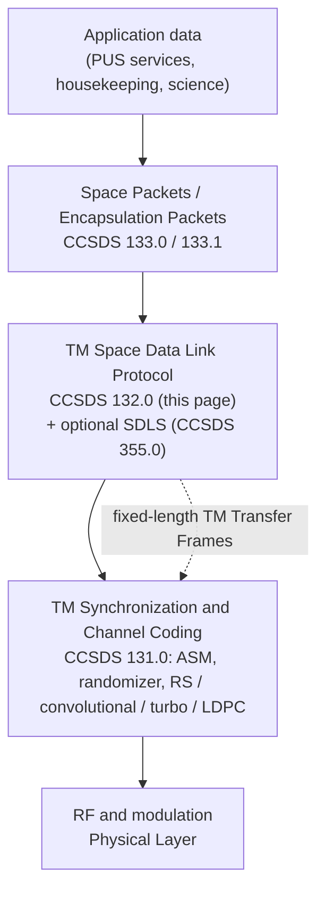
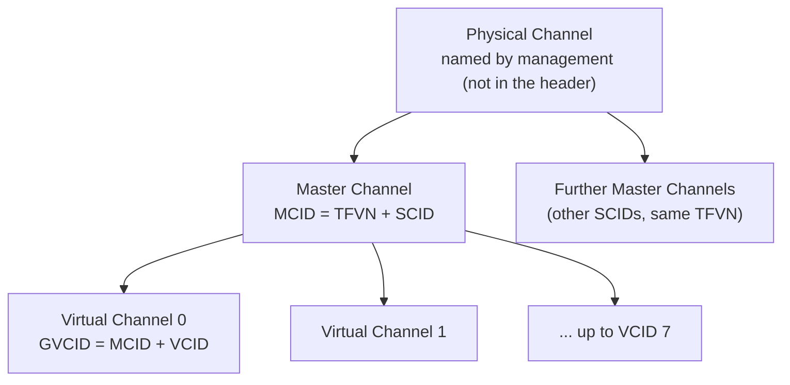
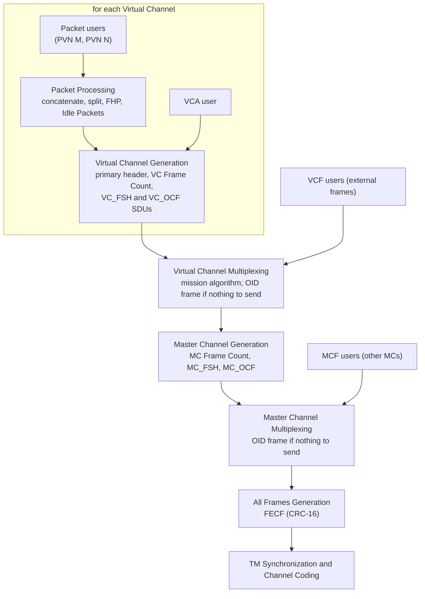
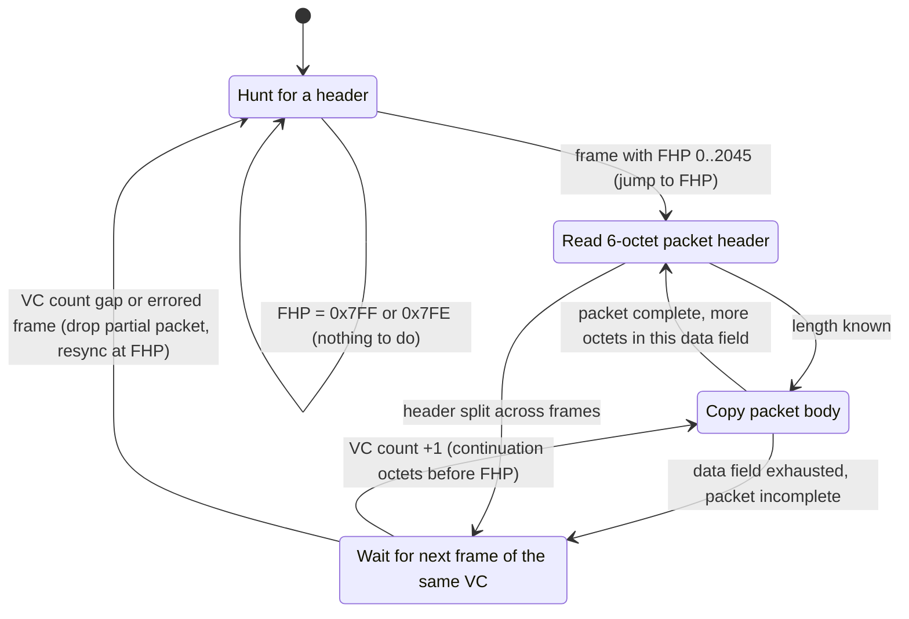

# TM Space Data Link Protocol (CCSDS 132.0-B-3)

The **TM Space Data Link Protocol** (TM SDLP) is the CCSDS Data Link Layer protocol that carries
telemetry from a spacecraft to the ground (or between spacecraft) inside fixed-length
**TM Transfer Frames**.[^b3-purpose] It takes variable-length [Space Packets](space-packet.md) (and a few
other kinds of data), packs them back to back into a constant stream of identical-length frames,
labels each frame with a spacecraft and [virtual channel](#channels-and-addressing) identity, and
optionally appends a 4-octet status word for the uplink (the [CLCW](cop-1.md)) and a 16-bit CRC. Below
it, the [TM synchronization and channel coding](tm-coding.md) sublayer adds the sync marker, the
pseudo-randomizer and the error-correcting code; above it sit the Space Packet Protocol and the
[PUS](../ecss/pus/index.md).[^b3-arch] Solar Orbiter, whose
[MIB](../missions/solar-orbiter/mib.md) and [SCOS-2000](../scos2000/index.md) ground system are used as
examples throughout this wiki, downlinks TM Transfer Frames as described here.[^sol-rd][^sol-tf]

!!! info "At a glance"
    | Item | Value |
    |---|---|
    | Current issue | CCSDS 132.0-B-3, October 2021 (B-1 2003, B-2 2015)[^b3-ctl] |
    | Frame length | Fixed per Physical Channel and Mission Phase; at most 2048 octets for TM[^c-len] |
    | Primary header | 6 octets, mandatory[^b3-tf] |
    | Optional fields | Secondary header (2 to 64 octets), Operational Control Field (4 octets), Frame Error Control Field (2 octets)[^b3-tf] |
    | Identifiers | TFVN `0b00` (2 bits), SCID (10 bits), VCID (3 bits, up to 8 VCs)[^b3-mcid] |
    | Frame counters | 8-bit Master Channel and 8-bit Virtual Channel counts, modulo 256[^b3-mcfc] |
    | Special First Header Pointer values | `0x7FF` (no packet starts here), `0x7FE` (only idle data)[^b3-fhp] |
    | Services | VCP, VCA, VC_FSH, VC_OCF, VCF, MC_FSH, MC_OCF, MCF[^b3-svc-table] |
    | ECSS equivalent | ECSS-E-ST-50-03C (2008), now superseded by the adoption notice ECSS-E-AS-50-22[^e50-adopt] |

## Where the protocol sits

CCSDS splits the OSI Data Link Layer into two sublayers. The TM SDLP is the upper one, the **Data Link
Protocol Sublayer**; it can optionally host the [Space Data Link Security](sdls.md) (SDLS) protocol.
The lower one, the **Synchronization and Channel Coding Sublayer**, delimits frames, adds
error-correction coding and guarantees bit transitions; for TM it is always specified by the TM
synchronization and channel coding standards.[^b3-arch][^g2-layers]



A space link normally pairs one forward physical channel with one or more return physical channels.
The usual combination is the [TC SDLP](tc-sdlp.md) on the uplink and the TM SDLP on the downlink; the
[AOS SDLP](aos.md) is the alternative for the return link when its extra features are needed, and only
one Space Data Link Protocol may be used on a given physical channel.[^g2-combos] The TC protocol relies
on the TM link in the other direction for its feedback: the CLCW of [COP-1](cop-1.md) normally travels in
the TM frame's Operational Control Field.[^g2-combos][^tc-clcw]

The TM SDLP provides unidirectional, unconfirmed, sequence-preserving and **incomplete** services: it
never retransmits, has no flow control and no connection set-up.[^b3-svc-common][^b3-func] Lost frames
are simply lost; some services can tell the receiver that a gap occurred. If complete delivery is
required, a higher layer must retransmit.[^g2-retx]

## Design principles

* **Fixed-length frames at a constant rate.** Fixed-length protocol data units make synchronization
  simple and robust on weak, noisy links. The length is set by management for a Physical Channel and a
  Mission Phase, and frames must be transmitted at a constant rate.[^b3-feat][^b3-func] Changing the
  frame length can make the receiver lose lock.[^b3-tf]
* **Virtual channels.** One Physical Channel is shared by up to eight logical streams per spacecraft,
  each with its own sequence counter and possibly its own service options.[^b3-feat][^g2-vc]
* **Upward compatibility with time-division telemetry.** CCSDS designed the frame structure so that
  conventional base-band receiving equipment could support it, and to be decodable efficiently after
  strong channel coding (unlike HDLC, which assumes nearly error-free links).[^g2-hdlc]
* **Management instead of in-line signalling.** Parameters that rarely change (frame length, which
  optional fields exist, which VCIDs are valid) are not transmitted; both ends know them from a
  management system (see [Managed parameters](#managed-parameters)).[^b3-mp]

## Channels and addressing

Three identifier fields appear in every frame header: the **Transfer Frame Version Number** (TFVN),
the **Spacecraft Identifier** (SCID) and the **Virtual Channel Identifier** (VCID). Their
concatenations define the channel hierarchy (the standard writes the concatenation as "+"):[^b3-addr]

$$\text{MCID} = \text{TFVN} + \text{SCID} \qquad \text{GVCID} = \text{MCID} + \text{VCID} = \text{TFVN} + \text{SCID} + \text{VCID}$$



* A **Virtual Channel** is the set of frames with the same GVCID; a **Master Channel** is the set of
  frames with the same MCID on a Physical Channel. Most missions have a single Master Channel, which is
  then identical to the Physical Channel, but several spacecraft (same TFVN, different SCIDs) can share
  one Physical Channel.[^b3-addr] ECSS gives a probe carried by another spacecraft as an example.[^e03-mc]
* The **Physical Channel Name** is a character string set by management and never transmitted.[^b3-addr][^g2-tfvn]
* TC and TM frames both use TFVN `0b00` (version 1); AOS frames use `0b01`. TC and TM frames are told
  apart by the sync pattern (ASM versus TC start sequence) or by management.[^b3-mcid][^g2-tfvn]
* SCIDs are assigned by the Space Assigned Numbers Authority (SANA). A SCID is unique only within a
  frequency band, so the same value can belong to a different spacecraft in another band. The 10-bit
  SCID space is shared by TC and TM; AOS has its own 8-bit space, so a spacecraft using TC up and AOS
  down needs two SCIDs.[^b3-mcid][^g2-tfvn]

!!! example "Solar Orbiter"
    The CCSDS spacecraft identifier of Solar Orbiter is `0x28A` (650 decimal), and the same SCID is
    used for the flight model, the "ETB" and the "OBC-DM" (abbreviations not expanded in the ICD).[^sol-tf][^sol-tcvc]
    The ECSS standard notes that projects may instead obtain separate SCIDs for development vehicles
    and simulated data streams.[^e03-scid]

## The TM Transfer Frame

### Overall structure

A TM Transfer Frame contains up to five fields, always in this order and without gaps:[^b3-tf]

| Field | Length | Presence | Controlled by |
|---|---|---|---|
| Transfer Frame Primary Header | 6 octets | Mandatory | Always present |
| Transfer Frame Secondary Header | 2 to 64 octets | Optional | Secondary Header Flag; static per MC or VC |
| Transfer Frame Data Field | Remainder of the frame | Mandatory | Contains packets, one VCA_SDU, or idle data |
| Operational Control Field (OCF) | 4 octets | Optional | OCF Flag; static per MC or VC |
| Frame Error Control Field (FECF) | 2 octets | Optional | Management; static per Physical Channel |

The OCF and FECF together form the **Transfer Frame Trailer**. The start of each frame is signalled by
the coding sublayer (the Attached Sync Marker), which is not part of the frame.[^b3-tf][^hb-tf] The data
field length is the fixed frame length minus the primary header and whichever of secondary header and
trailer are present:[^b3-df]

$$L_{\text{data}} = L_{\text{frame}} - 6 - L_{\text{FSH}} - 4\,[\text{OCF}] - 2\,[\text{FECF}]$$

The TM SDLP Blue Book itself defers the allowed lengths to the coding standards; the coding standard
allows any whole number of octets up to 2048 for uncoded or convolutionally coded TM, and specific
lengths for Reed-Solomon, turbo and LDPC codes (see [allowed frame lengths](tm-coding.md#allowed-transfer-frame-lengths)).[^b3-tf][^c-len]
ECSS-E-ST-50-03C states the 2048-octet maximum explicitly.[^e03-gen]

### Primary header

As in all CCSDS documents, bit 0 is the first bit transmitted and, for numeric fields, the most
significant bit; octets are numbered from 0 and spare bits are always `0`.[^b3-conv]

<div class="bitfield" data-title="TM Transfer Frame Primary Header (48 bits)" data-width="16"
     data-fields='[{"n":"TFVN","b":2,"v":"00","g":"Master Channel ID","d":"Transfer Frame Version Number; 00 = version 1 TM frame"},
                   {"n":"Spacecraft ID","b":10,"g":"Master Channel ID","d":"SCID assigned by SANA, static for all mission phases"},
                   {"n":"VCID","b":3,"d":"Virtual Channel Identifier, 0 to 7"},
                   {"n":"OCF flag","b":1,"d":"1 = Operational Control Field present"},
                   {"n":"Master Channel Frame Count","b":8,"d":"Modulo-256 count of frames on the Master Channel"},
                   {"n":"Virtual Channel Frame Count","b":8,"d":"Modulo-256 count of frames on this Virtual Channel"},
                   {"n":"Sec. hdr flag","b":1,"g":"Data Field Status","d":"1 = Transfer Frame Secondary Header present"},
                   {"n":"Sync flag","b":1,"g":"Data Field Status","d":"0 = packets or idle data, 1 = VCA_SDU"},
                   {"n":"Packet order","b":1,"g":"Data Field Status","d":"Reserved (0) when Sync flag = 0"},
                   {"n":"Segment length ID","b":2,"g":"Data Field Status","d":"11 when Sync flag = 0"},
                   {"n":"First Header Pointer","b":11,"g":"Data Field Status","d":"Offset of first packet header in the data field; 0x7FF none, 0x7FE idle"}]'></div>

| Field | Bits | Values | Meaning |
|---|---|---|---|
| Transfer Frame Version Number | 0–1 | `0b00` | Identifies a version 1 TM frame.[^b3-mcid] |
| Spacecraft Identifier | 2–11 | 0–1023 | Spacecraft associated with the data; static throughout all Mission Phases.[^b3-mcid] |
| Virtual Channel Identifier | 12–14 | 0–7 | Virtual Channel of the frame. VCIDs need not be consecutive.[^b3-vcid] |
| Operational Control Field Flag | 15 | `0`, `1` | `1` if the OCF is present; static within the associated MC or VC for a Mission Phase.[^b3-ocff] |
| Master Channel Frame Count | 16–23 | 0–255 | Sequential count, modulo 256, of frames on the Master Channel.[^b3-mcfc] |
| Virtual Channel Frame Count | 24–31 | 0–255 | Sequential count, modulo 256, of frames on the Virtual Channel.[^b3-vcfc] |
| Transfer Frame Secondary Header Flag | 32 | `0`, `1` | `1` if a secondary header is present; static within the associated MC or VC.[^b3-dfs] |
| Synchronization Flag | 33 | `0`, `1` | `0`: octet-synchronized, forward-ordered packets or idle data; `1`: a VCA_SDU. Static per VC.[^b3-dfs] |
| Packet Order Flag | 34 | `0` | Reserved by CCSDS and set to `0` when Sync = 0; undefined when Sync = 1.[^b3-dfs] |
| Segment Length Identifier | 35–36 | `0b11` | Set to `11` when Sync = 0; undefined when Sync = 1.[^b3-dfs] |
| First Header Pointer | 37–47 | 0–2045, `0x7FE`, `0x7FF` | Position of the first octet of the first packet that starts in the data field.[^b3-fhp] |

**Master Channel Identifier.** The first 12 bits are read as one unit, the MCID, by the
receiving end's master channel demultiplexer; frames whose SCID or TFVN is not in the managed list of
valid values are discarded.[^b3-mcid][^b3-mcr]

**Frame counts.** Both counters increment by one per frame on their channel and must not be reset
before reaching 255 unless that is unavoidable; after an unavoidable reset the receiver can no longer
tell whether the sequence is complete.[^b3-mcfc][^b3-vcfc] The Master Channel count lets the receiver
check the whole Master Channel; the Virtual Channel count gives each VC its own accountability and is
the basis for systematic packet extraction and for the optional loss flags of the services.[^b3-vcfc][^b3-vcr]
ECSS phrases the reset rule as "not reset before reaching 255 unless there is a major system reset".[^e03-counts]
The Virtual Channel Frame Count is generated by the VC Generation Function, while the Master Channel
Frame Count is filled in later by the MC Generation Function, after virtual channel multiplexing.[^b3-vcg][^b3-mcg]

!!! warning "Inference"
    An 8-bit counter cannot reveal the loss of a multiple of 256 consecutive frames on one channel. On
    a Master Channel shared by several VCs, the MC count still detects losses when the VC count of a
    rarely used VC would not, which is one practical reason for having both counters. The ECSS
    extended VC frame count (below) removes most of this ambiguity. This reasoning is the wiki's own,
    built on the field definitions.[^b3-mcfc][^e03-evcfc]

**Transfer Frame Data Field Status.** The last two octets describe the content of the data field.

<div class="bitfield" data-title="Transfer Frame Data Field Status (16 bits)" data-width="16"
     data-fields='[{"n":"Sec. hdr flag","b":1},{"n":"Sync flag","b":1},{"n":"Packet order flag","b":1},
                   {"n":"Segment length ID","b":2,"v":"11","d":"Legacy field from the removed Source Packet Segments"},
                   {"n":"First Header Pointer","b":11,"d":"0..2045 offset, 0x7FF no packet starts, 0x7FE only idle data"}]'></div>

The Segment Length Identifier is a fossil: earlier issues allowed Source Packet Segments, which are no
longer defined, and the value `11` is the one that meant "no segments".[^b3-dfs] The Synchronization
Flag tells the receiver whether the First Header Pointer is meaningful at all: with Sync = 1 the data
field carries a privately formatted VCA_SDU and the pointer, Packet Order Flag and Segment Length
Identifier are undefined by CCSDS (they are passed to the user as the "VCA Status Fields").[^b3-dfs][^b3-fhp][^b3-vca]

**First Header Pointer (FHP).** Octets of the data field are numbered from 0. The FHP holds the binary
position of the first octet of the **first packet that starts** in this frame, so the receiver can
find a packet header even if it missed the previous frame. Subsequent packets are located through each
packet's own length field.[^b3-fhp]

| FHP value | Binary | Meaning |
|---|---|---|
| 0 to 2045 (at most 2041 in practice, see below) | — | Offset of the first packet header starting in this data field. Octets before it belong to a packet continued from an earlier frame of the same VC.[^b3-fhp] |
| `0x7FF` (2047) | `11111111111` | No packet starts in this data field (a long packet continues through it).[^b3-fhp] |
| `0x7FE` (2046) | `11111111110` | The data field contains only idle data: an **OID Transfer Frame**.[^b3-fhp][^b3-oid] |

!!! warning "Inference"
    The standard reserves the two values `0x7FE` and `0x7FF` but states no maximum offset. Because a TM
    frame is at most 2048 octets, its data field is at most 2042 octets (2048 minus the 6-octet primary
    header), so a real offset never exceeds 2041 and can never collide with the reserved values. This
    calculation is the wiki's own.[^c-len][^b3-fhp]

### Secondary header

The optional **Transfer Frame Secondary Header** (FSH) follows the primary header. It is associated
either with the Master Channel (then present, with the same length, in every frame of the MC) or with
one Virtual Channel (then present in every frame of that VC). Its length is fixed for the associated
channel for a Mission Phase.[^b3-sh][^e03-sh]

| Subfield | Bits | Values | Meaning |
|---|---|---|---|
| Secondary Header Version Number | 0–1 | `0b00` | Version 1, the only version defined.[^b3-sh] |
| Secondary Header Length | 2–7 | 1–63 | Total secondary header length in octets **minus one**; static.[^b3-sh] |
| Secondary Header Data Field | 8 … | 1 to 63 octets | Mission data; CCSDS defines no content.[^b3-sh][^b3-sdu] |

The secondary header is the vehicle of the VC_FSH and MC_FSH services, whose SDUs are 2 to 64 octets
long.[^b3-sdu] ECSS-E-ST-50-03C adds one standardized use, inherited from the ESA Packet Telemetry
Standard: the **extended virtual channel frame count**. The secondary header is then 4 octets long
(length field = 3) and its 24-bit data field counts the roll-overs of the 8-bit VC frame count, giving a
32-bit count with the most significant 24 bits in the secondary header.[^e03-evcfc] The ECSS handbook
explains that ESA missions used it to sequence frames reliably, in particular when recorded frames
are played back, and to detect losses without reference to ground receive time; it is not defined by
CCSDS.[^hb-diff][^e03-ccsds]

<div class="bitfield" data-title="Solar Orbiter Transfer Frame Secondary Header (32 bits)" data-width="32"
     data-fields='[{"n":"FSH version","b":2,"v":"00","g":"Secondary Header ID"},
                   {"n":"FSH length","b":6,"v":"000011","g":"Secondary Header ID","d":"Total length 4 octets minus one"},
                   {"n":"Extended VC frame count (24 most significant bits)","b":24,"d":"Roll-over count of the 8-bit VC Frame Count in the primary header"}]'></div>

Solar Orbiter puts a secondary header in every frame, with identification octet `0b00000011` and a
3-octet extension of the VC frame counter. This is the layout of the ECSS extended count; the ICD
requires its frames to follow ECSS-E-ST-50-03C.[^sol-sh][^sol-rd]

### Transfer Frame Data Field

The data field holds either **packets**, exactly **one VCA_SDU**, or **idle data**. Packets and
VCA_SDUs are never mixed on one VC; which of the two a VC carries is fixed by management for a Mission
Phase, and idle data may appear on a VC that carries packets.[^b3-df] Packets are inserted contiguously
and in forward order, so the first and the last packet of a data field are often fragments of packets
that started in an earlier frame or continue in a later frame of the same VC.[^b3-df]

The packets must have a CCSDS-authorized Packet Version Number, and the service provider must know
where each version keeps its length field, because that is how packets are delimited.[^b3-sdu][^g2-pkts]
In practice these are [Space Packets](space-packet.md) and
[Encapsulation Packets](encapsulation.md); the TM Blue Book points to the SANA registry for the list of
authorized version numbers.[^b3-sdu]

**OID frames.** When a frame must be released and there is not enough data for it, the protocol sends
an **Only Idle Data (OID) Transfer Frame**: its FHP is `0x7FE` and its data field is filled with a
pseudo-noise (PN) sequence. Issue 3 makes the PN content mandatory: a 32-cell Linear Feedback Shift
Register with polynomial $D^0 + D^1 + D^2 + D^{22} + D^{32}$, initialized once at device start-up (all
ones in the Fibonacci form, `00000000001111111111111111111101` in the Galois form) and never
restarted, so consecutive OID frames continue the same sequence.[^b3-oid][^b3-annexd] The pattern starts
`FF FF FF FF 6D B6 D8 61 45 1F 11 F1 97 16 72 3C BE 7E 00 B1`.[^b3-annexd]

* The OID frame's VCID must be that of a VC that carries packets; CCSDS prefers a VC dedicated to
  idle frames, unless the secondary header or OCF content of a particular VC must be sent.[^b3-oid]
* The secondary header and OCF of an OID frame can still carry valid data, and an OID frame can be
  inserted even in the middle of a packet that is split across frames.[^b3-oid]
* The idle data of an OID frame is not the same thing as an Idle Packet. The random pattern is there
  to avoid reception problems caused by insufficient randomization.[^b3-oid]

!!! warning "Inference"
    The CCSDS coding Green Book (2020) describes how OID frames filled with zeros, after the short
    255-bit randomizer, produced periodic transmitted sequences and spectral lines that could violate
    ITU power-flux-density limits, and proposes filling OID data fields with a long, free-running PN
    sequence such as a 32-cell LFSR. The Green Book suggests doing this inside the coding sublayer, so
    that the data link layer could keep filling OID data fields with zeros.[^g1-oid] The 2021 TM SDLP
    issue instead mandates such a free-running 32-cell LFSR in the data link layer itself (§4.1.4.6,
    with example generators in the new Annex D). That the second is a response to the first is this wiki's
    reading; the TM SDLP itself only says the random pattern avoids problems from insufficient
    randomization.[^b3-oid][^b3-ctl] ECSS-E-ST-50-03C (2008) still left the idle pattern as a mission
    configuration parameter.[^e03-mcp]

### Operational Control Field

The optional 4-octet **OCF** follows the data field. Like the secondary header, it is associated
either with the Master Channel or with one Virtual Channel and is then present in every frame of that
channel.[^b3-ocf] Bit 0 is the **Type Flag**:[^b3-ocf]

* `0`: **Type-1-Report**, a [Communications Link Control Word](cop-1.md) (CLCW) reporting the state of
  the on-board telecommand receiver (FARM) to the ground (FOP).
* `1`: **Type-2-Report**. In CCSDS 132.0-B-3, bit 1 then distinguishes project-specific content (`0`)
  from an SDLS Frame Security Report (`1`). In ECSS-E-ST-50-03C, written before the SDLS extended
  procedures, bit 1 = `1` is reserved for future application.[^b3-ocf][^e03-ocf]

The Type Flag, and bit 1 of a Type-2 report, may change from frame to frame on the same channel.[^b3-ocf]
CCSDS warns that the VCs carrying the OCF must be sent often enough for the COP to work, because the
COP can time out if CLCWs do not arrive in time.[^b3-ocf] The ECSS handbook recommends using the OCF
only for Type-1 reports, and ECSS notes that some ground equipment can only retrieve an OCF associated
with the Master Channel.[^hb-rp][^e03-ocf]

<div class="bitfield" data-title="OCF carrying a Type-1-Report (CLCW, 32 bits)" data-width="32"
     data-fields='[{"n":"Type","b":1,"v":"0","d":"Control Word Type: 0 = CLCW"},
                   {"n":"Version","b":2,"v":"00"},
                   {"n":"Status field","b":3,"d":"Mission specific"},
                   {"n":"COP in effect","b":2,"v":"01","d":"01 = COP-1"},
                   {"n":"TC VC identifier","b":6,"d":"TC Virtual Channel this report refers to"},
                   {"n":"Spare","b":2,"v":"00"},
                   {"n":"No RF","b":1,"g":"Flags"},{"n":"No bit lock","b":1,"g":"Flags"},
                   {"n":"Lockout","b":1,"g":"Flags"},{"n":"Wait","b":1,"g":"Flags"},{"n":"Retransmit","b":1,"g":"Flags"},
                   {"n":"FARM-B counter","b":2,"d":"Two least significant bits of the count of accepted Type-B frames"},
                   {"n":"Spare","b":1,"v":"0"},
                   {"n":"Report value N(R)","b":8,"d":"Next expected TC frame sequence number V(R)"}]'></div>

The CLCW layout is defined by the TC Space Data Link Protocol, and each TC VC in use has its own CLCW
reporting.[^tc-clcw] Its semantics (lockout, wait, retransmit, FARM-B counter, N(R)) are explained on the
[COP-1 page](cop-1.md).

### Frame Error Control Field

The optional 16-bit **FECF** is the last field. Its presence is a management decision for the whole
Physical Channel and Mission Phase.[^b3-fecf] It is a cyclic redundancy check over the whole frame
except the FECF itself, computed with the generator polynomial $G(X) = X^{16} + X^{12} + X^5 + 1$ and a
shift register preset to all ones:[^b3-fecf]

$$\text{FECF} = \left[ X^{16}\, M(X) + X^{(n-16)}\, L(X) \right] \bmod G(X), \qquad L(X) = \sum_{i=0}^{15} X^i$$

where $M(X)$ is the $(n-16)$-bit frame content with the first transmitted bit as the highest-order
coefficient. The $X^{(n-16)} L(X)$ term is what presets the register to all ones. At the receiver the
syndrome $S(X) = [X^{16} C^*(X) + X^n L(X)] \bmod G(X)$ over the received frame, FECF included, is zero
for an error-free frame.[^b3-fecf]

* **Error detection only.** ECSS states that the FECF shall not be used for error correction.[^e03-fecf]
* **Capabilities.** For blocks shorter than 32,768 bits it detects every odd number of bit errors,
  every pattern of up to two bit errors (the Green Book says three), every single burst of 16 bits or
  less, and misses a random even-weight error pattern with probability of about $2^{-15}$
  (≈ 3 × 10⁻⁵).[^e03-fecf][^g1-crc]
* **When it is mandatory.** It must be present when neither Reed-Solomon nor LDPC coding is used;
  with Reed-Solomon or LDPC it is optional.[^c-fecf] ECSS-E-ST-50-03C (2008) exempts only
  Reed-Solomon-encoded frames.[^e03-fecf] The Green Book explains why:
  uncoded and convolutionally coded data have no error-detection capability of their own, and a turbo
  decoder has only a limited one, whereas the (255,223) Reed-Solomon decoder ($E$ = 16) already detects
  errors far better than the CRC. The $E$ = 8 code detects errors only about as well as the CRC, so the
  Green Book still requires the CRC in that case.[^g1-crc]

!!! warning "Inference"
    The definition above is the CRC-16 variant often called "CCITT-FALSE" (polynomial `0x1021`,
    initial value `0xFFFF`, no bit reflection, no final XOR). This wiki computed its check value on
    the ASCII string `123456789` as `0x29B1`, which can serve as an implementation test. The name and
    the test vector are not given in the CCSDS or ECSS documents.[^b3-fecf]

## Services

The TM SDLP defines eight services. Five work on a Virtual Channel, three on a Master Channel. Each
service user is addressed by a Service Access Point (SAP) address, shown in the last column.[^b3-svc-table]

| Service | Type | SDU | SAP address | What it is for |
|---|---|---|---|---|
| Virtual Channel Packet (VCP) | Asynchronous | Packet | GVCID + PVN | Variable-length packets, multiplexed by PVN on a VC.[^b3-vcp] |
| Virtual Channel Access (VCA) | Asynchronous or periodic | VCA_SDU | GVCID | Fixed-length, privately formatted blocks (one per frame).[^b3-vca] |
| VC Frame Secondary Header (VC_FSH) | Synchronous or periodic | FSH_SDU | GVCID | Fixed-length data in the secondary header of every frame of a VC.[^b3-fsh-ocf-svc] |
| VC Operational Control Field (VC_OCF) | Synchronous or periodic | OCF_SDU (4 octets) | GVCID | A 4-octet report in every frame of a VC.[^b3-fsh-ocf-svc] |
| Virtual Channel Frame (VCF) | Asynchronous or periodic | Transfer Frame | GVCID | Whole frames built by an independent entity, inserted on a VC.[^b3-frame-svc] |
| MC Frame Secondary Header (MC_FSH) | Synchronous or periodic | FSH_SDU | MCID | Secondary header data in every frame of the MC.[^b3-fsh-ocf-svc] |
| MC Operational Control Field (MC_OCF) | Synchronous or periodic | OCF_SDU (4 octets) | MCID | A 4-octet report in every frame of the MC.[^b3-fsh-ocf-svc] |
| Master Channel Frame (MCF) | Asynchronous or periodic | Transfer Frame | MCID | Whole frames of another Master Channel.[^b3-frame-svc] |

### Service types

The three service types describe how SDU submission relates to frame release:[^b3-svc-types][^g2-timing]

* **Asynchronous**: SDUs are queued and each is sent exactly once, in order, when the provider decides
  (for example according to the multiplexing rules).
* **Synchronous**: the SDU is placed in a one-deep buffer whose content is copied into every frame
  released on the associated channel. A value may therefore be sent several times, or overwritten
  before it is sent. It is essentially time-division multiplexing.
* **Periodic**: a synchronous (or VCA/VCF/MCF) service whose channel releases frames at a constant rate,
  with a specified maximum delay and jitter.

### Primitives and parameters

Every service has a `.request` primitive at the sending end and an `.indication` at the receiving end.
The optional parameters are how the receiving user learns about losses or security failures.[^b3-vcp][^b3-vca][^b3-fsh-ocf-svc][^b3-frame-svc]

| Service | `.request` parameters | `.indication` parameters |
|---|---|---|
| VCP | Packet, GVCID, Packet Version Number | Packet, GVCID, PVN, Packet Quality Indicator (opt.), Verification Status Code (opt.) |
| VCA | VCA_SDU, VCA Status Fields, GVCID | VCA_SDU, VCA Status Fields, GVCID, VCA_SDU Loss Flag (opt.), Verification Status Code (opt.) |
| VC_FSH / MC_FSH | FSH_SDU, GVCID / MCID | FSH_SDU, GVCID / MCID, FSH_SDU Loss Flag (opt.) |
| VC_OCF / MC_OCF | OCF_SDU, GVCID / MCID | OCF_SDU, GVCID / MCID, OCF_SDU Loss Flag (opt.) |
| VCF / MCF | Frame, GVCID / MCID | Frame, GVCID / MCID, Frame Loss Flag (opt.) |

* The **Packet Quality Indicator** says whether a delivered packet is complete or partial; it is
  required when the provider is asked to deliver incomplete packets.[^b3-vcp]
* The **VCA Status Fields** are the Packet Order Flag, the Segment Length Identifier and the First
  Header Pointer of a Sync = 1 frame. Their presence is mandatory, their meaning is up to the user.[^b3-vca]
* **Loss flags** are derived from the frame counts (VC count for VC services, MC count for MC services).[^b3-vca][^b3-vcr][^b3-mcr]
* The **Verification Status Code** exists only with SDLS: a non-zero value reports an SDLS failure, and
  data from the failed frame are not delivered.[^b3-vcp][^b3-vca]

### Rules that keep the services consistent

* An MCF service on a Master Channel excludes every other service on it; a VCF service excludes every
  other service on its VC.[^b3-restr]
* VC_FSH and MC_FSH cannot coexist on one Master Channel; nor can VC_OCF and MC_OCF.[^b3-restr]
* VCP and VCA cannot coexist on one VC.[^b3-restr]
* Frames given to the VCF or MCF services are **partially formatted**: they must have the same length
  as the provider's own frames, and the fields that the provider will fill later (MC frame count; MC
  secondary header and OCF if those MC services exist; FECF) are left empty.[^b3-partial][^b3-svc-desc]

The Green Book's example shows the services working together: urgent and non-urgent packets on VC 0 and
VC 1, an on-board clock-calibration value sent with VC_OCF on VC 0, and an encrypted stream cut into
fixed-length chunks and sent with VCA on VC 2.[^g2-example]

## Protocol procedures

### Sending end

Data flow down a fixed chain of functions, which CCSDS draws as the **channel tree**. Multiplexing
mixes streams with different identifiers; commutation places data from different services into the
same frame.[^b3-tree]



1. **Packet Processing** (one instance per packet VC) concatenates packets of all PVNs used on the VC
   into a contiguous string and cuts it into data fields. A packet that does not fit is split, the
   current data field is filled completely and the remainder starts the next data field of the same
   VC. The function sets the FHP to the first packet start, or to `0x7FF` if none. When there are not
   enough packets at release time it may add Idle Packets, either Space Packet Idle Packets (at least
   7 octets, so they may spill into the next frame) or Encapsulation Idle Packets (as short as 1
   octet), or it may produce an idle data field with FHP `0x7FE`.[^b3-ppf][^spp-idle]
2. **Virtual Channel Generation** (one per VC) builds the frame: puts the data field or VCA_SDU in place,
   generates the primary header and the VC frame count, inserts VC_FSH and VC_OCF SDUs, and leaves the
   MC frame count, MC secondary header, MC OCF and FECF empty.[^b3-vcg]
3. **Virtual Channel Multiplexing** (one per Master Channel with several VCs) orders the frames of the
   VCs and of the VCF users. The algorithm is not specified by CCSDS; projects choose it from priority,
   release rate and isochronous timing needs. If there is a single Master Channel and nothing is ready at
   a release time, this function generates an OID frame to keep the stream continuous.[^b3-vcm]
4. **Master Channel Generation** (one per MC) inserts MC_FSH and MC_OCF SDUs and the MC frame count.[^b3-mcg]
5. **Master Channel Multiplexing** (one per Physical Channel with several MCs) orders the MCs' frames
   and those of MCF users and, again, creates an OID frame if nothing is available.[^b3-mcm]
6. **All Frames Generation** (one per Physical Channel) computes and inserts the FECF if it is used.[^b3-afg]

### Receiving end

The receiving functions mirror the sending ones, from the bottom up:[^b3-afr][^b3-mcr][^b3-vcd][^b3-vcr][^b3-pef]

1. **All Frames Reception** recomputes the CRC; a frame with a detected error does not have to be
   delivered in cross-support situations.
2. **Master Channel Demultiplexing** routes frames by MCID and discards frames whose MCID is not valid.
3. **Master Channel Reception** extracts MC_FSH and MC_OCF SDUs and can flag gaps in the MC count.
4. **Virtual Channel Demultiplexing** routes frames by VCID and discards frames with an invalid VCID.
5. **Virtual Channel Reception** extracts the data field (to the packet extraction function or the VCA
   user) and the VC_FSH and VC_OCF SDUs, and can flag gaps in the VC count.
6. **Packet Extraction** uses the FHP and the packet length fields to delimit packets, completes a
   packet split across frames with the beginning of the next data field of the same VC, delivers packets
   to users by PVN, discards Idle Packets and idle data fields, and need not deliver incomplete packets.

One rule is worth stressing: if the position at which the extractor expects the next packet header
disagrees with the FHP, the **FHP wins** and extraction continues from the FHP.[^b3-pef] This is what
makes the stream self-healing after a lost or corrupted frame.

ECSS adds recommended practice: data fields of frames with uncorrectable errors should not be used by
packet extraction, and every missing or erroneous frame detected through the counters should be
signalled as a gap.[^hb-rp]

### Virtual channel multiplexing and quality of service

Virtual channels are the protocol's only tool for quality of service. A long, low-priority packet (a
memory dump, say) occupies its VC frame after frame; if a short urgent packet appears, a frame of
another, high-priority VC can be inserted between two frames of the long packet, because each VC
keeps its own packet assembly. The service provider needs buffer memory to do this, and the project
must design the multiplexing algorithm to meet its QoS needs; CCSDS recommends no standard algorithm.[^g2-vc]
The ECSS handbook suggests giving an instrument with very long packets its own VC, and choosing the
maximum packet length per VC with the waiting time of other sources in mind.[^hb-rp]

!!! example "Solar Orbiter's virtual channels"
    The Solar Orbiter TM/TC ICD lists a fixed downlink priority scheme:[^sol-vc]

    | Priority | VC | Content | Sent when |
    |---|---|---|---|
    | 1 | VC4 | Real-time high-priority TM | ready |
    | 2 | VC5 | Critical event log TM (playback) | ready, and no VC4 or VC0 frame available |
    | 3 | VC0 | Real-time TM | ready or when the time packet is due, and no VC4 |
    | 4 | VC1 | Playback TM from the OBC mass memory (OBC MM) | ready, no VC4, VC0 or VC5 |
    | 5 | VC2 | Playback TM from the Solid State Mass Memory (SSMM) | ready, no VC4, VC0, VC5 or VC1 |
    | 6 | VC3 | Playback TM from the SSMM | ready, none of the above |
    | 7 | VC7 | Idle frames only | nothing else available |

    VC0, VC1, VC4 and VC5 never carry compressed packets, VC2 and VC3 may; other VCs may contain Idle
    Packets; partially filled frames are completed with an Idle Packet.[^sol-vc][^sol-units] On the ground, the
    Solar Orbiter mission control system files telemetry in datastreams that map to VCs (1000 = VC0
    real-time non-science, 1001 = VC1 playback non-science, 1002 = VC2 science, 1003 = VC3 file
    transfer, with 2000+ for the offline copies).[^ddid-hdr] The two documents do not fully agree:
    the TM/TC ICD describes VC3 as SSMM playback rather than file transfer, and the data delivery ICD
    maps both offline streams 2001 and 2002 to VC1 (this wiki suspects a typing error). The ICD's own
    table mapping VCIDs to the on-board telemetry encoder channels is an image and is not reproduced
    here.[^sol-vc][^ddid-hdr] See [the Solar Orbiter mission page](../missions/solar-orbiter/index.md).

## How packets span frames: a worked example

The example below is **illustrative** (constructed for explanation, not captured telemetry) but uses
the real Solar Orbiter frame geometry: a 1115-octet frame whose data field is 1099 octets long.[^sol-tm][^sol-tf]
Four packets are sent on VC 0: P1 (300 octets), P2 (1000 octets), P3 (2500 octets) and P4 (50 octets).
Solar Orbiter's maximum packet length is 4112 octets, so P3 is legal.[^sol-tm]

| Frame (VC 0) | Data field octets | Content | FHP | Data Field Status (hex) |
|---|---|---|---|---|
| N | 0–299 | P1 complete | | |
| | 300–1098 | P2, first 799 octets | **0** | `0x9800` |
| N+1 | 0–200 | P2, last 201 octets | | |
| | 201–1098 | P3, first 898 octets | **201** | `0x98C9` |
| N+2 | 0–1098 | P3, octets 898–1996 (no header here) | **`0x7FF`** | `0x9FFF` |
| N+3 | 0–502 | P3, last 503 octets | | |
| | 503–552 | P4 complete | **503** | `0x99F7` |
| | 553–1098 | Idle Packet of 546 octets (APID `0x7FF`) | | |

The status octets assume Solar Orbiter's settings (secondary header present, Sync = 0, Packet Order
= 0, Segment Length ID = `11`).[^sol-hdr] The rules applied are those of the Packet Processing
Function: concatenate, split at the frame boundary, point to the first header that starts in the frame,
and fill with an Idle Packet when nothing else is ready.[^b3-ppf][^sol-vc] An Idle Packet of 546 octets has
a 6-octet header and 540 octets of data, so its Packet Data Length field is 539.[^spp-idle]

At the receiver, the extractor of VC 0 works like this:



!!! warning "Inference"
    The gap branch is common implementation practice rather than CCSDS text: the standard only says
    that the FHP is trusted over the computed position, that incomplete packets need not be delivered
    (or are delivered with the Packet Quality Indicator), and that frames with detected errors need not
    be delivered.[^b3-pef][^b3-vcp][^b3-afr] With the numbers above, losing frame N+1 also destroys P2
    and P3: the extractor cannot complete P2, and frame N+2 has FHP `0x7FF`, so it resynchronizes only at
    offset 503 of frame N+3 and recovers P4.

## Idle data in all its forms

Because the downlink is synchronous (a frame must leave at every slot), the protocol offers several ways
to send nothing useful:[^hb-idle][^b3-oid][^b3-ppf]

| Situation | Mechanism | What the receiver does |
|---|---|---|
| Some packets ready, data field not full | Idle Packet(s): Space Packet with APID `0b11111111111` (minimum 7 octets) or Encapsulation Idle Packet (minimum 1 octet) | Extracts and discards them |
| No packets ready on this VC, frame due | OID frame: FHP `0x7FE`, PN-filled data field | Ignores the data field; still processes secondary header and OCF |
| No frame ready on any VC | VC or MC multiplexer generates an OID frame on a packet VC | Same as above |
| VC carries VCA_SDUs (Sync = 1) | Not defined; the VCA_SDU is private | Up to the user |

The ECSS handbook adds that one large Idle Packet is kinder to the receiver than many short ones,
because ground systems may have packet-rate limits, and that an all-zero idle pattern without
randomization invites bit-synchronization problems.[^hb-idle] An Idle Packet may be followed by a normal
packet in the same data field.[^e03-idle]

## Managed parameters

Parameters that would waste link capacity if transmitted are fixed by management and must be known
identically at both ends.[^b3-mp] Issue 3 also lists them, with allowed values, in the PICS proforma of
Annex A.[^b3-pics]

| Scope | Managed parameter | Allowed values |
|---|---|---|
| Physical Channel | Physical Channel Name | Character string |
| | Transfer Frame Length (octets) | Integer |
| | Transfer Frame Version Number | 1 (binary `00`) |
| | Valid Spacecraft IDs | Set of integers |
| | MC Multiplexing Scheme | Mission specific |
| | Presence of Frame Error Control | Present, Absent |
| Master Channel | Spacecraft ID | Integer |
| | Valid VCIDs | Set of integers from 0 to 7 |
| | VC Multiplexing Scheme | Mission specific |
| | Presence of MC_FSH; MC_FSH Length | Present/Absent; 2 to 64 octets |
| | Presence of MC_OCF | Present, Absent |
| Virtual Channel | Spacecraft ID, VCID | Integer; 0 to 7 |
| | Data Field Content | Packets, VCA_SDU |
| | Presence of VC_FSH; VC_FSH Length | Present/Absent; integer |
| | Presence of VC_OCF | Present, Absent |
| Packet transfer | Valid Packet Version Numbers | Set selected from the SANA PVN registry |
| | Maximum Packet Length (octets) | Integer |
| | Delivery of incomplete packets | Required, Not required |

The rows above restate Tables 5-1 to 5-4.[^b3-mp] ECSS-E-ST-50-03C presents the same information as
"mission configuration parameters" and adds two that CCSDS leaves implicit: the handling of frames with
detected errors (deliver or discard) and the pattern of idle data.[^e03-mcp] SANA keeps registries of the
data link managed parameters and their values.[^g2-hdlc]

## The SDLS option

With the optional [Space Data Link Security](sdls.md) protocol, each VC can individually be protected by
authentication, encryption or authenticated encryption. A **Security Header** follows the primary (or
secondary) header and an optional **Security Trailer** follows the data field, both shrinking the data
field; the primary and secondary headers themselves are unchanged.[^b3-sdls-frame][^b3-feat]

| Without SDLS | With SDLS |
|---|---|
| Primary header · Secondary header · Data field · OCF · FECF | Primary header · Secondary header · **Security Header** · Data field · **Security Trailer** · OCF · FECF |

* What is protected depends on the service: VCP and VCA SDUs can be authenticated and encrypted; VC_FSH
  SDUs can only be authenticated; OCF, VCF and all Master Channel service data are not protected.[^b3-sdls-table]
* At the sending end the SDLS ApplySecurity function is called either from VC Generation (one security
  association per VC, the most flexible arrangement) or from VC Multiplexing (one association shared by
  several VCs, applied to the multiplexed stream). An OID frame created by the MC multiplexer must use a
  VC without SDLS.[^b3-sdls-send]
* At the receiving end ProcessSecurity sits at the matching point; frames that fail verification are
  discarded, and the Verification Status Code can tell the user why.[^b3-sdls-recv]
* Additional managed parameters per VC: presence and length of the Security Header and of the Security
  Trailer. The presence of a Security Header is what signals that SDLS is in use on the VC.[^b3-sdls-mp]

## ECSS and legacy variants

The European Cooperation for Space Standardization (ECSS) published the TM frame as ECSS-E-ST-50-03C
(31 July 2008), whose differences annex is written against CCSDS 132.0-B-1.[^e03-ccsds] ECSS-E-ST-50C
Rev.1 (March 2021) lists the adoption notice ECSS-E-AS-50-22, which adopts the CCSDS Blue Book directly
(then CCSDS 132.0-B-2) and supersedes the TM Transfer Frame topic of ECSS-E-ST-50-03C; by January 2023
its Rev.1 adopted CCSDS 132.0-B-3.[^e50-adopt][^as25-ctx] See [ECSS-E-ST-50C communications](../ecss/e-st-50-communications.md).

=== "ECSS-E-ST-50-03C vs CCSDS"

    * Adds the **extended VC frame count** in the secondary header (not in CCSDS).[^e03-ccsds]
    * Avoids the term "OID Transfer Frame" because such a frame may still carry useful secondary header
      and OCF data, but gives the FHP value `0x7FE` the same meaning.[^e03-ccsds][^hb-diff]
    * Reserves Type-2 OCF reports with bit 1 = `1`, which CCSDS 132.0-B-3 now uses for SDLS Frame
      Security Reports.[^e03-ocf][^b3-ocf]
    * Makes the FECF mandatory unless the frame is Reed-Solomon encoded.[^e03-fecf]

=== "ESA PSS-04-106 (1988) vs ECSS"

    The ECSS standard lists what changed from the ESA Packet Telemetry Standard:[^e03-pss]

    * PSS allowed only 892, 1115 or 1784 octets with Reed-Solomon coding and 128 to 2040 octets without;
      ECSS allows up to 2048 octets within the coding standard's constraints.
    * PSS fixed the frame length for the whole mission; ECSS fixes it per mission phase.
    * PSS did not distinguish Master and Physical Channels; OCF and secondary header were per Physical
      Channel, and the secondary header was always 32 bits.
    * PSS reserved all Type-2 reports and set the FHP to all ones when Sync = 1; ECSS leaves the FHP
      undefined in that case.
    * Field names changed (for example "Frame Error Control Word" became "Frame Error Control Field").

=== "Asynchronously inserted data (legacy)"

    ECSS keeps a legacy mechanism for playing back frames recorded on board (originally on tape
    recorders): recorded TM frames, with their sync markers, are placed in the data field of real-time
    frames with Sync = 1 on a dedicated VC, forward or reverse. In forward mode the recorded markers must
    use the alternative pattern `0x352EF853`, otherwise they could disturb frame synchronization on the
    ground. CLCWs inside recorded frames must not be fed to the real-time telecommand system. The
    handbook recommends this only for legacy support.[^e03-async][^hb-playback][^hb-rp]

## Solar Orbiter: a real TM frame configuration

The Solar Orbiter TM/TC and packet structure ICD (Airbus, issue 7) requires all TM Transfer Frames to
conform to ECSS-E-ST-50-03C, with project remarks that fix every option of the
protocol:[^sol-rd][^sol-tf][^sol-hdr][^sol-sh]

| Item | Solar Orbiter value |
|---|---|
| Frame length (before encoding) | 1115 octets (8920 bits), the only allowed length |
| TFVN | `0b00` |
| SCID | `0x28A` = 650 |
| OCF flag | `1` in all frames; the OCF holds a CLCW (Type Flag `0`) |
| Master and VC frame counts | Modulo 256; any unavoidable reset to be documented in the user manual |
| Secondary header | Present in all frames, ID `0b00000011`, 3-octet VC frame count extension |
| Sync flag / Packet Order / Segment Length ID | `0` / `0` / `0b11` |
| First Header Pointer | Packet offset, `0x7FF` if no header starts, `0x7FE` for idle frames (VC7) |
| FECF | Present in every frame |
| Data field | 1099 octets; packets longer than this (up to 4112 octets) are split across frames[^sol-tm] |

The frame budget is $1115 = 6 + 4 + 1099 + 4 + 2$ octets (primary header, secondary header, data
field, OCF, FECF). 1115 octets is also the information length of a turbo codeword with $k = 8920$ bits
and of a Reed-Solomon (255,223) codeblock with interleaving depth 5, and one of the three frame lengths
the old ESA Packet Telemetry Standard allowed with Reed-Solomon coding.[^c-len][^e03-pss] Solar
Orbiter's MIB calibrates turbo rates 1/2 and 1/4; that the downlink is turbo coded is an inference
discussed in [TM coding: Solar Orbiter](tm-coding.md#solar-orbiter-turbo-coding-in-the-mib).[^mib]

With the fields above, the first two header octets are fixed per VC (illustrative values computed by
this wiki from the documented field values):

| VC | Octets 0–1 | VC | Octets 0–1 |
|---|---|---|---|
| 0 | `0x28A1` | 4 | `0x28A9` |
| 1 | `0x28A3` | 5 | `0x28AB` |
| 2 | `0x28A5` | 7 (idle) | `0x28AF` |
| 3 | `0x28A7` | | |

<div class="bitfield" data-title="Solar Orbiter VC0 frame primary header (counts and FHP illustrative)" data-width="16"
     data-fields='[{"n":"TFVN","b":2,"v":"00"},{"n":"SCID 650","b":10,"v":"1010001010"},{"n":"VCID","b":3,"v":"000"},{"n":"OCF","b":1,"v":"1"},
                   {"n":"MC count","b":8,"v":"0x12"},{"n":"VC count","b":8,"v":"0x34"},
                   {"n":"FSH","b":1,"v":"1"},{"n":"Sync","b":1,"v":"0"},{"n":"POF","b":1,"v":"0"},{"n":"SLID","b":2,"v":"11"},{"n":"FHP","b":11,"v":"0"}]'></div>

### How the MIB sees the frame

Besides the spacecraft packets, the Solar Orbiter MIB release of 16 September 2025 defines internal
"mini-transfer frame" packets that expose every header and trailer field of a received frame as
monitoring parameters.[^mib] They have APID 1966 and PUS-like type 161,
with subtypes 5, 4 and 3 for good, bad and idle frames. [Rosetta and Mars Express used the same internal
APID 1966](../missions/rosetta-mex-vex.md), with type 190 and subtypes 21, 20 and 29 for good, bad and
idle transfer frames.[^mex-int]

| SPID | Description | Type/Subtype | [TPCF](../mib/tables/tpcf.md) name | Size (octets) |
|---|---|---|---|---|
| [66980](../explorer/index.md#/solo/packet/66980) | Good mini-transfer frame | 161/5 | `MTFGOOD` | 28 |
| [66981](../explorer/index.md#/solo/packet/66981) | Bad mini-transfer frame | 161/4 | `MTFBAD` | 16 |
| [66982](../explorer/index.md#/solo/packet/66982) | Idle mini-transfer frame | 161/3 | `MTFIDLE` | 16 |
| 1000006 / 1000002 / 1000003 | Good / bad / idle complete transfer frame | 0/0, APID 1 | `CTFGOOD` / `CTFBAD` / `CTFIDLE` | 6 |

The good-frame packet has 50 parameter placements ([PLF](../mib/tables/plf.md)) and the bad and idle
ones 29 each, identical in the April 2020 and September 2025 releases.[^mib][^mib2020] For the good frame (SPID 66980):

| Offset (octet.bit) | Parameter | Description | [PTC/PFC](../mib/parameter-types.md) | Width |
|---|---|---|---|---|
| 0.0 | [NYG00641](../explorer/index.md#/solo/param/NYG00641) | TF Version number | 2/2 | 2 bits |
| 0.2 | [NYG00642](../explorer/index.md#/solo/param/NYG00642) | Spacecraft Id. | 3/6 | 10 bits |
| 1.4 | [NYG00643](../explorer/index.md#/solo/param/NYG00643) | VC Id. | 2/3 | 3 bits |
| 1.7 | [NYG00644](../explorer/index.md#/solo/param/NYG00644) | Ops Control Field Flag | 1/0 | 1 bit |
| 2.0 | [NYG00645](../explorer/index.md#/solo/param/NYG00645) | MCF Count | 3/4 | 8 bits |
| 3.0 | [NYG00646](../explorer/index.md#/solo/param/NYG00646) | VCF Count | 3/4 | 8 bits |
| 4.0 | [NYG00647](../explorer/index.md#/solo/param/NYG00647) | TF Secondary Header Flag | 1/0 | 1 bit |
| 4.1 | [NYG00648](../explorer/index.md#/solo/param/NYG00648) | Synch. Flag | 1/0 | 1 bit |
| 4.2 | [NYG00649](../explorer/index.md#/solo/param/NYG00649) | Packet Order Flag | 1/0 | 1 bit |
| 4.3 | [NYG00650](../explorer/index.md#/solo/param/NYG00650) | Segment Length Id. | 2/2 | 2 bits |
| 4.5 | [NYG00651](../explorer/index.md#/solo/param/NYG00651) | First Header Pointer | 3/7 | 11 bits |
| 6.0 | [NYGG0652](../explorer/index.md#/solo/param/NYGG0652) | TF Secondary Header ID | 3/4 | 8 bits |
| 7.0 | [NYGG0653](../explorer/index.md#/solo/param/NYGG0653) | TF Secondary Header Data | 3/13 | 24 bits |
| 10.0 | [NYGG0670](../explorer/index.md#/solo/param/NYGG0670) | Operational Cntrl Field (whole word) | 3/14 | 32 bits |
| 10.0–13.0 | NYGD0655 … NYGD0668 | CLCW subfields (type, version, status, COP, VC Id, flags, FARM-B, report value) | various | 1–8 bits |
| 14.0 | [NYGG0669](../explorer/index.md#/solo/param/NYGG0669) | Frame Error Cntrl Field | 3/12 | 16 bits |
| 16.0, 20.0, 24.0 | NYG00538/539/540 | ERT sec / msec / psec | 3/14 | 32 bits each |

The widths come from the SCOS-2000 parameter type table (PTC 3, PFC 4 = 8-bit unsigned, PFC 6 = 10 bits,
PFC 7 = 11 bits, PFC 12 = 16 bits, PFC 13 = 24 bits, PFC 14 = 32 bits; PTC 2 = enumerated with PFC bits;
PTC 1 PFC 0 = 1-bit Boolean), and offsets are counted from the end of the SCOS-2000 packet header with
bit 0 as the leftmost bit of the octet.[^icd-ptc][^icd-plf]

!!! warning "Inference"
    The offsets show that a "mini-transfer frame" is the TM frame with its data field removed: 6 octets
    of primary header, 4 of secondary header, 4 of OCF and 2 of FECF make exactly the 16 octets of
    `MTFBAD` and `MTFIDLE`; `MTFGOOD` adds 12 octets of Earth Reception Time. The ICD does not define
    these internal packets; this is deduced from the MIB rows.[^mib]

The CLCW subfields are defined twice more with a **validity parameter**: parameters `NYGDA6xx` are
valid only when the CLCW VC Id (`NYGD0659`) equals 1, and `NYGDB6xx` only when it equals 2, so the
reports of Solar Orbiter's two telecommand VCs (one per on-board TC decoder) are kept apart.[^mib][^icd-valid][^sol-tcvc]
The "VC1/VC2 Lockout" and "VC1/VC2 Retransmit" parameters carry [textual calibrations](../mib/calibration.md)
([CYGT0663TM](../explorer/index.md#/solo/calib/txt/CYGT0663TM): 0 = `NO LOCKOUT`, 1 = `LOCKOUT`;
[CYGT0665TM](../explorer/index.md#/solo/calib/txt/CYGT0665TM): 0 = `NO RETRANSMIT`, 1 = `RETRANSMIT`) and
[monitoring checks](../mib/monitoring-checks.md) (hard-severity status checks, [OCP](../mib/tables/ocp.md)
`OCP_TYPE` = `H`) that expect
`NO LOCKOUT` and `NO RETRANSMIT`, applicable only when the ground variable `NYG01923` "CMD VC ID" has the
matching value 1 or 2.[^mib][^icd-ocp] `NYG01923` is placed in SPID 66832, described as the
"MISC_PACKET: Config variables packet MISCdynamic server".[^mib]

!!! warning "Inference"
    Read together, these rows mean that the control system alarms on FARM lockout or a retransmit
    request only for the TC virtual channel it is currently commanding on, and ignores the CLCW of the
    other decoder. The MIB does not state this intent; it is deduced from the applicability criteria.

??? example "SQL used"
    ```sql
    -- mini-transfer frame packets and their sizes
    SELECT PID_SPID, PID_TYPE, PID_STYPE, PID_APID, PID_DESCR FROM pid
     WHERE PID_APID = '1966' AND PID_TYPE = '161';
    SELECT * FROM tpcf WHERE TPCF_SPID IN ('66980','66981','66982','1000002','1000003','1000006');
    -- parameter layout of the good mini-frame
    SELECT p.PLF_NAME, p.PLF_OFFBY, p.PLF_OFFBI, c.PCF_DESCR, c.PCF_PTC, c.PCF_PFC
      FROM plf p JOIN pcf c ON c.PCF_NAME = p.PLF_NAME
     WHERE p.PLF_SPID = '66980'
     ORDER BY CAST(p.PLF_OFFBY AS INT), CAST(p.PLF_OFFBI AS INT);
    -- per-TC-VC CLCW parameters (validity) and their checks
    SELECT PCF_NAME, PCF_DESCR, PCF_VALID, PCF_VALPAR, PCF_CURTX FROM pcf WHERE PCF_NAME LIKE 'NYGD%';
    SELECT * FROM ocp WHERE OCP_NAME IN ('NYGDA663','NYGDA665','NYGDB663','NYGDB665');
    SELECT * FROM txp WHERE TXP_NUMBR IN ('CYGT0659TM','CYGT0663TM','CYGT0665TM');
    -- the same layout in the April 2020 release
    SELECT COUNT(*) FROM plf WHERE PLF_SPID = '66980';
    ```
    Run with `sqlite3 -readonly` against `solo-2025-09-16.sqlite` and `solo-2020-04-16.sqlite`. See
    also [the Solar Orbiter MIB page](../missions/solar-orbiter/mib.md) and the
    [PID](../mib/tables/pid.md), [PCF](../mib/tables/pcf.md) and [TXP](../mib/tables/txp.md) table
    references.

In the SCOS-2000 packet header used for Solar Orbiter data delivery, the RouteID field labels each
stored item with a data unit type: TM Transfer Frame (0) with qualifier good, bad or idle, TM Source
Packet (1), or internal MCS packet (2), the last including a CLCW qualifier.[^ddid-route]

## Frames, time correlation and the ground segment

The frame is also the time reference of the downlink. In the ESA Packet Telemetry scheme quoted in the
Rosetta and Mars Express interface document, the on-board clock is sampled at the leading edge of the
first bit of the sync marker of the VC 0 frame whose VC frame count is 0 (or every 128, 64 … 1 frames
of VC 0), the sample is sent in the spacecraft time packet before VC 0 has counted 255 more frames, and
the ground station time-tags the same marker bit.[^mex-tc] SCOS-2000's time correlation defines frame
radiation, reception and Earth Reception Time against that same marker edge.[^tco-times] See
[time correlation in SCOS-2000](../scos2000/time-correlation.md).

On the ground, the [SLE return services](sle/return-services.md) deliver TM frames to the control
centre: Return All Frames (RAF) delivers every frame of a physical channel, Return Channel Frames (RCF)
a Master Channel or selected VCs, and Return Operational Control Field (ROCF) just the OCFs.[^g2-sle]
RAF annotates each frame with its Earth Reception Time, the antenna, a good/erred quality flag and a
data-link-continuity value, and removes Reed-Solomon check symbols from frames that decoded
correctly.[^raf-prod] How ESOC's ground station interface hands frames to SCOS-2000 is described on the
[NCTRS and NIS page](../scos2000/nctrs-nis.md), and how packets are then interpreted with the
[MIB](../mib/index.md) on the [MIB monitoring page](../mib/monitoring.md). The end-to-end path is described in
[Downlink: from on-board parameter to operator display](../overview/downlink.md).

## Related pages

* [TM synchronization and channel coding](tm-coding.md) — the sublayer below this one.
* [Space Packet Protocol](space-packet.md) and [Encapsulation Packet Protocol](encapsulation.md) — what
  travels in the data field.
* [COP-1 and the CLCW](cop-1.md), [TC Space Data Link Protocol](tc-sdlp.md) — the uplink partner.
* [AOS](aos.md) and [USLP](uslp.md) — the other fixed-length frame protocols.
* [Space Data Link Security](sdls.md) — the security option.
* [CCSDS protocol stack overview](index.md), [glossary](../glossary.md),
  [reference catalogue](../references/index.md).

[^b3-purpose]: [CCSDS 132.0-B-3, TM Space Data Link Protocol](../library/ccsds-132-0-132x0b3.md), §1.1, PDF p. 11.
[^b3-ctl]: [CCSDS 132.0-B-3](../library/ccsds-132-0-132x0b3.md), Document Control, PDF p. 7.
[^b3-conv]: [CCSDS 132.0-B-3](../library/ccsds-132-0-132x0b3.md), §1.6.3, PDF p. 15.
[^b3-arch]: [CCSDS 132.0-B-3](../library/ccsds-132-0-132x0b3.md), §2.1.1 and Figure 2-1, PDF p. 17.
[^b3-feat]: [CCSDS 132.0-B-3](../library/ccsds-132-0-132x0b3.md), §2.1.2, PDF p. 18.
[^b3-addr]: [CCSDS 132.0-B-3](../library/ccsds-132-0-132x0b3.md), §2.1.3 and Figure 2-2, PDF pp. 18–19.
[^b3-svc-common]: [CCSDS 132.0-B-3](../library/ccsds-132-0-132x0b3.md), §2.2.1, PDF p. 20.
[^b3-svc-types]: [CCSDS 132.0-B-3](../library/ccsds-132-0-132x0b3.md), §2.2.2, PDF pp. 20–22.
[^b3-svc-table]: [CCSDS 132.0-B-3](../library/ccsds-132-0-132x0b3.md), §2.2.3.1 and Table 2-1, PDF pp. 22–23.
[^b3-sdls-table]: [CCSDS 132.0-B-3](../library/ccsds-132-0-132x0b3.md), Table 2-2, PDF pp. 23–24.
[^b3-svc-desc]: [CCSDS 132.0-B-3](../library/ccsds-132-0-132x0b3.md), §§2.2.3.6 and 2.2.3.9, PDF pp. 25–27.
[^b3-restr]: [CCSDS 132.0-B-3](../library/ccsds-132-0-132x0b3.md), §2.2.4, PDF p. 27.
[^b3-func]: [CCSDS 132.0-B-3](../library/ccsds-132-0-132x0b3.md), §2.3.1, PDF pp. 27–28.
[^b3-tree]: [CCSDS 132.0-B-3](../library/ccsds-132-0-132x0b3.md), §2.3.2 and Figures 2-5 to 2-7, PDF pp. 28–30.
[^b3-sdu]: [CCSDS 132.0-B-3](../library/ccsds-132-0-132x0b3.md), §§3.2.1–3.2.5, PDF pp. 32–34.
[^b3-partial]: [CCSDS 132.0-B-3](../library/ccsds-132-0-132x0b3.md), §3.2.6, PDF p. 34.
[^b3-vcp]: [CCSDS 132.0-B-3](../library/ccsds-132-0-132x0b3.md), §3.3 (VCP service), PDF pp. 34–37.
[^b3-vca]: [CCSDS 132.0-B-3](../library/ccsds-132-0-132x0b3.md), §3.4 (VCA service), PDF pp. 38–41.
[^b3-fsh-ocf-svc]: [CCSDS 132.0-B-3](../library/ccsds-132-0-132x0b3.md), §§3.5, 3.6, 3.8, 3.9 (VC_FSH, VC_OCF, MC_FSH, MC_OCF), PDF pp. 42–47 and 51–56.
[^b3-frame-svc]: [CCSDS 132.0-B-3](../library/ccsds-132-0-132x0b3.md), §§3.7 and 3.10 (VCF, MCF), PDF pp. 48–50 and 57–59.
[^b3-tf]: [CCSDS 132.0-B-3](../library/ccsds-132-0-132x0b3.md), §4.1.1 and Figure 4-1, PDF pp. 60–61.
[^b3-mcid]: [CCSDS 132.0-B-3](../library/ccsds-132-0-132x0b3.md), §4.1.2.2, PDF p. 62.
[^b3-vcid]: [CCSDS 132.0-B-3](../library/ccsds-132-0-132x0b3.md), §4.1.2.3, PDF pp. 62–63.
[^b3-ocff]: [CCSDS 132.0-B-3](../library/ccsds-132-0-132x0b3.md), §4.1.2.4, PDF p. 63.
[^b3-mcfc]: [CCSDS 132.0-B-3](../library/ccsds-132-0-132x0b3.md), §4.1.2.5, PDF p. 63.
[^b3-vcfc]: [CCSDS 132.0-B-3](../library/ccsds-132-0-132x0b3.md), §4.1.2.6, PDF pp. 63–64.
[^b3-dfs]: [CCSDS 132.0-B-3](../library/ccsds-132-0-132x0b3.md), §§4.1.2.7.1–4.1.2.7.5, PDF pp. 64–65.
[^b3-fhp]: [CCSDS 132.0-B-3](../library/ccsds-132-0-132x0b3.md), §4.1.2.7.6, PDF p. 66.
[^b3-sh]: [CCSDS 132.0-B-3](../library/ccsds-132-0-132x0b3.md), §4.1.3, PDF pp. 66–68.
[^b3-df]: [CCSDS 132.0-B-3](../library/ccsds-132-0-132x0b3.md), §§4.1.4.1–4.1.4.5, PDF pp. 68–69.
[^b3-oid]: [CCSDS 132.0-B-3](../library/ccsds-132-0-132x0b3.md), §4.1.4.6, PDF pp. 69–70.
[^b3-ocf]: [CCSDS 132.0-B-3](../library/ccsds-132-0-132x0b3.md), §4.1.5, PDF pp. 70–71.
[^b3-fecf]: [CCSDS 132.0-B-3](../library/ccsds-132-0-132x0b3.md), §4.1.6, PDF pp. 71–74.
[^b3-ppf]: [CCSDS 132.0-B-3](../library/ccsds-132-0-132x0b3.md), §4.2.2, PDF pp. 75–76.
[^b3-vcg]: [CCSDS 132.0-B-3](../library/ccsds-132-0-132x0b3.md), §4.2.3, PDF pp. 76–77.
[^b3-vcm]: [CCSDS 132.0-B-3](../library/ccsds-132-0-132x0b3.md), §4.2.4, PDF pp. 77–78.
[^b3-mcg]: [CCSDS 132.0-B-3](../library/ccsds-132-0-132x0b3.md), §4.2.5, PDF pp. 78–79.
[^b3-mcm]: [CCSDS 132.0-B-3](../library/ccsds-132-0-132x0b3.md), §4.2.6, PDF pp. 79–80.
[^b3-afg]: [CCSDS 132.0-B-3](../library/ccsds-132-0-132x0b3.md), §4.2.7, PDF p. 80.
[^b3-pef]: [CCSDS 132.0-B-3](../library/ccsds-132-0-132x0b3.md), §4.3.2, PDF pp. 81–82.
[^b3-vcr]: [CCSDS 132.0-B-3](../library/ccsds-132-0-132x0b3.md), §4.3.3, PDF pp. 82–83.
[^b3-vcd]: [CCSDS 132.0-B-3](../library/ccsds-132-0-132x0b3.md), §4.3.4, PDF p. 84.
[^b3-mcr]: [CCSDS 132.0-B-3](../library/ccsds-132-0-132x0b3.md), §§4.3.5–4.3.6, PDF pp. 85–86.
[^b3-afr]: [CCSDS 132.0-B-3](../library/ccsds-132-0-132x0b3.md), §4.3.7, PDF p. 87.
[^b3-mp]: [CCSDS 132.0-B-3](../library/ccsds-132-0-132x0b3.md), §5 and Tables 5-1 to 5-4, PDF pp. 88–90.
[^b3-sdls-frame]: [CCSDS 132.0-B-3](../library/ccsds-132-0-132x0b3.md), §6.3 and Figure 6-1, PDF pp. 91–94.
[^b3-sdls-send]: [CCSDS 132.0-B-3](../library/ccsds-132-0-132x0b3.md), §6.4, PDF pp. 94–96.
[^b3-sdls-recv]: [CCSDS 132.0-B-3](../library/ccsds-132-0-132x0b3.md), §6.5, PDF pp. 97–98.
[^b3-sdls-mp]: [CCSDS 132.0-B-3](../library/ccsds-132-0-132x0b3.md), §6.6 and Table 6-1, PDF pp. 98–99.
[^b3-pics]: [CCSDS 132.0-B-3](../library/ccsds-132-0-132x0b3.md), Annex A (PICS proforma), PDF pp. 100–108.
[^b3-annexd]: [CCSDS 132.0-B-3](../library/ccsds-132-0-132x0b3.md), Annex D, PDF p. 112.
[^g2-combos]: [CCSDS 130.2-G-3, Space Data Link Protocols—Summary of Concept and Rationale](../library/ccsds-130-2-130x2g3.md), §2.2, PDF pp. 13–15.
[^g2-layers]: [CCSDS 130.2-G-3](../library/ccsds-130-2-130x2g3.md), §2.3, PDF pp. 15–16.
[^g2-timing]: [CCSDS 130.2-G-3](../library/ccsds-130-2-130x2g3.md), §3.2.4.3, PDF pp. 23–24.
[^g2-example]: [CCSDS 130.2-G-3](../library/ccsds-130-2-130x2g3.md), §3.4 and Figure 3-4, PDF pp. 29–30.
[^g2-sle]: [CCSDS 130.2-G-3](../library/ccsds-130-2-130x2g3.md), §3.5, PDF p. 31.
[^g2-vc]: [CCSDS 130.2-G-3](../library/ccsds-130-2-130x2g3.md), §4.2 and Figure 4-2, PDF pp. 32–34.
[^g2-tfvn]: [CCSDS 130.2-G-3](../library/ccsds-130-2-130x2g3.md), §§4.3.2–4.3.5, PDF pp. 35–36.
[^g2-retx]: [CCSDS 130.2-G-3](../library/ccsds-130-2-130x2g3.md), §4.4.1, PDF p. 36.
[^g2-pkts]: [CCSDS 130.2-G-3](../library/ccsds-130-2-130x2g3.md), §4.5.3, PDF p. 39.
[^g2-hdlc]: [CCSDS 130.2-G-3](../library/ccsds-130-2-130x2g3.md), §§5.1 and 5.3, PDF p. 40.
[^e03-gen]: [ECSS-E-ST-50-03C, Telemetry transfer frame protocol](../library/ecss-e-st-50-03c-31july2008.md), §5.1 requirement b and Table 5-1, PDF p. 12.
[^e03-mc]: [ECSS-E-ST-50-03C](../library/ecss-e-st-50-03c-31july2008.md), §4.3, PDF p. 11.
[^e03-scid]: [ECSS-E-ST-50-03C](../library/ecss-e-st-50-03c-31july2008.md), §5.2.2.3 NOTE 2, PDF p. 16.
[^e03-counts]: [ECSS-E-ST-50-03C](../library/ecss-e-st-50-03c-31july2008.md), §§5.2.5–5.2.6, PDF pp. 16–17.
[^e03-sh]: [ECSS-E-ST-50-03C](../library/ecss-e-st-50-03c-31july2008.md), §5.3.1, PDF pp. 20–21.
[^e03-evcfc]: [ECSS-E-ST-50-03C](../library/ecss-e-st-50-03c-31july2008.md), §5.3.4, PDF pp. 22–23.
[^e03-idle]: [ECSS-E-ST-50-03C](../library/ecss-e-st-50-03c-31july2008.md), §5.4.3.4 requirement g, PDF p. 26.
[^e03-async]: [ECSS-E-ST-50-03C](../library/ecss-e-st-50-03c-31july2008.md), §5.4.4, PDF p. 27.
[^e03-ocf]: [ECSS-E-ST-50-03C](../library/ecss-e-st-50-03c-31july2008.md), §5.5, PDF pp. 28–29.
[^e03-fecf]: [ECSS-E-ST-50-03C](../library/ecss-e-st-50-03c-31july2008.md), §5.6, PDF pp. 29–31.
[^e03-pss]: [ECSS-E-ST-50-03C](../library/ecss-e-st-50-03c-31july2008.md), Annex B (changes from ESA-PSS-04-106), PDF pp. 34–36.
[^e03-ccsds]: [ECSS-E-ST-50-03C](../library/ecss-e-st-50-03c-31july2008.md), Annex C (differences from CCSDS), PDF p. 37.
[^e03-mcp]: [ECSS-E-ST-50-03C](../library/ecss-e-st-50-03c-31july2008.md), Annex D (mission configuration parameters), PDF pp. 38–42.
[^hb-tf]: [ECSS-E-HB-50A, Communications guidelines](../library/ecss-e-hb-50a-15november2008.md), §4.6.2.1, PDF p. 54.
[^hb-diff]: [ECSS-E-HB-50A](../library/ecss-e-hb-50a-15november2008.md), §4.6.3, PDF pp. 57–59.
[^hb-rp]: [ECSS-E-HB-50A](../library/ecss-e-hb-50a-15november2008.md), §4.6.5, PDF pp. 59–60.
[^hb-playback]: [ECSS-E-HB-50A](../library/ecss-e-hb-50a-15november2008.md), §5.3.1, PDF p. 127.
[^hb-idle]: [ECSS-E-HB-50A](../library/ecss-e-hb-50a-15november2008.md), §5.4.1 and Table 5-3, PDF pp. 128–131.
[^c-len]: [CCSDS 131.0-B-5, TM Synchronization and Channel Coding](../library/ccsds-131-0-131x0b5.md), §11 (Transfer Frame lengths; uncoded and convolutional §§11.3–11.4, Reed-Solomon §11.5, turbo §11.7, LDPC §§11.8–11.9), PDF pp. 73–75.
[^c-fecf]: [CCSDS 131.0-B-5](../library/ccsds-131-0-131x0b5.md), §12.2, PDF p. 76.
[^g1-oid]: [CCSDS 130.1-G-3, TM Synchronization and Channel Coding—Summary of Concept and Rationale](../library/ccsds-130-1-130x1g3e1.md), §9.2.4, PDF pp. 98–100.
[^g1-crc]: [CCSDS 130.1-G-3](../library/ccsds-130-1-130x1g3e1.md), §§9.4.3.2 and 9.4.4, PDF pp. 113–114.
[^tc-clcw]: [CCSDS 232.0-B-4, TC Space Data Link Protocol](../library/ccsds-232-0-232x0b4e1c1.md), §4.2.1 and Figure 4-6, PDF pp. 80–86.
[^spp-idle]: [CCSDS 133.0-B-2, Space Packet Protocol](../library/ccsds-133-0-133x0b2e2.md), §§4.1.3.3.4.4 and 4.1.3.5, PDF pp. 34 and 36; minimum Idle Packet lengths from [CCSDS 132.0-B-3](../library/ccsds-132-0-132x0b3.md), §4.2.2.5 NOTE, PDF p. 75.
[^e50-adopt]: [ECSS-E-ST-50C Rev.1, Communications](../library/ecss-e-st-50c-rev-1-1march2021.md), table of adoption notices, PDF p. 20.
[^as25-ctx]: [ECSS-E-AS-50-25C Rev.1](../library/ecss-e-as-50-25c-rev-1-13january2023.md), §2 (overview of superseded standards), PDF p. 6, and Bibliography, PDF p. 23.
[^sol-tm]: [SOL.S.ASTR.TN.00079, Solar Orbiter TM-TC and Packet Structure ICD, Issue 7](../library/sol-s-astr-tn-00079-07.md), §4.1, PDF p. 23.
[^sol-tf]: [SOL.S.ASTR.TN.00079](../library/sol-s-astr-tn-00079-07.md), §4.3, requirements PUS-242 to PUS-246 and the note on the shared SCID, PDF pp. 27–28.
[^sol-rd]: [SOL.S.ASTR.TN.00079](../library/sol-s-astr-tn-00079-07.md), §4.3 requirement PUS-240, PDF p. 27, and §2.2 (reference document RD1 = ECSS-E-ST-50-03C), PDF p. 13.
[^sol-vc]: [SOL.S.ASTR.TN.00079](../library/sol-s-astr-tn-00079-07.md), §4.3, requirements PUS-248 to PUS-264, PDF p. 28.
[^sol-hdr]: [SOL.S.ASTR.TN.00079](../library/sol-s-astr-tn-00079-07.md), §4.3, requirements PUS-271 to PUS-285, PDF pp. 29–30.
[^sol-sh]: [SOL.S.ASTR.TN.00079](../library/sol-s-astr-tn-00079-07.md), §4.3, requirements PUS-289 to PUS-5784, PDF p. 30.
[^sol-units]: [SOL.S.ASTR.TN.00079](../library/sol-s-astr-tn-00079-07.md), §1.1 (Solid State Mass Memory), PDF p. 11, and OBC Mass Memory (OMM), PDF p. 67.
[^sol-tcvc]: [SOL.S.ASTR.TN.00079](../library/sol-s-astr-tn-00079-07.md), TC frame header, requirements PUS-153 and PUS-155, PDF p. 21.
[^ddid-hdr]: [SOL-ESC-IF-05011, Solar Orbiter Data Delivery ICD, Issue 1 Rev 2](../library/solo-ddid-i1r2.md), §7.1.1 (Stream ID), PDF pp. 20–21.
[^ddid-route]: [SOL-ESC-IF-05011](../library/solo-ddid-i1r2.md), §7.1.2 (RouteID data unit types), PDF p. 23.
[^mib]: [Solar Orbiter MIB release MIB__20250916M25925PFMS001_SOL](../library/mib-20250916m25925pfms001-sol.md), tables `pid`, `pic`, `tpcf`, `plf`, `pcf`, `txf`, `txp`, `ocf`, `ocp`, queried by this wiki (see "SQL used").
[^mib2020]: [Solar Orbiter MIB release MIB__20200416M10720PFMS001_SOL](../library/mib-20200416m10720pfms001-sol.md), tables `pid` and `plf`, queried by this wiki.
[^icd-ptc]: [SCOS-2000 Database Import ICD, issue 7.0](../library/icd-7-0-final.md), Appendix A (SCOS-2000 parameter types), PDF pp. 214–215. The Solar Orbiter database follows the issue 7.2 layout; the types used here are the same.
[^icd-plf]: [SCOS-2000 Database Import ICD, issue 7.0](../library/icd-7-0-final.md), §3.3.2.5.1 (PLF_OFFBY, PLF_OFFBI), PDF pp. 97–98.
[^icd-valid]: [SCOS-2000 Database Import ICD, issue 7.0](../library/icd-7-0-final.md), §3.3.2.1.1 (PCF_VALID, PCF_VALPAR), PDF pp. 45 and 52.
[^icd-ocp]: [SCOS-2000 Database Import ICD, issue 7.0](../library/icd-7-0-final.md), §3.3.2.3.2 (ocp, applicability criteria OCP_RLCHK/OCP_VALPAR, OCP_TYPE), PDF pp. 75–78.
[^mex-int]: [RO-ESC-IF-5003 / MEX-ESC-IF-5003, Rosetta/Mars Express MCS DDID, Issue B5](../library/mex-esc-if-5003-b5.md), Appendix K §18.1.1, PDF p. 126.
[^mex-tc]: [RO-ESC-IF-5003 / MEX-ESC-IF-5003](../library/mex-esc-if-5003-b5.md), §18.1.2.1.1 (quoting the ESA Packet Telemetry Standard), PDF p. 127.
[^tco-times]: [EGOS-MCS-S2K-TN-1030, Technical Note – Time Correlation](../library/tn-1030-time-correlation.md), §6.1, PDF p. 26.
[^raf-prod]: [CCSDS 911.1-B-5, SLE Return All Frames Service](../library/ccsds-911-1-911x1b5e1.md), §§2.4.1–2.4.2, PDF pp. 27–28.
