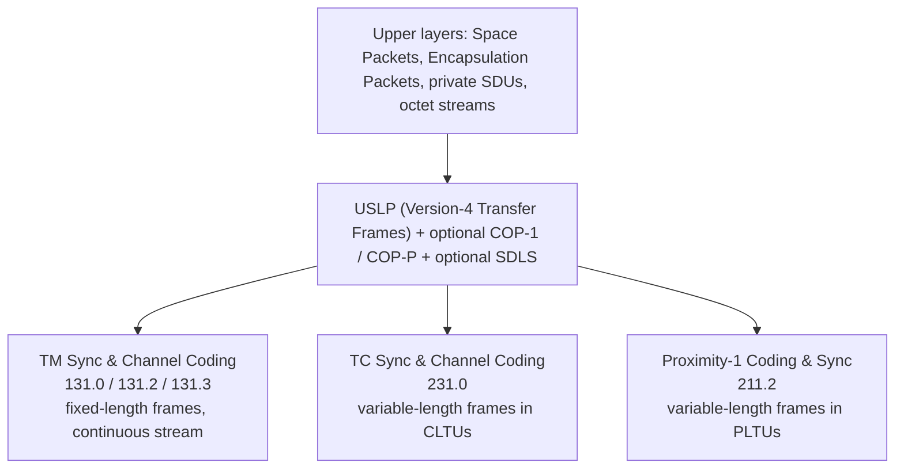
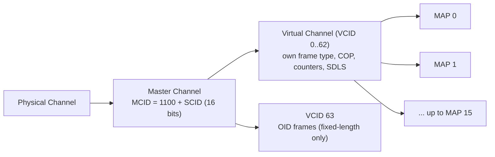
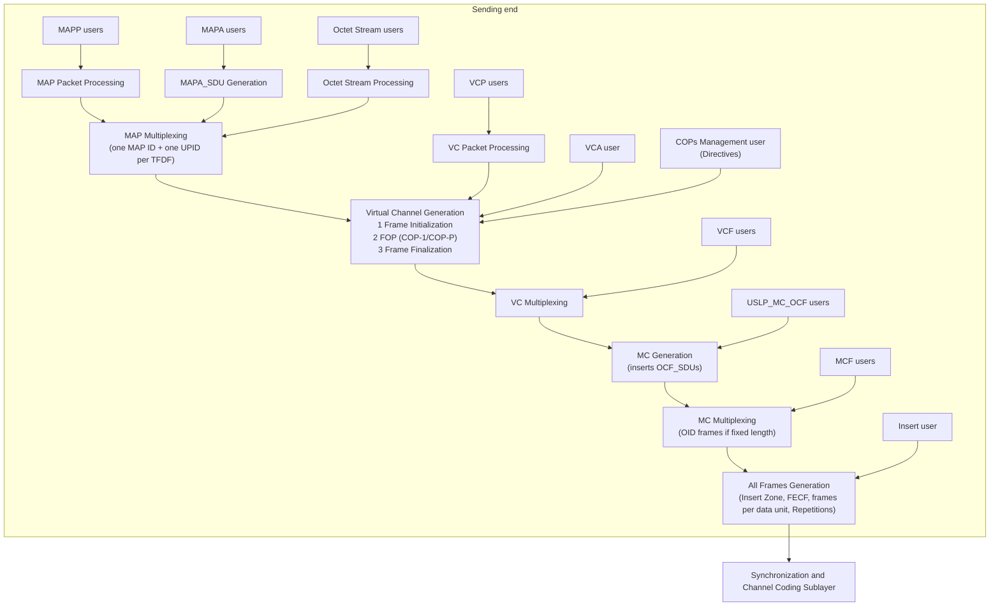
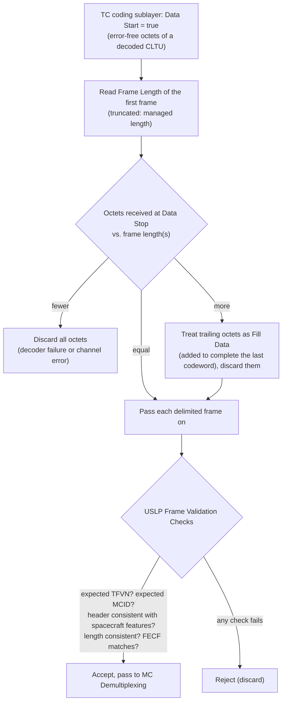
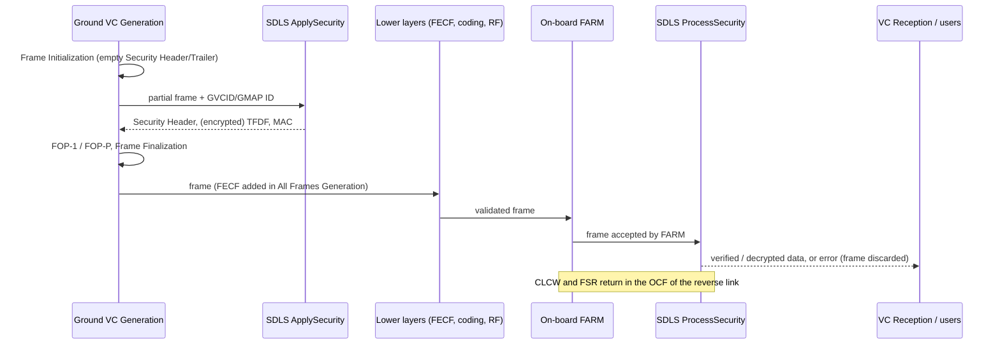

# Unified Space Data Link Protocol (CCSDS 732.1-B-3)

The **Unified Space Data Link Protocol** (USLP) is the newest CCSDS protocol for the Data Link
Protocol Sublayer. It is a single protocol for space-to-ground, ground-to-space and
space-to-space links.[^u-purpose] CCSDS released it in 2018 and envisions it as the data link
protocol of future robotic and crewed missions, in place of TM, TC, AOS and
[Proximity-1](proximity-1.md).[^g4-uslp][^g4-uslp-2] In this wiki's reading (see the
[comparison below](#how-uslp-unifies-tm-tc-aos-and-proximity-1), flagged as inference), it
combines features of its predecessors. From [TM](tm-sdlp.md) and [AOS](aos.md) it takes
fixed-length frames, idle frames, the First Header Pointer and the Insert Zone. From
[TC](tc-sdlp.md) it takes variable-length frames, Multiplexer Access Points and
[COP-1](cop-1.md). From Proximity-1 it takes the source-or-destination addressing and COP-P.
The standard itself names as additions a larger maximum frame (up to 65 536 octets), a larger
spacecraft address space (16-bit SCIDs), a frame counter whose length can be configured, and a
small header at the start of each data field that says how the data is organized.[^u-features][^u-tfdf-concept][^u-flen]

This page follows CCSDS 732.1-B-3 (June 2024, with Editorial Change 1 of October 2024), held in
the [library](../library/ccsds-732-1-732x1b3e1.md). Issue 3 adds the Virtual Channel Packet and
Virtual Channel Access services and allows more than one frame per CLTU, as in the TC
specification. It also adds a table, a diagram and text on the processing order of COP and SDLS
to the security section, as TC has.[^u-doc]

!!! info "At a glance"
    | Property | Value |
    |---|---|
    | Transfer Frame Version Number | `0b1100` (Version 4)[^u-tfvn] |
    | Frame length | Variable, or fixed per Physical Channel; maximum 65 536 octets[^u-flen] |
    | Primary Header | 7 to 14 octets (non-truncated); 4 octets (truncated)[^u-frame][^u-trunc] |
    | Spacecraft ID | 16 bits (0 to 65 535)[^u-tfvn][^u-sana] |
    | Virtual Channel ID | 6 bits; 63 reserved for Only Idle Data frames[^u-vcid] |
    | MAP ID | 4 bits (up to 16 MAP Channels per VC)[^u-map] |
    | VC Frame Count | 0 to 7 octets, chosen per VC[^u-vcfcl] |
    | Data Field Header | 1 to 3 octets: construction rule, protocol ID, optional pointer[^u-tfdfh] |
    | Retransmission | Optional, by COP-1 or COP-P (sequence-controlled QoS)[^u-cop] |
    | Security | Optional [SDLS](sdls.md), per VC or per MAP[^u-sdls-opt][^u-sdls-frame] |
    | Lower layers | TM, TC or Proximity-1 synchronization and coding (CCSDS 131.0, 131.2, 131.3, 231.0, 211.2)[^u-arch] |

## Why a unified protocol

The rationale is set out in §2.1.2 of the standard:[^u-features][^u-efficient]

* **Bigger frames.** The maximum frame is larger than in earlier protocols. High-rate missions
  then handle fewer frames.
* **More spacecraft.** A larger address space identifies more spacecraft. The SCID grows to 16
  bits so that future SCID requests can be met.[^u-c-scid]
* **A counter that scales.** Frame sizes now range much more widely, so the frame sequence
  counter has a configurable size.
* **Segmentation and blocking.** Large SDUs can be cut into smaller pieces. On a noisy link each
  piece is then less likely to be lost, and a retransmission resends only a small piece. Small
  SDUs can be grouped into one frame for efficiency.
* **Optional reliability and security.** COP-1 or COP-P provide reliable delivery and SDLS
  provides security. Both are selectable per Virtual Channel.[^u-cop][^u-sdls-opt]

The same frame format runs over every CCSDS synchronization and coding standard. Over the TM
standards (131.0, 131.2, 131.3) the Physical Channel carries fixed-length frames as a continuous
bit stream. Over TC (231.0) and Proximity-1 (211.2) coding it carries variable-length frames in
bursts. Even then, fixed-length frames can be sent asynchronously by setting the Master or
Virtual Channel frame type to "Fixed Length".[^u-lower]



How a received frame is validated depends on the coding below it:[^u-lower]

* **TM coding:** the sublayer delivers fully validated frames, with or without the optional FECF.
* **TC coding:** the sublayer delivers decoded octets that may be incomplete or include fill
  data. USLP itself must delimit the frames and validate them (see
  [receiving end](#all-frames-reception-delimiting-and-validation)).
* **Proximity-1 coding:** the mandatory CRC-32 of the PLTU gives fully validated frames.

## How USLP unifies TM, TC, AOS and Proximity-1

!!! warning "Inference"
    The table below is this wiki's comparison. Each cell is cited from the relevant standard, but
    "comes from" is our reading. CCSDS documents equivalences explicitly only for Proximity-1
    (annex C) and in a few notes.

| USLP feature | Closest predecessor feature |
|---|---|
| Fixed-length frames over TM coding; OID frames on VCID 63 filled with the same 32-cell LFSR sequence[^u-oid] | AOS OID frames on VCID 63, same polynomial and seeds[^aos-oid] |
| First Header Pointer for packets spanning frames (construction rule `000`)[^u-rules] | AOS M_PDU First Header Pointer[^aos-fhp] |
| Insert Zone, periodic, fixed-length Physical Channels only[^u-iz] | AOS Insert Zone[^aos-iz] |
| Frame Length field, variable-length frames[^u-flen] | TC frame length field, 10 bits, maximum 1024 octets[^tc-hdr] |
| Bypass/Sequence Control Flag and Protocol Control Command Flag[^u-bypass] | TC Bypass Flag (bit 2) and Control Command Flag (bit 3)[^tc-flags]; Proximity-1 QoS Indicator and PDU Type ID[^u-c-map] |
| MAP ID in the Primary Header (4 bits)[^u-map] | TC MAP ID in the Segment Header (6 bits)[^tc-seg] |
| Source-or-Destination Identifier (bit 20)[^u-sd] | Proximity-1 Source/Destination ID (bit 20)[^u-c-map] |
| COP-1 (CLCW) or COP-P (PLCW)[^u-cop] | TC COP-1; Proximity-1 COP-P[^g4-cop] |
| OCF with Type-1 or Type-2 reports[^u-ocf] | TM/AOS OCF[^aos-ocf] |
| CRC-16 FECF, identical to TC and the others[^u-fecf] | TM/TC/AOS FECF[^aos-fecf] |
| TFDF header: construction rule and UPID[^u-tfdfh] | Proximity-1 Data Field Construction ID, Segment Header sequence flags and Pseudo Packet ID[^u-c-dfc] |

## Channels and addressing

A USLP frame carries **four** identifiers: TFVN, SCID, VCID and MAP ID. They nest as
follows:[^u-addr]

$$\begin{aligned}
\text{MCID} &= \text{TFVN} + \text{SCID}\\
\text{GVCID} &= \text{MCID} + \text{VCID}\\
\text{GMAP ID} &= \text{GVCID} + \text{MAP ID}
\end{aligned}$$

All frames with the same MCID on a Physical Channel form a **Master Channel**, those with the
same GVCID a **Virtual Channel**, and those with the same GVCID and MAP ID a **MAP Channel**. A VC
therefore consists of one or more MAP Channels. As in TM and AOS, the Physical Channel Name is set
by management and never appears in the frame.[^u-addr] The SANA entries (see
[Space link identifiers](space-link-identifiers.md)) created or changed by
USLP fix the ranges. SCIDs run from `0x0000` to `0xFFFF`. The 20-bit "global" SCID (TFVN.SCID,
the same thing as the MCID) runs from `0xC0000` to `0xCFFFF`. MAP IDs are limited to `0000` to
`1111`, and the full 6-bit VCID range applies.[^u-sana]



The overview report compares identifier ranges across protocols. USLP allows 0 to 65 535 for
the SCID, 0 to 63 for the VCID and 0 to 15 for the MAP ID. TC allows 0 to 1023, 0 to 63 and 0 to
63, and AOS allows 0 to 255 and 0 to 63, with no MAP ID.[^g4-ids]

## The USLP Transfer Frame

A USLP Transfer Frame contains these fields, in this order and with no gaps:[^u-frame]

| # | Field | Length | Presence |
|---|---|---|---|
| 1 | Transfer Frame Primary Header | 4 to 14 octets | Mandatory |
| 2 | Transfer Frame Insert Zone | Integral number of octets | Optional (fixed-length Physical Channels only) |
| 3 | Transfer Frame Data Field (TFDF) = TFDF Header (1 to 3 octets) + Transfer Frame Data Zone (TFDZ) | Varies | Mandatory |
| 4 | Operational Control Field (OCF) | 4 octets | Optional, flagged in the header |
| 5 | Frame Error Control Field (FECF) | 2 octets | Optional (per Physical Channel) |

The TFDF may be up to 65 529 octets long.[^u-tfdf] On its own, "Transfer Frame" in the
standard means the **non-truncated** frame. The **truncated** frame, with only a 4-octet header,
is a special short form for brief commands; see
[Truncated Transfer Frames](#truncated-transfer-frames).[^u-terms] Bit numbering follows the usual
CCSDS convention: bit 0 is transmitted first and is the most significant bit, and spare bits are
zero.[^u-bits]

### Transfer Frame Primary Header

The non-truncated Primary Header has **13 fields**:[^u-hdr]

<div class="bitfield" data-title="USLP non-truncated Transfer Frame Primary Header (56 bits + 0 to 56-bit VCF Count; 8-bit count shown)" data-width="32"
     data-fields='[{"n":"TFVN","b":4,"v":"1100","g":"Master Channel ID","d":"Transfer Frame Version Number; 1100 = USLP Version-4 frame"},
                   {"n":"Spacecraft ID","b":16,"g":"Master Channel ID","d":"SCID, 0 to 65535, assigned by SANA"},
                   {"n":"Source/Dest. ID","b":1,"d":"0 = SCID is the source of the frame; 1 = SCID is the destination"},
                   {"n":"VCID","b":6,"d":"Virtual Channel ID; 63 reserved for OID frames"},
                   {"n":"MAP ID","b":4,"d":"Multiplexer Access Point ID, 0 to 15"},
                   {"n":"End of Frame Primary Header Flag","b":1,"d":"0 = full header; 1 = truncated header (only the six fields above)"},
                   {"n":"Frame Length","b":16,"d":"Total octets in the frame minus one"},
                   {"n":"Bypass/Sequence Control Flag","b":1,"d":"0 = sequence-controlled (FARM checks); 1 = expedited (checks bypassed)"},
                   {"n":"Protocol Control Command Flag","b":1,"d":"0 = TFDF carries user data; 1 = protocol control information"},
                   {"n":"Spare","b":2,"v":"00"},
                   {"n":"OCF Flag","b":1,"d":"1 = an OCF is present in this frame"},
                   {"n":"VCF Count Length","b":3,"d":"Length of the VCF Count field in octets, 0 to 7"},
                   {"n":"VCF Count (0 to 7 octets; 1 shown)","b":8,"d":"Sequence-controlled or expedited frame counter of this VC"}]'></div>

| Field | Bits | Values | Meaning and rationale |
|---|---|---|---|
| Transfer Frame Version Number | 0–3 | `0b1100` | Identifies the USLP Version-4 frame.[^u-tfvn] Proximity-1 used the last free 2-bit value, `11`; USLP appends `00` to make a 4-bit field with room for future versions.[^u-c-tfvn] |
| Spacecraft Identifier | 4–19 | 0 to 65 535 | Assigned by SANA. With the TFVN it forms the 20-bit MCID.[^u-tfvn][^u-sana] |
| Source-or-Destination Identifier | 20 | 0 = source, 1 = destination | Says whether the SCID names the sender or the intended receiver of the frame. The Proximity-1 green book discusses when to use which, but the field is not limited to proximity links.[^u-sd] |
| Virtual Channel Identifier | 21–26 | 0 to 62; 63 reserved | VCs need not be numbered consecutively. VCID 63 is used only for OID frames.[^u-vcid][^u-oid] |
| MAP ID | 27–30 | 0 to 15 | Identifies up to 16 MAP Channels in a VC. With one MAP the value is constant. With several MAPs, an SDU belongs to one MAP only, and it must be complete before an SDU of another MAP goes out on that VC. MAPs are SAPs and may be designated for sequence-controlled or expedited SDUs.[^u-map] |
| End of Frame Primary Header Flag | 31 | 0 = full header, 1 = truncated | Set to 1, the header ends after bit 31.[^u-eofph] |
| Frame Length | 32–47 | 0 to 65 535 | Count C = total frame octets − 1, measured from the first header octet to the last octet of the FECF, OCF or TFDF, whichever comes last. This caps a frame at 65 536 octets. On fixed-length channels the TM coding options may limit the allowed values.[^u-flen] |
| Bypass/Sequence Control Flag | 48 | 0 = sequence-controlled, 1 = expedited | Decides whether the FARM's Frame Acceptance Checks apply. It is equivalent to the Proximity-1 QoS Indicator.[^u-bypass] |
| Protocol Control Command Flag | 49 | 0 = user data, 1 = control information | Says whether the TFDF carries protocol control commands. It is equivalent to the Proximity-1 PDU Type.[^u-pcc] |
| Reserve Spares | 50–51 | `0b00` | Reserved for future CCSDS use.[^u-pcc-tbl] |
| OCF Flag | 52 | 0 = absent, 1 = present | Flags the OCF in **each frame**, so the OCF can be included frame by frame.[^u-ocff] |
| VCF Count Length | 53–55 | 0 to 7 | Length in octets of the VCF Count field that follows. Fixed for a given VC.[^u-vcfcl] |
| VCF Count | 56 onward | 0 to 56 bits | The frame sequence counter of this VC. Absent when the length is `000`.[^u-vcfc] |

!!! note "Header length"
    The fixed part of the non-truncated header is 56 bits (7 octets). Adding a VCF Count of $n$
    octets gives a header of $7+n$ octets, from 7 to 14. That is the "4 to 14 octets" of the
    frame layout, with the 4-octet case being the truncated header. This arithmetic follows
    from the field sizes in §4.1.2.[^u-hdr][^u-frame]

#### Bypass and Protocol Control Command flags together

The FOP sets these two flags. Read together, they say what kind of frame it is:[^u-pcc-tbl][^u-fin]

| Bypass | Protocol Control Command | Meaning | COP-1 name / COP-P name |
|---|---|---|---|
| 0 | 0 | User data, subject to the FARM's acceptance checks (sequence-controlled service) | Type-AD frame / Sequence-Controlled U-frame |
| 0 | 1 | Reserved for future use | — |
| 1 | 0 | User data, acceptance checks bypassed (expedited service) | Type-BD frame |
| 1 | 1 | Protocol Control Commands, acceptance checks bypassed | Type-BC frame / SPDU |

On a TC-coded link, every received frame first passes the basic USLP Frame Validation Checks,
whatever the Bypass Flag says.[^u-bypass]

#### Virtual Channel Frame Count

The VCF Count Length field (3 bits) picks the counter size. Each VC keeps its own counter, and
the length of a given VC never changes:[^u-vcfcl]

| VCF Count Length | Count field | Maximum count |
|---|---|---|
| `000` | absent | not applicable |
| `001` | 1 octet | 255 |
| `010` | 2 octets | 65 535 |
| `011` | 3 octets | 16 777 215 |
| `100` | 4 octets | 4 294 967 295 |
| `101` | 5 octets | 1 099 511 627 775 |
| `110` | 6 octets | 281 474 976 710 655 |
| `111` | 7 octets | about 7.2 × 10^16 |

The count increments by one for each frame sent on the VC, modulo the maximum plus one. A VC may
keep **two** counters: a *Sequence-Controlled Counter* for frames with Bypass = 0, and a
*FARM-B (Expedited Frame) Counter* for frames with Bypass = 1. This mirrors TC and Proximity-1,
which both need a sequence count and an expedited count on the same VC.[^u-vcfc] The managed
parameters set the count length separately for each QoS.[^u-mp-vc] That sits uneasily with
§4.1.2.11.4, which says the VCF Count Length of a VC is invariant; the standard does not
reconcile the two.[^u-vcfcl] For COP-1 the FOP supplies the
Frame Sequence Number that goes into the count.[^u-fin] The counter should not be reset before it
reaches its maximum. After an unavoidable reset, completeness cannot be judged and SDUs spanning
frames may not be reassembled.[^u-vcfc] For Proximity-1 operation the length is set to `001`, one
octet.[^u-c-vcfc]

### Truncated Transfer Frames

Annex D defines a **truncated Transfer Frame** for short forward-link or direct-from-Earth
telecommands. CCSDS does not currently expect it to be used for cross-support on direct-to-Earth
links.[^u-trunc] Its header keeps only the first six fields, with the End of Frame Primary Header
Flag set to 1:[^u-trunc-hdr]

<div class="bitfield" data-title="USLP truncated Transfer Frame Primary Header (32 bits)" data-width="32"
     data-fields='[{"n":"TFVN","b":4,"v":"1100"},{"n":"Spacecraft ID","b":16},{"n":"Source/Dest. ID","b":1},
                   {"n":"VCID","b":6},{"n":"MAP ID","b":4},{"n":"End of Frame Primary Header Flag","b":1,"v":"1"}]'></div>

The rules for truncated frames are:[^u-trunc][^u-trunc-hdr][^u-trunc-tfdf]

* They are allowed only on VCs whose "VC Transfer Frame Type" is "Variable Length". Every
  truncated frame of a VC has the same length, set by the VC parameter "Truncated Transfer Frame
  Length". The frame has no length field of its own.
* The length is at least 6 octets (4-octet header, 1-octet TFDF header and one data octet). It is
  at most 32 octets, so that the whole frame fits in one LDPC (512,256) codeword of the TC coding
  standard.
* There is no Insert Zone, no OCF and no FECF. The TFDF header is one octet: construction rule
  `111` (no segmentation) and the UPID "Mission Specific Information-1". The TFDZ holds at most
  27 octets.
* There is no Bypass or Protocol Control Command flag, so the frames are handled as **expedited
  user data** (COP-1 BD service).
* With SDLS the frame carries a 6-octet Security Header and a 16-octet Security Trailer, both
  mandatory. SDLS is allowed only if the truncated length is at least 28 octets. A different
  Security Association should be used than for VCs with non-truncated frames.
* Truncated and non-truncated frames are never mixed in the same CLTU.

The header length of 4 octets plus the 1-octet TFDF header gives 5 octets. That matches the
5-octet primary headers of TC and Proximity-1, which keeps backward compatibility.[^u-trunc-hdr]

!!! warning "Inference"
    The 28-octet minimum for SDLS on truncated frames is exactly 4 (header) + 6 (Security
    Header) + 1 (TFDF header) + 1 (one TFDZ octet) + 16 (Security Trailer). With the 32-octet
    maximum, a secured truncated frame can therefore carry at most 5 octets of user data. The
    standard states the 28-octet rule but does not show this sum.

### Transfer Frame Insert Zone

The Insert Zone is optional and serves the periodic **Insert Service**. Physical Channel
parameters control whether it is present and how long it is. When present, it is in every frame
of a Physical Channel whose frame type is "Fixed Length", OID frames included. It holds exactly
one IN_SDU and its length stays fixed for the Mission Phase.[^u-iz] It may be present only when
the Physical Channel frame type is "Fixed Length".[^u-mp-pc] It is not allowed in proximity
operations or in truncated frames.[^u-c-iz]

### Transfer Frame Data Field and its header

The TFDF follows the Primary Header, or the Insert Zone if present. It is an integral number of
octets: the frame length minus the header, Insert Zone, OCF and FECF. It consists of a **TFDF
Header** and a **Transfer Frame Data Zone (TFDZ)**.[^u-tfdf] The TFDF Header is what lets one
frame format carry packets, private SDUs, streams and control commands. It states how the zone
is organized and which protocol the data belongs to.[^u-tfdf-concept]

<div class="bitfield" data-title="TFDF Header (8 bits, or 24 bits with the pointer)" data-width="24"
     data-fields='[{"n":"TFDZ Construction Rules","b":3,"d":"How the TFDZ is organized (eight rules, see table)"},
                   {"n":"UPID","b":5,"d":"USLP Protocol Identifier, from the SANA UPID registry"},
                   {"n":"First Header / Last Valid Octet Pointer (optional)","b":16,"d":"Only for rules 000, 001 and 010; offset of an octet within the TFDZ, first octet = 0"}]'></div>

#### TFDZ Construction Rules

Bits 0–2 of the TFDF Header hold one of eight **construction rules**. Rules `000` to `010` apply
to fixed-length TFDZs and rules `011` to `111` to variable-length ones. The VC parameter "VC
Transfer Frame Type" decides which kind a VC uses.[^u-rules-gen]

| Rule | TFDZ | Name | Content |
|---|---|---|---|
| `000` | Fixed | Packets Spanning Multiple Frames | CCSDS packets concatenated across frame boundaries. The First Header Pointer is required.[^u-rules] |
| `001` | Fixed | Start of MAPA_SDU or VCA_SDU | All or the start of a MAPA_SDU or VCA_SDU, beginning at the first TFDZ octet. The Last Valid Octet Pointer marks its end, or is all ones if it continues.[^u-rules] |
| `010` | Fixed | Continuing Portion of MAPA_SDU or VCA_SDU | The continuation of an SDU begun earlier. The pointer marks its end, or is all ones.[^u-rules] |
| `011` | Variable | Octet Stream | An octet-aligned stream with no start or end, for example video.[^u-rules] |
| `100` | Variable | Starting Segment | Only the first segment of an SDU (MAPA_SDU, VCA_SDU or packet) that is longer than the maximum transmission unit of the SAP.[^u-rules] |
| `101` | Variable | Continuing Segment | A middle segment of that SDU.[^u-rules] |
| `110` | Variable | Last Segment | The last segment of that SDU.[^u-rules] |
| `111` | Variable | No Segmentation | One MAPA_SDU, one VCA_SDU, one or more complete packets, one or more control commands (COP-1, COP-P or SDLS), or one or more Proximity-1 SPDUs.[^u-rules-111] |

The placement rules are as follows. A MAPA_SDU or VCA_SDU always starts at the first octet of
the TFDZ of its first frame. The first packet in a variable-length TFDZ also starts at the first
octet. The remaining segments of an SDU travel in frames with the same SAP (GMAP ID or GVCID) and
contiguous VCF Counts. Completeness can therefore be checked from the counter.[^u-rules-gen][^u-mapp-var]
Several complete packets may be blocked into one variable-length TFDZ, provided they fit within
the VC's maximum frame and share the same QoS.[^u-rules-111]

#### USLP Protocol Identifier (UPID)

Bits 3–7 hold the **UPID**. It identifies the CCSDS-recognized protocol, procedure or type of data
in the TFDZ, and it must be a value from the SANA UPID registry.[^u-upid] SANA manages the full
range `00000` to `11111`.[^u-sana] The standard names some entries but does not list the numbers.
Those named are "Only Idle Data" (used by OID frames) and "Mission Specific Information-1" (used
by truncated frames). It also notes that values `00001` and `11111` do not apply to Proximity-1
operations.[^u-oid][^u-trunc-tfdf][^u-c-upid] The numeric UPID assignments are not stated in the
available sources. Check the SANA registry.

#### First Header Pointer / Last Valid Octet Pointer

The optional 16-bit pointer is used only with rules `000`, `001` and `010`, the fixed-length
rules. It gives an offset within the TFDZ, counting the first octet as 0.[^u-ptr]

* **Rule `000`, the First Header Pointer (FHP).** It points to the first octet of the first
  packet header that starts in the TFDZ. That lets packet extraction restart after a lost frame.
  If no packet starts or ends in the TFDZ, the FHP is all ones (`0xFFFF`). Packet locations
  after the first are found from the packets' own length fields. If frame M+1 is lost, the FHP of
  the next frame received skips the leftover part of the split packet.[^u-ptr]
* **Rules `001` and `010`, the Last Valid Octet Pointer.** It points to the last octet of the
  MAPA_SDU or VCA_SDU, after which the TFDZ is project-specified idle data. It is all ones if the
  SDU does not end in this TFDZ.[^u-ptr-lvo]

Variable-length TFDZs never contain idle data and need no pointer. When a fixed-length TFDZ
holding packets must be released before it is full, an **Encapsulation Idle Packet** completes
it. The data in one TFDZ always belongs to a single GMAP ID or GVCID, a single QoS and a single
UPID.[^u-tfdz][^u-mapp-fix]

!!! warning "Inference"
    For packets in fixed-length frames, the USLP TFDF header is 3 octets (rule, UPID and FHP).
    The AOS M_PDU header is 2 octets (5 spare bits and an 11-bit FHP).[^aos-fhp] The extra octet
    buys a protocol identifier and a pointer wide enough for 65 536-octet frames.

#### Only Idle Data frames

On fixed-length Physical Channels, a frame with an idle TFDZ is sent when no VC has a valid TFDF
ready at release time. Such an **OID Transfer Frame** has VCID 63, the only VC used for OID
frames, and MAP ID 0. Its TFDF header has rule `001`, the UPID "Only Idle Data" and a Last Valid
Octet Pointer set to the last octet of the TFDZ. In effect it is one complete MAPA_SDU of idle
data. The TFDZ is filled with the same pseudo-noise sequence as in AOS: the 32-cell LFSR
$D^0+D^1+D^2+D^{22}+D^{32}$, all-ones seed in the Fibonacci form, initialized at start-up and
never restarted.[^u-oid][^u-oid-2][^u-annexh] OID frames carry no valid user or control data. They
may contain an Insert Zone and an FECF, and keeping a VCF Count for them is optional. On
variable-length channels the Master Channel Multiplexing Function does not create OID frames at
all.[^u-oid-2][^u-mcm]

### Operational Control Field

The **OCF Flag** in each frame's header signals whether that frame has an OCF. When present, the
OCF is the 4 octets after the TFDF.[^u-ocf] Bit 0 is the Type Flag:[^u-ocf]

* `0`: Type-1 Report, containing a **CLCW** (COP-1) or a **PLCW** (COP-P);
* `1`: Type-2 Report. Bit 1 is then `0` for project-specific content or `1` for an SDLS **Frame
  Security Report**.

On fixed-length channels, the MC parameter "Inclusion of OCF Required" can force an OCF into
every frame of the Master Channel. On variable-length VCs, the parameter "Inclusion of OCF
Allowed" lets mission rules decide when to include one. A mission might, for example, include each
new OCF_SDU only once, or repeat it until a new one arrives.[^u-ocf][^u-mp-mc] As with AOS, VCs
that carry OCFs must be sent often enough that the COP in use does not time out.[^u-ocf-2] For
Proximity-1 operation, a PLCW or FSR may go in the OCF, even in a frame without a TFDF, or as an
SPDU in a separate frame.[^u-c-ocf]

### Frame Error Control Field

The **FECF** is optional. The Physical Channel parameter "Presence of Frame Error Control" decides
whether it is present, and if so it fills the last 16 bits of every frame on that channel for the
Mission Phase. It is the same CRC-16 as in TC and the other data link protocols: generator
$X^{16}+X^{12}+X^5+1$, register preset to all ones, MSB first, and a zero syndrome when the frame
is good.[^u-fecf][^u-annexb] Depending on the coding layer it may be mandatory.[^u-fecf] Over
Proximity-1 coding it is not strictly needed, because the PLTU already carries a CRC-32.[^u-c-fecf]
The [AOS page](aos.md#frame-error-control-field) has a worked CRC example.

## Worked example: a variable-length USLP frame

!!! example "Encoding a short frame (illustrative, constructed by this wiki)"
    This frame carries one complete 12-octet Space Packet on the expedited service, with an OCF
    and an FECF. The settings are TFVN `1100`, SCID `0x00B5`, Source/Destination 0, VCID 5,
    MAP ID 2, non-truncated header, Bypass 1, Protocol Control Command 0, OCF present, a 1-octet
    VCF Count of `0x2A`, and construction rule `111`.

    | Octets | Hex | Content |
    |---|---|---|
    | 0–3 | `C0 0B 50 A4` | `1100` · SCID `0000 0000 1011 0101` · S/D `0` · VCID `000101` · MAP `0010` · EOFPH `0` |
    | 4–5 | `00 1A` | Frame Length 26: 8 (header) + 1 (TFDF header) + 12 (packet) + 4 (OCF) + 2 (FECF) = 27 octets, minus 1 |
    | 6 | `89` | Bypass `1` · PCC `0` · spare `00` · OCF Flag `1` · VCF Count Length `001` |
    | 7 | `2A` | VCF Count = 42 (the expedited counter of VC 5) |
    | 8 | `E0` | Construction rule `111` (no segmentation) · UPID `00000` (**placeholder**: look up the real Space Packet UPID in the SANA registry) |
    | 9–20 | … | The 12-octet Space Packet |
    | 21–24 | … | OCF (for example a CLCW for the reverse link) |
    | 25–26 | … | FECF (CRC-16 over octets 0–24) |

    The same identifiers in a **truncated** header (End of Frame Primary Header Flag = 1) give
    `C0 0B 50 A5`, followed directly by a TFDF header and at most 27 data octets.[^u-trunc-tfdf]

## Services

USLP provides these services:[^u-svc-sum][^u-svc-tbl]

| Service | SAP | Attributes | SDU | SDLS protection |
|---|---|---|---|---|
| MAP Packet (MAPP) | GMAP ID + PVN | Sequence-controlled and expedited, asynchronous | Packet | All |
| MAP Access (MAPA) | GMAP ID | Sequence-controlled and expedited, asynchronous | MAPA_SDU | All |
| MAP Octet Stream | GMAP ID | Asynchronous | Octet Stream Data | All |
| Virtual Channel Packet (VCP) | GVCID | Sequence-controlled and expedited, asynchronous | Packet | All |
| Virtual Channel Access (VCA) | GVCID | Sequence-controlled and expedited, asynchronous | VCA_SDU | All |
| USLP_MC_OCF | GVCID | Synchronous or asynchronous | OCF_SDU (4 octets) | None |
| Virtual Channel Frame (VCF) | GVCID | Asynchronous or synchronous | USLP frame | None |
| Master Channel Frame (MCF) | MCID | Asynchronous or synchronous | USLP frame | None |
| Insert | Physical Channel Name | Periodic | IN_SDU | None |
| COPs Management | GVCID (or Port ID for COP-P) | not applicable | Directives | not applicable |

### Common features and the SDU ID

All the services are unidirectional, asynchronous (no predefined timing rules), unconfirmed,
incomplete and sequence-preserving. Gaps and duplicates are possible only on the expedited
service. With COP the services gain in-order delivery without error, omission or duplication. With
SDLS they gain authentication and encryption on selected VCs.[^u-common]

USLP adds an **SDU ID** to each `.request`. When reliable delivery is selected, the provider
returns a `Notify.indication` with the same SDU ID once that SDU has actually been transferred. It
may also report a failed transfer or other events. The SDU ID is used only for bookkeeping
between user and provider at the sending end. It is never sent over the link, and the receiving
end sees only `.indication`.[^u-sduid]

### Service attributes

* **Sequence-controlled ("reliable delivery").** COP-1 or COP-P use a "Go-Back-n" ARQ with a
  standard report from the receiving end. They ensure, with high probability, that no SDU is
  lost, duplicated or delivered out of order.[^u-seq]
* **Expedited ("best effort").** For use when no data link ARQ is needed, or when a higher layer
  retransmits. An SDU may be sent one or more times (see systematic retransmission below) with no
  guarantee of delivery. Despite the name, expedited is neither required nor faster for urgent
  data.[^u-exp]
* **Security.** SDLS covers the TFDZ of MAPP, MAP Octet Stream, MAPA, VCP and VCA. It
  authenticates, but does not encrypt, some header fields. It protects neither COP control
  frames, nor USLP_MC_OCF and Insert data, nor frames supplied by VCF or MCF users.[^u-sec-svc]
* **Asynchronous, synchronous, periodic.** These timing attributes come from the frame
  multiplexing rules the mission defines. Synchronous transfer is effectively time-division
  multiplexing. Periodic transfer occurs when a Master Channel's frames are sent back to
  back.[^u-timing]

### The services one by one

* **MAPP** carries packets with a CCSDS-authorized PVN, such as [Space Packets](space-packet.md)
  and [Encapsulation Packets](encapsulation.md), on a MAP Channel. Several users, each identified
  by GMAP ID and PVN, may share a MAP. Packets from different MAP IDs may be multiplexed on one VC
  only between complete packets: a new MAP ID cannot appear until the current packet is finished.
  Without a COP, only best-effort delivery is offered.[^u-mapp][^u-src-pkt] Primitives:
  `MAPP.request(Packet, GMAP ID, PVN, SDU ID, QoS)`,
  `MAPP_Notify.indication(GMAP ID, PVN, SDU ID, QoS, Notification Type)` and
  `MAPP.indication(Packet, GMAP ID, PVN, QoS, Packet Quality Indicator, Verification Status
  Code)`, with the last three optional.[^u-mapp-prim]
* **VCP** (new in issue 3) does the same per Virtual Channel, without MAPs. The user picks Type-A
  or Type-B per packet.[^u-vcp][^u-doc]
* **MAPA** carries private **variable-length** SDUs. Unlike the fixed-length VCA_SDUs of TM and
  AOS,[^g3-priv] their length is not limited by the data field, because USLP segments them. The
  length is not contained in the SDU itself.[^u-mapa][^u-src-mapa]
* **VCA** (new in issue 3) carries private variable-length SDUs per VC, one user per VC.[^u-vca][^u-src-vca]
* **MAP Octet Stream** carries a continuous string of octets with no structure known to the
  provider. It uses **only variable-length frames**, because those insert no idle data, and
  several streams can share a VC on different MAPs.[^u-os] It is the USLP counterpart of the AOS
  Bitstream service in the CCSDS service summary.[^g4-svc]
* **USLP_MC_OCF** carries 4-octet OCF_SDUs in the OCF. Each frame's OCF Flag signals inclusion.
  Several users, identified by GVCID, can share it on one Master Channel, and the receiving user
  demultiplexes by GVCID.[^u-mcocf][^u-mcr]
* **VCF and MCF** pass in fixed- or variable-length frames built by an independent entity. They
  are offered to **trusted users certified during design**, so that outside frames cannot harm the
  link. The submitted frames must leave the OCF and OCF Flag (if USLP_MC_OCF exists), the Insert
  Zone (if Insert exists) and the FECF empty.[^u-vcf][^u-mcf][^u-src-frame]
* **Insert** carries fixed-length IN_SDUs in fixed-length frames, periodically, one user per
  Physical Channel.[^u-ins][^u-src-in]
* **COPs Management** lets one authorized user per VC (or per Port ID for COP-P) run the FOP with
  **Directives**. Its primitives are `Directive.request(GVCID/Port ID, Directive ID, Directive Type,
  Directive Qualifier)`, `Directive_Notify.indication(...)` and
  `Async_Notify.indication(GVCID/Port ID, Notification Type, Notification Qualifier)`. The values
  of Directive Type and Notification Type come from COP-1 (CCSDS 232.1) or Proximity-1
  (CCSDS 211.0).[^u-copsm][^u-copsm-prim]

The full primitive definitions are in §3.3 to §3.12 of the standard.[^u-prims]

### Restrictions

* On a MAP Channel with fixed-length frames, MAPA and MAPP cannot coexist.
* On a VC with fixed-length frames, VCA and VCP cannot coexist.
* COPs Management cannot coexist with VCF on the same VC, or with MCF.
* If MCF exists on a Master Channel, no other data transfer service may exist there.
* Only one USLP_MC_OCF service may exist per Master Channel.
* MAP Octet Stream cannot exist with fixed-length frames.
* If VCF, VCA or VCP exists on a VC, no other data transfer service may exist on that VC.[^u-restr]

## How the protocol works



### Sending end

* **MAP Packet Processing** (one per MAP Channel that carries packets). In fixed-length TFDZs
  (rule `000`) it concatenates and splits packets, sets the FHP and fills the remainder at release
  time with an Encapsulation Idle Packet, which can be as short as one octet.[^u-mapp-fix] In
  variable-length TFDZs it segments an oversized packet (`100`, `101`, `110`), or blocks several
  complete packets (`111`) if the MAP allows it. The segments of one packet go in consecutive
  frames of the VC with the same QoS, not interleaved with other packets of that QoS.[^u-mapp-var]
* **MAPA_SDU Generation** works the same way with rules `001`/`010` (fixed length, idle fill and
  Last Valid Octet Pointer) and `100`/`101`/`110`/`111` (variable length).[^u-mapa-gen]
* **MAP Octet Stream Processing** places octets unchanged into variable-length TFDFs with rule
  `011`. Release can be bounded by the VC parameter "Maximum delay … for a TFDF to be completed,
  once started".[^u-os-proc]
* **MAP Multiplexing** (up to 16 instances per VC) queues TFDFs from different MAPs in a
  management-defined order. CCSDS does not specify the algorithm.[^u-mapmux]
* **VC Packet Processing** is the per-VC counterpart of MAP Packet Processing.[^u-vcpp]
* **Virtual Channel Generation** runs three procedures in order. **Frame Initialization** takes
  a TFDF and builds a partial frame with the static header fields. The **FOP** (COP-1 or COP-P)
  controls transmission and retransmission from CLCW/PLCW reports and Directives.
  **Frame Finalization** completes the header, writing in the Bypass and Control Command flags and
  the Frame Sequence Number supplied by the FOP.[^u-vcg][^u-fin]
* **VC Multiplexing** and **MC Multiplexing** order frames from VCs and from VCF and MCF users,
  using algorithms the project defines from priority, release rate and isochronous timing.
  "Maximum delay … between releases of USLP Frames of the same VC" bounds the latency. MC
  Multiplexing creates OID frames only when the Physical Channel frame type is fixed
  length.[^u-vcm][^u-mcm][^u-fin]
* **Master Channel Generation** puts OCF_SDUs into the OCF of a VC's frames according to
  management settings. USLP has no Master Channel frame count.[^u-mcg]
* **All Frames Generation** inserts IN_SDUs, computes the FECF, and passes data units of one or
  more frames to the coding sublayer, up to a managed maximum per data unit. External VCF and MCF
  frames bypass the error-control encoding.[^u-afg]

#### Systematic retransmission over TC coding

Over TC Synchronization and Channel Coding, USLP may ask the sublayer to send a data unit several
times. It does so through the optional `Repetitions` parameter of `ChannelAccess.request`. This
helps deep-space links, where the long round-trip delay makes COP-1's go-back-n retransmission
slow. Management sets one Repetitions value for sequence-controlled data frames (Type-AD) and one
for COP control commands (Type-BC) on each VC, with an upper limit per Physical Channel.
Repetitions are **not** allowed for expedited data (Type-BD).[^u-rep][^u-afg] The TC coding
standard in the library (issue 4, July 2021) still describes one request as carrying "one or
more TC Transfer Frames" or "a single USLP Transfer Frame".[^tcc-uslp] USLP issue 3 (2024)
allows more than one USLP frame per CLTU, to match TC.[^u-doc]

### Receiving end

* **All Frames Reception** comes first (see below).
* **MC Demultiplexing** routes frames by MCID and discards those with an invalid MCID. **MC
  Reception** extracts any OCF into an OCF_SDU for the USLP_MC_OCF user, then passes every frame
  on unchanged.[^u-mcd][^u-mcr]
* **VC Demultiplexing** routes frames by VCID. It discards OID frames once their Insert Zone has
  been read, and frames with an invalid VCID, and it may flag gaps in the VCF Count.[^u-vcd]
* **VC Reception** runs the **FARM** (FARM-1 or FARM-P) when a COP applies, which accepts or
  discards frames and generates CLCWs or PLCWs. It then decommutes the TFDZ, together with its
  MAP ID or VCID, for MAP Demultiplexing, VC Packet Extraction or the VCA user.[^u-vcr]
* **MAP Demultiplexing** and the **extraction functions** rebuild packets (using the FHP or the
  segment rules), MAPA_SDUs (removing idle data with the Last Valid Octet Pointer) and octet
  streams. They discard anything with an invalid MAP ID or VCID, and incomplete SDUs need not be
  delivered in cross-support.[^u-extr]

#### All Frames Reception: delimiting and validation

Over TM or Proximity-1 coding, the sublayer below delivers validated frames. USLP may discard
those it flags as received with errors, rechecks the FECF if present, and extracts IN_SDUs. Frames
with a detected error may be discarded in cross-support.[^u-afr] Over **TC coding** USLP itself
must delimit and validate the frames. It applies two procedures in order:[^u-afr-tc]



The fill-data rule has a subtle side. If fewer than five fill octets remain, they cannot form a
frame header and are dropped at once. Up to 6 fill octets are possible with BCH, 7 with LDPC
(128,64) and 31 with LDPC (512,256). The `01010101` fill pattern normally fails validation, for
example by implying a frame length longer than the octets received. The exception is BCH with
randomization when the fill is added *after* randomizing: the receiver derandomizes octets that
were never randomized, and validation may then not catch them.[^u-fill] The Frame Validation Checks
are: an expected TFVN, one of the expected MCIDs, no header values inconsistent with the
spacecraft's implemented features, an octet count consistent with the Frame Length (or with the
managed truncated length), and a matching FECF if present. A frame that fails any check is
discarded.[^u-fvc]

## USLP with COP-1 and COP-P

The COP is optional, chosen per VC by the parameter "COP in Effect" (COP-1, COP-P or none).
USLP uses the generic terms FOP and FARM for both COPs. Their reports (CLCW for COP-1, PLCW for
COP-P) differ but are transparent to USLP.[^u-cop][^u-terms-cop][^u-mp-vc] Expedited frames
only increment the FARM's expedited counter. In COP-1, Type-BC frames carry the Control Commands
"Unlock" and `Set V(R)`. In COP-P a Type-1 SPDU carries `Set V(R)`. Only the COPs Management user
may send control commands.[^u-cop2][^u-terms-cop] Over TC coding, the FECF and the Frame
Validation Checks guarantee correctness. Over Proximity-1 coding, that is done by the coding
sublayer's own CRC.[^u-cop2] The [COP-1 page](cop-1.md) describes the FOP-1 and FARM-1 state
machines.

Solar Orbiter uses the TC Space Data Link Protocol rather than USLP, but its MIB shows the same
COP-1 control commands. The commands [UNLOCK](../explorer/index.md#/solo/command/UNLOCK) ("FARM
UNLOCK directive") and [SETVR](../explorer/index.md#/solo/command/SETVR) are defined in the
[ccf](../mib/tables/ccf.md) table with the high-priority flag set and no APID, unlike packet
telecommands.[^mib-ccf]

## USLP with SDLS

[SDLS](sdls.md) can be enabled **per VC or per MAP**. When the Security Header is present, SDLS is
in use there, and it applies to all frames of that GVCID, truncated frames included.[^u-sdls-frame][^u-mp-sdls]
The Security Header follows the Insert Zone (or the Primary Header). An optional Security Trailer
follows the TFDF, then the OCF and FECF. The TFDF shrinks by the lengths of these fields, and the
Primary Header is unchanged.[^u-sdls-fields] Frames with the **Protocol Control Command Flag = 1
carry no Security Header or Trailer** and are not protected.[^u-sdls-frame]

The processing order is fixed. At the sending end the Virtual Channel Generation Function runs:
Frame Initialization, which reserves empty security fields; SDLS **ApplySecurity**; the **FOP**;
and Frame Finalization, which writes in the security values. At the receiving end the VC
Reception Function runs the **FARM**, then SDLS **ProcessSecurity**, then the rest of VC
reception.[^u-sdls-order][^u-sdls-rx]



Several points need care:

* **Security Associations.** Several Virtual Channels cannot share an SDLS Security
  Association.[^u-sdls-vcg] SDLS itself also requires one SA per VC when COPs are used.[^sdls-uslp]
  Note that §6.4.1 still describes, as in TM and AOS, an option to place the ApplySecurity
  interface in the VC Multiplexing Function and to have SAs that cover more than one VC or
  MAP.[^u-sdls-where] This page follows the explicit "not supported" rule of §6.4.8.1.
* **Retransmission and anti-replay.** If Type-AD frames must be retransmitted after Type-BD frames
  on the same authenticated VC, the anti-replay check rejects the retransmitted frames. Their
  sequence numbers are lower than those of the BD frames, so they are wrongly reported as security
  failures. Mixing the two frame types on an SDLS-secured VC is therefore generally not advised,
  unless BD frames are sent only after all AD frames have been accepted.[^u-sdls-rx]
* **Error reporting.** A ProcessSecurity error makes VC Reception discard the frame. The optional
  Verification Status Code tells the service user.[^u-sdls-rx]
* **Baseline.** The informative SDLS baseline for USLP is AES-GCM authenticated encryption. It
  has a 14-octet Security Header (2-octet SPI and 96-bit IV) and a 128-bit MAC, the same as for
  TM and AOS.[^sdls-base]

!!! note "Source discrepancies to be aware of"
    CCSDS 355.0-B-2 (2022) predates USLP issue 3. It lists only MAPP, MAP Octet Stream and MAPA as
    the protected USLP services, while USLP issue 3 adds VCP and VCA.[^sdls-uslp][^u-sec-svc] The
    SDLS figure of a USLP frame shows the error control field as "2 or 4" octets, whereas USLP
    issue 3 specifies a 2-octet FECF.[^sdls-uslp-fig][^u-fecf]

## Relationship with Proximity-1

Annex C (normative) maps the [Proximity-1](proximity-1.md) Version-3 frame onto the USLP Version-4
frame:[^u-c-map][^u-c-tfvn][^u-c-vcfc]

| Proximity-1 (Version 3) | Bits | USLP (Version 4) | Bits |
|---|---|---|---|
| TFVN | 0–1 | TFVN (`11` + `00`) | 0–3 |
| QoS Indicator | 2 | Bypass/Sequence Control Flag | 48 |
| PDU Type ID | 3 | Protocol Control Command Flag | 49 |
| Data Field Construction ID | 4–5 | TFDZ Construction Rules (TFDF header) | see table C-2 |
| Spacecraft ID | 6–15 | Spacecraft ID | 4–19 |
| Physical Channel ID | 16 | MSB of the VCID | 21 |
| Port ID | 17–19 | MAP ID (low 3 bits) | 28–30 |
| Source/Destination ID | 20 | Source-or-Destination ID | 20 |
| Frame Length (11 bits) | 21–31 | Frame Length (16 bits) | 32–47 |
| Frame Sequence Number | 32–39 | VCF Count (length `001`) | 56–63 |

Because the VCID's MSB stands in for the PCID, only 32 VCIDs are available for proximity links
over USLP.[^u-c-sec] Proximity operations use variable-length frames only, so their TFDF header is
just the construction rule and UPID, without a pointer. The Proximity-1 Segment Header is no longer
used. Proximity DFC ID `00` (packets) maps to rule `111`, and user-defined data `11` maps to
`011`. For segments, table C-2 prints the segment flags `00`/`01`/`10`/`11` against the rules
`100` (starting)/`101` (continuing)/`110` (last)/`111` (no segmentation).[^u-c-dfc] CCSDS 211.0-B-6,
however, defines `01` as the first segment and `00` as a continuing one, so the first two rows of
table C-2 are swapped with respect to the Proximity-1 meanings; the
[Proximity-1 page](proximity-1.md#version-4-uslp-frames-over-proximity-1) pairs them by meaning.[^p1-flags]

!!! note "Small inconsistencies in the source"
    §4.1.4.2.2.1.2 places the construction rules in bits 0–2 of the TFDF Header, but annex C §C1.5
    refers to "bits 1–3". This page follows §4.1.4.2.2.1.2, which agrees with figure 4-4 and with
    the UPID at bits 3–7.[^u-rules-gen][^u-c-dfc][^u-upid] Similarly, §4.1.1 lists the TFDF as
    mandatory and says it is always present, while §4.1.5.2 and annex C §C5 (note 3) foresee
    frames that carry an OCF but no TFDF.[^u-frame][^u-ocf][^u-c-ocf]

## Managed parameters

| Scope | Managed parameter | Allowed values |
|---|---|---|
| Physical Channel[^u-mp-pc] | Physical Channel Name | Character string |
| | Physical Channel Transfer Frame Type | Fixed Length or Variable Length (fixed over 131.x, variable over 231.0 and 211.2) |
| | Transfer Frame Length (octets) | Integer: the length (fixed) or the maximum length (variable) |
| | TFVN | `1100` |
| | MC Multiplexing Scheme | Mission specific |
| | Presence of Insert Zone; Insert Zone Length | Present/Absent; integer octets (fixed length only) |
| | Presence of Frame Error Control | Present/Absent |
| | Maximum Number of Transfer Frames Given to the C&S Sublayer as a Single Data Unit | Integer |
| | Maximum Value of the Repetitions Parameter | Integer |
| Master Channel[^u-mp-mc] | MC Transfer Frame Type | Fixed or Variable Length (fixed if the Physical Channel is fixed) |
| | SCID | 0 to 65535 |
| | VCIDs | Selectable set from 0 to 62 (63 reserved) |
| | VC Multiplexing Scheme | Mission specific |
| | Inclusion of OCF Required (fixed length only) | True/False |
| Virtual Channel[^u-mp-vc] | VC Transfer Frame Type; VCID | Fixed or Variable Length; 0 to 62 |
| | VC Count Length for Sequence Control QoS; for Expedited QoS | Integer (up to 56 bits) |
| | COP in Effect; CLCW Version Number; CLCW Reporting Rate | COP-1, COP-P, None; 1; as needed by COP-1 |
| | MAP IDs; MAP Multiplexing Scheme | Set from 0 to 15; mission specific |
| | Truncated Transfer Frame Length | 6 to 32 octets |
| | SDU Type | CCSDS Packet, VCA_SDU |
| | Inclusion of OCF Allowed (variable) / Required (fixed) | True/False |
| | Repetitions for sequence-controlled frames; for COP control commands | Integer (TC coding only) |
| | Maximum delay to complete a started TFDF; maximum delay between frames of the VC | Milliseconds |
| MAP Channel[^u-mp-map] | MAP ID; SDU Type; UPID supported | 0 to 15; CCSDS Packet, MAPA_SDU, Octet Stream Data; SANA value |
| Packet transfer[^u-mp-map] | Valid PVNs; Maximum Packet Length; delivery of incomplete packets | Set; integer; required or not |
| SDLS, per VC or MAP[^u-mp-sdls] | Presence and length of Security Header and of Security Trailer | Present/Absent; integer octets |

## A Solar Orbiter perspective

Solar Orbiter uses the classic TM and TC protocols, not USLP. Its data still shows how the USLP
fields would scale.

* **SCID.** The mission's spacecraft ID is `0x28A` (650).[^solo-frame] It fits in USLP's 16-bit
  SCID, as it does in the 10-bit TM/TC field.
* **Frame length.** Its 1115-octet TM frames[^solo-frame] match one of the Reed-Solomon lengths
  that TM coding allows. The frame-length rules of TM coding apply to USLP as well, with a
  65 536-octet upper bound instead of 2048 for uncoded frames.[^tmc-uslp]
* **MAP IDs.** Solar Orbiter's TC Segment Header uses MAP ID 0 for CPDU (high-priority hardware)
  commands and 1 for all other commands.[^solo-map] In the MIB, the ccf field `CCF_MAPID` matters
  only for high-priority commands (`CCF_HIPRI = 'Y'`), and the MIB ICD allows values 0 to
  63.[^icd-mapid] The release of 16 September 2025 has 5454 commands. Of these, 130 are flagged
  high priority. 125 of them carry MAP ID 0 (for example
  [ZBC04001](../explorer/index.md#/solo/command/ZBC04001), on APID 44). The other five have no
  MAP ID: UNLOCK, SETVR, RESET, TC_ONLY and REIN_TTR. Values 1 and 54 also appear, but only on
  non-high-priority commands (128 and 77 rows), where the ICD says the field is
  irrelevant.[^mib-ccf][^icd-mapid]

!!! warning "Inference"
    If Solar Orbiter's commanding were carried over USLP, MAP IDs 0 and 1 would fit in the 4-bit
    USLP MAP ID. The value 54 found in non-high-priority rows would not, but per the ICD it is not
    used. Nothing in the sources says Solar Orbiter considered USLP. This only illustrates the
    field widths.

??? example "SQL used (Solar Orbiter MIB, release 2025-09-16)"
    ```sql
    -- Commands per high-priority flag and MAP ID
    SELECT CCF_HIPRI, CCF_MAPID, COUNT(*), MIN(CCF_CNAME), MAX(CCF_CNAME),
           GROUP_CONCAT(DISTINCT CCF_APID)
    FROM ccf GROUP BY 1, 2;
    -- N | (empty) | 5119 | ...
    -- N | 1       |  128 | ZID52500 .. ZIM29104 | 812,796,1020
    -- N | 54      |   77 | ZID52300 .. ZID52378 | 876
    -- Y | (empty) |    5 | REIN_TTR .. UNLOCK   | (no APID)
    -- Y | 0       |  125 | ZBC04001 .. ZBC06080 | 44

    -- The five high-priority commands without MAP ID
    SELECT CCF_CNAME, CCF_DESCR FROM ccf
    WHERE CCF_HIPRI = 'Y' AND (CCF_MAPID = '' OR CCF_MAPID IS NULL);
    -- REIN_TTR, RESET, SETVR, TC_ONLY, UNLOCK
    SELECT COUNT(*) FROM ccf;  -- 5454
    ```

## On the ground

The SLE Return All Frames service (issue 5, July 2023) supports USLP frames. It defines a
telemetry frame as a TM, AOS or USLP Transfer Frame.[^sle-uslp] See
[SLE return services](sle/return-services.md). In Europe, ECSS-E-ST-50C Rev.1 shows USLP (CCSDS
732.1-B) in its protocol stack figure, alongside the TC, TM and AOS protocols.[^e50-fig]

## Related pages

* [CCSDS protocol stack overview](index.md), [standards landscape](../overview/standards-map.md)
* [AOS](aos.md), [TM Space Data Link Protocol](tm-sdlp.md), [TC Space Data Link Protocol](tc-sdlp.md)
* [COP-1, FOP-1, FARM-1 and the CLCW](cop-1.md), [Space Data Link Security](sdls.md)
* [TC synchronization and channel coding, the CLTU](tc-coding-cltu.md), [TM synchronization and channel coding](tm-coding.md)
* [Space Packet Protocol](space-packet.md), [Encapsulation Packet Protocol](encapsulation.md)
* [Proximity-1](proximity-1.md), [Space link identifiers](space-link-identifiers.md), [Security in CCSDS space links](security.md)
* [Glossary](../glossary.md), [reference catalogue](../references/index.md)

[^u-doc]: [CCSDS 732.1-B-3, Unified Space Data Link Protocol](../library/ccsds-732-1-732x1b3e1.md), Document Control, PDF p. 7.
[^u-purpose]: [CCSDS 732.1-B-3](../library/ccsds-732-1-732x1b3e1.md), §1.1 Purpose and §1.2 Scope, PDF p. 13.
[^u-terms]: [CCSDS 732.1-B-3](../library/ccsds-732-1-732x1b3e1.md), §1.6.1.4 Terms Defined (USLP Transfer Frame, truncated and non-truncated), PDF pp. 16–17.
[^u-terms-cop]: [CCSDS 732.1-B-3](../library/ccsds-732-1-732x1b3e1.md), §1.6.1.5 Terms Adapted from COP-1 and Proximity-1 (FOP, FARM, Directive, COP Control Command), PDF p. 17.
[^u-bits]: [CCSDS 732.1-B-3](../library/ccsds-732-1-732x1b3e1.md), §1.6.3 Conventions, PDF p. 18.
[^u-arch]: [CCSDS 732.1-B-3](../library/ccsds-732-1-732x1b3e1.md), §2.1.1 Architecture and figure 2-1; references [3] to [7] in §1.7, PDF pp. 19 and 21.
[^u-tfdf-concept]: [CCSDS 732.1-B-3](../library/ccsds-732-1-732x1b3e1.md), §2.1.2.1 Transfer Frames, Virtual Channels, and Multiplexer Access Points, PDF p. 22.
[^u-features]: [CCSDS 732.1-B-3](../library/ccsds-732-1-732x1b3e1.md), §2.1.2.2 Additional USLP Features, PDF p. 22.
[^u-efficient]: [CCSDS 732.1-B-3](../library/ccsds-732-1-732x1b3e1.md), §2.1.2.3 Efficient Data Transfer, PDF pp. 22–23.
[^u-cop]: [CCSDS 732.1-B-3](../library/ccsds-732-1-732x1b3e1.md), §2.1.2.4 Communications Operation Procedure (Optional), PDF p. 23.
[^u-cop2]: [CCSDS 732.1-B-3](../library/ccsds-732-1-732x1b3e1.md), §2.1.2.4 (continued), PDF p. 24.
[^u-sdls-opt]: [CCSDS 732.1-B-3](../library/ccsds-732-1-732x1b3e1.md), §2.1.2.5 Space Data Link Security Protocol (optional), PDF p. 24.
[^u-addr]: [CCSDS 732.1-B-3](../library/ccsds-732-1-732x1b3e1.md), §2.1.3 Addressing and figure 2-2, PDF p. 25.
[^u-sduid]: [CCSDS 732.1-B-3](../library/ccsds-732-1-732x1b3e1.md), §2.2.1 Introduction and figure 2-3, PDF pp. 26–27.
[^u-common]: [CCSDS 732.1-B-3](../library/ccsds-732-1-732x1b3e1.md), §2.2.2 Common Features of Services, PDF pp. 27–28.
[^u-seq]: [CCSDS 732.1-B-3](../library/ccsds-732-1-732x1b3e1.md), §2.2.3.1 Overview and §2.2.3.2 Sequence-Controlled Service, PDF pp. 28–29.
[^u-exp]: [CCSDS 732.1-B-3](../library/ccsds-732-1-732x1b3e1.md), §2.2.3.3 Expedited Service and note, PDF p. 29.
[^u-sec-svc]: [CCSDS 732.1-B-3](../library/ccsds-732-1-732x1b3e1.md), §2.2.3.4 Security Service, PDF pp. 29–30.
[^u-timing]: [CCSDS 732.1-B-3](../library/ccsds-732-1-732x1b3e1.md), §2.2.3.1 and §2.2.3.5 to §2.2.3.7 (asynchronous, synchronous and periodic service), PDF pp. 28 and 30–31.
[^u-svc-sum]: [CCSDS 732.1-B-3](../library/ccsds-732-1-732x1b3e1.md), §2.2.4.1 Summary of Services, Introduction, PDF p. 31.
[^u-svc-tbl]: [CCSDS 732.1-B-3](../library/ccsds-732-1-732x1b3e1.md), table 2-1 Summary of Services Provided by USLP, PDF p. 32.
[^u-mapp]: [CCSDS 732.1-B-3](../library/ccsds-732-1-732x1b3e1.md), §2.2.4.2 MAP Packet Service, PDF pp. 32–33.
[^u-vcp]: [CCSDS 732.1-B-3](../library/ccsds-732-1-732x1b3e1.md), §2.2.4.3 Virtual Channel Packet Service, PDF p. 33.
[^u-mapa]: [CCSDS 732.1-B-3](../library/ccsds-732-1-732x1b3e1.md), §2.2.4.4 MAP Access Service, PDF p. 33.
[^u-vca]: [CCSDS 732.1-B-3](../library/ccsds-732-1-732x1b3e1.md), §2.2.4.5 Virtual Channel Access Service, PDF pp. 33–34.
[^u-os]: [CCSDS 732.1-B-3](../library/ccsds-732-1-732x1b3e1.md), §2.2.4.6 MAP Octet Stream Service, PDF p. 34.
[^u-mcocf]: [CCSDS 732.1-B-3](../library/ccsds-732-1-732x1b3e1.md), §2.2.4.7 USLP Master Channel Operational Control Field Service, PDF p. 34.
[^u-vcf]: [CCSDS 732.1-B-3](../library/ccsds-732-1-732x1b3e1.md), §2.2.4.8 Virtual Channel Frame Service, PDF pp. 34–35.
[^u-mcf]: [CCSDS 732.1-B-3](../library/ccsds-732-1-732x1b3e1.md), §2.2.4.9 Master Channel Frame Service, PDF p. 35.
[^u-ins]: [CCSDS 732.1-B-3](../library/ccsds-732-1-732x1b3e1.md), §2.2.4.10 Insert Service, PDF p. 35.
[^u-copsm]: [CCSDS 732.1-B-3](../library/ccsds-732-1-732x1b3e1.md), §2.2.4.11 COPs Management Service (PDF p. 36) and §3.12.1–§3.12.2 (PDF pp. 84–85).
[^u-restr]: [CCSDS 732.1-B-3](../library/ccsds-732-1-732x1b3e1.md), §2.2.5 Restrictions on Services, PDF p. 36.
[^u-lower]: [CCSDS 732.1-B-3](../library/ccsds-732-1-732x1b3e1.md), §2.3.1 General Functions (PDF p. 37) and §2.4.1 Services Assumed from the Synchronization and Channel Coding Sublayer (PDF pp. 40–41).
[^u-rep]: [CCSDS 732.1-B-3](../library/ccsds-732-1-732x1b3e1.md), §2.4.2 Systematic Retransmissions, PDF p. 41.
[^u-src-pkt]: [CCSDS 732.1-B-3](../library/ccsds-732-1-732x1b3e1.md), §3.2.2 Packet, PDF pp. 42–43.
[^u-src-mapa]: [CCSDS 732.1-B-3](../library/ccsds-732-1-732x1b3e1.md), §3.2.3 MAP Access Service Data Unit, PDF p. 43.
[^u-src-vca]: [CCSDS 732.1-B-3](../library/ccsds-732-1-732x1b3e1.md), §3.2.4 Virtual Channel Access Service Data Unit, PDF p. 43.
[^u-src-frame]: [CCSDS 732.1-B-3](../library/ccsds-732-1-732x1b3e1.md), §3.2.7 USLP Transfer Frame (restrictions on frames given to VCF/MCF), PDF p. 44.
[^u-src-in]: [CCSDS 732.1-B-3](../library/ccsds-732-1-732x1b3e1.md), §3.2.8 Insert Service Data Unit, PDF pp. 44–45.
[^u-mapp-prim]: [CCSDS 732.1-B-3](../library/ccsds-732-1-732x1b3e1.md), §3.3.2 MAP Packet Service Parameters and §3.3.3 Primitives, PDF pp. 45–49.
[^u-copsm-prim]: [CCSDS 732.1-B-3](../library/ccsds-732-1-732x1b3e1.md), §3.12.3 COPs Management Service Primitives, PDF pp. 86–88.
[^u-prims]: [CCSDS 732.1-B-3](../library/ccsds-732-1-732x1b3e1.md), §3.3 to §3.12 service definitions and primitives, PDF pp. 45–88.
[^u-frame]: [CCSDS 732.1-B-3](../library/ccsds-732-1-732x1b3e1.md), §4.1.1 USLP Transfer Frame and figure 4-1, PDF p. 89.
[^u-hdr]: [CCSDS 732.1-B-3](../library/ccsds-732-1-732x1b3e1.md), §4.1.2.1 Transfer Frame Primary Header (13 fields) and figure 4-2, PDF pp. 90–91.
[^u-tfvn]: [CCSDS 732.1-B-3](../library/ccsds-732-1-732x1b3e1.md), §4.1.2.2 Master Channel Identifier (TFVN `1100`, SCID bits 4–19), PDF p. 91.
[^u-sd]: [CCSDS 732.1-B-3](../library/ccsds-732-1-732x1b3e1.md), §4.1.2.3 Source-or-Destination Identifier, PDF pp. 91–92.
[^u-vcid]: [CCSDS 732.1-B-3](../library/ccsds-732-1-732x1b3e1.md), §4.1.2.4 Virtual Channel Identifier, PDF p. 92.
[^u-map]: [CCSDS 732.1-B-3](../library/ccsds-732-1-732x1b3e1.md), §4.1.2.5 Multiplexer Access Point Identifier and notes, PDF p. 92.
[^u-eofph]: [CCSDS 732.1-B-3](../library/ccsds-732-1-732x1b3e1.md), §4.1.2.6 End of Frame Primary Header Flag, PDF p. 93.
[^u-flen]: [CCSDS 732.1-B-3](../library/ccsds-732-1-732x1b3e1.md), §4.1.2.7 Frame Length and notes 1–5, PDF pp. 93–94.
[^u-bypass]: [CCSDS 732.1-B-3](../library/ccsds-732-1-732x1b3e1.md), §4.1.2.8.1 Bypass/Sequence Control Flag and notes, PDF p. 94.
[^u-pcc]: [CCSDS 732.1-B-3](../library/ccsds-732-1-732x1b3e1.md), §4.1.2.8.2 Protocol Control Command Flag, PDF pp. 94–95.
[^u-pcc-tbl]: [CCSDS 732.1-B-3](../library/ccsds-732-1-732x1b3e1.md), §4.1.2.8.3 and table 4-1 (combined flag states); §4.1.2.9 Reserve Spares, PDF p. 95.
[^u-ocff]: [CCSDS 732.1-B-3](../library/ccsds-732-1-732x1b3e1.md), §4.1.2.10 Operational Control Field Flag, PDF p. 96.
[^u-vcfcl]: [CCSDS 732.1-B-3](../library/ccsds-732-1-732x1b3e1.md), §4.1.2.11 Virtual Channel Frame Count Length and table 4-2, PDF p. 96.
[^u-vcfc]: [CCSDS 732.1-B-3](../library/ccsds-732-1-732x1b3e1.md), §4.1.2.12 Virtual Channel Frame Count and notes, PDF pp. 96–97.
[^u-iz]: [CCSDS 732.1-B-3](../library/ccsds-732-1-732x1b3e1.md), §4.1.3 Transfer Frame Insert Zone, PDF p. 98.
[^u-tfdf]: [CCSDS 732.1-B-3](../library/ccsds-732-1-732x1b3e1.md), §4.1.4.1.1 to §4.1.4.1.4 Transfer Frame Data Field and figure 4-3, PDF pp. 98–99.
[^u-oid]: [CCSDS 732.1-B-3](../library/ccsds-732-1-732x1b3e1.md), §4.1.4.1.5 to §4.1.4.1.10.1 OID Transfer Frame, PDF p. 99.
[^u-oid-2]: [CCSDS 732.1-B-3](../library/ccsds-732-1-732x1b3e1.md), §4.1.4.1.10.2 to §4.1.4.1.12 and notes 1–6, PDF p. 100.
[^u-tfdfh]: [CCSDS 732.1-B-3](../library/ccsds-732-1-732x1b3e1.md), §4.1.4.2.1 Transfer Frame Data Field Header and figure 4-4, PDF pp. 100–101.
[^u-rules-gen]: [CCSDS 732.1-B-3](../library/ccsds-732-1-732x1b3e1.md), §4.1.4.2.2.1 TFDZ Construction Rules, general, PDF p. 101.
[^u-rules]: [CCSDS 732.1-B-3](../library/ccsds-732-1-732x1b3e1.md), §4.1.4.2.2.2.1 to §4.1.4.2.2.2.7 Itemized Construction Rules, PDF p. 102.
[^u-rules-111]: [CCSDS 732.1-B-3](../library/ccsds-732-1-732x1b3e1.md), §4.1.4.2.2.2.8 No Segmentation, notes and table 4-3, PDF p. 103.
[^u-upid]: [CCSDS 732.1-B-3](../library/ccsds-732-1-732x1b3e1.md), §4.1.4.2.3 USLP Protocol Identifier, PDF pp. 103–104.
[^u-ptr]: [CCSDS 732.1-B-3](../library/ccsds-732-1-732x1b3e1.md), §4.1.4.2.4.1 to §4.1.4.2.4.4 First Header/Last Valid Octet Pointer and notes, PDF p. 104.
[^u-ptr-lvo]: [CCSDS 732.1-B-3](../library/ccsds-732-1-732x1b3e1.md), §4.1.4.2.4.5 and §4.1.4.2.4.6 Last Valid Octet Pointer, PDF p. 105.
[^u-tfdz]: [CCSDS 732.1-B-3](../library/ccsds-732-1-732x1b3e1.md), §4.1.4.3 Transfer Frame Data Zone and notes, PDF p. 105.
[^u-ocf]: [CCSDS 732.1-B-3](../library/ccsds-732-1-732x1b3e1.md), §4.1.5 Operational Control Field, PDF p. 106.
[^u-ocf-2]: [CCSDS 732.1-B-3](../library/ccsds-732-1-732x1b3e1.md), §4.1.5 note 4, PDF p. 107.
[^u-fecf]: [CCSDS 732.1-B-3](../library/ccsds-732-1-732x1b3e1.md), §4.1.6 Frame Error Control Field and notes, PDF p. 107.
[^u-mapp-fix]: [CCSDS 732.1-B-3](../library/ccsds-732-1-732x1b3e1.md), §4.2.2.1 MAP Packet Processing for Fixed-Length TFDZ and notes, PDF pp. 108–109.
[^u-mapp-var]: [CCSDS 732.1-B-3](../library/ccsds-732-1-732x1b3e1.md), §4.2.2.2 MAP Packet Processing for Variable-Length TFDZ, PDF pp. 109–110.
[^u-mapa-gen]: [CCSDS 732.1-B-3](../library/ccsds-732-1-732x1b3e1.md), §4.2.3 MAPA_SDU Generation Function, PDF pp. 111–113.
[^u-os-proc]: [CCSDS 732.1-B-3](../library/ccsds-732-1-732x1b3e1.md), §4.2.4 MAP Octet Stream Processing Function and notes, PDF p. 114.
[^u-mapmux]: [CCSDS 732.1-B-3](../library/ccsds-732-1-732x1b3e1.md), §4.2.5 MAP Multiplexing Function, PDF p. 115.
[^u-vcpp]: [CCSDS 732.1-B-3](../library/ccsds-732-1-732x1b3e1.md), §4.2.6 VC Packet Processing Function, PDF pp. 116–118.
[^u-vcg]: [CCSDS 732.1-B-3](../library/ccsds-732-1-732x1b3e1.md), §4.2.7.1 to §4.2.7.3 Virtual Channel Generation Function (Frame Initialization, FOP), PDF p. 119.
[^u-fin]: [CCSDS 732.1-B-3](../library/ccsds-732-1-732x1b3e1.md), §4.2.7.4 Frame Finalization Procedure and notes, PDF p. 120.
[^u-vcm]: [CCSDS 732.1-B-3](../library/ccsds-732-1-732x1b3e1.md), §4.2.8 Virtual Channel Multiplexing Function, PDF p. 121.
[^u-mcg]: [CCSDS 732.1-B-3](../library/ccsds-732-1-732x1b3e1.md), §4.2.9 Master Channel Generation Function and notes, PDF p. 122.
[^u-mcm]: [CCSDS 732.1-B-3](../library/ccsds-732-1-732x1b3e1.md), §4.2.10 Master Channel Multiplexing Function and notes, PDF p. 123.
[^u-afg]: [CCSDS 732.1-B-3](../library/ccsds-732-1-732x1b3e1.md), §4.2.11 All Frames Generation Function, PDF pp. 124–125.
[^u-extr]: [CCSDS 732.1-B-3](../library/ccsds-732-1-732x1b3e1.md), §4.3.2 to §4.3.6 MAP Packet, MAPA_SDU and Octet Stream Extraction, MAP Demultiplexing and VC Packet Extraction Functions, PDF pp. 127–135.
[^u-vcr]: [CCSDS 732.1-B-3](../library/ccsds-732-1-732x1b3e1.md), §4.3.7 Virtual Channel Reception Function, PDF pp. 135–136.
[^u-vcd]: [CCSDS 732.1-B-3](../library/ccsds-732-1-732x1b3e1.md), §4.3.8 Virtual Channel Demultiplexing Function and notes, PDF pp. 136–137.
[^u-mcr]: [CCSDS 732.1-B-3](../library/ccsds-732-1-732x1b3e1.md), §4.3.9 Master Channel Reception Function, PDF pp. 137–138.
[^u-mcd]: [CCSDS 732.1-B-3](../library/ccsds-732-1-732x1b3e1.md), §4.3.10 Master Channel Demultiplexing Function, PDF p. 138.
[^u-afr]: [CCSDS 732.1-B-3](../library/ccsds-732-1-732x1b3e1.md), §4.3.11.1.1 to §4.3.11.1.5 All Frames Reception Function, PDF pp. 139–140.
[^u-afr-tc]: [CCSDS 732.1-B-3](../library/ccsds-732-1-732x1b3e1.md), §4.3.11.1.6 and §4.3.11.2.1 to §4.3.11.2.4 Frame Delimiting and Fill Data Removal Procedure, PDF pp. 140–142.
[^u-fill]: [CCSDS 732.1-B-3](../library/ccsds-732-1-732x1b3e1.md), §4.3.11.2.4 notes 1–2, PDF p. 142.
[^u-fvc]: [CCSDS 732.1-B-3](../library/ccsds-732-1-732x1b3e1.md), §4.3.11.3 USLP Frame Validation Check Procedure, PDF p. 143.
[^u-mp-pc]: [CCSDS 732.1-B-3](../library/ccsds-732-1-732x1b3e1.md), §5.2 and table 5-1 Managed Parameters for a Physical Channel, with notes, PDF p. 145.
[^u-mp-mc]: [CCSDS 732.1-B-3](../library/ccsds-732-1-732x1b3e1.md), §5.3 and table 5-2 Managed Parameters for a Master Channel, PDF p. 146.
[^u-mp-vc]: [CCSDS 732.1-B-3](../library/ccsds-732-1-732x1b3e1.md), §5.4 and table 5-3 Managed Parameters for a Virtual Channel, with notes, PDF pp. 147–148.
[^u-mp-map]: [CCSDS 732.1-B-3](../library/ccsds-732-1-732x1b3e1.md), §5.5 table 5-4 (MAP Channel) and §5.6 table 5-5 (Packet Transfer), PDF p. 149.
[^u-sdls-frame]: [CCSDS 732.1-B-3](../library/ccsds-732-1-732x1b3e1.md), §6.1 to §6.3.1 USLP Transfer Frame with SDLS, PDF p. 150.
[^u-sdls-fields]: [CCSDS 732.1-B-3](../library/ccsds-732-1-732x1b3e1.md), §6.3.2 to §6.3.8 and figure 6-1, PDF pp. 151–153.
[^u-sdls-order]: [CCSDS 732.1-B-3](../library/ccsds-732-1-732x1b3e1.md), §6.4.1 and §6.4.2 Order of Processing between USLP, COP, and SDLS (figure 6-2, table 6-1), PDF pp. 153–156.
[^u-sdls-vcg]: [CCSDS 732.1-B-3](../library/ccsds-732-1-732x1b3e1.md), §6.4.8 Virtual Channel Generation Function with SDLS, PDF p. 158.
[^u-sdls-where]: [CCSDS 732.1-B-3](../library/ccsds-732-1-732x1b3e1.md), §6.4.1 Sending End Protocol Procedures with SDLS, overview, PDF p. 153.
[^u-sdls-rx]: [CCSDS 732.1-B-3](../library/ccsds-732-1-732x1b3e1.md), §6.5.2 Order of Processing at the receiving end, discussion and notes 1–2, PDF pp. 159–161.
[^u-mp-sdls]: [CCSDS 732.1-B-3](../library/ccsds-732-1-732x1b3e1.md), §6.6 tables 6-2 and 6-3 Additional Managed Parameters for SDLS, PDF pp. 163–164.
[^u-annexb]: [CCSDS 732.1-B-3](../library/ccsds-732-1-732x1b3e1.md), annex B CRC-16 Frame Error Control Field Coding Procedures, PDF pp. 177–179.
[^u-c-map]: [CCSDS 732.1-B-3](../library/ccsds-732-1-732x1b3e1.md), annex C §C1.1 table C-1 Relationship of Transfer Frame Header Fields between Version-3 and Version-4 Frames, PDF p. 180.
[^u-c-tfvn]: [CCSDS 732.1-B-3](../library/ccsds-732-1-732x1b3e1.md), annex C §C1.2 to §C1.4, PDF p. 181.
[^p1-flags]: [CCSDS 211.0-B-6, Proximity-1 Space Link Protocol, Data Link Layer](../library/ccsds-211-0-211x0b6e1.md), §3.2.3.3 and table 3-4 Segment Header Sequence Flags, PDF pp. 37–38.
[^u-c-dfc]: [CCSDS 732.1-B-3](../library/ccsds-732-1-732x1b3e1.md), annex C §C1.5 (PDF p. 181), table C-2 (PDF p. 182) and §C3 Transfer Frame Data Field (PDF pp. 184–185).
[^u-c-scid]: [CCSDS 732.1-B-3](../library/ccsds-732-1-732x1b3e1.md), annex C §C1.6 Spacecraft Identifier and note, PDF p. 182.
[^u-c-vcfc]: [CCSDS 732.1-B-3](../library/ccsds-732-1-732x1b3e1.md), annex C §C1.7 to §C1.13 (PCID, Port ID, frame length, VCF Count Length, truncated header), PDF pp. 182–183.
[^u-c-iz]: [CCSDS 732.1-B-3](../library/ccsds-732-1-732x1b3e1.md), annex C §C2 Discussion: Insert Zone, PDF p. 183.
[^u-c-upid]: [CCSDS 732.1-B-3](../library/ccsds-732-1-732x1b3e1.md), annex C §C3.2.3 USLP Protocol Identifier, note, PDF p. 185.
[^u-c-sec]: [CCSDS 732.1-B-3](../library/ccsds-732-1-732x1b3e1.md), annex C §C4 Discussion: Security Header and Trailer, PDF p. 185.
[^u-c-ocf]: [CCSDS 732.1-B-3](../library/ccsds-732-1-732x1b3e1.md), annex C §C5 OCF and notes, PDF p. 185.
[^u-c-fecf]: [CCSDS 732.1-B-3](../library/ccsds-732-1-732x1b3e1.md), annex C §C6 FECF, PDF p. 185.
[^u-trunc]: [CCSDS 732.1-B-3](../library/ccsds-732-1-732x1b3e1.md), annex D §D1.1 and §D1.2 Truncated Transfer Frame, general requirements, PDF pp. 186–187.
[^u-trunc-hdr]: [CCSDS 732.1-B-3](../library/ccsds-732-1-732x1b3e1.md), annex D §D1.2.5 and §D1.3 Truncated Transfer Frame Primary Header with notes, PDF pp. 187–189.
[^u-trunc-tfdf]: [CCSDS 732.1-B-3](../library/ccsds-732-1-732x1b3e1.md), annex D §D1.4 Truncated Transfer Frame Data Field, PDF p. 189.
[^u-sana]: [CCSDS 732.1-B-3](../library/ccsds-732-1-732x1b3e1.md), annex E §E2 SANA Considerations (UPID registry, MAP ID, SCID and GSCID ranges, TFVN, VCID), PDF pp. 190–191.
[^u-annexh]: [CCSDS 732.1-B-3](../library/ccsds-732-1-732x1b3e1.md), annex H OID Frame Randomization Implementation Options, PDF p. 197.
[^g4-uslp]: [CCSDS 130.0-G-4, Overview of Space Communications Protocols](../library/ccsds-130-0-130x0g4e1.md), §2.1 History, PDF p. 18.
[^g4-uslp-2]: [CCSDS 130.0-G-4](../library/ccsds-130-0-130x0g4e1.md), §3.2.1 General Features of Data Link Protocols, PDF p. 25.
[^g4-cop]: [CCSDS 130.0-G-4](../library/ccsds-130-0-130x0g4e1.md), §3.2.1 (COP-1 for TC and USLP, COP-P for Proximity-1 and USLP), PDF p. 25.
[^g4-ids]: [CCSDS 130.0-G-4](../library/ccsds-130-0-130x0g4e1.md), table 3-1 Identifiers of Space Data Link Protocols, PDF p. 28.
[^g4-svc]: [CCSDS 130.0-G-4](../library/ccsds-130-0-130x0g4e1.md), table 3-2 Summary of Services Provided by Space Data Link Protocols, PDF p. 29.
[^aos-oid]: [CCSDS 732.0-B-4, AOS Space Data Link Protocol](../library/ccsds-732-0-732x0b4.md), §4.1.4.1.5 OID Transfer Frame, PDF pp. 64–65.
[^aos-fhp]: [CCSDS 732.0-B-4](../library/ccsds-732-0-732x0b4.md), §4.1.4.2 Multiplexing Protocol Data Unit, PDF pp. 65–66.
[^aos-iz]: [CCSDS 732.0-B-4](../library/ccsds-732-0-732x0b4.md), §4.1.3 Transfer Frame Insert Zone, PDF pp. 63–64.
[^aos-ocf]: [CCSDS 732.0-B-4](../library/ccsds-732-0-732x0b4.md), §4.1.5 Operational Control Field, PDF pp. 69–70.
[^aos-fecf]: [CCSDS 732.0-B-4](../library/ccsds-732-0-732x0b4.md), §4.1.6 Frame Error Control Field, PDF pp. 70–72.
[^tc-hdr]: [CCSDS 232.0-B-4, TC Space Data Link Protocol](../library/ccsds-232-0-232x0b4e1c1.md), §4.1.2.7 Frame Length (bits 22–31; maximum 1024 octets), PDF p. 73.
[^tc-flags]: [CCSDS 232.0-B-4](../library/ccsds-232-0-232x0b4e1c1.md), §4.1.2.3.1 Bypass Flag and §4.1.2.3.2 Control Command Flag, PDF p. 71.
[^tc-seg]: [CCSDS 232.0-B-4](../library/ccsds-232-0-232x0b4e1c1.md), §4.1.3.2.2.3 MAP Identifier (bits 2–7 of the Segment Header), PDF p. 76.
[^tcc-uslp]: [CCSDS 231.0-B-4, TC Synchronization and Channel Coding](../library/ccsds-231-0-231x0b4e1.md), annex A §A2 Overview of the Service and §A3 Service Parameters, PDF p. 46.
[^g3-priv]: [CCSDS 130.2-G-3, Space Data Link Protocols—Summary of Concept and Rationale](../library/ccsds-130-2-130x2g3.md), §3.3.4.3 Services to Transfer Private Data Provided by TM-SDLP and AOS-SDLP, PDF pp. 27–28.
[^tmc-uslp]: [CCSDS 131.0-B-5, TM Synchronization and Channel Coding](../library/ccsds-131-0-131x0b5.md), §11.1 to §11.4 Transfer Frame Lengths, PDF p. 73.
[^sdls-uslp]: [CCSDS 355.0-B-2, Space Data Link Security Protocol](../library/ccsds-355-0-355x0b2.md), §2.2.6 Security Service for USLP (PDF p. 19) and §5.4 USLP, item c) (PDF p. 49).
[^sdls-uslp-fig]: [CCSDS 355.0-B-2](../library/ccsds-355-0-355x0b2.md), §5.4 figure 5-4 USLP Transfer Frame Using the Security Protocol, PDF p. 49.
[^sdls-base]: [CCSDS 355.0-B-2](../library/ccsds-355-0-355x0b2.md), annex E4 Baseline Mode for Use with USLP, PDF pp. 73–74.
[^sle-uslp]: [CCSDS 911.1-B-5, SLE Return All Frames Service](../library/ccsds-911-1-911x1b5e1.md), Document Control (PDF p. 6) and §1.6.1.8.14 Telemetry Frame (PDF p. 18).
[^e50-fig]: [ECSS-E-ST-50C Rev.1 (1 March 2021)](../library/ecss-e-st-50c-rev-1-1march2021.md), figure 4-2 CCSDS and Internet space link protocols, PDF p. 21.
[^solo-frame]: [SOL.S.ASTR.TN.00079 issue 7, Solar Orbiter TM-TC and Packet Structure ICD](../library/sol-s-astr-tn-00079-07.md), §4.3 Telemetry Frame (PUS-242 frame length 1115 octets, PUS-246 SCID `0x28A`), PDF p. 27.
[^solo-map]: [SOL.S.ASTR.TN.00079](../library/sol-s-astr-tn-00079-07.md), §3.3 Telecommand Segments and §3.3.1 TC Segment Header (PUS-86 to PUS-95), PDF p. 18.
[^icd-mapid]: [SCOS-2000 Database Import ICD issue 7.0](../library/icd-7-0-final.md), ccf table fields 16 CCF_HIPRI and 17 CCF_MAPID, PDF p. 139.
[^mib-ccf]: [Solar Orbiter MIB release MIB__20250916M25925PFMS001_SOL](../library/mib-20250916m25925pfms001-sol.md), table ccf; this wiki's queries (see "SQL used").
