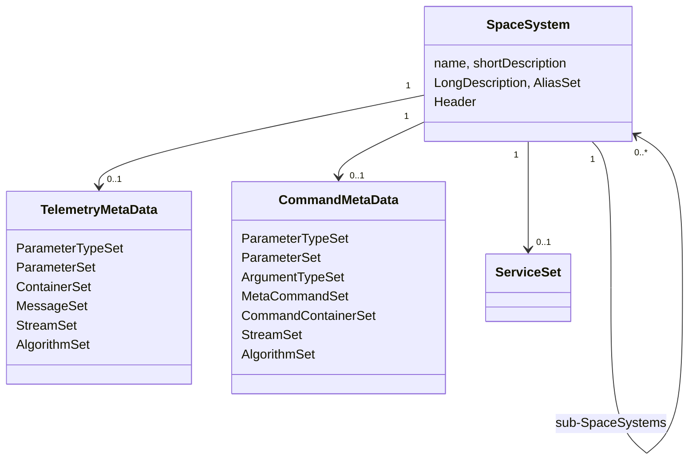
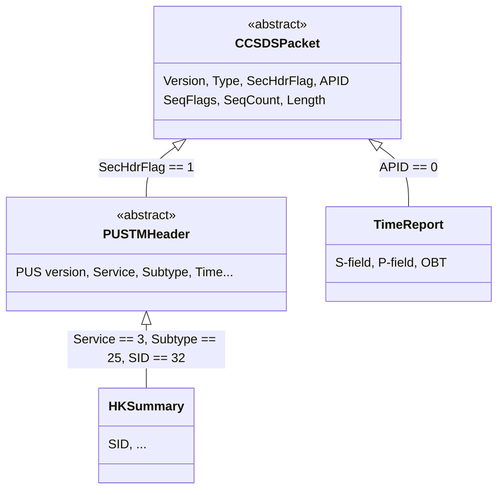
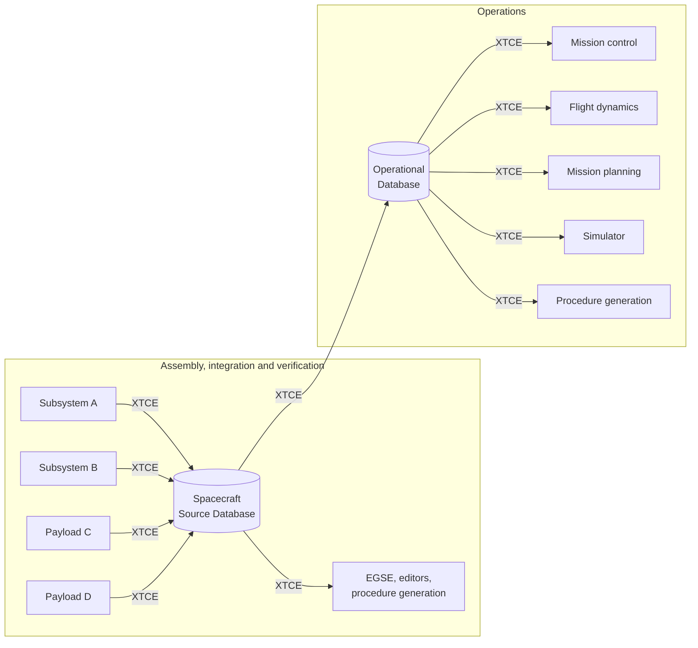

# XTCE: XML Telemetric and Command Exchange (CCSDS 660)

Every mission control system needs a **mission database**. This is the description, item by
item, of every telemetry parameter, packet, calibration, limit, command and verification check
that the ground must handle. ESA's [SCOS-2000](../scos2000/index.md) keeps it in the
[MIB](../mib/index.md), a set of ASCII tables. Other control systems have their own formats.
Every hand-over between organisations, for example from spacecraft manufacturer to operator or
from test system to control centre, has therefore needed a custom translation, more testing and
more risk of error.[^foreword] **XTCE**, the XML Telemetric and Command Exchange format, is an
open, standard XML Schema for describing such a database. The aim is that TM/TC definitions can
be exchanged "without the need for customized import/export, re-validation, or even
re-implementation".[^scope]

XTCE is an Object Management Group (OMG) specification. CCSDS publishes the OMG text of XTCE 1.2,
inside CCSDS front matter, as the Recommended Standard **CCSDS 660.0-B-2**.[^omg][^doc] The CCSDS
Informational Report **660.1-G-2** explains every element.[^gb-purpose] A second, shorter
Informational Report, **660.2-G-2**, introduces the concepts and use cases.[^gb2-purpose] In March
2026 the OMG published **XTCE 1.3** (formal/26-06-09) with a new schema. Its specification text
differs from 1.2 mostly in wording, as shown [below](#what-changed-in-xtce-13).[^v13-title]
Whether CCSDS will re-issue 660.0 for 1.3 is not stated in the available sources. This page
summarises these documents and a NASA tutorial on XTCE 1.1 (2008 or 2009), and records which parts two
open implementations, Yamcs and OpenC3 COSMOS, support. It then maps XTCE concepts onto the
SCOS-2000 MIB tables, a mapping that the standards themselves do not provide. Each mapping
judgement on this page is this wiki's own analysis.

!!! info "At a glance"
    | Property | Value |
    |---|---|
    | Standard | CCSDS 660.0-B-2 (February 2020) = OMG XTCE 1.2, formal/18-10-04 (January 2019)[^doc][^omg] |
    | Latest OMG version | XTCE 1.3, formal/26-06-09 (March 2026), schema `XTCE/20250214/SpaceSystem.xsd`[^v13-title][^v13-schema] |
    | Normative content | the W3C XML Schema `SpaceSystem.xsd` published by the OMG[^schema] |
    | Companions | CCSDS 660.1-G-2, XTCE element description (August 2021)[^gb-purpose]; CCSDS 660.2-G-2, introduction (February 2021)[^gb2-doc] |
    | Restricted profile | OMG XTCE US Govt Satellite Conformance Profile (XUSP, "GovSat")[^gb2-xusp] |
    | Root element | `SpaceSystem`, which can be nested to form a hierarchy[^root] |
    | Main sections | `TelemetryMetaData`, `CommandMetaData`, `ServiceSet`[^root][^service] |
    | Scope | TM/TC **definitions** (metadata), not live data transfer[^scope] |
    | Out of scope | displays, data distribution, protocols, RF, scheduling, orbits, flight software[^scope] |
    | Conformance | a compliant database is an XML file that validates against the schema[^conform] |

## Documents and versions

| Document | Date | Content |
|---|---|---|
| OMG XTCE 1.0 | 2005 or 2006 (sources differ, see below) | first version, from the OMG Space Domain Task Force[^versions][^tut-history] |
| OMG XTCE 1.1 | 2006, 2007 or 2008 (sources differ) | revised after a CCSDS review[^versions][^gb2-versions][^tut-history] |
| CCSDS 660.0-G-1 | July 2006 | original XTCE Informational Report, superseded by 660.2-G-2[^gb2-doc] |
| CCSDS 660.0-B-1 | October 2007 | first CCSDS Blue Book (XTCE 1.1), superseded[^doc][^tut-history] |
| NASA tutorial (K. Rice, B. Kizzort) | March 2008 or 2009 | 90-slide tutorial for XTCE 1.1; title slide 2008, page footers 2009 (Torrance, California)[^tut-title]. The NTRS record gives the meeting as an "XTCE Training Class" in Torrance starting 23 March 2009, but a publication date of 23 March 2008[^ntrs-rec] |
| CCSDS 660.1-G-1 | May 2012 | element description, issue 1[^gb2-refs] |
| OMG XTCE 1.2, formal/18-10-04 | January 2019 | schema `XTCE/20180204/SpaceSystem.xsd`[^omg] |
| CCSDS 660.0-B-2 | February 2020 | XTCE 1.2. The CCSDS cover wraps the OMG specification. The normative schema is at the OMG URL[^doc][^schema] |
| CCSDS 660.2-G-2 | February 2021 | high-level introduction: why XTCE, scope, core concepts, schema structure, a usage scenario and the GovSat example, by the CCSDS SM&C working group (MOIMS area)[^gb2-purpose][^gb2-doc] |
| CCSDS 660.1-G-2 | August 2021 | element-by-element explanation for XTCE 1.2, revising the version for XTCE 1.1[^gb-purpose] |
| OMG XTCE 1.3, formal/26-06-09 | March 2026 | schema `XTCE/20250214/SpaceSystem.xsd`; see [What changed in XTCE 1.3](#what-changed-in-xtce-13)[^v13-title][^v13-schema] |

The sources disagree on the early dates. 660.1-G-2 says that XTCE 1.0 and 1.1 were both
published in 2006, with 1.1 following a CCSDS review.[^versions] 660.2-G-2 dates 1.1 to
2008.[^gb2-versions] The NASA tutorial says that 1.0 was first published in 2005 by the OMG
Space Domain Task Force (active since 2000, with ESA, Boeing, the US Air Force SMC and Lockheed
Martin as original submitters, later joined by NASA GSFC and Harris). It says CCSDS published 1.1
as a Blue Book in October 2007 and dates a 1.1 overview Green Book to 2007.[^tut-history] That
last date conflicts with the July 2006 date that 660.2-G-2 gives for 660.0-G-1.[^gb2-doc]
660.2-G-2 also still cites draft issues of 660.0-B and of itself from 2019 as its
references.[^gb2-refs] XTCE 1.2 (2019) is largely backward compatible with 1.1 in
syntax.[^versions] Its main changes are: a new
SpaceSystem namespace; normalised enumeration strings; more ways to state byte order; integer
exponents; new rules for string length and float sizes; an updated epoch time/date type; arrays
whose dimension sizes are set in the type; XInclude support; time association moved to container
entries; a new numeric multi-range alarm and an inside/outside flag for alarms; more places for
ancillary data and short descriptions; and argument instance references.[^versions] 660.2-G-2
singles out the array change as the largest syntax change. It adds that many schema types were
cleaned up to map better onto programming-language classes, and that the command-side types were
split off from their telemetry ancestors so that argument references can be used wherever
parameter references were allowed.[^gb2-versions][^gb2-cmd]

### What changed in XTCE 1.3

The XTCE 1.3 document (31 pages) has the same structure and section numbers as the OMG text
inside 660.0-B-2. It contains no change list, and its normative content is again a separate
schema file, now at `https://www.omg.org/spec/XTCE/20250214/SpaceSystem.xsd`.[^v13-schema] A
word-by-word comparison of the two specification texts by this wiki finds these
differences:[^v13-title][^v13-foreword][^v13-scope][^v13-names][^omg][^foreword][^scope][^root]

| Topic | XTCE 1.2 (660.0-B-2) | XTCE 1.3 (formal/26-06-09) |
|---|---|---|
| Date and schema | January 2019; schema 20180204 | March 2026; schema 20250214 |
| Copyright holders | Boeing, ESOC, Lockheed Martin (2018), OMG (2014–2018) | adds Kratos S1 (2025), NASA (2025) and the EDM Council (EDM Association, 2026); Boeing 2018–2025; OMG 2014–2026 |
| Contributors named in the Foreword | Lockheed Martin, ESA, Boeing, NASA GSFC, USAF SMC, Harris, Raytheon, SciSys, CSC, GST | the same, with "L-3 Harris" for Harris and with Peraton and Kratos S1 added |
| Scope: structures | "CCSDS packets and TDM frames" | CCSDS packets, TDM frames "and proprietary implementations" |
| Scope: commands | command identification, argument specification and validation criteria | adds "header and footer parameter definitions" |
| Scope: encodings | "parameter and command encoding" | "parameter and argument encoding types" |
| Terms | Telemetering, Commands | Telemetering, Telecommands, and a new term **Container**: the abstract XTCE word for a partition of the bit stream, used instead of "packet" or "frame" |
| Reserved `:` in names | "reserved for future use" as a selector for data from other SpaceSystems | reserved for implementations, to separate names from aliases in alias namespaces |
| Wording | "command" | "telecommand" in most places |

!!! warning "Inference"
    The comparison covers only the specification texts. The 1.3 schema is not in this wiki's
    library, so element-level schema changes in 1.3 are not stated in the available sources. The
    rest of the specification (the SpaceSystem, TelemetryMetaData, CommandMetaData and ServiceSet
    descriptions, Annex B style notes and the bibliography) differs only by the "telecommand"
    wording, figure-caption punctuation and corrected typos such as "InputOutputAlgorighm",
    "Argurments" and "overide". The new
    use of `:` fits the alias approach that the [mapping below](#monitoring-parameters-pcf-and-calibrations)
    suggests for `PCF_PID`.

The specification lists Lockheed Martin, **ESA**, Boeing, NASA GSFC, USAF SMC, Harris, Raytheon,
SciSys, CSC and GST as contributors (1.3 adds Peraton and Kratos S1).[^foreword][^v13-foreword] The
European Space Operations Centre is one of the copyright holders of both 1.2 and 1.3.[^omg][^v13-title]
Its bibliography, unchanged in 1.3,[^v13-biblio] cites the **SCOS-2000 Database Import ICD issue 5.0
(June 2001)** and the **SCOS-2000 Synthetic Parameters Software User Manual**, alongside the
CCSDS packet standards, the PUS (draft ECSS-E-70-41 and ESA PSS-07-101), CCSDS time codes and the
IRIG-106 TMATS.[^biblio] This wiki reads that as a sign that the MIB was among the formats XTCE's
authors had in view; the specification does not say how its bibliography was used. See
[History of the Database Import ICD](../mib/icd-history.md) for the MIB's own evolution.

## Purpose and scope

XTCE covers the metadata needed to:[^scope]

* define the structure and sequence of **CCSDS packets and TDM frames**;
* define how individual data items are packed and unpacked;
* describe commands: identification, arguments and validation criteria;
* define parameter and command **encoding**;
* define data properties such as default values, validity criteria and dependencies.

It explicitly excludes data distribution mechanisms, command and data protocols, RF and analogue
streams, data grouping and coherent data sets, visualisation, scheduling, orbital properties,
**displays** and flight software. It is "a meta-data specification, not a data
specification".[^scope]

### Philosophy: neither packets nor frames

The industry is split between packet telemetry and TDM (time-division multiplexed) telemetry, and
much of the apparent divide is vocabulary. XTCE therefore avoids words such as "minor frame",
"major frame" and even "packet" except in examples, and builds in no packet or frame
standard. Instead, users build **libraries of containers** that represent those standards.[^philo]
The processing that XTCE metadata supports runs in two directions. Stream processing covers
decryption, decoding, frame synchronisation and so on. Parameter processing covers
decommutation, de-packetisation, calibration and custom processing. On the command side the
corresponding steps are formatting, constraint checking, authentication and
verification.[^figure1]

## The SpaceSystem model



*This wiki's summary of 660.0-B-2 §6.1 and 660.1-G-2 §3.2.*[^root][^tmmd][^cmmd][^gb-struct]

The root is called **SpaceSystem** rather than "Spacecraft", because an operations centre also
controls antennas, recorders, ground equipment and RF hardware. Each of these is a
SpaceSystem.[^root] A SpaceSystem can contain sub-SpaceSystems. The standard gives four reasons:
fewer name collisions (a dozen identical transponders can each live in their own
sub-SpaceSystem), better organisation of databases with thousands of commands and tens of
thousands of parameters, the ability to nest spacecraft inside a constellation, and a natural fit
to systems of systems.[^root] The optional **Header** records the source, version, revision
history, notes and classification.[^header] 660.2-G-2 lists its content as date, version,
classification and validation status (validated, tested or draft), an author set, a note set and
a history set for configuration management.[^gb2-header]

660.2-G-2 treats SpaceSystems as namespaces addressed by paths such as
`/MyMission/SubSystem1/Power/Battery1`. A SpaceSystem has no fixed meaning: it can be an
instrument, a spacecraft bus, a whole spacecraft, a constellation or a ground station. XTCE 1.2's
XInclude support lets each instrument and the spacecraft bus have its own SpaceSystem database,
assembled into one large database such as the satellite database.[^gb2-ss][^gb2-ss2] Some
organisations keep a single SpaceSystem, others use many.[^gb2-ss2]

Names may contain digits, letters, underscores, hyphens and backslashes, and are **case
sensitive**. The characters `/` (SpaceSystem path separator), `.` (member of an aggregate), `[` `]`
(array index) and `:` are reserved. In 1.2 the `:` is held for a future selector of data in
other SpaceSystems; in 1.3 implementations may use it to separate a name from an alias
namespace.[^root][^v13-names] Collections are named `…Set` when
unordered and `…List` when ordered. `Meta` marks a description (a MetaCommand is a command
description), and `Ref` marks a by-name reference.[^abbrev]

### References and instances

Items refer to each other by **NameReference**, which is the item's name with an optional
Unix-style path through the SpaceSystem hierarchy.[^nameref] The NASA tutorial lists absolute,
relative and path-less forms. A path-less name is not global: it is looked up in the local
SpaceSystem first and then up the tree. Because an XML parser does not resolve these references,
every implementation must, and the tutorial counts them among the hardest parts of XTCE to
implement.[^tut-nameref][^tut-hard] During processing, a
**ParameterInstanceRef** points at a parameter's value. Instance 0 (the default) is the last
recorded value, and negative instances go back in time. `useCalibratedValue` (default `true`)
selects the engineering or raw value.[^instref] Conditions throughout the schema use
**MatchCriteria**: a simple Comparison, a ComparisonList, an arbitrarily complex
BooleanExpression, or an escape to a custom algorithm.[^match] A **ContextMatch** is a
MatchCriteria that selects which calibrator, alarm or significance applies. The Green Book gives
mission phases as an example of a context.[^contextmatch]

## Telemetry

### Parameter types

A **ParameterType** is a description of something that can have a value. A **Parameter** is an
instance of it ("a Parameter is not the value itself").[^ptset][^pset] The type carries most of
the information: data type, description, units, alarm limits, string conversion and,
through one of four **DataEncodings**, the on-the-link form.[^ptset] The Green Book describes the
processing order. The encoded link value is checked against a valid range and calibrated into
the host data type. Alarm checks are then applied to the result.[^gb-relation]

| XTCE type | Typical encoding | Notes |
|---|---|---|
| `StringParameterType` | StringDataEncoding | restriction pattern, character width, string alarms[^gb-types][^gb-string] |
| `EnumeratedParameterType` | IntegerDataEncoding | EnumerationList of label/value pairs. `maxValue` turns a value into a range. EnumerationAlarm[^gb-enum] |
| `BinaryParameterType` | BinaryDataEncoding | data with no type[^gb-types] |
| `BooleanParameterType` | IntegerDataEncoding, 1 bit | `oneStringValue` / `zeroStringValue`[^gb-bool] |
| `IntegerParameterType` | IntegerDataEncoding | `signed`, `sizeInBits`, ValidRange, numeric alarms[^gb-types] |
| `FloatParameterType` | Float or IntegerDataEncoding (with calibrator) | numeric alarms[^gb-types] |
| `RelativeTimeParameterType` | IntegerDataEncoding (or Binary) | `units`, `scale`, `offset`. ReferenceTime by OffsetFrom or Epoch[^gb-time] |
| `AbsoluteTimeParameterType` | IntegerDataEncoding (or Binary) | the same, but **no alarms**[^gb-time][^gb-alarm-default] |
| `ArrayParameterType` | via array members | in XTCE 1.2 the dimensions and sizes are declared in the type[^gb-array] |
| `AggregateParameterType` | via members | a record ("struct"). Members are referenced as `Aggregate.Member`[^gb-agg] |

The Green Book counts ten ParameterTypes in two groups: the scalar types and the complex Array
and Aggregate types. Its list of scalar names repeats "String" and leaves out the two time
types.[^gb-types] 660.2-G-2 lists all ten with one-line roles (Boolean as "a special case of"
enumerated types, Binary as a "blob" catch-all) and distinguishes two forms of ParameterType:
one with a DataEncoding, describing a value from the spacecraft, and one without, describing a
ground-side value whose Parameter sets `dataSource` to `local`.[^gb2-ptype] It names three common
combinations: a FloatParameterType with an IntegerDataEncoding and (typically) a
PolynomialCalibrator for a calibrated count, an IntegerParameterType with IntegerDataEncoding, and
a FloatParameterType with FloatDataEncoding. For calibrations too complex for the three
calibrator kinds it suggests a BinaryDataEncoding with a FromBinaryTransformAlgorithm.[^gb2-enc]

#### Encodings

* **IntegerDataEncoding**: `encoding` is one of unsigned (default), twosComplement,
  onesComplement, BCD or packedBCD. The default `sizeInBits` is 8. It can carry calibrators and a
  `changeThreshold`.[^gb-int] The specification body of both 1.2 and 1.3 also lists
  `signMagnitude` and spells the complements "twosCompliment" and "onesCompliment".[^ptset][^v13-ptset]
  A later Green Book table names "signedMagnitude", and the NASA tutorial warns that the 1.1
  schema used the "Compliment" spelling.[^gb-int-table][^tut-enc] The GovSat example of
  660.2-G-2, which the report states is valid against the 1.2 schema, uses `twosComplement`.[^gb2-tm-types][^gb2-annexa2]
  The full list of enumeration strings is that of the schema, which is not in this wiki's library.
* **FloatDataEncoding**: IEEE754_1985, IEEE754, MILSTD_1750A, DEC, IBM or TI. The listed sizes
  are 16, 32, 40, 48, 64, 80 and 128 bits. Not every format supports every size, and a later
  paragraph of the Green Book mentions only 32, 64 and 128 bits.[^gb-float] The specification
  text names only IEEE754_1985 and MILSTD_1750A.[^ptset]
* **StringDataEncoding**: US-ASCII, ISO-8859-1, Windows-1252, UTF-8, UTF-16 (LE/BE) or UTF-32
  (LE/BE). The size is either fixed (`SizeInBits`, optionally ended by a termination character or
  given by a leading size field, 16 bits by default) or `Variable`.[^gb-str-enc]
* **BinaryDataEncoding**: a size plus optional From/ToBinaryTransformAlgorithms. It is used for
  data with no type and for exotic formats.[^gb-bin]

Every encoding shares a `bitOrder` (MSB first by default), an optional **byte order** list for
non-big-endian items, and **ErrorDetectCorrect** (parity, CRC, and a checksum added in
1.2).[^gb-common] A ParameterType with **no encoding** describes a local, ground, constant or
derived value that never comes from telemetry. Its Parameter should then declare a non-telemetered
`dataSource`.[^gb-noenc]

#### Calibrators

Integer and float encodings can hold a **DefaultCalibrator** and any number of
**ContextCalibrators**, each selected by a ContextMatch.[^gb-cal]

* **SplineCalibrator**: a list of raw-to-calibrated `SplinePoint`s. `order` 0 gives a step
  function, 1 linear (the default), 2 quadratic and 3 cubic. `extrapolate` controls values beyond
  the end points.[^gb-spline]
* **PolynomialCalibrator**: `Term` elements with `coefficient` and a non-negative integer
  `exponent`, for example $y = 0.5 + 1.5x - 0.045x^2 + 1.25x^3 + 0.0025x^4$.[^gb-poly]
* **MathOperationCalibrator**: an expression built from MathOperationType, written in postfix
  (reverse Polish) form.[^gb-poly][^gb-math]

#### Alarms

Every scalar type except AbsoluteTime has a **DefaultAlarm** and a **ContextAlarmList**. The first
context alarm whose ContextMatch is true is used. Otherwise the default applies, like an if-then
chain.[^gb-alarm-default][^gb-ctxalarm] All alarms share **minViolations** (successive violations
before the alarm state) and **minConformance** (successive good samples to leave it).[^gb-alarmtype]
The levels are `normal`, `watch`, `warning`, `distress`, `critical` and `severe`.[^gb-enumalarm] The
alarm forms are:

| Form | Applies to | Meaning |
|---|---|---|
| `StaticAlarmRanges` | Integer, Float (and time) | nested bands for watch, warning, distress, critical and severe. `rangeForm` is *outside* (default: normal in the middle) or *inside* (normal at the outside)[^gb-static] |
| `ChangeAlarmRanges` | Integer, Float | `changePerSample` (delta) or `changePerSecond` (rate), on an absolute or percentage basis, over a span of samples or seconds[^gb-change] |
| `MultiRange` | Integer, Float | any number of ranges (new in 1.2)[^gb-change] |
| `EnumerationAlarm` | Enumerated | alarm level per enumeration label[^gb-enumalarm] |
| `StringAlarm` | String | level per matching pattern, with a default level[^gb-string] |
| `AlarmConditions` | most types | a MatchCriteria per level. The most severe true level wins[^gb-alarmcond] |
| `CustomAlarm` | most types | algorithm-based[^gb-alarmtype] |

!!! note "Boundary semantics"
    In the Green Book's outside-alarm example, `WarningRange minInclusive="-5" maxInclusive="5"`
    makes **-5 and 5 themselves warnings**: the normal range is -5 < x < 5.[^gb-static] The
    "inclusive" values belong to the alarm band. This matters when mapping MIB limits (see below).
    The NASA tutorial reads its own example the same way. With `WatchRange` −2000 to 5000 and
    `SevereRange` −5000 to 6000, values x ≤ −2000 or x ≥ 5000 are at watch level and x ≤ −5000 or
    x ≥ 6000 are severe. More severe ranges clip less severe ones, and the colours used for the
    levels are not part of XTCE.[^tut-alarm] The Yamcs manual reads its own example the same way:
    a value of 40 against a warning range of 10 to 30 raises a warning, which it calls "perhaps a bit
    counter intuitive". It does not discuss the boundary values themselves.[^ym-alarm]

For **AlarmConditions**, the NASA tutorial adds that the condition of each of up to five levels
can be a single comparison, several conditions, a Boolean expression or a custom
algorithm.[^tut-alarmcond]

A **ValidRange** check applies only to Integer and Float types. It is separate from alarms: an
out-of-range value is invalid rather than alarmed.[^gb-relation][^gb-validrange] On the
telemetry side the tutorial says to ignore the attribute `validRangeAppliesToCalibrated`. For
commands it chooses where the check happens: on the engineering value before calibration
(`true`, the default) or on the encoded value after it (`false`), but not both.[^tut-validrange] Yamcs marks a parameter outside its
ValidRange as invalid and skips its limit checks, while a command argument outside its range
makes Yamcs reject the command.[^ym-int][^ym-tmproc]

#### Type inheritance

String, Enumerated, Binary, Integer, Float and Boolean types can extend another type of the
same kind through `@baseType`. Loops are illegal. A child can override calibrators, units,
the default alarm and ranges, and can prefix context alarms and enumerations. It cannot change
the encoding, `sizeInBits` or signedness.[^gb-inherit]

### Parameters

A Parameter is usually just a name and a `parameterTypeRef`.[^gb-param] Its **ParameterProperties**
add:[^gb-props]

* `dataSource`: *telemetered* (the default), *derived* (computed by an algorithm), *constant* or
  *local* (for example a session variable).
* `readOnly` and `persistance` (spelled this way in XTCE).
* **ValidityCondition**: a MatchCriteria that must hold for the value to be valid. The standard's
  example is a value that is invalid while its subsystem is off.
* **PhysicalAddressSet**: hardware addresses, for example on a MIL-STD-1553 bus.
* **TimeAssociation**: the offset of the sample from a reference time parameter. In XTCE 1.2 it
  can also be set per container entry.
* **SystemName**: a subsystem name for flat, single-SpaceSystem databases.

**One type per parameter?** A ParameterType can in theory serve many Parameters. 660.2-G-2 says
that this is "not common practice". Most databases give every Parameter its own type, so that a
change to an alarm or calibrator cannot spread by accident to other parameters, at the price of a
larger file. The same holds for ArgumentTypes.[^gb2-pset][^gb2-argtypes] The Yamcs manual makes the
same observation from the other side. Many control systems do not separate a parameter from its
type, and shared types are mostly generic ones such as `uint8` or `uint16`, or types for a family
of identical sensors.[^ym-types] 660.2-G-2 also warns that the `dataSource` attribute, which
defaults to `telemetered`, "is often overlooked".[^gb2-pset]

### Containers

A **SequenceContainer** describes "a packet, frame, a subframe, or any other grouping". Its
**EntryList** is an ordered list of items.[^containerset][^gb-cont] By default the entries are packed
back to back, and the container's size is the sum of their encoded sizes.[^gb-entry]

| Entry | Purpose |
|---|---|
| `ParameterRefEntry` | a parameter. Its width comes from the type's encoding[^gb-entry] |
| `ParameterSegmentRefEntry` | part of a parameter (for example a 1 024-bit binary split into 116-bit segments)[^gb-entry] |
| `ContainerRefEntry` | another container, resolved as a unit. Referencing an abstract container triggers **dynamic container matching**[^gb-cref] |
| `ContainerSegmentRefEntry`, `StreamSegmentEntry` | parts of containers or streams spread over several containers[^gb-cref] |
| `IndirectParameterRefEntry` | the parameter whose *name* is held in another parameter's value[^gb-indirect] |
| `ArrayParameterRefEntry` | an array, optionally a subset of its dimensions[^gb-indirect] |

Each entry can be modified by three elements:[^gb-modify]

* **LocationInContainerInBits** sets the position relative to `containerStart`, `containerEnd`,
  the previous entry (the default) or the next entry. The Green Book's XML examples spell the
  previous-entry value `previousEntry`.[^gb-modify][^gb-loc-ex]
* **RepeatEntry** repeats an entry for super-commutated parameters. A Count of 1 means one extra
  copy, giving two in total. An optional offset sets the gap between copies.[^gb-modify]
* **IncludeCondition** includes the entry only when a MatchCriteria holds.[^gb-modify]

#### Inheritance and identification

The key mechanism is **container inheritance**. A container names its parent in
**BaseContainer**, and the parent's EntryList is prefixed to the child's. **RestrictionCriteria**
on the BaseContainer state the values that identify the child, such as an APID or a
type/subtype. Inheritance can go to any depth, and every RestrictionCriteria along the chain must
hold.[^basecont][^gb-base][^gb-rules] Only the leaf containers are real packets. Intermediate
levels are marked `abstract`.[^gb-abstract]

| Element | Inheritance rule[^gb-rules] |
|---|---|
| `@name`, `@abstract`, `@idlePattern`, descriptions, aliases | not inherited |
| `EntryList` | parent's entries prefixed to the child's |
| `AncillaryDataSet` | child's prefixed to parent's |
| `DefaultRateInStream`, `BinaryEncoding/SizeInBits` | child overrides if present |
| `RateInStreamSet` | child's prefixed; same stream ref overrides |
| `RestrictionCriteria` | scoped to their construction, and apply to inherited entries too |



*This wiki's illustration of the Green Book patterns, not a figure from it.*[^gb-patterns]

The Green Book's **telemetry patterns** build on this idea. The basic pattern is one abstract
"generic packet" header with all packets derived from it, and for many missions one level is
enough. Variants add an optional secondary header through an IncludeCondition, a common root
container shared by all packets, or a secondary header chosen by dynamic matching, for example
when the time-stamp format varies.[^gb-patterns] **MessageSet** is an alternative to inheritance.
A Message pairs a container with a MatchCriteria.[^messageset][^gb-msg] **StreamSet** describes
fixed-frame, variable-frame or custom streams, and which containers or services they
carry.[^streamset][^gb-stream]

In practice these two are little used. 660.2-G-2 calls MessageSet one of the lesser-used areas,
kept for backward compatibility, which "one may want to consider" deprecated. It calls StreamSet
under-used and, in the view of many users, too simple to configure front-end processing.[^gb2-msg]
The NASA tutorial already listed MessageSet, StreamSet, AlgorithmSet and ServiceSet as "the
forgotten elements". It noted that StreamSet lacks, for example, Reed-Solomon coding information,
and advised describing packets and leaving frame processing to the front end.[^tut-forgotten]
660.2-G-2 likewise recommends defining packets in XTCE and not the framing.[^gb2-cont] Arrays
changed in 1.2. In 1.1 the number of dimensions sat in the ArrayParameterType and their sizes in
the container's ArrayParameterRefEntry. In 1.2 the type can hold both, and the old entry syntax
remains for backward compatibility.[^gb2-cont]

### Algorithms

The AlgorithmSet holds processing that cannot be stated declaratively. A **MathAlgorithm** is a
formula in postfix notation. A **CustomAlgorithm** (also called SimpleAlgorithm) holds algorithm
text and references to external implementations such as Java classes, DLLs or scripts. Input,
Input-Output and Input-Output-Trigger algorithms add named inputs, outputs, and periodic or
event-driven triggers.[^algos][^gb-math]

## Commanding

**CommandMetaData** has the telemetry sets plus an **ArgumentTypeSet**, a **MetaCommandSet** and
a **CommandContainerSet**. Parameters are scoped per SpaceSystem, so a telemetry parameter can be
used in a command and the other way round.[^cmmd][^gb-cmd] The Green Book draws the line this
way. An **argument** is something an operator (or automation) supplies. A command **parameter** is
part of the command that the system supplies, or that RestrictionCriteria fix.[^gb-cmd2] On the
command side, data flows the other way. The host value is range-checked, then (de)calibrated
into the encoding for uplink, and can be range-checked again.[^gb-cmdtypes]

**ArgumentTypes** mirror the ParameterTypes but have **no alarms**. Float and integer argument
types carry a **ValidRangeSet**.[^argtypes][^gb-argtypes]

660.2-G-2 adds three practical points. Arguments are local to their MetaCommand and cannot be
reused by another command, although commands can inherit them through BaseMetaCommand.[^gb2-tc]
The line between argument and command parameter is not always clear to users. Some see the whole
command "load", others only their own arguments, but XTCE has the syntax to separate the two when
needed.[^gb2-cmd] And the **CommandContainerSet** holds the "pieces/parts" of command containers
that several commands share.[^gb2-cmdsets] The NASA tutorial describes those shared pieces as
"has a" building blocks, for example an optional secondary header included only when the
secondary header flag is 1.[^tut-ccset] It also lists how a MetaCommand's own CommandContainer
differs from a telemetry container. It can hold a FixedValueEntry, for example an opcode, and
ArgumentRefEntries, which must cover every argument but need not follow the ArgumentList order. It
can extend the parent command's container only through an explicit BaseContainer, its
RestrictionCriteria are optional, and it has no `abstract` attribute of its own. The tutorial
encourages simple "parameter == value" restrictions, because they can be processed automatically
to tell the system which values it must supply in the named parameters.[^tut-cc][^tut-ccinh]

### MetaCommand

| Element | Purpose |
|---|---|
| `@abstract` | a template that is not itself a command. Its CommandContainer is then abstract too[^gb-mc1] |
| `BaseMetaCommand` + `ArgumentAssignmentList` | inherit from another MetaCommand and fix some of its arguments[^gb-basemc] |
| `ArgumentList` | the ordered arguments, each referencing an ArgumentType[^gb-arglist] |
| `CommandContainer` | the bit layout: `ParameterRefEntry`, `ContainerRefEntry`, **`ArgumentRefEntry`**, **`FixedValueEntry`** (a literal of given `sizeInBits`). It can extend another container. Its RestrictionCriteria act as **assertions** that set values[^gb-cc][^gb-cc2] |
| `TransmissionConstraintList` | conditions (MatchCriteria) that must hold before release, with a `timeOut` and an optional `suspendable` flag[^gb-mc2][^gb-tc] |
| `DefaultSignificance` / `ContextSignificanceList` | a `consequenceLevel` of none, watch, warning, distress, critical or severe, with `spaceSystemAtRisk` and `reasonForWarning`. The level must be confirmed before sending[^metacmd][^gb-sig] |
| `Interlock` | blocks *following* commands, within a SpaceSystem scope, until this one reaches `verificationToWaitFor` (default `complete`) or a `verificationProgressPercentage`[^metacmd][^gb-interlock] |
| `VerifierSet` | TransferredToRange, TransferredFromRange, Received, Accepted, Queued, Execution, Complete (several allowed) and Failed[^metacmd][^gb-verif] |
| `ParameterToSetList` | parameters to set (to a fixed or derived value) once a verification stage is reached, for example a command counter[^gb-pts] |
| `ParametersToSuspendAlarmsOnSet` | suspend alarms on given parameters for a `suspenseTime` after a stage, to avoid false change alarms[^metacmd][^gb-pts] |

Each **verifier** is one of: a ComparisonList, a ContainerRef (the stage is reached when that
container arrives), a ParameterValueChange, a CustomAlgorithm, a BooleanExpression or a single
Comparison. A **CheckWindow** gives `timeToStartChecking` and `timeToStopChecking` relative to
`commandRelease` or to the time the last verifier passed.[^gb-verif2] MetaCommand inheritance
follows rules like those for containers. Argument lists, constraints and verifiers accumulate
(with Complete verifiers accrued), and the CommandContainer is inherited only if its BaseContainer
explicitly points to the parent's.[^gb-mcinherit] A **BlockMetaCommand** groups MetaCommand steps
with their argument values into one unit. The Green Book's example opens a valve, waits through
five NOOPs and closes it.[^gb-block] The Green Book's **command patterns** range from a simple
MetaCommand whose container is all FixedValueEntries plus arguments, to an abstract mission
template with derived concrete commands, to a generic root template shared across
missions.[^gb-cmdpat]

## ServiceSet

A **Service** is a named grouping of containers or messages, such as a "memory dump service".
Referencing an abstract container includes all its children. The meaning of a grouping is left
to the implementation, and services are optional.[^service][^gb-service] 660.2-G-2 explains that
services were introduced "for the European space organizations that deal with services", that
is, users of the [PUS](../ecss/pus/index.md), and calls the area under-used.[^gb2-services] The
NASA tutorial's example groups the containers of each CCSDS virtual channel into one
service.[^tut-services]

## Worked example from 660.2-G-2: the GovSat fragment

Annex A of 660.2-G-2 gives a short, complete XTCE 1.2 file taken from the GovSat example. It has
one telemetry packet and one command, and the report states that the assembled fragments are
valid against the XTCE 1.2 schema.[^gb2-annexa][^gb2-annexa2] The definitions below are real
(from the source). The diagram is this wiki's rendering of them.

The abstract container `CCSDSPacket` lists seven unsigned integer parameters whose IntegerDataEncoding
sizes add up to the 48-bit [Space Packet](space-packet.md) primary header:[^gb2-tm-types][^gb2-tm-cont]

<div class="bitfield" data-title="GovSat CCSDSPacket container: XTCE parameters of the primary header (48 bits)" data-width="16"
     data-fields='[{"n":"CCSDSVersion","b":3,"v":"000","d":"CCSDSVersionType, 3 bits; restricted to 0 by CCSDSTelemetryPacket"},{"n":"CCSDSType","b":1,"d":"CCSDSTypeType, 1 bit; 0 for telemetry, 1 for commands"},{"n":"CCSDSSecH","b":1,"d":"CCSDSSecHType, 1 bit"},{"n":"CCSDSAPID","b":11,"d":"CCSDSAPIDType, 11 bits; 47 identifies PowmX0EP_StatusPacket"},{"n":"CCSDSGroupFlags","b":2,"d":"CCSDSGroupFlagsType, 2 bits"},{"n":"CCSDSSourceSequenceCount","b":14,"d":"CCSDSSourceSequenceCountType, 14 bits"},{"n":"CCSDSPacketLength","b":16,"d":"CCSDSPacketLengthType, 16 bits"}]'></div>

| Container or command | Base | RestrictionCriteria | Entries |
|---|---|---|---|
| `CCSDSPacket` (abstract) | none | none | the seven header parameters above |
| `CCSDSTelemetryPacket` (abstract) | `CCSDSPacket` | ComparisonList: `CCSDSVersion` == 0 and `CCSDSType` == 0 | none of its own |
| `PowmX0EP_StatusPacket` | `CCSDSTelemetryPacket` | `CCSDSAPID` == 47 (`useCalibratedValue="true"`, instance 0) | `TimeStamp` and seven power-module parameters (voltages, currents, PPS source, power state, set point) |
| MetaCommand `CCSDSCommand` (abstract), container `CCSDSCommandPacket` | `CCSDSPacket` | `CCSDSVersion` == 0 and `CCSDSType` == 1 | none |
| MetaCommand `PM1Enable_Logging`, container `PM1Enable_LoggingPacket` | `CCSDSCommand` / `CCSDSCommandPacket` | `CCSDSAPID` == 130 | four ArgumentRefEntries: message type (8 bits), address (32), port (16), sensor ID (32) |

Rows restate Annex A2.2.4 and A2.3.3 of 660.2-G-2.[^gb2-tm-cont][^gb2-tc-ex]

A few details of the example are worth noting:[^gb2-tm-types][^gb2-tm-cont][^gb2-tc-ex]

* `CCSDSSCID` and `CCSDSVCID` have no encoding and `dataSource="local"`. The spacecraft and
  virtual channel are not in the packet, and the virtual channel of each packet and command is
  recorded as `AncillaryData name="VCID"` (6 for the status packet, 27 for the command).
* The five analogue values (voltage, current, maximum current, bus voltage and set point) are
  64-bit `FloatParameterType`s on 16-bit `twosComplement` integer encodings with a
  `PolynomialCalibrator` of terms 0.0 and 0.1. Each raw count is therefore 0.1 V or 0.1 A. The
  PPS source is an unsigned integer on 8 bits.
* `TimeStamp` is an `AbsoluteTimeParameterType` on a 64-bit unsigned encoding, with
  `units="seconds"`, `scale` 1.0, `offset` 0.0 and the epoch TAI. Its short description
  describes the layout as a 16-bit P-field, 32 bits of seconds and 16 bits of fraction.
* `PowmX0EP_PowerStateType` is an `EnumeratedParameterType` with Off = 1, On = 2, Tripped = 3 and
  NotWorking = 4, encoded on 8 bits.
* There is no CommandContainerSet: the command reuses the telemetry header container, "which is
  legal XTCE".
* The root element declares the namespace `http://www.omg.org/spec/XTCE/20180204`, and the
  Header gives `validationStatus="Validated"`, date 2019-04-04 and version 0.2.

!!! warning "Inference"
    Compared with the MIB, `CCSDSTelemetryPacket` plus the APID restriction plays the role of
    the [PID](../mib/tables/pid.md) key, and the entries of `PowmX0EP_StatusPacket`, packed back to
    back after the inherited header, play the role of [PLF](../mib/tables/plf.md) offsets. The
    64-bit integer encoding of a time stamp whose description mentions a P-field, a seconds field
    and a fraction field shows a limit of plain integer encodings. Splitting the CUC fields, or
    honouring a P-field, would need a BinaryDataEncoding with an algorithm or separate
    parameters (see [Time code formats](time-codes.md)).

## Using XTCE in practice

### The usage scenario

660.2-G-2's scenario starts with a spacecraft project manager who receives an XTCE file from each
subsystem and payload contractor. The files are merged into one Spacecraft Source Database (SDB),
converted to run-time databases for assembly, integration and verification (AIV), and then passed
to the mission readiness team. That team includes or translates the database into the
operational databases (ODB) of the mission control, flight dynamics, mission planning, procedure
generation and simulator systems.[^gb2-usage] The report stresses that XTCE is for exchanging
database content, not an interface for sending commands or receiving telemetry.[^gb2-usage]



*This wiki's simplified drawing of figure 4-1 of 660.2-G-2.*[^gb2-usage]

This is the same flow that ESA projects implement with MIBs, for example the Herschel/Planck
satellite database (see [MIB tooling](../mib/tooling.md#project-databases-hpsdb-and-the-satellite-database)
and [Operations preparation](../scos2000/operations-preparation.md)).

### Too big and too small: profiles and extensions

660.2-G-2 admits that for many users XTCE has "far more features than are needed". The answer is a
trimmed profile, colloquially **GovSat**, published by the OMG as the XTCE US Govt Satellite
Conformance Profile (**XUSP**). XUSP is not a new schema but a set of executable rules, applied
after schema validation. The rules allow only one SpaceSystem, limit the number of polynomial
coefficients and the length of mnemonics, and define a standard CCSDS header with its
parameters. Organisations may relax rules, for example to allow several SpaceSystems, at a cost
in compatibility.[^gb2-xusp]

The same report admits that XTCE can also be too small, when a local "must have" feature is
missing, and lists six ways to handle it:[^gb2-ext]

| Option | How | Trade-off |
|---|---|---|
| a) AncillaryData | name/value pairs, available in many places of the schema | easiest; files stay schema-valid |
| b) Modify the schema locally | edit the XTCE schema | "breaking the standard" |
| c) Modify via an external schema | extensions in their own namespace, included at the modification point | easier to separate standard and local parts |
| d) External schema and file | keep extra information in a second file | files stay valid, but two files to manage and software must merge them |
| e) Overload elements | reuse an element or attribute for another purpose | may break software; "least preferred" |
| f) Change request to the OMG | propose a change to the specification | "very lengthy", worthwhile for features of broad value |

The NASA tutorial approaches the same problem from the exchange side. A full exchange works only between
parties that agree in advance on which XTCE features to use. Even partners with different packet
formats can exchange part of their data: NASA CCSDS and ESA PUS missions exchanged "the majority
of telemetry metadata", with some work.[^tut-exchange] Its list of points to agree goes below the
CCSDS header: polynomial coefficients, alarm levels, floating-point sizes and formats, and bit and
byte order. It suggests writing such constraints in machine-processable form, to configure
validators and "builder" tools. 660.2-G-2 later describes the XUSP rules as executable rules
for a validation program, which is a similar idea.[^tut-exchange2][^gb2-xusp] The tutorial
names the GSFC JWST translator, the CNES "Best" suite and ESA CryoSat as exchange
implementations, and says that several others exist, mostly on the customer side.[^tut-exchange]

!!! warning "Inference"
    For a MIB converter, option a) is the natural home for MIB fields with no XTCE element, such
    as `PCF_DARC`, `CCF_PLAN` or the display tables. Option c) would suit features such as status
    consistency checks that need structure. Neither 660.2-G-2 nor the tutorial mentions the MIB.

### Implementing XTCE

The tutorial describes four ways to implement XTCE: XSLT and XPath, a DOM or SAX parser, a
data-binding "autogenerator" that maps schema types to classes (it used JAXB for the GSFC
prototypes, and also mentions Eclipse EMF and XMLSpy), or a mix.[^tut-impl] The order of
elements matters and must survive the mapping. A native implementation can configure itself
from any valid file, but at the time GSFC's prototype had never decommutated real packet data. A
University of Bremen implementation had been demonstrated doing so.[^tut-native] The hardest
parts were name references and their instance syntax, container inheritance with include
conditions, type inheritance, and dynamic container matching with NextContainer. Of the last,
the authors wrote that it had "never been implemented yet that we are aware of".[^tut-hard]

## Implementations and what they support

Two open implementations document their XTCE coverage element by element. **Yamcs** reads XTCE
into its Mission Database. Its manual says that Yamcs "does not seek full compliance" and reads
only the parts that match its own concepts. The reader is deliberately tolerant: it ignores
unknown tags and "strives to be backward compatible" with XTCE 1.0 and 1.1, so a file that loads
is not thereby valid. The
manual points to the xtcetools project for validation.[^ym-compat] **OpenC3 COSMOS** imports
XTCE 1.0 to 1.2, uses `.xtce` files in a target's `cmd_tlm` folder in place of its own
definition files, and exports one schema-validated XTCE 1.2 file per target with
`openc3.sh cli xtce_converter`.[^cosmos-xtce] See [MIB tooling](../mib/tooling.md#yamcs-and-the-yamcs-scos2k-mib-loader)
for the licences and the Yamcs SCOS-2000 loader.

| XTCE feature | Yamcs (server manual) | OpenC3 COSMOS (documentation, retrieved 2026-11-12) |
|---|---|---|
| SpaceSystems | hierarchy; several files and sub-loaders | one SpaceSystem per file |
| Header | version and date only | ignored on import |
| Integer, Float, Enumerated, String, Binary types | yes | yes |
| Boolean type | yes, but the string forms are only used in comparisons | import only, exported as Enumerated |
| AbsoluteTime type | yes | not supported (planned) |
| RelativeTime type | not supported | not supported (planned) |
| Arrays | telemetry only, not in commands | one dimension only |
| Aggregates | yes | not listed |
| Float encodings | IEEE754_1985, MILSTD_1750A, plus a non-XTCE STRING; DEC, IBM, TI not supported | FloatDataEncoding listed as supported; the float formats are not stated |
| Byte order | big or little endian only | big and little endian |
| String sizes | whole bytes only; a 0-bit size tag accepted for arguments (non-XTCE, for SCOS-2000 compatibility) | `TerminationChar` export only |
| Calibrators | polynomial, linear spline, MathOperation; contextual calibrators | PolynomialCalibrator and DefaultCalibrator; SplineCalibrator not supported (planned) |
| Alarms | XTCE alarms incl. context alarms; none for StringParameterType | DefaultAlarm with StaticAlarmRanges |
| `changeThreshold`, ErrorDetectCorrect | not supported (checksums handled in the data links) | ErrorDetectCorrect ignored, no CRC computed |
| Entry location | absolute or relative to the previous entry; not relative to the container end | containerStart, containerEnd, previousEntry; `nextEntry` not supported (planned) |
| ParameterSegmentRefEntry, ContainerSegmentRefEntry, DiscreteLookupList, NextContainer | not supported | not listed |
| MessageSet, StreamSet | not supported (packets arrive from the data links) | not listed |
| ParameterProperties | PhysicalAddressSet, SystemName, TimeAssociation not supported | ParameterProperties listed |
| ArgumentRefEntry with IncludeCondition or RepeatEntry | not supported | ArgumentRefEntry listed |
| ValidRangeSet | one range only | ValidRange and ValidRangeSet listed |
| ContextSignificanceList, ParameterToSetList, ParametersToSuspendAlarmsOnSet | not supported | not listed |
| Several CompleteVerifiers | the first to succeed completes the command (XTCE requires all) | not listed |
| AncillaryData, AliasSet | AncillaryData carries Yamcs-specific options (for example `UseAsPacketName`); AliasSet is not in the unsupported list, which covers everything that is not supported "one way or another" | ignored, except COSMOS-namespace aliases used to restore item names |

Yamcs column from §3.1 and §3.7.1.2 of its manual and its TM processing description; COSMOS
column from its XTCE documentation page, which is outside this wiki's library.[^ym-compat][^ym-compat2][^ym-types-all][^ym-tmproc][^cosmos-xtce]
"Not listed" means the COSMOS page names the feature neither as supported nor as unsupported.

Yamcs also works around one XTCE rule. Where the schema requires a `DynamicValue`, for strings
or binaries whose size is not given by another parameter, Yamcs accepts a reference to a dummy
parameter `_yamcs_ignore`, and the manual admits that a file without the element would not
validate against the 1.2 XSD.[^ym-string] Both the Yamcs XTCE compatibility list and its
binary-type section mention ToBinaryTransformAlgorithm. The list calls it unsupported, yet §3.1.6
shows it in use for an argument type with a leading-size encoder.[^ym-compat][^ym-binary]

!!! warning "Inference: what this means for a MIB converted to XTCE"
    Using the [mapping below](#mapping-xtce-to-the-scos-2000-mib) and the 2025 Solar Orbiter row
    counts: the 679 CAF curves would become SplineCalibrators, which COSMOS cannot import today.
    The 3,796 PTC 9 and 47 PTC 10 telemetry parameters need time types. Yamcs lacks the relative
    one and COSMOS both. The 1,974 CUR rows need context calibrators, which the COSMOS page does
    not list. The 512 commands with repeated groups (`CDF_GRPSIZE` > 0, 569 CDF rows) would need
    RepeatEntry or arrays on arguments, which the Yamcs XTCE reader does not support. And 22 PRF
    range sets have more than one range (used by 20 command parameters), while Yamcs keeps only
    one range per ValidRangeSet. Yamcs' own SCOS-2000 loader bypasses XTCE and may handle these
    cases differently. Its README lists other gaps (see [MIB tooling](../mib/tooling.md#yamcs-scos2k)).[^mib]

??? example "SQL used"
    ```sql
    -- solo-2025-09-16.sqlite
    SELECT COUNT(*), COUNT(DISTINCT CDF_CNAME) FROM cdf WHERE CAST(CDF_GRPSIZE AS INT) > 0;
    SELECT COUNT(*) FROM (SELECT PRV_NUMBR FROM prv GROUP BY 1 HAVING COUNT(*) > 1);
    SELECT COUNT(*) FROM cpc WHERE CPC_PRFREF IN
      (SELECT PRV_NUMBR FROM prv GROUP BY 1 HAVING COUNT(*) > 1);
    SELECT PCF_PTC, COUNT(*) FROM pcf WHERE PCF_PTC IN ('9','10') GROUP BY 1;
    SELECT COUNT(*) FROM caf; SELECT COUNT(*) FROM cur;
    ```

## XTCE and ECSS-E-ST-70-31C

ECSS-E-ST-70-31C, the European [monitoring and control data definition](../ecss/e-st-70-31c.md)
standard, defines *what* data a supplier must deliver with a product so that the customer can
integrate, test and operate it. It leaves out *how* the data is provided: "spreadsheet data or
XML" are both outside its scope.[^e31-scope] It organises the data as a **space system model**:
a hierarchy of system elements, each with **activities** (telecommands, procedures and other
commands), **reporting data** (parameters and compound parameters with raw and engineering
representations) and **events**.[^e31-ssm][^e31-ssm2] It requires interpretation functions
(linear interpolation with an extrapolate/invalid choice, or IFL scripts) selected by ordered
conditions. Compound parameters can be records, arrays (fixed or variable) or deduced structures.
Limit checks have danger and warning limits, each optionally tied to a corrective
activity.[^e31-interp][^e31-compound][^e31-limit]

!!! warning "Inference"
    XTCE could serve as a delivery format for 70-31C data: the SpaceSystem hierarchy for system
    elements, Parameters and Aggregate/Array types for reporting data, MetaCommands for
    telecommand activities, ContextCalibrators for ordered interpretation functions, and
    ContextAlarms for limit sets. Neither document says so. 70-31C does not mention XTCE, and the
    70-31C requirements for corrective actions, procedures and events have no direct XTCE
    element.

## Mapping XTCE to the SCOS-2000 MIB

The MIB is a relational set of ASCII tables defined by the
[Database Import ICD](../library/icd-7-0-final.md). Each table is normalised, with mapping tables
instead of many-to-many fields.[^icd-rel] The [MIB data model](../mib/data-model.md) page shows how
the tables relate. The mapping below follows the ICD's grouping into monitoring, packets,
commanding and verification.

!!! warning "Inference: everything in this section is this wiki's analysis"
    Neither XTCE, the Green Book nor the ICD defines a mapping between XTCE and the MIB. The
    correspondences below come from comparing the element definitions in 660.0-B-2/660.1-G-2 with
    the field definitions in ICD issue 7.0. Many are approximate, and some MIB features have no
    XTCE counterpart. A real converter would need conventions, for example XTCE AncillaryData, to
    carry the rest.

### Table-level map

| MIB table(s) | XTCE concept | Fit |
|---|---|---|
| [vdf](../mib/tables/vdf.md) | `SpaceSystem/Header` (version, date) | good |
| [pcf](../mib/tables/pcf.md) | `Parameter` + `ParameterType` (+ `UnitSet`) | good for raw TM. Synthetic parameters need algorithms |
| [cur](../mib/tables/cur.md) | `ContextCalibratorList` with a ContextMatch per entry | good. Both use first-match-wins order |
| [caf](../mib/tables/caf.md) / [cap](../mib/tables/cap.md) | `SplineCalibrator` order 1 | good |
| [mcf](../mib/tables/mcf.md) | `PolynomialCalibrator` (terms 0 to 4) | exact |
| [lgf](../mib/tables/lgf.md) | `MathOperationCalibrator` | possible. No native logarithmic calibrator |
| [txf](../mib/tables/txf.md) / [txp](../mib/tables/txp.md) | `EnumeratedParameterType` / `EnumerationList` (value..maxValue → label) | good |
| [ocf](../mib/tables/ocf.md) / [ocp](../mib/tables/ocp.md) | `DefaultAlarm` / `ContextAlarmList`: StaticAlarmRanges, ChangeAlarmRanges, EnumerationAlarm | partial (see below) |
| [pid](../mib/tables/pid.md) / [pic](../mib/tables/pic.md) / [tpcf](../mib/tables/tpcf.md) | concrete `SequenceContainer` + `BaseContainer/RestrictionCriteria` on APID, type, subtype, PI1, PI2 | good |
| [plf](../mib/tables/plf.md) | `ParameterRefEntry` + `LocationInContainerInBits` (containerStart) + `RepeatEntry` + `TimeAssociation` | good |
| [vpd](../mib/tables/vpd.md) | EntryList with counters, `RepeatEntry`, `IncludeCondition`, dynamic matching, `IndirectParameterRefEntry` | partial |
| [grp](../mib/tables/grp.md) / [grpa](../mib/tables/grpa.md) / [grpk](../mib/tables/grpk.md) | `ServiceSet` (packet groups only) | weak. XTCE excludes "data grouping" |
| [dpf](../mib/tables/dpf.md), [gpf](../mib/tables/gpf.md), [spf](../mib/tables/spf.md) and their detail tables | none: displays are out of XTCE scope | none |
| [tcp](../mib/tables/tcp.md) / [pcpc](../mib/tables/pcpc.md) / [pcdf](../mib/tables/pcdf.md) | abstract `MetaCommand` + `CommandContainer` (packet header) | good |
| [ccf](../mib/tables/ccf.md) | concrete `MetaCommand` | good |
| [cdf](../mib/tables/cdf.md) | `CommandContainer/EntryList`: `FixedValueEntry`, `ArgumentRefEntry`, `ArgumentAssignment` | good |
| [cpc](../mib/tables/cpc.md) | `Argument` + `ArgumentType` | good |
| [cca](../mib/tables/cca.md) / [ccs](../mib/tables/ccs.md) | SplineCalibrator in an argument encoding (eng → raw) | good |
| [paf](../mib/tables/paf.md) / [pas](../mib/tables/pas.md) | `EnumeratedArgumentType` | good |
| [prf](../mib/tables/prf.md) / [prv](../mib/tables/prv.md) | `ValidRangeSet` | good for ranges. Discrete value lists are awkward |
| [ptv](../mib/tables/ptv.md) | `TransmissionConstraintList` | good |
| [cvs](../mib/tables/cvs.md) / [cve](../mib/tables/cve.md) / [cvp](../mib/tables/cvp.md) | `VerifierSet` with CheckWindow | partial |
| [csf](../mib/tables/csf.md) / [css](../mib/tables/css.md) / [sdf](../mib/tables/sdf.md) / [csp](../mib/tables/csp.md) | `BlockMetaCommand` (fixed steps only) | weak. MIB sequences have formal parameters and timing |
| [pst](../mib/tables/pst.md), [psv](../mib/tables/psv.md), [cps](../mib/tables/cps.md), [pvs](../mib/tables/pvs.md), [psm](../mib/tables/psm.md) | none. Closest is `ArgumentAssignmentList` | none |
| [dst](../mib/tables/dst.md) | none: command routing is "data distribution" | none |

### Parameter types: PTC/PFC to XTCE

The MIB's type system is the PUS PTC/PFC pair, as SCOS-2000 implements it.[^icd-appa] See
[MIB parameter types](../mib/parameter-types.md) and
[PUS parameter types](../ecss/pus/parameter-types.md).

| PTC (MIB meaning) | XTCE ParameterType | DataEncoding |
|---|---|---|
| 1 Boolean (1 bit) | Boolean | Integer, unsigned, 1 bit |
| 2 Enumerated (up to 32 bits) | Enumerated if textually calibrated, otherwise Integer | Integer, unsigned, PFC bits |
| 3 Unsigned integer (4 to 64 bits; 48 and 64 not supported by SCOS-2000) | Integer `signed="false"` | Integer, unsigned |
| 4 Signed integer | Integer | Integer, twosComplement |
| 5 Real: PFC 1/2 IEEE 32/64 bit, PFC 3/4 MIL-STD-1750A 32/48 bit | Float | Float IEEE754_1985 or MILSTD_1750A |
| 6 Bit string (handled as unsigned integer up to 32 bits) | Binary or Integer | Binary |
| 7 Octet string | Binary | Binary |
| 8 Character string | String | String, US-ASCII |
| 9 Absolute time (CDS, CUC, Unix) | AbsoluteTime, ReferenceTime/Epoch | Integer with `scale` (see [time codes](time-codes.md)) |
| 10 Relative time (CUC) | RelativeTime | Integer, twosComplement, with `scale` |
| 11 Deduced | (none) | dynamic container matching or IndirectParameterRefEntry |
| 13 Saved synthetic | type of the related synthetic parameter | none (derived) |

The MIB meanings are those of ICD Appendix A. The XTCE columns are this wiki's choice.[^icd-appa][^gb-types]

### Monitoring parameters (pcf and calibrations)

| MIB field | XTCE |
|---|---|
| PCF_NAME (8 characters), PCF_DESCR (24) | `Parameter/@name`, `@shortDescription`. MIB names are case-insensitive for uniqueness, XTCE names case-sensitive[^icd-names][^root] |
| PCF_PID (on-board parameter ID) | `AliasSet` alias (for example namespace "PUS") or AncillaryData |
| PCF_UNIT | `UnitSet/Unit` |
| PCF_PTC / PCF_PFC | ParameterType class + DataEncoding (table above) |
| PCF_CATEG `N` / `S` / `T` | numeric type with numeric calibrator / Enumerated / String[^icd-categ] |
| PCF_NATUR `R` | `dataSource="telemetered"` |
| PCF_NATUR `D`, `P`, `H` (OL, SPEL or hard-coded synthetic) | `dataSource="derived"` + AlgorithmSet (CustomAlgorithm or InputOutputTriggerAlgorithm)[^icd-natur] |
| PCF_NATUR `C` + PCF_PARVAL | `dataSource="constant"` + `initialValue` |
| PCF_NATUR `S` + PCF_RELATED | derived parameter copying another one. No XTCE notion of "saved in synthetic packets" |
| PCF_VALID = PCF_VALPAR | `ValidityCondition` (Comparison). SCOS-2000 also ANDs in the validity of the validity parameter[^icd-valid] |
| PCF_CURTX / CUR (CUR_RLCHK = CUR_VALPAR, by CUR_POS) | `DefaultCalibrator` / `ContextCalibrator` with ContextMatch. Both use the first match[^icd-cur] |
| CAF_INTER `P` / `F` | `SplineCalibrator/@extrapolate` true / false. In the MIB it is a property of the curve, not the parameter[^icd-caf] |
| MCF_POL1..POL5 ($Y = A_0 + A_1X + \ldots + A_4X^4$) | `PolynomialCalibrator`, Terms with exponent 0 to 4[^icd-mcf] |
| LGF ($Y = 1/[A_0 + A_1\ln X + \ldots + A_4\ln^4 X]$) | MathOperationCalibrator[^icd-mcf] |
| TXP_FROM..TXP_TO → TXP_ALTXT | `Enumeration/@value`, `@maxValue`, `@label`[^icd-txp][^gb-enum] |
| PCF_DECIM | `ToString/NumberFormat` (not detailed in the available sources) |
| PCF_CORR / PCF_OBTID | `ReferenceTime/Epoch` or `OffsetFrom`. XTCE has no notion of time correlation in the available sources[^icd-corr] |
| PCF_USCON (status consistency) | none |

### Monitoring checks (ocf and ocp)

| MIB | XTCE |
|---|---|
| OCF_NBCHCK (consecutive violating samples) | `@minViolations`[^icd-ocf][^gb-alarmtype] |
| OCF_INTER `U` / `C` (raw or calibrated limits) | XTCE numeric ranges apply to the parameter's calibrated (host) value. Raw-value limits would need AlarmConditions with `useCalibratedValue="false"`[^icd-ocf][^instref] |
| OCP_TYPE `S` (soft) / `H` (hard) limit pair | `StaticAlarmRanges`: for example `WarningRange` and `SevereRange`, following the Green Book's tri-colour recommendation[^icd-ocp][^gb-static] |
| OCP_TYPE `S`/`H` for status parameters (expected values) | `EnumerationAlarmList` (levels per label) |
| OCP_TYPE `D` (delta) | `ChangeAlarmRanges changeType="changePerSample" changeBasis="absoluteChange"` |
| OCP_RLCHK = OCP_VALPAR (applicability) | `ContextAlarm/ContextMatch` |
| OCP_TYPE `C` (status consistency), `E` (event generation) | none |

!!! warning "Inference: limit boundaries differ"
    In SCOS-2000, "In case the telemetry value matches exactly one of the limit values, this is
    not considered as an OOL condition."[^icd-ocp2] In XTCE's outside ranges, the `minInclusive` and
    `maxInclusive` values are themselves in the alarm band.[^gb-static] A literal copy of OCP_LVALU
    and OCP_HVALU into `minInclusive` and `maxInclusive` would therefore raise alarms at the exact
    limit values, which SCOS-2000 does not. A converter would need exclusive bounds or adjusted
    values. The Green Book's StaticAlarmRanges examples use only `minInclusive`/`maxInclusive`, but
    its description of the XTCE 1.2 MultiRange alarm lists both inclusive and exclusive interval
    forms, so a MultiRange alarm is the likelier way to express SCOS-2000's semantics.[^gb-multirange]
    The attribute names for exclusive bounds are not legible in the available text. SCOS-2000 also stops
    at the first applicable check (or soft/hard pair) unless configured otherwise, and limit checks
    always come in low/high pairs.[^icd-ocp2]

### Telemetry packets (pid, pic, tpcf, plf, vpd)

SCOS-2000 identifies a packet by APID, type and subtype, plus up to two extra identification
fields whose position comes from PIC, giving an SPID.[^icd-pid][^icd-pic] In XTCE this is
naturally a hierarchy. An abstract CCSDS header container restricts on APID. An abstract PUS
header container restricts on service type and subtype. Each concrete SPID container restricts
on PI1/PI2 values. The ICD warns that type, subtype and PI fields must sit at the same position in
every packet of a given type and subtype.[^icd-pid] XTCE does not impose that constraint, so the
mapping from MIB to XTCE is safe, while the reverse may not be.

* **PLF_OFFBY, PLF_OFFBI** (octet and bit of the first occurrence, from the start of the source
  packet header) become `LocationInContainerInBits referenceLocation="containerStart"` with
  value 8 × OFFBY + OFFBI.[^icd-plf][^gb-modify]
* **PLF_NBOCC, PLF_LGOCC** (super-commutation) become `RepeatEntry` with Count = NBOCC − 1 and
  offset LGOCC − width. XTCE counts *extra* copies and measures the gap between them.[^icd-plf][^gb-modify]
* **PLF_TIME, PLF_TDOCC** (millisecond offsets) become `TimeAssociation/@offset` (in seconds by
  default). XTCE has no per-occurrence delta.[^icd-plf][^gb-props]
* **PID_INTER** (period of periodic packets, used for expiry) becomes `DefaultRateInStream`.
  **TPCF_SIZE** becomes `BinaryEncoding/SizeInBits`.[^icd-pid][^gb-rate]
* **VPD** (variable packets): VPD_GRPSIZE counters become RepeatEntry with a DynamicValue count.
  VPD_FIXREP becomes a fixed count. VPD_CHOICE becomes dynamic container matching. VPD_PIDREF
  (deduced parameters by on-board ID) becomes `IndirectParameterRefEntry`, matching PCF_PID
  through an alias namespace.[^icd-vpd][^gb-indirect][^gb-size]

### Commands (tcp/pcdf, ccf, cdf, cpc)

| MIB | XTCE |
|---|---|
| TCP + PCDF (header layout) | abstract MetaCommand whose CommandContainer holds the CCSDS/PUS header fields |
| CCF_TYPE, CCF_STYPE, CCF_APID, CCF_ACK | `ArgumentAssignment`s or `RestrictionCriteria` assertions on the header parameters |
| CCF_CRITICAL `Y` | `DefaultSignificance consequenceLevel` (for example `critical`). The ICD leaves extra protection to the mission[^icd-ccf] |
| CCF_ILSCOPE (G, L, S, B, F, T, N) / CCF_ILSTAGE (R, U, O, A, C) | `Interlock` with `scopeToSpaceSystem` / `verificationToWaitFor`. XTCE has no equivalent of "local source" scope or "only on failure"[^icd-ccf][^gb-interlock] |
| CCF_PLAN, CCF_EXEC, CCF_HIPRI, CCF_MAPID, CCF_SUBSCHEDID | none (AncillaryData) |
| CDF_ELTYPE `A` (fixed area) | `FixedValueEntry` (value in hex, at most 32 bits)[^icd-cdf] |
| CDF_ELTYPE `F` (fixed parameter) | `ArgumentAssignment` in a derived MetaCommand, or a FixedValueEntry |
| CDF_ELTYPE `E` (editable) | `ArgumentRefEntry` + `Argument` |
| CDF_BIT (sort order; elements are packed without gaps) | EntryList order. The MIB uses CDF_BIT only to sort[^icd-cdf] |
| CDF_GRPSIZE (repeated groups with counter N) | RepeatEntry with a DynamicValue count from the counter argument |
| CDF_INTER `T` + CDF_TMID (dynamic default from TM) | none. The closest is an argument `initialValue` |
| CPC_PTC/PFC, CPC_UNIT, CPC_DISPFMT, CPC_RADIX | ArgumentType + encoding + UnitSet (+ AncillaryData) |
| CPC_CATEG `C` + CPC_CCAREF / `T` + CPC_PAFREF | calibrator in the argument encoding / EnumeratedArgumentType |
| CPC_CATEG `A` (command ID) / `P` (parameter ID) | none |
| CPC_PRFREF → PRF/PRV | `ValidRangeSet`. The MIB check passes when the value is within **or equal to** min/max[^icd-prv] |
| PTV (parameter = value, ANDed, validity implied) | `TransmissionConstraint` (ComparisonList)[^icd-ptv] |

### Verification (cvs, cve, cvp)

| MIB | XTCE |
|---|---|
| CVS_TYPE `A` (application acceptance) | `AcceptedVerifier` |
| CVS_TYPE `S` (start of execution), `0`-`9` (progress) | `ExecutionVerifier` (with PercentageComplete for progress) |
| CVS_TYPE `C` (completion) | `CompleteVerifier` |
| CCF_ILSTAGE `R`, `U`, `O` (ground reception, uplink, on-board reception) | TransferredToRange, TransferredFromRange, Received (approximate) |
| CVS_SOURCE `R` (PUS [ST[01]](../ecss/pus/st01-request-verification.md) report) | verifier with `ContainerRef` to the report container |
| CVS_SOURCE `V` + CVE (CVE_VAL ± CVE_TOL, ANDed) | ComparisonList. A tolerance needs two comparisons |
| CVS_START (seconds after release, or after execution for time-tagged commands, before the window opens) and CVS_INTERVAL (length of the sampling interval used to compute the overall window) | `CheckWindow` `timeToStartChecking` / `timeToStopChecking` relative to `commandRelease`. The stop time has to be derived from CVS_INTERVAL by SCOS-2000's window rule, which the ICD refers to another document for |
| CVE_CHECK `B` / `S` (also drives status consistency) | none |

The MIB meanings are from the ICD.[^icd-cvs][^icd-cve][^icd-ccf] In the MIB, at most one stage of
each type can attach to a command, and SCOS-2000 processes progress reports only for stage `0`.
In XTCE, a MetaCommand may have several Complete verifiers.[^icd-cvp][^icd-cvs][^metacmd]

### What has no XTCE counterpart

* **Displays** (alphanumeric, graphic and scrolling displays: tables dpf/dpc, gpf/gpc, spf/spc, and
  printouts ppf/ppc). XTCE excludes displays. SCOS-2000 itself has kept display
  definitions outside the MIB database since R5.0.[^scope][^icd-disp]
* **Command sequences** with formal parameters, timing and nesting. From SCOS-2000 R5.0 these are
  kept as XML files in the FARC. That XML is not XTCE.[^icd-seq] BlockMetaCommand covers only
  fixed groups.[^gb-block]
* **Parameter sets** (PST/PSV/CPS/PVS/PSM), **command routing** (DST), **status consistency
  checking**, **event-generating checks**, **dynamic defaults**, and SCOS-2000 configuration hooks
  such as PCF_DARC or PID_EVENT.
* **Time correlation**. The MIB says *whether* to correlate and with which OBT clock (PCF_CORR,
  PCF_OBTID). Correlation coefficients are run-time data. See
  [Time correlation in SCOS-2000](../scos2000/time-correlation.md).

## Worked example 1: a Solar Orbiter housekeeping parameter

[NIH0K31T](../explorer/index.md#/solo/param/NIH0K31T) ("ccT") is defined in the 2025 Solar
Orbiter MIB as follows:[^mib]

| Table | Row (abridged) |
|---|---|
| pcf | NAME NIH0K31T, DESCR ccT, UNIT degC, PTC 4, PFC 12 (16-bit signed), CATEG N, NATUR R, CURTX CIHP0100TM, DECIM 2 |
| caf | [CIHP0100TM](../explorer/index.md#/solo/calib/num/CIHP0100TM) "Convert raw to degC for IH,HK,IS", ENGFMT R, RAWFMT I, NCURVE 2, INTER blank (ICD default `F`) |
| cap | (−32768 → −327.68), (32767 → 327.67) |
| ocf | NBCHCK 2, NBOOL 2, INTER C, CODIN R |
| ocp | POS 1 type S: −40 to 40; POS 2 type H: −50 to 65 |
| plf | SPID 56316 at octet 66, bit 0 (also SPID 56326) |
| pid / pic / tpcf | SPID [56316](../explorer/index.md#/solo/packet/56316) "OBC HK Summary Packet (STBY & OBS)": type 3, subtype 25, APID 1316, PI1 32; PIC for (3,25): PI1 at octet 16, 8 bits; TPCF_SIZE 70 |

A possible XTCE rendering, constructed by this wiki and **not validated against the schema**,
follows the Green Book's syntax examples:[^gb-spline][^gb-static][^gb-base]

```xml
<xtce:FloatParameterType name="NIH0K31T_T" shortDescription="ccT">
  <xtce:UnitSet><xtce:Unit>degC</xtce:Unit></xtce:UnitSet>
  <xtce:IntegerDataEncoding sizeInBits="16" encoding="twosComplement">
    <xtce:DefaultCalibrator>
      <!-- CAF/CAP CIHP0100TM; CAF_INTER default 'F' = no extrapolation -->
      <xtce:SplineCalibrator order="1" extrapolate="false">
        <xtce:SplinePoint raw="-32768" calibrated="-327.68"/>
        <xtce:SplinePoint raw="32767"  calibrated="327.67"/>
      </xtce:SplineCalibrator>
    </xtce:DefaultCalibrator>
  </xtce:IntegerDataEncoding>
  <!-- OCF_NBCHCK = 2; OCP soft -40..40, hard -50..65 (calibrated, OCF_INTER = C) -->
  <xtce:DefaultAlarm minViolations="2">
    <xtce:StaticAlarmRanges>
      <xtce:WarningRange minInclusive="-40" maxInclusive="40"/>
      <xtce:SevereRange  minInclusive="-50" maxInclusive="65"/>
    </xtce:StaticAlarmRanges>
  </xtce:DefaultAlarm>
</xtce:FloatParameterType>

<xtce:Parameter name="NIH0K31T" parameterTypeRef="NIH0K31T_T"/>

<xtce:SequenceContainer name="SPID_56316" shortDescription="OBC HK Summary Packet (STBY &amp; OBS)">
  <xtce:EntryList>
    <xtce:ParameterRefEntry parameterRef="NIH0K31T">
      <!-- PLF_OFFBY 66, PLF_OFFBI 0: 66 x 8 = 528 bits from the start of the packet -->
      <xtce:LocationInContainerInBits referenceLocation="containerStart">
        <xtce:FixedValue>528</xtce:FixedValue>
      </xtce:LocationInContainerInBits>
    </xtce:ParameterRefEntry>
  </xtce:EntryList>
  <xtce:BaseContainer containerRef="PUS_TM_3_25">
    <xtce:RestrictionCriteria>
      <xtce:ComparisonList>
        <xtce:Comparison parameterRef="APID" value="1316"/>
        <!-- PIC (3,25): PI1 is the 8-bit field at octet 16 (the SID) -->
        <xtce:Comparison parameterRef="PI1_SID" value="32"/>
      </xtce:ComparisonList>
    </xtce:RestrictionCriteria>
  </xtce:BaseContainer>
</xtce:SequenceContainer>
```

!!! warning "Inference"
    RestrictionCriteria is a MatchCriteria, and the Green Book combines several conditions in it
    with a `ComparisonList`, in which every Comparison must be true.[^gb-base][^gb-complist] The
    example above follows that form. The schema is the normative reference and was not checked. Because `containerStart` is measured from the start of the
    concrete container, the container hierarchy must cover the whole packet from the primary
    header onwards, which matches the MIB's convention that PLF offsets count from the start of
    the source packet header.[^icd-plf] The soft-to-Warning and hard-to-Severe choice follows the
    Green Book's tri-colour recommendation. The boundary caveat above also applies: SCOS-2000 does
    not flag exactly −40 or 40.

## Worked example 2: a Solar Orbiter telecommand

[ZCD00901](../explorer/index.md#/solo/command/ZCD00901) "Change Time Report Generation Rate" is
PUS TC(9,1) to APID 172. It uses packet header NOM_TC, has acknowledgement flags 9, is
non-critical (CCF_CRITICAL `N`), has no interlock (ILSCOPE `N`, ILSTAGE `C`) and one CDF element.
That element is the editable parameter PCD09011 "Time Rep Gen rate": 8 bits, PTC 2 PFC 8,
CPC_CATEG `T` with textual de-calibration CCDT0043TX (`EVERY_TMFR` = 0 … `EVERY_256_TMFR` = 8),
default taken from the CPC entry. Its verification profile (cvp) attaches stages 14001 (type A,
report-based, start 0 s, interval 20 s) and 14007 (type C, report-based, 0 s, 20 s).[^mib]

```xml
<xtce:EnumeratedArgumentType name="PCD09011_T">
  <xtce:IntegerDataEncoding sizeInBits="8"/>
  <xtce:EnumerationList>
    <xtce:Enumeration label="EVERY_TMFR" value="0"/>
    <!-- ... values 1 to 7 ... -->
    <xtce:Enumeration label="EVERY_256_TMFR" value="8"/>
  </xtce:EnumerationList>
</xtce:EnumeratedArgumentType>

<xtce:MetaCommand name="ZCD00901" shortDescription="Change Time Report Generation Rate">
  <xtce:BaseMetaCommand metaCommandRef="NOM_TC">
    <xtce:ArgumentAssignmentList>
      <xtce:ArgumentAssignment argumentName="APID"    argumentValue="172"/>
      <xtce:ArgumentAssignment argumentName="Service" argumentValue="9"/>
      <xtce:ArgumentAssignment argumentName="Subtype" argumentValue="1"/>
      <xtce:ArgumentAssignment argumentName="Ack"     argumentValue="9"/>
    </xtce:ArgumentAssignmentList>
  </xtce:BaseMetaCommand>
  <xtce:ArgumentList>
    <xtce:Argument name="PCD09011" argumentTypeRef="PCD09011_T"/>
  </xtce:ArgumentList>
  <xtce:CommandContainer name="ZCD00901_CC">
    <xtce:EntryList>
      <xtce:ArgumentRefEntry argumentRef="PCD09011"/>
    </xtce:EntryList>
    <xtce:BaseContainer containerRef="NOM_TC_CC"/>
  </xtce:CommandContainer>
  <xtce:VerifierSet>
    <!-- CVS 14001 (A, R) and 14007 (C, R): match the PUS ST[01] acceptance/completion reports;
         window opens 0 s after release, CVS_INTERVAL 20 s -->
  </xtce:VerifierSet>
</xtce:MetaCommand>
```

This XML was constructed by this wiki following the Green Book's descriptions of
BaseMetaCommand, ArgumentAssignment and CommandContainer. The attribute spellings in
`ArgumentAssignment` and the verifier details were not checked against the
schema.[^gb-basemc][^gb-cc][^gb-verif2] The header parameters of NOM_TC (APID, service, subtype,
ack flags, source ID) are described on the [Space Packet](space-packet.md) page.

## Scale of a full conversion

Converting the whole 2025 Solar Orbiter MIB (VDF 25925PFM, "20250916-CSW3.1.2_MAS7.33") would
involve the following, from this wiki's row counts:[^mib]

| Item | MIB rows | XTCE result |
|---|---|---|
| Monitoring parameters | 126 745 pcf | Parameters (98 739 numeric raw, 26 328 status raw, 94 text raw; 1 582 synthetic `D`; 2 saved `S`) |
| Parameter types by PTC | 1: 4 380 · 2: 29 443 · 3: 50 341 · 4: 1 950 · 5: 29 718 · 6: 950 · 7: 5 990 · 8: 120 · 9: 3 796 · 10: 47 · 11: 8 · 13: 2 | ParameterTypes (many shareable) |
| Calibrations | 679 caf (7 830 points), 229 mcf, 0 lgf, 1 003 txf (35 032 txp), 1 974 cur rows for 907 parameters | Spline, Polynomial and Enumeration definitions, ContextCalibrators |
| Checks | 5 338 ocf, 7 369 ocp (H 4 153, S 3 096, D 105, C 15) | DefaultAlarm/ContextAlarm (C has no equivalent) |
| Packets | 11 150 pid, 256 pic, 400 792 plf, 19 863 vpd | SequenceContainers and entries |
| Commands | 5 454 ccf, 47 609 cdf (A 16 906, F 17 681, E 13 022), 7 155 cpc | MetaCommands, entries and Arguments |
| Command calibrations and ranges | 99 cca, 624 paf, 565 prf (1 072 prv) | argument calibrators, enumerations, ValidRangeSets |
| Verification | 206 cvs (A/R 16, C/R 23, C/V 167), 171 cve, 10 697 cvp | VerifierSets |
| PTV | 5 ptv | TransmissionConstraints |
| Sequences | 3 404 csf, 13 879 css | outside XTCE, apart from simple BlockMetaCommands |

How many ParameterTypes the conversion would produce depends on the type policy discussed
[above](#parameters). Of the 125 161 raw (`PCF_NATUR` R) parameters, 90 954 have no calibration
(no `PCF_CURTX`, no CUR row), no unit and no monitoring check. Those 90 954 fall into only 184
distinct PTC/PFC combinations, the most common being 5/1 (28 119), 3/12 (14 237), 3/14 (13 883),
3/4 (13 309), 2/1 (3 358) and 1/0 (2 542). Counting all 119 240 raw parameters without checks or
CUR rows, there are 1 643 distinct combinations of PTC, PFC, calibration and unit.[^mib]

!!! warning "Inference"
    A converter following 660.2-G-2's common practice would write 126 745 ParameterTypes,
    one per parameter. One following the generic-type practice that the Yamcs manual describes
    could share 184 types among the 90 954 plain parameters. Validity conditions are not part of
    the type, because XTCE puts them in the Parameter's properties.[^gb2-pset][^ym-types][^gb-props]

??? example "SQL used"
    ```sql
    -- solo-2025-09-16.sqlite (MIB__20250916M25925PFMS001_SOL)
    SELECT * FROM vdf;
    SELECT COUNT(*) FROM pcf;  -- and likewise for every table in the scale table
    SELECT PCF_CATEG, PCF_NATUR, COUNT(*) FROM pcf GROUP BY 1,2;
    SELECT PCF_PTC, COUNT(*) FROM pcf GROUP BY 1 ORDER BY CAST(PCF_PTC AS INT);
    SELECT OCP_TYPE, COUNT(*) FROM ocp GROUP BY 1;
    SELECT COL2 AS CVS_TYPE, COL3 AS CVS_SOURCE, COUNT(*) FROM cvs GROUP BY 1,2;
    SELECT CDF_ELTYPE, COUNT(*) FROM cdf GROUP BY 1;
    SELECT COUNT(DISTINCT CUR_PNAME) FROM cur;
    -- worked example 1
    SELECT * FROM pcf WHERE PCF_NAME='NIH0K31T';
    SELECT * FROM caf WHERE CAF_NUMBR='CIHP0100TM'; SELECT * FROM cap WHERE CAP_NUMBR='CIHP0100TM';
    SELECT * FROM ocf WHERE OCF_NAME='NIH0K31T';    SELECT * FROM ocp WHERE OCP_NAME='NIH0K31T';
    SELECT l.PLF_SPID, l.PLF_OFFBY, l.PLF_OFFBI, p.* FROM plf l JOIN pid p ON p.PID_SPID=l.PLF_SPID
      WHERE l.PLF_NAME='NIH0K31T';
    SELECT * FROM pic WHERE PIC_TYPE='3' AND PIC_STYPE='25'; SELECT * FROM tpcf WHERE TPCF_SPID='56316';
    -- worked example 2
    SELECT * FROM ccf WHERE CCF_CNAME='ZCD00901'; SELECT * FROM cdf WHERE CDF_CNAME='ZCD00901';
    SELECT * FROM cpc WHERE CPC_NAME='PCD09011';  SELECT * FROM pas WHERE PAS_NUMBR='CCDT0043TX';
    SELECT * FROM cvp WHERE COL1='ZCD00901';      SELECT * FROM cvs WHERE COL1 IN ('14001','14007');
    -- shareable types
    SELECT COUNT(*), COUNT(DISTINCT PCF_PTC||'/'||PCF_PFC) FROM pcf
     WHERE IFNULL(PCF_CURTX,'')='' AND IFNULL(PCF_UNIT,'')='' AND PCF_NATUR='R'
       AND PCF_NAME NOT IN (SELECT OCF_NAME FROM ocf) AND PCF_NAME NOT IN (SELECT CUR_PNAME FROM cur);
    SELECT COUNT(*), COUNT(DISTINCT PCF_PTC||'/'||PCF_PFC||'/'||IFNULL(PCF_CURTX,'')||'/'||IFNULL(PCF_UNIT,''))
      FROM pcf WHERE PCF_NATUR='R'
       AND PCF_NAME NOT IN (SELECT OCF_NAME FROM ocf) AND PCF_NAME NOT IN (SELECT CUR_PNAME FROM cur);
    ```

## Related pages

* [The MIB](../mib/index.md), [MIB data model](../mib/data-model.md), [Monitoring in the MIB](../mib/monitoring.md), [Calibration in the MIB](../mib/calibration.md), [Monitoring checks](../mib/monitoring-checks.md), [Commanding in the MIB](../mib/commanding.md), [Command verification](../mib/command-verification.md).
* [MIB tooling and open-source libraries](../mib/tooling.md) (Yamcs, yamcs-scos2k, COSMOS and the XTCE-based Python packages), [ECSS-E-ST-70-31C](../ecss/e-st-70-31c.md).
* [Operations preparation](../scos2000/operations-preparation.md), where mission databases are produced and exchanged.
* [Time code formats](time-codes.md), for XTCE absolute and relative time types.

[^doc]: [CCSDS 660.0-B-2, XML Telemetric and Command Exchange, Version 1.2](../library/ccsds-660-0-660x0b2.md), Authority and Document Control, PDF pp. 3 and 7.
[^omg]: [CCSDS 660.0-B-2](../library/ccsds-660-0-660x0b2.md), OMG title page (formal/18-10-04, January 2019) and copyright notice, PDF pp. 9–10.
[^foreword]: [CCSDS 660.0-B-2](../library/ccsds-660-0-660x0b2.md), Foreword and Introduction (purpose), PDF pp. 15–16.
[^philo]: [CCSDS 660.0-B-2](../library/ccsds-660-0-660x0b2.md), Introduction (overview and philosophy), PDF p. 16.
[^figure1]: [CCSDS 660.0-B-2](../library/ccsds-660-0-660x0b2.md), figure 1, Telemetric and command processing metadata encapsulated in XTCE, PDF p. 17.
[^scope]: [CCSDS 660.0-B-2](../library/ccsds-660-0-660x0b2.md), §1 Scope, PDF p. 19.
[^conform]: [CCSDS 660.0-B-2](../library/ccsds-660-0-660x0b2.md), §2 Conformance, PDF p. 19.
[^abbrev]: [CCSDS 660.0-B-2](../library/ccsds-660-0-660x0b2.md), §5 Symbols (prefixes and postfixes Meta, Set, List, Ref), PDF pp. 20–21.
[^root]: [CCSDS 660.0-B-2](../library/ccsds-660-0-660x0b2.md), §6.1 The root object, the SpaceSystem (sub-SpaceSystems, note on names), PDF p. 23.
[^header]: [CCSDS 660.0-B-2](../library/ccsds-660-0-660x0b2.md), §6.1.1 The Header record, PDF p. 24.
[^tmmd]: [CCSDS 660.0-B-2](../library/ccsds-660-0-660x0b2.md), §6.1.2 TelemetryMetadata, PDF p. 24.
[^ptset]: [CCSDS 660.0-B-2](../library/ccsds-660-0-660x0b2.md), §6.1.2.1 ParameterTypeSet (four encodings), PDF pp. 25–26.
[^pset]: [CCSDS 660.0-B-2](../library/ccsds-660-0-660x0b2.md), §6.1.2.2 ParameterSet, PDF pp. 26–27.
[^containerset]: [CCSDS 660.0-B-2](../library/ccsds-660-0-660x0b2.md), §6.1.2.3 ContainerSet, PDF p. 27.
[^basecont]: [CCSDS 660.0-B-2](../library/ccsds-660-0-660x0b2.md), §6.1.2.3.1 BaseContainer (RestrictionCriteria), PDF p. 27.
[^messageset]: [CCSDS 660.0-B-2](../library/ccsds-660-0-660x0b2.md), §6.1.2.4 MessageSet, PDF p. 28.
[^streamset]: [CCSDS 660.0-B-2](../library/ccsds-660-0-660x0b2.md), §6.1.2.5 StreamSet, PDF p. 28.
[^algos]: [CCSDS 660.0-B-2](../library/ccsds-660-0-660x0b2.md), §6.1.2.6 AlgorithmSet (Math, Simple, Input, InputOutput, InputOutputTrigger algorithms), PDF p. 29.
[^cmmd]: [CCSDS 660.0-B-2](../library/ccsds-660-0-660x0b2.md), §6.1.3 CommandMetaData, PDF p. 30.
[^argtypes]: [CCSDS 660.0-B-2](../library/ccsds-660-0-660x0b2.md), §6.1.3.1 ArgumentTypeSet, PDF p. 31.
[^metacmd]: [CCSDS 660.0-B-2](../library/ccsds-660-0-660x0b2.md), §6.1.3.2 MetaCommandSet and §6.1.3.2.1 to §6.1.3.2.9, PDF pp. 32–33.
[^service]: [CCSDS 660.0-B-2](../library/ccsds-660-0-660x0b2.md), §6.1.4 ServiceSet and §6.2 Common types (MatchCriteria, Polynomial, Unit), PDF p. 34.
[^match]: [CCSDS 660.0-B-2](../library/ccsds-660-0-660x0b2.md), §6.2.1 MatchCriteria, PDF p. 34.
[^schema]: [CCSDS 660.0-B-2](../library/ccsds-660-0-660x0b2.md), §6.3 The schema and Annex A, PDF pp. 34–35.
[^biblio]: [CCSDS 660.0-B-2](../library/ccsds-660-0-660x0b2.md), Annex C Bibliography, PDF p. 39.
[^gb-purpose]: [CCSDS 660.1-G-2, XTCE Element Description](../library/ccsds-660-1-660x1g2.md), §1.1 Purpose, §1.2 Scope and §1.5 References, PDF pp. 14–17.
[^versions]: [CCSDS 660.1-G-2](../library/ccsds-660-1-660x1g2.md), §2.3 XTCE versions and §2.3.2 Changes from XTCE 1.1 to 1.2, PDF pp. 19–20.
[^gb-struct]: [CCSDS 660.1-G-2](../library/ccsds-660-1-660x1g2.md), §3.2 Overall structure, PDF p. 21.
[^nameref]: [CCSDS 660.1-G-2](../library/ccsds-660-1-660x1g2.md), §3.3 Name references, PDF pp. 21–23.
[^contextmatch]: [CCSDS 660.1-G-2](../library/ccsds-660-1-660x1g2.md), §3.4.3.6 MatchCriteriaType and §3.4.3.7 ContextMatch, PDF pp. 36–37.
[^gb-complist]: [CCSDS 660.1-G-2](../library/ccsds-660-1-660x1g2.md), §3.4.3.3 ComparisonList element, PDF p. 29.
[^gb-multirange]: [CCSDS 660.1-G-2](../library/ccsds-660-1-660x1g2.md), §4.3.2.3.8 MultiRange and §4.3.2.3.8.1 AlarmMultiRange rangeForm (inclusive and exclusive interval forms), PDF pp. 106–108.
[^instref]: [CCSDS 660.1-G-2](../library/ccsds-660-1-660x1g2.md), §3.4.4 ParameterInstanceReferences, PDF pp. 37–38.
[^gb-size]: [CCSDS 660.1-G-2](../library/ccsds-660-1-660x1g2.md), §3.4.5 Size-related elements (FixedValue, DynamicValue, DiscreteLookupList), PDF pp. 38–40.
[^gb-relation]: [CCSDS 660.1-G-2](../library/ccsds-660-1-660x1g2.md), §4.3.2.2 ParameterType pattern, notes and figure 4-10, PDF pp. 60–61.
[^gb-inherit]: [CCSDS 660.1-G-2](../library/ccsds-660-1-660x1g2.md), §4.3.2.2.3 baseType attribute, tables 4-1 and 4-2, PDF pp. 61–63.
[^gb-common]: [CCSDS 660.1-G-2](../library/ccsds-660-1-660x1g2.md), §4.3.2.2.5.1 to §4.3.2.2.5.4 (DataEncodingType, bitOrder, ErrorDetectCorrect, ByteOrder), PDF pp. 67–70.
[^gb-str-enc]: [CCSDS 660.1-G-2](../library/ccsds-660-1-660x1g2.md), §4.3.2.2.5.5 StringDataEncoding, PDF pp. 70–75.
[^gb-int]: [CCSDS 660.1-G-2](../library/ccsds-660-1-660x1g2.md), §4.3.2.2.5.6 IntegerDataEncoding, PDF pp. 75–77.
[^gb-float]: [CCSDS 660.1-G-2](../library/ccsds-660-1-660x1g2.md), §4.3.2.2.5.7 FloatDataEncoding, PDF pp. 77–80.
[^gb-bin]: [CCSDS 660.1-G-2](../library/ccsds-660-1-660x1g2.md), §4.3.2.2.5.8 BinaryDataEncoding, PDF pp. 80–81.
[^gb-noenc]: [CCSDS 660.1-G-2](../library/ccsds-660-1-660x1g2.md), §4.3.2.2.5.9 Specifying no DataEncoding, PDF pp. 81–82.
[^gb-cal]: [CCSDS 660.1-G-2](../library/ccsds-660-1-660x1g2.md), §4.3.2.2.5.7.4 DefaultCalibrator and ContextCalibratorList, PDF p. 80.
[^gb-spline]: [CCSDS 660.1-G-2](../library/ccsds-660-1-660x1g2.md), §4.3.2.2.6.2 Spline calibrators (order, extrapolate, SplinePoint), PDF pp. 83–86.
[^gb-poly]: [CCSDS 660.1-G-2](../library/ccsds-660-1-660x1g2.md), §4.3.2.2.6.3 PolynomialCalibrator (table 4-3) and §4.3.2.2.6.4 MathOperationCalibrator, PDF pp. 86–88.
[^gb-alarm-default]: [CCSDS 660.1-G-2](../library/ccsds-660-1-660x1g2.md), §4.3.2.3.2 and §4.3.2.3.3 DefaultAlarm, PDF pp. 89–91.
[^gb-alarmtype]: [CCSDS 660.1-G-2](../library/ccsds-660-1-660x1g2.md), §4.3.2.3.3.1 to §4.3.2.3.3.4 (minViolations, minConformance, AlarmConditions, CustomAlarm), PDF pp. 93–97.
[^gb-ctxalarm]: [CCSDS 660.1-G-2](../library/ccsds-660-1-660x1g2.md), §4.3.2.3.4 ContextAlarmList, PDF pp. 97–98.
[^gb-enumalarm]: [CCSDS 660.1-G-2](../library/ccsds-660-1-660x1g2.md), §4.3.2.3.5 EnumerationAlarm (alarm levels), PDF pp. 98–99.
[^gb-alarmcond]: [CCSDS 660.1-G-2](../library/ccsds-660-1-660x1g2.md), §4.3.2.3.6 AlarmConditions, PDF p. 100.
[^gb-static]: [CCSDS 660.1-G-2](../library/ccsds-660-1-660x1g2.md), §4.3.2.3.7.2 StaticAlarmRanges, outside and inside alarms and the tri-colour recommendation, PDF pp. 100–103.
[^gb-change]: [CCSDS 660.1-G-2](../library/ccsds-660-1-660x1g2.md), §4.3.2.3.7.3 to §4.3.2.3.8 ChangeAlarmRanges and MultiRange, PDF pp. 103–106.
[^gb-validrange]: [CCSDS 660.1-G-2](../library/ccsds-660-1-660x1g2.md), §4.3.2.3.9 ValidRange and Alarms, PDF pp. 108–109.
[^gb-types]: [CCSDS 660.1-G-2](../library/ccsds-660-1-660x1g2.md), §4.3.2.4.1 ParameterTypes, general, PDF p. 109.
[^gb-string]: [CCSDS 660.1-G-2](../library/ccsds-660-1-660x1g2.md), §4.3.2.4.2 StringParameterType (StringAlarm), PDF pp. 109–118.
[^gb-enum]: [CCSDS 660.1-G-2](../library/ccsds-660-1-660x1g2.md), §4.3.2.4.3 EnumeratedParameterType (value, maxValue, label), PDF pp. 118–123.
[^gb-bool]: [CCSDS 660.1-G-2](../library/ccsds-660-1-660x1g2.md), §4.3.2.4.7 BooleanParameterType, PDF pp. 139–142.
[^gb-time]: [CCSDS 660.1-G-2](../library/ccsds-660-1-660x1g2.md), §4.3.2.4.8 RelativeTimeParameterType and §4.3.2.4.9 AbsoluteTimeParameterType (units, scale, offset, ReferenceTime), PDF pp. 142–149.
[^gb-array]: [CCSDS 660.1-G-2](../library/ccsds-660-1-660x1g2.md), §4.3.2.4.10 ArrayParameterType, PDF pp. 149–151.
[^gb-agg]: [CCSDS 660.1-G-2](../library/ccsds-660-1-660x1g2.md), §4.3.2.4.11 AggregateParameterType, PDF pp. 151–154.
[^gb-param]: [CCSDS 660.1-G-2](../library/ccsds-660-1-660x1g2.md), §4.3.3.1 to §4.3.3.4 ParameterSet and Parameters, PDF pp. 165–169.
[^gb-props]: [CCSDS 660.1-G-2](../library/ccsds-660-1-660x1g2.md), §4.3.3.5 to §4.3.3.12 ParameterProperties (dataSource, readOnly, ValidityCondition, PhysicalAddressSet, TimeAssociation), PDF pp. 170–175.
[^gb-cont]: [CCSDS 660.1-G-2](../library/ccsds-660-1-660x1g2.md), §4.3.4.1 ContainerSet, PDF pp. 175–176.
[^gb-abstract]: [CCSDS 660.1-G-2](../library/ccsds-660-1-660x1g2.md), §4.3.4.3 abstract attribute, PDF p. 178.
[^gb-rate]: [CCSDS 660.1-G-2](../library/ccsds-660-1-660x1g2.md), §4.3.4.5 DefaultRateInStream, §4.3.4.6 RateInStreamSet and §4.3.4.7 BinaryEncoding, PDF pp. 179–181.
[^gb-entry]: [CCSDS 660.1-G-2](../library/ccsds-660-1-660x1g2.md), §4.3.4.8.1 to §4.3.4.8.4 EntryList, ParameterRefEntry and ParameterSegmentRefEntry, PDF pp. 181–186.
[^gb-cref]: [CCSDS 660.1-G-2](../library/ccsds-660-1-660x1g2.md), §4.3.4.8.5 to §4.3.4.8.7 ContainerRefEntry, dynamic container matching, segment entries, PDF pp. 186–188.
[^gb-indirect]: [CCSDS 660.1-G-2](../library/ccsds-660-1-660x1g2.md), §4.3.4.8.8 IndirectParameterRefEntry and §4.3.4.8.9 ArrayParameterRefEntry, PDF pp. 188–190.
[^gb-modify]: [CCSDS 660.1-G-2](../library/ccsds-660-1-660x1g2.md), §4.3.4.8.10 LocationInContainerInBits, RepeatEntry and IncludeCondition, PDF pp. 191–193.
[^gb-loc-ex]: [CCSDS 660.1-G-2](../library/ccsds-660-1-660x1g2.md), §5.3.2 Addressing using LocationInContainerInBits, XML examples, PDF pp. 231–232.
[^gb-base]: [CCSDS 660.1-G-2](../library/ccsds-660-1-660x1g2.md), §4.3.4.9.1 to §4.3.4.9.4 BaseContainer, RestrictionCriteria and NextContainer, PDF pp. 193–195.
[^gb-rules]: [CCSDS 660.1-G-2](../library/ccsds-660-1-660x1g2.md), §4.3.4.9.5 Container inheritance as an operation, table 4-19 and example, PDF pp. 196–198.
[^gb-msg]: [CCSDS 660.1-G-2](../library/ccsds-660-1-660x1g2.md), §4.3.5 MessageSet, PDF pp. 199–200.
[^gb-stream]: [CCSDS 660.1-G-2](../library/ccsds-660-1-660x1g2.md), §4.3.6 StreamSet, PDF p. 200.
[^gb-math]: [CCSDS 660.1-G-2](../library/ccsds-660-1-660x1g2.md), §4.3.7 AlgorithmSet and §4.3.7.3 MathAlgorithm, PDF pp. 200–202.
[^gb-cmd]: [CCSDS 660.1-G-2](../library/ccsds-660-1-660x1g2.md), §4.4.1 CommandMetaData, general, PDF p. 202.
[^gb-cmd2]: [CCSDS 660.1-G-2](../library/ccsds-660-1-660x1g2.md), §4.4.1 (arguments versus parameters), PDF p. 203.
[^gb-cmdtypes]: [CCSDS 660.1-G-2](../library/ccsds-660-1-660x1g2.md), §4.4.2 Command ParameterTypeSet and figure 4-96, PDF pp. 203–204.
[^gb-argtypes]: [CCSDS 660.1-G-2](../library/ccsds-660-1-660x1g2.md), §4.4.4 ArgumentTypeSet, PDF p. 205.
[^gb-mc1]: [CCSDS 660.1-G-2](../library/ccsds-660-1-660x1g2.md), §4.4.5.1 and §4.4.5.2.2 MetaCommand abstract attribute, PDF pp. 205–206.
[^gb-basemc]: [CCSDS 660.1-G-2](../library/ccsds-660-1-660x1g2.md), §4.4.5.2.3 BaseMetaCommand and ArgumentAssignmentList, PDF pp. 207–208.
[^gb-mcinherit]: [CCSDS 660.1-G-2](../library/ccsds-660-1-660x1g2.md), §4.4.5.2.3.4 MetaCommand inheritance, table 4-20, PDF pp. 208–209.
[^gb-cc]: [CCSDS 660.1-G-2](../library/ccsds-660-1-660x1g2.md), §4.4.5.2.4 MetaCommand/CommandContainer and its entries, PDF pp. 209–211.
[^gb-cc2]: [CCSDS 660.1-G-2](../library/ccsds-660-1-660x1g2.md), §4.4.5.2.4.6 to §4.4.5.2.4.9 BaseContainer and RestrictionCriteria as assertions, PDF pp. 211–212.
[^gb-arglist]: [CCSDS 660.1-G-2](../library/ccsds-660-1-660x1g2.md), §4.4.5.2.4.10 ArgumentList, PDF p. 213.
[^gb-mc2]: [CCSDS 660.1-G-2](../library/ccsds-660-1-660x1g2.md), §4.4.5.3.1 MetaCommand part 2, PDF p. 214.
[^gb-tc]: [CCSDS 660.1-G-2](../library/ccsds-660-1-660x1g2.md), §4.4.5.3.2 TransmissionConstraintList, PDF p. 215.
[^gb-sig]: [CCSDS 660.1-G-2](../library/ccsds-660-1-660x1g2.md), §4.4.5.3.3 DefaultSignificance and §4.4.5.3.4 ContextSignificanceList, PDF pp. 215–217.
[^gb-interlock]: [CCSDS 660.1-G-2](../library/ccsds-660-1-660x1g2.md), §4.4.5.3.5 Interlock, PDF pp. 217–218.
[^gb-verif]: [CCSDS 660.1-G-2](../library/ccsds-660-1-660x1g2.md), §4.4.5.3.6 VerifierSet, PDF pp. 218–219.
[^gb-verif2]: [CCSDS 660.1-G-2](../library/ccsds-660-1-660x1g2.md), §4.4.5.3.6.2 to §4.4.5.3.6.10 verifier elements and CheckWindow, PDF pp. 220–221.
[^gb-pts]: [CCSDS 660.1-G-2](../library/ccsds-660-1-660x1g2.md), §4.4.5.3.7 ParameterToSetList and §4.4.5.3.8 ParametersToSuspendAlarmsOnSet, PDF pp. 222–223.
[^gb-block]: [CCSDS 660.1-G-2](../library/ccsds-660-1-660x1g2.md), §4.4.5.4 MetaCommandRef and BlockMetaCommand, PDF pp. 223–225.
[^gb-service]: [CCSDS 660.1-G-2](../library/ccsds-660-1-660x1g2.md), §4.5 ServiceSet, PDF p. 226.
[^gb-patterns]: [CCSDS 660.1-G-2](../library/ccsds-660-1-660x1g2.md), §6.2 Telemetry packet patterns, figures 6-1 to 6-4, PDF pp. 259–261.
[^gb-cmdpat]: [CCSDS 660.1-G-2](../library/ccsds-660-1-660x1g2.md), §7.2 Command patterns, figures 7-1 to 7-3, PDF pp. 262–263.
[^e31-scope]: [ECSS-E-ST-70-31C](../library/ecss-e-st-70-31c.md), Introduction and §1 Scope, PDF pp. 9–10.
[^e31-ssm]: [ECSS-E-ST-70-31C](../library/ecss-e-st-70-31c.md), §4.1 The space system model, PDF p. 15.
[^e31-ssm2]: [ECSS-E-ST-70-31C](../library/ecss-e-st-70-31c.md), §4.2 Monitoring and control view of the SSM, PDF pp. 16–18.
[^e31-interp]: [ECSS-E-ST-70-31C](../library/ecss-e-st-70-31c.md), §6.6.3 Parameters, tables 6-74 to 6-79 (interpretation functions), PDF pp. 101–104.
[^e31-compound]: [ECSS-E-ST-70-31C](../library/ecss-e-st-70-31c.md), §6.6.4 Compound parameters, tables 6-80 to 6-83, PDF pp. 104–106.
[^e31-limit]: [ECSS-E-ST-70-31C](../library/ecss-e-st-70-31c.md), §6.6.6.1 Limit check data, table 6-85, PDF pp. 107–108.
[^icd-rel]: [SCOS-2000 Database Import ICD issue 7.0](../library/icd-7-0-final.md), §3.1 Relationship between the ASCII tables and the database items, tables 1 to 3, PDF pp. 25–30.
[^icd-names]: [SCOS-2000 Database Import ICD issue 7.0](../library/icd-7-0-final.md), §3.3 remark on names (case-insensitive uniqueness), PDF p. 35.
[^icd-valid]: [SCOS-2000 Database Import ICD issue 7.0](../library/icd-7-0-final.md), §3.3.2.1.1 pcf, remark and field PCF_VALID, PDF pp. 40 and 45.
[^icd-categ]: [SCOS-2000 Database Import ICD issue 7.0](../library/icd-7-0-final.md), pcf field PCF_CATEG, PDF p. 47.
[^icd-natur]: [SCOS-2000 Database Import ICD issue 7.0](../library/icd-7-0-final.md), pcf field PCF_NATUR, PDF pp. 48–49.
[^icd-corr]: [SCOS-2000 Database Import ICD issue 7.0](../library/icd-7-0-final.md), pcf fields PCF_CORR and PCF_OBTID, PDF pp. 53–54.
[^icd-cur]: [SCOS-2000 Database Import ICD issue 7.0](../library/icd-7-0-final.md), §3.3.2.2.1 cur (CUR_POS, CUR_RLCHK, CUR_VALPAR), PDF pp. 63–64.
[^icd-caf]: [SCOS-2000 Database Import ICD issue 7.0](../library/icd-7-0-final.md), §3.3.2.2.2 caf, field CAF_INTER, PDF p. 67.
[^icd-txp]: [SCOS-2000 Database Import ICD issue 7.0](../library/icd-7-0-final.md), §3.3.2.2.4 txf and §3.3.2.2.5 txp, PDF pp. 69–70.
[^icd-mcf]: [SCOS-2000 Database Import ICD issue 7.0](../library/icd-7-0-final.md), §3.3.2.2.6 mcf and §3.3.2.2.7 lgf (formulas), PDF pp. 70–72.
[^icd-ocf]: [SCOS-2000 Database Import ICD issue 7.0](../library/icd-7-0-final.md), §3.3.2.3.1 ocf (OCF_NBCHCK, OCF_INTER, OCF_CODIN), PDF pp. 72–75.
[^icd-ocp]: [SCOS-2000 Database Import ICD issue 7.0](../library/icd-7-0-final.md), §3.3.2.3.2 ocp, check types and fields OCP_TYPE, OCP_LVALU, OCP_HVALU, PDF pp. 75–80.
[^icd-ocp2]: [SCOS-2000 Database Import ICD issue 7.0](../library/icd-7-0-final.md), §3.3.2.3.2 ocp, rules for population and processing, PDF pp. 76–77.
[^icd-pid]: [SCOS-2000 Database Import ICD issue 7.0](../library/icd-7-0-final.md), §3.3.2.4 packet recognition and §3.3.2.4.1 pid (key fields, PID_INTER, PID_DFHSIZE), PDF pp. 82–88.
[^icd-pic]: [SCOS-2000 Database Import ICD issue 7.0](../library/icd-7-0-final.md), §3.3.2.4.2 pic, PDF pp. 91–93.
[^icd-plf]: [SCOS-2000 Database Import ICD issue 7.0](../library/icd-7-0-final.md), §3.3.2.5.1 plf (PLF_OFFBY to PLF_TDOCC), PDF pp. 97–99.
[^icd-vpd]: [SCOS-2000 Database Import ICD issue 7.0](../library/icd-7-0-final.md), §3.3.2.5.2 vpd (VPD_GRPSIZE, VPD_FIXREP, VPD_CHOICE, VPD_PIDREF), PDF pp. 99–102.
[^icd-disp]: [SCOS-2000 Database Import ICD issue 7.0](../library/icd-7-0-final.md), §3.3.2.7 Displays and reports (definitions kept outside the MIB from R5.0), PDF p. 110.
[^icd-ccf]: [SCOS-2000 Database Import ICD issue 7.0](../library/icd-7-0-final.md), §3.3.3.2.1 ccf (CCF_CRITICAL, CCF_ILSCOPE, CCF_ILSTAGE and other fields), PDF pp. 133–140.
[^icd-cdf]: [SCOS-2000 Database Import ICD issue 7.0](../library/icd-7-0-final.md), §3.3.3.2.3 cdf (repeated groups, dynamic defaults, CDF_ELTYPE, CDF_BIT, CDF_GRPSIZE, CDF_VALUE), PDF pp. 151–159.
[^icd-ptv]: [SCOS-2000 Database Import ICD issue 7.0](../library/icd-7-0-final.md), §3.3.3.2.4 ptv, PDF pp. 159–161.
[^icd-seq]: [SCOS-2000 Database Import ICD issue 7.0](../library/icd-7-0-final.md), §3.3.3.3 Command sequences (stored as XML in the FARC from R5.0), PDF p. 161.
[^icd-cvs]: [SCOS-2000 Database Import ICD issue 7.0](../library/icd-7-0-final.md), §3.3.3.4.1 cvs (CVS_TYPE, CVS_SOURCE, CVS_START, CVS_INTERVAL), PDF pp. 192–194.
[^icd-cve]: [SCOS-2000 Database Import ICD issue 7.0](../library/icd-7-0-final.md), §3.3.3.4.2 cve (CVE_VAL, CVE_TOL, CVE_CHECK), PDF pp. 194–199.
[^icd-cvp]: [SCOS-2000 Database Import ICD issue 7.0](../library/icd-7-0-final.md), §3.3.3.4.3 cvp, PDF pp. 199–200.
[^icd-prv]: [SCOS-2000 Database Import ICD issue 7.0](../library/icd-7-0-final.md), §3.3.3.7.1 prf and §3.3.3.7.2 prv, PDF pp. 211–213.
[^icd-appa]: [SCOS-2000 Database Import ICD issue 7.0](../library/icd-7-0-final.md), Appendix A SCOS-2000 parameter types, PDF pp. 214–224.
[^mib]: [Solar Orbiter MIB release MIB__20250916M25925PFMS001_SOL](../library/mib-20250916m25925pfms001-sol.md), tables vdf, pcf, caf, cap, ocf, ocp, plf, pid, pic, tpcf, ccf, cdf, cpc, pas, cvp, cvs and row counts of all tables; this wiki's queries (see "SQL used").
[^gb-int-table]: [CCSDS 660.1-G-2](../library/ccsds-660-1-660x1g2.md), §4.3.2.5.2 Uncalibrated ParameterTypes (settings tables for integer types), PDF p. 156.
[^gb2-purpose]: [CCSDS 660.2-G-2, XML Telemetric and Command Exchange (XTCE), Informational Report](../library/ccsds-660-2-660x2g2.md), §1.1 Purpose and scope, PDF p. 8.
[^gb2-doc]: [CCSDS 660.2-G-2](../library/ccsds-660-2-660x2g2.md), Authority page and Document Control, PDF pp. 3 and 6.
[^gb2-refs]: [CCSDS 660.2-G-2](../library/ccsds-660-2-660x2g2.md), §1.3 References [1]–[9], PDF pp. 8–9.
[^gb2-versions]: [CCSDS 660.2-G-2](../library/ccsds-660-2-660x2g2.md), §2.2.1 General and §2.2.2 Changes from XTCE 1.1 to XTCE 1.2, PDF pp. 10–11.
[^gb2-xusp]: [CCSDS 660.2-G-2](../library/ccsds-660-2-660x2g2.md), §2.7 When XTCE seems too complex, PDF pp. 14–15, and reference [8], PDF p. 9.
[^gb2-ext]: [CCSDS 660.2-G-2](../library/ccsds-660-2-660x2g2.md), §2.8 When XTCE doesn't have all the features needed, items a) to f), PDF pp. 15–16.
[^gb2-ss]: [CCSDS 660.2-G-2](../library/ccsds-660-2-660x2g2.md), §2.4 XTCE scope and §2.6.1 SpaceSystems, PDF pp. 12–13.
[^gb2-ss2]: [CCSDS 660.2-G-2](../library/ccsds-660-2-660x2g2.md), §3.2.1 SpaceSystem, general, figures 3-1 and 3-2, PDF pp. 17–18.
[^gb2-header]: [CCSDS 660.2-G-2](../library/ccsds-660-2-660x2g2.md), §3.2.2 Header, PDF p. 18.
[^gb2-ptype]: [CCSDS 660.2-G-2](../library/ccsds-660-2-660x2g2.md), §3.2.3.2 ParameterTypeSet (two forms, list of ten ParameterTypes), PDF p. 20.
[^gb2-enc]: [CCSDS 660.2-G-2](../library/ccsds-660-2-660x2g2.md), §3.2.3.2 ParameterTypeSet (DataEncodings, calibrators and common combinations), PDF p. 21.
[^gb2-pset]: [CCSDS 660.2-G-2](../library/ccsds-660-2-660x2g2.md), §3.2.3.2 and §3.2.3.3 ParameterSet (one ParameterType per Parameter, dataSource), PDF pp. 20 and 22.
[^gb2-cont]: [CCSDS 660.2-G-2](../library/ccsds-660-2-660x2g2.md), §3.2.3.4 ContainerSet (array indices, packets rather than framing, figure 3-4), PDF pp. 22–23.
[^gb2-msg]: [CCSDS 660.2-G-2](../library/ccsds-660-2-660x2g2.md), §3.2.3.5 MessageSet and §3.2.3.6 StreamSet, PDF pp. 23–24.
[^gb2-tc]: [CCSDS 660.2-G-2](../library/ccsds-660-2-660x2g2.md), §2.6.3 Telecommanding, PDF p. 14.
[^gb2-cmd]: [CCSDS 660.2-G-2](../library/ccsds-660-2-660x2g2.md), §3.2.4.1 General and §3.2.4.2 ParameterSet and ParameterTypeSet (command side), PDF pp. 25–26; §3.2.4.3 ArgumentTypeSet (argumentRef and parameterRef in 1.2), PDF p. 27.
[^gb2-argtypes]: [CCSDS 660.2-G-2](../library/ccsds-660-2-660x2g2.md), §3.2.4.3 ArgumentTypeSet, PDF pp. 26–27.
[^gb2-cmdsets]: [CCSDS 660.2-G-2](../library/ccsds-660-2-660x2g2.md), §3.2.5 CommandContainersSet, StreamSet, and AlgorithmSet, PDF p. 29.
[^gb2-services]: [CCSDS 660.2-G-2](../library/ccsds-660-2-660x2g2.md), §2.6.4 Services and §3.3 ServiceSet, PDF pp. 14 and 30.
[^gb2-usage]: [CCSDS 660.2-G-2](../library/ccsds-660-2-660x2g2.md), §4 Usage example of XTCE and figure 4-1 XTCE Usage Scenario, PDF pp. 31–32.
[^gb2-annexa]: [CCSDS 660.2-G-2](../library/ccsds-660-2-660x2g2.md), Annex A, A1 Overview and A2.1 SpaceSystem, PDF p. 33.
[^gb2-annexa2]: [CCSDS 660.2-G-2](../library/ccsds-660-2-660x2g2.md), Annex A, A2.3.4 CommandContainers, PDF p. 40.
[^gb2-tm-types]: [CCSDS 660.2-G-2](../library/ccsds-660-2-660x2g2.md), Annex A, A2.2.2 Telemetry ParameterTypeSet and A2.2.3 Telemetry ParameterSet, PDF pp. 34–37.
[^gb2-tm-cont]: [CCSDS 660.2-G-2](../library/ccsds-660-2-660x2g2.md), Annex A, A2.2.4 Telemetry ContainerSet, PDF p. 38.
[^gb2-tc-ex]: [CCSDS 660.2-G-2](../library/ccsds-660-2-660x2g2.md), Annex A, A2.3.2 Command ArgumentTypes, A2.3.3 MetaCommand and A2.3.4 CommandContainers, PDF pp. 39–40.
[^v13-title]: [OMG, XML Telemetric and Command Exchange, Version 1.3](../library/omg-xtce-1-3-specification.md), title page (formal/26-06-09, March 2026) and copyright notice, PDF pp. 1–2.
[^v13-schema]: [OMG XTCE 1.3](../library/omg-xtce-1-3-specification.md), §6.3 The Schema and Annex A The SpaceSystem Schema, PDF pp. 26–27.
[^v13-foreword]: [OMG XTCE 1.3](../library/omg-xtce-1-3-specification.md), Foreword and Introduction, PDF pp. 7–8.
[^v13-scope]: [OMG XTCE 1.3](../library/omg-xtce-1-3-specification.md), §1 Scope and §4 Terms and Definitions (Telecommands, Containers), PDF pp. 11–12.
[^v13-names]: [OMG XTCE 1.3](../library/omg-xtce-1-3-specification.md), §6.1 The Root Object, note on names, PDF p. 15.
[^v13-ptset]: [OMG XTCE 1.3](../library/omg-xtce-1-3-specification.md), §6.1.2.1 ParameterTypeSet, PDF p. 17.
[^v13-biblio]: [OMG XTCE 1.3](../library/omg-xtce-1-3-specification.md), Annex C Bibliography, PDF p. 31.
[^tut-title]: [K. Rice and B. Kizzort, "XTCE: XML Telemetry & Command Exchange, Tutorial, XTCE Version 1.1" (NASA NTRS 20090017706)](../library/ntrs-20090017706-xtce-tutorial.md), title slide and contents slide footer, PDF pp. 1–2.
[^ntrs-rec]: Outside the library: NASA Technical Reports Server record 20090017706, <https://ntrs.nasa.gov/api/citations/20090017706> (publication date and meeting information), retrieved 2026-11-12. Not archived in this wiki's library.
[^tut-history]: [Rice and Kizzort, XTCE tutorial](../library/ntrs-20090017706-xtce-tutorial.md), Preface, "Brief History and Background", PDF p. 3.
[^tut-nameref]: [Rice and Kizzort, XTCE tutorial](../library/ntrs-20090017706-xtce-tutorial.md), Chapter 1, NameReferences, PDF p. 14.
[^tut-enc]: [Rice and Kizzort, XTCE tutorial](../library/ntrs-20090017706-xtce-tutorial.md), Chapter 2, DataEncodings and examples, PDF pp. 19–20.
[^tut-validrange]: [Rice and Kizzort, XTCE tutorial](../library/ntrs-20090017706-xtce-tutorial.md), Chapter 2, ValidRange Check, PDF p. 22; Chapter 4, ParameterTypes and ArgumentTypes and ValidRange in Commanding, PDF pp. 49 and 53.
[^tut-alarm]: [Rice and Kizzort, XTCE tutorial](../library/ntrs-20090017706-xtce-tutorial.md), Chapter 2, Alarms and StaticAlarmRange Example, PDF pp. 30–31.
[^tut-alarmcond]: [Rice and Kizzort, XTCE tutorial](../library/ntrs-20090017706-xtce-tutorial.md), Chapter 2, AlarmConditions, PDF p. 32.
[^tut-cc]: [Rice and Kizzort, XTCE tutorial](../library/ntrs-20090017706-xtce-tutorial.md), Chapter 4, MetaCommand's CommandContainer, PDF pp. 58–59.
[^tut-ccinh]: [Rice and Kizzort, XTCE tutorial](../library/ntrs-20090017706-xtce-tutorial.md), Chapter 4, CommandContainer inheritance, with RestrictionCriteria, and inheritance summary, PDF pp. 60–63.
[^tut-ccset]: [Rice and Kizzort, XTCE tutorial](../library/ntrs-20090017706-xtce-tutorial.md), Chapter 4, CommandContainerSet, PDF pp. 65–66.
[^tut-forgotten]: [Rice and Kizzort, XTCE tutorial](../library/ntrs-20090017706-xtce-tutorial.md), Chapter 5, The Forgotten Elements, MessageSet and StreamSet, PDF pp. 67–69.
[^tut-services]: [Rice and Kizzort, XTCE tutorial](../library/ntrs-20090017706-xtce-tutorial.md), Chapter 5, Services, PDF p. 71.
[^tut-impl]: [Rice and Kizzort, XTCE tutorial](../library/ntrs-20090017706-xtce-tutorial.md), Chapter 6, Implementing XTCE and A Quick Look at JAXB, PDF pp. 72–73.
[^tut-hard]: [Rice and Kizzort, XTCE tutorial](../library/ntrs-20090017706-xtce-tutorial.md), Chapter 6, Harder XTCE Items to Implement, PDF p. 77.
[^tut-native]: [Rice and Kizzort, XTCE tutorial](../library/ntrs-20090017706-xtce-tutorial.md), Chapter 6, Native Implementation, PDF p. 78.
[^tut-exchange]: [Rice and Kizzort, XTCE tutorial](../library/ntrs-20090017706-xtce-tutorial.md), Chapter 6, Exchange Implementations, PDF p. 79.
[^tut-exchange2]: [Rice and Kizzort, XTCE tutorial](../library/ntrs-20090017706-xtce-tutorial.md), Chapter 6, Ingredients in Successful Exchange and Automating Exchange, PDF pp. 80–81.
[^ym-types]: [Yamcs Server Manual, release 5.14.1-SNAPSHOT](../library/yamcs-server-manual.md), §3.1 Data Types and §3.1.1 Parameter types vs Argument types, PDF pp. 28–29.
[^ym-int]: [Yamcs Server Manual](../library/yamcs-server-manual.md), §3.1.2 Integer data type (ValidRange for parameters and arguments), PDF p. 30.
[^ym-alarm]: [Yamcs Server Manual](../library/yamcs-server-manual.md), §3.1.3 Float data type (alarm example and levels), PDF pp. 30–31.
[^ym-types-all]: [Yamcs Server Manual](../library/yamcs-server-manual.md), §3.1.3 Float data type (calibrations), §3.1.4 Boolean data type and §3.1.5 String data type, PDF pp. 31–32.
[^ym-string]: [Yamcs Server Manual](../library/yamcs-server-manual.md), §3.1.5 String data type, examples 2 and 3 (`_yamcs_ignore`), PDF pp. 33–34.
[^ym-binary]: [Yamcs Server Manual](../library/yamcs-server-manual.md), §3.1.6 Binary data type, example 3 (ToBinaryTransformAlgorithm), PDF p. 35.
[^ym-compat]: [Yamcs Server Manual](../library/yamcs-server-manual.md), §3.7.1 XTCE Loader and §3.7.1.2 Compatibility, PDF pp. 43–45.
[^ym-compat2]: [Yamcs Server Manual](../library/yamcs-server-manual.md), §3.3.3 Little Endian Parameter Encoding and §3.4 Alarm Definitions, PDF p. 38; §3.7.1.1 Configuration (`UseAsPacketName`), PDF p. 43.
[^ym-tmproc]: [Yamcs Server Manual](../library/yamcs-server-manual.md), §6.1 TM Packet Processing, steps 3 (entry positions) and 8–9 (validity and monitoring checks), PDF pp. 114–115.
[^cosmos-xtce]: Outside the library: OpenC3 COSMOS documentation, "XTCE", <https://docs.openc3.com/docs/meta/xtce> (supported and unsupported elements, `xtce_converter`), retrieved 2026-11-12. Not archived in this wiki's library.
