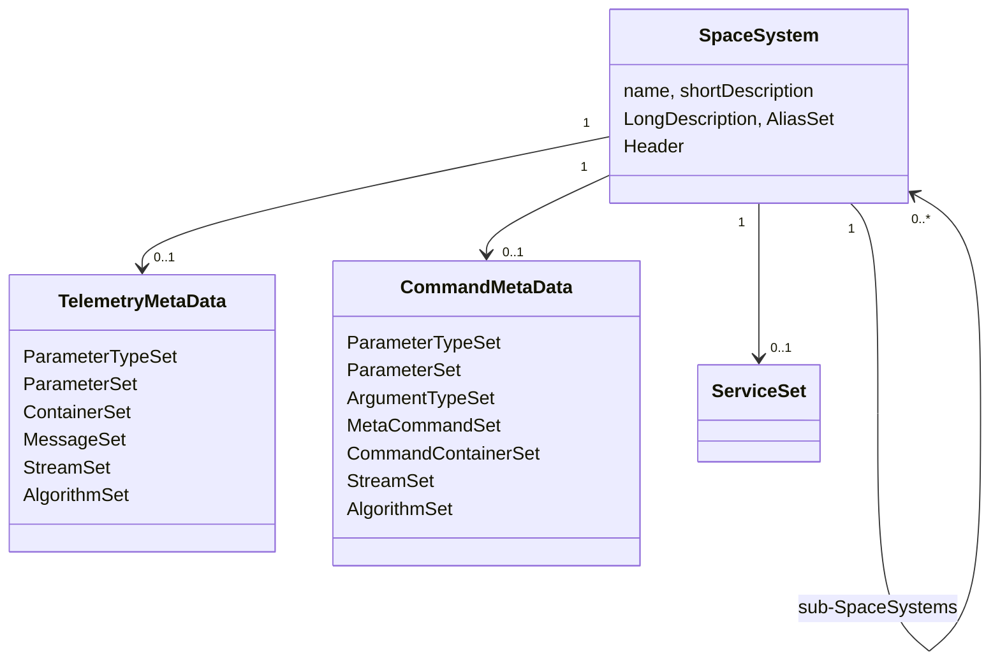
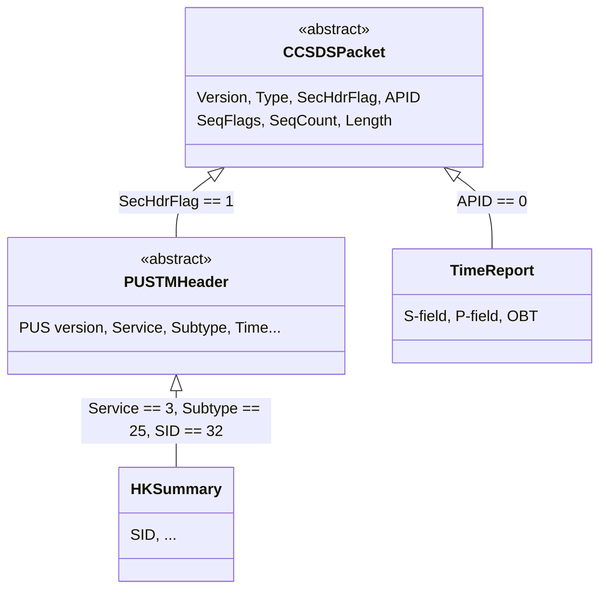

# XTCE: XML Telemetric and Command Exchange (CCSDS 660)

Every mission control system needs a **mission database**. This is the description, item by
item, of every telemetry parameter, packet, calibration, limit, command and verification check
that the ground must handle. ESA's [SCOS-2000](../scos2000/index.md) keeps it in the
[MIB](../mib/index.md), a set of ASCII tables. Other control systems have their own formats.
Every hand-over between organisations, for example from spacecraft manufacturer to operator or
from test system to control centre, has therefore needed a custom translation, more testing and
more risk of error.[^foreword] **XTCE**, the XML Telemetric and Command Exchange format, is an
open, standard XML Schema for describing such a database. The aim is that TM/TC definitions can
be exchanged "without the need for customized import/export, re-validation, or even
re-implementation".[^scope]

XTCE is an Object Management Group (OMG) specification. CCSDS publishes the OMG text of XTCE 1.2,
inside CCSDS front matter, as the Recommended Standard **CCSDS 660.0-B-2**.[^omg][^doc] The CCSDS
Informational Report **660.1-G-2** explains every element.[^gb-purpose] This page summarises
both. It then maps XTCE concepts onto the SCOS-2000 MIB tables, a mapping that the
standards themselves do not provide. Each mapping judgement on this page is this wiki's own
analysis.

!!! info "At a glance"
    | Property | Value |
    |---|---|
    | Standard | CCSDS 660.0-B-2 (February 2020) = OMG XTCE 1.2, formal/18-10-04 (January 2019)[^doc][^omg] |
    | Normative content | the W3C XML Schema `SpaceSystem.xsd` published by the OMG[^schema] |
    | Companion | CCSDS 660.1-G-2, XTCE element description (August 2021)[^gb-purpose] |
    | Root element | `SpaceSystem`, which can be nested to form a hierarchy[^root] |
    | Main sections | `TelemetryMetaData`, `CommandMetaData`, `ServiceSet`[^root][^service] |
    | Scope | TM/TC **definitions** (metadata), not live data transfer[^scope] |
    | Out of scope | displays, data distribution, protocols, RF, scheduling, orbits, flight software[^scope] |
    | Conformance | a compliant database is an XML file that validates against the schema[^conform] |

## Documents and versions

| Document | Date | Content |
|---|---|---|
| CCSDS 660.0-B-1 | October 2007 | first CCSDS issue, superseded[^doc] |
| CCSDS 660.0-B-2 | February 2020 | XTCE 1.2. The CCSDS cover wraps the OMG specification. The normative schema is at the OMG URL[^doc][^schema] |
| CCSDS 660.1-G-2 | August 2021 | element-by-element explanation for XTCE 1.2, revising the version for XTCE 1.1[^gb-purpose] |
| CCSDS 660.2-G-2 | February 2021 | high-level introduction. Referenced by 660.1-G-2 but not in this wiki's library[^gb-purpose] |

XTCE 1.0 and 1.1 both appeared in 2006. Version 1.1 followed a CCSDS review. XTCE 1.2 (2019) is
largely backward compatible with 1.1 in syntax.[^versions] Its main changes are: a new
SpaceSystem namespace; normalised enumeration strings; more ways to state byte order; integer
exponents; new rules for string length and float sizes; an updated epoch time/date type; arrays
whose dimension sizes are set in the type; XInclude support; time association moved to container
entries; a new numeric multi-range alarm and an inside/outside flag for alarms; more places for
ancillary data and short descriptions; and argument instance references.[^versions]

The specification lists Lockheed Martin, **ESA**, Boeing, NASA GSFC, USAF SMC, Harris, Raytheon,
SciSys, CSC and GST as contributors.[^foreword] The European Space Operations Centre is one of
the copyright holders.[^omg] Its bibliography cites the **SCOS-2000 Database Import ICD issue 5.0
(June 2001)** and the **SCOS-2000 Synthetic Parameters Software User Manual**, alongside the
CCSDS packet standards, the PUS (draft ECSS-E-70-41 and ESA PSS-07-101), CCSDS time codes and the
IRIG-106 TMATS.[^biblio] This wiki reads that as a sign that the MIB was among the formats XTCE's
authors had in view; the specification does not say how its bibliography was used. See
[History of the Database Import ICD](../mib/icd-history.md) for the MIB's own evolution.

## Purpose and scope

XTCE covers the metadata needed to:[^scope]

* define the structure and sequence of **CCSDS packets and TDM frames**;
* define how individual data items are packed and unpacked;
* describe commands: identification, arguments and validation criteria;
* define parameter and command **encoding**;
* define data properties such as default values, validity criteria and dependencies.

It explicitly excludes data distribution mechanisms, command and data protocols, RF and analogue
streams, data grouping and coherent data sets, visualisation, scheduling, orbital properties,
**displays** and flight software. It is "a meta-data specification, not a data
specification".[^scope]

### Philosophy: neither packets nor frames

The industry is split between packet telemetry and TDM (time-division multiplexed) telemetry, and
much of the apparent divide is vocabulary. XTCE therefore avoids words such as "minor frame",
"major frame" and even "packet" except in examples, and builds in no packet or frame
standard. Instead, users build **libraries of containers** that represent those standards.[^philo]
The processing that XTCE metadata supports runs in two directions. Stream processing covers
decryption, decoding, frame synchronisation and so on. Parameter processing covers
decommutation, de-packetisation, calibration and custom processing. On the command side the
corresponding steps are formatting, constraint checking, authentication and
verification.[^figure1]

## The SpaceSystem model



*This wiki's summary of 660.0-B-2 §6.1 and 660.1-G-2 §3.2.*[^root][^tmmd][^cmmd][^gb-struct]

The root is called **SpaceSystem** rather than "Spacecraft", because an operations centre also
controls antennas, recorders, ground equipment and RF hardware. Each of these is a
SpaceSystem.[^root] A SpaceSystem can contain sub-SpaceSystems. The standard gives four reasons:
fewer name collisions (a dozen identical transponders can each live in their own
sub-SpaceSystem), better organisation of databases with thousands of commands and tens of
thousands of parameters, the ability to nest spacecraft inside a constellation, and a natural fit
to systems of systems.[^root] The optional **Header** records the source, version, revision
history, notes and classification.[^header]

Names may contain digits, letters, underscores, hyphens and backslashes, and are **case
sensitive**. The characters `/` (SpaceSystem path separator), `.` (member of an aggregate), `[` `]`
(array index) and `:` (reserved) are reserved.[^root] Collections are named `…Set` when
unordered and `…List` when ordered. `Meta` marks a description (a MetaCommand is a command
description), and `Ref` marks a by-name reference.[^abbrev]

### References and instances

Items refer to each other by **NameReference**, which is the item's name with an optional
Unix-style path through the SpaceSystem hierarchy.[^nameref] During processing, a
**ParameterInstanceRef** points at a parameter's value. Instance 0 (the default) is the last
recorded value, and negative instances go back in time. `useCalibratedValue` (default `true`)
selects the engineering or raw value.[^instref] Conditions throughout the schema use
**MatchCriteria**: a simple Comparison, a ComparisonList, an arbitrarily complex
BooleanExpression, or an escape to a custom algorithm.[^match] A **ContextMatch** is a
MatchCriteria that selects which calibrator, alarm or significance applies. The Green Book gives
mission phases as an example of a context.[^contextmatch]

## Telemetry

### Parameter types

A **ParameterType** is a description of something that can have a value. A **Parameter** is an
instance of it ("a Parameter is not the value itself").[^ptset][^pset] The type carries most of
the information: data type, description, units, alarm limits, string conversion and,
through one of four **DataEncodings**, the on-the-link form.[^ptset] The Green Book describes the
processing order. The encoded link value is checked against a valid range and calibrated into
the host data type. Alarm checks are then applied to the result.[^gb-relation]

| XTCE type | Typical encoding | Notes |
|---|---|---|
| `StringParameterType` | StringDataEncoding | restriction pattern, character width, string alarms[^gb-types][^gb-string] |
| `EnumeratedParameterType` | IntegerDataEncoding | EnumerationList of label/value pairs. `maxValue` turns a value into a range. EnumerationAlarm[^gb-enum] |
| `BinaryParameterType` | BinaryDataEncoding | data with no type[^gb-types] |
| `BooleanParameterType` | IntegerDataEncoding, 1 bit | `oneStringValue` / `zeroStringValue`[^gb-bool] |
| `IntegerParameterType` | IntegerDataEncoding | `signed`, `sizeInBits`, ValidRange, numeric alarms[^gb-types] |
| `FloatParameterType` | Float or IntegerDataEncoding (with calibrator) | numeric alarms[^gb-types] |
| `RelativeTimeParameterType` | IntegerDataEncoding (or Binary) | `units`, `scale`, `offset`. ReferenceTime by OffsetFrom or Epoch[^gb-time] |
| `AbsoluteTimeParameterType` | IntegerDataEncoding (or Binary) | the same, but **no alarms**[^gb-time][^gb-alarm-default] |
| `ArrayParameterType` | via array members | in XTCE 1.2 the dimensions and sizes are declared in the type[^gb-array] |
| `AggregateParameterType` | via members | a record ("struct"). Members are referenced as `Aggregate.Member`[^gb-agg] |

The Green Book counts ten ParameterTypes in two groups: the scalar types and the complex Array
and Aggregate types. Its list of scalar names repeats "String" and leaves out the two time
types.[^gb-types]

#### Encodings

* **IntegerDataEncoding**: `encoding` is one of unsigned (default), twosComplement,
  onesComplement, BCD or packedBCD. The default `sizeInBits` is 8. It can carry calibrators and a
  `changeThreshold`.[^gb-int]
* **FloatDataEncoding**: IEEE754_1985, IEEE754, MILSTD_1750A, DEC, IBM or TI. The listed sizes
  are 16, 32, 40, 48, 64, 80 and 128 bits. Not every format supports every size, and a later
  paragraph of the Green Book mentions only 32, 64 and 128 bits.[^gb-float]
* **StringDataEncoding**: US-ASCII, ISO-8859-1, Windows-1252, UTF-8, UTF-16 (LE/BE) or UTF-32
  (LE/BE). The size is either fixed (`SizeInBits`, optionally ended by a termination character or
  given by a leading size field, 16 bits by default) or `Variable`.[^gb-str-enc]
* **BinaryDataEncoding**: a size plus optional From/ToBinaryTransformAlgorithms. It is used for
  data with no type and for exotic formats.[^gb-bin]

Every encoding shares a `bitOrder` (MSB first by default), an optional **byte order** list for
non-big-endian items, and **ErrorDetectCorrect** (parity, CRC, and a checksum added in
1.2).[^gb-common] A ParameterType with **no encoding** describes a local, ground, constant or
derived value that never comes from telemetry. Its Parameter should then declare a non-telemetered
`dataSource`.[^gb-noenc]

#### Calibrators

Integer and float encodings can hold a **DefaultCalibrator** and any number of
**ContextCalibrators**, each selected by a ContextMatch.[^gb-cal]

* **SplineCalibrator**: a list of raw-to-calibrated `SplinePoint`s. `order` 0 gives a step
  function, 1 linear (the default), 2 quadratic and 3 cubic. `extrapolate` controls values beyond
  the end points.[^gb-spline]
* **PolynomialCalibrator**: `Term` elements with `coefficient` and a non-negative integer
  `exponent`, for example $y = 0.5 + 1.5x - 0.045x^2 + 1.25x^3 + 0.0025x^4$.[^gb-poly]
* **MathOperationCalibrator**: an expression built from MathOperationType, written in postfix
  (reverse Polish) form.[^gb-poly][^gb-math]

#### Alarms

Every scalar type except AbsoluteTime has a **DefaultAlarm** and a **ContextAlarmList**. The first
context alarm whose ContextMatch is true is used. Otherwise the default applies, like an if-then
chain.[^gb-alarm-default][^gb-ctxalarm] All alarms share **minViolations** (successive violations
before the alarm state) and **minConformance** (successive good samples to leave it).[^gb-alarmtype]
The levels are `normal`, `watch`, `warning`, `distress`, `critical` and `severe`.[^gb-enumalarm] The
alarm forms are:

| Form | Applies to | Meaning |
|---|---|---|
| `StaticAlarmRanges` | Integer, Float (and time) | nested bands for watch, warning, distress, critical and severe. `rangeForm` is *outside* (default: normal in the middle) or *inside* (normal at the outside)[^gb-static] |
| `ChangeAlarmRanges` | Integer, Float | `changePerSample` (delta) or `changePerSecond` (rate), on an absolute or percentage basis, over a span of samples or seconds[^gb-change] |
| `MultiRange` | Integer, Float | any number of ranges (new in 1.2)[^gb-change] |
| `EnumerationAlarm` | Enumerated | alarm level per enumeration label[^gb-enumalarm] |
| `StringAlarm` | String | level per matching pattern, with a default level[^gb-string] |
| `AlarmConditions` | most types | a MatchCriteria per level. The most severe true level wins[^gb-alarmcond] |
| `CustomAlarm` | most types | algorithm-based[^gb-alarmtype] |

!!! note "Boundary semantics"
    In the Green Book's outside-alarm example, `WarningRange minInclusive="-5" maxInclusive="5"`
    makes **-5 and 5 themselves warnings**: the normal range is -5 < x < 5.[^gb-static] The
    "inclusive" values belong to the alarm band. This matters when mapping MIB limits (see below).

A **ValidRange** check applies only to Integer and Float types. It is separate from alarms: an
out-of-range value is invalid rather than alarmed.[^gb-relation][^gb-validrange]

#### Type inheritance

String, Enumerated, Binary, Integer, Float and Boolean types can extend another type of the
same kind through `@baseType`. Loops are illegal. A child can override calibrators, units,
the default alarm and ranges, and can prefix context alarms and enumerations. It cannot change
the encoding, `sizeInBits` or signedness.[^gb-inherit]

### Parameters

A Parameter is usually just a name and a `parameterTypeRef`.[^gb-param] Its **ParameterProperties**
add:[^gb-props]

* `dataSource`: *telemetered* (the default), *derived* (computed by an algorithm), *constant* or
  *local* (for example a session variable).
* `readOnly` and `persistance` (spelled this way in XTCE).
* **ValidityCondition**: a MatchCriteria that must hold for the value to be valid. The standard's
  example is a value that is invalid while its subsystem is off.
* **PhysicalAddressSet**: hardware addresses, for example on a MIL-STD-1553 bus.
* **TimeAssociation**: the offset of the sample from a reference time parameter. In XTCE 1.2 it
  can also be set per container entry.
* **SystemName**: a subsystem name for flat, single-SpaceSystem databases.

### Containers

A **SequenceContainer** describes "a packet, frame, a subframe, or any other grouping". Its
**EntryList** is an ordered list of items.[^containerset][^gb-cont] By default the entries are packed
back to back, and the container's size is the sum of their encoded sizes.[^gb-entry]

| Entry | Purpose |
|---|---|
| `ParameterRefEntry` | a parameter. Its width comes from the type's encoding[^gb-entry] |
| `ParameterSegmentRefEntry` | part of a parameter (for example a 1 024-bit binary split into 116-bit segments)[^gb-entry] |
| `ContainerRefEntry` | another container, resolved as a unit. Referencing an abstract container triggers **dynamic container matching**[^gb-cref] |
| `ContainerSegmentRefEntry`, `StreamSegmentEntry` | parts of containers or streams spread over several containers[^gb-cref] |
| `IndirectParameterRefEntry` | the parameter whose *name* is held in another parameter's value[^gb-indirect] |
| `ArrayParameterRefEntry` | an array, optionally a subset of its dimensions[^gb-indirect] |

Each entry can be modified by three elements:[^gb-modify]

* **LocationInContainerInBits** sets the position relative to `containerStart`, `containerEnd`,
  the previous entry (the default) or the next entry. The Green Book's XML examples spell the
  previous-entry value `previousEntry`.[^gb-modify][^gb-loc-ex]
* **RepeatEntry** repeats an entry for super-commutated parameters. A Count of 1 means one extra
  copy, giving two in total. An optional offset sets the gap between copies.[^gb-modify]
* **IncludeCondition** includes the entry only when a MatchCriteria holds.[^gb-modify]

#### Inheritance and identification

The key mechanism is **container inheritance**. A container names its parent in
**BaseContainer**, and the parent's EntryList is prefixed to the child's. **RestrictionCriteria**
on the BaseContainer state the values that identify the child, such as an APID or a
type/subtype. Inheritance can go to any depth, and every RestrictionCriteria along the chain must
hold.[^basecont][^gb-base][^gb-rules] Only the leaf containers are real packets. Intermediate
levels are marked `abstract`.[^gb-abstract]

| Element | Inheritance rule[^gb-rules] |
|---|---|
| `@name`, `@abstract`, `@idlePattern`, descriptions, aliases | not inherited |
| `EntryList` | parent's entries prefixed to the child's |
| `AncillaryDataSet` | child's prefixed to parent's |
| `DefaultRateInStream`, `BinaryEncoding/SizeInBits` | child overrides if present |
| `RateInStreamSet` | child's prefixed; same stream ref overrides |
| `RestrictionCriteria` | scoped to their construction, and apply to inherited entries too |



*This wiki's illustration of the Green Book patterns, not a figure from it.*[^gb-patterns]

The Green Book's **telemetry patterns** build on this idea. The basic pattern is one abstract
"generic packet" header with all packets derived from it, and for many missions one level is
enough. Variants add an optional secondary header through an IncludeCondition, a common root
container shared by all packets, or a secondary header chosen by dynamic matching, for example
when the time-stamp format varies.[^gb-patterns] **MessageSet** is an alternative to inheritance.
A Message pairs a container with a MatchCriteria.[^messageset][^gb-msg] **StreamSet** describes
fixed-frame, variable-frame or custom streams, and which containers or services they
carry.[^streamset][^gb-stream]

### Algorithms

The AlgorithmSet holds processing that cannot be stated declaratively. A **MathAlgorithm** is a
formula in postfix notation. A **CustomAlgorithm** (also called SimpleAlgorithm) holds algorithm
text and references to external implementations such as Java classes, DLLs or scripts. Input,
Input-Output and Input-Output-Trigger algorithms add named inputs, outputs, and periodic or
event-driven triggers.[^algos][^gb-math]

## Commanding

**CommandMetaData** has the telemetry sets plus an **ArgumentTypeSet**, a **MetaCommandSet** and
a **CommandContainerSet**. Parameters are scoped per SpaceSystem, so a telemetry parameter can be
used in a command and the other way round.[^cmmd][^gb-cmd] The Green Book draws the line this
way. An **argument** is something an operator (or automation) supplies. A command **parameter** is
part of the command that the system supplies, or that RestrictionCriteria fix.[^gb-cmd2] On the
command side, data flows the other way. The host value is range-checked, then (de)calibrated
into the encoding for uplink, and can be range-checked again.[^gb-cmdtypes]

**ArgumentTypes** mirror the ParameterTypes but have **no alarms**. Float and integer argument
types carry a **ValidRangeSet**.[^argtypes][^gb-argtypes]

### MetaCommand

| Element | Purpose |
|---|---|
| `@abstract` | a template that is not itself a command. Its CommandContainer is then abstract too[^gb-mc1] |
| `BaseMetaCommand` + `ArgumentAssignmentList` | inherit from another MetaCommand and fix some of its arguments[^gb-basemc] |
| `ArgumentList` | the ordered arguments, each referencing an ArgumentType[^gb-arglist] |
| `CommandContainer` | the bit layout: `ParameterRefEntry`, `ContainerRefEntry`, **`ArgumentRefEntry`**, **`FixedValueEntry`** (a literal of given `sizeInBits`). It can extend another container. Its RestrictionCriteria act as **assertions** that set values[^gb-cc][^gb-cc2] |
| `TransmissionConstraintList` | conditions (MatchCriteria) that must hold before release, with a `timeOut` and an optional `suspendable` flag[^gb-mc2][^gb-tc] |
| `DefaultSignificance` / `ContextSignificanceList` | a `consequenceLevel` of none, watch, warning, distress, critical or severe, with `spaceSystemAtRisk` and `reasonForWarning`. The level must be confirmed before sending[^metacmd][^gb-sig] |
| `Interlock` | blocks *following* commands, within a SpaceSystem scope, until this one reaches `verificationToWaitFor` (default `complete`) or a `verificationProgressPercentage`[^metacmd][^gb-interlock] |
| `VerifierSet` | TransferredToRange, TransferredFromRange, Received, Accepted, Queued, Execution, Complete (several allowed) and Failed[^metacmd][^gb-verif] |
| `ParameterToSetList` | parameters to set (to a fixed or derived value) once a verification stage is reached, for example a command counter[^gb-pts] |
| `ParametersToSuspendAlarmsOnSet` | suspend alarms on given parameters for a `suspenseTime` after a stage, to avoid false change alarms[^metacmd][^gb-pts] |

Each **verifier** is one of: a ComparisonList, a ContainerRef (the stage is reached when that
container arrives), a ParameterValueChange, a CustomAlgorithm, a BooleanExpression or a single
Comparison. A **CheckWindow** gives `timeToStartChecking` and `timeToStopChecking` relative to
`commandRelease` or to the time the last verifier passed.[^gb-verif2] MetaCommand inheritance
follows rules like those for containers. Argument lists, constraints and verifiers accumulate
(with Complete verifiers accrued), and the CommandContainer is inherited only if its BaseContainer
explicitly points to the parent's.[^gb-mcinherit] A **BlockMetaCommand** groups MetaCommand steps
with their argument values into one unit. The Green Book's example opens a valve, waits through
five NOOPs and closes it.[^gb-block] The Green Book's **command patterns** range from a simple
MetaCommand whose container is all FixedValueEntries plus arguments, to an abstract mission
template with derived concrete commands, to a generic root template shared across
missions.[^gb-cmdpat]

## ServiceSet

A **Service** is a named grouping of containers or messages, such as a "memory dump service".
Referencing an abstract container includes all its children. The meaning of a grouping is left
to the implementation, and services are optional.[^service][^gb-service]

## XTCE and ECSS-E-ST-70-31C

ECSS-E-ST-70-31C, the European [monitoring and control data definition](../ecss/e-st-70-31c.md)
standard, defines *what* data a supplier must deliver with a product so that the customer can
integrate, test and operate it. It leaves out *how* the data is provided: "spreadsheet data or
XML" are both outside its scope.[^e31-scope] It organises the data as a **space system model**:
a hierarchy of system elements, each with **activities** (telecommands, procedures and other
commands), **reporting data** (parameters and compound parameters with raw and engineering
representations) and **events**.[^e31-ssm][^e31-ssm2] It requires interpretation functions
(linear interpolation with an extrapolate/invalid choice, or IFL scripts) selected by ordered
conditions. Compound parameters can be records, arrays (fixed or variable) or deduced structures.
Limit checks have danger and warning limits, each optionally tied to a corrective
activity.[^e31-interp][^e31-compound][^e31-limit]

!!! warning "Inference"
    XTCE could serve as a delivery format for 70-31C data: the SpaceSystem hierarchy for system
    elements, Parameters and Aggregate/Array types for reporting data, MetaCommands for
    telecommand activities, ContextCalibrators for ordered interpretation functions, and
    ContextAlarms for limit sets. Neither document says so. 70-31C does not mention XTCE, and the
    70-31C requirements for corrective actions, procedures and events have no direct XTCE
    element.

## Mapping XTCE to the SCOS-2000 MIB

The MIB is a relational set of ASCII tables defined by the
[Database Import ICD](../library/icd-7-0-final.md). Each table is normalised, with mapping tables
instead of many-to-many fields.[^icd-rel] The [MIB data model](../mib/data-model.md) page shows how
the tables relate. The mapping below follows the ICD's grouping into monitoring, packets,
commanding and verification.

!!! warning "Inference: everything in this section is this wiki's analysis"
    Neither XTCE, the Green Book nor the ICD defines a mapping between XTCE and the MIB. The
    correspondences below come from comparing the element definitions in 660.0-B-2/660.1-G-2 with
    the field definitions in ICD issue 7.0. Many are approximate, and some MIB features have no
    XTCE counterpart. A real converter would need conventions, for example XTCE AncillaryData, to
    carry the rest.

### Table-level map

| MIB table(s) | XTCE concept | Fit |
|---|---|---|
| [vdf](../mib/tables/vdf.md) | `SpaceSystem/Header` (version, date) | good |
| [pcf](../mib/tables/pcf.md) | `Parameter` + `ParameterType` (+ `UnitSet`) | good for raw TM. Synthetic parameters need algorithms |
| [cur](../mib/tables/cur.md) | `ContextCalibratorList` with a ContextMatch per entry | good. Both use first-match-wins order |
| [caf](../mib/tables/caf.md) / [cap](../mib/tables/cap.md) | `SplineCalibrator` order 1 | good |
| [mcf](../mib/tables/mcf.md) | `PolynomialCalibrator` (terms 0 to 4) | exact |
| [lgf](../mib/tables/lgf.md) | `MathOperationCalibrator` | possible. No native logarithmic calibrator |
| [txf](../mib/tables/txf.md) / [txp](../mib/tables/txp.md) | `EnumeratedParameterType` / `EnumerationList` (value..maxValue → label) | good |
| [ocf](../mib/tables/ocf.md) / [ocp](../mib/tables/ocp.md) | `DefaultAlarm` / `ContextAlarmList`: StaticAlarmRanges, ChangeAlarmRanges, EnumerationAlarm | partial (see below) |
| [pid](../mib/tables/pid.md) / [pic](../mib/tables/pic.md) / [tpcf](../mib/tables/tpcf.md) | concrete `SequenceContainer` + `BaseContainer/RestrictionCriteria` on APID, type, subtype, PI1, PI2 | good |
| [plf](../mib/tables/plf.md) | `ParameterRefEntry` + `LocationInContainerInBits` (containerStart) + `RepeatEntry` + `TimeAssociation` | good |
| [vpd](../mib/tables/vpd.md) | EntryList with counters, `RepeatEntry`, `IncludeCondition`, dynamic matching, `IndirectParameterRefEntry` | partial |
| [grp](../mib/tables/grp.md) / [grpa](../mib/tables/grpa.md) / [grpk](../mib/tables/grpk.md) | `ServiceSet` (packet groups only) | weak. XTCE excludes "data grouping" |
| [dpf](../mib/tables/dpf.md), [gpf](../mib/tables/gpf.md), [spf](../mib/tables/spf.md) and their detail tables | none: displays are out of XTCE scope | none |
| [tcp](../mib/tables/tcp.md) / [pcpc](../mib/tables/pcpc.md) / [pcdf](../mib/tables/pcdf.md) | abstract `MetaCommand` + `CommandContainer` (packet header) | good |
| [ccf](../mib/tables/ccf.md) | concrete `MetaCommand` | good |
| [cdf](../mib/tables/cdf.md) | `CommandContainer/EntryList`: `FixedValueEntry`, `ArgumentRefEntry`, `ArgumentAssignment` | good |
| [cpc](../mib/tables/cpc.md) | `Argument` + `ArgumentType` | good |
| [cca](../mib/tables/cca.md) / [ccs](../mib/tables/ccs.md) | SplineCalibrator in an argument encoding (eng → raw) | good |
| [paf](../mib/tables/paf.md) / [pas](../mib/tables/pas.md) | `EnumeratedArgumentType` | good |
| [prf](../mib/tables/prf.md) / [prv](../mib/tables/prv.md) | `ValidRangeSet` | good for ranges. Discrete value lists are awkward |
| [ptv](../mib/tables/ptv.md) | `TransmissionConstraintList` | good |
| [cvs](../mib/tables/cvs.md) / [cve](../mib/tables/cve.md) / [cvp](../mib/tables/cvp.md) | `VerifierSet` with CheckWindow | partial |
| [csf](../mib/tables/csf.md) / [css](../mib/tables/css.md) / [sdf](../mib/tables/sdf.md) / [csp](../mib/tables/csp.md) | `BlockMetaCommand` (fixed steps only) | weak. MIB sequences have formal parameters and timing |
| [pst](../mib/tables/pst.md), [psv](../mib/tables/psv.md), [cps](../mib/tables/cps.md), [pvs](../mib/tables/pvs.md), [psm](../mib/tables/psm.md) | none. Closest is `ArgumentAssignmentList` | none |
| [dst](../mib/tables/dst.md) | none: command routing is "data distribution" | none |

### Parameter types: PTC/PFC to XTCE

The MIB's type system is the PUS PTC/PFC pair, as SCOS-2000 implements it.[^icd-appa] See
[MIB parameter types](../mib/parameter-types.md) and
[PUS parameter types](../ecss/pus/parameter-types.md).

| PTC (MIB meaning) | XTCE ParameterType | DataEncoding |
|---|---|---|
| 1 Boolean (1 bit) | Boolean | Integer, unsigned, 1 bit |
| 2 Enumerated (up to 32 bits) | Enumerated if textually calibrated, otherwise Integer | Integer, unsigned, PFC bits |
| 3 Unsigned integer (4 to 64 bits; 48 and 64 not supported by SCOS-2000) | Integer `signed="false"` | Integer, unsigned |
| 4 Signed integer | Integer | Integer, twosComplement |
| 5 Real: PFC 1/2 IEEE 32/64 bit, PFC 3/4 MIL-STD-1750A 32/48 bit | Float | Float IEEE754_1985 or MILSTD_1750A |
| 6 Bit string (handled as unsigned integer up to 32 bits) | Binary or Integer | Binary |
| 7 Octet string | Binary | Binary |
| 8 Character string | String | String, US-ASCII |
| 9 Absolute time (CDS, CUC, Unix) | AbsoluteTime, ReferenceTime/Epoch | Integer with `scale` (see [time codes](time-codes.md)) |
| 10 Relative time (CUC) | RelativeTime | Integer, twosComplement, with `scale` |
| 11 Deduced | (none) | dynamic container matching or IndirectParameterRefEntry |
| 13 Saved synthetic | type of the related synthetic parameter | none (derived) |

The MIB meanings are those of ICD Appendix A. The XTCE columns are this wiki's choice.[^icd-appa][^gb-types]

### Monitoring parameters (pcf and calibrations)

| MIB field | XTCE |
|---|---|
| PCF_NAME (8 characters), PCF_DESCR (24) | `Parameter/@name`, `@shortDescription`. MIB names are case-insensitive for uniqueness, XTCE names case-sensitive[^icd-names][^root] |
| PCF_PID (on-board parameter ID) | `AliasSet` alias (for example namespace "PUS") or AncillaryData |
| PCF_UNIT | `UnitSet/Unit` |
| PCF_PTC / PCF_PFC | ParameterType class + DataEncoding (table above) |
| PCF_CATEG `N` / `S` / `T` | numeric type with numeric calibrator / Enumerated / String[^icd-categ] |
| PCF_NATUR `R` | `dataSource="telemetered"` |
| PCF_NATUR `D`, `P`, `H` (OL, SPEL or hard-coded synthetic) | `dataSource="derived"` + AlgorithmSet (CustomAlgorithm or InputOutputTriggerAlgorithm)[^icd-natur] |
| PCF_NATUR `C` + PCF_PARVAL | `dataSource="constant"` + `initialValue` |
| PCF_NATUR `S` + PCF_RELATED | derived parameter copying another one. No XTCE notion of "saved in synthetic packets" |
| PCF_VALID = PCF_VALPAR | `ValidityCondition` (Comparison). SCOS-2000 also ANDs in the validity of the validity parameter[^icd-valid] |
| PCF_CURTX / CUR (CUR_RLCHK = CUR_VALPAR, by CUR_POS) | `DefaultCalibrator` / `ContextCalibrator` with ContextMatch. Both use the first match[^icd-cur] |
| CAF_INTER `P` / `F` | `SplineCalibrator/@extrapolate` true / false. In the MIB it is a property of the curve, not the parameter[^icd-caf] |
| MCF_POL1..POL5 ($Y = A_0 + A_1X + \ldots + A_4X^4$) | `PolynomialCalibrator`, Terms with exponent 0 to 4[^icd-mcf] |
| LGF ($Y = 1/[A_0 + A_1\ln X + \ldots + A_4\ln^4 X]$) | MathOperationCalibrator[^icd-mcf] |
| TXP_FROM..TXP_TO → TXP_ALTXT | `Enumeration/@value`, `@maxValue`, `@label`[^icd-txp][^gb-enum] |
| PCF_DECIM | `ToString/NumberFormat` (not detailed in the available sources) |
| PCF_CORR / PCF_OBTID | `ReferenceTime/Epoch` or `OffsetFrom`. XTCE has no notion of time correlation in the available sources[^icd-corr] |
| PCF_USCON (status consistency) | none |

### Monitoring checks (ocf and ocp)

| MIB | XTCE |
|---|---|
| OCF_NBCHCK (consecutive violating samples) | `@minViolations`[^icd-ocf][^gb-alarmtype] |
| OCF_INTER `U` / `C` (raw or calibrated limits) | XTCE numeric ranges apply to the parameter's calibrated (host) value. Raw-value limits would need AlarmConditions with `useCalibratedValue="false"`[^icd-ocf][^instref] |
| OCP_TYPE `S` (soft) / `H` (hard) limit pair | `StaticAlarmRanges`: for example `WarningRange` and `SevereRange`, following the Green Book's tri-colour recommendation[^icd-ocp][^gb-static] |
| OCP_TYPE `S`/`H` for status parameters (expected values) | `EnumerationAlarmList` (levels per label) |
| OCP_TYPE `D` (delta) | `ChangeAlarmRanges changeType="changePerSample" changeBasis="absoluteChange"` |
| OCP_RLCHK = OCP_VALPAR (applicability) | `ContextAlarm/ContextMatch` |
| OCP_TYPE `C` (status consistency), `E` (event generation) | none |

!!! warning "Inference: limit boundaries differ"
    In SCOS-2000, "In case the telemetry value matches exactly one of the limit values, this is
    not considered as an OOL condition."[^icd-ocp2] In XTCE's outside ranges, the `minInclusive` and
    `maxInclusive` values are themselves in the alarm band.[^gb-static] A literal copy of OCP_LVALU
    and OCP_HVALU into `minInclusive` and `maxInclusive` would therefore raise alarms at the exact
    limit values, which SCOS-2000 does not. A converter would need exclusive bounds or adjusted
    values. The Green Book's StaticAlarmRanges examples use only `minInclusive`/`maxInclusive`, but
    its description of the XTCE 1.2 MultiRange alarm lists both inclusive and exclusive interval
    forms, so a MultiRange alarm is the likelier way to express SCOS-2000's semantics.[^gb-multirange]
    The attribute names for exclusive bounds are not legible in the available text. SCOS-2000 also stops
    at the first applicable check (or soft/hard pair) unless configured otherwise, and limit checks
    always come in low/high pairs.[^icd-ocp2]

### Telemetry packets (pid, pic, tpcf, plf, vpd)

SCOS-2000 identifies a packet by APID, type and subtype, plus up to two extra identification
fields whose position comes from PIC, giving an SPID.[^icd-pid][^icd-pic] In XTCE this is
naturally a hierarchy. An abstract CCSDS header container restricts on APID. An abstract PUS
header container restricts on service type and subtype. Each concrete SPID container restricts
on PI1/PI2 values. The ICD warns that type, subtype and PI fields must sit at the same position in
every packet of a given type and subtype.[^icd-pid] XTCE does not impose that constraint, so the
mapping from MIB to XTCE is safe, while the reverse may not be.

* **PLF_OFFBY, PLF_OFFBI** (octet and bit of the first occurrence, from the start of the source
  packet header) become `LocationInContainerInBits referenceLocation="containerStart"` with
  value 8 × OFFBY + OFFBI.[^icd-plf][^gb-modify]
* **PLF_NBOCC, PLF_LGOCC** (super-commutation) become `RepeatEntry` with Count = NBOCC − 1 and
  offset LGOCC − width. XTCE counts *extra* copies and measures the gap between them.[^icd-plf][^gb-modify]
* **PLF_TIME, PLF_TDOCC** (millisecond offsets) become `TimeAssociation/@offset` (in seconds by
  default). XTCE has no per-occurrence delta.[^icd-plf][^gb-props]
* **PID_INTER** (period of periodic packets, used for expiry) becomes `DefaultRateInStream`.
  **TPCF_SIZE** becomes `BinaryEncoding/SizeInBits`.[^icd-pid][^gb-rate]
* **VPD** (variable packets): VPD_GRPSIZE counters become RepeatEntry with a DynamicValue count.
  VPD_FIXREP becomes a fixed count. VPD_CHOICE becomes dynamic container matching. VPD_PIDREF
  (deduced parameters by on-board ID) becomes `IndirectParameterRefEntry`, matching PCF_PID
  through an alias namespace.[^icd-vpd][^gb-indirect][^gb-size]

### Commands (tcp/pcdf, ccf, cdf, cpc)

| MIB | XTCE |
|---|---|
| TCP + PCDF (header layout) | abstract MetaCommand whose CommandContainer holds the CCSDS/PUS header fields |
| CCF_TYPE, CCF_STYPE, CCF_APID, CCF_ACK | `ArgumentAssignment`s or `RestrictionCriteria` assertions on the header parameters |
| CCF_CRITICAL `Y` | `DefaultSignificance consequenceLevel` (for example `critical`). The ICD leaves extra protection to the mission[^icd-ccf] |
| CCF_ILSCOPE (G, L, S, B, F, T, N) / CCF_ILSTAGE (R, U, O, A, C) | `Interlock` with `scopeToSpaceSystem` / `verificationToWaitFor`. XTCE has no equivalent of "local source" scope or "only on failure"[^icd-ccf][^gb-interlock] |
| CCF_PLAN, CCF_EXEC, CCF_HIPRI, CCF_MAPID, CCF_SUBSCHEDID | none (AncillaryData) |
| CDF_ELTYPE `A` (fixed area) | `FixedValueEntry` (value in hex, at most 32 bits)[^icd-cdf] |
| CDF_ELTYPE `F` (fixed parameter) | `ArgumentAssignment` in a derived MetaCommand, or a FixedValueEntry |
| CDF_ELTYPE `E` (editable) | `ArgumentRefEntry` + `Argument` |
| CDF_BIT (sort order; elements are packed without gaps) | EntryList order. The MIB uses CDF_BIT only to sort[^icd-cdf] |
| CDF_GRPSIZE (repeated groups with counter N) | RepeatEntry with a DynamicValue count from the counter argument |
| CDF_INTER `T` + CDF_TMID (dynamic default from TM) | none. The closest is an argument `initialValue` |
| CPC_PTC/PFC, CPC_UNIT, CPC_DISPFMT, CPC_RADIX | ArgumentType + encoding + UnitSet (+ AncillaryData) |
| CPC_CATEG `C` + CPC_CCAREF / `T` + CPC_PAFREF | calibrator in the argument encoding / EnumeratedArgumentType |
| CPC_CATEG `A` (command ID) / `P` (parameter ID) | none |
| CPC_PRFREF → PRF/PRV | `ValidRangeSet`. The MIB check passes when the value is within **or equal to** min/max[^icd-prv] |
| PTV (parameter = value, ANDed, validity implied) | `TransmissionConstraint` (ComparisonList)[^icd-ptv] |

### Verification (cvs, cve, cvp)

| MIB | XTCE |
|---|---|
| CVS_TYPE `A` (application acceptance) | `AcceptedVerifier` |
| CVS_TYPE `S` (start of execution), `0`-`9` (progress) | `ExecutionVerifier` (with PercentageComplete for progress) |
| CVS_TYPE `C` (completion) | `CompleteVerifier` |
| CCF_ILSTAGE `R`, `U`, `O` (ground reception, uplink, on-board reception) | TransferredToRange, TransferredFromRange, Received (approximate) |
| CVS_SOURCE `R` (PUS [ST[01]](../ecss/pus/st01-request-verification.md) report) | verifier with `ContainerRef` to the report container |
| CVS_SOURCE `V` + CVE (CVE_VAL ± CVE_TOL, ANDed) | ComparisonList. A tolerance needs two comparisons |
| CVS_START (seconds after release, or after execution for time-tagged commands, before the window opens) and CVS_INTERVAL (length of the sampling interval used to compute the overall window) | `CheckWindow` `timeToStartChecking` / `timeToStopChecking` relative to `commandRelease`. The stop time has to be derived from CVS_INTERVAL by SCOS-2000's window rule, which the ICD refers to another document for |
| CVE_CHECK `B` / `S` (also drives status consistency) | none |

The MIB meanings are from the ICD.[^icd-cvs][^icd-cve][^icd-ccf] In the MIB, at most one stage of
each type can attach to a command, and SCOS-2000 processes progress reports only for stage `0`.
In XTCE, a MetaCommand may have several Complete verifiers.[^icd-cvp][^icd-cvs][^metacmd]

### What has no XTCE counterpart

* **Displays** (alphanumeric, graphic and scrolling displays: tables dpf/dpc, gpf/gpc, spf/spc, and
  printouts ppf/ppc). XTCE excludes displays. SCOS-2000 itself has kept display
  definitions outside the MIB database since R5.0.[^scope][^icd-disp]
* **Command sequences** with formal parameters, timing and nesting. From SCOS-2000 R5.0 these are
  kept as XML files in the FARC. That XML is not XTCE.[^icd-seq] BlockMetaCommand covers only
  fixed groups.[^gb-block]
* **Parameter sets** (PST/PSV/CPS/PVS/PSM), **command routing** (DST), **status consistency
  checking**, **event-generating checks**, **dynamic defaults**, and SCOS-2000 configuration hooks
  such as PCF_DARC or PID_EVENT.
* **Time correlation**. The MIB says *whether* to correlate and with which OBT clock (PCF_CORR,
  PCF_OBTID). Correlation coefficients are run-time data. See
  [Time correlation in SCOS-2000](../scos2000/time-correlation.md).

## Worked example 1: a Solar Orbiter housekeeping parameter

[NIH0K31T](../explorer/index.md#/solo/param/NIH0K31T) ("ccT") is defined in the 2025 Solar
Orbiter MIB as follows:[^mib]

| Table | Row (abridged) |
|---|---|
| pcf | NAME NIH0K31T, DESCR ccT, UNIT degC, PTC 4, PFC 12 (16-bit signed), CATEG N, NATUR R, CURTX CIHP0100TM, DECIM 2 |
| caf | [CIHP0100TM](../explorer/index.md#/solo/calib/num/CIHP0100TM) "Convert raw to degC for IH,HK,IS", ENGFMT R, RAWFMT I, NCURVE 2, INTER blank (ICD default `F`) |
| cap | (−32768 → −327.68), (32767 → 327.67) |
| ocf | NBCHCK 2, NBOOL 2, INTER C, CODIN R |
| ocp | POS 1 type S: −40 to 40; POS 2 type H: −50 to 65 |
| plf | SPID 56316 at octet 66, bit 0 (also SPID 56326) |
| pid / pic / tpcf | SPID [56316](../explorer/index.md#/solo/packet/56316) "OBC HK Summary Packet (STBY & OBS)": type 3, subtype 25, APID 1316, PI1 32; PIC for (3,25): PI1 at octet 16, 8 bits; TPCF_SIZE 70 |

A possible XTCE rendering, constructed by this wiki and **not validated against the schema**,
follows the Green Book's syntax examples:[^gb-spline][^gb-static][^gb-base]

```xml
<xtce:FloatParameterType name="NIH0K31T_T" shortDescription="ccT">
  <xtce:UnitSet><xtce:Unit>degC</xtce:Unit></xtce:UnitSet>
  <xtce:IntegerDataEncoding sizeInBits="16" encoding="twosComplement">
    <xtce:DefaultCalibrator>
      <!-- CAF/CAP CIHP0100TM; CAF_INTER default 'F' = no extrapolation -->
      <xtce:SplineCalibrator order="1" extrapolate="false">
        <xtce:SplinePoint raw="-32768" calibrated="-327.68"/>
        <xtce:SplinePoint raw="32767"  calibrated="327.67"/>
      </xtce:SplineCalibrator>
    </xtce:DefaultCalibrator>
  </xtce:IntegerDataEncoding>
  <!-- OCF_NBCHCK = 2; OCP soft -40..40, hard -50..65 (calibrated, OCF_INTER = C) -->
  <xtce:DefaultAlarm minViolations="2">
    <xtce:StaticAlarmRanges>
      <xtce:WarningRange minInclusive="-40" maxInclusive="40"/>
      <xtce:SevereRange  minInclusive="-50" maxInclusive="65"/>
    </xtce:StaticAlarmRanges>
  </xtce:DefaultAlarm>
</xtce:FloatParameterType>

<xtce:Parameter name="NIH0K31T" parameterTypeRef="NIH0K31T_T"/>

<xtce:SequenceContainer name="SPID_56316" shortDescription="OBC HK Summary Packet (STBY &amp; OBS)">
  <xtce:EntryList>
    <xtce:ParameterRefEntry parameterRef="NIH0K31T">
      <!-- PLF_OFFBY 66, PLF_OFFBI 0: 66 x 8 = 528 bits from the start of the packet -->
      <xtce:LocationInContainerInBits referenceLocation="containerStart">
        <xtce:FixedValue>528</xtce:FixedValue>
      </xtce:LocationInContainerInBits>
    </xtce:ParameterRefEntry>
  </xtce:EntryList>
  <xtce:BaseContainer containerRef="PUS_TM_3_25">
    <xtce:RestrictionCriteria>
      <xtce:ComparisonList>
        <xtce:Comparison parameterRef="APID" value="1316"/>
        <!-- PIC (3,25): PI1 is the 8-bit field at octet 16 (the SID) -->
        <xtce:Comparison parameterRef="PI1_SID" value="32"/>
      </xtce:ComparisonList>
    </xtce:RestrictionCriteria>
  </xtce:BaseContainer>
</xtce:SequenceContainer>
```

!!! warning "Inference"
    RestrictionCriteria is a MatchCriteria, and the Green Book combines several conditions in it
    with a `ComparisonList`, in which every Comparison must be true.[^gb-base][^gb-complist] The
    example above follows that form. The schema is the normative reference and was not checked. Because `containerStart` is measured from the start of the
    concrete container, the container hierarchy must cover the whole packet from the primary
    header onwards, which matches the MIB's convention that PLF offsets count from the start of
    the source packet header.[^icd-plf] The soft-to-Warning and hard-to-Severe choice follows the
    Green Book's tri-colour recommendation. The boundary caveat above also applies: SCOS-2000 does
    not flag exactly −40 or 40.

## Worked example 2: a Solar Orbiter telecommand

[ZCD00901](../explorer/index.md#/solo/command/ZCD00901) "Change Time Report Generation Rate" is
PUS TC(9,1) to APID 172. It uses packet header NOM_TC, has acknowledgement flags 9, is
non-critical (CCF_CRITICAL `N`), has no interlock (ILSCOPE `N`, ILSTAGE `C`) and one CDF element.
That element is the editable parameter PCD09011 "Time Rep Gen rate": 8 bits, PTC 2 PFC 8,
CPC_CATEG `T` with textual de-calibration CCDT0043TX (`EVERY_TMFR` = 0 … `EVERY_256_TMFR` = 8),
default taken from the CPC entry. Its verification profile (cvp) attaches stages 14001 (type A,
report-based, start 0 s, interval 20 s) and 14007 (type C, report-based, 0 s, 20 s).[^mib]

```xml
<xtce:EnumeratedArgumentType name="PCD09011_T">
  <xtce:IntegerDataEncoding sizeInBits="8"/>
  <xtce:EnumerationList>
    <xtce:Enumeration label="EVERY_TMFR" value="0"/>
    <!-- ... values 1 to 7 ... -->
    <xtce:Enumeration label="EVERY_256_TMFR" value="8"/>
  </xtce:EnumerationList>
</xtce:EnumeratedArgumentType>

<xtce:MetaCommand name="ZCD00901" shortDescription="Change Time Report Generation Rate">
  <xtce:BaseMetaCommand metaCommandRef="NOM_TC">
    <xtce:ArgumentAssignmentList>
      <xtce:ArgumentAssignment argumentName="APID"    argumentValue="172"/>
      <xtce:ArgumentAssignment argumentName="Service" argumentValue="9"/>
      <xtce:ArgumentAssignment argumentName="Subtype" argumentValue="1"/>
      <xtce:ArgumentAssignment argumentName="Ack"     argumentValue="9"/>
    </xtce:ArgumentAssignmentList>
  </xtce:BaseMetaCommand>
  <xtce:ArgumentList>
    <xtce:Argument name="PCD09011" argumentTypeRef="PCD09011_T"/>
  </xtce:ArgumentList>
  <xtce:CommandContainer name="ZCD00901_CC">
    <xtce:EntryList>
      <xtce:ArgumentRefEntry argumentRef="PCD09011"/>
    </xtce:EntryList>
    <xtce:BaseContainer containerRef="NOM_TC_CC"/>
  </xtce:CommandContainer>
  <xtce:VerifierSet>
    <!-- CVS 14001 (A, R) and 14007 (C, R): match the PUS ST[01] acceptance/completion reports;
         window opens 0 s after release, CVS_INTERVAL 20 s -->
  </xtce:VerifierSet>
</xtce:MetaCommand>
```

This XML was constructed by this wiki following the Green Book's descriptions of
BaseMetaCommand, ArgumentAssignment and CommandContainer. The attribute spellings in
`ArgumentAssignment` and the verifier details were not checked against the
schema.[^gb-basemc][^gb-cc][^gb-verif2] The header parameters of NOM_TC (APID, service, subtype,
ack flags, source ID) are described on the [Space Packet](space-packet.md) page.

## Scale of a full conversion

Converting the whole 2025 Solar Orbiter MIB (VDF 25925PFM, "20250916-CSW3.1.2_MAS7.33") would
involve the following, from this wiki's row counts:[^mib]

| Item | MIB rows | XTCE result |
|---|---|---|
| Monitoring parameters | 126 745 pcf | Parameters (98 739 numeric raw, 26 328 status raw, 94 text raw; 1 582 synthetic `D`; 2 saved `S`) |
| Parameter types by PTC | 1: 4 380 · 2: 29 443 · 3: 50 341 · 4: 1 950 · 5: 29 718 · 6: 950 · 7: 5 990 · 8: 120 · 9: 3 796 · 10: 47 · 11: 8 · 13: 2 | ParameterTypes (many shareable) |
| Calibrations | 679 caf (7 830 points), 229 mcf, 0 lgf, 1 003 txf (35 032 txp), 1 974 cur rows for 907 parameters | Spline, Polynomial and Enumeration definitions, ContextCalibrators |
| Checks | 5 338 ocf, 7 369 ocp (H 4 153, S 3 096, D 105, C 15) | DefaultAlarm/ContextAlarm (C has no equivalent) |
| Packets | 11 150 pid, 256 pic, 400 792 plf, 19 863 vpd | SequenceContainers and entries |
| Commands | 5 454 ccf, 47 609 cdf (A 16 906, F 17 681, E 13 022), 7 155 cpc | MetaCommands, entries and Arguments |
| Command calibrations and ranges | 99 cca, 624 paf, 565 prf (1 072 prv) | argument calibrators, enumerations, ValidRangeSets |
| Verification | 206 cvs (A/R 16, C/R 23, C/V 167), 171 cve, 10 697 cvp | VerifierSets |
| PTV | 5 ptv | TransmissionConstraints |
| Sequences | 3 404 csf, 13 879 css | outside XTCE, apart from simple BlockMetaCommands |

??? example "SQL used"
    ```sql
    -- solo-2025-09-16.sqlite (MIB__20250916M25925PFMS001_SOL)
    SELECT * FROM vdf;
    SELECT COUNT(*) FROM pcf;  -- and likewise for every table in the scale table
    SELECT PCF_CATEG, PCF_NATUR, COUNT(*) FROM pcf GROUP BY 1,2;
    SELECT PCF_PTC, COUNT(*) FROM pcf GROUP BY 1 ORDER BY CAST(PCF_PTC AS INT);
    SELECT OCP_TYPE, COUNT(*) FROM ocp GROUP BY 1;
    SELECT COL2 AS CVS_TYPE, COL3 AS CVS_SOURCE, COUNT(*) FROM cvs GROUP BY 1,2;
    SELECT CDF_ELTYPE, COUNT(*) FROM cdf GROUP BY 1;
    SELECT COUNT(DISTINCT CUR_PNAME) FROM cur;
    -- worked example 1
    SELECT * FROM pcf WHERE PCF_NAME='NIH0K31T';
    SELECT * FROM caf WHERE CAF_NUMBR='CIHP0100TM'; SELECT * FROM cap WHERE CAP_NUMBR='CIHP0100TM';
    SELECT * FROM ocf WHERE OCF_NAME='NIH0K31T';    SELECT * FROM ocp WHERE OCP_NAME='NIH0K31T';
    SELECT l.PLF_SPID, l.PLF_OFFBY, l.PLF_OFFBI, p.* FROM plf l JOIN pid p ON p.PID_SPID=l.PLF_SPID
      WHERE l.PLF_NAME='NIH0K31T';
    SELECT * FROM pic WHERE PIC_TYPE='3' AND PIC_STYPE='25'; SELECT * FROM tpcf WHERE TPCF_SPID='56316';
    -- worked example 2
    SELECT * FROM ccf WHERE CCF_CNAME='ZCD00901'; SELECT * FROM cdf WHERE CDF_CNAME='ZCD00901';
    SELECT * FROM cpc WHERE CPC_NAME='PCD09011';  SELECT * FROM pas WHERE PAS_NUMBR='CCDT0043TX';
    SELECT * FROM cvp WHERE COL1='ZCD00901';      SELECT * FROM cvs WHERE COL1 IN ('14001','14007');
    ```

## Related pages

* [The MIB](../mib/index.md), [MIB data model](../mib/data-model.md), [Monitoring in the MIB](../mib/monitoring.md), [Calibration in the MIB](../mib/calibration.md), [Monitoring checks](../mib/monitoring-checks.md), [Commanding in the MIB](../mib/commanding.md), [Command verification](../mib/command-verification.md).
* [MIB tooling and open-source libraries](../mib/tooling.md), [ECSS-E-ST-70-31C](../ecss/e-st-70-31c.md).
* [Time code formats](time-codes.md), for XTCE absolute and relative time types.

[^doc]: [CCSDS 660.0-B-2, XML Telemetric and Command Exchange, Version 1.2](../library/ccsds-660-0-660x0b2.md), Authority and Document Control, PDF pp. 3 and 7.
[^omg]: [CCSDS 660.0-B-2](../library/ccsds-660-0-660x0b2.md), OMG title page (formal/18-10-04, January 2019) and copyright notice, PDF pp. 9–10.
[^foreword]: [CCSDS 660.0-B-2](../library/ccsds-660-0-660x0b2.md), Foreword and Introduction (purpose), PDF pp. 15–16.
[^philo]: [CCSDS 660.0-B-2](../library/ccsds-660-0-660x0b2.md), Introduction (overview and philosophy), PDF p. 16.
[^figure1]: [CCSDS 660.0-B-2](../library/ccsds-660-0-660x0b2.md), figure 1, Telemetric and command processing metadata encapsulated in XTCE, PDF p. 17.
[^scope]: [CCSDS 660.0-B-2](../library/ccsds-660-0-660x0b2.md), §1 Scope, PDF p. 19.
[^conform]: [CCSDS 660.0-B-2](../library/ccsds-660-0-660x0b2.md), §2 Conformance, PDF p. 19.
[^abbrev]: [CCSDS 660.0-B-2](../library/ccsds-660-0-660x0b2.md), §5 Symbols (prefixes and postfixes Meta, Set, List, Ref), PDF pp. 20–21.
[^root]: [CCSDS 660.0-B-2](../library/ccsds-660-0-660x0b2.md), §6.1 The root object, the SpaceSystem (sub-SpaceSystems, note on names), PDF p. 23.
[^header]: [CCSDS 660.0-B-2](../library/ccsds-660-0-660x0b2.md), §6.1.1 The Header record, PDF p. 24.
[^tmmd]: [CCSDS 660.0-B-2](../library/ccsds-660-0-660x0b2.md), §6.1.2 TelemetryMetadata, PDF p. 24.
[^ptset]: [CCSDS 660.0-B-2](../library/ccsds-660-0-660x0b2.md), §6.1.2.1 ParameterTypeSet (four encodings), PDF pp. 25–26.
[^pset]: [CCSDS 660.0-B-2](../library/ccsds-660-0-660x0b2.md), §6.1.2.2 ParameterSet, PDF pp. 26–27.
[^containerset]: [CCSDS 660.0-B-2](../library/ccsds-660-0-660x0b2.md), §6.1.2.3 ContainerSet, PDF p. 27.
[^basecont]: [CCSDS 660.0-B-2](../library/ccsds-660-0-660x0b2.md), §6.1.2.3.1 BaseContainer (RestrictionCriteria), PDF p. 27.
[^messageset]: [CCSDS 660.0-B-2](../library/ccsds-660-0-660x0b2.md), §6.1.2.4 MessageSet, PDF p. 28.
[^streamset]: [CCSDS 660.0-B-2](../library/ccsds-660-0-660x0b2.md), §6.1.2.5 StreamSet, PDF p. 28.
[^algos]: [CCSDS 660.0-B-2](../library/ccsds-660-0-660x0b2.md), §6.1.2.6 AlgorithmSet (Math, Simple, Input, InputOutput, InputOutputTrigger algorithms), PDF p. 29.
[^cmmd]: [CCSDS 660.0-B-2](../library/ccsds-660-0-660x0b2.md), §6.1.3 CommandMetaData, PDF p. 30.
[^argtypes]: [CCSDS 660.0-B-2](../library/ccsds-660-0-660x0b2.md), §6.1.3.1 ArgumentTypeSet, PDF p. 31.
[^metacmd]: [CCSDS 660.0-B-2](../library/ccsds-660-0-660x0b2.md), §6.1.3.2 MetaCommandSet and §6.1.3.2.1 to §6.1.3.2.9, PDF pp. 32–33.
[^service]: [CCSDS 660.0-B-2](../library/ccsds-660-0-660x0b2.md), §6.1.4 ServiceSet and §6.2 Common types (MatchCriteria, Polynomial, Unit), PDF p. 34.
[^match]: [CCSDS 660.0-B-2](../library/ccsds-660-0-660x0b2.md), §6.2.1 MatchCriteria, PDF p. 34.
[^schema]: [CCSDS 660.0-B-2](../library/ccsds-660-0-660x0b2.md), §6.3 The schema and Annex A, PDF pp. 34–35.
[^biblio]: [CCSDS 660.0-B-2](../library/ccsds-660-0-660x0b2.md), Annex C Bibliography, PDF p. 39.
[^gb-purpose]: [CCSDS 660.1-G-2, XTCE Element Description](../library/ccsds-660-1-660x1g2.md), §1.1 Purpose, §1.2 Scope and §1.5 References, PDF pp. 14–17.
[^versions]: [CCSDS 660.1-G-2](../library/ccsds-660-1-660x1g2.md), §2.3 XTCE versions and §2.3.2 Changes from XTCE 1.1 to 1.2, PDF pp. 19–20.
[^gb-struct]: [CCSDS 660.1-G-2](../library/ccsds-660-1-660x1g2.md), §3.2 Overall structure, PDF p. 21.
[^nameref]: [CCSDS 660.1-G-2](../library/ccsds-660-1-660x1g2.md), §3.3 Name references, PDF pp. 21–23.
[^contextmatch]: [CCSDS 660.1-G-2](../library/ccsds-660-1-660x1g2.md), §3.4.3.6 MatchCriteriaType and §3.4.3.7 ContextMatch, PDF pp. 36–37.
[^gb-complist]: [CCSDS 660.1-G-2](../library/ccsds-660-1-660x1g2.md), §3.4.3.3 ComparisonList element, PDF p. 29.
[^gb-multirange]: [CCSDS 660.1-G-2](../library/ccsds-660-1-660x1g2.md), §4.3.2.3.8 MultiRange and §4.3.2.3.8.1 AlarmMultiRange rangeForm (inclusive and exclusive interval forms), PDF pp. 106–108.
[^instref]: [CCSDS 660.1-G-2](../library/ccsds-660-1-660x1g2.md), §3.4.4 ParameterInstanceReferences, PDF pp. 37–38.
[^gb-size]: [CCSDS 660.1-G-2](../library/ccsds-660-1-660x1g2.md), §3.4.5 Size-related elements (FixedValue, DynamicValue, DiscreteLookupList), PDF pp. 38–40.
[^gb-relation]: [CCSDS 660.1-G-2](../library/ccsds-660-1-660x1g2.md), §4.3.2.2 ParameterType pattern, notes and figure 4-10, PDF pp. 60–61.
[^gb-inherit]: [CCSDS 660.1-G-2](../library/ccsds-660-1-660x1g2.md), §4.3.2.2.3 baseType attribute, tables 4-1 and 4-2, PDF pp. 61–63.
[^gb-common]: [CCSDS 660.1-G-2](../library/ccsds-660-1-660x1g2.md), §4.3.2.2.5.1 to §4.3.2.2.5.4 (DataEncodingType, bitOrder, ErrorDetectCorrect, ByteOrder), PDF pp. 67–70.
[^gb-str-enc]: [CCSDS 660.1-G-2](../library/ccsds-660-1-660x1g2.md), §4.3.2.2.5.5 StringDataEncoding, PDF pp. 70–75.
[^gb-int]: [CCSDS 660.1-G-2](../library/ccsds-660-1-660x1g2.md), §4.3.2.2.5.6 IntegerDataEncoding, PDF pp. 75–77.
[^gb-float]: [CCSDS 660.1-G-2](../library/ccsds-660-1-660x1g2.md), §4.3.2.2.5.7 FloatDataEncoding, PDF pp. 77–80.
[^gb-bin]: [CCSDS 660.1-G-2](../library/ccsds-660-1-660x1g2.md), §4.3.2.2.5.8 BinaryDataEncoding, PDF pp. 80–81.
[^gb-noenc]: [CCSDS 660.1-G-2](../library/ccsds-660-1-660x1g2.md), §4.3.2.2.5.9 Specifying no DataEncoding, PDF pp. 81–82.
[^gb-cal]: [CCSDS 660.1-G-2](../library/ccsds-660-1-660x1g2.md), §4.3.2.2.5.7.4 DefaultCalibrator and ContextCalibratorList, PDF p. 80.
[^gb-spline]: [CCSDS 660.1-G-2](../library/ccsds-660-1-660x1g2.md), §4.3.2.2.6.2 Spline calibrators (order, extrapolate, SplinePoint), PDF pp. 83–86.
[^gb-poly]: [CCSDS 660.1-G-2](../library/ccsds-660-1-660x1g2.md), §4.3.2.2.6.3 PolynomialCalibrator (table 4-3) and §4.3.2.2.6.4 MathOperationCalibrator, PDF pp. 86–88.
[^gb-alarm-default]: [CCSDS 660.1-G-2](../library/ccsds-660-1-660x1g2.md), §4.3.2.3.2 and §4.3.2.3.3 DefaultAlarm, PDF pp. 89–91.
[^gb-alarmtype]: [CCSDS 660.1-G-2](../library/ccsds-660-1-660x1g2.md), §4.3.2.3.3.1 to §4.3.2.3.3.4 (minViolations, minConformance, AlarmConditions, CustomAlarm), PDF pp. 93–97.
[^gb-ctxalarm]: [CCSDS 660.1-G-2](../library/ccsds-660-1-660x1g2.md), §4.3.2.3.4 ContextAlarmList, PDF pp. 97–98.
[^gb-enumalarm]: [CCSDS 660.1-G-2](../library/ccsds-660-1-660x1g2.md), §4.3.2.3.5 EnumerationAlarm (alarm levels), PDF pp. 98–99.
[^gb-alarmcond]: [CCSDS 660.1-G-2](../library/ccsds-660-1-660x1g2.md), §4.3.2.3.6 AlarmConditions, PDF p. 100.
[^gb-static]: [CCSDS 660.1-G-2](../library/ccsds-660-1-660x1g2.md), §4.3.2.3.7.2 StaticAlarmRanges, outside and inside alarms and the tri-colour recommendation, PDF pp. 100–103.
[^gb-change]: [CCSDS 660.1-G-2](../library/ccsds-660-1-660x1g2.md), §4.3.2.3.7.3 to §4.3.2.3.8 ChangeAlarmRanges and MultiRange, PDF pp. 103–106.
[^gb-validrange]: [CCSDS 660.1-G-2](../library/ccsds-660-1-660x1g2.md), §4.3.2.3.9 ValidRange and Alarms, PDF pp. 108–109.
[^gb-types]: [CCSDS 660.1-G-2](../library/ccsds-660-1-660x1g2.md), §4.3.2.4.1 ParameterTypes, general, PDF p. 109.
[^gb-string]: [CCSDS 660.1-G-2](../library/ccsds-660-1-660x1g2.md), §4.3.2.4.2 StringParameterType (StringAlarm), PDF pp. 109–118.
[^gb-enum]: [CCSDS 660.1-G-2](../library/ccsds-660-1-660x1g2.md), §4.3.2.4.3 EnumeratedParameterType (value, maxValue, label), PDF pp. 118–123.
[^gb-bool]: [CCSDS 660.1-G-2](../library/ccsds-660-1-660x1g2.md), §4.3.2.4.7 BooleanParameterType, PDF pp. 139–142.
[^gb-time]: [CCSDS 660.1-G-2](../library/ccsds-660-1-660x1g2.md), §4.3.2.4.8 RelativeTimeParameterType and §4.3.2.4.9 AbsoluteTimeParameterType (units, scale, offset, ReferenceTime), PDF pp. 142–149.
[^gb-array]: [CCSDS 660.1-G-2](../library/ccsds-660-1-660x1g2.md), §4.3.2.4.10 ArrayParameterType, PDF pp. 149–151.
[^gb-agg]: [CCSDS 660.1-G-2](../library/ccsds-660-1-660x1g2.md), §4.3.2.4.11 AggregateParameterType, PDF pp. 151–154.
[^gb-param]: [CCSDS 660.1-G-2](../library/ccsds-660-1-660x1g2.md), §4.3.3.1 to §4.3.3.4 ParameterSet and Parameters, PDF pp. 165–169.
[^gb-props]: [CCSDS 660.1-G-2](../library/ccsds-660-1-660x1g2.md), §4.3.3.5 to §4.3.3.12 ParameterProperties (dataSource, readOnly, ValidityCondition, PhysicalAddressSet, TimeAssociation), PDF pp. 170–175.
[^gb-cont]: [CCSDS 660.1-G-2](../library/ccsds-660-1-660x1g2.md), §4.3.4.1 ContainerSet, PDF pp. 175–176.
[^gb-abstract]: [CCSDS 660.1-G-2](../library/ccsds-660-1-660x1g2.md), §4.3.4.3 abstract attribute, PDF p. 178.
[^gb-rate]: [CCSDS 660.1-G-2](../library/ccsds-660-1-660x1g2.md), §4.3.4.5 DefaultRateInStream, §4.3.4.6 RateInStreamSet and §4.3.4.7 BinaryEncoding, PDF pp. 179–181.
[^gb-entry]: [CCSDS 660.1-G-2](../library/ccsds-660-1-660x1g2.md), §4.3.4.8.1 to §4.3.4.8.4 EntryList, ParameterRefEntry and ParameterSegmentRefEntry, PDF pp. 181–186.
[^gb-cref]: [CCSDS 660.1-G-2](../library/ccsds-660-1-660x1g2.md), §4.3.4.8.5 to §4.3.4.8.7 ContainerRefEntry, dynamic container matching, segment entries, PDF pp. 186–188.
[^gb-indirect]: [CCSDS 660.1-G-2](../library/ccsds-660-1-660x1g2.md), §4.3.4.8.8 IndirectParameterRefEntry and §4.3.4.8.9 ArrayParameterRefEntry, PDF pp. 188–190.
[^gb-modify]: [CCSDS 660.1-G-2](../library/ccsds-660-1-660x1g2.md), §4.3.4.8.10 LocationInContainerInBits, RepeatEntry and IncludeCondition, PDF pp. 191–193.
[^gb-loc-ex]: [CCSDS 660.1-G-2](../library/ccsds-660-1-660x1g2.md), §5.3.2 Addressing using LocationInContainerInBits, XML examples, PDF pp. 231–232.
[^gb-base]: [CCSDS 660.1-G-2](../library/ccsds-660-1-660x1g2.md), §4.3.4.9.1 to §4.3.4.9.4 BaseContainer, RestrictionCriteria and NextContainer, PDF pp. 193–195.
[^gb-rules]: [CCSDS 660.1-G-2](../library/ccsds-660-1-660x1g2.md), §4.3.4.9.5 Container inheritance as an operation, table 4-19 and example, PDF pp. 196–198.
[^gb-msg]: [CCSDS 660.1-G-2](../library/ccsds-660-1-660x1g2.md), §4.3.5 MessageSet, PDF pp. 199–200.
[^gb-stream]: [CCSDS 660.1-G-2](../library/ccsds-660-1-660x1g2.md), §4.3.6 StreamSet, PDF p. 200.
[^gb-math]: [CCSDS 660.1-G-2](../library/ccsds-660-1-660x1g2.md), §4.3.7 AlgorithmSet and §4.3.7.3 MathAlgorithm, PDF pp. 200–202.
[^gb-cmd]: [CCSDS 660.1-G-2](../library/ccsds-660-1-660x1g2.md), §4.4.1 CommandMetaData, general, PDF p. 202.
[^gb-cmd2]: [CCSDS 660.1-G-2](../library/ccsds-660-1-660x1g2.md), §4.4.1 (arguments versus parameters), PDF p. 203.
[^gb-cmdtypes]: [CCSDS 660.1-G-2](../library/ccsds-660-1-660x1g2.md), §4.4.2 Command ParameterTypeSet and figure 4-96, PDF pp. 203–204.
[^gb-argtypes]: [CCSDS 660.1-G-2](../library/ccsds-660-1-660x1g2.md), §4.4.4 ArgumentTypeSet, PDF p. 205.
[^gb-mc1]: [CCSDS 660.1-G-2](../library/ccsds-660-1-660x1g2.md), §4.4.5.1 and §4.4.5.2.2 MetaCommand abstract attribute, PDF pp. 205–206.
[^gb-basemc]: [CCSDS 660.1-G-2](../library/ccsds-660-1-660x1g2.md), §4.4.5.2.3 BaseMetaCommand and ArgumentAssignmentList, PDF pp. 207–208.
[^gb-mcinherit]: [CCSDS 660.1-G-2](../library/ccsds-660-1-660x1g2.md), §4.4.5.2.3.4 MetaCommand inheritance, table 4-20, PDF pp. 208–209.
[^gb-cc]: [CCSDS 660.1-G-2](../library/ccsds-660-1-660x1g2.md), §4.4.5.2.4 MetaCommand/CommandContainer and its entries, PDF pp. 209–211.
[^gb-cc2]: [CCSDS 660.1-G-2](../library/ccsds-660-1-660x1g2.md), §4.4.5.2.4.6 to §4.4.5.2.4.9 BaseContainer and RestrictionCriteria as assertions, PDF pp. 211–212.
[^gb-arglist]: [CCSDS 660.1-G-2](../library/ccsds-660-1-660x1g2.md), §4.4.5.2.4.10 ArgumentList, PDF p. 213.
[^gb-mc2]: [CCSDS 660.1-G-2](../library/ccsds-660-1-660x1g2.md), §4.4.5.3.1 MetaCommand part 2, PDF p. 214.
[^gb-tc]: [CCSDS 660.1-G-2](../library/ccsds-660-1-660x1g2.md), §4.4.5.3.2 TransmissionConstraintList, PDF p. 215.
[^gb-sig]: [CCSDS 660.1-G-2](../library/ccsds-660-1-660x1g2.md), §4.4.5.3.3 DefaultSignificance and §4.4.5.3.4 ContextSignificanceList, PDF pp. 215–217.
[^gb-interlock]: [CCSDS 660.1-G-2](../library/ccsds-660-1-660x1g2.md), §4.4.5.3.5 Interlock, PDF pp. 217–218.
[^gb-verif]: [CCSDS 660.1-G-2](../library/ccsds-660-1-660x1g2.md), §4.4.5.3.6 VerifierSet, PDF pp. 218–219.
[^gb-verif2]: [CCSDS 660.1-G-2](../library/ccsds-660-1-660x1g2.md), §4.4.5.3.6.2 to §4.4.5.3.6.10 verifier elements and CheckWindow, PDF pp. 220–221.
[^gb-pts]: [CCSDS 660.1-G-2](../library/ccsds-660-1-660x1g2.md), §4.4.5.3.7 ParameterToSetList and §4.4.5.3.8 ParametersToSuspendAlarmsOnSet, PDF pp. 222–223.
[^gb-block]: [CCSDS 660.1-G-2](../library/ccsds-660-1-660x1g2.md), §4.4.5.4 MetaCommandRef and BlockMetaCommand, PDF pp. 223–225.
[^gb-service]: [CCSDS 660.1-G-2](../library/ccsds-660-1-660x1g2.md), §4.5 ServiceSet, PDF p. 226.
[^gb-patterns]: [CCSDS 660.1-G-2](../library/ccsds-660-1-660x1g2.md), §6.2 Telemetry packet patterns, figures 6-1 to 6-4, PDF pp. 259–261.
[^gb-cmdpat]: [CCSDS 660.1-G-2](../library/ccsds-660-1-660x1g2.md), §7.2 Command patterns, figures 7-1 to 7-3, PDF pp. 262–263.
[^e31-scope]: [ECSS-E-ST-70-31C](../library/ecss-e-st-70-31c.md), Introduction and §1 Scope, PDF pp. 9–10.
[^e31-ssm]: [ECSS-E-ST-70-31C](../library/ecss-e-st-70-31c.md), §4.1 The space system model, PDF p. 15.
[^e31-ssm2]: [ECSS-E-ST-70-31C](../library/ecss-e-st-70-31c.md), §4.2 Monitoring and control view of the SSM, PDF pp. 16–18.
[^e31-interp]: [ECSS-E-ST-70-31C](../library/ecss-e-st-70-31c.md), §6.6.3 Parameters, tables 6-74 to 6-79 (interpretation functions), PDF pp. 101–104.
[^e31-compound]: [ECSS-E-ST-70-31C](../library/ecss-e-st-70-31c.md), §6.6.4 Compound parameters, tables 6-80 to 6-83, PDF pp. 104–106.
[^e31-limit]: [ECSS-E-ST-70-31C](../library/ecss-e-st-70-31c.md), §6.6.6.1 Limit check data, table 6-85, PDF pp. 107–108.
[^icd-rel]: [SCOS-2000 Database Import ICD issue 7.0](../library/icd-7-0-final.md), §3.1 Relationship between the ASCII tables and the database items, tables 1 to 3, PDF pp. 25–30.
[^icd-names]: [SCOS-2000 Database Import ICD issue 7.0](../library/icd-7-0-final.md), §3.3 remark on names (case-insensitive uniqueness), PDF p. 35.
[^icd-valid]: [SCOS-2000 Database Import ICD issue 7.0](../library/icd-7-0-final.md), §3.3.2.1.1 pcf, remark and field PCF_VALID, PDF pp. 40 and 45.
[^icd-categ]: [SCOS-2000 Database Import ICD issue 7.0](../library/icd-7-0-final.md), pcf field PCF_CATEG, PDF p. 47.
[^icd-natur]: [SCOS-2000 Database Import ICD issue 7.0](../library/icd-7-0-final.md), pcf field PCF_NATUR, PDF pp. 48–49.
[^icd-corr]: [SCOS-2000 Database Import ICD issue 7.0](../library/icd-7-0-final.md), pcf fields PCF_CORR and PCF_OBTID, PDF pp. 53–54.
[^icd-cur]: [SCOS-2000 Database Import ICD issue 7.0](../library/icd-7-0-final.md), §3.3.2.2.1 cur (CUR_POS, CUR_RLCHK, CUR_VALPAR), PDF pp. 63–64.
[^icd-caf]: [SCOS-2000 Database Import ICD issue 7.0](../library/icd-7-0-final.md), §3.3.2.2.2 caf, field CAF_INTER, PDF p. 67.
[^icd-txp]: [SCOS-2000 Database Import ICD issue 7.0](../library/icd-7-0-final.md), §3.3.2.2.4 txf and §3.3.2.2.5 txp, PDF pp. 69–70.
[^icd-mcf]: [SCOS-2000 Database Import ICD issue 7.0](../library/icd-7-0-final.md), §3.3.2.2.6 mcf and §3.3.2.2.7 lgf (formulas), PDF pp. 70–72.
[^icd-ocf]: [SCOS-2000 Database Import ICD issue 7.0](../library/icd-7-0-final.md), §3.3.2.3.1 ocf (OCF_NBCHCK, OCF_INTER, OCF_CODIN), PDF pp. 72–75.
[^icd-ocp]: [SCOS-2000 Database Import ICD issue 7.0](../library/icd-7-0-final.md), §3.3.2.3.2 ocp, check types and fields OCP_TYPE, OCP_LVALU, OCP_HVALU, PDF pp. 75–80.
[^icd-ocp2]: [SCOS-2000 Database Import ICD issue 7.0](../library/icd-7-0-final.md), §3.3.2.3.2 ocp, rules for population and processing, PDF pp. 76–77.
[^icd-pid]: [SCOS-2000 Database Import ICD issue 7.0](../library/icd-7-0-final.md), §3.3.2.4 packet recognition and §3.3.2.4.1 pid (key fields, PID_INTER, PID_DFHSIZE), PDF pp. 82–88.
[^icd-pic]: [SCOS-2000 Database Import ICD issue 7.0](../library/icd-7-0-final.md), §3.3.2.4.2 pic, PDF pp. 91–93.
[^icd-plf]: [SCOS-2000 Database Import ICD issue 7.0](../library/icd-7-0-final.md), §3.3.2.5.1 plf (PLF_OFFBY to PLF_TDOCC), PDF pp. 97–99.
[^icd-vpd]: [SCOS-2000 Database Import ICD issue 7.0](../library/icd-7-0-final.md), §3.3.2.5.2 vpd (VPD_GRPSIZE, VPD_FIXREP, VPD_CHOICE, VPD_PIDREF), PDF pp. 99–102.
[^icd-disp]: [SCOS-2000 Database Import ICD issue 7.0](../library/icd-7-0-final.md), §3.3.2.7 Displays and reports (definitions kept outside the MIB from R5.0), PDF p. 110.
[^icd-ccf]: [SCOS-2000 Database Import ICD issue 7.0](../library/icd-7-0-final.md), §3.3.3.2.1 ccf (CCF_CRITICAL, CCF_ILSCOPE, CCF_ILSTAGE and other fields), PDF pp. 133–140.
[^icd-cdf]: [SCOS-2000 Database Import ICD issue 7.0](../library/icd-7-0-final.md), §3.3.3.2.3 cdf (repeated groups, dynamic defaults, CDF_ELTYPE, CDF_BIT, CDF_GRPSIZE, CDF_VALUE), PDF pp. 151–159.
[^icd-ptv]: [SCOS-2000 Database Import ICD issue 7.0](../library/icd-7-0-final.md), §3.3.3.2.4 ptv, PDF pp. 159–161.
[^icd-seq]: [SCOS-2000 Database Import ICD issue 7.0](../library/icd-7-0-final.md), §3.3.3.3 Command sequences (stored as XML in the FARC from R5.0), PDF p. 161.
[^icd-cvs]: [SCOS-2000 Database Import ICD issue 7.0](../library/icd-7-0-final.md), §3.3.3.4.1 cvs (CVS_TYPE, CVS_SOURCE, CVS_START, CVS_INTERVAL), PDF pp. 192–194.
[^icd-cve]: [SCOS-2000 Database Import ICD issue 7.0](../library/icd-7-0-final.md), §3.3.3.4.2 cve (CVE_VAL, CVE_TOL, CVE_CHECK), PDF pp. 194–199.
[^icd-cvp]: [SCOS-2000 Database Import ICD issue 7.0](../library/icd-7-0-final.md), §3.3.3.4.3 cvp, PDF pp. 199–200.
[^icd-prv]: [SCOS-2000 Database Import ICD issue 7.0](../library/icd-7-0-final.md), §3.3.3.7.1 prf and §3.3.3.7.2 prv, PDF pp. 211–213.
[^icd-appa]: [SCOS-2000 Database Import ICD issue 7.0](../library/icd-7-0-final.md), Appendix A SCOS-2000 parameter types, PDF pp. 214–224.
[^mib]: [Solar Orbiter MIB release MIB__20250916M25925PFMS001_SOL](../library/mib-20250916m25925pfms001-sol.md), tables vdf, pcf, caf, cap, ocf, ocp, plf, pid, pic, tpcf, ccf, cdf, cpc, pas, cvp, cvs and row counts of all tables; this wiki's queries (see "SQL used").
