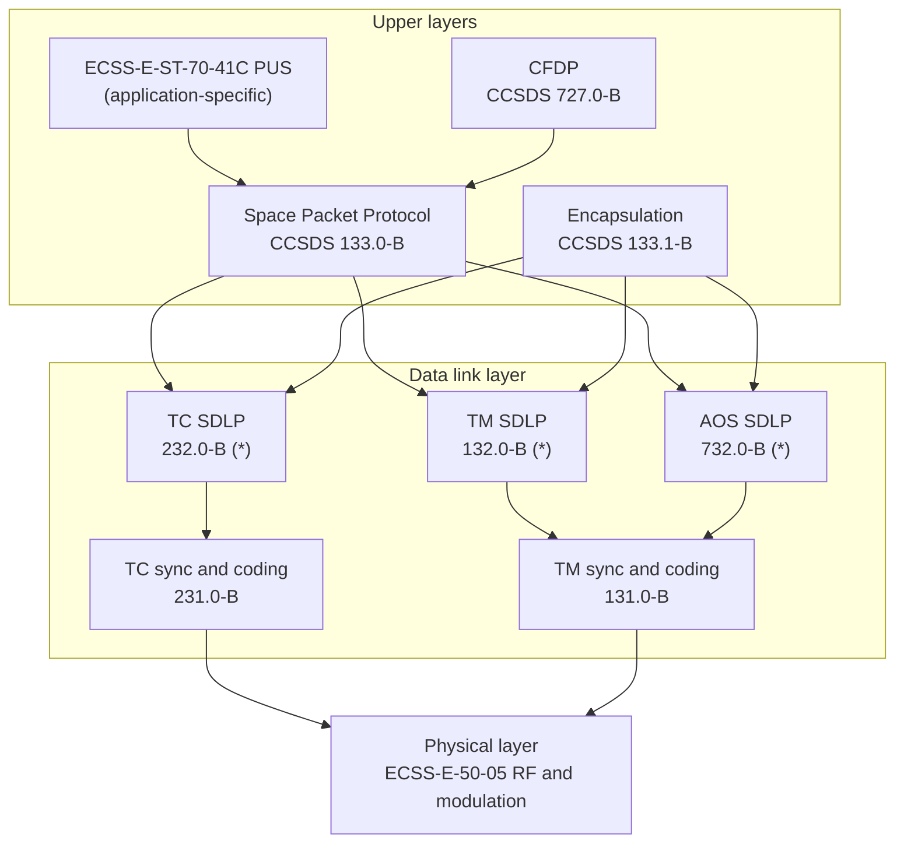
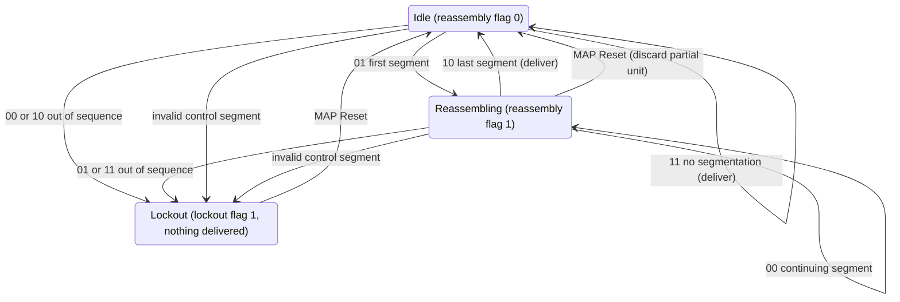
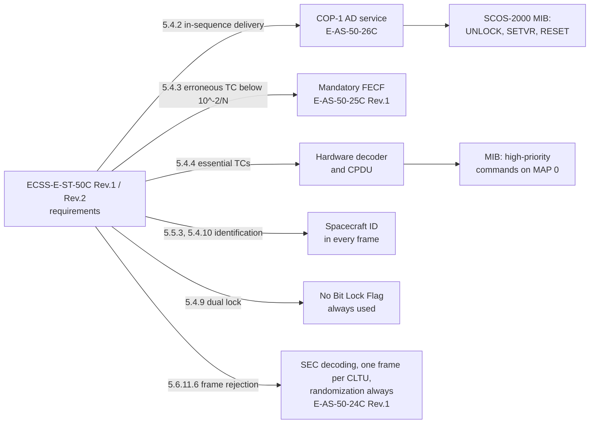

# ECSS-E-ST-50C communications and the CCSDS adoption notices

**ECSS-E-ST-50C** ("Space engineering – Communications") is the top-level ECSS standard for the
end-to-end data communication system of a spacecraft. It does not define frame formats. It defines
the vocabulary, the engineering process with its documents and reviews, and the functional and
performance requirements that the chosen protocols must satisfy; the protocols themselves are
specified by lower-level ECSS standards, by ECSS **adoption notices** of CCSDS standards and by the
CCSDS books.[^intro][^scope] The current issue is **Revision 2 of 5 December 2024**. It changes
no requirement of Revision 1 (1 March 2021) beyond correcting a typing error in requirement
5.2.5.3c: it deletes twelve definitions, fixes that typo and stops naming the issue of each adopted
CCSDS book, so that the standard need not be revised every time CCSDS updates one of them.[^r2-cl]
This page therefore follows Rev.1 and says where Rev.2 differs. The clause numbers and requirement
identifiers are the same in both, but from clause 3.3 onwards each clause sits one PDF page earlier
in Rev.2 (see [What Rev.2 changed](#what-rev2-changed)). It also
covers all six adoption notices, ECSS-E-AS-50-21 to -26 (for [TM coding](../ccsds/tm-coding.md),
the [TM](../ccsds/tm-sdlp.md), [AOS](../ccsds/aos.md) and [TC](../ccsds/tc-sdlp.md) Space Data
Link Protocols, [TC coding](../ccsds/tc-coding-cltu.md) and [COP-1](../ccsds/cop-1.md)), the
superseded 2008 standards ECSS-E-ST-50-03C (TM transfer frame) and ECSS-E-ST-50-04C (telecommand),
and the communications guidelines handbook ECSS-E-HB-50A. The general ECSS context is on the
[ECSS overview](index.md) page, and the PSS standards from which the European choices descend are
on the [history](../overview/history.md) page.

!!! info "At a glance"
    | Document | Date | Nature | What it does |
    |---|---|---|---|
    | ECSS-E-ST-50C Rev.2 | 5 December 2024 | Standard (current) | Same requirements as Rev.1 (one typo corrected); adopted CCSDS books named without issue |
    | ECSS-E-ST-50C Rev.1 | 1 March 2021 | Standard, superseded by Rev.2 | Process (clause 5.2), system requirements (5.3 to 5.8), eight DRDs (Annexes A to H) |
    | ECSS-E-AS-50-21C Rev.2 | 5 December 2024 | Adoption notice | Applies CCSDS 131.0-B-5 (September 2023): soft decisions of at least 3 bits mandatory, Reed-Solomon E=8 only with 4D-8PSK-TCM |
    | ECSS-E-AS-50-22C Rev.1 | 13 January 2023 | Adoption notice | Applies CCSDS 132.0-B-3 (October 2021) and adds the ESA extended virtual channel frame count |
    | ECSS-E-AS-50-23C Rev.1 | 13 January 2023 | Adoption notice | Applies CCSDS 732.0-B-4 (October 2021); the AOS Replay Flag is always '0' |
    | ECSS-E-AS-50-24C Rev.1 | 13 January 2023 | Adoption notice | Applies CCSDS 231.0-B-4 (July 2021): one frame per CLTU, BCH always in single-error-correction mode, randomization always on |
    | ECSS-E-AS-50-25C Rev.1 | 13 January 2023 | Adoption notice | Applies CCSDS 232.0-B-4 (October 2021): FECF mandatory, data field up to 1017 octets, No Bit Lock Flag always used, adds the Packet Assembly Controller |
    | ECSS-E-AS-50-26C | 1 March 2021 | Adoption notice | Applies CCSDS 232.1-B-2 (September 2010): the FARM-1 "FDU Arrived Indication" always carries an "FDU aborted indication" parameter |
    | ECSS-E-ST-50-03C | 31 July 2008 | Standard, superseded | TM Transfer Frame, with the ECSS-only extended virtual channel frame count |
    | ECSS-E-ST-50-04C | 31 July 2008 | Standard, superseded | TC segmentation, transfer frame, COP-1, CLTU coding and physical layer procedures in one document |
    | ECSS-E-HB-50A | 15 November 2008 | Handbook | Option selection and recommended practice for the E-50 series |

    Sources: the documents' title pages, change logs and scopes.[^r2-cl][^cl-50][^as21-cl][^as22-cl][^as23-cl][^as24-cl][^as25-cl][^as26-scope][^5003-cl][^5004-cl][^hb-cl]

The ECSS Trees chart of the E-50 discipline (status as of May 2025) shows all six notices in these
revisions as published, together with ECSS-E-ST-50C Rev.2, ECSS-E-ST-50-02C (ranging and Doppler
tracking), ECSS-E-ST-50-05C Rev.2 (radio frequency and modulation) and the on-board data bus
standards (SpaceFibre, SpaceWire, MIL-STD-1553B, discrete interfaces, CAN bus, time-triggered
ethernet).[^trees-e50] The RF, modulation, ranging and Doppler standards are described on
[Radio frequency, modulation and ranging](../ccsds/rf-and-ranging.md); the on-board data bus standards are not covered by this wiki.

## ECSS-E-ST-50C (Rev.1 and Rev.2)

### Scope

The standard specifies requirements for developing the end-to-end data communication system of a
spacecraft: the terminology of space communication systems engineering, the activities of the
engineering process (following ECSS-E-ST-10), and specific functional and performance
requirements. It covers space-to-ground, ground-to-space and space-to-space links used in
operations, and the links used during assembly, integration and test (AIT).[^scope] The
communication system has three domains, the **ground network**, the **space link** and the
**space network**; the standard covers the space link and the space network in detail and the
ground network only as far as end-to-end services need it, the rest being left to ECSS-E-ST-70.[^scope]
The handbook calls ECSS-E-ST-50 a process-oriented standard, with no options, that should be
applied to all missions.[^hb-50]

The standard is explicit that it cannot define a complete link on its own: the complete set of
standards for a link is project-dependent, and ECSS-E-HB-50 gives guidance and examples.[^intro]

### Terms that matter downstream

| Term | Definition (paraphrased) | Equivalent elsewhere |
|---|---|---|
| essential telecommand | Telecommand that controls essential (vital) functions | "high priority telecommand" of ECSS-E-ST-70-11 |
| essential telemetry | Telemetry that reliably shows the current status of vital on-board equipment under all circumstances | "high priority telemetry" of ECSS-E-ST-70-11 |
| essential function | Term from ECSS-E-ST-20 | "vital function" of ECSS-E-ST-70-11 |
| frame | Service data unit passed at the sending end from the protocol sublayer to the coding and synchronization sublayer | see the [TM](../ccsds/tm-sdlp.md) and [TC](../ccsds/tc-sdlp.md) data link pages |
| isochronous service | Transfer with a defined maximum deviation from a nominal end-to-end delay | |
| telecommand link / uplink | Ground-to-space link by which a spacecraft is commanded ("uplink" kept in Rev.2 only as a synonym in the note) | forward link |
| telemetry link / downlink | Space-to-ground link carrying data generated on board (Rev.1 only; deleted in Rev.2) | return link |
| cross support | Use by one party of part of another party's data system resources (Rev.1 only; deleted in Rev.2) | see the [cross support reference model](../ccsds/sle/service-management.md) |

Sources: clauses 3.1 and 3.2 of Rev.1 and of Rev.2.[^terms-31][^terms-32][^r2-terms] The synonymy table
matters because the operability standard [ECSS-E-ST-70-11C](e-st-70-11c.md) defines the same ideas
under different names; the two standards point at each other. Rev.2 removed twelve definitions on a
change request of the ECSS Glossary Task Force (communication service, cross support, downlink,
service-provider, service-user, sink, telecommand, telemetry, telemetry link, uplink, user, user
application) and renumbered the rest, so its clause 3.2 runs from 3.2.1 "channel" to 3.2.13
"telecommand link".[^r2-cl][^r2-terms] The deleted words are still used in the requirements; the
available sources do not say where their definitions now live.

### Architecture: elements, domains and the protocol stack

The example configuration of the standard has a spacecraft (possibly with a probe or lander on a
space-to-space link), a ground station, an operational control centre (OCC) and a mission experiment
centre (MEC). Each element has a data handling system that manages its internal links, its external
links and the processing between them; the downlink and uplink chains are described as acquisition,
formatting, transmission, reception, de-formatting and onward delivery.[^arch]

The three domains have very different characteristics:[^domains]

| Domain | Character | What the standard focuses on |
|---|---|---|
| Space network (on-board and inter-spacecraft) | On-board networks are varied, often proprietary, conservative and not upgradeable in flight; inter-spacecraft links are intermittent and of variable topology | Upper-layer services that leave freedom of on-board data link and physical layers |
| Space link | Point-to-point wireless link, inherently unreliable; ground end unconstrained, space end constrained in power, mass and volume; Doppler and variable propagation; must tolerate very high BER | Reliable data transfer services |
| Ground network | Reliable terrestrial links that can be upgraded during the mission | Only the transfer of spacecraft data between ground and space nodes |

The standard's figure 4-2 maps the CCSDS and Internet protocols onto the ISO layers, marking which
CCSDS standards ECSS formally adopts. In the lower layers the formally adopted ones are the TC, TM
and AOS Space Data Link Protocols (each with the optional [SDLS](../ccsds/sdls.md) protocol, CCSDS
355.0-B) and the TC and TM synchronization and channel coding standards; ECSS-E-50-05 covers radio
frequency and modulation. Upper layers include the [Space Packet Protocol](../ccsds/space-packet.md),
the [Encapsulation Packet Protocol](../ccsds/encapsulation.md), [CFDP](../ccsds/cfdp.md), IP over
CCSDS, the Bundle Protocol and LTP, and compression standards. The figure names ECSS-E-ST-70-41C
(the [PUS](pus/index.md)) as the example of an application-specific source and sink.[^fig42] Its
notes add that CCSDS has its own physical layer standard, CCSDS 401.0-B, with more options than
ECSS-E-50-05 (see [Radio frequency, modulation and ranging](../ccsds/rf-and-ranging.md)), that the
[Proximity-1](../ccsds/proximity-1.md) suite is only one possible choice for proximity links, and
that the optical communications standards CCSDS 141.0-B and 142.0-B are not shown. Figure 4-2 and
its notes are the same in Rev.2.[^fig42][^r2-fig]



*A simplified extract of figure 4-2 of ECSS-E-ST-50C Rev.1; (*) marks the optional SDLS. USLP,
Proximity-1, IP, BP, LTP and the compression standards are omitted here.*[^fig42]

### Spacecraft control considerations

Clause 4.7 explains why the requirements look as they do. Under degraded conditions (on-board
failures, bad attitude, tumbling) the minimum goal is to keep *some* control: in the worst case,
commanding in the blind with some certainty of execution, which implies telecommands decoded and
executed directly by hardware with minimal on-board functionality; in less extreme cases, receiving
critical telemetry acquired by simple and reliable functions that usually do not rely on software.
Data unit sizes are chosen to limit the effect of bit errors and drop-outs, and acknowledgements are
desirable for critical command functions without preventing blind commanding.[^control] Control and
payload traffic also differ in kind: commands must be delivered in order and may be repeated but not
lost, while payload transfer aims at volume, can accept some loss and does not care about order if the
data can be reconstituted.[^context]

### The engineering process and its documents

Clause 5.2 assigns the activities of each engineering phase and the documents they produce. The
documents are specified by **document requirements definitions** (DRDs) in Annexes A to H, and Annex I
says at which project review each is first delivered.[^drd-table]

| Phase (clause) | Who | Activities required | Outputs (DRD) |
|---|---|---|---|
| Requirements engineering (5.2.1) | Customer | Analyse top-level mission requirements, express communication-specific requirements, formulate new ones | CSRD, Annex A |
| Analysis (5.2.2) | Supplier | Feasibility; data rates, link margins, commandability, Doppler; criticality analysis; top-level architecture; verification plan including compatibility and interoperability tests; candidate solutions; request assignment of globally managed parameters (frequencies, spacecraft identifiers); identify telemetry parameters with their criticality and need for time stamping at source; identify telecommand parameters, data flows and ranging needs | Link and Doppler margin and criticality analyses (CSAD, Annex C); CSVP (Annex D) |
| Design and configuration (5.2.3) | Supplier | Partition into components; assign unique names; component specifications; define manual and automatic procedures (link acquisition, release, synchronization, data rate and frequency negotiation); update link margins | CSBD, CSADD, CSDDD, CSPD (Annexes B, E, F, G); configuration item list (CSDDD); simulations (CSAD); procedures (CSOM, Annex H) |
| Implementation (5.2.4) | Supplier | Procure, manufacture, integrate and test components; interoperability and compatibility tests; manage; update link margins | The delivered system; designs, test procedures, simulations, test results and deviations (CSADD, CSDDD, CSVP) |
| Verification (5.2.5) | Supplier, accepted by customer | Execute agreed tests in a controlled environment; record and analyse results; compliance matrices | Verification report (ECSS-E-ST-10-02 Annex F); signed declaration of acceptance; characterization data (CSPD) |
| Operations (5.2.6) | Either or both | Operate, maintain and reconfigure for mission phases, support troubleshooting, decommission at end of life including stopping transmissions and notifying the ITU-R | Periodic utilization and performance reports |

Sources: §5.2.1 to §5.2.6.[^p521][^p522][^p523][^p524][^p525][^p526]

| DRD | Annex | Content (paraphrased) | First delivery |
|---|---|---|---|
| Communication system requirements document (CSRD) | A | The customer's requirements on ground network, space link and space network | SRR, finalised at PDR |
| Communication system baseline definition (CSBD) | B | The supplier's formal response and technical baseline, with a compliance matrix against the CSRD | PDR |
| Communication system analysis document (CSAD) | C | Full technical analysis leading to frequencies, protocols, options, redundancy and operational concept | PDR, finalised at CDR |
| Communication system verification plan (CSVP) | D | Verification test plan, including tests usable in operations | PDR, updated at CDR, QR, AR |
| Communication system architectural design document (CSADD) | E | Architectural design and relationships with other mission systems | PDR |
| Communication system detailed design document (CSDDD) | F | Detailed design | CDR |
| Communication system profile document (CSPD) | G | Frequency, protocol, option, address, channel and spacecraft identifier assignments, space link and on-board bus bandwidth allocations; the formal statement of compliance to ECSS-E-50 | CDR, finalised at AR, ORR and FRR |
| Communication system operations manual (CSOM) | H | All procedures for operating the communication system, normal (acquisition, loss of signal, hand-over, address initialisation, router configuration) and contingency (uplink-only, downlink-only, unexpected or discontinuous signal) | PDR, finalised at CDR, AR, ORR, FRR |

Source: Annex I, table I-1.[^drd-table] The process milestones are the system requirements,
preliminary design, critical design, qualification, acceptance, operational readiness and flight
readiness reviews (SRR, PDR, CDR, QR, AR, ORR, FRR).[^milestones]


*First delivery of each DRD at the project reviews (Annex I).*[^drd-table]

!!! tip "What a profile looks like in practice"
    The CSPD records spacecraft identifier, address and channel assignments. For Solar Orbiter the
    equivalent values are in the TM/TC and packet structure ICD: spacecraft identifier 650 (0x28A),
    a single 1115-octet frame length and a fixed allocation of data classes to virtual channels.[^solo-scid][^solo-vc]

### Functional and performance requirements

The remaining clauses are short "shall" and "should" statements. They are listed here in full (as
paraphrases) because together they explain most protocol features of the CCSDS stack.

**5.3 Space communication system.** Bandwidth is allocated according to data needs and spacecraft
mode, with priority for essential commands and telemetry in emergencies; data must not be lost
through congestion (buffering and flow control are suggested); all transmissions must be stoppable
by telecommand at any time, which makes those telecommands essential telecommands.[^p53]

**5.4 Telecommanding.**[^p54a][^p54b][^p54c]

| Clause | Requirement (paraphrased) | Typical realisation |
|---|---|---|
| 5.4.1 | Commandable at all attitudes and anticipated rates | Omnidirectional antenna coverage (see ECSS-E-ST-70-11) |
| 5.4.2 | A service guaranteeing in-sequence delivery of telecommands | [COP-1](../ccsds/cop-1.md) sequence-controlled service |
| 5.4.3 | Probability of accepting an erroneous telecommand below $10^{-2}/N$, $N$ = number of telecommands expected over the mission | BCH code plus frame error control field |
| 5.4.4 | Essential telecommands decodable and distributable when all other systems including the CDMU have failed; list, encoding and effects agreed at PDR; able to switch power to key components and force switch-over to redundancy; for critical operations (e.g. transmitter on/off) not dependent on software | Hardware decoder and CPDU ([ST[02]](pus/st02-device-access.md)) |
| 5.4.5 | Only telecommands from authorised sources executed | Authentication, possibly [SDLS](../ccsds/sdls.md) |
| 5.4.6 | Encryption when authentication alone cannot meet the security requirement; may be at upper layers or in the protocol sublayer via SDLS in ECSS-E-AS-50-25 | SDLS |
| 5.4.7 | Commanding in the blind (no telemetry or acknowledgement) possible | Expedited service, hardware commands |
| 5.4.8 | Telecommand acknowledgements returned to the source | CLCW, [ST[01]](pus/st01-request-verification.md) |
| 5.4.9 (new in Rev.1) | With several input channels, active-channel selection must not repeatedly select a channel whose lower signal quality causes significant frame rejection | Remedy for the "dual lock" issue (see the handbook section below) |
| 5.4.10 (new in Rev.1) | Every telecommand carries the identifier of its destination spacecraft | Spacecraft Identifier in the TC frame |

??? example "What $10^{-2}/N$ means (illustrative arithmetic)"
    A mission that expects to uplink $N = 10^6$ telecommands must keep the probability of accepting
    an erroneous one below $10^{-2}/10^{6} = 10^{-8}$ per telecommand. The standard's note to
    5.6.11.7 says that with the BCH coding of ECSS-E-AS-50-24 and the frame error control of
    ECSS-E-AS-50-25 the undetected frame error probability can be kept below $10^{-18}$ at the
    reference BER of $10^{-5}$, and below $10^{-8}$ without frame error control.[^p5611b] The numbers
    for $N$ are illustrative.

**5.5 Telemetry.**[^p55a][^p55b][^p55c]

| Clause | Requirement (paraphrased) | Typical realisation |
|---|---|---|
| 5.5.1 | Essential telemetry transmissible at all attitudes and rates (notes: may be unachievable on some missions; deep-space missions can use sub-carriers or tones as "semaphores") | Low-gain antennas, beacon modes |
| 5.5.2 | Essential telemetry acquired from critical points and transmitted even when only one redundant part of other systems including the CDMU works; list, conversions, encodings and formats agreed at PDR; enough to judge overall condition (power state, data handling status, whether TCs are received); should not rely on the space network or on-board software | Hardware-generated high priority telemetry |
| 5.5.3 | All telemetry identifies its source spacecraft (normally kept as annotation on ground) | Spacecraft Identifier in the TM frame |
| 5.5.4 | Telemetry in the blind (no uplink signal) possible | |
| 5.5.5 | All telemetry time-stamped against a common on-board reference so that order can be determined on ground | Packet time in the PUS secondary header; [time codes](../ccsds/time-codes.md) |
| 5.5.6 | A range of simultaneous source rates with priorities and maximum latencies; the downlink imposes no constraint on individual source rates | Virtual channels and packet multiplexing |
| 5.5.7 (new in Rev.1) | Telemetry authentication and encryption when security needs it; may be via SDLS of ECSS-E-AS-50-22 and -23 | SDLS |

**5.6 Space link.**[^p561][^p563][^p568][^p5611a][^p5611b][^p5612][^p5613][^p5614a][^p5614b][^p5614c]

| Clause | Requirement (paraphrased) |
|---|---|
| 5.6.1 | Modulation chosen to minimise bandwidth (ECSS-E-ST-50-05); channel coding chosen to minimise power (ECSS-E-AS-50-21, -24); conformity to the ITU Radio Regulations |
| 5.6.2 | Each space link treated as simplex; data integrity mechanisms (ARQ) on contra-flowing links supported |
| 5.6.3 to 5.6.7 | Work with short sporadic contacts; interoperability across mission types and ground segments, including receive-only stations; optimised for the orbit; robust to background and burst noise; all mission phases from AIT to end of life |
| 5.6.8 | Meaningful commands and status reports within very short acquisition periods |
| 5.6.9, 5.6.10 | Isochronous and asynchronous traffic, and housekeeping and payload data, on one link |
| 5.6.11.1 to .4 | Worst-case Doppler shift and rate; worst-case tumbling (demonstrated by simulation); worst-case run lengths and transition densities (demonstrated by simulation); adaptable to loss of link, reduced margin and sporadic carrier acquisition |
| 5.6.11.5 | Uplink budgets based on a BER of $10^{-5}$ at the telecommand decoder input |
| 5.6.11.6 | At that BER, uplink frame rejection rate below $10^{-5}$ for 256-octet frames (the note warns that with BCH a 1024-octet frame exceeds $10^{-5}$, and that LDPC in ECSS-E-AS-50-24 performs better) |
| 5.6.11.7 | Probability of accepting a corrupted uplink frame compatible with 5.4.3 |
| 5.6.11.8, .9 | Downlink frame rejection rate should be below $10^{-5}$; probability of accepting a corrupted maximum-size downlink frame should be below $10^{-12}$ |
| 5.6.11.10, .11 | Minimise end-to-end delay; downlink rates compatible with all mission phases and with ITU bandwidth allocations |
| 5.6.12 | Minimise the number of frequencies; apply to the ITU Radiocommunication Bureau for frequency assignment before SRR; keep unwanted emissions below interference levels (special protection for radio astronomy and deep space bands); respect power flux density limits on the Earth's surface in all phases |
| 5.6.13.1 | Frames identify spacecraft and link (the frame version number can identify the link) |
| 5.6.13.2 | Formatted data units identify source, destination or both (the identifier need only be unique within the spacecraft, combined with the spacecraft identifier) |
| 5.6.13.3 | Formatted data units carry a sequence identifier to detect duplication or omission |
| 5.6.13.4 | Error detection in the protocol; undetected error probability is a project item; compatible with 5.6.11 |
| 5.6.13.5 | ARQ settings verified by end-to-end simulation under all expected conditions, to avoid both loss and excessive retransmission |
| 5.6.14.1 | Connection establishment and maintenance (carrier acquisition, configuration, ordered disconnection, possibly rate negotiation) |
| 5.6.14.2, .3 | A guaranteed delivery service preserving order; an expedited service that overtakes queued SDUs |
| 5.6.14.4, .5 | Isochronous duplex services for voice and video, specified by nominal rate, maximum nominal latency and maximum deviation |
| 5.6.14.6 | Time correlation between on-board time and ground time |
| 5.6.14.7 | Ranging or Doppler tracking or both (ECSS-E-ST-50-02; PN ranging and Delta-DOR for accurate orbit determination) |
| 5.6.14.8 | Telecommand receipt confirmation at the space network gateway (received on board, not necessarily delivered) |
| 5.6.14.9 | Exception reporting of all detected errors, which should include corrected errors, undeliverable SDUs, failed deliveries, reconfiguration and unexpected loss of link |

The mapping to CCSDS mechanisms is direct: 5.6.13.1 is the Master Channel Identifier, 5.6.13.2 the
APID or MAP or VC identifier, 5.6.13.3 the frame and packet counters, 5.6.13.4 the frame error
control field and the Reed-Solomon or BCH codes, 5.6.14.2/.3 the AD and BD services of COP-1,
5.6.14.6 the time correlation of [ST[09]](pus/st09-time-management.md) and the ground
[time correlation](../scos2000/time-correlation.md), and 5.6.14.8 the CLCW.

!!! warning "Inference"
    The mapping in the previous paragraph, and the "Typical realisation" columns of the 5.4 and 5.5
    tables, are this wiki's reading. ECSS-E-ST-50C only gives hints in its notes (for example, that
    the frame version number can identify the link, or that SDLS can provide security).[^p5613][^p54b]

**5.7 Space network.** The on-board network must be deterministic under all loads, support
synchronous command and control of sensors and actuators and asynchronous transfers, give medium
access to all nodes, should allow hot redundant nodes, and have lower error rates than the space
link. Its services provide reliable delivery (or notification of non-delivery), expedited transfer,
network management of routing and configuration tables, redundancy management, exception reporting,
telecommand **delivery** confirmation to the end destination (not execution, which is the
application's business) and time distribution. Rev.1 added an inter-spacecraft network subsection
with deterministic performance (should), asynchronous transfers, best-effort and reliable qualities of
service, expedited transfer, network management, exception reporting and time synchronization.[^p57a][^p57b][^p57c]

**5.8 Ground network.** Every data item from the spacecraft is labelled so that parameter name,
sampling time and ground reception time can be determined; security prevents unauthorised access to
command or acquire data; error rates are much lower than on the space link and network; critical
nodes can run hot redundant; the network is available for all scheduled operations.[^p58]

!!! warning "Inference"
    ECSS-E-ST-50C names no ground implementation. That in ESA's ground segment these needs are met by
    [SLE services](../ccsds/sle/index.md), by [NCTRS/NIS](../scos2000/nctrs-nis.md) and by the archive
    annotation of [SCOS-2000](../scos2000/index.md) is this wiki's reading.

### What Rev.1 changed

Rev.1 (1 March 2021) implements change requests, updates terms (the "space network" of the on-board
domain becomes "on-board network"), updates the purpose of the CSDDD and CSPD DRDs and the
documentation summary, adds requirements 5.2.5.3c, 5.4.9a, 5.4.10a, 5.5.7a and the inter-spacecraft
network clauses 5.7.3 and 5.7.4, modifies some 40 requirements, and deletes 5.4.6b, 5.6.12.4b,
5.7.1.7a and 5.7.2.2a.[^cl-50]

### What Rev.2 changed

Rev.2 (5 December 2024) was prepared by the same ECSS-E-ST-50C Revision Working Group. Its change
log gives one reason for the revision: to stop having to update ECSS-E-ST-50 whenever one of the
adopted CCSDS standards is updated.[^r2-fw][^r2-cl] A line-by-line comparison of the two copies
held by this wiki finds no other technical change than the ones the change log lists:

| Part | Rev.1 (1 March 2021) | Rev.2 (5 December 2024) |
|---|---|---|
| Foreword | Opens by calling the standard one of a series meant to be applied together for management, engineering, product assurance and sustainability | That sentence is gone; the rest is unchanged |
| Clause 3.2 | 25 terms | 13 terms (twelve deleted, see [above](#terms-that-matter-downstream)) |
| Requirement 5.2.5.3c | The CSPD DRD is misprinted "(CDPD)" | Corrected to "(CSPD)" (the change log calls the typo "CSDP") |
| Table of adoption notices in 4.2 | Each notice with the CCSDS issue and date it is based on, e.g. "CCSDS 131.0-B-3 (Sept. 2017)" | Book number and title only, e.g. "CCSDS 131.0-B - TM Synchronization and Channel Coding" |
| Bibliography | Notices listed with the adopted CCSDS issue | Notices listed with the book number only |
| Requirements 5.2 to 5.8, Annexes A to I | Baseline | Same text and same identifiers, e.g. ECSS-E-ST-50_0970031 for in-sequence telecommand delivery (§5.4.2) |

Sources: the change logs, forewords, clause 3.2, §4.2, §5.2.5.3, §5.4.2 and bibliographies of both
revisions.[^r2-cl][^r2-fw][^r2-terms][^r2-table][^r2-5253][^r2-542][^r2-bib][^cl-50][^as-table]

!!! warning "Inference"
    That Rev.2 changes nothing beyond what its change log lists is this wiki's finding, from a
    normalised text diff of the two extracted copies; ECSS does not state it. The diff also shows
    the expected side effects: the remaining terms of clause 3.2 are renumbered and the bullet
    layout of some lists differs.

Because the deleted definitions shorten clause 3, every clause of Rev.2 from 3.3 onwards sits one
PDF page earlier than in Rev.1: §5.4.2 is on p. 37 of Rev.1 and p. 36 of Rev.2, requirement 5.2.5.3c on p. 34 and
p. 33.[^req-542-r1][^r2-542][^r2-5253] The page numbers in the footnotes of this page are those of
Rev.1.

### Companion standards: radio frequency and ranging

Two clauses of ECSS-E-ST-50C point to companion standards that ECSS did not replace by adoption
notices: the overview of 5.6.1 says that suitable modulation schemes are defined in ECSS-E-ST-50-05,
and the note to requirement 5.6.14.7a (ranging or Doppler tracking capability) says that suitable
methods are defined in ECSS-E-ST-50-02.[^p561][^p5614c] Both are in the library and are described on
[Radio frequency, modulation and ranging](../ccsds/rf-and-ranging.md).

| Standard | Issues | Scope (paraphrased) |
|---|---|---|
| [ECSS-E-ST-50-05C Rev.2](../library/ecss-e-st-50-05c-rev24october2011.md), Radio frequency and modulation | ECSS-E-50-05A (14 Nov. 2007); B never issued; C (31 July 2008); Rev.1 (6 March 2009); Rev.2 (4 October 2011) | Radio techniques between spacecraft and Earth stations in both directions and for orbit-determination tracking: frequency allocation and use, signal requirements such as spectral occupation and power, permissible modulations, the spacecraft–Earth station interface, acquisition and cross-support; for the Space Operation, Space Research and Earth Exploration-Satellite services, not for data-relay satellites |
| [ECSS-E-ST-50-02C](../library/ecss-e-st-50-02c31july2008.md), Ranging and Doppler tracking | ECSS-E-50-02A (24 Nov. 2005); B never issued; C (31 July 2008) | Transponder and Earth station requirements for ranging with unprocessed accuracies of 2.5 ns to 30 ns and Doppler of 0.1 mm/s to 1 mm/s; for less demanding projects CCSDS 401.0-B may suffice |

Sources: change logs and scopes.[^5005-cl][^5005-scope][^5002-cl][^5002-scope] Rev.2 of
ECSS-E-ST-50-05C aligned the standard with CCSDS 401.0-B-20 (April 2009): it removed filtered OQPSK
from the 8400–8450 MHz band, dropped FQPSK-B and shaped OQPSK from Annex D.2.2 and corrected the
change log, which had called the 2008 and 2009 issues "First issue".[^5005-cl] The library's CCSDS
copy is the much later 401.0-B-32 (October 2021).[^dc-401]

## The adoption notices

An adoption notice applies a CCSDS Recommended Standard as an ECSS standard "with a minimum set of
modifications", listed in an applicability table that shows each modified clause with its new
wording, a comment and the original CCSDS text.[^as25-ctx][^as25-req] In the 2023 and 2024
notices, clause 4 holds one labelled requirement saying that the CCSDS book applies with the
amendments of table 4-1 (ECSS-E-AS-50-21_1520001, -22_1530001, -23_1540001, -24_1550001,
-25_1560001) and a second labelled requirement carrying the table; ECSS-E-AS-50-26C of 2021 states
the same requirement without a label. All but -23, whose AOS frame had no 2008 ECSS predecessor,
close with an informative Annex A listing the remaining differences from the superseded ECSS
standard.[^as21-req][^as22-req][^as23-req][^as24-req][^as25-req][^as26-t1]
ECSS-E-ST-50C lists six notices; the table below adds the revision of each that this wiki holds:[^as-table][^r2-table]

| Adoption notice | Based on (as listed in ECSS-E-ST-50C Rev.1, 2021) | Latest revision in the library and the CCSDS issue it adopts | Supersedes | Wiki page |
|---|---|---|---|---|
| ECSS-E-AS-50-21 | CCSDS 131.0-B-3 (Sept. 2017), TM Synchronization and Channel Coding | [-21C Rev.2](../library/ecss-e-as-50-21c-rev-2-5december2024.md) (5 Dec. 2024): 131.0-B-5, Sept. 2023 | ECSS-E-ST-50-01C, whole standard | [TM coding](../ccsds/tm-coding.md) |
| ECSS-E-AS-50-22 | CCSDS 132.0-B-2 (Sept. 2015), TM Space Data Link Protocol | [-22C Rev.1](../library/ecss-e-as-50-22c-rev-1-13january2023.md) (13 Jan. 2023): 132.0-B-3, Oct. 2021 | ECSS-E-ST-50-03C, "TM Transfer Frame" | [TM SDLP](../ccsds/tm-sdlp.md) |
| ECSS-E-AS-50-23 | CCSDS 732.0-B-3 (Aug. 2016 per ECSS; the CCSDS document control dates Issue 3 September 2015, see [AOS](../ccsds/aos.md)), AOS Space Data Link Protocol | [-23C Rev.1](../library/ecss-e-as-50-23c-rev-1-13january2023.md) (13 Jan. 2023): 732.0-B-4, Oct. 2021 | nothing (ECSS-E-ST-50-03 had no AOS frame) | [AOS](../ccsds/aos.md) |
| ECSS-E-AS-50-24 | CCSDS 231.0-B-3 (Sept. 2017), TC Synchronization and Channel Coding | [-24C Rev.1](../library/ecss-e-as-50-24c-rev-1-13january2023.md) (13 Jan. 2023): 231.0-B-4, July 2021 | ECSS-E-ST-50-04C clauses 8 and 9 | [CLTU](../ccsds/tc-coding-cltu.md) |
| ECSS-E-AS-50-25 | CCSDS 232.0-B-3 (Sept. 2015), TC Space Data Link Protocol | [-25C Rev.1](../library/ecss-e-as-50-25c-rev-1-13january2023.md) (13 Jan. 2023): 232.0-B-4, Oct. 2021 | ECSS-E-ST-50-04C clauses 5 and 6 | [TC SDLP](../ccsds/tc-sdlp.md) |
| ECSS-E-AS-50-26 | CCSDS 232.1-B-2 (Sept. 2010), COP-1 | [-26C](../library/ecss-e-as-50-26c-1march2021.md) (1 Mar. 2021): 232.1-B-2, Sept. 2010 | ECSS-E-ST-50-04C clause 7 | [COP-1](../ccsds/cop-1.md) |

Sources for the last column: the scope clause of each notice.[^as21-scope][^as22-scope][^as23-scope][^as24-scope][^as25-scope][^as26-scope]

The adoption notices are revised when CCSDS revises the book, and the applicable CCSDS issue is the
one stated in the latest revision of each notice; every notice of 2023 and 2024 repeats this rule
under its mapping table, which itself names the books only as "CCSDS 131.0-B-x" and so on. The 2021
ECSS-E-AS-50-26C still lists the issues in its table (for example "CCSDS 232.1-B-2 (Sept. 2010)")
and has no such note.[^as25-ctx][^as21-ctx][^as26-ctx]
ECSS-E-ST-50C Rev.2 applied the same idea to the parent standard by dropping the issue numbers from
its own table.[^r2-cl][^r2-table] The first issues of -21 to -26 all date from 1 March 2021; -21
to -25 were revised on 13 January 2023 and -21 again on 5 December 2024.[^as21-cl][^as22-cl][^as23-cl][^as24-cl][^as25-cl]

The bibliographies cross-check one another. Those of -22C, -23C, -24C and -25C Rev.1 (all January
2023) list -21C Rev.1 as the adoption of CCSDS 131.0-B-4; the bibliography of -21C Rev.2 lists
itself as the adoption of 131.0-B-5. The bibliography of -25C Rev.1 lists -23C Rev.1 as an adoption
of "CCSDS 232.0-B-4, AOS Space Data Link Protocol"; -23C Rev.1 itself, and the other bibliographies,
give 732.0-B-4, so that entry is a typing error.[^as25-bib][^as22-bib][^as23-scope][^as21-bib]
All six notices are held in the revisions that the ECSS Trees of May 2025 show as published; the
earlier revisions (the first issues of -21 to -25 of 1 March 2021 and ECSS-E-AS-50-21C Rev.1 of
13 January 2023) are not held.[^trees-e50][^as21-cl]

!!! warning "Newer CCSDS issues than the adopted ones"
    The library also holds CCSDS 131.0-B-6 (April 2026), whose document control marks 131.0-B-5
    as superseded, and CCSDS 732.0-B-5 (October 2025), which marks 732.0-B-4 as
    superseded.[^dc-1316][^dc-7325] The latest notices in the library still adopt 131.0-B-5 and
    732.0-B-4. Whether ECSS has since revised ECSS-E-AS-50-21 or -23 is not stated in the
    available sources; by the rule above, the issue named in the latest notice remains the one
    that applies.

### ECSS-E-AS-50-21C Rev.2: TM synchronization and channel coding

The notice applies CCSDS 131.0-B-5 (September 2023), which it calls similar to ECSS-E-ST-50-01C, the
2008 telemetry coding standard it supersedes. Its first issue (1 March 2021) replaced
ECSS-E-ST-50-01C; Rev.1 (13 January 2023) followed a CCSDS issue that added support for the
[Unified Space Data Link Protocol](../ccsds/uslp.md) and for ground-to-space links; Rev.2
(5 December 2024) follows 131.0-B-5, whose revised pseudo-randomizer avoids spectral spikes on
high-rate links, and adds differences from ECSS-E-ST-50-01C (USLP, turbo code rates, attached sync
marker patterns) that earlier revisions had missed.[^as21-cl][^as21-scope][^as21-ctx] Its table 4-1
modifies five CCSDS clauses (in six rows: 5.1 has one for the requirement and one for a new
note):[^as21-t1][^as21-t2]

| CCSDS clause | CCSDS 131.0-B-5 | ECSS (ECSS-E-AS-50-21C Rev.2) | Effect |
|---|---|---|---|
| 3.2.4 | Soft-decision decoding with at least 3-bit quantization "should" be used when decoder complexity permits | It shall be used for the convolutional decoder | No hard-decision convolutional decoding |
| 4.3.1c (new) | — | Reed-Solomon with E=8 only with 4-dimensional 8PSK trellis-coded modulation (4D-8PSK-TCM) | E=8 restricted to one modulation |
| 4.3.5.1 | Interleaving depth I = 1, 2, 3, 4, 5 or 8 | E=16: I = 1, 2, 3, 4, 5 or 8; E=8: I = 8 only | Depth tied to the code |
| 4.3.5.2 | Depth "normally" fixed on a physical channel for a mission phase | Always fixed | |
| 5.1 and new note | Concatenated codes combine a Reed-Solomon code of section 4 with a convolutional code | Only the E=16 Reed-Solomon code; E=8 is never concatenated | |

Annex A lists what ECSS-E-ST-50-01C lacked compared with CCSDS 131.0-B-5:[^as21-a1][^as21-a2]

| Topic | ECSS-E-ST-50-01C (2008) | CCSDS 131.0-B-5 as adopted |
|---|---|---|
| LDPC codes | none | several, for a frame or a stream of sync-marked frames |
| Turbo code rates | 1/2 and 1/4 | 1/2, 1/3, 1/4 and 1/6, with matching ASM patterns |
| Pseudo-randomizer | 255-bit sequence | 131 071-bit sequence (section 10), the old one only for backward compatibility |
| Frame lengths per code | informative (Annex C) | normative (section 11) |
| USLP frames | not mentioned | supported beside TM and AOS frames |
| Managed parameters | informative "mission configuration parameters" (Annex G) | normative (section 12) |
| Ground-to-space and space-to-space use | not covered | normative (section 13) |
| Service interface and security discussion | none | Annexes A and B |
| Coding scheme selection guidance | Annex D application profiles | none in the book; CCSDS 130.1-G-3 gives performance data |

The 2008 standard is in the library as [ECSS-E-ST-50-01C](../library/ecss-e-st-50-01c31july2008.md):
issue A of 6 November 2007, B never issued, C of 31 July 2008, which says it establishes a common
implementation of telemetry channel coding without quantifying coding gain.[^5001-cl][^5001-scope]
CCSDS has meanwhile issued 131.0-B-6 (April 2026), which adds an interleaver for turbo codewords,
allows slicing for all block codes and makes the pseudo-randomizer mandatory.[^dc-1316] Code details
are on the [TM coding](../ccsds/tm-coding.md) page.

### ECSS-E-AS-50-22C Rev.1: TM Space Data Link Protocol

The notice applies CCSDS 132.0-B-3 (October 2021). Together with ECSS-E-AS-50-23 it supersedes
ECSS-E-ST-50-03C; its Rev.1 change log summarises the new CCSDS issue (support for the SDLS Extended
Procedures of CCSDS 355.1-B-1, a normative PICS proforma, and informative options for randomizing
the data field of Only Idle Data frames), which, as with -25C Rev.1, are annexes of the CCSDS book,
not of the notice.[^as22-cl][^as22-scope][^as22-ctx][^as22-a1] Its only modification is an addition:
it carries the ESA **extended virtual channel frame count** of ECSS-E-ST-50-03C over into the CCSDS
frame as new clauses 4.1.3.1.7 and 4.1.3.4.[^as22-t1][^as22-t2][^as22-t3]

| New clause | Requirement (paraphrased) |
|---|---|
| 4.1.3.1.7 | The Transfer Frame Secondary Header may carry an extended virtual channel frame count |
| 4.1.3.4.2.1 | The secondary header is then 32 bits long (Secondary Header Length field = 3) |
| 4.1.3.4.2.2 | Its data field holds a 24-bit extension of the Virtual Channel Frame Count |
| 4.1.3.4.2.3 | The extension counts the roll-overs of the 8-bit count in the primary header, giving a 32-bit count whose 8 least significant bits stay in the primary header |
| 4.1.3.4.2.4 | It is associated with a master channel (every frame carries the count of its own VC) or with one virtual channel (other VCs may omit the secondary header or use it otherwise) |
| 4.1.3.4.2.5 | The choice is static on that channel throughout a mission phase |

The rules are those of ECSS-E-ST-50-03C §5.3.4; the bit layout is drawn
[below](#secondary-header-and-the-extended-virtual-channel-frame-count), where Solar Orbiter's use of
the count is shown.[^5003-534a][^5003-534b] Annex A of the notice lists the other differences from the
2008 standard:[^as22-a1][^as22-a2]

* CCSDS 132.0-B-3 specifies service interfaces (section 3) and sending and receiving procedures
  (4.2, 4.3); ECSS-E-ST-50-03 specified only packet processing and extraction.
* It provides optional interfaces to [SDLS](../ccsds/sdls.md) and the SDLS Extended Procedures,
  including the SDLS Frame Security Report, a new Type-2 Report in the Operational Control Field
  (4.1.5.5); ECSS-E-ST-50-03 had no SDLS support (see [Security](../ccsds/security.md)).
* A frame count may not be reset before 255 "unless it is unavoidable" (CCSDS) instead of "unless
  there is a major system reset" (ECSS-E-ST-50-03).
* A Synchronization Flag of '1' marks a frame carrying a Virtual Channel Access SDU (CCSDS), while
  ECSS-E-ST-50-03 used '1' for any frame not meeting the conditions for '0', including frames
  carrying asynchronously inserted data.
* Managed parameters (sections 5 and 6.6) and the PICS requirements list (Annex A) are normative;
  the 2008 standard had informative "mission configuration parameters" and no PICS.
* The data field of an Only Idle Data frame may be randomized (4.1.4.6.2, with two implementation
  options in Annex D); the 2008 standard had no such specification.

### ECSS-E-AS-50-23C Rev.1: AOS Space Data Link Protocol

The notice applies CCSDS 732.0-B-4 (October 2021), which it describes as having a similar purpose to
the TM Space Data Link Protocol with some extra features. Because ECSS-E-ST-50-03 covered only the
TM frame, it has no annex of differences. Its change log repeats the CCSDS changes listed for -22C
Rev.1; its first row labels the first issue "ECSS-E-AS-50-23C Rev.1 ... 13 January 2023", evidently
a typing error, since the next row lists the changes of Rev.1 with respect to the issue of 1 March
2021.[^as23-cl][^as23-scope][^as23-ctx] Its table 4-1 touches three CCSDS clauses, on two topics, the
Replay Flag and the Frame Header Error Control:[^as23-t1][^as23-t2][^as23-t3]

| CCSDS clause | CCSDS 732.0-B-4 | ECSS-E-AS-50-23C Rev.1 |
|---|---|---|
| 4.1.2.5.2 | The Replay Flag tells the receiver whether a frame is realtime or replayed, so that both kinds can share a virtual channel | The Replay Flag shall be '0'; a new note says ECSS does not allow '1' because other means of replaying frames exist and '1' adds processing complexity at the receiving end |
| 4.1.2.5.3 and notes | '0' realtime, '1' replay; interpretation (for example a decreasing VC count in reverse playback) negotiated per project | Deleted |
| 4.1.2.6.1 | One note | Existing note numbered 1 (content unchanged); new note 2: the Frame Header Error Control may be restricted to physical channels without an error-correcting code, and with Reed-Solomon coding it brings no benefit and is strongly discouraged |

!!! note "A reversal of the 2008 advice"
    The 2008 handbook presented the AOS Replay Flag as the way AOS frames handle playback of
    recorded data.[^hb-playback] The 2023 notice forbids the value '1' in ECSS missions and only
    says that alternative means of replaying frames exist, without naming them. The newer CCSDS
    732.0-B-5 (October 2025) widens the AOS Spacecraft Identifier to 10 bits and the M_PDU First
    Header Pointer to 16 bits, for frames up to 65 536 octets; no notice in the library adopts
    it.[^dc-7325] See the [AOS](../ccsds/aos.md) page.

### ECSS-E-AS-50-24C Rev.1: TC synchronization and channel coding

The notice applies CCSDS 231.0-B-4 (July 2021), which it calls similar to clauses 8 and 9 of
ECSS-E-ST-50-04C. With -25C and -26C it replaced that standard on 1 March 2021; Rev.1 aligns with
231.0-B-4, which supports USLP frames, and corrects informative notes that still called the
randomizer optional with BCH coding.[^as24-cl][^as24-scope][^as24-ctx] Most of the European choices
that the 2008 handbook explained (see [below](#european-telecommand-choices-and-their-rationale))
reappear here as modifications:[^as24-t1][^as24-t2][^as24-t3][^as24-t4][^as24-t5][^as24-t6][^as24-t7]

| Topic | CCSDS 231.0-B-4 | ECSS-E-AS-50-24C Rev.1 | Clauses modified |
|---|---|---|---|
| Frames per CLTU | One or more TC Transfer Frames, or one USLP frame | Exactly one TC Transfer Frame, or one USLP frame | Note 2 to the definition in 1.6.1.3; Annex A3 |
| BCH decoding mode | Error-detecting (Triple Error Detection, TED) or error-correcting (Single Error Correction, SEC), per mission | Always SEC: one bit corrected, two detected | 2.2.2, 3.5, table 8-2 |
| Frame Error Control Field | "may be used", particularly with SEC | "is used" (made mandatory by -25C) | 2.2.2 |
| Randomization | Optional and managed with BCH, always with LDPC | Always, with BCH and with LDPC | 2.2.4, 3.4.3, note 2 to 5.2.3, table 5-1 state S3, 6.1, note 2 to 6.3.1 deleted, table 8-2 |
| Errors allowed in the CLTU Start Sequence | 0 (TED) or 1 (SEC) | 1 with BCH | Note 1 below table 5-2, table 8-2 |
| Acquisition Sequence | Preferred minimum 16 octets | Minimum 16 octets (128 bits), alternating ones and zeros | 7.2.2 |
| Idle Sequence | Unconstrained length | At least 8 bits; only the maximum is unconstrained | 7.2.4 |
| Idle Sequence between CLTUs with PLOP-2 | At least one octet "recommended" | At least one octet mandatory, against synchronization lockout | 7.5.2 |
| Repetitions parameter of the CLTU service | Optional; if above 1, no Type-BD frames | Unchanged, apart from the one-frame rule | Annex A3 |

Annex A adds the differences from ECSS-E-ST-50-04C that are not modifications: CCSDS 231.0-B-4 has
LDPC codes (section 4) beside the modified BCH code, normative managed parameters (section 8)
instead of informative mission configuration parameters, a formal service interface (Annex A) with
the optional Repetitions parameter, and USLP support; the performance data of the 2008 Annex D now
live in the Green Book CCSDS 230.1-G-3.[^as24-a1][^as24-a2] The coding details are on the
[CLTU](../ccsds/tc-coding-cltu.md) page.

!!! example "What the ECSS physical layer settings mean in bits (illustrative)"
    With the minimum values of the notice, a PLOP-2 uplink session starts with at least 128 bits of
    alternating ones and zeros (16 octets of acquisition), sends a CLTU holding exactly one TC
    frame, then at least 8 bits of idle sequence before the next CLTU. The receiver searches for
    the CLTU Start Sequence accepting one bit error and decodes every BCH codeblock in SEC
    mode.[^as24-t1][^as24-t3][^as24-t4][^as24-t6][^as24-t7] The bit counts are the notice's; the sequence of events is
    this wiki's illustration.

### ECSS-E-AS-50-25C Rev.1: TC Space Data Link Protocol

The notice applies CCSDS 232.0-B-4 (October 2021). Its first issue (1 March 2021), together with
ECSS-E-AS-50-24C and -26C, replaced ECSS-E-ST-50-04C; Rev.1 follows the new CCSDS issue, which adds
corrections and clarifications and a normative protocol implementation conformance statement
(PICS) proforma.[^as25-cl][^as25-scope] The TC Transfer Frame of the CCSDS book is described as
similar to clauses 5 (segmentation sublayer) and 6 (transfer sublayer) of ECSS-E-ST-50-04.[^as25-ctx]

!!! note "Where the PICS lives"
    The change log says Rev.1 adds the PICS proforma "as new normative Annex A"; Annex A of the
    notice itself is the informative list of differences from ECSS-E-ST-50-04C, and its clause A.2.4
    explains that the normative PICS requirements list is Annex A of CCSDS 232.0-B-4.[^as25-cl][^as25-annex]

The modifications, clause by clause:[^as25-t1][^as25-t2][^as25-t3][^as25-t4][^as25-t5]

| CCSDS clause | Change | Effect |
|---|---|---|
| 4.1.1b | Data field "up to 1019 or 1017 octets" becomes "up to 1017 octets" | Because the FECF is always present |
| 4.1.1c, 4.1.4.1.1 to 4.1.4.1.3 and note | Frame Error Control Field becomes mandatory; the "presence established by management" and "every frame of the physical channel" rules and the related note are deleted | Every ECSS TC frame ends with the 16-bit CRC |
| 4.1.3.2.1.4 | New note 2: with the Packet Assembly Controller a Frame Data Unit can be a MAP Reset command, a segment header with no user data | |
| Note 1 to 4.2.1.8.3.1, 4.2.1.8.3.2 to .4 | No Bit Lock Flag no longer optional: '0' when at least one demodulator of the physical channel has bit lock, '1' when none has; always the actual status of the physical channel, even in CLCWs reporting an inactive virtual channel; the "permanently 0 if unused" rule is deleted | See the [CLCW](../ccsds/cop-1.md) |
| 4.4.1.6, 4.4.2.5 (new) | Packet extraction and MAP_SDU reception may use the Packet Assembly Controller | |
| 4.4.9 (new) | The Packet Assembly Controller Function, see below | ESA heritage |
| Table 5-1 | "Presence of Frame Error Control: Present, Absent" becomes "Present" | Managed parameter fixed |
| Table 5-4 | Maximum Frame Data Unit length: up to 1017 (was 1019) | Managed parameter narrowed |
| 6.3.7 | In a frame with SDLS the FECF always follows the Security Trailer (or the data field) | SDLS interplay |

A TC frame therefore has a 5-octet primary header, at most 1017 octets of data and a 2-octet FECF:
1024 octets in total at most. The arithmetic is this wiki's; the CCSDS frame format is on the
[TC SDLP](../ccsds/tc-sdlp.md) page.

#### The Packet Assembly Controller

The Packet Assembly Controller (PAC) is an ESA feature inherited from the PSS standards. CCSDS
232.0-B does not include it, and the 2008 handbook noted that because of it ECSS segments could be
one octet long whereas CCSDS segments had at least two.[^hb-diff2] ECSS-E-ST-50-04C had defined it
in its segmentation sublayer (§5.5.4) and listed it among its differences from CCSDS.[^5004-toc][^5004-c] The notice re-introduces it as
an optional function used by the MAP Packet Extraction Function (for packets) and by the MAP
Reception Function (for MAP_SDUs); despite its name it handles both.[^pac-ov]

**MAP pairs.** Each PAC instance uses two MAP Identifiers: a data MAP with the most significant bit
'0' (identifiers 0 to 31) and a control MAP with the same five low bits and the most significant
bit '1' (identifiers 32 to 63), so control MAP = data MAP + 32. Segments carrying data use the data
MAP; control segments use the control MAP.[^pac-map][^pac-map2]

<div class="bitfield" data-title="Segment header of a data segment for a PAC instance (8 bits)" data-width="8"
     data-fields='[{"n":"Sequence Flags","b":2,"d":"01 first, 00 continuing, 10 last, 11 no segmentation"},{"n":"MAP MSB","b":1,"v":"0","d":"0 = data MAP"},{"n":"MAP Identifier (low 5 bits)","b":5,"d":"0 to 31"}]'></div>

<div class="bitfield" data-title="PAC control segment = MAP Reset command (8 bits, no user data)" data-width="8"
     data-fields='[{"n":"Sequence Flags","b":2,"v":"11","d":"Always 11 in a control segment"},{"n":"MAP MSB","b":1,"v":"1","d":"1 = control MAP"},{"n":"MAP Identifier (low 5 bits)","b":5,"d":"Same low bits as the data MAP to be reset"}]'></div>

A control segment is exactly one octet, has Sequence Flags '11' and the identifier of a control MAP;
any valid control segment is a MAP Reset command. A Frame Data Unit on a control MAP that breaks
these rules is an invalid control segment.[^pac-cs][^pac-cs2]

**Behaviour.** On the data MAP the PAC reassembles packets or MAP_SDUs using the Sequence Flags. It
keeps a **reassembly status flag** ('1' while a reassembly is in progress, '0' when complete) and a
**lockout status flag** ('1' in lockout). It enters lockout on an incorrect sequence of Sequence Flags
or an invalid control segment; in lockout it neither reconstructs nor delivers, and it stays there
until it receives a MAP Reset. A MAP Reset discards any partially reconstructed unit, clears the
reassembly flag and exits lockout.[^pac-b1][^pac-b2][^pac-b3][^pac-b4]



*PAC states, drawn from requirements 4.4.9.3.1 to 4.4.9.3.9. The state names and the initial state
are this wiki's; the notice defines only the two flags and the lockout state.*[^pac-b1][^pac-b2][^pac-b3][^pac-b4]

The eight incorrect transitions listed by the notice are: first followed by first or by no
segmentation; continuing followed by first or by no segmentation; last followed by continuing or by
last; no segmentation followed by continuing or by last.[^pac-b2]

**Status report.** The PAC reports the data MAP identifier, the reassembly flag and the lockout flag
to the sending end. The notice does not specify the format, the transport, or how the sending end
reacts (for example by sending a MAP Reset); correct operation depends on the sending end knowing the
status.[^pac-b4]

Why keep it? The handbook gives the reasons: backward compatibility with the PSS standard and with
European decoder hardware, which used the PAC for segmentation, although European missions generally
did not use segmentation; it also warned that the one-octet control segment could affect
interoperability, for example with SLE forward services (see [FCLTU](../ccsds/sle/fcltu.md) and
[FSP](../ccsds/sle/fsp.md)).[^hb-diff2] The notice's own note on MAP Reset
gives the operational use: recovery after breaks in the sequence of received frames caused by link
problems or by an unplanned end of the transfer service.[^pac-b4]

#### Solar Orbiter: one-octet control segments in the real MIB

The Solar Orbiter ICD does not segment packets (Sequence Flags always '11') and uses MAP 0 for CPDU
commands and MAP 1 for all other commands.[^solo-map] The 2025 MIB is close to that but not identical:
the 125 CPDU commands force MAP 0, 128 normal commands force MAP 1, 77 commands of APID 876 (all with
"SIS_" in their descriptions) force MAP 54, and the other 5 113 normal commands leave `CCF_MAPID` empty; the ICD's
§3.3.1 does not mention MAP 54.[^mib-ctl] The Solar Orbiter [MIB](../mib/index.md) also defines a PAC reset. Command [`RESET`](../explorer/index.md#/solo/command/RESET)
("PAC RESET directive") has [`CCF_CTYPE`](../mib/tables/ccf.md) = 'R' ("Control Segment (a.k.a.
Reset Map Command)" in the ICD) and the packet header `NO_HDR`, so its [`cdf`](../mib/tables/cdf.md)
entries define the frame data field directly.[^icd-ctype][^mib-ctl] Its layout reproduces the
adoption notice exactly:

| Bit | Length | `cdf` element | Value | Meaning |
|---|---|---|---|---|
| 0 | 2 | fixed area "RESET 2 Fixed Bit" | 0x3 | Sequence Flags '11' |
| 2 | 1 | fixed area "RESET 1 Fixed Bit" | 0x1 | Control MAP (most significant bit '1') |
| 3 | 5 | editable `RESETMAP` ("MAP ID", PTC 3 / PFC 1; default 1 from `CDF_VALUE`, while `CPC_DEFVAL` is 0) | 1 | Low five bits: the data MAP to reset |

With the default value the octet is `0b11100001` = `0xE1`, the MAP Reset for control MAP 33, that is
for data MAP 1, the "Normal" MAP (the octet value is this wiki's computation from the MIB fields).[^mib-ctl][^solo-map]
Fixed areas in [`cdf`](../mib/tables/cdf.md) are raw hexadecimal values.[^icd-cdfval]

The same MIB has two more one-octet frame data units flagged 'R':
[`TC_ONLY`](../explorer/index.md#/solo/command/TC_ONLY) ("CPDU TC_Only", `0b11000110` = MAP 6) and
[`REIN_TTR`](../explorer/index.md#/solo/command/REIN_TTR) ("Reinit TTR", `0b11000101` = MAP 5), and the
two COP-1 control frames [`UNLOCK`](../explorer/index.md#/solo/command/UNLOCK) (one octet 0x00) and
[`SETVR`](../explorer/index.md#/solo/command/SETVR) (0x8200 followed by an 8-bit V(R)) with
`CCF_CTYPE` = 'F'.[^mib-ctl]

!!! warning "Inference"
    `TC_ONLY` and `REIN_TTR` have the most significant MAP bit '0', so they are not MAP Reset
    commands in the sense of the adoption notice. They look like hardware directives to the
    telecommand decoder or CPDU encoded as segment-header-only frame data units on MAPs 5 and 6.
    Their on-board meaning is not stated in the available sources.

### ECSS-E-AS-50-26C: COP-1

The notice applies CCSDS 232.1-B-2 (September 2010) and, together with -24C and -25C, replaces
ECSS-E-ST-50-04C, whose clause 7 contained COP-1. It notes that the later CCSDS Technical Corrigendum
does not affect the notice.[^as26-scope][^as26-ctx] It changes one thing:[^as26-t1][^as26-t2]

| CCSDS 232.1-B-2 §3.3.2 | ECSS version |
|---|---|
| A Type-BD frame accepted with no free buffer overwrites the buffer, and an optional "Aborted Indication" may be sent to the higher procedures | The buffer content is erased, without the optional signal |
| FARM-1 signals a new FDU with *FDU Arrived Indication (GVCID)* | *FDU Arrived Indication (GVCID, FDU aborted indication)* |
| (no such parameter) | New rule: the FDU aborted indication is set when a Type-BD frame was accepted with no buffer available, and is otherwise not set |
| Note 2: optional Aborted Indication, delivery not specified | Note 2: when set, the indication tells the higher procedures that buffered data were erased in favour of the new Type-BD frame |

Annex A records one further difference from ECSS-E-ST-50-04C that is not carried over: the old ECSS
standard had requirements for a FARM-1 with a single back-end buffer per virtual channel, a case that
CCSDS 232.1-B-2 does not include.[^as26-annex] The handbook explains why ECSS had cared: some European
on-board hardware had such a FARM-1, in which a newly arrived FDU could overwrite the previous one,
so the higher sublayer had to be told; users must know the FARM-1 buffering limits and on-board
systems should copy delivered FDUs without delay.[^hb-diff13] The full COP-1 machinery is on the
[COP-1 page](../ccsds/cop-1.md).

## The superseded TM transfer frame standard: ECSS-E-ST-50-03C

ECSS-E-ST-50-03C ("Space data links – Telemetry transfer frame protocol", 31 July 2008) defined the
TM Transfer Frame as a fixed-length structure sent at a constant frame rate. It was the European
counterpart of CCSDS 132.0-B-1 and is now superseded by ECSS-E-AS-50-22 (and, for AOS, -23).[^5003-scope][^hb-5003][^as-table]
It is still worth knowing: Solar Orbiter's frame ICD cites it,[^solo-docs] and it is where the
ESA-specific *extended virtual channel frame count* was first defined in ECSS form, before
ECSS-E-AS-50-22C carried it into the CCSDS frame (see [above](#ecss-e-as-50-22c-rev1-tm-space-data-link-protocol)).[^as22-t1]

### Frame and primary header

| Field | Length (bits) | Presence |
|---|---|---|
| Transfer Frame Primary Header | 48 | always |
| Transfer Frame Secondary Header | 16, 24, ... 512 | optional |
| Transfer Frame Data Field | variable | always |
| Transfer Frame Trailer (Operational Control Field and/or Frame Error Control Field) | 16, 32 or 48 | optional |

The frame is at most 2048 octets, constant in length within a mission phase, sent at a constant rate
with the same coding options for all frames of a physical channel, and its length must agree with
ECSS-E-ST-50-01 (some codes impose specific lengths). Frames with detected errors need not be
delivered; their handling is specified per mission or phase. All frames on a physical channel have
the same version number, and a master channel holds one to eight virtual channels.[^5003-51a][^5003-51b]

<div class="bitfield" data-title="TM Transfer Frame Primary Header, ECSS-E-ST-50-03C (48 bits)" data-width="16"
     data-fields='[{"n":"TFVN","b":2,"v":"00","g":"Master Channel Identifier","d":"Transfer Frame Version Number, 00 for a TM frame"},{"n":"Spacecraft Identifier","b":10,"g":"Master Channel Identifier","d":"Assigned by the CCSDS Secretariat; static in all mission phases"},{"n":"VCID","b":3,"d":"Virtual Channel Identifier, up to eight VCs"},{"n":"OCF Flag","b":1,"d":"1 = Operational Control Field present"},{"n":"Master Channel Frame Count","b":8,"d":"Modulo 256, not reset before 255 except at a major system reset"},{"n":"Virtual Channel Frame Count","b":8,"d":"Modulo 256 per VC"},{"n":"Sec. Hdr Flag","b":1,"g":"Data Field Status"},{"n":"Sync Flag","b":1,"g":"Data Field Status","d":"0 = octet-synchronised forward-ordered packets or idle data"},{"n":"Packet Order","b":1,"g":"Data Field Status","d":"0 when Sync Flag is 0"},{"n":"Segment Length ID","b":2,"g":"Data Field Status","d":"11 when Sync Flag is 0 (obsolete feature)"},{"n":"First Header Pointer","b":11,"g":"Data Field Status","d":"Offset of first packet start; 11111111111 none starts; 11111111110 only idle data"}]'></div>

Sources: §5.2.[^5003-52a][^5003-52b][^5003-52c][^5003-52d][^5003-52e]

| Field | Bits | Values | Meaning and rules |
|---|---|---|---|
| Transfer Frame Version Number | 0–1 | `0b00` | TM frame (value from CCSDS 135.0-B-3) |
| Spacecraft Identifier | 2–11 | assigned per CCSDS 320.0-B-4 | Static in all mission phases; different identifiers may be used for development vehicles and simulated streams |
| Virtual Channel Identifier | 12–14 | 0–7 | Frame order across VCs may vary |
| Operational Control Field Flag | 15 | 1 present, 0 absent | Static per master or virtual channel in a phase |
| Master Channel Frame Count | 16–23 | modulo 256 | A reset (only at a major system reset) makes completeness undeterminable |
| Virtual Channel Frame Count | 24–31 | modulo 256 | Per-VC accountability; gap detection |
| Secondary Header Flag | 32 | 1 present | Static per master or virtual channel |
| Synchronization Flag | 33 | 0 or 1 | 0: packets or idle data; 1: other data (undefined by the standard); static per VC |
| Packet Order Flag | 34 | 0 when Sync Flag is 0 | Reserved; undefined when Sync Flag is 1 |
| Segment Length Identifier | 35–36 | `0b11` when Sync Flag is 0 | An obsolete feature; '11' means "not used" |
| First Header Pointer | 37–47 | offset, `0b11111111111` (no packet starts), `0b11111111110` (only idle data) | Ignores the residue of a packet spilling in from the previous frame |

### Secondary header and the extended virtual channel frame count

The secondary header is 2 to 64 octets, fixed-length per master or virtual channel in a phase, and
consists of an 8-bit identification (2-bit version '00' and 6-bit length = total length minus one)
followed by mission-defined data.[^5003-53a][^5003-53b] ECSS-E-ST-50-03C adds an optional standard use
of it: a 4-octet secondary header (length field = 3) whose 24-bit data field counts the roll-overs of
the 8-bit Virtual Channel Frame Count, giving a 32-bit count with the 24 most significant bits in the
secondary header. The extension is associated with a master channel (present in every frame, carrying
the count of the frame's own VC) or with one virtual channel.[^5003-534a][^5003-534b]

<div class="bitfield" data-title="Secondary header with extended VC frame count (32 bits)" data-width="16"
     data-fields='[{"n":"Version","b":2,"v":"00","d":"Secondary header version 1"},{"n":"Length","b":6,"v":"000011","d":"Total secondary header length minus one = 3"},{"n":"Extended VC Frame Count (most significant 24 bits)","b":24,"d":"Number of roll-overs of the 8-bit Virtual Channel Frame Count"}]'></div>

The handbook explains that this is ESA PSS heritage not specified by CCSDS: it helps sequence frames,
resolve ambiguities and detect losses without ground receive time, especially when recorded frames are
played back through a real-time virtual channel. It is optional, does not affect frame-level
interoperability (SLE RAF/RCF), and excludes any other use of the secondary header on that channel.[^hb-diff1]

**Solar Orbiter uses it.** Its frame ICD requires a secondary header in every frame, with
identification `0b00000011` and a 3-octet data field holding an additional 24 bits of the virtual
channel frame count. The same ICD fixes the frame length at 1115 octets (8920 bits), sets the
Synchronization Flag to 0, the Packet Order Flag to 0, the Segment Length Identifier to '11', inserts a
CLCW in the OCF of every frame and a frame error control word in every frame, and reserves VC7 for idle
frames with First Header Pointer `0b11111111110`.[^solo-frame1][^solo-frame2][^solo-frame3]

### Data field, idle data and asynchronous insertion

With the Synchronization Flag at 0 the data field carries packets whose Packet Version Number is
authorised by CCSDS 135.0-B-3. Packets are placed contiguously per virtual channel, may span frames,
may have different version numbers on one VC, and idle packets (an idle Space Packet, at least 7
octets, or a fill Encapsulation Packet) or frames of only idle data fill gaps. The receiver extracts
packets with the First Header Pointer and the packet length fields and discards idle data and idle
packets.[^5003-54a][^5003-54b][^5003-54c]

For legacy systems that recorded whole TM frames (for example on a tape recorder), clause 5.4.4 lets
recorded frames be played back inside the data field of real-time frames with the Synchronization Flag
set to 1, on a dedicated virtual channel, in forward or reverse mode. In forward mode the recorded sync
markers must use the alternative pattern `0x352EF853` so that they do not disturb frame
synchronization; recorded CLCWs must not be processed by the real-time telecommand system.[^5003-544]
The handbook recommends using this only for legacy support, and notes that AOS frames handle playback
with their Replay Flag instead.[^hb-5003prac][^hb-playback]

### Operational Control Field and Frame Error Control Field

The OCF (4 octets, after the data field) is associated with a master or virtual channel and present in
every frame of it in a phase. Bit 0 is the Type Flag: '0' means a **Type-1-Report**, a CLCW per
ECSS-E-ST-50-04 clause 6.3; '1' means a **Type-2-Report**, whose bit 1 says project-specific ('0') or
reserved ('1').[^5003-55a][^5003-55b] The handbook recommends using the OCF only for CLCWs.[^hb-5003prac]

<div class="bitfield" data-title="Operational Control Field, Type-2-Report (32 bits)" data-width="32"
     data-fields='[{"n":"Type Flag","b":1,"v":"1","d":"1 = Type-2-Report (0 would be a CLCW)"},{"n":"Use","b":1,"d":"0 project-specific, 1 reserved for future application"},{"n":"Report content","b":30,"d":"Not defined by ECSS-E-ST-50-03C"}]'></div>

The 16-bit FECF follows the OCF (or the data field). It is mandatory unless the frame is Reed-Solomon
encoded, present in every frame of the physical channel in a phase, and is computed as
$\text{FECF} = [X^{16} M(X) + X^{n-16} L(X)] \bmod G(X)$ with $G(X) = X^{16}+X^{12}+X^5+1$ and the
register preset to all ones; the receiver computes a syndrome that is zero for an error-free frame. It
detects all odd numbers of bit errors, all patterns of up to two errors and all single bursts of up to
16 bits in blocks under 32 768 bits, and misses a random even-weight (at least 4) error pattern with
probability of about $2^{-15}$. It is never used for correction.[^5003-56a][^5003-56b][^5003-56c]

### Annexes: PSS heritage, CCSDS differences and mission parameters

Annex B lists differences from ESA-PSS-04-106 (Packet Telemetry Standard, January 1988):[^5003-b1][^5003-b2]

| Topic | ESA-PSS-04-106 | ECSS-E-ST-50-03C |
|---|---|---|
| Packet types | Only those it defined | Any Packet Version Number defined in CCSDS 135.0-B-3 |
| Frame length | 892, 1115 or 1784 octets with Reed-Solomon; 128 to 2040 octets without | Up to 2048 octets, consistent with ECSS-E-ST-50-01 |
| Length fixed for | The whole mission | A mission phase |
| Master vs physical channel | No distinction | Several master channels (spacecraft identifiers) per physical channel |
| OCF and secondary header | In every frame of the physical channel if used | Per master or virtual channel |
| Secondary header length | 32 bits only | 16 to 512 bits |
| Type-2-Report | Entirely reserved | Bit 1 = 0 project-specific |
| First Header Pointer with Sync Flag 1 | All ones | Undefined |
| Field names | Frame Identification, Version Number, Frame Data Field Status, Secondary Header ..., Frame Error Control Word | Master Channel Identifier, Transfer Frame Version Number, Transfer Frame Data Field Status, Transfer Frame Secondary Header ..., Frame Error Control Field |

Annex C lists only two differences from CCSDS 132.0-B-1: the extended VC frame count, and ECSS not
using the CCSDS name "OID Transfer Frame" for a frame whose First Header Pointer says "only idle data",
because such a frame can still carry useful secondary header and OCF data.[^5003-c][^hb-diff1]

Annex D lists the mission configuration parameters, which map naturally onto ground system
configuration:[^5003-d1][^5003-d2][^5003-d3]

| Level | Parameters |
|---|---|
| Physical channel | Frame length per phase; version number '00'; list of spacecraft identifiers (one per master channel); presence of FECF per phase; handling of frames with detected errors (deliver or discard); multiplexing (out of scope); idle data pattern |
| Master channel | Spacecraft identifier; up to eight VC identifiers; secondary header use and length (if associated with the master channel, not with its VCs); OCF presence |
| Virtual channel | Spacecraft and VC identifiers; secondary header use and length; Synchronization Flag; OCF presence |
| VC with Synchronization Flag 0 | Valid packet version numbers; maximum packet length; handling of incomplete packets (deliver or discard) |

## The superseded telecommand standard: ECSS-E-ST-50-04C

ECSS-E-ST-50-04C ("Space data links – Telecommand protocols synchronization and channel coding",
31 July 2008) specified the data structures and protocols of a telecommand space data link and the
physical layer operation procedures, normally from ground to space but usable space to space. Its
first issue, ECSS-E-50-04A, dates from 14 November 2007; issue B was never published, and issue C
made editorial changes for consistency with CCSDS and other ECSS standards.[^5004-cl][^5004-scope]
Where CCSDS splits the telecommand link over three books, this one standard held all of it, which is
why three adoption notices were needed to replace it:[^hb-rel50][^5004-toc][^as-table]

| Clause of ECSS-E-ST-50-04C | Content | Replaced by |
|---|---|---|
| 5 Segmentation sublayer | TC Segment, transfer notification, blocking of packets, segmentation with the optional Packet Assembly Controller (5.5.4), MAP multiplexing | ECSS-E-AS-50-25 ([TC SDLP](../ccsds/tc-sdlp.md)) |
| 6 Transfer sublayer | TC Transfer Frame, CLCW, frame header, error control, delimiting and validation procedures, virtual channel multiplexing | ECSS-E-AS-50-25 |
| 7 COP-1 | Internal variables, interfaces of the sending and receiving ends, control command formats, actions | ECSS-E-AS-50-26 ([COP-1](../ccsds/cop-1.md)) |
| 8 Synchronization and channel coding sublayer | BCH codeblock, CLTU, randomization, encoding, fill bits, channel logic and decoding at the receiving end | ECSS-E-AS-50-24 ([CLTU](../ccsds/tc-coding-cltu.md)) |
| 9 Physical layer | Data structures and procedures, including PLOP-1 and PLOP-2 | ECSS-E-AS-50-24 |
| Annexes A to E (informative) | Frame error control; changes from ESA PSS-04-107; differences from CCSDS 231.0-B-1, 232.0-B-1 and 232.1-B-1; performance issues; mission configuration parameters | Notices' Annex A and the CCSDS books |

Its TC Transfer Frame Primary Header is drawn below; compare the CCSDS frame on the
[TC SDLP](../ccsds/tc-sdlp.md) page.[^5004-hdr1][^5004-hdr2][^5004-hdr3]

<div class="bitfield" data-title="TC Transfer Frame Primary Header, ECSS-E-ST-50-04C §6.2.2 (40 bits)" data-width="16"
     data-fields='[{"n":"Version","b":2,"v":"00","d":"Bits 0-1: version 1 of the TC frame"},{"n":"Bypass Flag","b":1,"d":"Bit 2: 0 type-A (sequence-controlled), 1 type-B (bypasses FARM-1 sequence checks)"},{"n":"Control Command Flag","b":1,"d":"Bit 3: 0 type-D (data), 1 type-C (control command)"},{"n":"Reserved Spare","b":2,"v":"00","d":"Bits 4-5"},{"n":"Spacecraft Identifier","b":10,"d":"Bits 6-15: destination spacecraft, static in all mission phases"},{"n":"Virtual Channel Identifier","b":6,"d":"Bits 16-21"},{"n":"Frame Length","b":10,"d":"Bits 22-31: total frame octets minus 1, range 7 to 1023"},{"n":"Frame Sequence Number","b":8,"d":"Bits 32-39: N(S) in type-A frames, zero in type-B frames"}]'></div>

| Bypass Flag | Control Command Flag | Frame type |
|---|---|---|
| 0 | 0 | AD: data, sequence-controlled service |
| 0 | 1 | reserved |
| 1 | 0 | BD: data, expedited service |
| 1 | 1 | BC: control command |

Sources: §6.2.2.1 to §6.2.2.9 and table 6-3.[^5004-hdr1][^5004-hdr2][^5004-hdr3]

### What changed from ESA PSS-04-107

Annex B lists, for checking the compatibility of existing systems, the technical differences from
ESA PSS-04-107, the ESA Packet Telecommand Standard (issue 2, April 1992), which had a wider
scope:[^5004-b1][^5004-b2][^5004-b3]

| Area | ESA PSS-04-107 (1992) | ECSS-E-ST-50-04C (2008) |
|---|---|---|
| Layer names | "Segmentation Layer", "Transfer Layer" | segmentation sublayer, transfer sublayer |
| Packets per frame | No blocking function | Blocking: several packets in one frame |
| Segments | TC Segments on every virtual channel | Virtual channels without segments allowed |
| Layer below segmentation | Assumed to be the transfer layer | No specific sublayer assumed |
| Authentication | Defined, with an optional Segment Trailer for its data | Out of scope; no Segment Trailer |
| Maximum frame length | 256 octets; Frame Length in bits 24–31, bits 22–23 reserved | 1024 octets; Frame Length in bits 22–31 |
| COP-1 | Older version, now called COP-1A | Modified version COP-1B; differences affect only FOP-1 |
| CLCW Status Field (bits 3–5) | Always zero | May be used for mission-specific purposes |
| CLCW sampling in telemetry | Standard Insertion Schemes 1 and 2 | Project-specific |
| CLTU Tail Sequence | One bit pattern | A different pattern |
| Randomization | None | Included |
| Codeblocks | "TC codeblock" of 64, 56, 48 or 40 bits | "BCH codeblock" of 64 bits only |
| Acquisition and idle sequences | Acquisition ends with "one" before idle; idle starts with "zero" | Neither constrained |
| Physical layer procedures | PLOP-2 only | PLOP-1 and PLOP-2 |
| Names | Command Operation Procedure, Command Link Control Word, Command Link Transmission Unit; Frame Header; Reserved Field A; Reserved Field B | Communications Operation Procedure, Communications Link Control Word, Communications Link Transmission Unit; Transfer Frame Primary Header; Reserved Spare; part of the Frame Length |

Because the old 2-bit reserved field held zeros, the standard notes that frames built to the earlier
256-octet definition are still valid under the current one.[^5004-hdr3] The PSS standard itself is
now in the library as [ESA PSS-04-107](../library/esa-pss-04-107-issue2-april1992.md), whose change
record says issue 2 only made editorial changes to issue 1 of June 1990; its origins are on the
[history](../overview/history.md) page.[^pss107-cr] Annex C lists the differences from the CCSDS
books of the time (231.0-B-1, 232.0-B-1, 232.1-B-1), starting with the same two that the handbook
explains below: no assumption about the sublayer below segmentation, and the optional Packet
Assembly Controller.[^5004-c]

## The communications guidelines handbook: ECSS-E-HB-50A

ECSS-E-HB-50A (15 November 2008) helps implementers of the E-50 series: it gives an overview of the
standards and the related CCSDS books, explains how they combine, discusses questions the standards
could not, and advises on options. It is informative; the standards prevail.[^hb-purpose][^hb-scope]
Some of its content is now historical (it describes ECSS-E-ST-50-01, -03 and -04 of 2008), but its
rationale for European choices explains the adoption-notice changes above, and its recommended
practices remain relevant.

### European telecommand choices and their rationale

The handbook lists fourteen differences between ECSS-E-ST-50-04 and the CCSDS TC books. Eleven of
them survive in the adoption notices of 2021 and 2023, as the last column notes.[^hb-diffs1][^hb-diffs2][^hb-diffs3][^hb-diffs4][^hb-diff13][^as24-t1][^as24-t2][^as24-t3][^as24-t4][^as24-t5][^as24-t6][^as24-t7]

| # | ECSS-E-ST-50-04 (2008) | CCSDS | Rationale given |
|---|---|---|---|
| 1 | Does not assume the adjacent sublayer is the segmentation or transfer sublayer | Assumes it | Forward compatibility, easy insertion of layers such as security |
| 2 | Optional Packet Assembly Controller; minimum segment length 1 octet | No PAC; minimum 2 octets | Backward compatibility with PSS and European hardware (now in ECSS-E-AS-50-25C Rev.1) |
| 3 | Exactly one frame per CLTU | Several allowed | Fewer BCH codeblocks per CLTU, better performance; European frame delimiting hardware (now in ECSS-E-AS-50-24C Rev.1) |
| 4 | FECF always present; minimum frame 8 octets | Optional; minimum 6 | BCH in correction mode lacks detection power; European hardware always checks the CRC (now in ECSS-E-AS-50-25C Rev.1) |
| 5 | CLTU start sequence with one bit error always accepted | Optional | Fewer CLTU rejections (now in ECSS-E-AS-50-24C Rev.1) |
| 6 | Randomization always used | Optional | Past problems with frames of all zeros, which give codeblocks without transitions (now in ECSS-E-AS-50-24C Rev.1) |
| 7 | BCH always decoded in single error correction (SEC) | SEC or triple error detection (TED) | Fewer CLTU rejections (now in ECSS-E-AS-50-24C Rev.1) |
| 8 | Idle sequence of at least 8 bits between CLTUs in PLOP-2 always used | Optional | Avoids synchronization lockout that can lose the next frame (now in ECSS-E-AS-50-24C Rev.1) |
| 9 | Acquisition sequence at least 128 bits | 128 bits preferred | Adapted to transponder performance (now in ECSS-E-AS-50-24C Rev.1, as 16 octets) |
| 10 | Idle sequence at least 8 bits | No minimum | As 8 (now in ECSS-E-AS-50-24C Rev.1) |
| 11 | No Bit Lock Flag defined and always used | Optional, mission-specific | Observability; used by the PLOP carrier modulation modes (now in ECSS-E-AS-50-25C Rev.1) |
| 12 | Names TC Segment, user data unit, Segment Data Field | Segment, Service Data Unit, User Data | Backward compatibility and clarity |
| 13, 14 | FDU Arrived Indication always carries "FDU aborted"; single back-end buffer FARM-1 procedures | Optional parameter; case not considered | European hardware with single-buffer FARM-1 (the first now in ECSS-E-AS-50-26C) |

### Recommended practice

**Telecommand.**[^hb-tcprac][^hb-tcprac2]

* Use the sequence-controlled service for MAPs that use segmentation, because Sequence Flags have no
  counter and reassembly needs complete, ordered delivery.
* Assign TC virtual channel identifiers with maximum Hamming distance between them, so that a bit error
  in an on-board CLCW does not turn one VC into another, and avoid identifiers of all zeros or all ones,
  which a failed or unpowered decoder can produce.
* The No RF Available and No Bit Lock flags report the physical channel as a whole, not a single
  decoder; the CLCW VC field carries the full 6-bit identifier.
* Near-Earth missions should use the COP-1 sequence-controlled (AD) service and keep the expedited (BD)
  service for exceptional cases such as recovery; COP-1 retransmission is less efficient for deep space,
  where an additional mechanism was being studied in 2008.
* Prefer PLOP-2 to PLOP-1 for its higher throughput.
* There is no ECSS telecommand decoder specification; the withdrawn ESA PSS-04-151 contained important
  information, and the PUS has an annex on the CPDU and its interaction with PSS decoders. The PSS
  specification, issue 1 of September 1992, is now in the library as
  [ESA PSS-04-151](../library/esa-pss-04-151-issue1-september1992.md).[^pss151-cover]

**The transponder "dual lock" issue.** Near-Earth and Lagrange-point spacecraft such as Cryosat-2
combine the uplink from both low-gain antennas with a 3 dB hybrid so that both transponders see the
best signal. Without such care, one receiver can run near its threshold (the handbook quotes about
−122 dBm) with a poor bit error rate while the other is well above it; the decoder may then select the
poor channel and reject telecommands. The handbook recommends the AD service for all near-Earth
missions, a realistic pre-launch compatibility test with representative ground station and control
system, and mission-specific tuning of COP-1 parameters to the Earth–spacecraft distance.[^hb-dual1][^hb-dual2]
ECSS-E-ST-50C Rev.1 turned the lesson into requirement 5.4.9a.[^p54c]

**Telemetry.**[^hb-5003prac][^hb-5003prac2]

* Use the OCF only for the CLCW; use asynchronously inserted data only for legacy support.
* Use virtual channels to separate sources with different characteristics (for example an imager with
  very long packets on its own VC) or different destinations.
* Choose the maximum packet length with latency in mind: while a long packet is sent, other sources on
  the VC wait.
* Do not feed frames with uncorrectable errors to packet extraction, and signal a gap whenever a frame
  is missing or erroneous, detected with the master, virtual and extended counts.

**Channel coding.** For telecommand ECSS-E-ST-50-04 left no coding options. For telemetry the handbook
tabulates coding gain against bandwidth expansion (frame length 8920 bits, AWGN, BPSK), from
Reed-Solomon (255,223) alone (bandwidth ×1.14, about 5.4 dB gain at FER $10^{-4}$) through concatenated
Reed-Solomon and convolutional codes to turbo rate 1/4 (×4, about 11.7 dB). It advises trading coding
gain against bandwidth limits, link budget and decoder complexity, noting for example that turbo rate
1/2 gains about 5 dB over convolutional rate 1/2 at the same bandwidth but was hard to decode in real
time above about 20 Mbit/s.[^hb-coding1][^hb-coding2] Details are on the [TM coding](../ccsds/tm-coding.md) page.

**Idle data.** TM and AOS channels are synchronous and must fill every frame slot; TC and Proximity-1
are asynchronous and need no idle data in frames (PLOP-2 sends an idle sequence between CLTUs instead).
Idle patterns are project-specific; all-zero or periodic patterns can upset bit synchronization, so
projects without randomization must choose carefully.[^hb-idle1][^hb-idle2]

| TM frame | Sync Flag | First Header Pointer | Data field |
|---|---|---|---|
| Only idle data | 0 | 2046 (`0b11111111110`) | Only idle data, pattern a mission parameter; other fields still carry data |
| Packets | 0 | any other value | Packets, possibly idle packets |
| Other data | 1 | undefined | Not specified |

Source: handbook table 5-3.[^hb-idle1]

**Packet utilization.** The handbook treats ECSS-E-ST-70-41 only where it touches the E-50 protocols:
the PUS (issue A at the time) used the older names "telemetry source packet", "telecommand packet" and
"data field header"; it reserves APID 2047 for idle packets and APID 0 for the time packet, while
CCSDS 135.0-B reserves 2047, 2045–2046 and 2040–2044; and it makes the 16-bit Packet Error Control
mandatory on telecommand packets and fixed per APID on telemetry.[^hb-pus1][^hb-pus2] Solar Orbiter's
MIB follows the PUS reservations: the time report TM(9,2) is on APID 0 and the idle packet on APID
2047.[^mib-apid]

**Security, interoperability and conformance.** In 2008 neither ECSS nor CCSDS specified security
methods for these protocols; the handbook pointed to CCSDS 350.0-G.[^hb-sec] Today ECSS-E-ST-50C
(Rev.1 and Rev.2) points to the SDLS option in the adoption notices, and ECSS-E-AS-50-22C and -23C
Rev.1 also open the SDLS Extended Procedures of CCSDS 355.1-B-1 to TM and AOS frames; the CCSDS
security books are summarised on the [Security](../ccsds/security.md) page.[^p54b][^as22-cl][^as23-cl] Cross support needs agreement on service,
physical, communications and enterprise aspects, not just protocols; [SLE](../ccsds/sle/index.md) had largely solved
ground-station cross support (the architecture is on
[cross support reference model and service management](../ccsds/sle/service-management.md)), while space-to-space cross support still had to be negotiated case by
case.[^hb-interop] Draft PICS proformas for ECSS-E-ST-50-01, -03 and -04 (sending and receiving ends)
fill Annexes A to F; a PICS records which options an implementation supports and lets incompatible
implementations be spotted early.[^hb-pics]

### Which standard for which link

The handbook closes with applicability tables. In short: ECSS-E-ST-50, CCSDS 320.0-B (spacecraft
identifiers), CCSDS 135.0-B (space link identifiers), ECSS-E-ST-50-05 and CCSDS 301.0-B (time codes)
apply to all missions; the TM frame standard to return links except where AOS applies; AOS to return
links with very large data volumes per contact; Proximity-1 to lander–orbiter links; ECSS-E-ST-70-41 to
all ESA missions; CFDP to file transfer and reliable return links.[^hb-guide1][^hb-guide2] It also
notes that AOS is sometimes chosen for high-rate downlinks where TM frame counters would roll over
during a pass, after the ISS-driven ambitions for symmetric high-rate links faded.[^hb-aos] The
identifier books are covered on [Space link identifiers](../ccsds/space-link-identifiers.md): the
library holds CCSDS 320.0-M-7 (November 2017), which turned the spacecraft identifier procedures from
a Blue Book into a Magenta Book Recommended Practice, and the Space Link Identifiers book 135.0-B-4
(October 2009), whose copy is stamped "Historical".[^dc-320][^dc-135] Proximity-1 has its own
[page](../ccsds/proximity-1.md).

## How it fits together



*How some ECSS-E-ST-50C requirements are met by the adoption notices and show up in the Solar Orbiter
MIB. The links are this wiki's synthesis of the sources cited above.*

??? example "SQL used"
    All queries ran with `sqlite3 -readonly` on `solo-2025-09-16.sqlite` (release
    MIB__20250916M25925PFMS001_SOL).

    ```sql
    -- frame-level commands: control segments ('R'), control frames ('F'), NIS throw events ('N')
    SELECT CCF_CNAME, CCF_DESCR, CCF_CTYPE, CCF_PKTID, CCF_HIPRI, CCF_MAPID
      FROM ccf WHERE CCF_CTYPE IN ('R','F','S','T','N');
    -- their frame data field layout
    SELECT * FROM cdf WHERE CDF_CNAME IN ('RESET','TC_ONLY','REIN_TTR','SETVR','UNLOCK')
      ORDER BY CDF_CNAME, cast(CDF_BIT AS int);
    SELECT * FROM cpc WHERE CPC_NAME IN ('RESETMAP','VR');
    SELECT * FROM tcp;
    -- high-priority commands and their MAP
    SELECT CCF_HIPRI, CCF_MAPID, CCF_PKTID, count(*) FROM ccf GROUP BY 1, 2, 3;
    SELECT CCF_APID, count(*), sum(instr(CCF_DESCR, 'SIS_') > 0) FROM ccf
      WHERE CCF_MAPID = '54' GROUP BY 1;
    -- reserved APIDs in use
    SELECT PID_TYPE, PID_STYPE, PID_APID, PID_SPID, PID_DESCR FROM pid WHERE PID_APID IN (0, 2047);
    ```

## Related pages

* [ECSS overview](index.md), [ECSS-E-ST-70-11C operability](e-st-70-11c.md)
* [TC Space Data Link Protocol](../ccsds/tc-sdlp.md), [COP-1](../ccsds/cop-1.md), [CLTU](../ccsds/tc-coding-cltu.md)
* [TM Space Data Link Protocol](../ccsds/tm-sdlp.md), [TM coding](../ccsds/tm-coding.md), [AOS](../ccsds/aos.md), [SDLS](../ccsds/sdls.md)
* [Uplink chain](../overview/uplink.md) and [downlink chain](../overview/downlink.md)
* [Radio frequency, modulation and ranging](../ccsds/rf-and-ranging.md), [Proximity-1](../ccsds/proximity-1.md), [Space link identifiers](../ccsds/space-link-identifiers.md), [Security in CCSDS space links](../ccsds/security.md)
* [From ESA PSS to CCSDS and ECSS](../overview/history.md), [The standards landscape](../overview/standards-map.md)

[^intro]: [ECSS-E-ST-50C Rev.1, Communications](../library/ecss-e-st-50c-rev-1-1march2021.md), Introduction, PDF p. 8.
[^scope]: [ECSS-E-ST-50C Rev.1](../library/ecss-e-st-50c-rev-1-1march2021.md), clause 1 "Scope", PDF p. 9.
[^cl-50]: [ECSS-E-ST-50C Rev.1](../library/ecss-e-st-50c-rev-1-1march2021.md), Change log (main and detailed changes), PDF p. 3.
[^as25-cl]: [ECSS-E-AS-50-25C Rev.1, Adoption Notice of CCSDS 232.0-B-4](../library/ecss-e-as-50-25c-rev-1-13january2023.md), Change log, PDF p. 3.
[^as26-scope]: [ECSS-E-AS-50-26C, Adoption Notice of CCSDS 232.1-B-2](../library/ecss-e-as-50-26c-1march2021.md), Change log and clause 1 "Scope", PDF pp. 3 and 5.
[^5003-cl]: [ECSS-E-ST-50-03C, Telemetry transfer frame protocol](../library/ecss-e-st-50-03c-31july2008.md), Change log, PDF p. 3.
[^hb-cl]: [ECSS-E-HB-50A, Communications guidelines](../library/ecss-e-hb-50a-15november2008.md), Change log, PDF p. 3.
[^hb-50]: [ECSS-E-HB-50A](../library/ecss-e-hb-50a-15november2008.md), §4.2 "E-ST-50: Communications", PDF pp. 36–37.
[^terms-31]: [ECSS-E-ST-50C Rev.1](../library/ecss-e-st-50c-rev-1-1march2021.md), §3.1 "Terms defined in other standards", PDF p. 11.
[^terms-32]: [ECSS-E-ST-50C Rev.1](../library/ecss-e-st-50c-rev-1-1march2021.md), §3.2 "Terms specific to the present standard", PDF pp. 11–14.
[^arch]: [ECSS-E-ST-50C Rev.1](../library/ecss-e-st-50c-rev-1-1march2021.md), §4.2 "Overall space communication", PDF pp. 17–19.
[^domains]: [ECSS-E-ST-50C Rev.1](../library/ecss-e-st-50c-rev-1-1march2021.md), §4.3 "Space communication domains", PDF pp. 22–24.
[^fig42]: [ECSS-E-ST-50C Rev.1](../library/ecss-e-st-50c-rev-1-1march2021.md), §4.2, figure 4-2 "CCSDS and Internet space link protocols" and its notes, PDF pp. 19 and 21.
[^control]: [ECSS-E-ST-50C Rev.1](../library/ecss-e-st-50c-rev-1-1march2021.md), §4.7 "Spacecraft control considerations", PDF p. 28.
[^context]: [ECSS-E-ST-50C Rev.1](../library/ecss-e-st-50c-rev-1-1march2021.md), §4.1 "Context", PDF p. 16.
[^drd-table]: [ECSS-E-ST-50C Rev.1](../library/ecss-e-st-50c-rev-1-1march2021.md), Annex I, table I-1 "ECSS-E-ST-50 DRD list", PDF pp. 86–88.
[^p521]: [ECSS-E-ST-50C Rev.1](../library/ecss-e-st-50c-rev-1-1march2021.md), §5.2.1 "Requirements engineering", PDF pp. 29–30.
[^p522]: [ECSS-E-ST-50C Rev.1](../library/ecss-e-st-50c-rev-1-1march2021.md), §5.2.2 "Analysis", PDF pp. 30–31.
[^p523]: [ECSS-E-ST-50C Rev.1](../library/ecss-e-st-50c-rev-1-1march2021.md), §5.2.3 "Design and configuration", PDF pp. 31–32.
[^p524]: [ECSS-E-ST-50C Rev.1](../library/ecss-e-st-50c-rev-1-1march2021.md), §5.2.4 "Implementation", PDF pp. 32–34.
[^p525]: [ECSS-E-ST-50C Rev.1](../library/ecss-e-st-50c-rev-1-1march2021.md), §5.2.5 "Verification", PDF p. 34.
[^p526]: [ECSS-E-ST-50C Rev.1](../library/ecss-e-st-50c-rev-1-1march2021.md), §5.2.6 "Operations", PDF p. 35.
[^milestones]: [ECSS-E-ST-50C Rev.1](../library/ecss-e-st-50c-rev-1-1march2021.md), §4.4.3 "Process milestones", PDF p. 27.
[^solo-scid]: [Solar Orbiter TM-TC and Packet Structure ICD, SOL.S.ASTR.TN.00079 issue 7](../library/sol-s-astr-tn-00079-07.md), §4.3 "Telemetry Frame" (frame length, version number, spacecraft ID), PDF p. 27.
[^solo-vc]: [Solar Orbiter TM-TC and Packet Structure ICD](../library/sol-s-astr-tn-00079-07.md), §4.3, Virtual Channel ID and VC priority scheme, PDF p. 28.
[^p53]: [ECSS-E-ST-50C Rev.1](../library/ecss-e-st-50c-rev-1-1march2021.md), §5.3 "Space communication system", PDF p. 36.
[^p54a]: [ECSS-E-ST-50C Rev.1](../library/ecss-e-st-50c-rev-1-1march2021.md), §5.4.1 to §5.4.4, PDF p. 37.
[^p54b]: [ECSS-E-ST-50C Rev.1](../library/ecss-e-st-50c-rev-1-1march2021.md), §5.4.5 to §5.4.8, PDF p. 38.
[^p54c]: [ECSS-E-ST-50C Rev.1](../library/ecss-e-st-50c-rev-1-1march2021.md), §5.4.9 and §5.4.10, PDF p. 39.
[^p5611b]: [ECSS-E-ST-50C Rev.1](../library/ecss-e-st-50c-rev-1-1march2021.md), §5.6.11.7 to §5.6.11.11 and note to 5.6.11.7a, PDF p. 46.
[^p55a]: [ECSS-E-ST-50C Rev.1](../library/ecss-e-st-50c-rev-1-1march2021.md), §5.5.1 and §5.5.2, PDF pp. 39–40.
[^p55b]: [ECSS-E-ST-50C Rev.1](../library/ecss-e-st-50c-rev-1-1march2021.md), §5.5.3 and §5.5.4, PDF p. 40.
[^p55c]: [ECSS-E-ST-50C Rev.1](../library/ecss-e-st-50c-rev-1-1march2021.md), §5.5.5 to §5.5.7, PDF p. 41.
[^p561]: [ECSS-E-ST-50C Rev.1](../library/ecss-e-st-50c-rev-1-1march2021.md), §5.6.1 and §5.6.2, PDF p. 42.
[^p563]: [ECSS-E-ST-50C Rev.1](../library/ecss-e-st-50c-rev-1-1march2021.md), §5.6.3 to §5.6.7, PDF p. 43.
[^p568]: [ECSS-E-ST-50C Rev.1](../library/ecss-e-st-50c-rev-1-1march2021.md), §5.6.8 to §5.6.11.2, PDF p. 44.
[^p5611a]: [ECSS-E-ST-50C Rev.1](../library/ecss-e-st-50c-rev-1-1march2021.md), §5.6.11.3 to §5.6.11.6, PDF p. 45.
[^p5612]: [ECSS-E-ST-50C Rev.1](../library/ecss-e-st-50c-rev-1-1march2021.md), §5.6.12 "Space link frequency", PDF pp. 47–48.
[^p5613]: [ECSS-E-ST-50C Rev.1](../library/ecss-e-st-50c-rev-1-1march2021.md), §5.6.13 "Space link protocol", PDF pp. 48–49.
[^p5614a]: [ECSS-E-ST-50C Rev.1](../library/ecss-e-st-50c-rev-1-1march2021.md), §5.6.14.1, PDF pp. 49–50.
[^p5614b]: [ECSS-E-ST-50C Rev.1](../library/ecss-e-st-50c-rev-1-1march2021.md), §5.6.14.2 to §5.6.14.6, PDF p. 50.
[^p5614c]: [ECSS-E-ST-50C Rev.1](../library/ecss-e-st-50c-rev-1-1march2021.md), §5.6.14.7 to §5.6.14.9, PDF p. 51.
[^p57a]: [ECSS-E-ST-50C Rev.1](../library/ecss-e-st-50c-rev-1-1march2021.md), §5.7.1 "On-board network", PDF pp. 52–53.
[^p57b]: [ECSS-E-ST-50C Rev.1](../library/ecss-e-st-50c-rev-1-1march2021.md), §5.7.2 "On-board network services", PDF pp. 53–54.
[^p57c]: [ECSS-E-ST-50C Rev.1](../library/ecss-e-st-50c-rev-1-1march2021.md), §5.7.3 and §5.7.4 "Inter-spacecraft network", PDF pp. 54–56.
[^p58]: [ECSS-E-ST-50C Rev.1](../library/ecss-e-st-50c-rev-1-1march2021.md), §5.8 "Ground network", PDF pp. 56–57.
[^as25-ctx]: [ECSS-E-AS-50-25C Rev.1](../library/ecss-e-as-50-25c-rev-1-13january2023.md), clause 2 "Context information" and overview of superseded standards, PDF p. 6.
[^as25-req]: [ECSS-E-AS-50-25C Rev.1](../library/ecss-e-as-50-25c-rev-1-13january2023.md), clause 4, requirements ECSS-E-AS-50-25_1560001 and _1560002 (table 4-1 header), PDF p. 8.
[^as-table]: [ECSS-E-ST-50C Rev.1](../library/ecss-e-st-50c-rev-1-1march2021.md), §4.2, table of ECSS adoption notices, PDF p. 20.
[^as25-bib]: [ECSS-E-AS-50-25C Rev.1](../library/ecss-e-as-50-25c-rev-1-13january2023.md), Bibliography, PDF p. 23.
[^as25-scope]: [ECSS-E-AS-50-25C Rev.1](../library/ecss-e-as-50-25c-rev-1-13january2023.md), clause 1 "Scope", PDF p. 5.
[^as25-annex]: [ECSS-E-AS-50-25C Rev.1](../library/ecss-e-as-50-25c-rev-1-13january2023.md), Annex A, §A.2.1 to §A.2.4, PDF pp. 21–22.
[^as25-t1]: [ECSS-E-AS-50-25C Rev.1](../library/ecss-e-as-50-25c-rev-1-13january2023.md), table 4-1, rows 4.1.1b, 4.1.1c and 4.1.3.2.1.4, PDF pp. 8–9.
[^as25-t2]: [ECSS-E-AS-50-25C Rev.1](../library/ecss-e-as-50-25c-rev-1-13january2023.md), table 4-1, rows 4.1.4.1.1 to 4.1.4.1.3, PDF p. 9.
[^as25-t3]: [ECSS-E-AS-50-25C Rev.1](../library/ecss-e-as-50-25c-rev-1-13january2023.md), table 4-1, rows for the No Bit Lock Flag (note 1 to 4.2.1.8.3.1, 4.2.1.8.3.2 to 4.2.1.8.3.4), PDF pp. 10–11.
[^as25-t4]: [ECSS-E-AS-50-25C Rev.1](../library/ecss-e-as-50-25c-rev-1-13january2023.md), table 4-1, rows 4.4.1.6, 4.4.2.5 and 4.4.9, PDF p. 11.
[^as25-t5]: [ECSS-E-AS-50-25C Rev.1](../library/ecss-e-as-50-25c-rev-1-13january2023.md), table 4-1, rows for tables 5-1 and 5-4 and clause 6.3.7, PDF pp. 19–20.
[^hb-diff2]: [ECSS-E-HB-50A](../library/ecss-e-hb-50a-15november2008.md), §4.7.4.3 "Difference 2" (Packet Assembly Controller), PDF p. 69.
[^pac-ov]: [ECSS-E-AS-50-25C Rev.1](../library/ecss-e-as-50-25c-rev-1-13january2023.md), table 4-1, row 4.4.9.1 "Overview", PDF p. 12.
[^pac-map]: [ECSS-E-AS-50-25C Rev.1](../library/ecss-e-as-50-25c-rev-1-13january2023.md), table 4-1, rows 4.4.9.2.1 and 4.4.9.2.2 and note, PDF p. 13.
[^pac-map2]: [ECSS-E-AS-50-25C Rev.1](../library/ecss-e-as-50-25c-rev-1-13january2023.md), table 4-1, row 4.4.9.2.3, PDF p. 14.
[^pac-cs]: [ECSS-E-AS-50-25C Rev.1](../library/ecss-e-as-50-25c-rev-1-13january2023.md), table 4-1, rows 4.4.9.4.1 to 4.4.9.4.3, PDF p. 18.
[^pac-cs2]: [ECSS-E-AS-50-25C Rev.1](../library/ecss-e-as-50-25c-rev-1-13january2023.md), table 4-1, row 4.4.9.4.4 and notes 1 and 2, PDF p. 19.
[^pac-b1]: [ECSS-E-AS-50-25C Rev.1](../library/ecss-e-as-50-25c-rev-1-13january2023.md), table 4-1, rows 4.4.9.3.1 to 4.4.9.3.3, PDF p. 14.
[^pac-b2]: [ECSS-E-AS-50-25C Rev.1](../library/ecss-e-as-50-25c-rev-1-13january2023.md), table 4-1, row 4.4.9.3.3 (errors and the note listing incorrect sequences), PDF p. 15.
[^pac-b3]: [ECSS-E-AS-50-25C Rev.1](../library/ecss-e-as-50-25c-rev-1-13january2023.md), table 4-1, rows 4.4.9.3.4 to 4.4.9.3.6, PDF p. 16.
[^pac-b4]: [ECSS-E-AS-50-25C Rev.1](../library/ecss-e-as-50-25c-rev-1-13january2023.md), table 4-1, rows 4.4.9.3.7 to 4.4.9.3.9 and notes, PDF pp. 17–18.
[^solo-map]: [Solar Orbiter TM-TC and Packet Structure ICD](../library/sol-s-astr-tn-00079-07.md), §3.3.1 "TC Segment Header" (Sequence Flags 11, MAP-ID 0 CPDU, MAP-ID 1 normal), PDF p. 18.
[^icd-ctype]: [SCOS-2000 Database Import ICD, issue 7.0](../library/icd-7-0-final.md), §3.3.3.2.1, field CCF_CTYPE, PDF pp. 134–135.
[^mib-ctl]: [Solar Orbiter MIB release MIB__20250916M25925PFMS001_SOL](../library/mib-20250916m25925pfms001-sol.md), tables ccf (RESET, TC_ONLY, REIN_TTR, SETVR, UNLOCK; `CCF_MAPID` and `CCF_PKTID` distribution), cdf, cpc (RESETMAP, VR) and tcp (NO_HDR); queries by this wiki.
[^icd-cdfval]: [SCOS-2000 Database Import ICD, issue 7.0](../library/icd-7-0-final.md), §3.3.3.2.3, field CDF_VALUE ("raw unsigned integer value expressed in Hex" for fixed areas), PDF p. 157.
[^as26-ctx]: [ECSS-E-AS-50-26C](../library/ecss-e-as-50-26c-1march2021.md), clause 2 "Context information", PDF p. 6.
[^as26-t1]: [ECSS-E-AS-50-26C](../library/ecss-e-as-50-26c-1march2021.md), clause 4 and table 4-1, rows for the 3rd and 4th paragraphs of 3.3.2 and the new paragraph, PDF pp. 8–9.
[^as26-t2]: [ECSS-E-AS-50-26C](../library/ecss-e-as-50-26c-1march2021.md), table 4-1, row "Note 2 in 3.3.2", PDF p. 10.
[^as26-annex]: [ECSS-E-AS-50-26C](../library/ecss-e-as-50-26c-1march2021.md), Annex A.2.1 "FARM-1 with single back-end buffer", PDF p. 11.
[^hb-diff13]: [ECSS-E-HB-50A](../library/ecss-e-hb-50a-15november2008.md), §4.7.4.14 and §4.7.4.15 "Difference 13" and "Difference 14", PDF pp. 73–74.
[^5003-scope]: [ECSS-E-ST-50-03C](../library/ecss-e-st-50-03c-31july2008.md), clause 1 "Scope", PDF p. 6.
[^hb-5003]: [ECSS-E-HB-50A](../library/ecss-e-hb-50a-15november2008.md), §4.6.1 "Purpose and usage", PDF p. 53.
[^solo-docs]: [Solar Orbiter TM-TC and Packet Structure ICD](../library/sol-s-astr-tn-00079-07.md), §2 "Documents" (RD1 ECSS-E-ST-50-03C, RD2 ECSS-E-ST-50-04C), PDF p. 13.
[^5003-51a]: [ECSS-E-ST-50-03C](../library/ecss-e-st-50-03c-31july2008.md), §5.1, table 5-1 and requirements 5.1a to 5.1c, PDF p. 12.
[^5003-51b]: [ECSS-E-ST-50-03C](../library/ecss-e-st-50-03c-31july2008.md), §5.1, requirements 5.1d to 5.1k, PDF p. 13.
[^5003-52a]: [ECSS-E-ST-50-03C](../library/ecss-e-st-50-03c-31july2008.md), §5.2.1 "General", PDF p. 14.
[^5003-52b]: [ECSS-E-ST-50-03C](../library/ecss-e-st-50-03c-31july2008.md), §5.2.2 "Master Channel Identifier", PDF pp. 15–16.
[^5003-52c]: [ECSS-E-ST-50-03C](../library/ecss-e-st-50-03c-31july2008.md), §5.2.3 to §5.2.6, PDF pp. 16–17.
[^5003-52d]: [ECSS-E-ST-50-03C](../library/ecss-e-st-50-03c-31july2008.md), §5.2.7.1 to §5.2.7.3, PDF pp. 17–18.
[^5003-52e]: [ECSS-E-ST-50-03C](../library/ecss-e-st-50-03c-31july2008.md), §5.2.7.4 to §5.2.7.6, PDF pp. 19–20.
[^5003-53a]: [ECSS-E-ST-50-03C](../library/ecss-e-st-50-03c-31july2008.md), §5.3.1 "General", PDF pp. 20–21.
[^5003-53b]: [ECSS-E-ST-50-03C](../library/ecss-e-st-50-03c-31july2008.md), §5.3.2 and §5.3.3, PDF pp. 21–22.
[^5003-534a]: [ECSS-E-ST-50-03C](../library/ecss-e-st-50-03c-31july2008.md), §5.3.4 "Extended virtual channel frame count", PDF p. 22.
[^5003-534b]: [ECSS-E-ST-50-03C](../library/ecss-e-st-50-03c-31july2008.md), §5.3.4.2, notes 1 and 2 and requirement e, PDF p. 23.
[^hb-diff1]: [ECSS-E-HB-50A](../library/ecss-e-hb-50a-15november2008.md), §4.6.3.2 "Difference 1" and §4.6.3.3 "Difference 2", PDF pp. 58–59.
[^solo-frame1]: [Solar Orbiter TM-TC and Packet Structure ICD](../library/sol-s-astr-tn-00079-07.md), §4.3, frame length and spacecraft ID, PDF p. 27.
[^solo-frame2]: [Solar Orbiter TM-TC and Packet Structure ICD](../library/sol-s-astr-tn-00079-07.md), §4.3, OCF flag, frame counts, secondary header flag, synchronisation flag, packet order flag, segment length identifier and first header pointer, PDF p. 29.
[^solo-frame3]: [Solar Orbiter TM-TC and Packet Structure ICD](../library/sol-s-astr-tn-00079-07.md), §4.3, idle frames on VC7, secondary header ID and data, OCF and frame error control word, PDF p. 30.
[^5003-54a]: [ECSS-E-ST-50-03C](../library/ecss-e-st-50-03c-31july2008.md), §5.4.1 to §5.4.3.2, PDF pp. 23–24.
[^5003-54b]: [ECSS-E-ST-50-03C](../library/ecss-e-st-50-03c-31july2008.md), §5.4.3.3 "Packet properties" and §5.4.3.4, PDF pp. 25–26.
[^5003-54c]: [ECSS-E-ST-50-03C](../library/ecss-e-st-50-03c-31july2008.md), §5.4.3.5 "Packet extraction function at the receiving end", PDF p. 26.
[^5003-544]: [ECSS-E-ST-50-03C](../library/ecss-e-st-50-03c-31july2008.md), §5.4.4 "Asynchronously inserted data", PDF p. 27.
[^hb-5003prac]: [ECSS-E-HB-50A](../library/ecss-e-hb-50a-15november2008.md), §4.6.5.1 and §4.6.5.2, PDF p. 59.
[^hb-playback]: [ECSS-E-HB-50A](../library/ecss-e-hb-50a-15november2008.md), §5.3 "Playback of recorded data", PDF pp. 127–128.
[^5003-55a]: [ECSS-E-ST-50-03C](../library/ecss-e-st-50-03c-31july2008.md), §5.5.1 to §5.5.3, PDF p. 28.
[^5003-55b]: [ECSS-E-ST-50-03C](../library/ecss-e-st-50-03c-31july2008.md), §5.5.4 "Type-2-Report", PDF p. 29.
[^5003-56a]: [ECSS-E-ST-50-03C](../library/ecss-e-st-50-03c-31july2008.md), §5.6.1 "General" and notes, PDF pp. 29–30.
[^5003-56b]: [ECSS-E-ST-50-03C](../library/ecss-e-st-50-03c-31july2008.md), §5.6.2 "Frame Error Control Field encoding procedure", PDF p. 30.
[^5003-56c]: [ECSS-E-ST-50-03C](../library/ecss-e-st-50-03c-31july2008.md), §5.6.3 "Frame Error Control Field decoding procedure", PDF p. 31.
[^5003-b1]: [ECSS-E-ST-50-03C](../library/ecss-e-st-50-03c-31july2008.md), Annex B.1 and B.2a to B.2c, PDF p. 34.
[^5003-b2]: [ECSS-E-ST-50-03C](../library/ecss-e-st-50-03c-31july2008.md), Annex B.2d to B.2j and table B-1, PDF pp. 35–36.
[^5003-c]: [ECSS-E-ST-50-03C](../library/ecss-e-st-50-03c-31july2008.md), Annex C "Differences from CCSDS recommendations", PDF p. 37.
[^5003-d1]: [ECSS-E-ST-50-03C](../library/ecss-e-st-50-03c-31july2008.md), Annex D.1 and D.2, PDF pp. 38–39.
[^5003-d2]: [ECSS-E-ST-50-03C](../library/ecss-e-st-50-03c-31july2008.md), Annex D.3 "Parameters of a master channel", PDF pp. 39–40.
[^5003-d3]: [ECSS-E-ST-50-03C](../library/ecss-e-st-50-03c-31july2008.md), Annex D.4 and D.5, PDF pp. 41–42.
[^hb-purpose]: [ECSS-E-HB-50A](../library/ecss-e-hb-50a-15november2008.md), §1.1 "Purpose" and §1.3, PDF pp. 17–18.
[^hb-scope]: [ECSS-E-HB-50A](../library/ecss-e-hb-50a-15november2008.md), §1.2 "Scope", PDF p. 17.
[^hb-diffs1]: [ECSS-E-HB-50A](../library/ecss-e-hb-50a-15november2008.md), §4.7.4.1 to §4.7.4.3 (Differences 1 and 2), PDF pp. 68–69.
[^hb-diffs2]: [ECSS-E-HB-50A](../library/ecss-e-hb-50a-15november2008.md), §4.7.4.4 to §4.7.4.6 (Differences 3 to 5), PDF pp. 69–70.
[^hb-diffs3]: [ECSS-E-HB-50A](../library/ecss-e-hb-50a-15november2008.md), §4.7.4.7 to §4.7.4.11 (Differences 6 to 10), PDF pp. 71–72.
[^hb-diffs4]: [ECSS-E-HB-50A](../library/ecss-e-hb-50a-15november2008.md), §4.7.4.12 and §4.7.4.13 (Differences 11 and 12, table 4-3), PDF pp. 72–73.
[^hb-tcprac]: [ECSS-E-HB-50A](../library/ecss-e-hb-50a-15november2008.md), §4.7.6.1 to §4.7.6.4, PDF pp. 75–76.
[^hb-tcprac2]: [ECSS-E-HB-50A](../library/ecss-e-hb-50a-15november2008.md), §4.7.6.5, §4.7.6.6 and §4.7.7 "Telecommand decoder specification", PDF p. 76.
[^hb-dual1]: [ECSS-E-HB-50A](../library/ecss-e-hb-50a-15november2008.md), §4.4.5.2 "The 'Transponder Dual Lock' issue", PDF p. 44.
[^hb-dual2]: [ECSS-E-HB-50A](../library/ecss-e-hb-50a-15november2008.md), §4.4.5.2 (continued) and figure 4-2, PDF p. 45.
[^hb-5003prac2]: [ECSS-E-HB-50A](../library/ecss-e-hb-50a-15november2008.md), §4.6.5.3 to §4.6.5.6, PDF p. 60.
[^hb-coding1]: [ECSS-E-HB-50A](../library/ecss-e-hb-50a-15november2008.md), §5.2.2 "Coding options" and table 5-2, PDF pp. 124–125.
[^hb-coding2]: [ECSS-E-HB-50A](../library/ecss-e-hb-50a-15november2008.md), §5.2.2 (continued), PDF p. 126.
[^hb-idle1]: [ECSS-E-HB-50A](../library/ecss-e-hb-50a-15november2008.md), §5.4.1 and table 5-3, PDF pp. 128–130.
[^hb-idle2]: [ECSS-E-HB-50A](../library/ecss-e-hb-50a-15november2008.md), §5.4.1.3 and §5.4.2, PDF pp. 130–131.
[^hb-pus1]: [ECSS-E-HB-50A](../library/ecss-e-hb-50a-15november2008.md), §4.12.1 and §4.12.4.1 to §4.12.4.3, PDF pp. 94–95.
[^hb-pus2]: [ECSS-E-HB-50A](../library/ecss-e-hb-50a-15november2008.md), §4.12.4.3 (continued), PDF p. 96.
[^mib-apid]: [Solar Orbiter MIB release MIB__20250916M25925PFMS001_SOL](../library/mib-20250916m25925pfms001-sol.md), table pid (SPID 9999 "Time Report" TM(9,2) on APID 0; SPID 66986 "Idle Packet" on APID 2047); queries by this wiki.
[^hb-sec]: [ECSS-E-HB-50A](../library/ecss-e-hb-50a-15november2008.md), §5.6 "Security", PDF p. 132.
[^hb-interop]: [ECSS-E-HB-50A](../library/ecss-e-hb-50a-15november2008.md), §5.7 "Interoperability", PDF pp. 133–134.
[^hb-pics]: [ECSS-E-HB-50A](../library/ecss-e-hb-50a-15november2008.md), §5.8 "Conformance and PICS" and table 5-5, PDF pp. 134–135.
[^hb-guide1]: [ECSS-E-HB-50A](../library/ecss-e-hb-50a-15november2008.md), §6.2, table 6-1, PDF p. 140.
[^hb-guide2]: [ECSS-E-HB-50A](../library/ecss-e-hb-50a-15november2008.md), §6.2, tables 6-2 to 6-4, PDF p. 141.
[^hb-aos]: [ECSS-E-HB-50A](../library/ecss-e-hb-50a-15november2008.md), §6.1.3 "Later standards: AOS, Proximity-1 and CFDP", PDF p. 137.
[^r2-cl]: [ECSS-E-ST-50C Rev.2, Communications](../library/ecss-e-st-50c-rev-2-5december2024.md), Change log (Rev.2 row: purpose, modified parts, deleted terms, typo in 5.2.5.3c), PDF p. 3.
[^r2-fw]: [ECSS-E-ST-50C Rev.2](../library/ecss-e-st-50c-rev-2-5december2024.md), Foreword and publisher block, PDF p. 2.
[^r2-terms]: [ECSS-E-ST-50C Rev.2](../library/ecss-e-st-50c-rev-2-5december2024.md), §3.1 and §3.2 "Terms specific to the present standard" (3.2.1 to 3.2.13), PDF pp. 11–13.
[^r2-table]: [ECSS-E-ST-50C Rev.2](../library/ecss-e-st-50c-rev-2-5december2024.md), §4.2, table of ECSS adoption notices (books named without issue), PDF pp. 18–19.
[^r2-fig]: [ECSS-E-ST-50C Rev.2](../library/ecss-e-st-50c-rev-2-5december2024.md), §4.2, figure 4-2 and its notes, PDF p. 20.
[^r2-bib]: [ECSS-E-ST-50C Rev.2](../library/ecss-e-st-50c-rev-2-5december2024.md), Bibliography, PDF p. 88.
[^r2-5253]: [ECSS-E-ST-50C Rev.2](../library/ecss-e-st-50c-rev-2-5december2024.md), §5.2.5.3, requirement c, PDF p. 33.
[^r2-542]: [ECSS-E-ST-50C Rev.2](../library/ecss-e-st-50c-rev-2-5december2024.md), §5.4.2, requirement ECSS-E-ST-50_0970031, PDF p. 36.
[^req-542-r1]: [ECSS-E-ST-50C Rev.1](../library/ecss-e-st-50c-rev-1-1march2021.md), §5.4.2 (requirement ECSS-E-ST-50_0970031), PDF p. 37, and §5.2.5.3c ("(CDPD)"), PDF p. 34.
[^trees-e50]: [ECSS Trees, November 2025](../library/ecss-trees-nov2025.md), chart "E-50 discipline – Communications" (status as of May 2025), PDF p. 6.
[^as21-cl]: [ECSS-E-AS-50-21C Rev.2, Adoption Notice of CCSDS 131.0-B-5](../library/ecss-e-as-50-21c-rev-2-5december2024.md), Change log, PDF p. 3.
[^as21-scope]: [ECSS-E-AS-50-21C Rev.2](../library/ecss-e-as-50-21c-rev-2-5december2024.md), clause 1 "Scope", PDF p. 5.
[^as21-ctx]: [ECSS-E-AS-50-21C Rev.2](../library/ecss-e-as-50-21c-rev-2-5december2024.md), clause 2 "Context information" and the mapping of superseded standards, PDF p. 6.
[^as21-req]: [ECSS-E-AS-50-21C Rev.2](../library/ecss-e-as-50-21c-rev-2-5december2024.md), clause 4, requirements ECSS-E-AS-50-21_1520001 and _1520002, PDF p. 8.
[^as21-t1]: [ECSS-E-AS-50-21C Rev.2](../library/ecss-e-as-50-21c-rev-2-5december2024.md), table 4-1, row 3.2.4, PDF p. 8.
[^as21-t2]: [ECSS-E-AS-50-21C Rev.2](../library/ecss-e-as-50-21c-rev-2-5december2024.md), table 4-1, rows 4.3.1c, 4.3.5.1, 4.3.5.2 and 5.1, PDF p. 9.
[^as21-a1]: [ECSS-E-AS-50-21C Rev.2](../library/ecss-e-as-50-21c-rev-2-5december2024.md), Annex A, §A.2.1 to §A.2.4, PDF p. 10.
[^as21-a2]: [ECSS-E-AS-50-21C Rev.2](../library/ecss-e-as-50-21c-rev-2-5december2024.md), Annex A, §A.2.5 to §A.2.11, PDF p. 11.
[^as21-bib]: [ECSS-E-AS-50-21C Rev.2](../library/ecss-e-as-50-21c-rev-2-5december2024.md), Bibliography, PDF p. 12.
[^as22-cl]: [ECSS-E-AS-50-22C Rev.1, Adoption Notice of CCSDS 132.0-B-3](../library/ecss-e-as-50-22c-rev-1-13january2023.md), Change log, PDF p. 3.
[^as22-scope]: [ECSS-E-AS-50-22C Rev.1](../library/ecss-e-as-50-22c-rev-1-13january2023.md), clause 1 "Scope", PDF p. 5.
[^as22-ctx]: [ECSS-E-AS-50-22C Rev.1](../library/ecss-e-as-50-22c-rev-1-13january2023.md), clause 2 "Context information", PDF p. 6.
[^as22-req]: [ECSS-E-AS-50-22C Rev.1](../library/ecss-e-as-50-22c-rev-1-13january2023.md), clause 4, requirements ECSS-E-AS-50-22_1530001 and _1530002, PDF p. 8.
[^as22-t1]: [ECSS-E-AS-50-22C Rev.1](../library/ecss-e-as-50-22c-rev-1-13january2023.md), table 4-1, rows 4.1.3.1.7 to 4.1.3.4.2, PDF p. 8.
[^as22-t2]: [ECSS-E-AS-50-22C Rev.1](../library/ecss-e-as-50-22c-rev-1-13january2023.md), table 4-1, rows 4.1.3.4.2.1 to 4.1.3.4.2.3, PDF p. 9.
[^as22-t3]: [ECSS-E-AS-50-22C Rev.1](../library/ecss-e-as-50-22c-rev-1-13january2023.md), table 4-1, rows 4.1.3.4.2.4 and 4.1.3.4.2.5 with notes, PDF p. 10.
[^as22-a1]: [ECSS-E-AS-50-22C Rev.1](../library/ecss-e-as-50-22c-rev-1-13january2023.md), Annex A, §A.2.1 to §A.2.3, PDF p. 11.
[^as22-a2]: [ECSS-E-AS-50-22C Rev.1](../library/ecss-e-as-50-22c-rev-1-13january2023.md), Annex A, §A.2.4 to §A.2.8, PDF p. 12.
[^as22-bib]: [ECSS-E-AS-50-22C Rev.1](../library/ecss-e-as-50-22c-rev-1-13january2023.md), Bibliography, PDF p. 13; the same list is in the bibliographies of [-23C Rev.1](../library/ecss-e-as-50-23c-rev-1-13january2023.md), PDF p. 11, and [-24C Rev.1](../library/ecss-e-as-50-24c-rev-1-13january2023.md), PDF p. 19.
[^as23-cl]: [ECSS-E-AS-50-23C Rev.1, Adoption Notice of CCSDS 732.0-B-4](../library/ecss-e-as-50-23c-rev-1-13january2023.md), Change log, PDF p. 3.
[^as23-scope]: [ECSS-E-AS-50-23C Rev.1](../library/ecss-e-as-50-23c-rev-1-13january2023.md), clause 1 "Scope", PDF p. 5.
[^as23-ctx]: [ECSS-E-AS-50-23C Rev.1](../library/ecss-e-as-50-23c-rev-1-13january2023.md), clause 2 "Context information", PDF p. 6.
[^as23-req]: [ECSS-E-AS-50-23C Rev.1](../library/ecss-e-as-50-23c-rev-1-13january2023.md), clause 4, requirements ECSS-E-AS-50-23_1540001 and _1540002, PDF p. 8.
[^as23-t1]: [ECSS-E-AS-50-23C Rev.1](../library/ecss-e-as-50-23c-rev-1-13january2023.md), table 4-1, row 4.1.2.5.2, PDF p. 8.
[^as23-t2]: [ECSS-E-AS-50-23C Rev.1](../library/ecss-e-as-50-23c-rev-1-13january2023.md), table 4-1, new note to 4.1.2.5.2 and deleted 4.1.2.5.3, PDF p. 9.
[^as23-t3]: [ECSS-E-AS-50-23C Rev.1](../library/ecss-e-as-50-23c-rev-1-13january2023.md), table 4-1, deleted notes to 4.1.2.5.3 and notes to 4.1.2.6.1, PDF p. 10.
[^as24-cl]: [ECSS-E-AS-50-24C Rev.1, Adoption Notice of CCSDS 231.0-B-4](../library/ecss-e-as-50-24c-rev-1-13january2023.md), Change log, PDF p. 3.
[^as24-scope]: [ECSS-E-AS-50-24C Rev.1](../library/ecss-e-as-50-24c-rev-1-13january2023.md), clause 1 "Scope", PDF p. 5.
[^as24-ctx]: [ECSS-E-AS-50-24C Rev.1](../library/ecss-e-as-50-24c-rev-1-13january2023.md), clause 2 "Context information", PDF p. 6.
[^as24-req]: [ECSS-E-AS-50-24C Rev.1](../library/ecss-e-as-50-24c-rev-1-13january2023.md), clause 4, requirements ECSS-E-AS-50-24_1550001 and _1550002, PDF p. 8.
[^as24-t1]: [ECSS-E-AS-50-24C Rev.1](../library/ecss-e-as-50-24c-rev-1-13january2023.md), table 4-1, row "Note 2 to Transfer Frame definition in 1.6.1.3", PDF p. 8, and row A3, PDF p. 16.
[^as24-t2]: [ECSS-E-AS-50-24C Rev.1](../library/ecss-e-as-50-24c-rev-1-13january2023.md), table 4-1, rows 2.2.2 (two rows), 2.2.4 and 3.4.3, PDF p. 9.
[^as24-t3]: [ECSS-E-AS-50-24C Rev.1](../library/ecss-e-as-50-24c-rev-1-13january2023.md), table 4-1, rows 3.5 and note 2 in 5.2.3, PDF p. 10.
[^as24-t4]: [ECSS-E-AS-50-24C Rev.1](../library/ecss-e-as-50-24c-rev-1-13january2023.md), table 4-1, rows table 5-1 (state S3) and note 1 below table 5-2, PDF p. 11.
[^as24-t5]: [ECSS-E-AS-50-24C Rev.1](../library/ecss-e-as-50-24c-rev-1-13january2023.md), table 4-1, rows 6.1 and note 2 in 6.3.1, PDF p. 12.
[^as24-t6]: [ECSS-E-AS-50-24C Rev.1](../library/ecss-e-as-50-24c-rev-1-13january2023.md), table 4-1, rows 7.2.2 and 7.2.4, PDF p. 13.
[^as24-t7]: [ECSS-E-AS-50-24C Rev.1](../library/ecss-e-as-50-24c-rev-1-13january2023.md), table 4-1, rows 7.5.2 and table 8-2 (decoding mode, allowed errors in the Start Sequence, randomizer), PDF pp. 14–15.
[^as24-a1]: [ECSS-E-AS-50-24C Rev.1](../library/ecss-e-as-50-24c-rev-1-13january2023.md), Annex A, §A.2.1 to §A.2.3, PDF p. 17.
[^as24-a2]: [ECSS-E-AS-50-24C Rev.1](../library/ecss-e-as-50-24c-rev-1-13january2023.md), Annex A, §A.2.4 to §A.2.6, PDF p. 18.
[^dc-1316]: [CCSDS 131.0-B-6, TM Synchronization and Channel Coding](../library/ccsds-131-0-131x0b6ec1.md), Document Control (131.0-B-5 superseded; changes of issue 6; EC 1 of May 2026), PDF p. 7.
[^dc-7325]: [CCSDS 732.0-B-5, AOS Space Data Link Protocol](../library/ccsds-732-0-732x0b5ec1.md), Document Control (732.0-B-4 superseded; changes of issue 5; EC 1), PDF p. 7.
[^dc-320]: [CCSDS 320.0-M-7, Spacecraft Identification Field Code Assignment Control Procedures](../library/ccsds-320-0-320x0m7c1.md), cover and Document Control (issues 320.0-B-1 to -B-6, change to Recommended Practice, Cor. 1 of July 2019), PDF pp. 1 and 7–8.
[^dc-135]: [CCSDS 135.0-B-4, Space Link Identifiers](../library/ccsds-135-0-135x0b4s.md), "CCSDS Historical Document" cover and Document Control, PDF pp. 1 and 8.
[^dc-401]: [CCSDS 401.0-B-32, Radio Frequency and Modulation Systems—Part 1](../library/ccsds-401-0-401x0b32.md), cover and Document Control (issues 31 and 32), PDF pp. 1 and 11.
[^5001-cl]: [ECSS-E-ST-50-01C, Telemetry synchronization and channel coding](../library/ecss-e-st-50-01c31july2008.md), Change log, PDF p. 3.
[^5001-scope]: [ECSS-E-ST-50-01C](../library/ecss-e-st-50-01c31july2008.md), clause 1 "Scope", PDF p. 8.
[^5002-cl]: [ECSS-E-ST-50-02C, Ranging and Doppler tracking](../library/ecss-e-st-50-02c31july2008.md), Change log, PDF p. 3.
[^5002-scope]: [ECSS-E-ST-50-02C](../library/ecss-e-st-50-02c31july2008.md), clause 1 "Scope", PDF p. 7.
[^5005-cl]: [ECSS-E-ST-50-05C Rev.2, Radio frequency and modulation](../library/ecss-e-st-50-05c-rev24october2011.md), Change log, PDF p. 3.
[^5005-scope]: [ECSS-E-ST-50-05C Rev.2](../library/ecss-e-st-50-05c-rev24october2011.md), clause 1 "Scope" and its footnotes, PDF p. 9.
[^5004-cl]: [ECSS-E-ST-50-04C, Telecommand protocols synchronization and channel coding](../library/ecss-e-st-50-04c31july2008.md), Change log, PDF p. 3.
[^5004-scope]: [ECSS-E-ST-50-04C](../library/ecss-e-st-50-04c31july2008.md), clause 1 "Scope", PDF p. 12.
[^5004-toc]: [ECSS-E-ST-50-04C](../library/ecss-e-st-50-04c31july2008.md), Table of contents (clauses 5 to 9, Annexes A to E), PDF pp. 4–8.
[^5004-hdr1]: [ECSS-E-ST-50-04C](../library/ecss-e-st-50-04c31july2008.md), §6.2.2.1 to §6.2.2.4, PDF pp. 38–39.
[^5004-hdr2]: [ECSS-E-ST-50-04C](../library/ecss-e-st-50-04c31july2008.md), §6.2.2.4 to §6.2.2.6 and table 6-3, PDF p. 40.
[^5004-hdr3]: [ECSS-E-ST-50-04C](../library/ecss-e-st-50-04c31july2008.md), §6.2.2.7 to §6.2.2.9 (including the note on the earlier 256-octet definition), PDF pp. 41–42.
[^5004-b1]: [ECSS-E-ST-50-04C](../library/ecss-e-st-50-04c31july2008.md), Annex B "Changes from ESA-PSS-04-107", §B.1 and §B.2, PDF p. 131.
[^5004-b2]: [ECSS-E-ST-50-04C](../library/ecss-e-st-50-04c31july2008.md), Annex B, §B.2 (continued), PDF p. 132.
[^5004-b3]: [ECSS-E-ST-50-04C](../library/ecss-e-st-50-04c31july2008.md), Annex B, §B.2 (end), tables B-1 and B-2, PDF p. 133.
[^5004-c]: [ECSS-E-ST-50-04C](../library/ecss-e-st-50-04c31july2008.md), Annex C "Differences from CCSDS recommendations", §C.1 and §C.2, PDF p. 134.
[^pss107-cr]: [ESA PSS-04-107 Issue 2, Packet telecommand standard](../library/esa-pss-04-107-issue2-april1992.md), Document change record (scanned; read from the OCR text), PDF p. 6.
[^pss151-cover]: [ESA PSS-04-151 Issue 1, Telecommand decoder specification](../library/esa-pss-04-151-issue1-september1992.md), cover (OCR text of a scan), PDF p. 1.
[^hb-rel50]: [ECSS-E-HB-50A](../library/ecss-e-hb-50a-15november2008.md), §3.1.4 "Relationship of ECSS standards to CCSDS standards", PDF p. 26.
