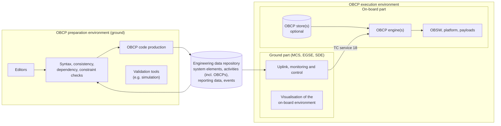
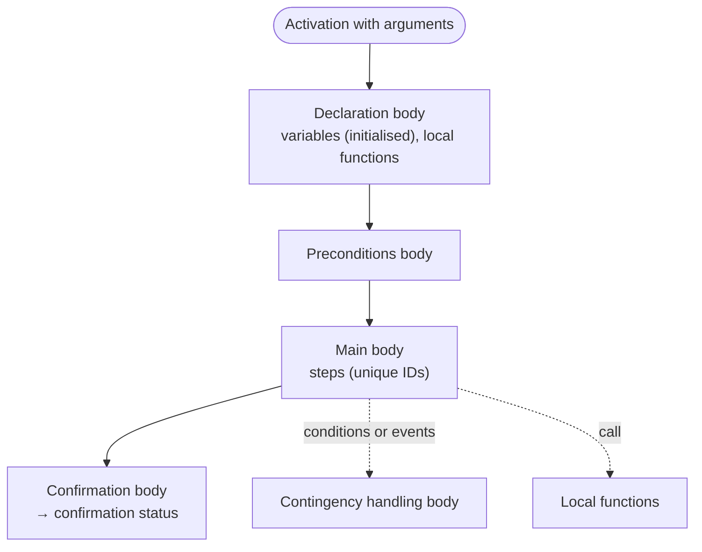
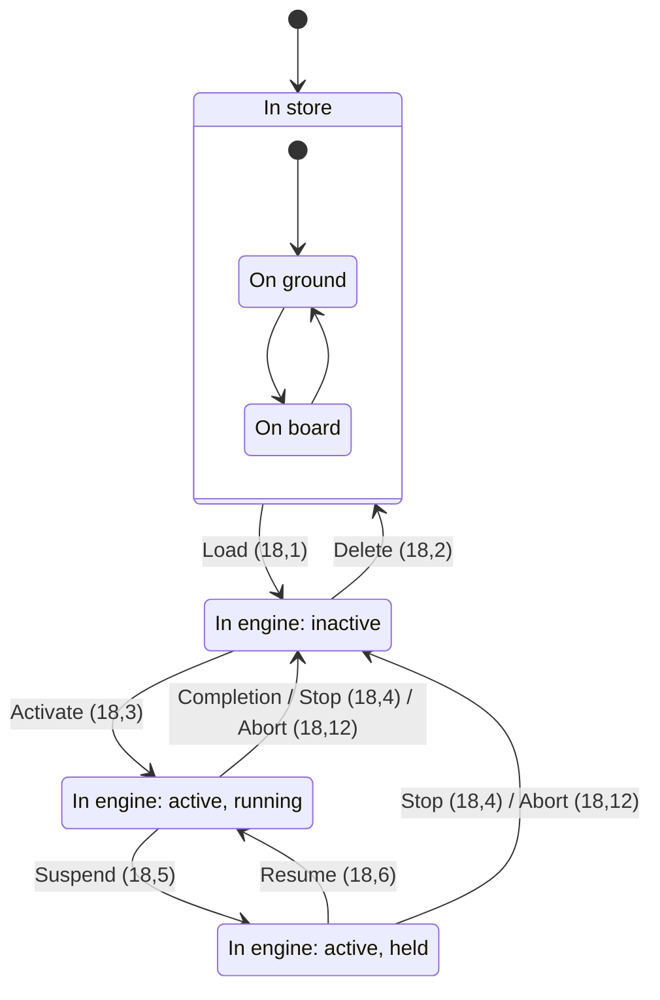
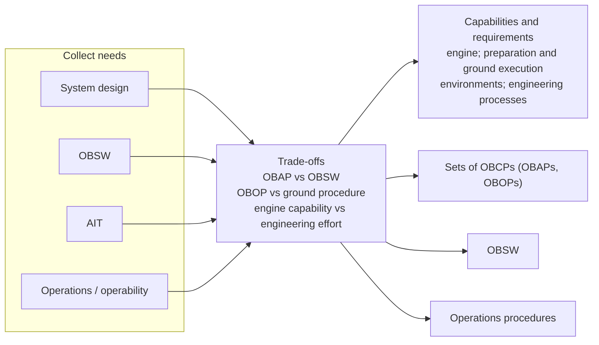
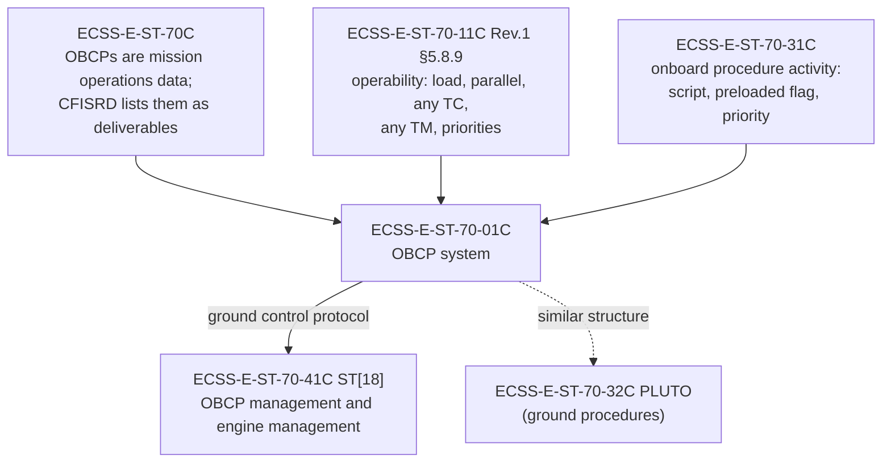

# ECSS-E-ST-70-01C: on-board control procedures

**ECSS-E-ST-70-01C** ("Space engineering – Spacecraft on-board control procedures", 16 April 2010)
standardises the **on-board control procedure (OBCP)**: a program, executed by an interpreter in the
on-board software called the **OBCP engine**, that can be loaded, run and replaced on board without
changing the rest of the on-board software (OBSW).[^def][^c41] The standard defines the whole OBCP
*system*: the on-board functions that execute OBCPs, the ground functions that prepare and control
them, and the development lifecycle of OBCPs and its relation to the spacecraft and OBSW
lifecycles.[^scope]

It sits between two other standards. It assumes that the mission also complies with the
[PUS](pus/index.md) (ECSS-E-70-41), because several PUS services are invoked to operate OBCPs and to
interact with the ground; OBCP operations themselves are initiated with telecommands of the PUS
on-board operations procedure service, [ST[18]](pus/st18-onboard-operations-procedure.md).[^scope][^def]
It also says it conforms with and extends [ECSS-E-ST-70-31](e-st-70-31c.md), whose data model
already knows on-board procedures as a kind of activity.[^intro][^31-onb] PUS-C, in turn, declares
its ST[18] to be compliant with and complementary to ECSS-E-ST-70-01.[^p1811]

!!! info "At a glance"
    | Item | Value |
    |---|---|
    | Issues | ECSS-E-ST-70-01A and B never issued; **ECSS-E-ST-70-01C** is the first issue (16 April 2010)[^cl] |
    | Status (ECSS tree, October 2025) | Published; no update shown as ongoing or planned[^tree] |
    | Normative references | ECSS-S-ST-00-01, ECSS-E-ST-40 (software), ECSS-E-ST-70, ECSS-E-ST-70-31, ECSS-E-70-41[^refs] |
    | Structure | Clause 4 concept; clause 5 capabilities (structure, language, preparation, execution); clause 6 engineering processes[^toc] |
    | Two kinds of OBCP | On-board application procedure (OBAP), part of the spacecraft design; on-board operations procedure (OBOP), used to operate it[^c43] |
    | OBCP states | in store (on ground or on board); in engine: inactive, or active (running or held)[^c5422] |
    | Ground control | ECSS-E-70-41 service 18; memory management only for anomaly investigation[^c541] |
    | ESA usage | ESA's generic operations interface requirements (2019) do not tailor the standard[^goird-obcp] |

## Why a standard for OBCPs

The introduction notes that OBCPs had been implemented ad hoc on several European missions over
about 25 years, which had proved the concept. The standard wants one OBCP concept for any mission
that meets the needs of all users (system, on-board software, AIT and operations engineers), gives
OBCPs a development lifecycle independent of the rest of the OBSW, and conforms with and extends
ECSS-E-70-41 and ECSS-E-ST-70-31.[^intro]

The earlier mission documents in this wiki's library show what that ad-hoc state looked like. The
Herschel/Planck operations interface requirements of 2003 required that OBCPs be controllable from
any command source, access telemetry, issue telecommands and event packets, evaluate simple
arithmetic and control structures, run several at once without interference, and be prepared with
a simple language and test tools usable by operations engineers rather than software experts; the
procedures were to be written in a "Spacecraft Control Language" running in the central data
management system.[^oird-obcp][^oird-scl]

## Terms

| Term (§3.2) | Definition (paraphrased) |
|---|---|
| automation | Replacing manual operations by computerised mechanisms |
| on-board control procedure (OBCP) | A program designed to be executed by an OBCP engine that can easily be loaded, executed and replaced on board; depending on context, the source or the OBCP code |
| OBCP code | The complete loadable form of an OBCP, called token code, executable code or bytecode on earlier missions, and "procedure code" in service 18 of ECSS-E-70-41A |
| OBCP engine | The OBSW application that handles the execution of OBCPs; OBCP operations are initiated with service 18 telecommands |
| OBCP language | The programming language in which humans write OBCP source code |
| OBCP system | The whole machinery for creating OBCPs on the ground, uplinking them and handling them on board |
| OBCP step | A sequence of source statements forming the smallest operational unit within an OBCP |
| on-board software | Software hosted and executed by any programmable on-board computer or processor |
| scheduling | Allocating OBSW processor time to OBSW functions (including the engine and OBCPs) by a predefined algorithm |
| survival mode | A configuration in which the spacecraft can remain safely without ground intervention for a specified period (also called safe mode) |

Source: §3.2.[^def] Terms such as activity, event, event reporting service, on-board parameter and
operations procedure come from ECSS-E-ST-70, ECSS-E-ST-70-31 and ECSS-E-70-41.[^c31] Abbreviations
introduced include OBAP (on-board application procedure), OBOP (on-board operations procedure),
OBCP, OBSW, CPDU (command pulse distribution unit) and SDE (software development environment).[^abbr]

## The OBCP concept

### Stakeholders and domains

Four stakeholder groups use OBCPs - system engineers (spacecraft and payload), on-board software
engineers, AIT engineers and operations engineers - and they cooperate throughout the lifecycle;
responsibility for the system or software may pass from the prime contractor to the operations
organisation some time after launch. The standard therefore classifies OBCP uses by **domain**
rather than by stakeholder:[^c421]

| Domain | Typical uses named by the standard |
|---|---|
| System design (§4.2.2.1) | Isolate mission-specific platform functions (thermal or battery control) from the OBSW; one-shot applications deleted after use (deployments, pyrotechnics); a detailed FDIR strategy that is defined late and tuned in system testing (the standard stresses it does not encourage late FDIR definition); equipment delivered late, added, removed or replaced; tuning of configuration sequences of complex equipment; late definition of payload control sequences, monitoring algorithms and recovery actions |
| OBSW design and development (§4.2.2.2) | Easier development and validation than OBSW; a more generic, reusable core OBSW; simpler maintenance; OBSW engineers' own test automation, debugging and short-term workarounds |
| AIT (§4.2.2.3) | On-ground only: fault injection for robustness tests, long repetitive configuration sequences, temporary test functions |
| Operations and operability (§4.2.2.4) | Routine and contingency procedures run on board instead of on the ground: less bandwidth, possibly fewer staff, no ground loop delay, simpler ground procedures, more reliability and autonomy, robustness to station outages (for GEO as well as LEO and deep space); counter unforeseen failures, unpredictable deep-space environments, end-of-life operations such as de-orbiting |

Sources: §4.2.2.[^c4221][^c4222][^c4223][^c4224]

### OBAP and OBOP

From these uses the standard derives two types of OBCP:[^c43]

| | On-board application procedure (OBAP) | On-board operations procedure (OBOP) |
|---|---|---|
| Purpose | Implements part of the basic functionality of the spacecraft; an integral part of its design | Used to operate the spacecraft |
| Historical name | "Application Program", "Flight Application Program" | – |
| Qualification | Spacecraft qualification needs the complete set of OBAPs (they may still be updated after launch) | Not involved in spacecraft qualification |
| Lifecycle | Tied to the spacecraft system and the related subsystem or payload, with their engineering processes and reviews | Akin to a ground operations procedure; fully decoupled, can be defined after launch without system delta-qualification |
| On-board accommodation | Defined rules and a priority scheme for concurrent OBAPs; may request on-board activities not accessible from the ground (for example low-level bus access) | Resources independent of the OBAPs and of the number of running OBOPs; the standard's example limits OBOPs to activities accessible from the ground |

Sources: §4.3, §5.2.9.2l, §5.4.4.2, §5.4.4.5 and §6.1.[^c43][^c5292][^c5442][^c5445][^c61] Both may use the same on-board capabilities and be equally
complex; what differs is how they are accommodated and engineered.[^c43]

### The OBCP system



The OBCP system, after Figure 4-1 and §4.4.[^c44]

The **preparation environment** belongs to the overall test and operations preparation environment:
editors, execution-constraint checks (resource use), consistency checks against the telemetry and
telecommand database, configuration management, OBCP code production and validation tools such as a
simulator. The standard makes no assumption about whether the OBCP *script* and the OBCP *code* are
the same thing or whether the script is compiled or turned into pseudo-code.[^c44] All OBCPs are
kept in the **engineering data repository** of ECSS-E-ST-10, whose monitoring and control part
(ECSS-E-ST-70-31) holds system elements, activities (telecommands, ground procedures, OBCPs),
reporting data and events; its configuration management covers OBCPs.[^c44b]

The **execution environment** has a ground part (uplink, monitoring and control services, a view of
the on-board environment, constraint and consistency checks) and an on-board part: one or more OBCP
engines that offer monitoring and control services towards ground and on-board services, standard
services towards the OBSW, platform and payloads, and manage execution, plus optional on-board
**OBCP stores** where OBCPs wait before being loaded. How OBCPs reach a store and how stores are
managed is out of scope. Engine and preparation environment are designed together, the split of
functions between them may vary, and multiple engines are assumed independent.[^c44b]

## OBCP structure (§5.1)

| Req. | Requirement |
|---|---|
| a | Each OBCP has a unique **OBCP identifier**, assigned by the ground system |
| b | Arguments can be defined (values input at initiation); their definition (type, default, range) is in ECSS-E-ST-70-31 §6.7.1.2 |
| c | Elements: optional **declaration body** (declares and initialises variables, declares local functions); optional **preconditions body**; mandatory **main body**; optional **confirmation body**; optional **contingency handling body** |
| d | Nominal execution order: declaration, preconditions, main, confirmation |
| e, f | A **step** construct identifies a block of functionally self-contained statements; steps are unique within an OBCP |
| g, h | The confirmation body's result gives the engine the OBCP confirmation status; without it the engine sets an implicit status (for example "success" if all initiated activities succeeded and no exception occurred) |
| i, j | A **local function** construct encapsulates statements with input and output parameters and can be called from anywhere in the OBCP |

Source: §5.1.[^c51]



Elements of an OBCP and their nominal order (§5.1c and d); the dotted paths are not ordered by the
standard.[^c51]

Compared with the ground language [PLUTO](e-st-70-32c.md) (ECSS-E-ST-70-32C), the same four bodies
appear, but the watchdog body becomes a **contingency handling body**, variables are declared and
initialised at procedure level rather than per step, and **local functions** are added.[^c51][^pluto-a11]

## OBCP language capabilities (§5.2)

The language lets the user write the OBCP script referring to system elements, activities, reporting
data and events fully defined in the engineering data repository.[^c521]

| Clause | Capability (each a "shall" unless noted) |
|---|---|
| 5.2.2 General | Syntax formally specified (for example ISO EBNF, ISO/IEC 14977); a comment possible on every source line |
| 5.2.3 Data types | The simple data types of ECSS-E-ST-70-31 §5.5; structured types (arrays, records); explicit type casting (implicit conversions not excluded) |
| 5.2.4 Declarations | Variables of any type with initial values; constants of any type with values; local functions, unique within the OBCP |
| 5.2.5 Assignments | Assign to variables; a variable declared in the declaration body is visible everywhere, including in local functions |
| 5.2.6 Expressions | Mathematical, time, string **and bitwise** operations and functions; array manipulation; expressions over constants, on-board parameters, activity arguments and variables; constants with engineering units, free mixing and automatic conversion of compatible units; parameters referred to by repository name, valued in engineering units **or in the raw downlinked form**; events and their parameters by repository name |
| 5.2.7 Flow controls | If-then-else; multi-way branch on a parameter or variable; loops (count, while, until); nesting |
| 5.2.8 Waits | In the main body: until an on-board time, for an interval, until a condition, until an event, until **any event from a list**; combined conditions; preconditions and confirmations combine the same waits with a condition test; timeouts with defined behaviour |
| 5.2.9.1 Parameters | Read any on-board parameter including on-board time; set specific on-board parameters (housekeeping values, values kept between runs, inputs to on-board monitoring) |
| 5.2.9.2 Activities | Refer to activities and arguments by repository name; request any on-board activity accessible from the ground unless excluded (for example CPDU commands); choose per activity the verification stages to report; read execution and confirmation status and initiation, start, termination or completion time; initiate and continue (several activities in parallel), initiate and wait for a status, initiate without waiting for completion; an OBCP does not complete while requested verification reporting is outstanding; timeouts on verification waits; an **OBAP** may request on-board activities not accessible from the ground (for example low-level bus access) |
| 5.2.9.3 Events | Raise events with parameters - only existing system events, never new ones; access events raised on board and their parameters |
| 5.2.10 Contingency handling | One or more contingency routines triggered by conditions or events (for example a resource exceeded, a parameter out of limits) |

Sources: §5.2.2 to §5.2.10.[^c522][^c526][^c527][^c529][^c5292][^c5293]

!!! warning "Inference"
    Several capabilities differ from the ground language PLUTO in ways that reflect the on-board
    setting: raw-value access, bitwise operations, explicit type casts and a "wait for any of these
    events" construct are added, while PLUTO's user interaction (ask user, inform user) has no
    on-board counterpart and events cannot be invented by the OBCP. The standard does not define an
    OBCP language itself, only its required capabilities.[^c52][^pluto-r52]

## The preparation environment (§5.3)

| Clause | Requirement |
|---|---|
| 5.3.1 Script preparation | A read-write editor and a read-only viewer; collapse and expand globally or per step; full integration with the engineering data repository, populating OBCPs from context-sensitive menus (for example only objects of the OBCP's parent system element); override of repository defaults (for example a different activity verification profile) |
| 5.3.2 Checking | A syntax analyser and consistency, dependency and constraint checker reporting on grammar compliance, consistency with the current repository, inter-OBCP dependencies (execution calls) and constraints: available engine services, memory, maximum code size, CPU use, maximum frequency of parameter sampling or activity invocation; constraints may differ for all OBCPs, OBOPs, OBAPs, sets of them, or per engine |
| 5.3.3 Reports | Per OBCP: referenced repository objects (activities including OBCPs, parameters, events), CPU and memory consumption, prerequisites for execution, script quality measures (nesting, loops, ECSS-Q-ST-80 measures); and an **activity call tree** of all OBCPs |
| 5.3.4 Verification and validation | A debugger (should): step-by-step and statement-by-statement execution; step over, into and out of; forced execution paths; setting and viewing internal and external data; event stimulation; simulated activities and responses; simulated interactions with the execution environment (suspend, resume); breakpoints that store all context. A flight-representative V&V environment (shall), with higher fidelity possibly needed for OBAPs (hardware in the loop); test coverage tools for code, branch and decision coverage, identifying missing coverage |
| 5.3.5 Characterisation | Static and dynamic memory needs predictable at preparation time (static split between mass memory and local RAM; dynamic including stacks and their persistence); an upper bound of execution duration predictable; the engine provides observability of run-time events and data (for example branching events), with definable and selectable **observability levels** |

Sources: §5.3.[^c531][^c532][^c533][^c534][^c535]

## The execution environment (§5.4)

### Ground capabilities

Before acting on OBCPs, the ground system must check that the requested state transition is allowed
(for example "activate" only for a loaded, non-active OBCP), that interdependencies hold (OBCPs that
an activated OBCP can call are loaded or scheduled for loading in time), and that resources
allocated separately to OBAPs and OBOPs are respected (number of OBCPs loaded or active, CPU,
memory). OBCPs are uplinked by telecommand as OBCP code for the target engine. Ground control
protocols are based on the ECSS-E-70-41 on-board operations procedure service; the memory
management service is reserved for anomaly investigations and for cases where on-board failures
prevent the use of other services.[^c541]

### States and operations



OBCP state diagram after Figure 5-1 and §5.4.2.2; numbers are the ECSS-E-70-41 service 18 subtypes
that the standard's notes give for each operation. The standard does not prescribe how on-board
stores are implemented.[^c5421][^c5422][^c5423]

The OBCP states are **in store** (executable form, on board or on the ground) and **in engine**
(in memory the engine can access), the latter either **inactive** (idle) or **active** (under engine
control), active being **running** or **held**.[^c5422] The engine performs eight operations, on
request by telecommand from the ground or from on-board processes:[^c5423]

| Operation (§5.4.2.3) | Transition | Service 18 subtype named by the standard | PUS-C (ECSS-E-ST-70-41C) counterpart |
|---|---|---|---|
| Load | in store → inactive | 1 | TC[18,1] direct-load an OBCP; TC[18,13] load an OBCP by reference; TC[18,19] load by reference and activate an OBCP |
| Activate | inactive → running | 3 | TC[18,3] activate an OBCP; TC[18,14] activate and execute one OBCP step |
| Communicate parameters | (active) | 7 | TC[18,7] communicate parameters to an OBCP |
| Suspend (at end of current statement or of a given step) | running → held | 5 | TC[18,5] suspend an OBCP |
| Resume (from where it was suspended) | held → running | 6 | TC[18,6] resume an OBCP; TC[18,15] resume and execute one OBCP step |
| Stop (at end of current statement or of a given step, or a held OBCP; cannot be resumed) | active → inactive | 4 | TC[18,4] stop an OBCP; TC[18,20] stop and unload an OBCP |
| Abort (immediately) | active → inactive | 12 | TC[18,12] abort an OBCP; TC[18,17] abort all OBCPs and report |
| Delete | inactive → in store | 2 | TC[18,2] unload an OBCP |

Sources: §5.4.2.3 of ECSS-E-ST-70-01C and the PUS-C message types of §6.18.4.[^c5423][^p-names] The
subtypes named in the 2010 standard are those of the PUS-A service of 2003, where 1 to 6 and 12 form
the minimum capability set and 7 is optional.[^pusa-cap] Further rules:[^c5423]

* A request inconsistent with the OBCP's state (for example activating an active OBCP) fails with a
  telecommand verification failure.
* An OBCP returns autonomously to "inactive" at the end of execution (transition "Completion").
* The Activate request carries the parameters to pass to the OBCP.
* A loaded OBCP stays available for reactivation until deleted from the engine.
* Requests from the ground are reported to their source with telecommand verification reports;
  requests from on board are reported to the ground with event reports giving the requesting source
  (an OBSW application or another OBCP), the OBCP identifier and the execution status of the
  operation.
* Run-time errors found by the engine are reported with event reports.

### Integrity

A checksum, generated on the ground by the translation process that produced the code from the
source, is loaded with every OBCP. It lets the code be verified independently of any uplink
protocol protection. The engine verifies it at load time, fails the Load request with a telecommand
verification failure if it does not match, and verifies it again whenever the ground asks.[^c543]

### On-board capabilities

| Clause | Requirement |
|---|---|
| 5.4.4.1 General | At most one OBCP engine per on-board application process; the scheduling policy, static and dynamic memory allocation, garbage collection policy, and their observability and controllability from ground are defined |
| 5.4.4.2 Engine services | All services needed for the language capabilities (possibly different for OBOPs and OBAPs, for example OBOPs restricted to ground-accessible activities); a **global function service** of standard functions callable from any OBCP (managed by implementation-dependent means such as patches or extra service 18 subtypes); defined behaviour on a reset or discontinuity of the reference clock used by waits |
| 5.4.4.3 Engine monitoring | For each OBCP in the engine: execution status, the step being executed when running, the next step when suspended (reporting configured with ECSS-E-70-41 service 3); engine housekeeping such as free memory, CPU time and I/O slots used; operationally significant events through the event reporting service; detailed data for anomaly investigation (memory management, call stack contents) |
| 5.4.4.4 Loading policy | Defined, when OBCPs can sit in more than one store: precedence rules that select the store from which a Load takes the code (for example local RAM, then platform mass memory, then EEPROM); whether the policy is reprogrammable; how resets, reboots, processor switch-over or power loss affect it; definable per OBCP |
| 5.4.4.5 Scheduling | A defined OBSW scheduling policy for the engine; a guaranteed minimum processor time over regular intervals (fixed slots, pre-emptive priority scheduling, or a dedicated co-processor are examples); several OBCPs in parallel; OBOP resources independent of OBAP resources; specified maximum numbers of loaded and of active OBOPs; an OBOP's resources independent of how many OBOPs run, so that its designer need not consider the others; defined allocation rules and a priority scheme for concurrent OBAPs |
| 5.4.4.6 Isolation | Internal faults do not propagate to the OBSW (CPU and memory faults, engine faults; a wrong value written to a parameter is excluded); the engine never exceeds its allocation; loading and controlling one OBCP does not disturb active ones; OBCPs are isolated from each other and from unauthorised memory |
| 5.4.4.7 Exceptions | Every OBCP-internal error (overflow, divide by zero, array bounds) is caught by an OBCP exception handler or by the engine; unhandled errors abort the OBCP; an anomaly event goes to ground for any internal error; a run-time error in an exception handler terminates the OBCP at once; actions are defined for when the engine can no longer support running OBCPs (for example an engine event caught by contingency handlers that set controlled devices to a default state, suspension of all OBCPs, a report to ground) |
| 5.4.4.8 Continuity of service | A defined concept, possibly preserving OBCP state in non-volatile memory; a list of OBCPs automatically loaded and activated at engine initialisation (from engine start-up until it accepts an external command) |

Sources: §5.4.4.1 to §5.4.4.8.[^c5441][^c5442][^c5443][^c5444][^c5445][^c5446][^c5447][^c5448]

## Engineering processes (clause 6)

### Lifecycles

The concept decouples OBCP development from the spacecraft lifecycle to different degrees: the
OBOP lifecycle is fully decoupled from the system and the OBSW (OBOPs can be defined after launch
without delta-qualification), while the OBAP lifecycle is only partly decoupled from the OBSW and
stays tied to system development (OBAPs are qualified with the system). The engineering process an
OBCP needs depends on how well the OBCP system protects the rest of the system against functional
and software failures caused by an OBCP, and on quality and risk considerations; "critical" OBCPs
deserve special attention to margins and impact.[^c61]

| Lifecycle line (Figure 6-1) | Phases covered |
|---|---|
| Spacecraft | A, B (preliminary definition), C (detailed definition), D (qualification and production), E (utilisation), F (disposal) |
| OBSW | Prototyping, development, operation and maintenance |
| OBCP software engineering | Prototyping, development, operation and maintenance |
| System OBCPs and AIT OBCPs | Developed within phases C to D |
| Operations and operability OBOPs | From phase D through the end of phase F |

Source: Figure 6-1, as read from the drawing.[^f61]

### Management process



OBCP management overview, after Figure 6-2.[^c621]

The OBCP system management process is defined and documented and covers: collecting needs from
all stakeholders, the OBSW-versus-OBAP trade-off, and the analysis of future OBOP use cases and
engineering-effort benefits leading to requirements on board and on ground. Its output consolidates
the required capabilities of the engine, the preparation environment, the ground execution
environment and the engineering processes; every requirement traces to one of these four. The
output is reviewed at the **system requirements review (SRR)**; engine and preparation environment
capabilities are frozen at the **software PDR**; budgets (OBCPs in parallel, activities invoked by an
OBCP) are managed at system level and reviewed at system and OBSW reviews; and OBAP verification and
validation is completed before **system qualification**.[^c621] Figure 6-3 aligns these milestones: the
preparation environment becomes available early in the system lifecycle, the OBSW reviews (SRR, PDR,
DDR, TRR, CDR, QR) and the OBAP reviews (SRR, PDR, CDR, QR) follow the system ones, and OBAP
qualification feeds the system QR (as read from the drawing).[^f63]

### Trade-offs

=== "OBAP vs OBSW (§6.2.2)"

    | In favour of OBAPs | In favour of OBSW |
    |---|---|
    | Variability and flexibility (changing requirements, ageing) | Real-time capabilities; execution time (technology-dependent) |
    | Programmatic reasons: late definition, reuse (but late selection concentrates validation in a short, critical period) | Complex functions, suited to software engineering processes |
    | | Core system management functions with stable requirements close to subsystem engineering (for example AOCS) |
    | | Functions that sustain survival modes, which must be fully validated by the end of development |
    | | Generic parts of a system or product line (for example components supporting ECSS-E-70-41 services); lower schedule risk through early definition |

=== "OBOP vs ground procedure (§6.2.3)"

    | In favour of OBOPs | In favour of ground procedures |
    |---|---|
    | Operations during non-visibility or with long signal delays | Human response to unforeseen scenarios |
    | Safer operations if ground control is lost | Less capability and less validation needed on board |
    | Fewer operator errors | Less engineering effort to develop, validate and update |
    | Synchronisation with asynchronous on-board events | Simpler configuration management |
    | "Coded and up-linked once, used many times" | Better overall visibility of operations |
    | Atomic operations combined into one block (critical activities) | |
    | Less need for round-the-clock staff in routine phases | |

Sources: §6.2.2 and §6.2.3 (the criteria are notes, the trade-offs and their documentation are
requirements).[^c622][^c623] The engine itself is traded against engineering effort (§6.2.4):
isolation may be relaxed for OBAPs to simplify the engine, at the price of more validation, while
for OBOPs a higher level of isolation is mandatory.[^c624]

### Organisation and engineering

All stakeholders, their organisation, responsibilities and interactions are identified; each category
of stakeholder develops and validates its own OBCPs (OBAPs needing close collaboration of all
parties). OBOP execution decisions are approved by **one single authority**, which checks for example
that the maximum number of running OBOPs is not exceeded and that no two OBOPs use the same hardware
at once; OBOPs may still be split into sets developed by different teams. Resource allocation between
stakeholders follows defined policies (a maximum number of OBOPs per stakeholder, CPU and memory for
OBAPs) enforced throughout the project.[^c625] OBAPs follow the software lifecycle of ECSS-E-ST-40
(tailored with adequate documentation and reviews, strict configuration control and adequate
validation); OBOPs follow the operations procedure process of ECSS-E-ST-70 (tailored with timely
feedback from operations engineers, concurrent documentation maintenance and strict configuration
control by developers and test engineers).[^c63]

## How the standard connects to the others



The OBCP standard among the E-70 standards; arrows show which document places requirements on or
supplies data to which.[^70-obcp][^70-cfisrd][^11-obcp][^31-onb][^p1811]

* **ECSS-E-ST-70-41C (PUS-C).** ST[18] is declared compliant with and complementary to the OBCP
  standard. Each ECSS-E-ST-70-01 step is represented in the OBCP code by exactly one step identifier;
  OBCP arguments (values at initiation) and parameters (values during execution) refer to
  ECSS-E-ST-70-31 and are checked by the OBCP itself, not by the service.[^p1811][^p1812] One OBCP
  engine per service and at most one OBCP management subservice per application process echo
  §5.4.4.1a; the OBCP identifier note points back to requirement 5.1a; loading by reference uses the
  loading policy of §5.4.4.4a to c; whether the code checksum is verified is a declared option.[^p182][^p1841][^p18441]
  PUS-C turns the "levels of observability" of §5.3.5.3 into four declared levels - no observability,
  at procedure level, at step level and at detailed level - reported as events through
  [ST[05]](pus/st05-event-reporting.md), and the states into "inactive", "active and running" and
  "active and held" (waiting for an event counts as running).[^p1842][^p1843] PUS-C has no "in store"
  state: an OBCP is either loaded in the engine or not, and an OBCP loaded by reference comes from an
  on-board [file](pus/st23-file-management.md).[^p18441] The full service is described on the
  [ST[18] page](pus/st18-onboard-operations-procedure.md).
* **ECSS-E-ST-70-31C.** An activity of type "onboard procedure" has a script compliant with
  ECSS-E-ST-70-01, a "preloaded on board" flag and a priority (high, medium or low) used by the
  on-board execution system in scheduling conflicts.[^31-onb]
* **ECSS-E-ST-70-11C Rev.1.** The operability standard requires that the spacecraft can execute
  ground-loaded and controlled OBCPs, several at once, that OBCPs can send any command available to
  the ground and read any engineering telemetry parameter available to it, and that OBCP execution
  can be prioritised (for example in favour of fault management).[^11-obcp]
* **ECSS-E-ST-70C.** OBCPs are part of the mission-specific data that populates the monitoring and
  control databases, and the customer furnished items include "other databases for in-flight
  operations" such as OBCPs; the OBCP standard in turn requires OBOPs to follow the ECSS-E-ST-70
  operations procedure process.[^70-obcp][^70-cfisrd][^c63]
* **Generic OIRD.** ESA's generic operations interface requirements document (released July 2019)
  is split into on-board functional requirements based on ECSS-E-ST-70-11C and PUS-C requirements
  covering ECSS-E-ST-70-41C and ECSS-E-ST-70-01C. It applies no tailoring to the OBCP standard,
  which it judges to satisfy most ESA needs, and adds a few requirements to its service 18 instead.[^goird-struct][^goird-obcp]

## Solar Orbiter: an OBCP system in flight

Solar Orbiter's TM/TC and packet structure ICD describes an OBCP as an interpretable program compiled
on the ground with a dedicated compiler and uploaded with service 13 into one of the on-board file
partitions; OBCPs are mainly controlled from the ground through service 18 but can also start
autonomously, for example on an on-board event.[^so-519] The ICD's description lines up with the
standard:

| ECSS-E-ST-70-01C | Solar Orbiter (ICD §5.19) |
|---|---|
| Unique OBCP identifier (5.1a) | "OBCP ID", 4 bytes, in every request that addresses one OBCP and in each report entry[^so-519][^so-5195] |
| Steps (5.1e) | A "Step ID" set at chosen points of the OBCP design, used to report progress; suspend (TC(18,5)) and stop-and-delete (TC(18,141)) take an optional step ID, with -1 (the default) for immediate and 0 for the end of the current step[^so-519][^so-5191][^so-5197] |
| In store / in engine (5.4.2.2) | Stored in file partitions (for example in mass memory), loaded into a RAM "execution slot" of the OBCP interpreter; a limited number of slots, hence an auto-delete option when the OBCP ends[^so-519] |
| Inactive, running, held (5.4.2.2) | The same three states; the list report adds "loading" (and the MIB calibration a "free" slot)[^so-519][^so-5195][^mib] |
| Communicate parameters (5.4.2.3) | TC(18,7) with N pairs of parameter ID and value, at start or while running[^so-5193] |
| Checksum (5.4.3) | Reported per OBCP in TM(18,9) and TM(18,144)[^so-5195][^so-5199] |
| Engine monitoring (5.4.4.3) | TM(18,9) list with state, instruction pointer and last step reached; TC(18,142) enables cyclic TM(18,144) with the current values of the OBCP's parameters, every N cycles of 8 Hz[^so-5195][^so-5198] |
| Scheduling and priorities (5.4.4.5) | "Normal" or "Emergency" priority chosen at start; only one emergency OBCP runs at a time, further ones are queued[^so-519][^so-5196] |

The packet carried in every entry of the TM(18,9) OBCP List Report shows the monitoring data of
§5.4.4.3 in its real form:

<div class="bitfield" data-title="Solar Orbiter TM(18,9) OBCP List Report: counter and one repeated entry (104 bits)" data-width="16"
     data-fields='[{"n":"N (OBCPs reported)","b":16,"d":"NCD12091, PTC 3 / PFC 12; repeats the next 5 fields N times","g":"header"},
                   {"n":"OBCP ID","b":32,"d":"NCDB0G90, PTC 3 / PFC 14","g":"entry"},
                   {"n":"Checksum","b":16,"d":"NCDB0G50, PTC 3 / PFC 12","g":"entry"},
                   {"n":"State","b":8,"d":"NCD12094, PTC 2 / PFC 8: 0 FREE, 1 LOADING, 2 INACTIVE, 3 RUNNING, 4 HELD","g":"entry"},
                   {"n":"Instruction pointer","b":16,"d":"NCDB0GA0, PTC 3 / PFC 12","g":"entry"},
                   {"n":"Step ID","b":16,"d":"NCDB0GB0, PTC 3 / PFC 12; last step reached","g":"entry"}]'></div>

Field sizes and meanings from ICD §5.19.5; parameter names, types and the textual calibration
`CCDT0124TM` from the MIB tables [`vpd`](../mib/tables/vpd.md), [`pcf`](../mib/tables/pcf.md) and
[`txp`](../mib/tables/txp.md) for SPID [14405](../explorer/index.md#/solo/packet/14405).[^so-5195][^mib]
The ICD lists states 1 to 4; the MIB calibration adds 0 "FREE".[^so-5195][^mib]

In the MIB the service has 46 telecommands (32 in 2020): four of the PUS-A subtypes (5 to 8) plus the
mission-specific subtypes 140 to 142. The PUS-A subtypes 1 to 4 and 12 (load, delete, start, stop,
abort) have no command of their own.[^mib][^mib20][^pusa-cap]

| Subtype | Commands (2025-09-16) | Commands (2020-04-16) | Meaning (MIB description) |
|---|---|---|---|
| 5 | 1 | 1 | [ZCD01205](../explorer/index.md#/solo/command/ZCD01205) Suspend an OBCP |
| 6 | 1 | 1 | [ZCD01206](../explorer/index.md#/solo/command/ZCD01206) Resume an OBCP |
| 7 | 3 | 3 | Communicate 1-, 2- or 4-byte parameters to OBCP |
| 8 | 1 | 1 | [ZCD01208](../explorer/index.md#/solo/command/ZCD01208) Report list of OBCPs (answered by TM(18,9), SPID 14405, APID 163) |
| 140 | 38 | 24 | Load and start OBCP: 3 generic ([ZCD2Z00R](../explorer/index.md#/solo/command/ZCD2Z00R), ZCD2Z00S, ZCD2Z00T) and 35 for named OBCPs |
| 141 | 1 | 1 | [ZCD0128D](../explorer/index.md#/solo/command/ZCD0128D) Stop and delete an OBCP |
| 142 | 1 | 1 | [ZCD0128E](../explorer/index.md#/solo/command/ZCD0128E) Set OBCP HK TM (cyclic TM(18,144), SPID [14406](../explorer/index.md#/solo/packet/14406), APID 165) |
| **Total** | **46** | **32** | all 46 addressed to APID 172 |

The 14 commands added between the two releases are all "load and start" commands
`ZCPX0001` to `ZCPX0015` (no `ZCPX0013`), for named OBCPs such as SWA6 to SWA8, DMS1, TTC2 and
TTC3, the METIS high-voltage door ramps, SSMM1 to SSMM3, MAG2, STR1 and PHI3.[^mib][^mib20]

!!! warning "Inference"
    Read against ECSS-E-ST-70-01C, Solar Orbiter has no separate Load, Activate or Delete
    telecommand: TC(18,140) combines load and activate (like PUS-C TC[18,19]) and TC(18,141)
    combines stop and delete (like TC[18,20]); abort is not in the MIB. Named "load and start"
    commands with fixed arguments let the database and its verification profiles describe each
    OBCP as its own activity, which is how the engineering data repository of §4.4 knows them.
    This interpretation is the wiki's; the ICD gives no rationale.

??? example "SQL used"
    ```sql
    -- solo-2025-09-16.sqlite and solo-2020-04-16.sqlite
    SELECT CCF_STYPE, count(*) FROM ccf WHERE CCF_TYPE = '18' GROUP BY CCF_STYPE;
    SELECT CCF_APID, count(*) FROM ccf WHERE CCF_TYPE = '18' GROUP BY CCF_APID;   -- 172: 46
    SELECT PID_TYPE, PID_STYPE, PID_APID, PID_SPID, PID_DESCR FROM pid WHERE PID_TYPE = '18';
    -- commands new in 2025
    ATTACH 'solo-2020-04-16.sqlite' AS o;
    SELECT CCF_CNAME, CCF_DESCR FROM ccf WHERE CCF_TYPE = '18'
       AND CCF_CNAME NOT IN (SELECT CCF_CNAME FROM o.ccf WHERE CCF_TYPE = '18');
    -- TM(18,9) layout
    SELECT * FROM vpd WHERE VPD_TPSD = (SELECT PID_TPSD FROM pid WHERE PID_SPID = '14405')
     ORDER BY CAST(VPD_POS AS int);
    SELECT PCF_NAME, PCF_DESCR, PCF_PTC, PCF_PFC, PCF_CURTX FROM pcf
     WHERE PCF_NAME IN ('NCD12091','NCDB0G90','NCDB0G50','NCD12094','NCDB0GA0','NCDB0GB0');
    SELECT * FROM txp WHERE TXP_NUMBR = 'CCDT0124TM';
    ```

The 22 command sequences of the 2025 MIB that send a service 18 command are listed on the
[PLUTO page](e-st-70-32c.md#command-sequences-in-the-mib). Twelve of them contain a TC(18,140)
"load and start"; 19 consist of a single service 18 command; all but one name a flight control
or contingency recovery procedure document (`CSF_DOCNAME`) as their source, so that ground
procedures trigger and control on-board ones.[^mib]

??? example "SQL used (sequences)"
    ```sql
    -- solo-2025-09-16.sqlite: sequences containing a service 18 command
    SELECT f.CSF_NAME, f.CSF_ELEMS, f.CSF_DOCNAME, c.CCF_STYPE
      FROM csf f JOIN css x ON x.CSS_SQNAME = f.CSF_NAME
      JOIN ccf c ON c.CCF_CNAME = x.CSS_ELEMID
     WHERE c.CCF_TYPE = '18';   -- 22 sequences; 12 with subtype 140; 19 with CSF_ELEMS = 1
    ```

## Herschel: an OBCP as fault management

The Herschel/Planck payload management and OBCP note (issue 06, 10 March 2008; see also
[Herschel/Planck interface documents](../scos2000/herschel-planck-interfaces.md#an-instrument-obcp-in-detail)) specifies, for each
instrument, the OBCPs the central data management software needs; most are started by an event
report through the event-action table, some by a "mother" OBCP.[^h-list] One SPIRE example, paraphrased from its specification:[^h-spec]

| Item | Value in the note |
|---|---|
| OBCP | DB_OBCP_H_SPIRE_DRCU_OFF, ID 0x1102 |
| Triggered by | Event 0xC000 from SPIRE nominal or redundant (SPIRE internal FDIR: DRCU power or temperature anomaly) |
| Type, time-out | Normal (TBC), 600 s (TBC) |
| OBCP parameters | SPIRE_SUBS_ID_CMD (default 370), SPIRE_SUBS_ID_META (default 100) |
| Actions | If DB_OBCP_H_SPIRE_OPE_RESUME (0x1107) runs, stop it with TC(18,4); disable four event-action entries with TC(19,5); disable release of the two SPIRE sub-schedules with TC(11,2); switch off the two SPIRE HSFCU power lines (LCL 51 and 52) with TC(8,4,112,3); issue event TM(5,4) 0x1000 "SPIRE DRCU Switched OFF"; re-enable the triggering event-action entries with TC(19,4) |
| Lasting effects | Two event-action entries and both sub-schedules left disabled (re-enabling recommended when SPIRE is back on); both LCLs off |

!!! warning "Inference"
    The note predates ECSS-E-ST-70-01C and does not use its vocabulary. In the standard's terms this
    is a system-design OBCP implementing FDIR (§4.2.2.1), started through the
    [event-action service](pus/st19-event-action.md), using arguments with defaults (§5.1b),
    initiating activities of services 8, 11, 18 and 19 (§5.2.9.2), raising an existing event
    (§5.2.9.3) and checking whether another OBCP is running before stopping it. Its interference
    with DB_OBCP_H_SPIRE_OPE_RESUME is the kind of OBCP interdependency that §5.4.1a asks the
    ground to check, and that §6.2.5c (written for OBOPs) gives to a single approving authority.

## Related pages

* [ST[18] on-board operations procedure](pus/st18-onboard-operations-procedure.md): every PUS-A and PUS-C message, and Solar Orbiter layouts
* [ECSS-E-ST-70-32C: PLUTO](e-st-70-32c.md), the ground counterpart of the OBCP language
* [ECSS-E-ST-70-31C: monitoring and control data definition](e-st-70-31c.md) and [ECSS-E-ST-70-11C: space segment operability](e-st-70-11c.md)
* [ECSS-E-ST-70C: ground systems and operations](e-st-70c.md)
* [ST[19] event-action](pus/st19-event-action.md), [ST[11] time-based scheduling](pus/st11-time-based-scheduling.md), [ST[23] file management](pus/st23-file-management.md)
* [How Solar Orbiter uses PUS](../missions/solar-orbiter/pus-usage.md) and [Herschel and Planck](../missions/herschel-planck.md)
* [Herschel/Planck interface documents: payload management and OBCPs](../scos2000/herschel-planck-interfaces.md#payload-management-and-obcps), the same payload OBCP note with its Event/Action Table and spacecraft modes
* [ECSS overview](index.md) and the [glossary](../glossary.md)

[^def]: [ECSS-E-ST-70-01C, Spacecraft on-board control procedures](../library/ecss-e-st-70-01c16april2010.md), §3.2 "Terms specific to the present standard", PDF pp. 9–10.
[^c41]: [ECSS-E-ST-70-01C](../library/ecss-e-st-70-01c16april2010.md), §4.1 "Introduction", PDF p. 12.
[^scope]: [ECSS-E-ST-70-01C](../library/ecss-e-st-70-01c16april2010.md), clause 1 "Scope", PDF p. 7.
[^intro]: [ECSS-E-ST-70-01C](../library/ecss-e-st-70-01c16april2010.md), Introduction, PDF p. 6.
[^cl]: [ECSS-E-ST-70-01C](../library/ecss-e-st-70-01c16april2010.md), Change log and page headers, PDF pp. 2–3.
[^tree]: [ECSS Trees (November 2025)](../library/ecss-trees-nov2025.md), "Engineering branch" chart, E-70 discipline (as of October 2025), PDF p. 4.
[^refs]: [ECSS-E-ST-70-01C](../library/ecss-e-st-70-01c16april2010.md), clause 2 "Normative references", PDF p. 8.
[^toc]: [ECSS-E-ST-70-01C](../library/ecss-e-st-70-01c16april2010.md), Table of contents, PDF pp. 4–5.
[^c31]: [ECSS-E-ST-70-01C](../library/ecss-e-st-70-01c16april2010.md), §3.1 "Terms from other standards", PDF p. 9.
[^abbr]: [ECSS-E-ST-70-01C](../library/ecss-e-st-70-01c16april2010.md), §3.3 "Abbreviated terms", PDF pp. 10–11.
[^c421]: [ECSS-E-ST-70-01C](../library/ecss-e-st-70-01c16april2010.md), §4.2.1 "Stakeholders", PDF p. 12.
[^c4221]: [ECSS-E-ST-70-01C](../library/ecss-e-st-70-01c16april2010.md), §4.2.2.1 "System design", PDF p. 13.
[^c4222]: [ECSS-E-ST-70-01C](../library/ecss-e-st-70-01c16april2010.md), §4.2.2.2 "On-board software design and development", PDF pp. 13–14.
[^c4223]: [ECSS-E-ST-70-01C](../library/ecss-e-st-70-01c16april2010.md), §4.2.2.3 "AIT", PDF p. 14.
[^c4224]: [ECSS-E-ST-70-01C](../library/ecss-e-st-70-01c16april2010.md), §4.2.2.4 "Operations and operability", PDF p. 14.
[^c43]: [ECSS-E-ST-70-01C](../library/ecss-e-st-70-01c16april2010.md), §4.3 "Types of OBCP", PDF pp. 14–15.
[^c44]: [ECSS-E-ST-70-01C](../library/ecss-e-st-70-01c16april2010.md), §4.4 "The OBCP system" and Figure 4-1, PDF pp. 15–16.
[^c44b]: [ECSS-E-ST-70-01C](../library/ecss-e-st-70-01c16april2010.md), §4.4 (engineering data repository and execution environment), PDF p. 17.
[^c51]: [ECSS-E-ST-70-01C](../library/ecss-e-st-70-01c16april2010.md), §5.1 "OBCP structure", PDF pp. 18–19.
[^c521]: [ECSS-E-ST-70-01C](../library/ecss-e-st-70-01c16april2010.md), §5.2.1 "Introduction", PDF p. 19.
[^c52]: [ECSS-E-ST-70-01C](../library/ecss-e-st-70-01c16april2010.md), §5.2 "OBCP language capabilities", PDF pp. 19–23.
[^c522]: [ECSS-E-ST-70-01C](../library/ecss-e-st-70-01c16april2010.md), §5.2.2 "General" and §5.2.3 "Data types", PDF pp. 19–20.
[^c526]: [ECSS-E-ST-70-01C](../library/ecss-e-st-70-01c16april2010.md), §5.2.4 to §5.2.6 (declarations, assignments, expressions), PDF pp. 20–21.
[^c527]: [ECSS-E-ST-70-01C](../library/ecss-e-st-70-01c16april2010.md), §5.2.7 "Flow controls" and §5.2.8 "Waits", PDF p. 21.
[^c529]: [ECSS-E-ST-70-01C](../library/ecss-e-st-70-01c16april2010.md), §5.2.9.1 "Acquiring and setting the values of on-board parameters", PDF p. 22.
[^c5292]: [ECSS-E-ST-70-01C](../library/ecss-e-st-70-01c16april2010.md), §5.2.9.2 "Initiating activities", PDF pp. 22–23.
[^c5293]: [ECSS-E-ST-70-01C](../library/ecss-e-st-70-01c16april2010.md), §5.2.9.3 "Raising and accessing events" and §5.2.10 "Contingency handling", PDF p. 23.
[^c531]: [ECSS-E-ST-70-01C](../library/ecss-e-st-70-01c16april2010.md), §5.3.1 "OBCP script preparation", PDF p. 23.
[^c532]: [ECSS-E-ST-70-01C](../library/ecss-e-st-70-01c16april2010.md), §5.3.2 "Syntax analysis, consistency, dependency and constraint checking", PDF p. 24.
[^c533]: [ECSS-E-ST-70-01C](../library/ecss-e-st-70-01c16april2010.md), §5.3.3 "Report generation", PDF p. 24.
[^c534]: [ECSS-E-ST-70-01C](../library/ecss-e-st-70-01c16april2010.md), §5.3.4 "Verification and validation", PDF pp. 24–25.
[^c535]: [ECSS-E-ST-70-01C](../library/ecss-e-st-70-01c16april2010.md), §5.3.5 "OBCP characterisation", PDF pp. 25–26.
[^c541]: [ECSS-E-ST-70-01C](../library/ecss-e-st-70-01c16april2010.md), §5.4.1 "Ground capabilities", PDF p. 26.
[^c5421]: [ECSS-E-ST-70-01C](../library/ecss-e-st-70-01c16april2010.md), §5.4.2.1 and Figure 5-1 "OBCP state diagram", PDF pp. 26–27.
[^c5422]: [ECSS-E-ST-70-01C](../library/ecss-e-st-70-01c16april2010.md), §5.4.2.2 "OBCP execution states", PDF p. 27.
[^c5423]: [ECSS-E-ST-70-01C](../library/ecss-e-st-70-01c16april2010.md), §5.4.2.3 "OBCP operations and reporting", PDF pp. 27–29.
[^c543]: [ECSS-E-ST-70-01C](../library/ecss-e-st-70-01c16april2010.md), §5.4.3 "OBCP integrity", PDF p. 29.
[^c5441]: [ECSS-E-ST-70-01C](../library/ecss-e-st-70-01c16april2010.md), §5.4.4.1 "General", PDF p. 29.
[^c5442]: [ECSS-E-ST-70-01C](../library/ecss-e-st-70-01c16april2010.md), §5.4.4.2 "OBCP engine services", PDF p. 30.
[^c5443]: [ECSS-E-ST-70-01C](../library/ecss-e-st-70-01c16april2010.md), §5.4.4.3 "OBCP engine monitoring", PDF pp. 30–31.
[^c5444]: [ECSS-E-ST-70-01C](../library/ecss-e-st-70-01c16april2010.md), §5.4.4.4 "OBCP loading policy", PDF p. 31.
[^c5445]: [ECSS-E-ST-70-01C](../library/ecss-e-st-70-01c16april2010.md), §5.4.4.5 "Process scheduling (OBSW and OBCP engine)", PDF pp. 31–32.
[^c5446]: [ECSS-E-ST-70-01C](../library/ecss-e-st-70-01c16april2010.md), §5.4.4.6 "Isolation of OBCPs", PDF p. 32.
[^c5447]: [ECSS-E-ST-70-01C](../library/ecss-e-st-70-01c16april2010.md), §5.4.4.7 "Exception handling", PDF pp. 32–33.
[^c5448]: [ECSS-E-ST-70-01C](../library/ecss-e-st-70-01c16april2010.md), §5.4.4.8 "Continuity of service", PDF p. 33.
[^c61]: [ECSS-E-ST-70-01C](../library/ecss-e-st-70-01c16april2010.md), §6.1 "Introduction", PDF p. 34.
[^f61]: [ECSS-E-ST-70-01C](../library/ecss-e-st-70-01c16april2010.md), Figure 6-1 "Lifecycles of OBCPs originating from the different domains", PDF p. 35.
[^c621]: [ECSS-E-ST-70-01C](../library/ecss-e-st-70-01c16april2010.md), §6.2.1 "Management process" and Figure 6-2, PDF pp. 35–37.
[^f63]: [ECSS-E-ST-70-01C](../library/ecss-e-st-70-01c16april2010.md), Figure 6-3 "Synchronisation of OBAP lifecycles with system and OBSW lifecycles", PDF p. 37.
[^c622]: [ECSS-E-ST-70-01C](../library/ecss-e-st-70-01c16april2010.md), §6.2.2 "OBAP vs. OBSW: criteria and trade-off analysis", PDF p. 38.
[^c623]: [ECSS-E-ST-70-01C](../library/ecss-e-st-70-01c16april2010.md), §6.2.3 "OBOP vs. ground-based operations", PDF p. 39.
[^c624]: [ECSS-E-ST-70-01C](../library/ecss-e-st-70-01c16april2010.md), §6.2.4 "Trade-off between OBCP engine capability and engineering effort", PDF p. 40.
[^c625]: [ECSS-E-ST-70-01C](../library/ecss-e-st-70-01c16april2010.md), §6.2.5 "Overall organization and management", PDF p. 40.
[^c63]: [ECSS-E-ST-70-01C](../library/ecss-e-st-70-01c16april2010.md), §6.3 "OBCP engineering", PDF p. 41.
[^pluto-a11]: [ECSS-E-ST-70-32C, Test and operations procedure language](../library/ecss-e-st-70-32c31july2008.md), §A.1.1 and §A.1.7.2, PDF pp. 24 and 27.
[^pluto-r52]: [ECSS-E-ST-70-32C](../library/ecss-e-st-70-32c31july2008.md), §5.2 "Language constructs" (requirements u to w), PDF pp. 20–22.
[^p1811]: [ECSS-E-ST-70-41C, Telemetry and telecommand packet utilization](../library/ecss-e-st-70-41c-15april2016.md), §6.18.1.1 "General", PDF p. 321.
[^p1812]: [ECSS-E-ST-70-41C](../library/ecss-e-st-70-41c-15april2016.md), §6.18.1.2 "OBCP management subservice", PDF p. 321.
[^p182]: [ECSS-E-ST-70-41C](../library/ecss-e-st-70-41c-15april2016.md), §6.18.2 "Service layout", PDF p. 322.
[^p1841]: [ECSS-E-ST-70-41C](../library/ecss-e-st-70-41c-15april2016.md), §6.18.4.1 "OBCP definition" (resources, checksum, identifier), PDF p. 323.
[^p1842]: [ECSS-E-ST-70-41C](../library/ecss-e-st-70-41c-15april2016.md), §6.18.4.2 "OBCP execution observability level", PDF pp. 324–325.
[^p1843]: [ECSS-E-ST-70-41C](../library/ecss-e-st-70-41c-15april2016.md), §6.18.4.3 "Execution status", PDF p. 325.
[^p18441]: [ECSS-E-ST-70-41C](../library/ecss-e-st-70-41c-15april2016.md), §6.18.4.4.1 to §6.18.4.4.3 (loading capabilities, direct-load, load by reference), PDF pp. 326–327.
[^p-names]: [ECSS-E-ST-70-41C](../library/ecss-e-st-70-41c-15april2016.md), §6.18.4.4 to §6.18.4.7 and Annex A message type list for service 18, PDF pp. 326–338 and 646–647.
[^pusa-cap]: [ECSS-E-70-41A](../library/ecss-e-70-41a-30jan2003-pus.md), §20.4, Tables 39 and 40, PDF p. 175.
[^31-onb]: [ECSS-E-ST-70-31C, Monitoring and control data definition](../library/ecss-e-st-70-31c.md), §6.7.5.3, Table 6-110 "Onboard procedure data", PDF p. 125.
[^11-obcp]: [ECSS-E-ST-70-11C Rev.1, Space segment operability](../library/ecss-e-st-70-11c-rev-1-15october2025.md), §5.8.9 "On-board control procedures", PDF p. 65.
[^70-obcp]: [ECSS-E-ST-70C, Ground systems and operations](../library/ecss-e-st-70c31july2008.md), §5.3.2f, PDF p. 34.
[^70-cfisrd]: [ECSS-E-ST-70C](../library/ecss-e-st-70c31july2008.md), Annex J, §J.2.1 <3>, PDF p. 119.
[^goird-struct]: [Clerigo, "Generic Operations Interface Requirements Document (GOIRD)", ESA ADCSS 2019](../library/15-05-generic-oird.md), slides "Generic OIRD - Structure" and "Generic OIRD - Status", PDF pp. 7 and 12.
[^goird-obcp]: [Clerigo, GOIRD, ADCSS 2019](../library/15-05-generic-oird.md), slide "OBCP requirements", PDF p. 29.
[^oird-obcp]: [Herschel/Planck Operations Interface Requirements Document SCI-PT-RS-07360, issue 2.2](../library/cosmos-operations-interface-requirements.md), §2.2.5 "On-board Control Procedures" (OBCP-1 to OBCP-7), PDF pp. 22–23.
[^oird-scl]: [Herschel/Planck OIRD issue 2.2](../library/cosmos-operations-interface-requirements.md), §1.5.6 "On-Board Procedures", PDF p. 13.
[^so-519]: [SOL.S.ASTR.TN.00079 Issue 7, Solar Orbiter TM-TC and packet structure ICD](../library/sol-s-astr-tn-00079-07.md), §5.19 "Service 18: Onboard Control Procedures" (objective and description), PDF pp. 202–203.
[^so-5191]: [Solar Orbiter TM-TC ICD Issue 7](../library/sol-s-astr-tn-00079-07.md), §5.19.1 "TC (18,5) Suspend OBCP", PDF pp. 203–204.
[^so-5193]: [Solar Orbiter TM-TC ICD Issue 7](../library/sol-s-astr-tn-00079-07.md), §5.19.3 "TC (18,7) Communicate parameters to OBCP", PDF pp. 204–205.
[^so-5195]: [Solar Orbiter TM-TC ICD Issue 7](../library/sol-s-astr-tn-00079-07.md), §5.19.4 "TC (18,8) Report List of OBCP" and §5.19.5 "TM (18,9) OBCP List Report", PDF pp. 205–206.
[^so-5196]: [Solar Orbiter TM-TC ICD Issue 7](../library/sol-s-astr-tn-00079-07.md), §5.19.6 "TC (18,140) Load and Start an OBCP", PDF pp. 206–207.
[^so-5197]: [Solar Orbiter TM-TC ICD Issue 7](../library/sol-s-astr-tn-00079-07.md), §5.19.7 "TC (18,141) Stop and Delete an OBCP", PDF p. 208.
[^so-5198]: [Solar Orbiter TM-TC ICD Issue 7](../library/sol-s-astr-tn-00079-07.md), §5.19.8 "TC (18,142) Set OBCP HKTM", PDF p. 209.
[^so-5199]: [Solar Orbiter TM-TC ICD Issue 7](../library/sol-s-astr-tn-00079-07.md), §5.19.9 "TM (18,144) OBCP TM", PDF pp. 209–210.
[^mib]: [Solar Orbiter MIB release MIB__20250916M25925PFMS001_SOL](../library/mib-20250916m25925pfms001-sol.md), tables `ccf`, `pid`, `vpd`, `pcf`, `txp`, `csf` and `css`, queried by this wiki.
[^mib20]: [Solar Orbiter MIB release MIB__20200416M10720PFMS001_SOL](../library/mib-20200416m10720pfms001-sol.md), tables `ccf` and `pid`, queried by this wiki.
[^h-list]: [H-P-1-ASP-TN-1072 issue 06, Herschel/Planck Payload Management & OBCP](../library/ad19-h-p-1-asp-tn-1072-06-payload-management-and-obcp.md), cover page and §4.1.3.1 "List of SPIRE OBCP", PDF pp. 1 and 25–26.
[^h-spec]: [H-P-1-ASP-TN-1072 issue 06](../library/ad19-h-p-1-asp-tn-1072-06-payload-management-and-obcp.md), §4.1.3.2.1 "DB_OBCP_H_SPIRE_DRCU_OFF", PDF pp. 27–28.
