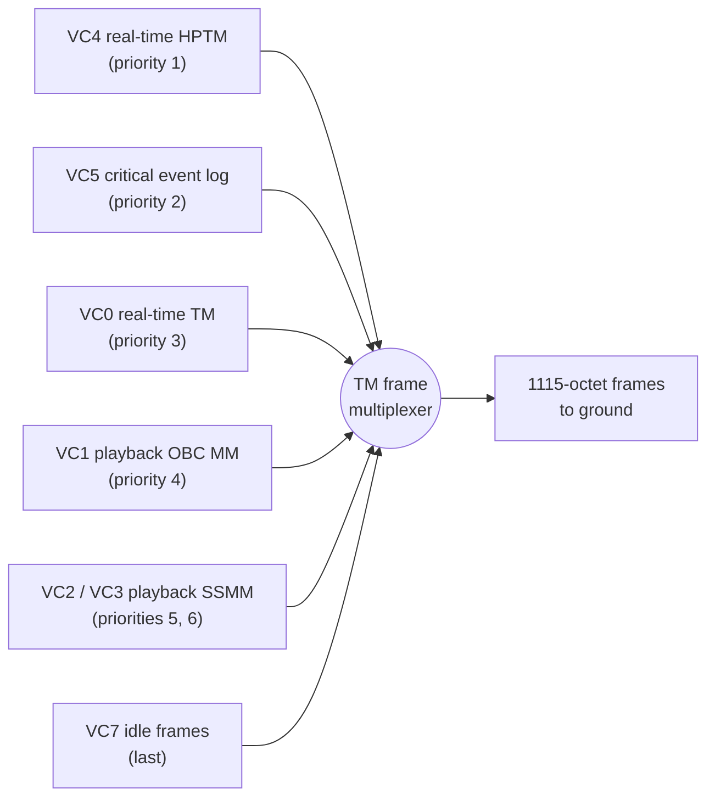
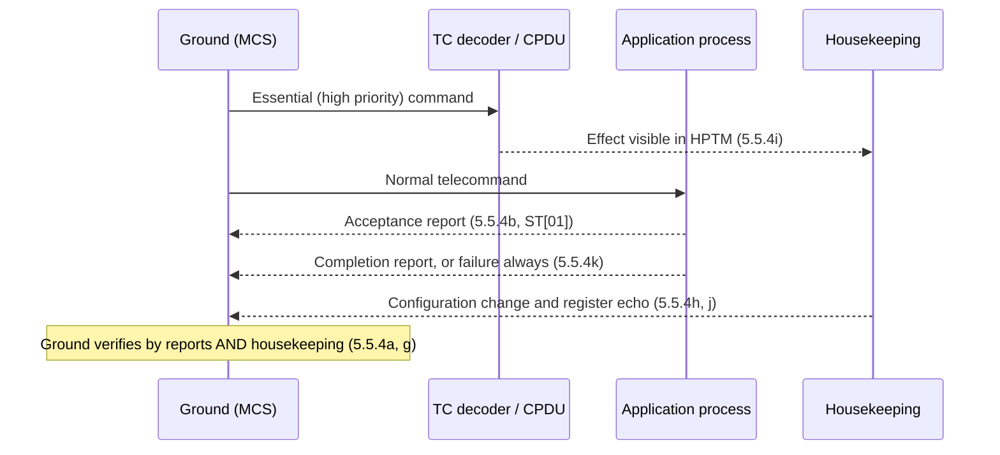
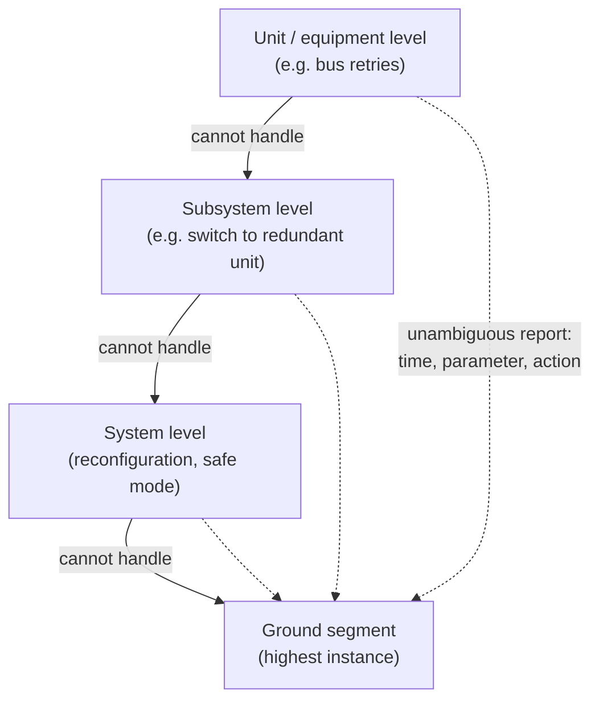
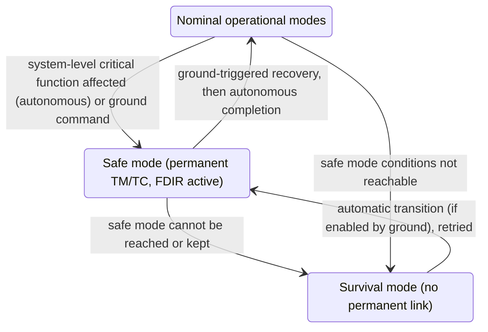

# ECSS-E-ST-70-11C: space segment operability

**ECSS-E-ST-70-11C** ("Space engineering – Space segment operability") specifies what on-board functions an
unmanned space segment must provide so that it can be operated in flight in any nominal or predefined
contingency situation.[^scope] It is the requirements document behind the operator's everyday experience:
whether a parameter can be trusted, whether a command is verifiable, whether the spacecraft can survive a week
without contact, whether a failed unit can be isolated from the ground. The [PUS](pus/index.md)
(ECSS-E-ST-70-41C) says of itself that its services satisfy the fundamental operational requirements for
monitoring and control and refers the reader to ECSS-E-ST-70-11 for them.[^pus-scope]

This page follows **revision 1 of 15 October 2025**, the current issue. Its stated aims are to define
operability requirements that let the space segment be operated safely and cost-effectively, ease the
preparation, execution and evaluation of check-out and operations, and help suppliers answer requests for
proposal. It recognises a cost trade: more operability can raise development cost but certainly lowers
operations and maintenance cost.[^intro]

!!! info "At a glance"
    | Item | Value |
    |---|---|
    | Issues | ECSS-E-70-11A (5 August 2005); B never issued; ECSS-E-ST-70-11C (31 July 2008, template and renumbering); **Rev.1 (15 October 2025)**[^cl] |
    | Requirement identifiers | ECSS-E-ST-70-11_1670001 to ECSS-E-ST-70-11_1670399 (Rev.1 is a new DOORS module, not linked to the previous version)[^cl][^last-req] |
    | Normative references | ECSS-S-ST-00-01; ECSS-E-AS-50-24, -25, -26 (TC coding, TC SDLP, COP-1); ECSS-E-ST-70-41 (PUS); CCSDS 133.0-B-2 (Space Packet)[^refs] |
    | Structure | Clause 4 general requirements by operability category; clause 5 detailed requirements by function; Annex A mission constants |
    | Applicability | Clause 5 applies only where the corresponding function is implemented on board; every mission tailors[^scope][^d-intro] |

## What Rev.1 changed

Rev.1 was driven by experience of modern operations and by the wide adoption of the 2008 issue and of
ECSS-E-ST-70-41C; it aligns the scope of the two standards to avoid overlap, prepares for future missions,
acknowledges new ECSS and CCSDS standards and applies the ECSS drafting rules. Terminology was partly updated
and extended; general and detailed requirements were updated with input from European operators, working
groups and ESA's standardised generic operations interface requirements document (the
[Generic OIRD](../scos2000/operations-preparation.md#the-generic-oird)); **clause 5.8 was rewritten
to remove overlap with ECSS-E-ST-70-41 and give complementary operability requirements**; the mission
constants of Annex A were updated; and the tailoring guide of the former Annex B was removed.[^cl] The 2008
issue is not in this wiki's library, so a clause-by-clause comparison is not possible here.

## Terms

### The six categories of operability

| Category | Definition (paraphrased) | General requirements |
|---|---|---|
| Observability | Availability to the ground and to on-board functions of information on status, configuration and performance | §4.2 |
| Commandability | Adequate control functions to configure the on-board systems for nominal operations, FDIR and maintenance | §4.3 |
| Compatibility | Two or more systems perform their functions without interference | §4.4 |
| Flexibility | Ability to configure and make optimum use of on-board functions, link capacity and redundancy | §4.6 |
| Testability | Ability to test on-board functions, including "off-line" ones not in the current configuration | §4.7 |
| Deactivation | Ability to terminate the mission at end of life (deactivate, de-orbit or both) | §4.8 |

Sources: §3.2.1 and clause 4.[^cat] Safety and fault tolerance (§4.5) are treated as a general requirement
group of their own.[^g-safety]

### Critical functions

| Term | Definition (paraphrased) |
|---|---|
| essential telecommand | Telecommand distributed without the involvement of on-board software |
| high priority command | Pulse command routed directly to hardware by a command pulse distribution unit (CPDU) |
| high priority telemetry (HPTM) | Telemetry that reliably shows the status of mission-critical equipment under all circumstances, normally managed without microprocessor involvement |
| locally-critical function | Wrong-context execution can degrade local functions temporarily or permanently but not higher-level functionality |
| mission-critical function | Wrong-context or wrong execution can cause permanent mission degradation |
| permanent / temporary degradation of a space segment function | The function cannot be achieved on the nominal or any redundant chain for the rest of the mission / for a limited period |
| permanent / temporary mission degradation | Functions or performance affecting mission products or primary objectives cannot be achieved, for the rest of the mission / for a limited period (for example an outage after a transition to survival mode) |
| critical telecommand | Telecommand that activates a mission-critical function |

Source: §3.2.2.[^crit] These levels are the "Criticality" values (non critical, locally critical, mission
critical) that [ECSS-E-ST-70-31C](e-st-70-31c.md) asks suppliers to attach to every activity.[^7031-crit] The
communications standard [ECSS-E-ST-50C](e-st-50-communications.md) uses "essential telecommand" and "essential
telemetry" for the same ideas.[^e50-terms]

### Other terms

Among the 35 other definitions, these matter most for ground systems: **datation** (attaching time to telemetry,
including payload data); **deferred command** (stored in an on-board schedule for later release by time or
position); **device telecommand** (routed to and executed by hardware, such as a relay switch or register load);
**engineering telemetry** (generated to monitor functioning and health) and **housekeeping telemetry** (cyclic
engineering telemetry); **parameter** (an on-board data item or structure observable via telemetry);
**parameter validity** (the condition under which a parameter's interpretation is reliable, with the example of
a gyro output meaningful only when the gyro is powered); **report** (telemetry aggregated to simplify
distribution, storage, transmission and processing); **safe mode** (autonomously sustainable for a specified
period, with permanent communications available for recovery) and **survival mode** (safety without permanent
communications, when safe mode cannot be reached); and **telecommand** (a self-contained data item from ground
with one or more commands; called requests and instructions in the PUS).[^terms1][^terms2][^terms3]

**Mission constants** are quantities the standard cannot fix across missions; they appear in angular brackets,
such as `<TC_VERIF_DELAY>`, and are listed in Annex A. The nomenclature of shall, should, may, need not and can
follows ECSS rules; recommendations are expected to become requirements or be tailored out.[^conv][^nomen]

## General requirements (clause 4)

| Clause | Requirement (paraphrased) |
|---|---|
| 4.2 Observability | Visibility of internal status, configuration and performance at the detail and delay needed for all routine and specified contingency operations, including diagnosis (contingencies come from the failure analysis, e.g. FMECA) |
| 4.3 Commandability | Monitoring and control functions at every level can achieve the mission objectives in all specified circumstances, using redundancy if needed |
| 4.4 Compatibility | Operations neither constrain nor are constrained by the space–Earth links; the links support all nominal and anticipated contingency operations |
| 4.5a Safety | No telecommand executed at the wrong time or configuration leads to loss of mission (for mission-critical functions, for example, two independent commands such as ARM and FIRE) |
| 4.5b to e | All functions recoverable after a single failure (except agreed single points of failure); no unintentional TC to one function causes failure of another; FDIR overcomes all anticipated failures autonomously or by clear and timely notification; no autonomous reconfiguration leads to an unprotected state (FDIR disabled) |
| 4.5f to h | Operational context data updatable safely and consistently, independently of the current configuration, and partially |
| 4.6 Flexibility | All prime/redundant combinations behave operationally alike; ground allocates units to nominal and redundant chains, can override the live selection and switch reversibly; every function has an alternative configuration with different units; every parameter used by autonomy updatable by TC and visible in telemetry without patch and dump; storage areas should be resizable; remaining lifetime resources (propellant, power, battery, coolant) determinable; resource usage deterministic |
| 4.7 Testability | End-to-end test of any application process (an "are you alive" function); redundant equipment operable off-line; health of unused units should be confirmable before use; redundant memory loadable and checkable; test modes do not disable fault management; no FDIR triggers on off-line data |
| 4.8 Deactivation | Resources to put the space segment in a safe state for the space environment at end of life (de-orbit or graveyard orbit) and to deactivate it completely and permanently (remove energy sources) |

Sources: §4.2 to §4.8.[^g-obs][^g-safety][^g-flex][^g-test][^g-deact]

## Detailed requirements (clause 5)

### Mission level: security and links

The space segment provides security commensurate with mission needs (confidentiality of data streams,
authentication and authorization of telecommands). Rev.1 recommends the CCSDS
[Space Data Link Security](../ccsds/sdls.md) protocol (CCSDS 355.0-B, baseline mode for telecommand
authentication, Annex E) and the SDLS extended procedures (CCSDS 355.1-B, baseline implementation mode,
Annex D), with CCSDS 350.5-G for the concept. Access to telemetry and telecommand must survive specified
external influences (typically RFI and weather; meteorites or malicious dazzling clearly cannot be covered)
and be recoverable after all specified space and ground configuration changes.[^sec1][^sec2]

Downlink bandwidth is allocated to classes of data through physical and virtual channels; the assignment of
virtual channels to data classes (real-time housekeeping, science, playback, HPTM, critical event log) is
agreed with the operator and never changes during the mission, while the bandwidth allocation per VC can be
modified; real-time and deferred telemetry can be sent simultaneously.[^vc]

**Solar Orbiter** shows the pattern. Its frame ICD assigns VC0 to real-time telemetry, VC1 to playback from the
on-board computer mass memory, VC2 and VC3 to playback from the solid-state mass memory (the only VCs that may
carry compressed packets), VC4 to real-time high priority telemetry, VC5 to critical event log playback and VC7
to idle frames only, with a fixed priority order VC4, VC5, VC0, VC1, VC2, VC3, VC7.[^solo-vc]



*Solar Orbiter's allocation of data classes to virtual channels, an instance of requirements 5.2.2a to d.*[^solo-vc][^vc]

### Telemetry

Clause 5.3.1 has 35 requirements (a to ii). Grouped by purpose:[^tm1][^tm2][^tm3][^tm4][^tm5][^tm6]

| Purpose | Requirements (paraphrased) |
|---|---|
| Content | Engineering telemetry in all phases gives status, health and performance and lets ground follow nominal and contingency operations independently of command history (a); it includes sensor readings, register readouts, equipment and power status, function status, events and autonomous actions, processor and memory self-tests (b); complete, unambiguous and timely (c); events in dedicated progress or anomaly report packets (d); reporting does not starve other operational information of bandwidth (e) |
| Measurement quality | Status from direct measurement, not secondary effects, especially for switches (f); switching preconditions acquired independently of the unit to be switched, so a unit can be assessed while off (g); self-contained values, no deltas or status changes (h); fast-changing significant values (pyro currents) memorised (i); adequate range and resolution (j); every mission-critical function observable by at least two independent measurements (k); telemetry to diagnose every FMECA failure down to function or equipment level (l); raw data of on-board processed measurements downlinkable on request (m); units operable in parallel distinguishable, also in events (n); loss of one chain does not block the other's telemetry (o) |
| Packet design | Every packet with measurements carries what is needed to calibrate and validate them (p); sampling fast enough for all operations (q); all contributing parameters of a given equipment (for synthetic, conditionally valid or deduced parameters) in the same packet (r); same structure and interpretation wherever a parameter appears (s); fixed, implicitly known position in non-variable packets (t); super-commutated parameters sampled regularly (u); no sub-commutation in housekeeping packets (v); one parameter's value in contiguous bits (z) |
| Ordering and storage | Packets of one APID on one VC delivered in generation order (w); status and health data only in engineering telemetry, since science telemetry is mostly not processed by the control system (x); all packets except idle, time and HPTM packets storable on board until deleted or overwritten (aa); each application process delivers in chronological order (bb); no dynamic ground management of the telemetry configuration in nominal operations (cc) |
| HPTM | High priority telemetry on the on-board computer, critical latching current limiters and TT&C always available for real-time downlink whenever a transmitter is on, even with application software not running, typically generated by hardware (y) |
| Idle data | Idle frames on a dedicated VC and only to fill unused bandwidth; idle packets only to complete a frame with meaningful data (dd); telemetry has priority over idle frames and packets, which are not interleaved while data waits (ee) |
| Completeness and safe mode | Ground can verify completeness of telemetry independently of the route (ff); storage configuration and data preserved in safe mode and on reconfiguration of the storage unit (gg), accessible afterwards with the standard services (hh) and functional without ground intervention (ii) |

**Diagnostic mode** (5.3.2): ground can select housekeeping parameters for high-rate sampling, generate packets
at the sampling rate, sample down to `<DIAG_MIN_INTERV>` and record diagnostic data on board.[^diag]
**Compression** (5.3.3): missions that compress on board document the compression performance and uncertainty
so that ground can predict data volume.[^diag]

!!! tip "Why the packet design rules matter to the ground"
    Requirements p, r, s, t and u are what let a ground system define a parameter once and extract it from
    every packet by position and fixed time offset: in SCOS-2000, one [`pcf`](../mib/tables/pcf.md) entry per
    parameter, fixed packet layouts in [`plf`](../mib/tables/plf.md), and sample times computed from the packet
    time plus a static offset. The SCOS-2000 import ICD states that it relies on exactly these assumptions:
    housekeeping time offsets must be known a priori and identical for all instances of a packet, and variable
    packets are excluded from full processing (validity, checks, verification, synthetic parameters).[^icd-hk][^icd-var]

### Datation and synchronization

| Req. | Content (paraphrased) |
|---|---|
| a | Timing information allows ground correlation of on-board time with UTC to better than `<TIME_CORREL_ACCUR>` over `<TIME_CORREL_PERIOD>` |
| b, c | Ground can set on-board time by telecommand; on-board time increases monotonically in all modes, including standby and survival |
| d | All timing functions synchronised with a single Central Time Reference, including redundant units running in parallel |
| e to g | Application processes using time synchronisation report "not yet synchronised", "synchronised" and the state of synchronisation |
| h, j, k | No on-board clock, and no telemetered on-board time, wraps around during the mission; no telemetered counter wraps within the agreed ground non-availability period |
| i | Every telemetry source packet should carry its generation time in its header |
| l to n | Original sampling time of every status parameter recoverable; relative sampling time of any two parameters to `<PARAM_REL_SAMPL_TIME>`, even across packets; in non-variable packets, sampling time = generation time plus or minus an implicitly known offset |
| o, w | On-board contribution to correlation error at most `<ONBOARD_STABILITY>` ms/day; all on-board delays documented |
| p, q, v | Any unit's clock can be synchronised with the Central Time Reference; several on-board time sources are mutually correlatable from housekeeping; synchronisation of application time references monitored and reported |
| r to u, x | With a GNSS receiver as time source: periodic GNSS/OBT correlation reports; ground can enable and disable GNSS synchronisation even when GNSS is not in the AOCS loop; performance kept through forward and backward re-synchronisation; periodic resynchronisation; leap seconds handled autonomously |

Sources: §5.4a to x.[^time1][^time2][^time3] The PUS-specific counterpart (5.8.4) requires that the telemetry
transfer frame that triggered a time packet be unambiguously derivable on ground, the basis of ground
[time correlation](../scos2000/time-correlation.md).[^pus-time] Solar Orbiter's time report is TM(9,2) on APID 0
(SPID 9999) in the MIB, matching its packet category 0, "exclusive for Service 9, Time packet".[^mib][^solo-apid]
See also [ST[09] Time management](pus/st09-time-management.md) and [time codes](../ccsds/time-codes.md).

### Telecommanding

**Telecommand function** (5.5.1, a to u):[^tc1][^tc2][^tc3][^tc4]

* Telecommands exist for all equipment and functions in all nominal and anticipated contingency conditions,
  which implies **essential telecommands** to re-establish command processing after a processor failure (a).
* One telecommand performs one on-board function, possibly several strictly related actions; loading or starting
  a schedule counts as one function (b, c). Its action definition never changes during the mission, so no
  "flip/flop" commands (d); the conditions for configuration-dependent commands are visible in housekeeping (e).
* No telecommand leads to permanent loss of commanding; repeating a telecommand causes no permanent degradation
  (f, g). All devices can be commanded individually, not necessarily with high-priority commands (h).
* Redundancy switching does not change the procedures or commands addressed to the operational unit, so loaded
  timelines and OBCPs keep working (i). Maximum execution duration is fixed for the mission (j). Parameter values
  in contiguous bits (k).
* On-board parameters and tables are changed and read with **dedicated** commands, not with general memory load
  and dump (l, m).
* Distribution at `<TC_DISTR_RATE>` regardless of source and size, acceptance of `<TC_ACC_RATE>` commands per
  second by every application process (n, o).
* **Essential telecommands** can be issued directly from the on-board decoder without software (examples: processor
  module on/off and reset, watchdog enable/disable, reconfiguration module enable/disable, transmitter on/off) on
  redundant, independent hardware (two decoders), and are identical whatever the commanding route (p to r).
* Commandable parameters have adequate accuracy, precision and encoding (s). With COP-1 the AD service is
  configured for the in-orbit conditions, with sliding windows that do not artificially limit the uplink rate (t).
  Parallel on-board operations do not block ground commanding, for example of the scheduler while it releases
  commands (u).

**Critical telecommands** (5.5.2): they can be implemented through different categories (an OBCP or the
schedule executing what is normally a CPDU command, or low-level commands replacing a high-level function); a
mission-critical function needs at least two separate command actions (arm or enable, then execute; pyrotechnics
are the example); mission-critical register loads have a separate execute command so the loaded data can be
verified first; and every mission-critical command has a redundant command on a maximally diverse route with no
common nodes.[^crit1][^crit2]

**Transmission and distribution** (5.5.3): no restriction when ground commands at the full uplink rate, even with
all commands to one application process (for example a memory load), with queues for long-running commands;
commanding one application process does not interfere with others; and the source of a telecommand (ground or a
named on-board process) is explicit in the packet; commands released from the on-board schedule count as
ground-sourced.[^dist]

**Verification** (5.5.4): complete and unambiguous ground verification of acceptance, routing and execution of any
telecommand from any source, by verification reports and housekeeping together, positive and negative, including
non-packetised units and essential commands (a); acceptance verification for everything except pure hardware
commands such as CPDU commands (b); ground can disable success reports (c); reports within `<TC_VERIF_DELAY>` of
the stage (d); an invalid command (bad length, CRC or APID) fails acceptance and goes no further (e); failures of
autonomously generated commands reported as anomaly events (f); execution verifiable from housekeeping generated
in all circumstances in which the command runs (g); configuration changes reported in housekeeping (h); effects
observable in telemetry available whenever the command can succeed, which for commands affecting telemetry
generation means the HPTM (i); register loads echoed by dedicated parameters (j); ground-issued command failures
always reported (k); and a command whose effect was already achieved is still positively acknowledged (l).[^ver1][^ver2]



*Two verification paths required by clause 5.5.4. The diagram is this wiki's.*[^ver1][^ver2]

### Modes and configuration

**Modes** (5.6.1): at least pre-launch, operational and safe modes; modes identified in hardware and software
terms and unambiguously visible in periodic housekeeping; any subsystem, unit or instrument put into each mode by
a single telecommand function; maintenance possible in nominal modes; mode transitions reported with event
reports; any serviceable combination of physical units usable in every mode; forbidden transitions prevented on
board but forceable by ground in exceptional cases (for example end-of-life passivation); telemetry storage
always possible, in safe mode at least for engineering telemetry; modes available to on-board autonomy; no ground
monitoring or commanding needed during launch up to separation, with engineering telemetry stored until ground
takes control; transmitters switched on autonomously as soon as permitted; commissioning able to exercise all
scenarios; checkouts of payloads and platform items supported.[^modes1][^modes2]

**On-board configuration handling** (5.6.2): every reconfiguration ends in a known, observable state, has a
deterministic maximum duration and is monitorable at every stage; it does not disturb unrelated units; telemetry
gives the cause of the last reconfiguration (or chain of them); units can be pre-configured before selection;
safe-state reconfiguration can be triggered autonomously and by ground; after separation the spacecraft enters a
state survivable without ground for a predefined period (`<GRD_RSP_TIME_CRIT>` in critical phases); conflicts
between autonomous actions and scheduled commands are avoided or resolved; and power-up, restart or power
recovery produces a known, reproducible electrical state.[^conf1][^conf2]

### On-board autonomy and FDIR

**General autonomy** (5.7.2): autonomy reflects acceptable outage, station coverage and the longest unexpected
ground non-availability. The spacecraft continues nominal operations without contact for at least
`<NOM_OPS_PER>` days (for deep space typically 10 days plus the longest conjunction) and stores mission products
for that period; after a non-recoverable failure it survives in safe mode, with FDIR active, for at least
`<SAFE_TIME>` days (for deep space at least the longest conjunction plus 10 days). Ground reaction is never
needed faster than `<GRD_RSP_TIME_NOM>` hours in non-critical phases and `<GRD_RSP_TIME_CRIT>` hours in critical
ones. Ground can enable and disable every autonomous function, separately for nominal and safe/survival modes;
autonomy can read any engineering telemetry (including event reports from other units) and ground can read every
parameter it uses; autonomy uses only valid acquisitions; FDIR never triggers on a single sample and its limits
avoid false triggering without compromising safety.[^aut1][^aut2][^aut3]

Two autonomy scales are defined:[^levels]

| Level | Mission execution | Functions |
|---|---|---|
| E1 | Under ground control; limited on-board capability for safety | Real-time ground control; deferred commands for safety |
| E2 | Pre-planned, ground-defined operations on board | On-board scheduler of deferred commands ([ST[11]](pus/st11-time-based-scheduling.md)) |
| E3 | Adaptive operations on board | Event-based operations ([ST[19]](pus/st19-event-action.md)), on-board control procedures ([ST[18]](pus/st18-onboard-operations-procedure.md)) |
| E4 | Goal-oriented operations on board | On-board re-planning |

| Level | Data management | Functions |
|---|---|---|
| D1 | Essential data stored on board after a ground outage or failure | Storage and retrieval of event reports; storage management |
| D2 | All mission data stored; independent of ground availability | D1 plus storage and retrieval of all data ([ST[15]](pus/st15-onboard-storage-retrieval.md)) |

**FDIR** (5.7.5) follows the failure detection, isolation and recovery paradigm: detect and report failures,
isolate them to stop propagation, and where possible recover so operations continue.[^fdir0]



*Hierarchical FDIR (5.7.5.2b to e): failures are handled at the lowest possible level and handed upwards, every
action is reported to ground.*[^fdir1]

| Area | Requirements (paraphrased) |
|---|---|
| General (5.7.5.2) | FDIR reflects autonomy, safeguarding and ground intervention needs; hierarchical; escalation to ground as the highest instance; unambiguous reporting with all information for analysis; every FDIR function and each of its inputs can be enabled and disabled by TC (except passive hardware such as fuses), consistently; one failure triggers one surveillance; unit available/failed status managed, reported and updatable by ground; functions disabled by ground stay disabled through mode transitions; no toggling between prime and redundant; no autonomous local reconfiguration of a suspected unit; protection (for example two steps) against unintended modification of FDIR parameters; definitions of all on-board monitorings reportable; statuses of all monitorings and recovery actions in cyclic housekeeping |
| Detection (5.7.5.3) | Detect and report any anomaly, hardware or software; define out-of-limit conditions on essential parameters (see 5.8.6); no repeated reports of the same failure each cycle; all operationally significant autonomous actions in housekeeping; anomaly reports with unique ID, time and input data record; detection independent of nominal control (for example different AOCS sensors); off-line failure detection where possible; thresholds and repetition counts modifiable by TC; self-check results reported; operational integrity failures reported (late scheduled commands, failed on-board TC files) |
| Isolation (5.7.5.4) | Isolate failed units; where system safeguarding is at stake (for example a power drain), disable or switch off the offender; otherwise hierarchical steps first (retries and readback, switching with functional verification, delays) |
| Recovery (5.7.5.5) | Autonomous recovery consistent with mission needs; conflicts with ongoing commanding (schedule, OBCPs) managed; safety guaranteed even if recovery fails; deterministic end configuration |

Sources: §5.7.5.2 to §5.7.5.5.[^fdir1][^fdir2][^fdir3][^fdir4][^fdir5]

**Safe and survival modes** (5.7.5.6): safe mode reaches a stable safe condition from any initial state and has an
autonomy of at least `<SAFE_TIME>`; the space segment enters a safe state for any hazard to its health or mission
objectives, but enters safe or survival mode only when a system-level critical function is affected; recovery
from safe mode is under ground control, after which the return to nominal completes without further ground
action; safe mode guarantees permanent uplink and downlink; survival mode is entered when safe mode cannot be
reached (solar flare blinding star trackers, corrupted ephemeris, multiple failures), with automatic return to
safe mode that ground can enable or disable and that keeps retrying when enabled. Entry includes putting payloads
in a safe and recoverable state, transmitting the telemetry needed to recognise the mode (or just the carrier in
survival), and keeping the reason for entry available in real time and in storage. Autonomous entry is enabled by
default, can be disabled only through a protection mechanism (for example unlock then disable), and its status is
always in cyclic telemetry; no nominal operation may need it inhibited or forced. The transition cannot be
interrupted (high-priority hardware commanding excepted) and does not rely on residual values from previous
modes. Ground recovers within `<SM_RECOVERY_TIME>` at the lowest safe-mode bit rates; the operational context is
in non-volatile memory; the critical event log is returned within `<CEL_DUMP_TIME>`; downlink starts within
`<DL_START_TIME>`; and a survival mode is required if `<MIN_DATA_RATE_SM>` cannot be guaranteed in safe mode.[^safe1][^safe2][^safe3][^safe4]



*Transitions between nominal, safe and survival modes allowed by §5.7.5.6. State names are this wiki's.*[^safe1][^safe2]

### The PUS-related requirements and the relationship with ECSS-E-ST-70-41

Clause 5.8 assumes and requires that monitoring and control services are supported on board as specified in the
PUS, which gives a logical, service-based view of any space segment. Deploying the PUS means choosing the
application processes for the physical architecture, the service types to host and, per application process, the
subtypes and functions. Clause 5.8 then adds only **complementary** requirements, the overlap with
ECSS-E-ST-70-41 having been removed in Rev.1.[^pus-intro][^cl]

| Clause | Complementary requirement (paraphrased) | PUS service |
|---|---|---|
| 5.8.2 General | One or more application processes per subsystem; APIDs unchanged for the mission; APID, type and subtype (plus type-specific fields) uniquely identify a packet's structure across the spacecraft; a service hosted by several processes has identical packet structures (identification field positions may differ); housekeeping reports have the same parameters in the same positions with fixed sampling offsets, so no variable arrays or deduced presence; on-board parameter identifiers unique across the spacecraft | [Packets](pus/packets.md), [ST[03]](pus/st03-housekeeping.md) |
| 5.8.3 Memory | Load any changeable area, dump and check any area, no extra size limits per command, integrity during operations, persistent storage (EEPROM); with files, load and dump memory images as files | [ST[06]](pus/st06-memory-management.md) |
| 5.8.4 Time | The frame that triggered a time packet is derivable on ground | [ST[09]](pus/st09-time-management.md) |
| 5.8.5 Scheduling | Any TC loadable; content editable without disabling execution and while disabled; capacity covers the autonomy period; predictable transfer delay; transfer errors reported and detected; equal release tags released in order; elapsed commands after disable/enable not released | [ST[11]](pus/st11-time-based-scheduling.md) |
| 5.8.6 Monitoring | Any parameter or function monitorable on request, including from processes without on-board monitoring; definitions editable without disabling, and while disabled | [ST[12]](pus/st12-onboard-monitoring.md) |
| 5.8.7 Large packets | Mission-defined maximum TC packet length below the CCSDS 232.0-B maximum and TM packet length below CCSDS 133.0-B-2; large packets split for transfer | [ST[13]](pus/st13-large-packet-transfer.md) |
| 5.8.8 Storage | Store any packetised data in packet stores or files; capacity for all engineering telemetry over the autonomy period; same packet in several stores; persistence across reconfiguration and cold restart; retrieval priorities; storage not interrupted by retrieval or reset; independent devices managed independently | [ST[15]](pus/st15-onboard-storage-retrieval.md) |
| 5.8.9 OBCPs | Load and control; several in parallel; any ground command; any engineering telemetry; prioritised (for example fault management first) | [ST[18]](pus/st18-onboard-operations-procedure.md), [ECSS-E-ST-70-01C](e-st-70-01c.md) |
| 5.8.10 Event-action | Trigger an action (any ground-available command) on an on-board event | [ST[19]](pus/st19-event-action.md) |
| 5.8.11 Files | Files as native data units: storage, transfer, content access, automatic telemetry files, files of telecommands; the same file system interface exposed to ground | [ST[23]](pus/st23-file-management.md), [CFDP](../ccsds/cfdp.md) |

Sources: §5.8.1 to §5.8.11.[^pus-intro][^pus-gen][^pus-mem][^pus-time][^pus-sched][^pus-mon][^pus-st][^pus-obcp]

The dependency runs both ways. ECSS-E-ST-70-41C lists ECSS-E-ST-70-11 as a normative reference and states that
its services satisfy the operational requirements found there; the Rev.1 draft of the PUS (DIR1, December 2024)
keeps the same wording.[^pus-scope][^pus-refs][^pusr1-scope] According to its change log, that draft also
standardises new services, ST[24] file transfer and ST[25] file data storage for file-based operations,
ST[26] parameter extraction and ST[27] critical packet log management, and deletes ST[8] function
management.[^pusr1-cl]

!!! warning "Inference"
    Linking ST[27] critical packet log management to the critical event log of ECSS-E-ST-70-11C Rev.1
    (requirement 5.7.5.6w and VC data class "CEL"), and ST[24]/ST[25] to clause 5.8.11, is this wiki's reading of
    the two change logs; neither document states the correspondence.

### Equipment and subsystem requirements

| Clause | Highlights (paraphrased) |
|---|---|
| 5.9.1 Processors and software | Safe prime/redundant switchover with operational context in non-volatile memory; redundant processors testable outside control loops (should); software resources (memory, CPU, I/O) telemetered; uploaded software checkable before enabling; boot image selectable by one TC; ground-software communication through dedicated TC/TM, not memory load and dump; event reports before forced resets and on cycle overruns, processor load threshold, arithmetic overflow, illegal instruction, bus error, uncorrectable memory corruption, checksum error and internal inconsistency, with type, location and diagnosis data; robust to complete loss of context; memory for two software images per processor; boot context modifiable separately from the image; robust image loading; selectable prime and redundant images; RAM patches; software version reportable; "death reports" and "boot reports" saved and reported; context protected; images in non-volatile memory accessible from any processor; corrected-error counts and last location per memory in cyclic telemetry; patch sets applied at boot |
| 5.9.2 Power | Total generated and consumed power directly from telemetry; battery state of charge to `<BATT_CHARGE_ACC>`; a current sensor per consuming unit; power status of each equipment always available; mission-critical power functions can switch over but never switch off; modifiable power-shed list |
| 5.9.3 TT&C | Redundant receivers cross-strapped to redundant decoders; at least two receivers active on different antennas; commandable at any time; antenna pattern overlap leaves at least `<ANT_SWITCH_TIME>` to switch; commands with repetitive or transition-free patterns processed correctly (randomisation of CCSDS 231.0-B can help); contingency recovery after `<NO_TC_TIMEOUT>` without commands (configurable; may include clearing authentication); all stored engineering telemetry since the previous pass downlinkable each pass; maximum uplink rate usable in all nominal phases; bit rate and modulation settable per band; coherent or non-coherent transponder mode; antenna switching without switching off the transmitter; carrier-only, TM/TC, ranging and simultaneous modes; continuous transmission for whole passes; data return budgets assume `<DATA_RETURN_DELTA>` less than visibility; no telemetry loss on bit rate change (idle frames for resynchronisation); orbit determination in all scenarios; no design limit on daily contact time |
| 5.9.4 AOCS | Attitude determinable on ground independently of on-board estimation; thruster telemetry for on-time and fuel; remaining fuel to `<PROP_ACCURACY>`; safeguarding on unplanned thruster firing; AOCS fallback commandable from any mode; ground override of on-board biases and drifts; any actuator commandable; performance verifiable; link kept during AOCS operations; attitude kept through sensor outages up to `<MAX_SENSOR_OUTAGE_PERIOD>` and communication beyond; manoeuvres without real-time interaction; direct safe-to-orbit-control transition; minimal routine commanding; generic guidance and thruster modulator functions; wheel off-loading autonomous if authorised, enable/disable and direct command |
| 5.9.5 Mechanisms | Deployment status of one-shot mechanisms telemetered (mission-critical, so subject to the two-measurement rule); launch-lock status in pre-launch; deployment stages monitored; positions reported and commanded absolutely; no non-recoverable positions except single-shot |
| 5.9.6 Thermal | Each control loop enable/disable; thresholds adjustable except thermostats; thermistor coverage and resolution |
| 5.9.7 Payload | Protection from the environment even when off; safe state on a specific TC; no extensive payload operations for `<PAYLOAD_INT>` after separation; compression imposes no special ground design and does not depend on telemetry history; health and safety in engineering telemetry; timing and configuration of operations downlinked (should) |
| 5.9.8 and 5.10 Storage and files | Autonomous file system maintenance; all file services ground-accessible; ground manages status, content and attributes; directories; file exchange (for example CFDP) with completeness verification and minimal overhead; downlink control per transaction or per direction; large files; parallel transactions; persistence over cold restart; reconfigurable storage; memory self-test; no hardware activation by file creation; failed memory blocks reported and listable; all on-board users can access the file services; full ground visibility of file systems |

Sources: §5.9.1 to §5.10.[^eq-sw1][^eq-sw2][^eq-pwr][^eq-ttc1][^eq-ttc2][^eq-aocs1][^eq-aocs2][^eq-mech][^eq-pl][^eq-files]

## Mission constants (Annex A)

| Constant | Meaning (paraphrased) | Used in |
|---|---|---|
| `<ANT_SWITCH_TIME>` | Minimum time available to switch antennas | 5.9.3d |
| `<BATT_CHARGE_ACC>` | Accuracy of battery state of charge | 5.9.2b |
| `<CEL_DUMP_TIME>` | Maximum time to return the critical event log in safe mode | 5.7.5.6w |
| `<DATA_RETURN_DELTA>` | Time subtracted from pass duration for data return budgets | 5.9.3o |
| `<DIAG_MIN_INTERV>` | Minimum sampling interval in diagnostic mode | 5.3.2c |
| `<DL_START_TIME>` | Maximum delay to start downlink after safe-mode entry | 5.7.5.6y |
| `<GRD_RSP_TIME_NOM>` / `<GRD_RSP_TIME_CRIT>` | Minimum ground response time in non-critical / critical phases | 5.7.2e, g; 5.6.2h |
| `<MAX_SENSOR_OUTAGE_PERIOD>` | Period of guaranteed contact without attitude sensors | 5.9.4l, m |
| `<MIN_DATA_RATE_SM>` | Minimum safe-mode downlink rate | 5.7.5.6z |
| `<NO_TC_TIMEOUT>` | Time without telecommands before an on-board contingency recovery (ground-configurable) | 5.9.3f |
| `<NOM_OPS_PER>` | Minimum autonomy for nominal operations without contact | 5.7.2b, c |
| `<ONBOARD_STABILITY>` | On-board time reference stability contribution | 5.4o |
| `<PARAM_REL_SAMPL_TIME>` | Accuracy of relative sampling time of two parameters | 5.4m |
| `<PAYLOAD_INT>` | Time after separation without extensive payload operations | 5.9.7c |
| `<PROP_ACCURACY>` | Accuracy of remaining fuel determination | 5.9.4d |
| `<SAFE_TIME>` | Interval for which safety is ensured | 5.7.2d, 5.7.5.6a |
| `<SM_RECOVERY_TIME>` | Time for ground to recover from safe mode | 5.7.5.6u |
| `<TC_DISTR_RATE>` / `<TC_ACC_RATE>` | Minimum on-board distribution / acceptance rates | 5.5.1n, o |
| `<TC_VERIF_DELAY>` | Maximum delay between execution and verification telemetry | 5.5.4d |
| `<TIME_CORREL_ACCUR>` / `<TIME_CORREL_PERIOD>` | Time correlation accuracy and the period over which it holds | 5.4a |

Source: Annex A and the clauses cited.[^annexA1][^annexA2] Two of these also appear as PUS mission constants in
the service data that [ECSS-E-ST-70-31C](e-st-70-31c.md) asks suppliers to deliver (`<DIAG_MIN_INTERV>` and
`<PARAM_REL_SAMPL_TIME>`).[^7031-const]

## How operability shows up in the Solar Orbiter MIB and PUS usage

The Solar Orbiter TM/TC ICD and the [MIB](../missions/solar-orbiter/mib.md) show many of these requirements as
concrete design features. Solar Orbiter's ICD applies ECSS-E-70-41A (the PUS of 2003), so the service subtypes
below use that issue's names.[^solo-docs]

| Requirement | Solar Orbiter design | Evidence |
|---|---|---|
| Essential and high priority commands without software (5.5.1a, p to r) | CPDU commands on MAP 0 ("HPC-1"), also issuable from the reconfiguration module (HPC-2) and by software writing CPDU registers (HPC-3); 125 MIB commands with header `HPC1_TC`, `CCF_HIPRI` = Y, `CCF_MAPID` = 0, for example [`ZBC04007`](../explorer/index.md#/solo/command/ZBC04007) "Watchdog (A or B) Enable" and `ZBC04001` "Select PM A EEPROM Image 1" | ICD §3.3.1; [`ccf`](../mib/tables/ccf.md)[^solo-map][^solo-hpc][^mib] |
| High priority telemetry (5.3.1y) | Packet category 2 "HPTM", APID 34, SPID [36997](../explorer/index.md#/solo/packet/36997) "OBC_HPTM_packet" with 274 parameters (with names such as "PCDU TMTC_A Red Status" and "SPICE OU (HTR-B)"), downlinked on VC4 at top priority | ICD annex 8, §4.3; [`pid`](../mib/tables/pid.md), [`plf`](../mib/tables/plf.md)[^solo-apid][^solo-vc][^mib] |
| Parameter validity (3.2.3.28, 5.3.1p) | 20 692 parameters carry a validity parameter; for example [`NDSD0046`](../explorer/index.md#/solo/param/NDSD0046) "DST-A WD Reset Counter" is valid only when `NCSD3JJ3` ("DST-RX A SCV St.Tm", textual calibration 0 NOT_APPLICABLE, 1 OFF, 2 ON) is 2 (ON) | [`pcf`](../mib/tables/pcf.md) `PCF_VALID`, `PCF_VALPAR`[^mib] |
| Event-based reporting by severity (5.3.1d, 5.7.5.3) | 7 156 TM(5,x) packet definitions: 1 374 informative (5,1), 1 159 low (5,2), 2 911 medium (5,3), 1 698 high severity (5,4), plus 14 of the mission-specific subtypes 130, 132 and 134; SCOS-2000 raises info (I), warning (W) and alarm (A) events for the four standard subtypes | `pid` `PID_TYPE`, `PID_EVENT`[^mib][^icd-pid] |
| Mode transitions reported by events (5.6.1f) | 70 TM(5,x) packet descriptions contain "mode" (case-insensitive match); most name mode changes, mode transitions or wrong-mode rejections, a few (such as RTEMS task-mode errors) concern software modes; safe-mode events include "TM 5,1 Trans2Safe event" (SPID 52017) | `pid` descriptions[^mib] |
| Acceptance and completion verification (5.5.4b, g) | ST[01] reports TM(1,1), (1,2), (1,7), (1,8); verification stages: 16 acceptance and 23 completion by report, 167 completion by parameter check | `pid`, [`cvs`](../mib/tables/cvs.md)[^mib] |
| Enable and disable reporting and monitoring by TC (5.7.5.2f, 5.7.5.3h) | TC(5,5)/(5,6) enable/disable event report generation (10 each); TC(12,1)/(12,2) enable/disable monitoring (13 each), (12,5) add to and (12,7) modify the monitoring list (114 and 83) | `ccf` `CCF_TYPE`, `CCF_STYPE`[^mib][^pusa-sub] |
| Event-action and OBCPs (5.8.9, 5.8.10) | 48 ST[19] commands, including 25 TC(19,1) "Add Events to the Detection List"; 46 ST[18] commands | `ccf`[^mib][^pusa-sub] |
| Two-step critical commands (5.5.2b) | Arm commands such as `ZAHG0008` "HAPME_A Arm Set Ctrl Par" precede set commands | `ccf` descriptions[^mib] |
| Time and idle packets (5.3.1aa, dd; 5.8.4) | TM(9,2) time report on APID 0; idle packet APID 2047; idle frames only on VC7 | `pid`; ICD §4.3[^mib][^solo-frame] |
| Same structure everywhere (5.8.2c, e) | Packet identification by APID, type, subtype and extra fields; fixed housekeeping layouts in `plf` | `pid`, [`pic`](../mib/tables/pic.md), `plf`[^mib] |

The criticality flag changed between releases. In the release of 16 April 2020, 79 commands had
`CCF_CRITICAL` = 'Y' (for example `ZCSD3404` "Dst-Tx Set Output Power", `ZCSF0013` "COMS Execute Recovery
Action 1 Function" and `ZIC00085` "SDM_OPEN_DOOR"); in the release of 16 September 2025 no command and no
command sequence (`CSF_CRITICAL`) is flagged, although 77 of those 79 command names still exist, now with
'N'.[^mib][^mib2020] The SCOS-2000 ICD leaves the extra processing or protection of critical commands to
mission-specific implementation.[^icd-crit]

!!! warning "Inference"
    Why the flag was cleared is not stated in the available sources. Criticality in the 2025 release is
    presumably handled by other means (procedures, interlocks or two-step command pairs such as the arm
    commands above), or by mission-specific ground tooling outside the MIB.

??? example "SQL used"
    All queries ran with `sqlite3 -readonly` on `solo-2025-09-16.sqlite` (release
    MIB__20250916M25925PFMS001_SOL). In this database `cvs` has generic column names (`COL2` = `CVS_TYPE`,
    `COL3` = `CVS_SOURCE`).

    ```sql
    -- high-priority commands
    SELECT CCF_HIPRI, CCF_MAPID, CCF_PKTID, count(*) FROM ccf GROUP BY 1, 2, 3;
    SELECT CCF_CNAME, CCF_DESCR FROM ccf WHERE CCF_HIPRI = 'Y' AND CCF_MAPID = '0' LIMIT 10;
    SELECT CCF_CRITICAL, count(*) FROM ccf GROUP BY 1;
    SELECT CSF_CRITICAL, count(*) FROM csf GROUP BY 1;
    -- the same two queries on solo-2020-04-16.sqlite (MIB__20200416M10720PFMS001_SOL), then:
    ATTACH 'solo-2020-04-16.sqlite' AS o;
    SELECT n.CCF_CRITICAL, count(*) FROM ccf n JOIN o.ccf c ON n.CCF_CNAME = c.CCF_CNAME
      WHERE c.CCF_CRITICAL = 'Y' GROUP BY 1;
    -- HPTM, time and idle packets
    SELECT PID_TYPE, PID_STYPE, PID_APID, PID_SPID, PID_DESCR FROM pid WHERE PID_APID IN (0, 34, 2047);
    SELECT count(*) FROM plf WHERE PLF_SPID = 36997;
    -- validity
    SELECT count(*) FROM pcf WHERE PCF_VALID <> '';
    SELECT PCF_NAME, PCF_DESCR, PCF_VALID, PCF_VALPAR FROM pcf WHERE PCF_NAME IN ('NDSD0046','NCSD3JJ3');
    SELECT TXP_FROM, TXP_ALTXT FROM txp
      WHERE TXP_NUMBR = (SELECT PCF_CURTX FROM pcf WHERE PCF_NAME = 'NCSD3JJ3');
    -- events, verification reports, service usage
    SELECT PID_TYPE, PID_STYPE, PID_EVENT, count(*) FROM pid WHERE PID_TYPE IN ('1','5') GROUP BY 1, 2, 3;
    SELECT count(*) FROM pid WHERE PID_TYPE = '5' AND upper(PID_DESCR) LIKE '%MODE%';
    SELECT COL2, COL3, count(*) FROM cvs GROUP BY 1, 2;
    SELECT CCF_TYPE, CCF_STYPE, count(*) FROM ccf
      WHERE CCF_TYPE IN ('5','12','18','19') GROUP BY 1, 2;
    SELECT CCF_CNAME, CCF_DESCR FROM ccf WHERE upper(CCF_DESCR) LIKE '%ARM%';
    ```

## Related pages

* [ECSS overview](index.md), [ECSS-E-ST-50C communications](e-st-50-communications.md), [ECSS-E-ST-70-31C](e-st-70-31c.md)
* [ECSS-E-ST-70C](e-st-70c.md), the parent ground systems and operations standard, and [ECSS-E-ST-70-01C](e-st-70-01c.md), the OBCP standard (compare requirement group 5.8.9)
* [Operations preparation](../scos2000/operations-preparation.md), with the Generic OIRD whose Part I is traced to this standard
* [PUS: the Packet Utilization Standard](pus/index.md) and [PUS-A vs PUS-C](pus/pus-a-vs-pus-c.md)
* [How Solar Orbiter uses PUS](../missions/solar-orbiter/pus-usage.md)
* [Monitoring checks in the MIB](../mib/monitoring-checks.md) and [command verification](../mib/command-verification.md)

[^scope]: [ECSS-E-ST-70-11C Rev.1, Space segment operability](../library/ecss-e-st-70-11c-rev-1-15october2025.md), clause 1 "Scope", PDF p. 8.
[^pus-scope]: [ECSS-E-ST-70-41C, Telemetry and telecommand packet utilization](../library/ecss-e-st-70-41c-15april2016.md), clause 1 "Scope", PDF p. 9.
[^intro]: [ECSS-E-ST-70-11C Rev.1](../library/ecss-e-st-70-11c-rev-1-15october2025.md), Introduction, PDF p. 7.
[^cl]: [ECSS-E-ST-70-11C Rev.1](../library/ecss-e-st-70-11c-rev-1-15october2025.md), Change log, PDF p. 3.
[^last-req]: [ECSS-E-ST-70-11C Rev.1](../library/ecss-e-st-70-11c-rev-1-15october2025.md), §4.2 (first requirement ECSS-E-ST-70-11_1670001) and §5.10c (requirement ECSS-E-ST-70-11_1670399), PDF pp. 18 and 81.
[^refs]: [ECSS-E-ST-70-11C Rev.1](../library/ecss-e-st-70-11c-rev-1-15october2025.md), clause 2 "Normative references", PDF p. 9.
[^d-intro]: [ECSS-E-ST-70-11C Rev.1](../library/ecss-e-st-70-11c-rev-1-15october2025.md), §5.1 "Introduction", PDF p. 24.
[^cat]: [ECSS-E-ST-70-11C Rev.1](../library/ecss-e-st-70-11c-rev-1-15october2025.md), §3.2.1 "Categories of operability", PDF p. 10.
[^g-safety]: [ECSS-E-ST-70-11C Rev.1](../library/ecss-e-st-70-11c-rev-1-15october2025.md), §4.4 and §4.5, PDF pp. 19–20.
[^crit]: [ECSS-E-ST-70-11C Rev.1](../library/ecss-e-st-70-11c-rev-1-15october2025.md), §3.2.2 "Terms pertaining to critical functions", PDF p. 11.
[^7031-crit]: [ECSS-E-ST-70-31C, Monitoring and control data definition](../library/ecss-e-st-70-31c.md), §6.7.1.2, table 6-89 (Criticality), PDF p. 113.
[^e50-terms]: [ECSS-E-ST-50C Rev.1, Communications](../library/ecss-e-st-50c-rev-1-1march2021.md), §3.1 and §3.2.7–3.2.8, PDF pp. 11–12.
[^terms1]: [ECSS-E-ST-70-11C Rev.1](../library/ecss-e-st-70-11c-rev-1-15october2025.md), §3.2.3.1 to §3.2.3.11, PDF p. 12.
[^terms2]: [ECSS-E-ST-70-11C Rev.1](../library/ecss-e-st-70-11c-rev-1-15october2025.md), §3.2.3.12 to §3.2.3.31, PDF pp. 13–14.
[^terms3]: [ECSS-E-ST-70-11C Rev.1](../library/ecss-e-st-70-11c-rev-1-15october2025.md), §3.2.3.32 to §3.2.3.35, PDF p. 15.
[^conv]: [ECSS-E-ST-70-11C Rev.1](../library/ecss-e-st-70-11c-rev-1-15october2025.md), §3.4 "Conventions", PDF p. 16.
[^nomen]: [ECSS-E-ST-70-11C Rev.1](../library/ecss-e-st-70-11c-rev-1-15october2025.md), §3.5 "Nomenclature", PDF pp. 16–17.
[^g-obs]: [ECSS-E-ST-70-11C Rev.1](../library/ecss-e-st-70-11c-rev-1-15october2025.md), §4.1 to §4.3, PDF p. 18.
[^g-flex]: [ECSS-E-ST-70-11C Rev.1](../library/ecss-e-st-70-11c-rev-1-15october2025.md), §4.6 "Flexibility", PDF pp. 20–21.
[^g-test]: [ECSS-E-ST-70-11C Rev.1](../library/ecss-e-st-70-11c-rev-1-15october2025.md), §4.7 "Testability", PDF p. 22.
[^g-deact]: [ECSS-E-ST-70-11C Rev.1](../library/ecss-e-st-70-11c-rev-1-15october2025.md), §4.8 "Deactivation", PDF p. 23.
[^sec1]: [ECSS-E-ST-70-11C Rev.1](../library/ecss-e-st-70-11c-rev-1-15october2025.md), §5.2.1a and b, PDF p. 24.
[^sec2]: [ECSS-E-ST-70-11C Rev.1](../library/ecss-e-st-70-11c-rev-1-15october2025.md), §5.2.1c, PDF p. 25.
[^vc]: [ECSS-E-ST-70-11C Rev.1](../library/ecss-e-st-70-11c-rev-1-15october2025.md), §5.2.2 "Uplink and downlink", PDF p. 25.
[^solo-vc]: [Solar Orbiter TM-TC and Packet Structure ICD, SOL.S.ASTR.TN.00079 issue 7](../library/sol-s-astr-tn-00079-07.md), §4.3, Virtual Channel ID allocation and priority scheme, PDF p. 28.
[^tm1]: [ECSS-E-ST-70-11C Rev.1](../library/ecss-e-st-70-11c-rev-1-15october2025.md), §5.3.1a, PDF p. 25.
[^tm2]: [ECSS-E-ST-70-11C Rev.1](../library/ecss-e-st-70-11c-rev-1-15october2025.md), §5.3.1b to h, PDF p. 26.
[^tm3]: [ECSS-E-ST-70-11C Rev.1](../library/ecss-e-st-70-11c-rev-1-15october2025.md), §5.3.1i to p, PDF p. 27.
[^tm4]: [ECSS-E-ST-70-11C Rev.1](../library/ecss-e-st-70-11c-rev-1-15october2025.md), §5.3.1q to w, PDF p. 28.
[^tm5]: [ECSS-E-ST-70-11C Rev.1](../library/ecss-e-st-70-11c-rev-1-15october2025.md), §5.3.1x to cc, PDF p. 29.
[^tm6]: [ECSS-E-ST-70-11C Rev.1](../library/ecss-e-st-70-11c-rev-1-15october2025.md), §5.3.1dd to ii, PDF p. 30.
[^diag]: [ECSS-E-ST-70-11C Rev.1](../library/ecss-e-st-70-11c-rev-1-15october2025.md), §5.3.2 "Diagnostic mode" and §5.3.3 "Data compression", PDF p. 31.
[^icd-hk]: [SCOS-2000 Database Import ICD, issue 7.0](../library/icd-7-0-final.md), Appendix C "SCOS-2000 Support of Packet Utilisation Standard (PUS)", §3.3 "Service 3", PDF pp. 238–239.
[^icd-var]: [SCOS-2000 Database Import ICD, issue 7.0](../library/icd-7-0-final.md), Appendix C, §2 "Support of PUS data structures", PDF p. 236.
[^mib2020]: [Solar Orbiter MIB release MIB__20200416M10720PFMS001_SOL](../library/mib-20200416m10720pfms001-sol.md), table ccf (`CCF_CRITICAL`), compared with table ccf of the 2025 release; queries by this wiki.
[^time1]: [ECSS-E-ST-70-11C Rev.1](../library/ecss-e-st-70-11c-rev-1-15october2025.md), §5.4a to h, PDF p. 32.
[^time2]: [ECSS-E-ST-70-11C Rev.1](../library/ecss-e-st-70-11c-rev-1-15october2025.md), §5.4i to q, PDF p. 33.
[^time3]: [ECSS-E-ST-70-11C Rev.1](../library/ecss-e-st-70-11c-rev-1-15october2025.md), §5.4r to x, PDF p. 34.
[^pus-time]: [ECSS-E-ST-70-11C Rev.1](../library/ecss-e-st-70-11c-rev-1-15october2025.md), §5.8.4 "Time management", PDF p. 61.
[^mib]: [Solar Orbiter MIB release MIB__20250916M25925PFMS001_SOL](../library/mib-20250916m25925pfms001-sol.md), tables ccf, csf, pid, plf, pcf, txp and cvs; queries by this wiki.
[^solo-apid]: [Solar Orbiter TM-TC and Packet Structure ICD](../library/sol-s-astr-tn-00079-07.md), annex 8 "Application process ID assignment", packet categories, PDF p. 272.
[^tc1]: [ECSS-E-ST-70-11C Rev.1](../library/ecss-e-st-70-11c-rev-1-15october2025.md), §5.5.1a to f, PDF p. 35.
[^tc2]: [ECSS-E-ST-70-11C Rev.1](../library/ecss-e-st-70-11c-rev-1-15october2025.md), §5.5.1g to l, PDF p. 36.
[^tc3]: [ECSS-E-ST-70-11C Rev.1](../library/ecss-e-st-70-11c-rev-1-15october2025.md), §5.5.1m to q, PDF p. 37.
[^tc4]: [ECSS-E-ST-70-11C Rev.1](../library/ecss-e-st-70-11c-rev-1-15october2025.md), §5.5.1q (note) to u, PDF p. 38.
[^crit1]: [ECSS-E-ST-70-11C Rev.1](../library/ecss-e-st-70-11c-rev-1-15october2025.md), §5.5.2a and b, PDF p. 38.
[^crit2]: [ECSS-E-ST-70-11C Rev.1](../library/ecss-e-st-70-11c-rev-1-15october2025.md), §5.5.2b (notes) to d, PDF p. 39.
[^dist]: [ECSS-E-ST-70-11C Rev.1](../library/ecss-e-st-70-11c-rev-1-15october2025.md), §5.5.3 "Telecommand transmission and distribution", PDF pp. 39–40.
[^ver1]: [ECSS-E-ST-70-11C Rev.1](../library/ecss-e-st-70-11c-rev-1-15october2025.md), §5.5.4a to e, PDF p. 40.
[^ver2]: [ECSS-E-ST-70-11C Rev.1](../library/ecss-e-st-70-11c-rev-1-15october2025.md), §5.5.4f to l, PDF p. 41.
[^modes1]: [ECSS-E-ST-70-11C Rev.1](../library/ecss-e-st-70-11c-rev-1-15october2025.md), §5.6.1a to m, PDF pp. 42–43.
[^modes2]: [ECSS-E-ST-70-11C Rev.1](../library/ecss-e-st-70-11c-rev-1-15october2025.md), §5.6.1n to p, PDF p. 44.
[^conf1]: [ECSS-E-ST-70-11C Rev.1](../library/ecss-e-st-70-11c-rev-1-15october2025.md), §5.6.2a to f, PDF p. 44.
[^conf2]: [ECSS-E-ST-70-11C Rev.1](../library/ecss-e-st-70-11c-rev-1-15october2025.md), §5.6.2g to j, PDF p. 45.
[^aut1]: [ECSS-E-ST-70-11C Rev.1](../library/ecss-e-st-70-11c-rev-1-15october2025.md), §5.7.1 and §5.7.2a to d, PDF p. 46.
[^aut2]: [ECSS-E-ST-70-11C Rev.1](../library/ecss-e-st-70-11c-rev-1-15october2025.md), §5.7.2d (note) to i, PDF p. 47.
[^aut3]: [ECSS-E-ST-70-11C Rev.1](../library/ecss-e-st-70-11c-rev-1-15october2025.md), §5.7.2j to m, PDF p. 48.
[^levels]: [ECSS-E-ST-70-11C Rev.1](../library/ecss-e-st-70-11c-rev-1-15october2025.md), §5.7.3 and §5.7.4, tables 5-1 and 5-2, PDF pp. 48–49.
[^fdir0]: [ECSS-E-ST-70-11C Rev.1](../library/ecss-e-st-70-11c-rev-1-15october2025.md), §5.7.5.1 "Overview", PDF p. 50.
[^fdir1]: [ECSS-E-ST-70-11C Rev.1](../library/ecss-e-st-70-11c-rev-1-15october2025.md), §5.7.5.2a to c, PDF p. 50.
[^fdir2]: [ECSS-E-ST-70-11C Rev.1](../library/ecss-e-st-70-11c-rev-1-15october2025.md), §5.7.5.2d to k, PDF p. 51.
[^fdir3]: [ECSS-E-ST-70-11C Rev.1](../library/ecss-e-st-70-11c-rev-1-15october2025.md), §5.7.5.2l to r, PDF p. 52.
[^fdir4]: [ECSS-E-ST-70-11C Rev.1](../library/ecss-e-st-70-11c-rev-1-15october2025.md), §5.7.5.3 "Failure detection", PDF pp. 53–54.
[^fdir5]: [ECSS-E-ST-70-11C Rev.1](../library/ecss-e-st-70-11c-rev-1-15october2025.md), §5.7.5.4 "Failure isolation" and §5.7.5.5 "Failure recovery", PDF pp. 54–55.
[^safe1]: [ECSS-E-ST-70-11C Rev.1](../library/ecss-e-st-70-11c-rev-1-15october2025.md), §5.7.5.6a to d, PDF p. 55.
[^safe2]: [ECSS-E-ST-70-11C Rev.1](../library/ecss-e-st-70-11c-rev-1-15october2025.md), §5.7.5.6e to m, PDF p. 56.
[^safe3]: [ECSS-E-ST-70-11C Rev.1](../library/ecss-e-st-70-11c-rev-1-15october2025.md), §5.7.5.6n to t, PDF p. 57.
[^safe4]: [ECSS-E-ST-70-11C Rev.1](../library/ecss-e-st-70-11c-rev-1-15october2025.md), §5.7.5.6t (notes) to z, PDF pp. 58–59.
[^pus-intro]: [ECSS-E-ST-70-11C Rev.1](../library/ecss-e-st-70-11c-rev-1-15october2025.md), §5.8.1 "Introduction", PDF p. 59.
[^pus-gen]: [ECSS-E-ST-70-11C Rev.1](../library/ecss-e-st-70-11c-rev-1-15october2025.md), §5.8.2 "General service design", PDF pp. 59–60.
[^pus-mem]: [ECSS-E-ST-70-11C Rev.1](../library/ecss-e-st-70-11c-rev-1-15october2025.md), §5.8.3 "Memory management", PDF pp. 60–61.
[^pus-sched]: [ECSS-E-ST-70-11C Rev.1](../library/ecss-e-st-70-11c-rev-1-15october2025.md), §5.8.5 "On-board operations scheduling", PDF p. 62.
[^pus-mon]: [ECSS-E-ST-70-11C Rev.1](../library/ecss-e-st-70-11c-rev-1-15october2025.md), §5.8.6 and §5.8.7, PDF pp. 63–64.
[^pus-st]: [ECSS-E-ST-70-11C Rev.1](../library/ecss-e-st-70-11c-rev-1-15october2025.md), §5.8.8 "On-board storage and retrieval", PDF p. 64.
[^pus-obcp]: [ECSS-E-ST-70-11C Rev.1](../library/ecss-e-st-70-11c-rev-1-15october2025.md), §5.8.9 to §5.8.11, PDF pp. 65–66.
[^pus-refs]: [ECSS-E-ST-70-41C](../library/ecss-e-st-70-41c-15april2016.md), clause 2 "Normative references", PDF p. 11.
[^pusr1-scope]: [ECSS-E-ST-70-41C Rev.1 DIR1](../library/ecss-e-st-70-41c-rev1-dir1.md), clause 1 "Scope" and clause 2, PDF pp. 10 and 12.
[^pusr1-cl]: [ECSS-E-ST-70-41C Rev.1 DIR1](../library/ecss-e-st-70-41c-rev1-dir1.md), change log for the published standard (main changes), PDF pp. 3–4.
[^eq-sw1]: [ECSS-E-ST-70-11C Rev.1](../library/ecss-e-st-70-11c-rev-1-15october2025.md), §5.9.1a to p, PDF pp. 66–68.
[^eq-sw2]: [ECSS-E-ST-70-11C Rev.1](../library/ecss-e-st-70-11c-rev-1-15october2025.md), §5.9.1q to ee, PDF pp. 68–70.
[^eq-pwr]: [ECSS-E-ST-70-11C Rev.1](../library/ecss-e-st-70-11c-rev-1-15october2025.md), §5.9.2 "Power supply and consumption", PDF p. 70.
[^eq-ttc1]: [ECSS-E-ST-70-11C Rev.1](../library/ecss-e-st-70-11c-rev-1-15october2025.md), §5.9.3a to g, PDF p. 71.
[^eq-ttc2]: [ECSS-E-ST-70-11C Rev.1](../library/ecss-e-st-70-11c-rev-1-15october2025.md), §5.9.3g (continued) to r, PDF pp. 72–73.
[^eq-aocs1]: [ECSS-E-ST-70-11C Rev.1](../library/ecss-e-st-70-11c-rev-1-15october2025.md), §5.9.4a to j, PDF pp. 73–74.
[^eq-aocs2]: [ECSS-E-ST-70-11C Rev.1](../library/ecss-e-st-70-11c-rev-1-15october2025.md), §5.9.4k to v, PDF pp. 75–76.
[^eq-mech]: [ECSS-E-ST-70-11C Rev.1](../library/ecss-e-st-70-11c-rev-1-15october2025.md), §5.9.5 "Mechanisms" and §5.9.6 "Thermal control", PDF pp. 76–77.
[^eq-pl]: [ECSS-E-ST-70-11C Rev.1](../library/ecss-e-st-70-11c-rev-1-15october2025.md), §5.9.7 "Payload", PDF p. 78.
[^eq-files]: [ECSS-E-ST-70-11C Rev.1](../library/ecss-e-st-70-11c-rev-1-15october2025.md), §5.9.8 and §5.10, PDF pp. 79–81.
[^annexA1]: [ECSS-E-ST-70-11C Rev.1](../library/ecss-e-st-70-11c-rev-1-15october2025.md), Annex A "Mission constants", PDF p. 82.
[^annexA2]: [ECSS-E-ST-70-11C Rev.1](../library/ecss-e-st-70-11c-rev-1-15october2025.md), Annex A (continued), PDF p. 83.
[^7031-const]: [ECSS-E-ST-70-31C](../library/ecss-e-st-70-31c.md), §6.5.5.4.3, table 6-24, PDF p. 64.
[^solo-docs]: [Solar Orbiter TM-TC and Packet Structure ICD](../library/sol-s-astr-tn-00079-07.md), §2.1 "Applicable Documents" (AD1 ECSS-E-70-41A), PDF p. 13.
[^solo-map]: [Solar Orbiter TM-TC and Packet Structure ICD](../library/sol-s-astr-tn-00079-07.md), §3.3.1 and §3.3.1.1 "CPDU Telecommands", PDF p. 18.
[^solo-hpc]: [Solar Orbiter TM-TC and Packet Structure ICD](../library/sol-s-astr-tn-00079-07.md), §3.3.1.1 (HPC-2 and HPC-3), PDF p. 19.
[^icd-pid]: [SCOS-2000 Database Import ICD, issue 7.0](../library/icd-7-0-final.md), §3.3.2.4.1, field PID_EVENT, PDF p. 90.
[^pusa-sub]: [ECSS-E-70-41A](../library/ecss-e-70-41a-30jan2003-pus.md), service request names (5,5), (5,6), (12,1) to (12,9), (19,1) to (19,5), PDF pp. 80, 123–130 and 178–179.
[^solo-frame]: [Solar Orbiter TM-TC and Packet Structure ICD](../library/sol-s-astr-tn-00079-07.md), §4.3, idle frames on VC7, PDF pp. 28 and 30.
[^icd-crit]: [SCOS-2000 Database Import ICD, issue 7.0](../library/icd-7-0-final.md), §3.3.3.2.1, field CCF_CRITICAL, PDF p. 135.
