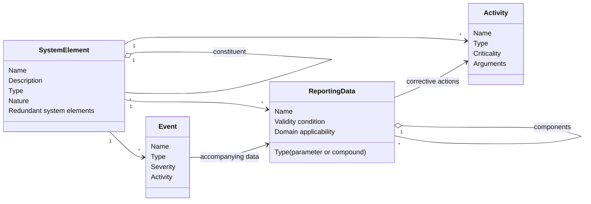
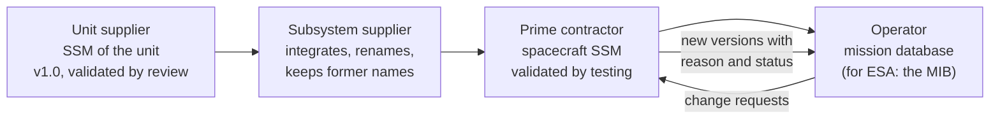
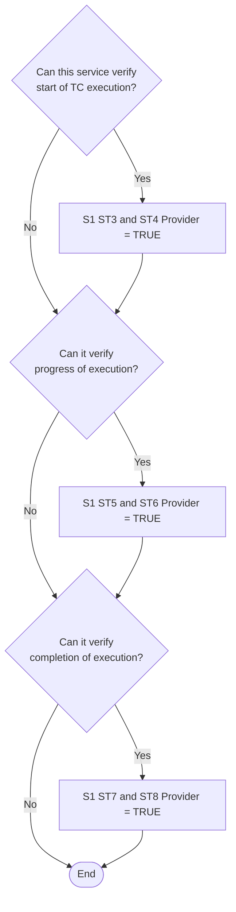
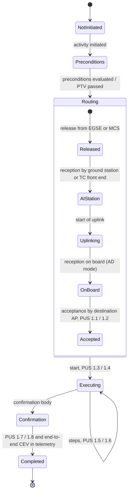

# ECSS-E-ST-70-31C: monitoring and control data definition

**ECSS-E-ST-70-31C** ("Space engineering – Ground systems and operations – Monitoring and control
data definition", 31 July 2008) answers a simple question: when a supplier delivers a product (an
instrument, a subsystem, a whole spacecraft), what data must come with it so that the customer can
integrate, test and operate it? The standard calls that data the **space system model** (SSM). It
specifies *what* data is delivered, not *how* (spreadsheet, XML or anything else is out of scope),
and it assumes missions that follow [ECSS-E-ST-50](e-st-50-communications.md), [ECSS-E-ST-70](e-st-70c.md), the [PUS](pus/index.md)
(ECSS-E-ST-70-41) and the procedure language standard [ECSS-E-ST-70-32](e-st-70-32c.md).[^scope][^intro] Formally the
data is part of the user manual of the product.[^intro]

In ESA practice the same knowledge ends up in a mission's [Mission Information Base](../mib/index.md)
(MIB), the set of ASCII tables imported by [SCOS-2000](../scos2000/index.md).[^icd-norm] This page explains the
standard in full and then compares it, concept by concept, with the SCOS-2000 Database Import ICD and
with the real [Solar Orbiter MIB](../missions/solar-orbiter/mib.md).

!!! info "At a glance"
    | Item | Value |
    |---|---|
    | Issue | ECSS-E-ST-70-31C, 31 July 2008 (first issue ECSS-E-70-31A, 9 October 2007; B never issued)[^cl] |
    | Normative references | ECSS-E-ST-50, -70, -70-01 (on-board control procedures), -70-11 (operability), -70-32 (PLUTO), -70-41 (PUS)[^refs] |
    | Core concepts | System elements, reporting data (parameters and compound parameters), activities, events |
    | Languages | Activity Call, EXPL, IFL, SPEL, VAL, PLUTO, all specified with railroad diagrams and ISO EBNF |
    | Size | Clause 6 has 111 data requirement tables; Annex A gives tailoring flowcharts and packet layouts for 16 PUS services |

## The space system model

### Products, system elements and views

Throughout a project, suppliers deliver products: hardware, software or both, with the documentation
needed over the whole life cycle. To make that knowledge shareable and reusable, the standard requires
it to be organised as a space system model that mirrors the functional breakdown of the space system:
system, subsystem, set, equipment or software product, assembly, and part (hardware) or module
(software). Each level is a **system element** (SE), a data structure whose properties capture the
knowledge.[^ssm]

Each system element carries three kinds of monitoring and control knowledge:[^ssm-mc]

* **Activities**: monitoring and control functions implemented in the EGSE or mission control system
  (EMCS). An activity can be a telecommand to the space or ground segment, a procedure, an operating
  system command (print, e-mail, FTP) or any implementation-specific command, for example to a special
  check-out system or a ground station.
* **Reporting data**: information a system element provides, whatever it is used for. It may be a
  measurement of the element's state or a product meant for another element (for example manoeuvre
  parameters from flight dynamics). A **parameter** is the lowest level of elementary information with a
  meaning for monitoring and control; a **compound parameter** is a record of parameters, arrays and
  sub-records interpreted together, such as a complete anomaly report.
* **Events**: occurrences of a condition of operational significance, used to trigger functions (for
  example acquisition of signal starting telemetry processing at a station).

The model consists of **entity types** (such as system element) and **value types** (such as APID).
Every actor has its own view: one or more root system elements and the part of the hierarchy below them
that interests it, so that a payload manufacturer only sees its payload and its EGSE.[^views] The same
activity keeps its name and description whether it is implemented as a simulated command in testing or as
a procedure in operations.[^views] For a given product the model is **tailored**: a subset of the entity
and value types is selected and product-specific types are added (a 1553 bus protocol, mission-specific
PUS services, an antenna controller's proprietary protocol).[^tailor]



*The SSM entity types and their main relationships, drawn from clauses 4, 6.5, 6.6, 6.7 and 6.8. The
diagram form is this wiki's.*[^ssm-mc][^se-data][^rd-data][^act-data][^ev-data]

The standard's own example is an attitude and orbit control subsystem decomposed into electronics, star
trackers, reaction wheels, a sun sensor and a propulsion system, with activities such as "Switch On",
events such as "Switch On Failure" and reporting data such as wheel speed or tank pressure attached at the
appropriate level.[^ssm]

### Naming

Because suppliers work in parallel, names that are unique for one supplier may clash at a higher level of
integration. The standard therefore uses **relative names** (one or more words of letters and digits,
separated by spaces, such as "Star Tracker") made unique where needed by a **reference path** after the
keyword "of" ("X Thruster of Branch 1", "temperature of XGyro"). Names are case-insensitive. The same
scheme names the model itself: "Severity of Event" is the value type Severity of the entity type Event.[^names]

## Conventions and data types

### Data requirement tables

Each entity type is specified as a table of three columns: the value type name, its definition and
constraints, and its data type; "List of" and "Ordered list of" mark lower-level entities with arity above
one. When a row is conditional, the data is *not* provided if the condition is false. Language syntax is
given with railroad diagrams (non-terminals in rectangles, terminals in rounded boxes, branches for options,
return lines for repetitions) and again in ISO/IEC 14977 EBNF in Annex B.[^conv][^rail][^ebnf]

### Simple data types

| Type | Notes | Constant examples from the standard |
|---|---|---|
| Boolean | | `TRUE`, `FALSE` |
| integer | Range mission-dependent; optional engineering units (units per ECSS-E-ST-70-32 Annex B) | `23`, `5 A`, `65536 B` |
| unsigned integer | Decimal or hexadecimal | `2056`, `0x2056`, `0xFFFF` |
| real | Range and precision mission-dependent | `123`, `56e12`, `0.1` |
| bit string | | `0b11001` |
| octet string | | `0x12AB` |
| character string | Escape `\"` and `\\` | `"This is a string."` |
| absolute time | Calendar or day-of-year form, optional `Z` | `2001-08-18T21:07:43.137468Z`, `2001-033T13:21:32.226` |
| relative time | Several forms | `30 h 10 min`, `200 s`, `-0:00:10:00` |

Source: §5.5.2.1.[^simple1][^simple2][^simple3]

**PUS types.** Two further families come from the PUS. Service type and subtype: standard service types
0–127 and mission-specific 128–255; standard subtypes 0–127, mission-specific subtypes 128–255 within a
standard service, or 0–255 within a mission-specific service.[^pus-svc] And the **parameter code**
(PC) = parameter type code (PTC) + parameter format code (PFC):[^pus-ptc]

| PTC | Data type | PFC range |
|---|---|---|
| 1 | Boolean | 0 |
| 2 | Enumerated | 1–16, 24, 32 |
| 3 | Unsigned integer | 0–16 |
| 4 | Signed integer | 0–16 |
| 5 | Real | 1–4 |
| 6 | Bit-string | 0 to any |
| 7 | Octet-string | 0 to any |
| 8 | Character-string | 0 to any |
| 9 | Absolute time | 0–18 |
| 10 | Relative time | 0–16 |
| 11 | Deduced | 0 |

There is a subtle shift of meaning: in the PUS the PFC defines the *size* of the encoded value, whereas
here it expresses the *range* of values (PTC 3 PFC 0 is an integer from 0 to 15; PTC 8 PFC 12 a fixed
12-character string). PTC 11 is not used, because every deduced parameter is instantiated as one of the
other types. Booleans are 0 (false) and 1 (true) in packets.[^pus-ptc][^pus-ptc2] The SCOS-2000 view of the
same codes is on [MIB parameter types](../mib/parameter-types.md) and [PUS parameter types](pus/parameter-types.md).

**User-defined enumerated types.** A user can define an enumerated set by name and list of values. When
the values are sampled in packets, each element gets a raw correspondence: one raw value (PTC 2) for a
one-to-one mapping, or, for many-to-one mappings, a raw type (PTC 3, 4 or 5) with a list of raw intervals
per element, plus a default raw value for encoding telecommand arguments. The standard's examples are a
battery charge status (trickle 0, full 1, discharge 2) and a filter wheel readout where raw 5–6 means
"red", 7–8 "green" and 0–4 or 13–15 "non-operational".[^enum1][^enum2]

**Value type sets and value type data types** let a data item take any populated value of another item
(for example "ID of system element of Type application process", the set of all APIDs) or inherit its type
("same as Data Type of current parameter").[^vts]

### The languages

Complex data items are strings in one of six languages.[^complex]

| Language | Used for | Specified in |
|---|---|---|
| Activity Call | Instantiating an activity with argument values or a predefined value set and directives (MAP ID, AD or BD mode, requested verification reports); corrective actions | ECSS-E-ST-70-32 Annex A.3.9.28 |
| EXPL (expression language) | Validity, selection and pre/post-conditions | Annex B.5 |
| IFL (interpretation function language) | Raw-to-engineering interpretation and the reverse | Annex B.6 |
| SPEL (synthetic parameter expression language) | Synthetic parameters | Annex B.7 |
| VAL (value language) | Default values and value sets | Annex B.9 |
| PLUTO | Procedures | ECSS-E-ST-70-32 (see [PLUTO](e-st-70-32c.md)) |

Sources: §6.2.2 to §6.2.7 and Annex B.[^lang1][^lang2][^lang3]

EXPL, IFL and SPEL share an expression grammar: Boolean operators AND, OR, XOR and NOT; relational
comparisons, `between ... and ...` and `in (...)`; `+ - * /` and `**`; functions from ECSS-E-ST-70-32
Annex C; constants with units; and, in IFL, the keyword `raw value`. The requirements behind them insist on
engineering units on constants, free mixing of compatible units and automatic unit conversion.[^expl][^ifl][^lang1]

!!! note "A glitch in the prose"
    The prose under the railroad diagrams of B.5, B.6 and B.7 lists the relational operators as
    "AND, OR, XOR" (a copy of the Boolean operator list). The EBNF of B.7.3 gives the intended set:
    `=`, `!=`, `<`, `>`, `<=`, `>=`.[^expl][^spel-ebnf2]

**SPEL** adds what a synthetic parameter needs (requirements 6.2.6): a **trigger** (on update of a
reporting data, meaning a new sample rather than a changed value, or on an event, or any combination); a
**declaration** of typed local variables and **persistent** variables that keep their value between
evaluations; `if ... then ... else` and `in case ... is ... or is ... otherwise` flow control; a context
statement (`in the context of ... do ... end context`); property requests (`get Raw Value of ...`; a bare
parameter name means its engineering value); bit functions `bitand`, `bitor`, `bitxor`, `bitnot`, `bitshl`,
`bitshr`; and an assignment of the result with `set ... with ... end with`. The result is an engineering value
that needs no further calibration.[^spel-req][^spel1][^spel2][^spel-bits][^spel-ebnf2][^spel-ebnf3]

```text
synthetic parameter
  trigger
    on update of Bus Voltage of PCDU or on update of Bus Current of PCDU
  end trigger
  declare
    variable Power of type real with units W described by "instantaneous bus power",
    persistent Peak of type real with units W set to 0 W described by "highest power so far"
  end declare
  main
    Power := Bus Voltage of PCDU * Bus Current of PCDU;
    if Power > Peak then
      Peak := Power;
    end if;
    set engineering value with Power end with;
  end main
end synthetic parameter
```

*An illustrative SPEL definition written by this wiki to the EBNF of Annex B.7.3; the parameter names are
invented. It is not taken from any mission.*[^spel-ebnf2][^spel-ebnf3]

**VAL** writes simple values, records (`record ... end record`) and arrays (`array ... end array`), each
optionally named after the component it fills, with constants, activity calls, reporting data references or
system element references as values.[^val]

## Data exchange and the data life cycle

### Exchange rules

The supplier delivers a subset of the model plus product-specific types; the **product data schema** must
be specified, machine-processable and lossless on re-import. The formal languages above should be used,
and any other language must be specified in EBNF. The electronic database is under configuration management
and is identified by a configuration item ID, a version number, a generation date, a supplier ID and the list
of digital files, each with type and checksum; each file is uniquely identified and compressed with a
standard tool.[^exch1][^exch2]

### Product configuration data

Each delivered product is described as either a **specification** (a theoretical product) or a
**realization** (a real one), and typed as a developed hardware configuration item (CI ID, part, serial and
lot numbers, model such as EM, STM or FM, manufacturer), a developed software CI (software identifier,
version, release date), a COTS or standard product, or a non-CI product.[^prod1][^prod2]

**Versioning.** A system element gets a new version when any of its properties change or when any of its
activities, reporting data, events or constituent elements are created or deleted; activities, reporting data
and events get a new version when any of their properties change (for reporting data, also when
sub-components appear or disappear). Every version records number, date, originator, reason and a
validation status: not validated, validated by review, by simulation or by testing. The same data is kept
for every constituent product, so that knowledge supplied at lower levels or earlier phases stays
traceable.[^ver1][^ver2]

### Population rules

| Rule (6.4) | Content |
|---|---|
| Language and case | All data in English, case-insensitive except engineering units |
| Renaming | If an object is renamed during integration, its former names are retained |
| Consistency | The data agrees with the product documentation (ICD, user manual) |
| Uniqueness | Object names unique within a delivery |
| Life-limited items | Accumulated operational cycles or life provided with each delivery |
| Sub-suppliers | Provide enough to populate everything the customer needs |
| Domains | Domain-specific data (Software, AIV, Operations) identified as such |
| Validation | All data validated (review, simulators, real hardware); for operations, with real hardware wherever possible |

"Fully populated" is defined precisely. For **reporting data** it means: everything in the documentation,
including dumpable software tables and memory; redundancy links between items conveying the same
information; all interpretation functions with their applicability conditions; validity conditions; ground
monitoring checks for all reporting data (except those that can take any value); status consistency checks
where values depend on activities or events; and corrective actions for violations. For **activities**:
everything in the documentation, all atomic activities, arguments in engineering values with their
de-interpretation, pre- and post-conditions, verification conditions for start, progress and completion
deduced from low-level telemetry *whether or not* the PUS verification service is used, redundant and
reverse links, criticality, corrective actions, execution profile and resources. For **events**: all events
and their corrective actions.[^pop1][^pop2][^pop3]



*The data definition life cycle implied by clauses 6.3 and 6.4. The arrows and roles are this wiki's
summary.*[^ver1][^pop1]

## System element data

Every system element has a name unique within the product, a description, a type and a nature
(specification or realization), references to the sub-product elements integrated into it, and its
redundant elements. The type list is long: system, subsystem, set, equipment, software product, assembly,
part, module, element, facility (ground), application process, MAP, VC, any service, function, memory block,
memory sub-block, store, CPDU, On/Off device, register load device and sensor.[^se-data] Elements that send
telecommands or receive telemetry get a PUS source or destination ID; life-limited elements get maximum
cycles and duration plus the record of operations.[^se-data2]

| Element type | Data required (paraphrased) |
|---|---|
| System (6.5.3) | ID; ground or space segment; for PUS systems: PFC of the Source ID field and list of TC sources, whether CPDU telecommands have a data field header, maximum TC packet length; PFC of the Destination ID and list of destinations, whether the spacecraft time packet has a data field header, maximum TM packet length |
| Application process (6.5.4) | APID (PTC 2 PFC 11, unique in the system); service accesses (commanding path, monitoring path, memory and store management, store access, event report access) with the elements concerned; word length (8, 16, 24, 32 or 64 bits) for padding; PFCs of the length fields of variable bit, octet and character strings; TC checksum type (ISO or CRC); PFC of the TM time field; whether there is a packet sub-counter; TM checksum type |
| Service (6.5.5) | Tailoring variables, packet field data types and service-specific configuration, per application process (below) |
| MAP (6.5.6) | ID 0–63; mission-specific priority; reachable application processes; whether it is the default MAP for an AP |
| VC (6.5.7) | ID; downlink or uplink; packets (AP, service type and subtype) carried |
| Function (6.5.8) | Function ID (PTC 8, unique within a service implementation); ordered arguments with ID (the PUS Parameter#), type, arity and default |
| Memory block (6.5.9) | Memory ID (PTC 7, unique in the system); read-only or read/write; smallest addressable unit (1, 2, 3, 4 or 8 octets); addressing technique (base plus offset, symbolic reference plus offset, absolute); size |
| Memory sub-block (6.5.10) | Symbolic base reference; offset; size; access; reload or patch; content type (object code, dynamic data, data pool, static data); mapped reporting data |
| Store (6.5.11) | Store ID; circular or bounded; capacity |
| CPDU (6.5.12) | Output lines (name, number PTC 2 PFC 8, description); pulse duration unit 10–15 ms; maximum instructions per packet 12–120 |
| On/Off device (6.5.13) | Hardware addresses with the element and ON or OFF type |
| Register load device (6.5.14) | Address; independently commandable components with the reporting data echoing each one |
| Sensor (6.5.15) | Bi-level, analogue SE or DE, relay, thermistor; address (e.g. RTU); connector |

Sources: §6.5.3 to §6.5.15.[^sys][^ap1][^ap2][^map-vc][^func][^mem][^cpdu][^dev]

### Service data and PUS tailoring

For each standard PUS service an application process hosts, the supplier provides three things: the
**tailoring variables** (Booleans stating which capabilities are implemented), the **data types of the
packet fields** (the PFC of each field that the tailoring leaves present) and the **service-specific
configuration data** the ground needs to model the service.[^svc-intro] Annex A gives, for each service, a
short summary of the PUS service model, a yes/no flowchart whose "yes" branches set tailoring variables, and
the packet layouts with semantics, field names, data types and presence conditions.[^annexA1][^annexA2]

Telecommand verification is the simplest. Three tailoring variables say whether the service verifies start
(`S1 ST3 and ST4 Provider`), progress (`S1 ST5 and ST6 Provider`) and completion (`S1 ST7 and ST8
Provider`); the field types are the PFCs of the Code and (if progress is verified) Step Number fields; and the
service data is the list of command failure codes valid for all commands, with the stages they apply to and
the parameters that accompany them (codes 0 to 5 have a special meaning in the PUS).[^s1]



*Tailoring choices for the telecommand verification service (Annex A, figure A-2).*[^annexA2]

Housekeeping and diagnostic reporting shows how far this goes: some thirty tailoring variables (whether
housekeeping and diagnostic reports exist, whether report control, parameter definition reports, sampling
time offset reports and filtered mode exist, whether collection intervals, timeouts and thresholds have
defaults...), fourteen field types (SID, collection interval, NPAR1, NFA, NREP, NPAR2, Parameter#, NSID, time
offset, timeout, N, threshold type, threshold, mode), service data such as the minimum sampling interval and
the absolute and relative sampling accuracies (PUS mission constants `<DIAG_MIN_INTERV>`,
`<PARAM_ABS_SAMPL_TIME>`, `<PARAM_REL_SAMPL_TIME>`), and per report a definition with SID, ordered
components and their time offsets, whether it is predefined on board, collection interval and filtered
parameters.[^s3a][^s3b][^s3c][^s3d]

The services covered follow the service list of the 2003 PUS (ECSS-E-70-41A), with this page linking to the
current ECSS-E-ST-70-41C pages:[^annexA-toc][^svc-all]

| 70-31C Annex | Service (2003 name) | Current page |
|---|---|---|
| A.2 | Telecommand verification | [ST[01]](pus/st01-request-verification.md) |
| A.3 | Device command distribution | [ST[02]](pus/st02-device-access.md) |
| A.4 | Housekeeping and diagnostic data reporting | [ST[03]](pus/st03-housekeeping.md) |
| A.5 | Parameter statistics reporting | [ST[04]](pus/st04-parameter-statistics.md) |
| A.6 | Event reporting | [ST[05]](pus/st05-event-reporting.md) |
| A.7 | Memory management | [ST[06]](pus/st06-memory-management.md) |
| A.8 | Function management | [ST[08]](pus/st08-function-management.md) |
| A.9 | Time management | [ST[09]](pus/st09-time-management.md) |
| A.10 | On-board operations scheduling | [ST[11]](pus/st11-time-based-scheduling.md) |
| A.11 | On-board monitoring | [ST[12]](pus/st12-onboard-monitoring.md) |
| A.12 | Large data transfer | [ST[13]](pus/st13-large-packet-transfer.md) |
| A.13 | Packet forwarding control | [ST[14]](pus/st14-real-time-forwarding-control.md) |
| A.14 | On-board storage and retrieval | [ST[15]](pus/st15-onboard-storage-retrieval.md) |
| A.15 | Test | [ST[17]](pus/st17-test.md) |
| A.16 | On-board operations procedure | [ST[18]](pus/st18-onboard-operations-procedure.md) |
| A.17 | Event/action | [ST[19]](pus/st19-event-action.md) |

## Reporting data

### Generic data

Every reporting data item names its system element and itself (relative name), describes its purpose, says
whether it is a parameter or a compound parameter, lists the domains (AIV, Operations, Software) where it
applies, gives per domain a **validity condition** (an EXPL Boolean expression saying when its
interpretation is meaningful), traces back to the sub-product item it came from, and lists redundant
reporting data conveying the same information (the standard's example is two boom release sensors).[^rd-data]

### Parameters and interpretation

A parameter has the data type of its engineering value; if it is referenced inside packets it has a
**Parameter Number** (the PUS "Parameter#", never 0, assigned system-wide). If the transported value can be
taken directly as the engineering value, only the PFC of the raw value is given. Otherwise an interpretation
is defined: the PTC and PFC of the raw value, and per domain an **ordered list of interpretation functions**,
each with an EXPL selection condition; the first function whose condition is true applies. A function is
either a **linear interpolation** between calibration points (raw, engineering), with an extrapolation flag
("extrapolate" from the last two points or declare "invalid" outside the range), or an **IFL** script. For
every interpretation a raw value must give a unique engineering value.[^param1][^param2][^param3]

### Compound and synthetic reporting data

A compound parameter is a **record** (ordered components, each with a sampling time offset when in a
packet), an **array** (fixed or variable, minimum and maximum repetitions, components, time offset of the
first element, delta time between elements, PFC of the repetition counter of a variable array) or a
**deduced structure** (a list of alternative component lists, each selected by an EXPL condition; more than
one can be true).[^comp1][^comp2] Reporting data computed in the EMCS is **synthetic** and carries a SPEL
script, which can set one or several components of a compound parameter.[^synth]

### Checks

| Check (6.6.6) | Data | Selection |
|---|---|---|
| Limit | Upper and lower **danger** limits and upper and lower **warning** limits, each with its own corrective activity (independent of the previous check state) | Ordered list of limit sets, each with an EXPL validity condition (for example mission phase or unit status); first true applies; per domain |
| Delta | Maximum delta (failure if exceeded) and minimum delta (failure if not exceeded) between successive values, each with an activity | Ordered lists with validity conditions |
| Expected state | List of expected values and a corrective activity | Ordered list with validity conditions |
| Status consistency | Either a telecommand activity and argument whose last uplinked value the parameter must equal (check suspended during the command's execution window; examples "Set Filter Wheel Position" with "Position = UV", or "Switch LCL1 ON" with "LCL1 Status"), or an EXPL expression for a value set autonomously on board or by a mission event (such as entry into eclipse); plus an activity | Per domain |

Sources: tables 6-85 to 6-88.[^chk1][^chk2][^chk3][^chk4]

## Activities

### Definition

An activity names its system element and itself, describes its function, has a type (ground procedure,
on-board procedure, telecommand, operating system command), domain applicability, traceability references,
lists of **redundant** activities (same effect) and **reverse** activities (opposite effect), a
**criticality** taken from ECSS-E-ST-70-11 (non critical, locally critical, mission critical) and an ordered,
flat list of arguments. Each argument has a name, description, type (any simple type, record or activity
call), arity (single value or array, with minimum and maximum repetitions), and a default or fixed value in
VAL. Predefined **argument value sets** can be named and described.[^act-data][^act-data2][^argsets]
[ECSS-E-ST-70-11C](e-st-70-11c.md) gives the meaning of the criticality levels.

### Execution states

Table 6-93 fixes the states an activity passes through and the events marking the transitions, and says which
apply to procedures and which to telecommands. For telecommands the stages are reported through the PUS
telecommand verification service:[^states1][^states2]



*Telecommand execution states after table 6-93. The PTV applies to the telecommand itself, not to commands
it contains (for example those inside a schedule load); whether station and on-board reception events are
reported depends on the ground system and the on-board design.*[^states1][^states2]

For each activity the supplier gives an **execution profile** (expected, minimum and maximum duration;
earliest and latest start after initiation; resources used and quantities), the steps it consists of (each
with its own profile and states, steps within steps for procedures, PUS 1.5/1.6 for telecommand steps), and
the failure activities to run if completion fails.[^profile][^steps][^fail]

### Telecommands

| Data (6.7.4) | Content |
|---|---|
| Telecommand data | PUS service type and subtype; default application process; whether it may be sent as a high-priority command and, if so, the MAP forced for the uplink (CPDU commands are the example) |
| Array arguments | PFC of the repetition number |
| Non-interpreted arguments | PFC of the encoded format |
| Interpreted arguments | PTC and PFC of the encoded format; per domain an ordered list of de-interpretation functions with selection conditions; each a linear interpolation (values outside the engineering range are invalid) or an IFL script; a unique raw value per engineering value |
| Property arguments | PFC for arguments that are system element or reporting data properties (such as an APID) |
| Execution check data | Per domain PTV conditions; whether start, progress and completion can be verified with PUS service 1; a start verification condition and a CEV (command execution verification) condition from low-level telemetry, even when service 1 is used; start failure activities; command-specific failure codes (not those reserved by the PUS or defined service-wide) with their parameter components |
| Step check data | Per step: number, verification condition, failure activity |

Sources: §6.7.4.[^tc1][^tc2][^tc3][^tc4] The CEV can range from one measurement to comparing every
transmitted argument with an "echo" parameter, or comparing a memory dump with the load image.[^tc4]

### Procedures

Procedures are initiated explicitly (foreground) or run permanently (background) and have earliest and latest
validity dates. A ground procedure is a PLUTO script with a default automatic or manual execution mode; an
on-board procedure is an [ECSS-E-ST-70-01](e-st-70-01c.md) script with a preloaded flag and a high, medium or low priority for
conflicts.[^proc]

## Events

An event names its system element and itself, has a description, a type (anomaly report, progress report,
information, software error, scheduling event...), domain applicability, references, a **severity** (normal,
low, medium, high, with a pointer to the PUS event reporting service), the reporting data accompanying it with
their time offsets from the event time, and per domain the activity to run when it occurs.[^ev-data]

## How the SCOS-2000 MIB realises the model

The MIB is not an implementation of ECSS-E-ST-70-31C: SCOS-2000's Database Import ICD descends from the PSS
era (it still cites ESA PSS-07-101, the 1994 PUS, next to ECSS-E-70-41A) and defines flat, normalised ASCII
tables keyed by 8-character names.[^icd-rd][^icd-rd20][^icd-norm] Yet almost every concept of the standard has a counterpart. The table below
compares them; the third column says where the MIB is narrower.

| ECSS-E-ST-70-31C concept | SCOS-2000 MIB realisation | Difference |
|---|---|---|
| Electronic database identification (table 6-1) | [`vdf`](../mib/tables/vdf.md): `VDF_NAME`, comment, domain, release, issue | No file list or checksums in the table |
| Relative names with reference paths | Unique alphanumeric names, typically 8 characters, case-insensitively unique, no spaces recommended; descriptions `PCF_DESCR` (24) and `CCF_DESCR` (24) / `CCF_DESCR2` (64) | Flat namespace; hierarchy only through naming conventions and groups |
| System element hierarchy | No table; `PCF_SUBSYS` (future extension), `CCF_SUBSYS` (numeric subsystem 1–255), monitoring groups [`grp`](../mib/tables/grp.md) | No SE entity |
| Parameter (reporting data) | [`pcf`](../mib/tables/pcf.md) row | |
| Data type of engineering value; raw PTC/PFC | `PCF_PTC`, `PCF_PFC`; `PCF_CATEG` N (numerical), S (status), T (text) | PTC/PFC give size, as in the PUS |
| Parameter Number (Parameter#) | `PCF_PID`, unique on-board ID | |
| Validity condition (EXPL) | `PCF_VALID` = `PCF_VALPAR`: one integer parameter compared with one raw value; plus automatic expiry when a periodic packet stops | No general expressions |
| Ordered interpretation functions with selection conditions | `PCF_CURTX` (single) or [`cur`](../mib/tables/cur.md): `CUR_POS` order, `CUR_RLCHK` = `CUR_VALPAR`, `CUR_SELECT`; first true applies | Conditions limited to parameter = value |
| Linear interpolation with extrapolate/invalid | [`caf`](../mib/tables/caf.md) / [`cap`](../mib/tables/cap.md); `CAF_INTER` P (extrapolate) or F (invalid); `PCF_INTER` is ignored | Extrapolation is per calibration, not per parameter |
| IFL script | [`mcf`](../mib/tables/mcf.md) polynomial and [`lgf`](../mib/tables/lgf.md) logarithmic calibrations | Fixed formula families instead of a language |
| User-defined enumerated type with raw intervals | [`txf`](../mib/tables/txf.md) / [`txp`](../mib/tables/txp.md): `TXP_FROM`..`TXP_TO` mapped to `TXP_ALTXT` | Equivalent |
| Record, array, deduced structure | Packet layouts: [`plf`](../mib/tables/plf.md) (fixed), [`vpd`](../mib/tables/vpd.md) (variable, with repeat counters); deduced parameters (`PCF_PTC` 11) with `PCF_RELATED` | Deduced *structures* not supported; variable packets excluded from full processing |
| Synthetic reporting data (SPEL) | `PCF_NATUR` D (dynamic OL), P (SPEL), H (hard-coded), S (saved); one expression file per parameter | SPEL only in the EGSE delivery of SCOS-2000 |
| Limit check: warning and danger, ordered sets with validity conditions | [`ocf`](../mib/tables/ocf.md) / [`ocp`](../mib/tables/ocp.md): `OCP_TYPE` S (soft) and H (hard), `OCP_POS` order, `OCP_RLCHK` = `OCP_VALPAR`; `OCF_NBCHCK` consecutive violations | No per-limit corrective activity; type E checks raise SCOS-2000 events that can trigger system actions |
| Delta check | `OCP_TYPE` D | Single min/max delta pair |
| Expected state check | Status checks: soft/hard `ocp` entries listing allowed values for status parameters | |
| Status consistency check | `PCF_USCON` = Y plus `OCP_TYPE` C; reference value maintained from commanding; [`cve`](../mib/tables/cve.md) marks affected parameters | Limited number of parameters (snapshot packet size) |
| Activity of type telecommand | [`ccf`](../mib/tables/ccf.md): `CCF_TYPE`, `CCF_STYPE`, `CCF_APID` | |
| High priority and forced MAP | `CCF_HIPRI`, `CCF_MAPID` | Equivalent |
| Criticality (three levels) | `CCF_CRITICAL` Y/N ("hazardous"), extra protection mission-specific | Two levels |
| Arguments, defaults, fixed values, arrays | [`cdf`](../mib/tables/cdf.md) (editable or fixed elements, `CDF_GRPSIZE` repeaters), [`cpc`](../mib/tables/cpc.md) (`CPC_DEFVAL`) | |
| Argument value sets | [`pst`](../mib/tables/pst.md), [`psv`](../mib/tables/psv.md), [`cps`](../mib/tables/cps.md), [`pvs`](../mib/tables/pvs.md), [`psm`](../mib/tables/psm.md); `CCF_DEFSET` | Equivalent |
| De-interpretation functions | [`cca`](../mib/tables/cca.md)/[`ccs`](../mib/tables/ccs.md) numerical, [`paf`](../mib/tables/paf.md)/[`pas`](../mib/tables/pas.md) textual, referenced by `CPC_CCAREF` or `CPC_PAFREF`; range checks [`prf`](../mib/tables/prf.md)/[`prv`](../mib/tables/prv.md) | One de-calibration per command parameter, no selection conditions |
| PTV condition | [`ptv`](../mib/tables/ptv.md): parameter = value pairs, implicitly ANDed, validity checked | No general expressions |
| Execution states and verification | `CCF_ILSTAGE` stages R (ground station), U (uplink), O (on-board reception), A (acceptance), C (completion); [`cvs`](../mib/tables/cvs.md) `CVS_TYPE` A, S, 0–9, C with `CVS_SOURCE` R (PUS reports) or V (parameter checks); [`cvp`](../mib/tables/cvp.md) profiles | Report-based progress only for step 0; failure codes ignored by the verifier |
| CEV condition | `cve` expressions, ANDed per stage | |
| Execution profile | `CVS_START` and `CVS_INTERVAL` (verification window), `CVS_UNCERTAINTY` | No durations or resources |
| Procedures | Command sequences [`csf`](../mib/tables/csf.md), [`css`](../mib/tables/css.md), [`sdf`](../mib/tables/sdf.md), [`csp`](../mib/tables/csp.md) | Not PLUTO; on-board procedures not modelled |
| Event with severity | `PID_EVENT` (N, I info, W warning, A alarm) and `PID_EVID` generate SCOS-2000 events when a packet arrives | Severity is attached to the packet type |
| Service tailoring data | Packet headers [`tcp`](../mib/tables/tcp.md)/[`pcdf`](../mib/tables/pcdf.md)/[`pcpc`](../mib/tables/pcpc.md), TM packet attributes in [`pid`](../mib/tables/pid.md) and [`tpcf`](../mib/tables/tpcf.md) | No tailoring variables; services are handled by fixed or mission-specific code |

Sources: ICD 7.0 clauses 1.3.1, 3.1 to 3.3 and Appendix C on PUS support.[^icd-def][^icd-norm][^icd-vdf][^icd-cpc][^icd-pcf1][^icd-pcf2][^icd-pcf3][^icd-pcf4][^icd-cur][^icd-caf][^icd-txp][^icd-ocf][^icd-ocp][^icd-ccf1][^icd-ccf2][^icd-ccf3][^icd-ptv][^icd-cvs][^icd-cve][^icd-spel][^icd-pid][^icd-pus1][^icd-pus2]

!!! warning "Inference"
    The rows "System element hierarchy", "Procedures" and "Service tailoring data" compare concepts the ICD
    never relates to ECSS-E-ST-70-31C; the pairing is this wiki's. The ICD does not cite ECSS-E-ST-70-31C at
    all.

The ICD also documents what SCOS-2000 does with the PUS services that 70-31C asks suppliers to describe. For
example, service 1 reports are matched to commands by the 4 echoed header octets and only the subtype (not
the failure code) drives verification; housekeeping packets must be defined in the database before they are
enabled on board, with fixed time offsets and collection intervals; service 11 has a ground model of the
on-board schedule built around the Rosetta packet structure; services 4 and 12 reports are variable packets
and so excluded from full processing.[^icd-pus1][^icd-pus2][^icd-pus3]

### What the Solar Orbiter MIB shows

The release of 16 September 2025 (`VDF_NAME` 25925PFM, comment "20250916-CSW3.1.2_MAS7.33") gives a measure of
how much of the model a real mission populates:[^mib]

| Model concept | MIB measure (2025 release) | 2020 release |
|---|---|---|
| Parameters | 126 745 `pcf` rows: 125 161 raw (R), 1 582 dynamic OL synthetic (D), 2 saved synthetic (S), no SPEL (P) | 102 104: 101 714 R, 354 D, 36 hard-coded (H) |
| Parameter Number | 19 803 parameters with `PCF_PID` | |
| Validity condition | 20 692 parameters with `PCF_VALID` | 8 369 |
| Conditional interpretation | 1 974 `cur` rows for 907 parameters | 723 parameters |
| Limit and status checks | 5 338 `ocf` rows (3 199 on calibrated values, 2 139 on raw); 7 369 `ocp` rows: 3 096 soft (S), 4 153 hard (H), 105 delta (D), 15 status consistency (C) | |
| Checks with applicability conditions | 859 `ocp` rows on 563 parameters | |
| Telecommands | 5 454 `ccf` rows, 130 high priority, none flagged critical (`CCF_CRITICAL` 'N' in 5 448 rows, empty in 6) | 5 238, 130 high priority, 79 flagged critical (`CCF_CRITICAL` = 'Y') |
| Verification | 206 stages: 16 acceptance by report, 23 completion by report, 167 completion by parameter check; 10 697 `cvp` links for 5 393 commands | |
| Static PTV | 5 `ptv` rows | |
| Events | Severities in `pid`: TM(5,1) informative reports raise I, TM(5,2) W, TM(5,3) and TM(5,4) A; TM(1,2) and TM(1,8) failure reports also raise A | TM(5,x): 893, 876, 2 189, 1 695 packets |

Two examples show the standard's ideas in MIB form. Parameter
[`NIXD0058`](../explorer/index.md#/solo/param/NIXD0058) (HK_DET_C, mA) has five soft limit sets selected by the
status parameter [`NIXS0002`](../explorer/index.md#/solo/param/NIXS0002) ("DPU_DET_C criter", values
NOT_POWERED, 1Q, 2Q, 3Q, 4Q) and an unconditional hard limit: an ordered list of limit sets with validity
conditions, exactly as in table 6-85. Parameter [`NCAB0EP0`](../explorer/index.md#/solo/param/NCAB0EP0) ("CPS A
TLV LCL Cur", A) uses calibration `CPWP3005TM` when `NPWZ0000` (PCDU_MODEL) is 10 and `CPWP8005TM` when it is 11:
an ordered list of interpretation functions with selection conditions, as in table 6-77.[^mib]

??? example "SQL used"
    All queries ran with `sqlite3 -readonly` on `solo-2025-09-16.sqlite` (release
    MIB__20250916M25925PFMS001_SOL) and, for the last column, on `solo-2020-04-16.sqlite`
    (MIB__20200416M10720PFMS001_SOL). In this database `cvs` and `cvp` have generic column names: for `cvs`,
    `COL2` is `CVS_TYPE` and `COL3` is `CVS_SOURCE`; for `cvp`, `COL1` is `CVP_TASK`.

    ```sql
    SELECT * FROM vdf;
    SELECT PCF_NATUR, count(*) FROM pcf GROUP BY 1;
    SELECT count(*) FROM pcf WHERE PCF_PID <> '';
    SELECT count(*) FROM pcf WHERE PCF_VALID <> '';
    SELECT count(*), count(DISTINCT CUR_PNAME) FROM cur;
    SELECT OCF_INTER, count(*) FROM ocf GROUP BY 1;
    SELECT OCP_TYPE, count(*) FROM ocp GROUP BY 1;
    SELECT count(*), count(DISTINCT OCP_NAME) FROM ocp WHERE OCP_RLCHK <> '';
    SELECT count(*), sum(CCF_HIPRI = 'Y'), sum(CCF_CRITICAL = 'Y') FROM ccf;
    SELECT COL2, COL3, count(*) FROM cvs GROUP BY 1, 2;
    SELECT count(*), count(DISTINCT COL1) FROM cvp;
    SELECT * FROM ptv;
    SELECT PID_TYPE, PID_STYPE, PID_EVENT, count(*) FROM pid
      WHERE PID_EVENT IN ('A','W','I') GROUP BY 1, 2, 3;
    -- examples
    SELECT * FROM ocp WHERE OCP_NAME = 'NIXD0058';
    SELECT * FROM txp WHERE TXP_NUMBR = 'CIXTS002TM';
    SELECT * FROM cur WHERE CUR_PNAME = 'NCAB0EP0';
    SELECT PCF_NAME, PCF_DESCR, PCF_UNIT FROM pcf
      WHERE PCF_NAME IN ('NIXD0058','NIXS0002','NCAB0EP0','NPWZ0000');
    ```

## Why the standard matters

ECSS-E-ST-70-31C is the reason a supplier's database can be specified contractually: it lists what "complete"
means for every parameter, command and event, and it makes ground-side knowledge such as calibration, checks,
verification conditions and corrective actions part of the delivery rather than something the operator
reconstructs from documents. Its companion requirements in [ECSS-E-ST-70-11C](e-st-70-11c.md) (for example
that every packet carries what is needed to calibrate and validate its data, or that the same parameter
always has the same interpretation) are what make such a model possible on the spacecraft side.[^pop1][^oper]

!!! warning "Inference"
    The previous paragraph is this wiki's assessment of the standard's role; the standard itself only states
    its purpose (defining the data a supplier provides for monitoring and control).[^intro]

## Related pages

* [The MIB: Mission Information Base](../mib/index.md) and [MIB data model](../mib/data-model.md)
* [Monitoring](../mib/monitoring.md), [calibration](../mib/calibration.md), [monitoring checks](../mib/monitoring-checks.md), [synthetic parameters](../mib/synthetic-parameters.md)
* [Commanding](../mib/commanding.md), [command verification](../mib/command-verification.md), [sequences and parameter sets](../mib/sequences.md)
* [XTCE](../ccsds/xtce.md), the CCSDS exchange format for similar data
* [ECSS-E-ST-70C](e-st-70c.md), the parent standard; [ECSS-E-ST-70-32C (PLUTO)](e-st-70-32c.md); [ECSS-E-ST-70-01C (OBCPs)](e-st-70-01c.md); [ECSS-E-ST-70-11C (operability)](e-st-70-11c.md)
* [Operations preparation: databases, procedures and tools](../scos2000/operations-preparation.md), how missions build these databases in practice (HPSDB, SRDB, ODB)
* [ECSS overview](index.md)

[^scope]: [ECSS-E-ST-70-31C, Monitoring and control data definition](../library/ecss-e-st-70-31c.md), clause 1 "Scope", PDF p. 10.
[^intro]: [ECSS-E-ST-70-31C](../library/ecss-e-st-70-31c.md), Introduction, PDF p. 9.
[^cl]: [ECSS-E-ST-70-31C](../library/ecss-e-st-70-31c.md), Change log, PDF p. 3.
[^refs]: [ECSS-E-ST-70-31C](../library/ecss-e-st-70-31c.md), clause 2 "Normative references", PDF p. 11.
[^ssm]: [ECSS-E-ST-70-31C](../library/ecss-e-st-70-31c.md), §4.1 "The space system model" and figure 4-1, PDF pp. 15–16.
[^ssm-mc]: [ECSS-E-ST-70-31C](../library/ecss-e-st-70-31c.md), §4.2.1 and §4.2.2 "Standard SSM definitions", PDF pp. 16–17.
[^views]: [ECSS-E-ST-70-31C](../library/ecss-e-st-70-31c.md), §4.2.2 (continued) and figure 4-2, PDF p. 18.
[^tailor]: [ECSS-E-ST-70-31C](../library/ecss-e-st-70-31c.md), §4.2.3 "Product-specific SSM tailoring", PDF pp. 18–19.
[^se-data]: [ECSS-E-ST-70-31C](../library/ecss-e-st-70-31c.md), §6.5.1 and §6.5.2.1, table 6-8 "System element data", PDF pp. 49–50.
[^se-data2]: [ECSS-E-ST-70-31C](../library/ecss-e-st-70-31c.md), §6.5.2.2 and §6.5.2.3, tables 6-9 and 6-10, PDF pp. 50–51.
[^rd-data]: [ECSS-E-ST-70-31C](../library/ecss-e-st-70-31c.md), §6.6.1 and §6.6.2, table 6-73 "Reporting data", PDF pp. 99–101.
[^act-data]: [ECSS-E-ST-70-31C](../library/ecss-e-st-70-31c.md), §6.7.1, table 6-89 "Activity definition data", PDF pp. 112–114.
[^ev-data]: [ECSS-E-ST-70-31C](../library/ecss-e-st-70-31c.md), §6.8 "Events", table 6-111, PDF p. 126.
[^names]: [ECSS-E-ST-70-31C](../library/ecss-e-st-70-31c.md), §5.3 "Case sensitivity" and §5.4 "Names", PDF pp. 22–23.
[^conv]: [ECSS-E-ST-70-31C](../library/ecss-e-st-70-31c.md), §5.1 "Data definition" and table 5-1, PDF pp. 20–21.
[^rail]: [ECSS-E-ST-70-31C](../library/ecss-e-st-70-31c.md), §5.2 "Railroad diagrams", PDF pp. 21–22.
[^ebnf]: [ECSS-E-ST-70-31C](../library/ecss-e-st-70-31c.md), Annex B.1 "Conventions" and table B-1, PDF pp. 208–209.
[^simple1]: [ECSS-E-ST-70-31C](../library/ecss-e-st-70-31c.md), §5.5.1 and §5.5.2.1.1 to §5.5.2.1.3, PDF pp. 24–26.
[^simple2]: [ECSS-E-ST-70-31C](../library/ecss-e-st-70-31c.md), §5.5.2.1.4 to §5.5.2.1.7, PDF pp. 27–29.
[^simple3]: [ECSS-E-ST-70-31C](../library/ecss-e-st-70-31c.md), §5.5.2.1.8 and §5.5.2.1.9, PDF pp. 29–30.
[^pus-svc]: [ECSS-E-ST-70-31C](../library/ecss-e-st-70-31c.md), §5.5.2.2.1 "Service data types", PDF pp. 30–31.
[^pus-ptc]: [ECSS-E-ST-70-31C](../library/ecss-e-st-70-31c.md), §5.5.2.2.2 and table 5-2 "PUS data types", PDF pp. 31–32.
[^pus-ptc2]: [ECSS-E-ST-70-31C](../library/ecss-e-st-70-31c.md), §5.5.2.2.2 (constants and note on PTC 11), PDF p. 33.
[^enum1]: [ECSS-E-ST-70-31C](../library/ecss-e-st-70-31c.md), §5.5.2.3.1 and §5.5.2.3.2, tables 5-3 and 5-4, PDF pp. 33–34.
[^enum2]: [ECSS-E-ST-70-31C](../library/ecss-e-st-70-31c.md), §5.5.2.3.2, tables 5-5 to 5-7, PDF pp. 34–35.
[^vts]: [ECSS-E-ST-70-31C](../library/ecss-e-st-70-31c.md), §5.5.2.4 and §5.5.2.5, PDF pp. 36–37.
[^complex]: [ECSS-E-ST-70-31C](../library/ecss-e-st-70-31c.md), §5.5.3 "Complex Data Types", PDF p. 37.
[^lang1]: [ECSS-E-ST-70-31C](../library/ecss-e-st-70-31c.md), §6.2.1 to §6.2.4, PDF pp. 39–41.
[^lang2]: [ECSS-E-ST-70-31C](../library/ecss-e-st-70-31c.md), §6.2.5 to §6.2.7, PDF pp. 41–42.
[^lang3]: [ECSS-E-ST-70-31C](../library/ecss-e-st-70-31c.md), Annex B.4, B.8 and B.9, PDF pp. 218, 236 and 237.
[^expl]: [ECSS-E-ST-70-31C](../library/ecss-e-st-70-31c.md), Annex B.5 "EXPL - Expression Language", PDF pp. 218–220.
[^ifl]: [ECSS-E-ST-70-31C](../library/ecss-e-st-70-31c.md), Annex B.6 "IFL - Interpretation Function Language", PDF pp. 222–223.
[^spel-ebnf2]: [ECSS-E-ST-70-31C](../library/ecss-e-st-70-31c.md), Annex B.7.3 "EBNF Representation" (Relational Operator, Persistent Variable Declaration, Main Body), PDF pp. 232–234.
[^spel-ebnf3]: [ECSS-E-ST-70-31C](../library/ecss-e-st-70-31c.md), Annex B.7.3 (Statement, Synthetic Parameter Assignment Statement, Synthetic Parameter Expression Definition, Trigger Body, Variable Declaration), PDF pp. 235–236.
[^spel-req]: [ECSS-E-ST-70-31C](../library/ecss-e-st-70-31c.md), §6.2.6 "Synthetic parameter", PDF pp. 41–42.
[^spel1]: [ECSS-E-ST-70-31C](../library/ecss-e-st-70-31c.md), Annex B.7.1 (Trigger Body, Declaration Body, Main Body), PDF pp. 226–227.
[^spel2]: [ECSS-E-ST-70-31C](../library/ecss-e-st-70-31c.md), Annex B.7.1 (Set Context, Case Statement, Synthetic Parameter Assignment, property requests), PDF pp. 228–229.
[^spel-bits]: [ECSS-E-ST-70-31C](../library/ecss-e-st-70-31c.md), Annex B.7.2 "Bit-manipulation functions", PDF pp. 231–232.
[^val]: [ECSS-E-ST-70-31C](../library/ecss-e-st-70-31c.md), Annex B.9 "VAL – Value Language", PDF pp. 237–238.
[^exch1]: [ECSS-E-ST-70-31C](../library/ecss-e-st-70-31c.md), §6.1 "Data exchange", requirements a to h, PDF p. 38.
[^exch2]: [ECSS-E-ST-70-31C](../library/ecss-e-st-70-31c.md), §6.1, table 6-1 and requirement i, PDF p. 39.
[^prod1]: [ECSS-E-ST-70-31C](../library/ecss-e-st-70-31c.md), §6.3.1 and §6.3.2.1 to §6.3.2.3, tables 6-2 and 6-3, PDF pp. 42–44.
[^prod2]: [ECSS-E-ST-70-31C](../library/ecss-e-st-70-31c.md), §6.3.2.4 to §6.3.2.6, tables 6-4 to 6-6, PDF pp. 44–45.
[^ver1]: [ECSS-E-ST-70-31C](../library/ecss-e-st-70-31c.md), §6.3.2.7, PDF pp. 45–46.
[^ver2]: [ECSS-E-ST-70-31C](../library/ecss-e-st-70-31c.md), §6.3.2.8 and §6.3.2.9, table 6-7 "Version data", PDF p. 46.
[^pop1]: [ECSS-E-ST-70-31C](../library/ecss-e-st-70-31c.md), §6.4.1 to §6.4.8, PDF pp. 47–48.
[^pop2]: [ECSS-E-ST-70-31C](../library/ecss-e-st-70-31c.md), §6.4.8d and e, PDF p. 48.
[^pop3]: [ECSS-E-ST-70-31C](../library/ecss-e-st-70-31c.md), §6.4.8e (continued) to h, PDF p. 49.
[^sys]: [ECSS-E-ST-70-31C](../library/ecss-e-st-70-31c.md), §6.5.3, tables 6-11 to 6-13, PDF pp. 51–52.
[^ap1]: [ECSS-E-ST-70-31C](../library/ecss-e-st-70-31c.md), §6.5.4.1, table 6-14 "Application process data", PDF pp. 53–55.
[^ap2]: [ECSS-E-ST-70-31C](../library/ecss-e-st-70-31c.md), §6.5.4.2 and §6.5.4.3, tables 6-15 and 6-16, PDF p. 55.
[^map-vc]: [ECSS-E-ST-70-31C](../library/ecss-e-st-70-31c.md), §6.5.6 and §6.5.7, tables 6-63 and 6-64, PDF p. 93.
[^func]: [ECSS-E-ST-70-31C](../library/ecss-e-st-70-31c.md), §6.5.8, table 6-65, PDF p. 94.
[^mem]: [ECSS-E-ST-70-31C](../library/ecss-e-st-70-31c.md), §6.5.9 to §6.5.11, tables 6-66 to 6-68, PDF pp. 95–96.
[^cpdu]: [ECSS-E-ST-70-31C](../library/ecss-e-st-70-31c.md), §6.5.12 and §6.5.13, tables 6-69 and 6-70, PDF p. 97.
[^dev]: [ECSS-E-ST-70-31C](../library/ecss-e-st-70-31c.md), §6.5.14 and §6.5.15, tables 6-71 and 6-72, PDF p. 98.
[^svc-intro]: [ECSS-E-ST-70-31C](../library/ecss-e-st-70-31c.md), §6.5.5.1 "Introduction", PDF pp. 55–56.
[^annexA1]: [ECSS-E-ST-70-31C](../library/ecss-e-st-70-31c.md), Annex A.1 "Introduction", PDF pp. 127–128.
[^annexA2]: [ECSS-E-ST-70-31C](../library/ecss-e-st-70-31c.md), Annex A.2 "Telecommand verification service" and figure A-2, PDF pp. 128–130.
[^s1]: [ECSS-E-ST-70-31C](../library/ecss-e-st-70-31c.md), §6.5.5.2, tables 6-17 to 6-19, PDF pp. 56–57.
[^s3a]: [ECSS-E-ST-70-31C](../library/ecss-e-st-70-31c.md), §6.5.5.4.1, table 6-22, PDF pp. 59–60.
[^s3b]: [ECSS-E-ST-70-31C](../library/ecss-e-st-70-31c.md), §6.5.5.4.2, table 6-23, PDF pp. 62–63.
[^s3c]: [ECSS-E-ST-70-31C](../library/ecss-e-st-70-31c.md), §6.5.5.4.3, table 6-24, PDF pp. 64–65.
[^s3d]: [ECSS-E-ST-70-31C](../library/ecss-e-st-70-31c.md), §6.5.5.4.4, tables 6-25 and 6-26, PDF pp. 65–66.
[^annexA-toc]: [ECSS-E-ST-70-31C](../library/ecss-e-st-70-31c.md), table of contents, Annex A.2 to A.17, PDF pp. 6–7.
[^svc-all]: [ECSS-E-ST-70-31C](../library/ecss-e-st-70-31c.md), §6.5.5.5 to §6.5.5.17, PDF pp. 66–92; service names as in [ECSS-E-70-41A](../library/ecss-e-70-41a-30jan2003-pus.md); current numbering from [ECSS-E-ST-70-41C](../library/ecss-e-st-70-41c-15april2016.md), Annex D, PDF p. 655.
[^param1]: [ECSS-E-ST-70-31C](../library/ecss-e-st-70-31c.md), §6.6.3.1 to §6.6.3.3.1, tables 6-74 to 6-76, PDF pp. 101–102.
[^param2]: [ECSS-E-ST-70-31C](../library/ecss-e-st-70-31c.md), §6.6.3.3.2, table 6-77 "Interpretation data", PDF p. 103.
[^param3]: [ECSS-E-ST-70-31C](../library/ecss-e-st-70-31c.md), §6.6.3.3.2b to d, tables 6-78 and 6-79, PDF p. 104.
[^comp1]: [ECSS-E-ST-70-31C](../library/ecss-e-st-70-31c.md), §6.6.4.1 to §6.6.4.3, tables 6-80 to 6-82, PDF pp. 104–105.
[^comp2]: [ECSS-E-ST-70-31C](../library/ecss-e-st-70-31c.md), §6.6.4.4, table 6-83 "Deduced structure data", PDF p. 106.
[^synth]: [ECSS-E-ST-70-31C](../library/ecss-e-st-70-31c.md), §6.6.5, table 6-84 "Synthetic reporting data", PDF p. 106.
[^chk1]: [ECSS-E-ST-70-31C](../library/ecss-e-st-70-31c.md), §6.6.6.1, table 6-85 "Limit check data", PDF pp. 107–108.
[^chk2]: [ECSS-E-ST-70-31C](../library/ecss-e-st-70-31c.md), §6.6.6.2, table 6-86 "Delta check data", PDF p. 109.
[^chk3]: [ECSS-E-ST-70-31C](../library/ecss-e-st-70-31c.md), §6.6.6.3, table 6-87 "Expected state check data", PDF p. 110.
[^chk4]: [ECSS-E-ST-70-31C](../library/ecss-e-st-70-31c.md), §6.6.6.4, table 6-88 "Status consistency checking data", PDF pp. 110–111.
[^act-data2]: [ECSS-E-ST-70-31C](../library/ecss-e-st-70-31c.md), §6.7.1.3 and §6.7.1.4, tables 6-90 and 6-91, PDF pp. 114–115.
[^argsets]: [ECSS-E-ST-70-31C](../library/ecss-e-st-70-31c.md), §6.7.2, table 6-92 "Argument value set data", PDF p. 115.
[^states1]: [ECSS-E-ST-70-31C](../library/ecss-e-st-70-31c.md), §6.7.3.1, table 6-93 "Activity execution states and associated events", PDF p. 115.
[^states2]: [ECSS-E-ST-70-31C](../library/ecss-e-st-70-31c.md), table 6-93 (continued) and notes a to c, PDF p. 116.
[^profile]: [ECSS-E-ST-70-31C](../library/ecss-e-st-70-31c.md), §6.7.3.2, table 6-94 "Activity execution profile data", PDF p. 117.
[^steps]: [ECSS-E-ST-70-31C](../library/ecss-e-st-70-31c.md), §6.7.3.3 to §6.7.3.5, tables 6-95 to 6-97, PDF pp. 117–118.
[^fail]: [ECSS-E-ST-70-31C](../library/ecss-e-st-70-31c.md), §6.7.3.6, table 6-98, PDF p. 119.
[^tc1]: [ECSS-E-ST-70-31C](../library/ecss-e-st-70-31c.md), §6.7.4.1, table 6-99 "Telecommand data", PDF p. 119.
[^tc2]: [ECSS-E-ST-70-31C](../library/ecss-e-st-70-31c.md), §6.7.4.2 to §6.7.4.4, tables 6-100 to 6-102, PDF pp. 120–121.
[^tc3]: [ECSS-E-ST-70-31C](../library/ecss-e-st-70-31c.md), §6.7.4.5 to §6.7.4.8, tables 6-103 to 6-105, PDF p. 122.
[^tc4]: [ECSS-E-ST-70-31C](../library/ecss-e-st-70-31c.md), §6.7.4.9 and §6.7.4.10, tables 6-106 and 6-107 and notes, PDF pp. 122–124.
[^proc]: [ECSS-E-ST-70-31C](../library/ecss-e-st-70-31c.md), §6.7.5, tables 6-108 to 6-110, PDF pp. 124–125.
[^icd-rd]: [SCOS-2000 Database Import ICD, issue 7.0](../library/icd-7-0-final.md), §1.4.2 "Reference documents" (RD-6 ESA PSS-07-101), PDF p. 19.
[^icd-norm]: [SCOS-2000 Database Import ICD, issue 7.0](../library/icd-7-0-final.md), §3.1 (normalised tables, mapping tables) and §3.3 (field conventions, case-insensitive uniqueness), PDF pp. 25 and 35–36.
[^icd-def]: [SCOS-2000 Database Import ICD, issue 7.0](../library/icd-7-0-final.md), §1.3.1 "Definitions and Terminology" (raw, engineering and encoded values; names of about 8 characters), PDF p. 17.
[^icd-vdf]: [SCOS-2000 Database Import ICD, issue 7.0](../library/icd-7-0-final.md), §3.3.1.1 "Database version: vdf", PDF pp. 37–38.
[^icd-pcf1]: [SCOS-2000 Database Import ICD, issue 7.0](../library/icd-7-0-final.md), §3.3.2.1.1, introduction and fields PCF_NAME to PCF_PFC, PDF pp. 40–43.
[^icd-pcf2]: [SCOS-2000 Database Import ICD, issue 7.0](../library/icd-7-0-final.md), §3.3.2.1.1, fields PCF_WIDTH to PCF_RELATED, PDF pp. 44–46.
[^icd-pcf3]: [SCOS-2000 Database Import ICD, issue 7.0](../library/icd-7-0-final.md), §3.3.2.1.1, fields PCF_CATEG to PCF_INTER, PDF pp. 47–50.
[^icd-pcf4]: [SCOS-2000 Database Import ICD, issue 7.0](../library/icd-7-0-final.md), §3.3.2.1.1, fields PCF_USCON to PCF_SPTYPE, PDF pp. 51–52.
[^icd-cur]: [SCOS-2000 Database Import ICD, issue 7.0](../library/icd-7-0-final.md), §3.3.2.2.1 "Calibration conditional selection: cur", PDF pp. 63–64.
[^icd-caf]: [SCOS-2000 Database Import ICD, issue 7.0](../library/icd-7-0-final.md), §3.3.2.2, field CAF_INTER, PDF p. 67.
[^icd-txp]: [SCOS-2000 Database Import ICD, issue 7.0](../library/icd-7-0-final.md), §3.3.2.2, fields TXP_FROM and TXP_ALTXT, PDF p. 70.
[^icd-ocf]: [SCOS-2000 Database Import ICD, issue 7.0](../library/icd-7-0-final.md), §3.3.2.3.1 "Monitoring checks: ocf", PDF pp. 72–75.
[^icd-ocp]: [SCOS-2000 Database Import ICD, issue 7.0](../library/icd-7-0-final.md), §3.3.2.3.2 "Monitoring checks definition: ocp", PDF pp. 75–78.
[^icd-ccf1]: [SCOS-2000 Database Import ICD, issue 7.0](../library/icd-7-0-final.md), §3.3.3.2.1, fields CCF_CNAME to CCF_APID (including CCF_CRITICAL), PDF pp. 133–136.
[^icd-ccf2]: [SCOS-2000 Database Import ICD, issue 7.0](../library/icd-7-0-final.md), §3.3.3.2.1, fields CCF_ILSCOPE to CCF_SUBSYS, PDF pp. 137–138.
[^icd-ccf3]: [SCOS-2000 Database Import ICD, issue 7.0](../library/icd-7-0-final.md), §3.3.3.2.1, fields CCF_HIPRI to CCF_DEFSET, PDF p. 139.
[^icd-cpc]: [SCOS-2000 Database Import ICD, issue 7.0](../library/icd-7-0-final.md), §3.3.3.2.2, fields CPC_CATEG, CPC_CCAREF and CPC_PAFREF, PDF pp. 146–148.
[^icd-ptv]: [SCOS-2000 Database Import ICD, issue 7.0](../library/icd-7-0-final.md), §3.3.3.2.4 "Commands pre-transmission validation: ptv", PDF pp. 159–160.
[^icd-cvs]: [SCOS-2000 Database Import ICD, issue 7.0](../library/icd-7-0-final.md), §3.3.3.4 and §3.3.3.4.1 "Verification stages file: cvs", PDF pp. 191–194.
[^icd-cve]: [SCOS-2000 Database Import ICD, issue 7.0](../library/icd-7-0-final.md), §3.3.3.4.2 "Verification expressions: cve", PDF pp. 194–195.
[^icd-spel]: [SCOS-2000 Database Import ICD, issue 7.0](../library/icd-7-0-final.md), §3.3.2.1.2, SPEL based dynamic synthetic parameters (EGSE delivery only), PDF p. 56.
[^icd-pid]: [SCOS-2000 Database Import ICD, issue 7.0](../library/icd-7-0-final.md), §3.3.2.4.1, fields PID_EVENT and PID_EVID, PDF pp. 90–91.
[^icd-pus1]: [SCOS-2000 Database Import ICD, issue 7.0](../library/icd-7-0-final.md), Appendix C "SCOS-2000 Support of Packet Utilisation Standard (PUS)", §2 "Support of PUS data structures" and §3.1 to §3.3 (services 1 to 3), PDF pp. 234–239.
[^icd-pus2]: [SCOS-2000 Database Import ICD, issue 7.0](../library/icd-7-0-final.md), Appendix C, §3.4 to §3.10 (services 4 to 12), PDF pp. 239–242.
[^icd-pus3]: [SCOS-2000 Database Import ICD, issue 7.0](../library/icd-7-0-final.md), Appendix C, §3.11 to §3.16 (services 13 to 19), PDF pp. 242–243.
[^icd-rd20]: [SCOS-2000 Database Import ICD, issue 7.0](../library/icd-7-0-final.md), §1.4.2 "Reference documents" (RD-20 ECSS-E-70-41A, "will be replaced by ECSS-E-ST-70-41C"), PDF p. 20.
[^mib]: [Solar Orbiter MIB release MIB__20250916M25925PFMS001_SOL](../library/mib-20250916m25925pfms001-sol.md) and [release MIB__20200416M10720PFMS001_SOL](../library/mib-20200416m10720pfms001-sol.md), tables vdf, pcf, cur, ocf, ocp, ccf, cvs, cvp, ptv, pid and txp; queries by this wiki.
[^oper]: [ECSS-E-ST-70-11C Rev.1, Space segment operability](../library/ecss-e-st-70-11c-rev-1-15october2025.md), §5.3.1p, r and s, PDF pp. 27–28.
