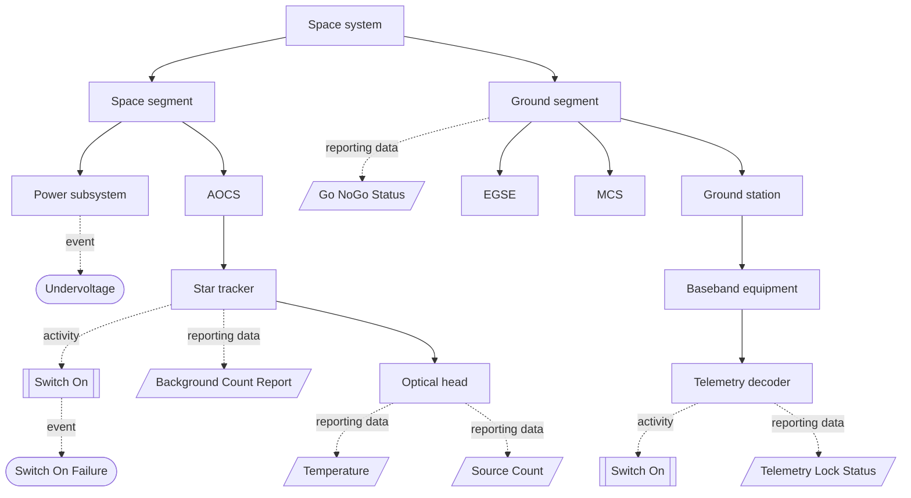
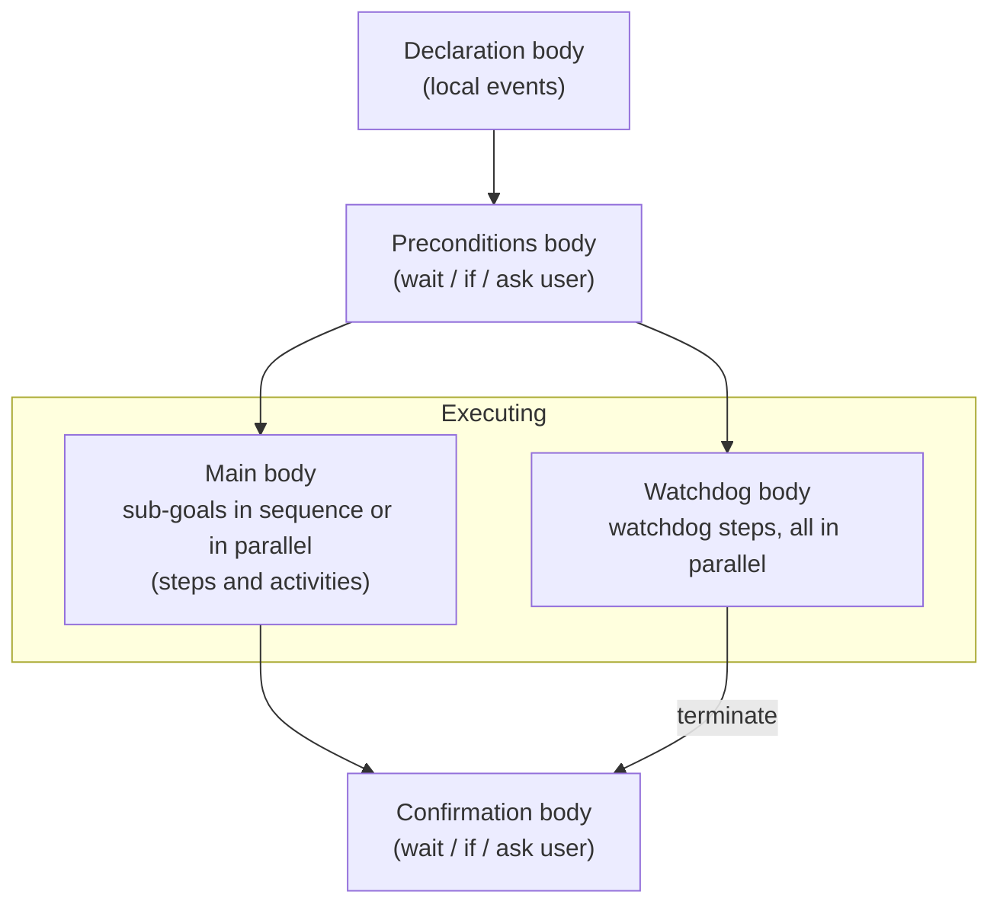
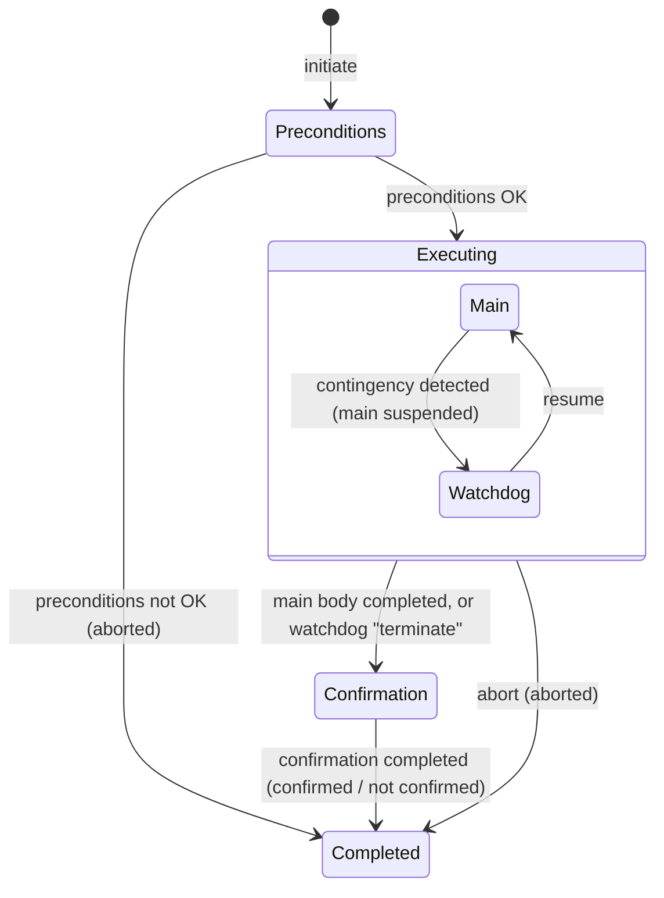
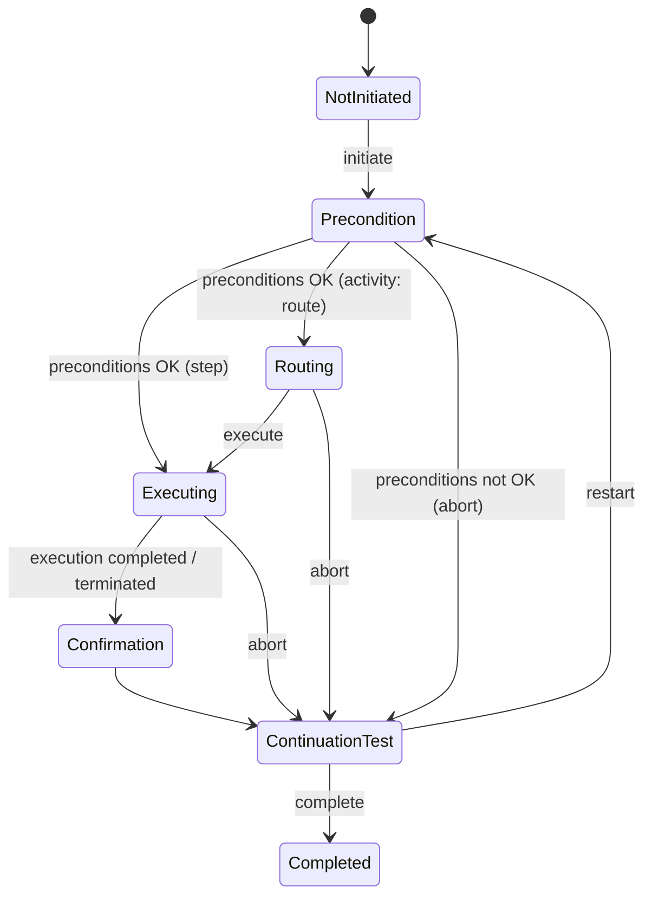

# ECSS-E-ST-70-32C: PLUTO test and operations procedure language

**ECSS-E-ST-70-32C** ("Space engineering – Test and operations procedure language", 31 July 2008)
does two things. It lists the capabilities that any language for automated **test and operations
procedures** has to provide, and it defines a reference language that provides them, the
**Procedure Language for Users in Test and Operations (PLUTO)**.[^intro][^scope] The standard
calls the procedure the principal means by which the end user controls the space system, both in
functional testing before launch and in operations after launch.[^intro] Its main promise is reuse:
a procedure written once for satellite checkout should carry over to mission operations, and the
same language should be used from one mission to the next.[^r53]

PLUTO is not a stand-alone programming language. It works on top of the **space system model**
(SSM) of [ECSS-E-ST-70-31C](e-st-70-31c.md): a procedure refers to system elements, reporting data,
activities and events that the SSM already defines, and it only adds the procedural script.[^ssm2]
This page covers the whole standard, then compares PLUTO with what ESA ground systems actually ran:
the Tcl-based TOPE language of the SCOS-2000 EGSE, the command sequences of the
[SCOS-2000 MIB](../mib/index.md), and the MOIS procedure tools.

!!! info "At a glance"
    | Item | Value |
    |---|---|
    | Issues | ECSS-E-70-32A (24 April 2006, first issue); B never issued; **ECSS-E-ST-70-32C (31 July 2008)**, which made editorial changes only[^cl] |
    | Status (ECSS tree, October 2025) | Published; no update shown as ongoing or planned[^tree] |
    | Normative references | ECSS-S-ST-00-01 (glossary) and ISO/IEC 14977 (extended BNF)[^refs] |
    | Normative part | Clause 5, requirements on any procedure language (44 lettered requirements: 18 in §5.1, 24 in §5.2, 2 in §5.3)[^r51][^r52][^r53] |
    | Informative annexes | A: the PLUTO language (structure, behaviour, 36 language constructs, EBNF, index); B: engineering units; C: mathematical, time and string functions[^scope] |
    | Syntax notation | Railroad diagrams plus ISO EBNF for every construct[^a31][^a4] |
    | Users of the standard | ECSS-E-ST-70-31C requires clause 5 for procedures and names PLUTO as the script type of ground procedures[^31-proc][^31-tab] |

## Why a common procedure language

The standard places procedures in the life of a space system. The space system consists of a space
segment, a ground segment and a launch service segment, whose elements are used at different times:
the electrical ground support equipment (EGSE) during development, the launch service segment before
and during launch, and the mission control system and ground stations during operations.[^c411]

* **Testing.** The standard does not prescribe at which integration level automated procedures
  are used (that is a decision of each mission's verification approach), but notes that they are
  generally used from subsystem level upwards. Reusing test procedures across integration levels
  needs standardised EGSE functions; reusing them in operations needs harmonised requirements for
  EGSE and mission control systems.[^c412]
* **Operations.** ECSS-E-ST-70 makes procedures the primary mechanism for mission operations and
  names two kinds of **flight control procedure (FCP)**: *nominal* procedures, the building blocks
  of the timelines and schedules of the flight operations plan (FOP), and *contingency* procedures,
  which reconfigure the space system after pre-identified anomalies. FCPs were traditionally run
  by hand; pressure to reduce routine manpower pushes towards automating their execution.[^c413]

In this standard the EGSE and the mission control system together are the **EMCS** (EGSE and
mission control system). The procedure language and its development and execution environments are
part of the EMCS and have direct access to its other monitoring and control functions.[^c421]

!!! note "FOP and MOP"
    ECSS-E-ST-70-32C speaks of the flight operations plan (FOP) of ECSS-E-ST-70. The 2008 issue of
    [ECSS-E-ST-70C](e-st-70c.md), published the same day, calls the corresponding document the
    mission operations plan (MOP) and does not use the abbreviation FOP.[^c413][^70-mop] ESOC's own
    plans used the FOP name: its INTEGRAL plan of 2003 is a "Flight Operations Plan" whose mission
    rules state that the FOP provides the timelines and the nominal and contingency flight procedures (see
    [ECSS-E-ST-70C](e-st-70c.md#a-real-flight-operations-plan-integral)).[^fop]

## The space system model seen by a procedure

The SSM of ECSS-E-ST-70-31 captures mission knowledge for assembly, integration and verification
(AIV) and for operations. Four kinds of SSM object matter to a procedure:[^ssm1][^ssm2]

| SSM object | Meaning | Examples given by the standard |
|---|---|---|
| System element | A functional element of the space system, from the functional decomposition of the space segment (ECSS-S-ST-00) or of the ground segment (ECSS-E-ST-70) | Power subsystem, AOCS, star tracker, optical head; EGSE, MCS, ground station, baseband equipment, telemetry decoder |
| Reporting data | Data used to assess the functioning of the space system: **parameters** (the lowest level of elementary information with a meaning for monitoring) and **compound parameters** (records of parameters, arrays and sub-records interpreted together, for example a whole telemetry packet or an anomaly report) | Temperature, Source Count, Background Count Report, Telemetry Lock Status, Go NoGo Status |
| Activity | A space system monitoring and control function: procedures, telecommands to the space or ground segment, and any EMCS function (a printer request, an e-mail, an ftp transfer); missions may add their own activity types | Switch On |
| Event | The occurrence of a condition or set of conditions during a test session or mission phase, used to trigger a monitoring and control function; associated with system elements, reporting data or activities | Undervoltage (of the power subsystem), Switch On Failure (of the star tracker's Switch On activity) |

Reporting data can have several representations during its life: an on-board measurement has an
encoded value in telemetry and a raw or engineering value on a ground display.[^ssm1] For any given
configuration of the space system (a stand-alone unit test, a partly integrated spacecraft, a ground
segment validated against a simulator) only a subset of the SSM is in use, but the model itself is
independent of the configuration.[^ssm2]



Example SSM fragment, redrawn after the example of Figure 4-2 of the standard: system elements are
boxes, activities double boxes, events rounded, reporting data parallelograms.[^ssm-fig]

The procedure language **refers to** system elements, activities, reporting data and events but
**does not define** them; it defines only the procedural script.[^ssm2] The SSM supplies the common
definition of every activity:[^ssm-act]

| Activity data in the SSM | Procedure-specific data in the SSM |
|---|---|
| Name, description, type (procedure, telecommand or operating system call), associated system element | Default execution mode (manual or automatic) |
| Version number and configuration history; validation status (testing status) | Activation mode (permanently active, or explicitly initiated) |
| Validity period (earliest and latest date of execution); mean, minimum and maximum duration | The procedural script |
| Arguments, each with name, description, engineering units, data type and default value; allowed combinations of argument values | |
| Planning attributes such as the resource profile (on-board power, downlink bandwidth) | |

ECSS-E-ST-70-31C turns this into data requirements: every procedure has an initiation mode
(background or foreground) and earliest and latest validity dates; a *ground procedure* adds a
script "written according to" PLUTO and a default execution mode (automatic or manual); an
*onboard procedure* adds a script compliant with [ECSS-E-ST-70-01](e-st-70-01c.md), a "preloaded
on board" flag and a high, medium or low priority.[^31-tab] Arguments therefore live outside the
script: a procedure receives them at initiation and cannot change them.[^a12]

## Terms

| Term (§3.2) | Definition (paraphrased) |
|---|---|
| activity | A space system monitoring and control function |
| compound parameter | A record of any sequence of reporting data, arrays of reporting data and sub-records interpreted together |
| confirmation body | Part of a procedure or step that assesses whether its objective has been achieved |
| continuation test | Construct that defines how a procedure or step proceeds after a constituent step or activity has executed |
| event | A condition or set of conditions that can arise during a test session or mission phase |
| initiation | The act of requesting the execution of a step or activity |
| main body | Part of a procedure or step dedicated to achieving its objectives |
| parameter | The lowest level of elementary information meaningful for monitoring the space system |
| preconditions body | Part of a procedure that ensures it executes only if or when predefined initial conditions hold |
| procedure | A means of interacting with the space system to achieve an objective or a sequence of objectives |
| reporting data | Data used to assess the functioning of the space system (a parameter or a compound parameter) |
| space system model | The space system described as system elements, the activities on them, the reporting data that reflects their state and the events raised and handled for their control |
| statement | A language element which, with others, implements the goal of a procedure or step |
| step | A component of a procedure that achieves a well-defined sub-goal |
| system element | A functional element of the space system as represented in the SSM |
| watchdog body | Part of a procedure or step that manages contingencies arising during its execution |
| watchdog step | A component of the watchdog body that detects one contingency condition and executes corrective actions |

Source: §3.2.[^terms] The standard's own abbreviations are AIV, EBNF, EGSE, EMCS, FCP, FOP, MMI
(man-machine interface), PLUTO, SCOE (special check-out equipment) and SSM.[^abbr]

## Requirements on any procedure language (clause 5)

Clause 5 is the normative heart of the standard. It is written for *any* language, and PLUTO is the
one that satisfies it.

### Procedure structure (§5.1)

| Req. | Capability |
|---|---|
| a, b | Build a high-level, goal-oriented activity (a procedure) from elementary activities (telecommands, operating system calls); a procedure may call other procedures |
| c, d, e | Define self-contained sub-goals, each reached by one activity call or a sequence of them; activities can take arguments passed at initiation |
| f | A **step** construct encapsulates complex logic (waiting for a time or a condition, conditional branching) |
| g | Sub-goals can run in series or in parallel |
| h, i, j | Preconditions (to be fulfilled before start) and confirmation conditions (whether the goal was met) for procedures, and also for steps |
| k–n | Contingency actions besides the nominal flow: for a procedure, on space system anomalies, on failure of the nominal path or on other events or conditions; for a step, on failure of its nominal path or on other events or conditions |
| o, p | A contingency action should be taken at the level where the failure occurs, and should either fix the anomaly or report it and return control to the nominal flow |
| q | If the anomaly cannot be fixed, one of these actions shall be performed: raise an event to flag it at a higher level; reach the goal another way and terminate; abort |
| r | While a contingency action runs, the body of the procedure or step is suspended |

Source: §5.1.[^r51]

### Language constructs (§5.2)

The 24 requirements of §5.2 list what a procedure must be able to do:[^r52]

* **Initiate activities** (a–d): request any space system activity; request it and continue at once;
  or request it and wait for confirmation, then test the result to decide what to do next.
* **Acquire data** (e): execution or confirmation status of an activity; initiation, start,
  termination or completion time of its last execution; the value, validity status, overall or
  detailed monitoring status (limit, delta, expected-status and status-consistency checks) and
  sampling time of reporting data; the time of the last occurrence of an event.
* **Replace missing functions** (f): when a space system function is not available (for example in
  an early test phase), set an activity's confirmation status, or a parameter's value, validity
  status, monitoring statuses or sampling time.
* **Snapshot** (g): make a local copy of reporting data so that several properties used by
  successive statements are sampled at the same instant, avoiding the asynchronous update problem.
* **Generic EMCS access** (h): request any operation and read any property of any space system
  object.
* **Flow control** (i): if-then-else, multi-way branching on a parameter or variable, loops (fixed
  count, while a condition holds, until a condition becomes true), and waits until an absolute
  time, for an interval, until a condition is true or until an event occurs.
* **Variables and events** (j–m): typed local variables, assignment, and local events declared in
  the procedure or step and raised by it (for example to trigger a contingency action).
* **Expressions and units** (n–s): the Annex C functions (should), expressions over constants,
  parameters from the EMCS, activity arguments and local variables; engineering units on constants,
  free mixing of compatible units and automatic conversion between them.
* **Comments and users** (t–w): comments; messages for user acknowledgement; messages to the
  procedure execution log; input from the user.
* **Pre- and confirmation conditions** (x): any combination of waiting until a time, for an interval,
  until a condition or until an event, testing a condition, or asking the user for the outcome.

### Language specification (§5.3)

A conforming language **shall** be formally specified in ISO EBNF (ISO/IEC 14977). PLUTO, with the
engineering units and functions of the annexes, **should** be used for automating procedures in
development and exploitation. Using PLUTO ensures conformance with every requirement of the
standard and eases the transfer of procedures from functional testing to operations.[^r53]

## The structure of a PLUTO procedure

A procedure has five bodies, in a fixed order; only the main body is mandatory:[^a11][^a-procdef]

| Body | Keyword pair | Presence | Purpose | Execution status while active |
|---|---|---|---|---|
| Declaration | `declare` … `end declare` | optional | Declares the procedure's local events (procedure level: events only) | – |
| Preconditions | `preconditions` … `end preconditions` | optional | Holds the procedure until, or runs it only if, initial conditions are met | "preconditions" |
| Main | `main` … `end main` | **mandatory** | Achieves the goal through activities and steps, in sequence or in parallel | "executing" |
| Watchdog | `watchdog` … `end watchdog` | optional | One or more watchdog steps, all initiated in parallel, each watching for one contingency | "executing" |
| Confirmation | `confirmation` … `end confirmation` | optional | Decides whether the goal was achieved | "confirmation" |



The elements of a procedure, after Figure A-1.[^a11]

**Preconditions** and **confirmation** bodies accept any combination of: wait until an absolute time,
wait for an interval, wait until a condition becomes true, a Boolean `if` test, and a decision
requested from the user; the keyword `then` chains several conditions.[^a13][^a16][^a-pre][^a-conf]
If an `if` expression is false, or a wait in the preconditions times out, the procedure (or step)
is skipped and its confirmation status becomes "aborted"; a raise-event action after a timeout is
not available in a preconditions body, because the watchdog has not started yet.[^a-pre][^a-wait]
In the confirmation body a false condition or an expired wait gives "not confirmed".[^a-conf]

The **procedure main body** may contain only seven statement types: set procedure context, initiate
in parallel, initiate and confirm step, initiate and confirm activity, initiate activity, inform
user, and log. All computation (assignments, loops, waits) therefore happens inside steps.[^a14][^a-pmb]

The **procedure watchdog body** detects and reacts to system-level events such as anomalies,
keeps procedure-level invariants true for the whole run, and handles failures that a step's own
watchdog could not handle. It need not fix everything itself: it can suspend or abort the
procedure while another procedure handles the anomaly. Concurrent watchdog steps watch independent
conditions; a triggered watchdog step suspends the main body while the others keep monitoring, so
contingencies that interact must be handled within one watchdog step. Error handling *after* a
procedure has ended belongs to the caller.[^a15]

### Steps

A step has the same five-body structure, with these differences:[^a171][^a-stepdef]

* Its preconditions body is optional for a main-body step but **mandatory** for a watchdog step,
  where it is a single `wait` statement that defines the contingency being watched.[^a171][^a173]
* Watchdog steps have no watchdog body of their own.[^a171]
* A step name is unique within its procedure and can be used to refer to the step.[^a171]
* Step-level declarations add **local variables** (with an engineering value, a validity status
  and a sampling time, visible in the step, its lower-level steps and its watchdog steps) and
  **enumerated sets**, plus local events that only the step's own watchdog body can use. Before
  its first assignment a variable's validity status is "not available" according to §A.3.9.14,
  but "invalid" according to §A.1.7.2.[^a172][^a-stepdecl]
* A step main body accepts the full statement set (below); a procedure main body only seven.[^a174][^a-smb]
* The step watchdog body handles failures in the step's main body and keeps step-level invariants;
  error handling after the step ends belongs to the caller.[^a175]

| Statement | Procedure main body | Step main body | Clause |
|---|:-:|:-:|---|
| Set context (`in the context of … do … end context`) | yes | yes | A.3.9.10, A.3.9.16 |
| Initiate in parallel | yes | yes | A.3.9.11 |
| Initiate and confirm step | yes | yes | A.3.9.12 |
| Initiate and confirm activity | yes | yes | A.3.9.26 |
| Initiate activity | yes | yes | A.3.9.27 |
| Inform user | yes | yes | A.3.9.29 |
| Log | yes | yes | A.3.9.30 |
| Assignment (`:=`) | – | yes | A.3.9.17 |
| Flow control (if, case, repeat, while, for) | – | yes | A.3.9.18–A.3.9.23 |
| Wait | – | yes | A.3.9.4 |
| Object operation request | – | yes | A.3.9.24 |
| Save context | – | yes | A.3.9.25 |

Source: §A.1.4, §A.1.7.4, §A.3.9.9 and §A.3.9.15.[^a14][^a174][^a-pmb][^a-smb]

## Behaviour: execution and confirmation status

Every procedure, step and activity carries two statuses that the caller can monitor:[^a21]

* the **execution status**: "not initiated" (steps and activities), "preconditions", "routing"
  (telecommands only), "executing", "confirmation" or "completed";[^a21][^a-tabA5]
* the **confirmation status**: "not available" until completion, then "confirmed", "not confirmed"
  or "aborted".[^a21]

### Procedure



Execution states of a procedure, after Figure A-2.[^a21]

1. **Preconditions.** On initiation the preconditions body runs ("preconditions", "not available").
   If they hold, the watchdog body starts (all watchdog-step preconditions are initiated) and then
   the main body; if not, the procedure completes as "aborted". Without user preconditions both
   bodies start immediately.[^a21]
2. **Main body.** Statements run in sequence ("executing", "not available"). Each
   *initiate and confirm* statement ends with a **continuation test** whose outcome is: continue;
   restart the step or activity from its preconditions; raise a local event for a watchdog step; or
   abort the procedure.[^a21]
3. **Watchdog.** If no contingency occurs, the watchdog body ends when the main body ends. If one
   occurs, the main body is **suspended**: the atomic statement in progress completes, but its
   follow-on action is not taken. Every statement except initiate-and-confirm step,
   initiate activity, initiate-and-confirm activity and initiate in parallel is atomic; inside an
   initiate-in-parallel, all branches are suspended once their current atomic statements end. The
   watchdog step then returns one of four continuation actions: **resume** (main body continues
   where it stopped and the watchdog step is restarted), **terminate** (the goal was reached another
   way; main and watchdog bodies end and confirmation starts), **raise event** (pass the problem to
   another watchdog step) or **abort**.[^a21]
4. **Two watchdogs at once.** A second watchdog step triggered while the first runs executes in
   parallel; control returns to the main body only when both have finished; each is restarted when
   it completes; an "abort" from either aborts the procedure at once.[^a21] If the returned actions
   differ, the user is asked.[^a-wd]
5. **Confirmation.** When every step and activity initiated by the main body has completed
   (including the remaining branches of an "until one completes" parallel statement), the watchdog
   body ends and the confirmation body runs, giving "confirmed" or "not confirmed".[^a21]
6. **Implicit confirmation.** Without a confirmation body: after a watchdog "terminate" the procedure
   takes the watchdog step's confirmation status; otherwise it is "confirmed" only if every activity
   and step initiated by the main body was confirmed, and "not confirmed" in all other cases. If an
   initiated step or activity raised an event in its continuation test, the watchdog step that
   caught it decides.[^a21][^a-conf]

For a procedure, what happens after it ends is left to the caller; for steps and activities the
continuation test inside the calling statement decides.[^a22]

### Step and activity



Execution states of a step (Figure A-3) and of an activity (Figure A-4) combined; the "Routing" state
applies to activities only.[^a22][^a23]

A step runs its preconditions, main and watchdog bodies exactly as a procedure does, then its
confirmation body, and finally the continuation test of the statement that initiated it, which
maps the confirmation status ("confirmed", "not confirmed" or "aborted") to a continuation action;
"restart" sends it back to "preconditions", anything else completes it. Missing preconditions or
confirmation use the same defaults as a procedure.[^a22]

An **activity** is executed by the EMCS, not by the procedure. The EMCS reports progress
notifications for the state transitions and for type-specific sub-states, such as the routing stages
of a telecommand ("released from EMCS", "reception by ground station", "reception on-board").
*Initiate activity* does not wait; *initiate and confirm activity* waits and applies a continuation
test.[^a23]

### Continuation tests and their defaults

A continuation test holds up to three couplets of confirmation status and continuation action;
missing couplets take default actions. The allowed combinations differ between main-body and
watchdog statements:[^a25][^a-ct]

=== "Main body"

    | Confirmation status | resume | abort | restart | ask user | raise event | continue | terminate |
    |---|---|---|---|---|---|---|---|
    | confirmed | – | – | – | allowed | – | **default** | – |
    | not confirmed | – | allowed | allowed | **default** | allowed | allowed | – |
    | aborted | – | **default** | allowed | allowed | allowed | – | – |

=== "Watchdog"

    | Confirmation status | resume | abort | restart | ask user | raise event | continue | terminate |
    |---|---|---|---|---|---|---|---|
    | confirmed | **default** | allowed | – | allowed | – | – | allowed |
    | not confirmed | allowed | allowed | – | **default** | allowed | – | allowed |
    | aborted | – | **default** | – | allowed | – | – | – |

"–" means forbidden. Read from Figures A-5 and A-6 of the standard.[^a25]

| Action | Meaning |
|---|---|
| resume | Watchdog only: resume the suspended main body where it was suspended |
| abort | Abort the procedure (or step) |
| restart | Main body only: run the initiate-and-confirm statement again; may be bounded by a `timeout` (relative to the statement's start) or `max times`, after which an event is raised for a watchdog step or the parent is aborted |
| ask user | Ask the user how to proceed; in a main body the user may choose any action except resume, ask user and terminate; in a watchdog any except continue and ask user |
| raise event | Raise a local event, caught by a watchdog step; the main body then resumes where it was suspended |
| continue | Main body only: carry on with the next statement |
| terminate | Watchdog only: end the main body early and start the confirmation body |

Source: §A.2.5 and §A.3.9.33.[^a25][^a-ct] A watchdog *initiate and confirm step* is re-initiated
after it completes unless its action was "abort".[^a25] The allowed combinations may be widened for
special tests: a test that checks that a critical command such as "deploy solar array" is rejected
can treat "aborted" as success and map it to "continue".[^a25]

### Parallel execution

`in parallel until all complete` (the default) or `in parallel until one completes` starts all of
its steps and activities at once.[^a-par] With "until one completes", the first to finish lets the
calling body move on; the others keep running and their continuation actions still apply, except
"continue", which then does nothing. With "until all complete", each branch's action is handled as
it arrives: "abort" aborts the parent and all other branches at once; "restart" restarts that
branch (resetting it to "preconditions" and "not available") and the parallel statement cannot end
until it finishes again; "raise event" is raised at once and suspends the main body through a
watchdog step.[^a24]

## The language

### Lexical conventions

* **Notation.** Each construct is a grammar rule (a non-terminal symbol) defined from non-terminal
  and terminal symbols, drawn as a railroad diagram (main line mandatory, branch lines optional,
  return lines repetition, rectangles for non-terminals, rounded boxes for terminals) and repeated
  in ISO EBNF in clause A.4.[^a31][^a4]
* **Case.** Only engineering units are case-sensitive; everything else, including keywords, is not.
  Spaces inside multi-word keywords count as single blanks.[^a32][^a34]
* **Comments** run from `/*` to `*/`.[^a32]
* **Keywords** may be several words ("not confirmed", "execution status", "is contained in"). If an
  SSM object is named with a keyword, the implementation resolves the ambiguity by grammar
  precedence, but the standard warns against names that confuse readers.[^a34]
* **Identifiers** are one or more words separated by spaces; the first word starts with a letter,
  each word is letters and digits. `Switch on Gyro5 in Fine Mode` is one identifier. Identifiers are
  unique in their context (a step name in its procedure); objects elsewhere are reached by an
  object reference path.[^a35]

### Constants

| Constant | Form | Examples from the standard |
|---|---|---|
| Boolean | `TRUE`, `FALSE` | – |
| Enumerated | Characters in double quotes; `\"` and `\\` escape quote and backslash | `"red"`, `"not confirmed"` |
| Integer | Optional sign, digits, optional engineering unit; or hexadecimal `0x` followed by 0–9, A–F | `23 A`, `2056`, `0x2056`, `0xFFFF` |
| Real | Optional sign, digits, optional fraction, optional exponent `e`, optional unit | `123.56e12`, `0.1`, `23E6`, `5.3 [kg/m^3]` |
| String | Characters in double quotes | – |
| Absolute time | `YYYY-MM-DDThh:mm:ss.f[Z]` or `YYYY-DDDThh:mm:ss.f[Z]` (day of year 001–366; seconds up to 60 in a leap second; any number of fraction digits) | `2001-08-18T21:07:43.137468Z`, `2001-033T13:21:32.226` |
| Relative time | Sum of `d`, `h`, `min`, `s` components, or `[sign]days:hh:mm:ss` | `30 h 10 min`, `200 s`, `- 0:00:10:00` |

Source: §A.3.6.[^a36] In the colon form, the railroad diagram shows the fraction of a second
introduced by a full stop, while the EBNF rule of clause A.4 writes a colon.[^a36][^a-ebnf-rt]

### Types

| Predefined type | Values |
|---|---|
| Boolean | `true`, `false` |
| Enumerated set reference | A named set of enumerated values, defined system-wide or locally within a procedure (declared in a step declaration body) |
| Signed integer, unsigned integer, real | Implementation subsets of those numbers |
| String | Character strings |
| Absolute time, relative time | Dates (such as 2003-02-15) and intervals (such as 2 s) |
| Property value set | The set of all values of a property of an SSM object (for example all APIDs defined for system elements) |
| Property data type | The type inherited from a property of an SSM object (for example "real with engineering units V" for a battery voltage) |

Source: Table A-1 and §A.3.9.14.[^a37][^a-stepdecl] In an assignment the two sides must be type-compatible.[^a37]

### Object references

Objects are reached with `of` chains, read from the specific to the general:
`Temperature of Catalyst Bed of Thruster X of Thruster Main Branch`. A reference may start with an
explicit object type (variable, predefined value set, activity statement, step, argument, system
element, reporting data, parameter, record, array, activity, event).[^a-ref] When the type is
omitted and a name is not unique in the SSM, the 14 precedence levels resolve it, from highest to
lowest: variable, local reporting data, local event, activity statement, step, argument, system
element, reporting data, parameter, record, array, activity, predefined value set, system event.[^a-ref]
Inside expressions a bare identifier resolves first to a local variable (searched upwards through
the step hierarchy), then to a procedure argument, a function name, and finally an object name.[^a-expr]

### Expressions and operators

The grammar builds expressions as Boolean combinations (`AND`, `OR`, `XOR`) of relational
expressions; each relational expression is a term optionally followed by a comparative expression;
terms are sums, products and powers of factors.[^a-expr] Besides the six relational operators
(`=`, `!=`, `<`, `>`, `<=`, `>=`), comparative expressions offer `between A and B`,
`within C [unit or %] of T` and set membership `in (T1, T2, ...)`.[^a-expr] A factor can be a
constant, an argument or variable reference, an object property request, a function call, a
parenthesised expression, a signed factor, a `NOT` factor, or `ask user (prompt [default value])
[expect type]`, which makes the user an input source.[^a-expr][^a-ebnf-sf]

| Operator (descending precedence) | Operand types → result |
|---|---|
| unary `-`, unary `+` | integer or real → same |
| `NOT` | Boolean → Boolean |
| `**` | integer**integer → integer; any real operand → real |
| `*` | numbers as usual; relative time × number → relative time |
| `/` | integer / integer → **real**; relative time / number → relative time |
| `+` | numbers; absolute + relative → absolute; relative + relative → relative; string + anything → string (concatenation) |
| `-` | numbers; absolute − absolute → relative; absolute − relative → absolute; relative − relative → relative |
| `=`, `!=`, `<`, `>`, `<=`, `>=` | numbers, strings (case-insensitive), relative times, absolute times → Boolean |
| `AND`, `OR`, `XOR` | Boolean → Boolean |

Source: Table A-4.[^a-ops] Boolean expressions are always evaluated completely, without
short-circuit: the standard's own warning is that `X > 0 AND Y/X = Z` still divides by zero when
X is 0.[^a-ops]

### Language constructs

The 36 constructs of clause A.3.9 (the two context statements share a row):

| Construct | Shape (simplified from the EBNF) | Notes | Clause, PDF p. |
|---|---|---|---|
| Procedure Definition | `procedure [declare] [preconditions] main [watchdog] [confirmation] end procedure` | Five bodies, main mandatory | A.3.9.1, 47 |
| Procedure Declaration Body | `declare event N [described by "…"], … end declare` | Events only, used by the procedure watchdog | A.3.9.2, 48 |
| Preconditions Body | `preconditions (if E | Wait) {then (if E | Wait)} end preconditions` | False or timed out → "aborted" | A.3.9.3, 49 |
| Wait Statement | `wait until E` \| `wait for E` \| `wait for event R`, then `[save context]` `[timeout]` | Until an absolute time or a Boolean; for a relative time or an event | A.3.9.4, 50 |
| Save Context | `save context refer to R by N {, to R by N}` | Snapshot taken when the wait condition is met | A.3.9.5, 51 |
| Timeout | `timeout E [raise event N]` | Not allowed with "for a relative time" or "until an absolute time" waits | A.3.9.6, 53 |
| Raise Event | `raise event N` | Local events only | A.3.9.7, 54 |
| Object Reference | `[type] name {of reference}` | 14-level precedence | A.3.9.8, 55 |
| Procedure Main Body | `main {statement ;} end main` (keywords optional) | Seven statement types | A.3.9.9, 57 |
| Set Procedure / Step Context | `in the context of R do {statement ;} end context` | R is a system element or a (record) compound parameter | A.3.9.10/16, 59/69 |
| Initiate In Parallel | `in parallel [until all complete | until one completes] S ; S ; … end parallel` | At least two branches | A.3.9.11, 60 |
| Initiate And Confirm Step | `initiate and confirm step N <step definition> end step [continuation test]` | Waits for the step to finish | A.3.9.12, 62 |
| Step Definition | `[declare] [preconditions] main [watchdog] [confirmation]` | Same bodies as a procedure | A.3.9.13, 63 |
| Step Declaration Body | `declare` enumerated sets, `variable V of type T [with units U]`, events `end declare` | Variables visible downwards | A.3.9.14, 64 |
| Step Main Body | `main {statement ;} end main` | Twelve statement types | A.3.9.15, 67 |
| Assignment | `V := E` | Only declared variables | A.3.9.17, 70 |
| Flow Control | if, case, repeat, while, for | – | A.3.9.18, 71 |
| If | `if E then … [else …] end if` | – | A.3.9.19, 72 |
| Case | `in case E is tag : … {or is tag : …} [otherwise : …] end case` | First matching tag wins | A.3.9.20, 73 |
| Repeat | `repeat … until E [timeout]` | Body runs at least once | A.3.9.21, 75 |
| While | `while E [timeout] do … end while` | Timeout acts at the end of an iteration | A.3.9.22, 76 |
| For | `for V := E to E [by E] do … end for` | Bounds evaluated once; counter read-only | A.3.9.23, 77 |
| Object Operation Request | `operation [of R] [with [arg :=] E, … end with]` | `set <property>` or a non-standard operation | A.3.9.24, 79 |
| Save Context Statement | `save context …` as a statement | – | A.3.9.25, 81 |
| Initiate And Confirm Activity | `initiate and confirm <activity call> [refer by S] [continuation test]` | Waits for completion | A.3.9.26, 82 |
| Initiate Activity | `initiate <activity call> [refer by S]` | Runs in parallel with the caller | A.3.9.27, 83 |
| Activity Call | `A [with arguments … end with | with value set … end with] [with directives … end with]` | See below | A.3.9.28, 84 |
| Inform User | `inform user E {, E}` | Does not wait for the acknowledgement | A.3.9.29, 88 |
| Log | `log E {, E}` | To the procedure execution log | A.3.9.30, 89 |
| Watchdog Body | `watchdog <initiate and confirm step> ; … end watchdog` | Watchdog steps in parallel | A.3.9.31, 90 |
| Confirmation Body | `confirmation (if E | Wait) {then …} end confirmation` | False or timed out → "not confirmed" | A.3.9.32, 92 |
| Continuation Test | `in case status : action ; … end case` | Defaults per Figures A-5/A-6 | A.3.9.33, 93 |
| Expression | see above | – | A.3.9.34, 96 |
| Function | `name ( [E {, E}] )` | Annex C or non-standard | A.3.9.35, 101 |
| Object Property Request | `[[get] property of] R [with … end with]` | Standard and non-standard properties | A.3.9.36, 102 |

Sources: clauses A.3.9.1 to A.3.9.36 and the EBNF of A.4.2.[^a39][^a4] Further rules worth knowing:

* A **case** statement compares the `in case` expression with each tag; the first match runs, and
  `otherwise` runs only when nothing matched. Tags may combine comparative expressions with
  `AND`/`OR`/`XOR`.[^a-case]
* A **for** loop evaluates its three expressions once at the start; the default step is +1; the
  counter may be read but not assigned.[^a-for]
* A **while** loop whose timeout expires in the middle of a multi-statement iteration completes the
  iteration first; the timeout acts at the end.[^a-while] **Repeat** and **while** timeouts either
  raise an event for a watchdog step or abort the parent step.[^a-repeat][^a-while]
* An **activity statement** named with `refer by` is the initiation instance of an activity, an
  EMCS dynamic object that inherits all activity properties and operations; inside a loop it
  always refers to the latest iteration.[^a-iaca]
* A variable name reused in a lower-level step hides the parent's variable.[^a-assign]
* A **save context** creates local reporting data that is "not available" until created, takes all
  properties of the source when created, and lives only for the current procedure instance.[^a-save]

### Activity calls, arguments and directives

An activity call names the activity and supplies either explicit **arguments** or a **predefined
value set** from the operations database, plus optional **directives**.[^a-call] Arguments are
simple (an expression, or a reference to an activity, parameter or reporting data, system element or
event), records (recursive groups of arguments, as in ECSS-E-70-41) or arrays. Either all arguments
are named or none are, in which case their order defines them.[^a-call] Directives are specific to an
activity *type* rather than to one activity; for telecommands the standard lists the MAP ID, AD or
BD transmission mode, and the verification packets to request.[^a-call] Its examples of simple
arguments are also PUS-flavoured: a parameter reference for a [ST[12]](pus/st12-onboard-monitoring.md)
request, a system element (APID) for a [ST[14]](pus/st14-real-time-forwarding-control.md) request,
and an activity call as the argument of a [ST[11]](pus/st11-time-based-scheduling.md) TC[11,4]
insertion into the on-board schedule, where each scheduled command is a record with the
telecommand, its release time, sub-schedule and interlock fields.[^a-call]

### Standard properties and operations

Two generic mechanisms reach any EMCS service: the **object property request** (read a property)
and the **object operation request** (do something to an object). "Standard" ones are supported by
every EMCS; implementations may add others.[^a38]

| Object | Standard property requests (result) |
|---|---|
| Activity or step | execution status; initiation time (when the preconditions check began); start time (start of execution by the destination application process for a telecommand, start of the main body for a procedure or step); termination time; confirmation status; restart number; completion time (end of confirmation for a procedure or step, end of end-to-end verification for a telecommand) |
| Reporting data, variable, argument | validity status ("not available", "valid", "invalid"); sampling time; value (engineering values only); monitoring status; status consistency check status; limit check status ("danger high", "warning high", "within limits", "warning low", "danger low"); delta check status; expected check status (each "not available", "nominal" or "failed" unless stated) |
| Event | last raise time |

Sources: Tables A-5, A-6 and A-7.[^a-prop] Property requests on an activity refer by default to its
last initiation; within a loop only the latest iteration is available; a restart counter is kept.[^a-tabA5]
Two shorthands keep scripts readable: naming a property alone implies `get`, and naming a parameter
alone implies `get value`.[^a-prop] The standard operations mirror the replace-missing-function
requirement: `set confirmation status` for activities and steps; `set validity status`,
`set value`, `set monitoring status`, `set status consistency check status`,
`set limit check status`, `set delta check status` and `set expected check status` for reporting
data, variables and arguments. Events have none. These operations are meant for configurations in
which the spacecraft or the EMCS health monitoring is absent.[^a-op]

## Engineering units (Annex B)

PLUTO constants and variables carry units, and §5.2 requires automatic conversion between
compatible ones.[^r52] Annex B defines the symbols, based on a 2003 proposal for representing SI
units in character strings:[^b1]

* **Simple units** (Table B-1) include the SI base units, `min`, `h`, `d`, `AU`, `pc`, `u`, `L`, `t`,
  `degC`, `rad`, `deg`, `arcmin`, `arcsec`, `r` (revolution), `sr`, the derived SI units
  (`Hz` … `Sv`, with `Ohm` spelled out), `bar`, `eV`, `dB`, `Np`, `bit`, `B` (byte) and `Bd`.[^b2]
* **Prefixes**: decimal `Y` to `da` and `d` to `y` (micro is `u`); binary `Ki` to `Ei` only for
  `bit` and `B`. No prefixes on `dB`, `AU`, `pc`, `u`, `min`, `h`, `d`; only submultiples on `L`,
  `Np`, `deg`, `arcmin`, `arcsec`, `degC`, `rad`, `sr`; only multiples on `t`, `B`, `r`, `Bd`;
  no compound prefixes.[^b2]
* **Compound units**: multiplication with `.`, division with `/` (not repeated outside
  parentheses), exponent after `^`, negative exponents allowed, fractional exponents in
  parentheses: `kg.m^2/s`, `W/(m^2.K)`, `s^-1`.[^b2] Units may be written in square brackets after a
  number, as in `5.3 [kg/m^3]`.[^a36][^b4]

Missions that need further units should follow the same syntax.[^b2]

## Functions (Annex C)

| Group | Functions |
|---|---|
| Mathematical (Table C-1) | `abs`, `acos`, `acosec`, `acosec2`, `acotan`, `acotan2`, `asec`, `asec2`, `asin`, `atan`, `atan2`, `average`, `ceiling`, `cos`, `cosec`, `cosh`, `cotan`, `floor`, `ln`, `log`, `max`, `min`, `quotient`, `remainder`, `round`, `sec`, `sin`, `sinh`, `sqrt`, `tan`, `tanh`, `truncate`, and the constants `pi()`, `e()`, `G()` |
| Time (Table C-2) | `current time`, `year`, `month`, `day of month`, `day of week`, `day of year`, `hour`, `minute`, `second`, `days`, `hours`, `minutes`, `seconds` |
| String (Table C-3) | `to string` (optionally converting to given units), `to Boolean`, `to hex`, `to integer`, `to real`, `capitalize`, `get from`, `insert in`, `is contained in`, `length of`, `lower case`, `omit from`, `position of`, `upper case` |

Sources: Annex C.[^c] Functions respect units: `max (1 V, 100 mV)` is `1 V`,
`to string (5 V, mV)` is `"5000 mV"`, and `hours (2 d 5 h 30 min)` is `53.5 h`.[^c]

## A worked example

!!! example "Illustrative PLUTO procedure"
    The following procedure was constructed for this page from the grammar of clause A.4; it is not
    taken from the standard or from a mission. All object names are invented.

    ```text
    procedure
      declare
        event Heater Overcurrent described by "Line current above limit"
      end declare
      preconditions
        wait until Bus Voltage of Power Subsystem > 27 V timeout 2 min
      end preconditions
      main
        initiate and confirm step Warm Up
          declare
            variable Target of type real with units degC
          end declare
          main
            Target := 20 degC;
            initiate and confirm Switch On Heater with arguments Line := 3 end with
              in case not confirmed : restart max times 2; end case;
            wait until Temperature of Camera > Target timeout 30 min;
            log "Camera at ", to string (Temperature of Camera);
          end main
        end step;
        initiate and confirm Switch Off Heater with arguments Line := 3 end with;
      end main
      watchdog
        initiate and confirm step Overcurrent Guard
          preconditions
            wait until Current of Heater Line 3 > 1.5 A
          end preconditions
          main
            initiate and confirm Switch Off Heater with arguments Line := 3 end with;
            inform user "Heater line 3 switched off by watchdog";
          end main
        end step
          in case confirmed : terminate; end case;
      end watchdog
      confirmation
        if Temperature of Camera >= 20 degC
      end confirmation
    end procedure
    ```

    How it runs, following clause A.2:

    1. The procedure enters "preconditions" and waits up to 2 minutes for the bus voltage. On a
       timeout it completes as "aborted", because no watchdog exists yet to catch an event.[^a-wait]
    2. When the voltage condition holds, the watchdog step *Overcurrent Guard* starts waiting on its
       single `wait` precondition, then the main body starts ("executing").[^a21]
    3. In *Warm Up*, if the heater command is "not confirmed" the explicit couplet restarts it up to
       twice; "aborted" falls back to the main-body default "abort"; "confirmed" takes the default
       "continue".[^a-ct][^a25]
    4. If the line current exceeds 1.5 A, the main body is suspended after its current atomic
       statement, the watchdog step switches the heater off and, when confirmed, returns "terminate":
       the main and watchdog bodies end and the confirmation body runs.[^a21][^a25]
    5. The confirmation body sets "confirmed" only if the camera reached 20 degC; otherwise the
       procedure ends "not confirmed", and what happens next is up to its caller.[^a-conf][^a22]

## Observations on the text

!!! warning "Inference"
    These points come from this wiki's reading of the 2008 text and are not discussed in it:

    * Several examples in the standard declare variables in a short form such as
      `unsigned integer Counter` or `real AvgeTemp units degC`, which does not match the
      `variable … of type … [with units …]` rule of the grammar.[^a-for][^a-prop][^a-stepdecl]
    * The relative-time colon form ends with a full stop before the fraction in the railroad diagram
      but with a colon in the EBNF.[^a36][^a-ebnf-rt]
    * ECSS-E-ST-70-31C points twice to "Table 6 of ECSS-E-ST-70-32" for operator operand types; in
      ECSS-E-ST-70-32C that table is numbered A-4, which is how a third passage of
      ECSS-E-ST-70-31C cites it.[^31-table6][^a-ops]
    * The text of A.2.5 says a user asked in a watchdog may choose any action except continue and
      ask user, while Figure A-6 forbids "restart" in watchdogs.[^a25]

## PLUTO across the ECSS ground standards

PLUTO is wired into the other E-70 standards:

* [ECSS-E-ST-70-31C](e-st-70-31c.md) assumes conformance to ECSS-E-ST-70-32, requires clause 5 for
  procedures, uses PLUTO as the data type of procedure definitions, reuses the PLUTO *Activity Call*
  syntax (A.3.9.28) for its own Activity Call data type, takes its engineering units from Annex B and
  its functions from Annex C.[^31-scope][^31-proc][^31-tab][^31-call][^31-units][^31-table6]
* [ECSS-E-ST-70C](e-st-70c.md) summarises ECSS-E-ST-70-32 in its table of level-3 standards and
  defines, in Annex I, the human-readable layout of an operations procedure: preconditions, a body of
  steps (sequential or parallel), an optional contingency element and post-conditions.[^70-L][^70-I]
* [ECSS-E-ST-70-01C](e-st-70-01c.md) (on-board control procedures, 2010) asks for a very similar
  structure on board: declaration, preconditions, main and confirmation bodies, steps, and a
  contingency handling body instead of a watchdog.[^01-struct]

| Concept | ECSS-E-ST-70C Annex I (procedure document) | PLUTO (ECSS-E-ST-70-32C) | OBCP (ECSS-E-ST-70-01C) |
|---|---|---|---|
| Start conditions | Pre-conditions (mission phase, ground and space configuration, orbit or environment, other procedures) | Preconditions body | Preconditions body |
| Body | Steps in sequence or parallel; each step with pre-conditions, body, post-conditions | Main body of steps and activities, `in parallel` | Main body; steps uniquely identified |
| Contingency | Contingency element: restore and resume, reach the goal another way and stop, or abort | Watchdog body with resume / terminate / abort | Contingency handling body |
| End check | Post-conditions; status "success confirmed" or "procedure failed" | Confirmation body; "confirmed", "not confirmed", "aborted" | Confirmation body; implicit status if absent |

Sources: ECSS-E-ST-70C Annex I, ECSS-E-ST-70-32C A.1 and ECSS-E-ST-70-01C §5.1.[^70-I][^a11][^01-struct]
The three contingency outcomes of Annex I match the "resume", "terminate" and "abort" watchdog
actions one for one.[^70-I][^a25]

## PLUTO and ESA's SCOS-2000 world

### No PLUTO in SCOS-2000; TOPE instead

None of the SCOS-2000 documents in this wiki's library describes a PLUTO interpreter. The ESTEC
user manual of the SCOS-2000-based EMCS (issue 4.0, March 2004) states the situation plainly: ESA had
started developing PLUTO software for preparing and executing procedures with SCOS-2000, but since
it was not yet available, a Tcl/Tk procedure environment called **TOPE** (the manual's heading
reads "The Test and Operation Procedure Environment") had been delivered to the Herschel/Planck
instrument teams.[^emcs-tope] TOPE initiates telecommands and SCOE commands, follows their execution
through the reports sent back by SCOS-2000, and monitors telemetry and ground parameters.[^emcs-tope]
Four years earlier, ESA's SCOS-2000 presentation to FIRST/Planck had proposed reusing the TCL/TK
procedure automation tool of the PROBA checkout facility, which PROBA used for both AIV and
operations.[^s2k-2000-p14][^s2k-2000-p26]
The TOPE language itself is described on [SCOS-2000 as EGSE](../scos2000/egse.md#tope-the-test-and-operations-procedure-environment).

The two languages share the same concepts, and the mapping is close:

| PLUTO construct | Nearest TOPE command (EMCS SUM issue 4.0) |
|---|---|
| `initiate <telecommand>` | `tcsend <cmd> … nowait` (by default `tcsend` waits until the ground stage UV_GS_RECEIVE)[^emcs-tc] |
| `initiate and confirm <telecommand>` with a continuation test | `tcsend <cmd> referby v` then `waitfor v -until {[getcompleted $v]}`, with Tcl logic for the outcome[^emcs-wait] |
| Directives (MAP ID, AD/BD, verification packets) | `tcsend` options `mapid`, `vcid`, `ack {ACCEPT START PROGRESS COMPLETE}`, `checks`, `settransfermode AD/BD`[^emcs-tc][^emcs-sum-tm] |
| `get value of P`, validity and monitoring status | `fetch P` with `getengvalue`, `israwvaluevalid`, `getoolstate`, `getsccstate`, `gettimestamp`[^emcs-fetch] |
| `wait until <condition>` | `subscribe P referby v` and `waitfor v -until {…}`[^emcs-wait] |
| `wait for <relative time>` | `waittime <time>`[^emcs-wait2] |
| Watchdog step | `watchdog <name> triggeredby <vars> <condition> <action>` (not available on TOPE/CCS)[^emcs-wd] |
| `log` | `putlog`, `openlog`, `closelog`[^emcs-log] |

!!! warning "Inference"
    The mapping in this table is this wiki's comparison. The EMCS manual does not compare TOPE with
    PLUTO beyond saying that TOPE stands in for PLUTO software that was not yet available. TOPE
    lacks PLUTO's built-in step state machine, continuation defaults and engineering-unit arithmetic;
    a TOPE script gets those only through Tcl code written by the user.

### Command sequences in the MIB

What the SCOS-2000 MIB itself can store is far simpler than PLUTO: **command sequences**, ordered
lists of commands and nested sequences with formal parameters, defined in the tables
[`csf`](../mib/tables/csf.md), [`css`](../mib/tables/css.md), [`sdf`](../mib/tables/sdf.md) and
[`csp`](../mib/tables/csp.md) (see [sequences](../mib/sequences.md)). A nested sequence is expanded
like a macro when the sequence is loaded; elements carry release and execution delta times
(relative to the previous command or to the sequence start), grouping and blocking flags, interlock
scope and stage, and flags to override PTV checks or disable CEV checks.[^icd-seq][^icd-css][^icd-css2]

!!! warning "Inference"
    None of the sequence fields defined in the ICD expresses a branch, a loop, a wait for a
    telemetry condition or a confirmation check. Read in PLUTO terms, a sequence is a main body of
    `initiate` statements whose timing is fixed in advance, with interlocks as the only feedback.
    This comparison is the wiki's; the ICD does not mention PLUTO.

The Solar Orbiter MIB of 16 September 2025 shows how much of the operations material takes this
form, and where it comes from:[^mib]

| Quantity (Solar Orbiter MIB, 2025-09-16) | Value |
|---|---|
| Sequences (`csf`) | 3 404, with 13 879 elements (`css`): 12 629 commands and 1 250 nested sequences |
| Elements timed relative to the previous command / to the sequence start (`CSS_RELTYPE`) | 10 475 / 3 404 |
| Elements with a non-zero release delta (`CSS_RELTIME`; 3 196 are zero and 44 empty) | 10 639 |
| Elements with interlock scope 'N' (no interlock) and stage 'C' | 12 494 |
| Elements that disable CEV checks (`CSS_CEV = 'Y'`) | 17 |
| Largest sequence / mean size (`CSF_ELEMS`) | 312 / about 4.1 elements |
| Sequences whose source document (`CSF_DOCNAME`) is an FCP / a CRP / other | 2 243 / 1 091 / 70 |
| Sequences that contain a service 18 "load and start OBCP" or other OBCP command | 22 |

The `CSF_DOCNAME` field records the document from which a sequence was generated.[^icd-csf] In this
MIB the names follow a pattern of a two-character prefix (mostly a subsystem code such as `DM`,
`AC` or `SY`), `FCP` or `CRP`, and a number (for example `SY-FCP-010` and `IA-CRP-071`); a
Herschel/Planck naming convention uses the same two families, flight control procedures (FCP) and
contingency recovery procedures (CRP).[^mib][^oird-names]
Three real examples, each a single command that starts an on-board control procedure:
[ASYF010B](../explorer/index.md#/solo/sequence/ASYF010B) "Config DST via OBCP v11" (from
SY-FCP-010, 18 formal parameters), [AITF124B](../explorer/index.md#/solo/sequence/AITF124B)
"OBCP_HVdoorRmpUp v02" (from IT-FCP-124, no formal parameters) and
[AIAC071A](../explorer/index.md#/solo/sequence/AIAC071A) "SWA HIS Start HAMMER v02" (from
IA-CRP-071, 6 formal parameters). Their single elements are the "Load and start OBCP" commands
[ZCPX0003](../explorer/index.md#/solo/command/ZCPX0003) (TTC2),
[ZCPX0004](../explorer/index.md#/solo/command/ZCPX0004) (METIS_HVdoorRmpUp) and
[ZCPX0011](../explorer/index.md#/solo/command/ZCPX0011) (SWA8), all TC(18,140).[^mib]

!!! warning "Inference"
    That each sequence implements a step or the whole of a written FCP or CRP is deduced from the
    `CSF_DOCNAME` values; the MIB does not say how much of each procedure is left to operators.
    The three sequences above also suggest that, where logic is needed, Solar Orbiter moves it on
    board: they simply start OBCPs, whose required language capabilities are the subject of
    [ECSS-E-ST-70-01C](e-st-70-01c.md).

??? example "SQL used"
    ```sql
    -- Solar Orbiter MIB 2025-09-16 (solo-2025-09-16.sqlite)
    SELECT count(*) FROM csf;                                  -- 3404
    SELECT CSS_TYPE, count(*) FROM css GROUP BY 1;             -- C 12629, S 1250
    SELECT CSS_RELTYPE, count(*) FROM css GROUP BY 1;          -- A 3404, R 10475
    SELECT CASE WHEN CSS_RELTIME IS NULL OR CSS_RELTIME = '' THEN 'empty'
                WHEN replace(replace(replace(CSS_RELTIME,'.',''),':',''),'0','') = ''
                THEN 'zero' ELSE 'nonzero' END k, count(*)
      FROM css GROUP BY k;                    -- nonzero 10639, zero 3196, empty 44
    SELECT CSS_ILSCOPE, CSS_ILSTAGE, count(*) FROM css GROUP BY 1,2;
    SELECT CSS_CEV, count(*) FROM css GROUP BY 1;              -- Y 17
    SELECT max(CAST(CSF_ELEMS AS int)), avg(CAST(CSF_ELEMS AS int)) FROM csf;
    SELECT CASE WHEN CSF_DOCNAME LIKE '%-FCP-%' THEN 'FCP'
                WHEN CSF_DOCNAME LIKE '%-CRP-%' THEN 'CRP' ELSE 'other' END k, count(*)
      FROM csf GROUP BY k;                                     -- FCP 2243, CRP 1091, other 70
    SELECT count(DISTINCT CSS_SQNAME) FROM css JOIN ccf ON CCF_CNAME = CSS_ELEMID
     WHERE CCF_TYPE = '18';                                    -- 22
    SELECT CSF_NAME, CSF_DESC, CSF_DOCNAME, CSF_ELEMS, CSF_NFPARS
      FROM csf WHERE CSF_NAME IN ('ASYF010B','AITF124B','AIAC071A');
    SELECT CSS_SQNAME, CSS_ENTRY, CSS_TYPE, CSS_ELEMID, CSS_RELTYPE, CSS_RELTIME,
           CSS_ILSCOPE, CSS_ILSTAGE
      FROM css WHERE CSS_SQNAME IN ('ASYF010B','AITF124B','AIAC071A');
    SELECT CCF_CNAME, CCF_DESCR, CCF_TYPE, CCF_STYPE FROM ccf
     WHERE CCF_CNAME IN ('ZCPX0003','ZCPX0004','ZCPX0011');   -- 18,140 each
    ```

### MOIS and the procedure tools

Procedures at ESOC are prepared outside the MIB. In 2000 ESA presented a "Winfops / MOIS" system
built on MS-Access for procedure preparation, with simple automation in tabular form, among the
elements offered to Herschel/Planck.[^s2k-2000-p26] By 2023 RHEA described ASTRAL-Prepare as the
latest evolution of MOIS (used on more than 100 spacecraft), with editors for OBCP scripts, mission
planning rules, **PLUTO scripts**, Writer procedures and synthetic SCOS-2000 scripts.[^rhea-mois][^rhea-types]
The same paper lists the executable "operations languages" that such tools export (OBCPs in OL,
automation procedures in Tcl/TOPE, SPELL and others) and notes that MOIS has generated them for
years through its Writer editor; some ESOC SCOS-2000 missions automated routine operations with
Writer procedures and the MOIS Scheduler, starting contingency recovery procedures automatically
on known events.[^rhea-lang][^rhea-auto] ESOC's OPEN preparation environment planned to re-engineer
MOIS Writer, its editor for flight operation procedures, as an extension, and the 2025 EGS-CC
migration plan keeps MOIS or ProToS for the flight control procedures of missions that stay on a
SCOS-2000 MIB, with converters for MOIS and ProToS procedures for missions that move fully to
EGS-CC.[^trifin][^egscc-cat] The tools are described on
[ancillary systems and EGS-CC](../scos2000/ancillary-and-egs-cc.md) and
[operations preparation](../scos2000/operations-preparation.md).

!!! note "PLUTO in practice"
    The available sources show PLUTO scripts as one of several supported procedure formats in a
    commercial preparation tool, not as the language of ESOC's SCOS-2000 operations. Whether any
    ESA mission executes PLUTO procedures operationally is not stated in the available sources.

## Related pages

* [ECSS-E-ST-70-31C: monitoring and control data definition](e-st-70-31c.md), the space system model PLUTO refers to
* [ECSS-E-ST-70-01C: on-board control procedures](e-st-70-01c.md) and [ST[18] on-board operations procedure](pus/st18-onboard-operations-procedure.md)
* [ECSS-E-ST-70C: ground systems and operations](e-st-70c.md), with the operations procedure DRD
* [SCOS-2000 as EGSE](../scos2000/egse.md) (TOPE) and [command sequences in the MIB](../mib/sequences.md)
* [Ancillary systems and EGS-CC](../scos2000/ancillary-and-egs-cc.md) and [operations preparation](../scos2000/operations-preparation.md)
* [Command verification in the MIB](../mib/command-verification.md), the SCOS-2000 counterpart of confirmation
* [ECSS overview](index.md) and the [glossary](../glossary.md)

[^intro]: [ECSS-E-ST-70-32C, Test and operations procedure language](../library/ecss-e-st-70-32c31july2008.md), Introduction, PDF p. 7.
[^scope]: [ECSS-E-ST-70-32C](../library/ecss-e-st-70-32c31july2008.md), clause 1 "Scope", PDF p. 8.
[^cl]: [ECSS-E-ST-70-32C](../library/ecss-e-st-70-32c31july2008.md), Change log, PDF p. 3.
[^refs]: [ECSS-E-ST-70-32C](../library/ecss-e-st-70-32c31july2008.md), clause 2 "Normative references", PDF p. 9.
[^tree]: [ECSS Trees (November 2025)](../library/ecss-trees-nov2025.md), "Engineering branch" chart, E-70 discipline (as of October 2025), PDF p. 4.
[^terms]: [ECSS-E-ST-70-32C](../library/ecss-e-st-70-32c31july2008.md), §3.2 "Terms specific to the present standard", PDF pp. 10–11.
[^abbr]: [ECSS-E-ST-70-32C](../library/ecss-e-st-70-32c31july2008.md), §3.3 "Abbreviated terms", PDF p. 12.
[^c411]: [ECSS-E-ST-70-32C](../library/ecss-e-st-70-32c31july2008.md), §4.1.1 "The space system" and Figure 4-1, PDF pp. 13–14.
[^c412]: [ECSS-E-ST-70-32C](../library/ecss-e-st-70-32c31july2008.md), §4.1.2 "Satellite testing", PDF p. 14.
[^c413]: [ECSS-E-ST-70-32C](../library/ecss-e-st-70-32c31july2008.md), §4.1.3 "Mission operations", PDF p. 15.
[^c421]: [ECSS-E-ST-70-32C](../library/ecss-e-st-70-32c31july2008.md), §4.2.1 "General", PDF p. 15.
[^ssm1]: [ECSS-E-ST-70-32C](../library/ecss-e-st-70-32c31july2008.md), §4.2.2 "Space system model" (objects), PDF pp. 15–16.
[^ssm2]: [ECSS-E-ST-70-32C](../library/ecss-e-st-70-32c31july2008.md), §4.2.2 (configurations and scope of the language), PDF p. 17.
[^ssm-fig]: [ECSS-E-ST-70-32C](../library/ecss-e-st-70-32c31july2008.md), §4.2.2, Figure 4-2 "Example of a space system model", PDF p. 17.
[^ssm-act]: [ECSS-E-ST-70-32C](../library/ecss-e-st-70-32c31july2008.md), §4.2.2 (activity data), PDF pp. 17–18.
[^70-mop]: [ECSS-E-ST-70C, Ground systems and operations](../library/ecss-e-st-70c31july2008.md), §3.3 "Abbreviated terms" and §5.3.2 "Process description", PDF pp. 15–18 and 33–35.
[^r51]: [ECSS-E-ST-70-32C](../library/ecss-e-st-70-32c31july2008.md), §5.1 "Procedure structure", PDF pp. 19–20.
[^r52]: [ECSS-E-ST-70-32C](../library/ecss-e-st-70-32c31july2008.md), §5.2 "Language constructs", PDF pp. 20–22.
[^r53]: [ECSS-E-ST-70-32C](../library/ecss-e-st-70-32c31july2008.md), §5.3 "Language specification", PDF p. 23.
[^a11]: [ECSS-E-ST-70-32C](../library/ecss-e-st-70-32c31july2008.md), §A.1.1 "Procedure definition" and Figure A-1, PDF pp. 24–25.
[^a12]: [ECSS-E-ST-70-32C](../library/ecss-e-st-70-32c31july2008.md), §A.1.2 "Procedure declaration body", PDF p. 25.
[^a13]: [ECSS-E-ST-70-32C](../library/ecss-e-st-70-32c31july2008.md), §A.1.3 "Procedure preconditions body", PDF p. 25.
[^a14]: [ECSS-E-ST-70-32C](../library/ecss-e-st-70-32c31july2008.md), §A.1.4 "Procedure main body", PDF p. 26.
[^a15]: [ECSS-E-ST-70-32C](../library/ecss-e-st-70-32c31july2008.md), §A.1.5 "Procedure watchdog body", PDF p. 26.
[^a16]: [ECSS-E-ST-70-32C](../library/ecss-e-st-70-32c31july2008.md), §A.1.6 "Procedure confirmation body", PDF p. 27.
[^a171]: [ECSS-E-ST-70-32C](../library/ecss-e-st-70-32c31july2008.md), §A.1.7.1 "Step definition", PDF p. 27.
[^a172]: [ECSS-E-ST-70-32C](../library/ecss-e-st-70-32c31july2008.md), §A.1.7.2 "Step declaration body", PDF p. 27.
[^a173]: [ECSS-E-ST-70-32C](../library/ecss-e-st-70-32c31july2008.md), §A.1.7.3 "Step preconditions body", PDF p. 28.
[^a174]: [ECSS-E-ST-70-32C](../library/ecss-e-st-70-32c31july2008.md), §A.1.7.4 "Step main body", PDF p. 28.
[^a175]: [ECSS-E-ST-70-32C](../library/ecss-e-st-70-32c31july2008.md), §A.1.7.5 "Step watchdog body", PDF p. 29.
[^a21]: [ECSS-E-ST-70-32C](../library/ecss-e-st-70-32c31july2008.md), §A.2.1 "Procedure execution flow" and Figure A-2, PDF pp. 29–32.
[^a22]: [ECSS-E-ST-70-32C](../library/ecss-e-st-70-32c31july2008.md), §A.2.2 "Step execution flow" and Figure A-3, PDF pp. 32–34.
[^a23]: [ECSS-E-ST-70-32C](../library/ecss-e-st-70-32c31july2008.md), §A.2.3 "Activity execution flow" and Figure A-4, PDF pp. 34–35.
[^a24]: [ECSS-E-ST-70-32C](../library/ecss-e-st-70-32c31july2008.md), §A.2.4 "Execution in parallel", PDF p. 36.
[^a25]: [ECSS-E-ST-70-32C](../library/ecss-e-st-70-32c31july2008.md), §A.2.5 "Continuation following an 'initiate and confirm' statement", Figures A-5 and A-6, PDF pp. 36–38.
[^a31]: [ECSS-E-ST-70-32C](../library/ecss-e-st-70-32c31july2008.md), §A.3.1 "Conventions" and Figure A-7, PDF pp. 38–39.
[^a32]: [ECSS-E-ST-70-32C](../library/ecss-e-st-70-32c31july2008.md), §A.3.2 "Language case sensitivity" and §A.3.3 "Comments", PDF p. 39.
[^a34]: [ECSS-E-ST-70-32C](../library/ecss-e-st-70-32c31july2008.md), §A.3.4 "Keywords", PDF pp. 39–40.
[^a35]: [ECSS-E-ST-70-32C](../library/ecss-e-st-70-32c31july2008.md), §A.3.5 "Identifiers", PDF p. 40.
[^a36]: [ECSS-E-ST-70-32C](../library/ecss-e-st-70-32c31july2008.md), §A.3.6 "Constants", PDF pp. 41–44.
[^a37]: [ECSS-E-ST-70-32C](../library/ecss-e-st-70-32c31july2008.md), §A.3.7 "Types", Table A-1, PDF p. 45.
[^a38]: [ECSS-E-ST-70-32C](../library/ecss-e-st-70-32c31july2008.md), §A.3.8 "System interfaces", PDF p. 46.
[^a39]: [ECSS-E-ST-70-32C](../library/ecss-e-st-70-32c31july2008.md), §A.3.9 "Language constructs" (A.3.9.1 to A.3.9.36), PDF pp. 47–105.
[^a-procdef]: [ECSS-E-ST-70-32C](../library/ecss-e-st-70-32c31july2008.md), §A.3.9.1 "Procedure Definition", PDF p. 47.
[^a-pre]: [ECSS-E-ST-70-32C](../library/ecss-e-st-70-32c31july2008.md), §A.3.9.3 "Preconditions Body", PDF p. 49.
[^a-wait]: [ECSS-E-ST-70-32C](../library/ecss-e-st-70-32c31july2008.md), §A.3.9.4 "Wait Statement", PDF p. 50.
[^a-save]: [ECSS-E-ST-70-32C](../library/ecss-e-st-70-32c31july2008.md), §A.3.9.5 "Save Context", PDF pp. 51–52.
[^a-ref]: [ECSS-E-ST-70-32C](../library/ecss-e-st-70-32c31july2008.md), §A.3.9.8 "Object Reference", PDF pp. 55–56.
[^a-pmb]: [ECSS-E-ST-70-32C](../library/ecss-e-st-70-32c31july2008.md), §A.3.9.9 "Procedure Main Body", PDF pp. 57–58.
[^a-par]: [ECSS-E-ST-70-32C](../library/ecss-e-st-70-32c31july2008.md), §A.3.9.11 "Initiate In Parallel Statement", PDF pp. 60–61.
[^a-stepdef]: [ECSS-E-ST-70-32C](../library/ecss-e-st-70-32c31july2008.md), §A.3.9.13 "Step Definition", PDF p. 63.
[^a-stepdecl]: [ECSS-E-ST-70-32C](../library/ecss-e-st-70-32c31july2008.md), §A.3.9.14 "Step Declaration Body", PDF pp. 64–66.
[^a-smb]: [ECSS-E-ST-70-32C](../library/ecss-e-st-70-32c31july2008.md), §A.3.9.15 "Step Main Body", PDF pp. 67–68.
[^a-assign]: [ECSS-E-ST-70-32C](../library/ecss-e-st-70-32c31july2008.md), §A.3.9.17 "Assignment Statement", PDF p. 70.
[^a-case]: [ECSS-E-ST-70-32C](../library/ecss-e-st-70-32c31july2008.md), §A.3.9.20 "Case Statement", PDF pp. 73–74.
[^a-repeat]: [ECSS-E-ST-70-32C](../library/ecss-e-st-70-32c31july2008.md), §A.3.9.21 "Repeat Statement", PDF p. 75.
[^a-while]: [ECSS-E-ST-70-32C](../library/ecss-e-st-70-32c31july2008.md), §A.3.9.22 "While Statement", PDF p. 76.
[^a-for]: [ECSS-E-ST-70-32C](../library/ecss-e-st-70-32c31july2008.md), §A.3.9.23 "For Statement" and its example, PDF pp. 77–78.
[^a-op]: [ECSS-E-ST-70-32C](../library/ecss-e-st-70-32c31july2008.md), §A.3.9.24 "Object Operation Request Statement", Tables A-2 and A-3, PDF pp. 79–80.
[^a-iaca]: [ECSS-E-ST-70-32C](../library/ecss-e-st-70-32c31july2008.md), §A.3.9.26 "Initiate And Confirm Activity Statement" and §A.3.9.27 "Initiate Activity Statement", PDF pp. 82–83.
[^a-call]: [ECSS-E-ST-70-32C](../library/ecss-e-st-70-32c31july2008.md), §A.3.9.28 "Activity Call" and its example, PDF pp. 84–87.
[^a-wd]: [ECSS-E-ST-70-32C](../library/ecss-e-st-70-32c31july2008.md), §A.3.9.31 "Watchdog Body", PDF pp. 90–91.
[^a-conf]: [ECSS-E-ST-70-32C](../library/ecss-e-st-70-32c31july2008.md), §A.3.9.32 "Confirmation Body", PDF p. 92.
[^a-ct]: [ECSS-E-ST-70-32C](../library/ecss-e-st-70-32c31july2008.md), §A.3.9.33 "Continuation Test", PDF pp. 93–95.
[^a-expr]: [ECSS-E-ST-70-32C](../library/ecss-e-st-70-32c31july2008.md), §A.3.9.34 "Expression", PDF pp. 96–98.
[^a-ops]: [ECSS-E-ST-70-32C](../library/ecss-e-st-70-32c31july2008.md), §A.3.9.34, Table A-4 "Predefined operators", PDF pp. 99–100.
[^a-prop]: [ECSS-E-ST-70-32C](../library/ecss-e-st-70-32c31july2008.md), §A.3.9.36 "Object Property Request", Tables A-5 to A-7 and example, PDF pp. 102–105.
[^a-tabA5]: [ECSS-E-ST-70-32C](../library/ecss-e-st-70-32c31july2008.md), Table A-5 "Activity and step property requests" and notes 1–5, PDF p. 103.
[^a4]: [ECSS-E-ST-70-32C](../library/ecss-e-st-70-32c31july2008.md), §A.4 "Extended Backus-Naur form (EBNF) representation of PLUTO language constructs", Table A-8, PDF pp. 105–118.
[^a-ebnf-rt]: [ECSS-E-ST-70-32C](../library/ecss-e-st-70-32c31july2008.md), §A.4.2, rule "Relative Time Constant", PDF pp. 114–115.
[^a-ebnf-sf]: [ECSS-E-ST-70-32C](../library/ecss-e-st-70-32c31july2008.md), §A.4.2, rule "Simple Factor", PDF p. 116.
[^b1]: [ECSS-E-ST-70-32C](../library/ecss-e-st-70-32c31july2008.md), §B.1 "Introduction" and Bibliography, PDF pp. 122 and 139.
[^b2]: [ECSS-E-ST-70-32C](../library/ecss-e-st-70-32c31july2008.md), §B.2 "Engineering units and symbols", Tables B-1 to B-4, PDF pp. 122–127.
[^b4]: [ECSS-E-ST-70-32C](../library/ecss-e-st-70-32c31july2008.md), §B.3 and §B.4, railroad diagrams and EBNF of engineering units, PDF pp. 128–132.
[^c]: [ECSS-E-ST-70-32C](../library/ecss-e-st-70-32c31july2008.md), Annex C "Functions", Tables C-1 to C-3, PDF pp. 133–138.
[^31-scope]: [ECSS-E-ST-70-31C, Monitoring and control data definition](../library/ecss-e-st-70-31c.md), clause 1 "Scope", PDF p. 10.
[^31-proc]: [ECSS-E-ST-70-31C](../library/ecss-e-st-70-31c.md), §6.2.5 "Procedure", PDF p. 41.
[^31-call]: [ECSS-E-ST-70-31C](../library/ecss-e-st-70-31c.md), §6.2.2 "Activity call" (requirement b) and §B.4 "Activity Call", PDF pp. 40 and 218.
[^31-units]: [ECSS-E-ST-70-31C](../library/ecss-e-st-70-31c.md), §5.5.2.1.2 "Integer" (engineering units) and §6.4.2 (case sensitivity), PDF pp. 25 and 47.
[^31-tab]: [ECSS-E-ST-70-31C](../library/ecss-e-st-70-31c.md), §6.7.5, Tables 6-108 "Procedure data", 6-109 "Ground procedure data" and 6-110 "Onboard procedure data", PDF pp. 124–125.
[^31-table6]: [ECSS-E-ST-70-31C](../library/ecss-e-st-70-31c.md), Annex B, expression definitions ("Table 6 of ECSS-E-ST-70-32" on PDF pp. 220 and 224; "Table A-4 of ECSS-E-ST-70-32" on PDF p. 231).
[^70-L]: [ECSS-E-ST-70C](../library/ecss-e-st-70c31july2008.md), Annex L, Table L-1 "ECSS-E-ST-70 level 3 standards", PDF p. 127.
[^70-I]: [ECSS-E-ST-70C](../library/ecss-e-st-70c31july2008.md), Annex I "Operations procedures - DRD", §I.2.2 <6> to <8>, PDF pp. 115–117.
[^01-struct]: [ECSS-E-ST-70-01C, Spacecraft on-board control procedures](../library/ecss-e-st-70-01c16april2010.md), §5.1 "OBCP structure", PDF pp. 18–19.
[^emcs-tope]: [EGSE based on SCOS 2000 (EMCS SUM), issue 4.0, 9 March 2004](../library/emcs-sum-4-0.md), §1.4.3 "The Test and Operation Procedure Environment", PDF p. 13.
[^s2k-2000-p14]: [SCOS-2000 presentation to FIRST/Planck (April 2000)](../library/scos2000-complete-presentation-2000.md), PROBA EGSE elements, PDF p. 14.
[^s2k-2000-p26]: [SCOS-2000 presentation to FIRST/Planck (April 2000)](../library/scos2000-complete-presentation-2000.md), proposed elements for FIRST/Planck, PDF p. 26.
[^emcs-tc]: [EMCS SUM issue 4.0](../library/emcs-sum-4-0.md), §6.1 "Sending Commands to the Unit Under Test and/or SCOEs" (`tcsend` options), PDF pp. 28–31.
[^emcs-sum-tm]: [EMCS SUM issue 4.0](../library/emcs-sum-4-0.md), §6.1.3 "Get/Set the Transfer Mode (AD/BD)", PDF pp. 34–35.
[^emcs-fetch]: [EMCS SUM issue 4.0](../library/emcs-sum-4-0.md), §6.2 "Fetch a parameter" (access functions), PDF pp. 35–37.
[^emcs-wait]: [EMCS SUM issue 4.0](../library/emcs-sum-4-0.md), §6.3 "Subscribe to a parameter" and §6.6 "Wait For a condition to become true", PDF pp. 37–40.
[^emcs-wait2]: [EMCS SUM issue 4.0](../library/emcs-sum-4-0.md), §6.7 "Wait For Time Interval", PDF p. 40.
[^emcs-wd]: [EMCS SUM issue 4.0](../library/emcs-sum-4-0.md), §6.8 "Watchdog", PDF pp. 40–41.
[^emcs-log]: [EMCS SUM issue 4.0](../library/emcs-sum-4-0.md), §6.9 to §6.11 (log functions), PDF pp. 41–42.
[^icd-seq]: [SCOS-2000 Database Import ICD, issue 7.0](../library/icd-7-0-final.md), §3.3.3.3 "Command Sequences", PDF pp. 161–163.
[^icd-csf]: [SCOS-2000 Database Import ICD, issue 7.0](../library/icd-7-0-final.md), §3.3.3.3.1, table `csf` fields 4–16 (CSF_DOCNAME: document from which the sequence was generated), PDF pp. 166–168.
[^icd-css]: [SCOS-2000 Database Import ICD, issue 7.0](../library/icd-7-0-final.md), §3.3.3.3.2, table `css` fields 1–13, PDF pp. 168–176.
[^icd-css2]: [SCOS-2000 Database Import ICD, issue 7.0](../library/icd-7-0-final.md), §3.3.3.3.2, table `css` fields 14–18 (interlocks, PTV overrides, CEV), PDF pp. 176–179.
[^mib]: [Solar Orbiter MIB release MIB__20250916M25925PFMS001_SOL](../library/mib-20250916m25925pfms001-sol.md), tables `csf`, `css` and `ccf`, queried by this wiki.
[^oird-names]: [Herschel/Planck Operations Interface Requirements Document SCI-PT-RS-07360, issue 2.2](../library/cosmos-operations-interface-requirements.md), Annex A4.2 "Procedures and Timelines", PDF p. 70.
[^rhea-mois]: [Heinen et al. (RHEA), "Challenges in Operations Preparations when transitioning to EGS-CC based systems", SpaceOps 2023](../library/spaceops-0415-challenges-in-operations-preparations-when-transit.md), §2 (ASTRAL-Prepare and MOIS), PDF p. 2.
[^rhea-types]: [Heinen et al., SpaceOps 2023](../library/spaceops-0415-challenges-in-operations-preparations-when-transit.md), data types implemented in ASTRAL-Prepare, PDF p. 4.
[^rhea-lang]: [Heinen et al., SpaceOps 2023](../library/spaceops-0415-challenges-in-operations-preparations-when-transit.md), executable artefacts and the Writer editor, PDF p. 6.
[^rhea-auto]: [Heinen et al., SpaceOps 2023](../library/spaceops-0415-challenges-in-operations-preparations-when-transit.md), automation of ESOC SCOS-2000 missions with Writer procedures and the MOIS Scheduler, PDF p. 12.
[^trifin]: [Trifin and Walsh, "The Next Generation Mission Operations Preparation Environment at ESOC", SESP 2017](../library/1400-trifin-paper.md), FOP editor (MOIS Writer) in OPEN, PDF p. 2.
[^egscc-cat]: [SpaceOps 2025 paper on ESOC's EGS-CC migration](../library/spaceops2025-egs-cc.md), migration categories 1 and 2, PDF p. 5.
[^fop]: [INTEGRAL Flight Operations Plan, Volume 1, INT-MOC-FOP-FOP-1001-TOS-OGI issue 2](../library/fop-vol01.md), cover and Book 3 mission rule 1.4, PDF pp. 1 and 24.
