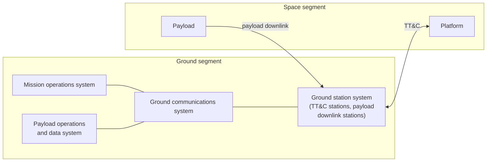
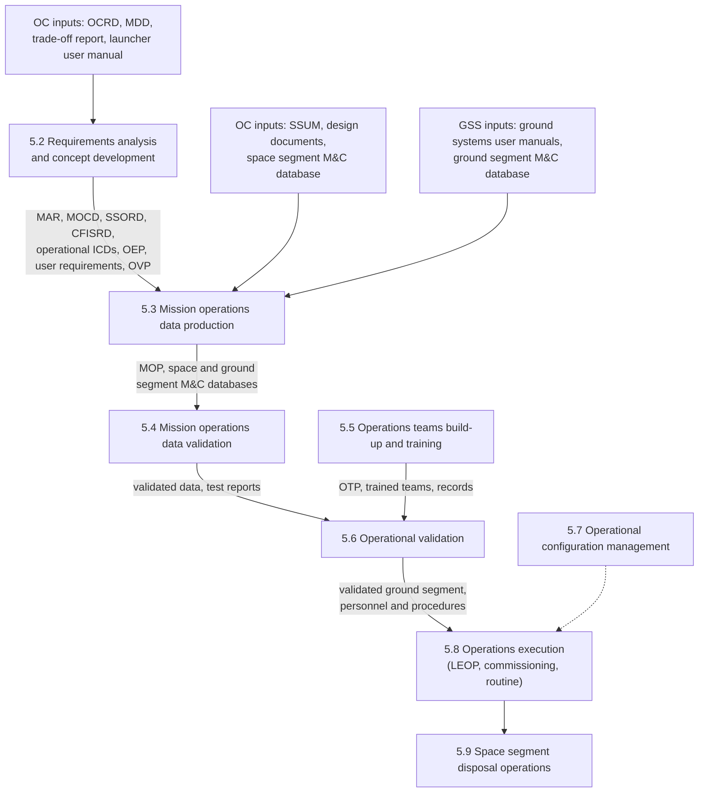
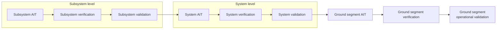
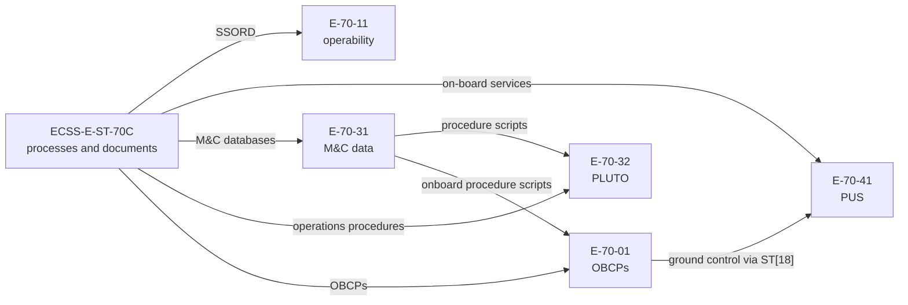

# ECSS-E-ST-70C: ground systems and operations

**ECSS-E-ST-70C** ("Space engineering – Ground systems and operations", 31 July 2008) is the
top-level ECSS standard of the E-70 discipline. It holds the basic rules, principles and requirements
for engineering the **ground segment** and for preparing and conducting **mission operations**, and it
defines the customer-supplier relationships for both: a customer with a **ground segment supplier**
(GSS) and a customer with an **operations supplier** (OS).[^scope] It does not cover EGSE and the
operations that support space segment verification (that is ECSS-E-ST-10-02) nor the launch segment
and its operations.[^scope]

Where the other E-70 standards on this wiki describe *things* - the spacecraft's operability
([ECSS-E-ST-70-11](e-st-70-11c.md)), its monitoring and control data ([ECSS-E-ST-70-31](e-st-70-31c.md)),
procedure languages on the ground ([ECSS-E-ST-70-32](e-st-70-32c.md)) and on board
([ECSS-E-ST-70-01](e-st-70-01c.md)), and the packet services ([ECSS-E-ST-70-41, the PUS](pus/index.md)) -
this standard describes the *processes and documents* in which those things are produced, validated
and used, and it lists the others as its level 3 standards.[^annexL]

!!! info "At a glance"
    | Item | Value |
    |---|---|
    | Issues | ECSS-E-70 Part 1A "Principles and requirements" (25 April 2000) and Part 2A "Document requirements definition" (2 April 2001); B never issued; **ECSS-E-ST-70C (31 July 2008)** merges both[^cl] |
    | Status (ECSS tree, October 2025) | Published; no update shown as ongoing or planned[^tree4] |
    | Normative references | ECSS-S-ST-00-01, ECSS-E-ST-10, -10-02, -10-06, ECSS-E-ST-40, ECSS-M-ST-40, ECSS-M-ST-70, ECSS-Q-ST-10-09, ECSS-Q-ST-80[^refs] |
    | Structure | Clause 4 domain; clause 5 operations engineering (8 processes); clause 6 ground segment engineering (5 processes); clause 7 lifecycle (phases A to F); Annexes A–J normative DRDs; K commonality; L level 3 standards[^toc] |
    | Reviews defined | CRR, GSSRR, GSPDR, GSCDR, GSQR, COR, ORR, FQR, IOORs, ELR, MCR (plus the space-system reviews of ECSS-M-ST-10)[^t79] |

## What changed from the A issues

The 2008 issue replaced the phase-based approach of ECSS-E-70A with a **process approach**:
operations engineering and ground segment engineering are separate processes (and disciplines),
projected onto the ECSS-M-10 lifecycle model. It identifies separate customer-supplier relationships
for operations and for the ground segment and accepts different procurement models (one organisation
supplying both, or two). It aligns with ECSS-E-ST-10C system engineering in processes, documents,
reviews and terminology, reviews the interfaces with spacecraft design and manufacture (adding the
CFISRD), assumes **no reference architecture** for the ground segment (functions are listed without
saying how they are grouped), and brings the document requirements definitions (DRDs) into normative
annexes. New DRDs are the mission analysis report (MAR), mission operations plan (MOP), customer
furnished items and services requirements document (CFISRD), operations engineering plan (OEP) and
ground segment system engineering plan.[^cl]

## Terms

| Term (§3.2) | Definition (paraphrased) |
|---|---|
| entity | A combination of ground systems and the associated personnel or operations organisation |
| ground segment | The ground systems needed to prepare or execute mission operations |
| ground segment operations | Planning, execution and evaluation of operations of the ground segment or parts of it |
| ground segment customer (GSC) / supplier (GSS) | The party procuring / supplying the ground segment |
| ground system | An integrated set of ground functions supporting operations preparation or execution |
| incident | In service provision, an enquiry, observation or anomaly that relates to, causes or can cause an interruption or quality reduction of the service |
| mission | Objectives achieved by a space system, characterised by its expected products (quantity, quality, availability) |
| mission exploitation | Planning, generation, use and evaluation of the products of the mission |
| mission information | Information on space and ground segments before and after launch: design and operations characteristics, test and operations procedures, TM/TC characteristics; source data from the operations customer and GSS plus data derived by the operations teams |
| mission operations | Planning, execution and evaluation of operations of the combined space and ground segments in phases E and F |
| mission operations data | The subset of mission information used to execute in-orbit operations: operations procedures, operations rules, monitoring and control databases |
| mission products | Products and services delivered by the space system (communications services, science data) |
| operational validation | Tests (simulations, rehearsals) establishing that the complete ground segment, its mission operations data and its staff are ready; its completion gives a qualified ground segment |
| operations customer (OC) / supplier (OS) | The party procuring / preparing and executing the space and ground segment operations; OC and GSC are usually the same entity |
| space segment operations | Planning, execution and evaluation of space segment operations in orbit |
| synthetic parameter | A parameter derived from telemetry and other data by an algorithm |

Source: §3.2.[^terms] The abbreviation list (§3.3) is long; the ones used most on this page are
collected in the [glossary](../glossary.md).[^abbr]

## The domain (clause 4)

The domain of the standard has two components: the **ground segment** (every ground system used
to prepare, conduct and close operations) and the **operations organisations** (the people). An
**entity** combines an operations organisation with its ground systems, for example a control centre
with its mission control team, or a ground station with its operations and maintenance staff.[^c41]
Teams typically include operations managers, spacecraft operators (astronauts, operations engineers,
spacecraft analysts, spacecraft controllers), payload operators, mission planners, flight dynamics
engineers, ground systems operators, mission exploitation staff and ground systems maintenance
engineers.[^c42]

The ground segment typically consists of four top-level systems, which can be distributed over
several centres:[^c43]



Ground segment systems, after Figure 4-2.[^c43]

| System | Functions it typically supports |
|---|---|
| Mission operations system | Mission analysis; operations preparation; simulation; mission planning and scheduling; monitoring and control; flight dynamics; on-board software maintenance and management; data archiving; user services; data product delivery; performance analysis and reporting; configuration management (space segment, ground segment, mission information); system maintenance |
| Payload operations and data system | Payload operations analysis, preparation, planning and scheduling, control; simulation; payload data processing and archiving; user services; data product delivery; performance analysis; algorithm tuning, development and validation; system maintenance |
| Ground station system | TM reception, storage and distribution; TC transmission; tracking, ranging, Doppler and meteorological data; station monitoring and control; time management; network management and scheduling; data distribution; maintenance |
| Ground communications system | Data distribution; voice and video; maintenance |

Source: §4.3.2 to §4.3.5.[^c43] In ESA's world these map onto systems described elsewhere on this
wiki: [SCOS-2000](../scos2000/index.md) for monitoring and control, its
[archives](../scos2000/archives.md) and [data dissemination](../scos2000/edds.md), and the
[NCTRS and ground station interface](../scos2000/nctrs-nis.md).

Two engineering disciplines act on this domain: **operations engineering** (preparing and executing
mission operations) and **ground segment engineering** (defining, designing, producing, integrating,
verifying and maintaining the ground segment). They are separate process chains with many links, and
both contribute to the space segment requirements and to reviews of the on-board design.[^c44] The
standard singles out critical areas for coordination: mission concepts with due weight on ground and
operations aspects; spacecraft operability and maintainability; the adequacy of what the operations
customer delivers; end-to-end validation; reuse of operations knowledge and data (TM/TC definitions,
procedures) from spacecraft design through AIT to operations; commonality between ground services and
between AIT and operations; security and safety; and communications design and cost.[^c45]

## Operations engineering (clause 5)



Operations engineering processes and their main products, after Figure 5-1.[^c51][^f51]

### 5.2 Requirements analysis and concept development

The inputs are the **operations customer requirements document** (OCRD, the "initial technical
specification" of ECSS-E-ST-10-06 tailored to operations, written with the end users), the
**mission description document** (mission analysis, system description and operations scenarios for
each concept), the space-system **trade-off report** and the **launcher user manual**; the first three
are phase 0 products.[^c521]

* **Mission analysis** characterises launcher, ground station, spacecraft, mission-specific (for
  example station-keeping windows, orbit phasing), payload and data flow constraints, and supplies
  13 items: launch window, separation sequence, target orbit, positioning strategy, orbit
  determination concept, schedule of operational events (nominal and planned contingencies), station
  coverage, analysis of high-risk sequences, interference risk with flying spacecraft, delta-V budget,
  environmental impacts (sensor blinding, eclipses), payload operations strategy and data circulation
  scheme. Output: the MAR.[^c5221]
* **Operational analysis** checks the customer requirements, assesses feasibility, finds the drivers,
  defines the mission operations concept and derives requirements on operations engineering and the
  ground segment, and contributes to interface definition. Output: the **mission operations concept
  document** (MOCD).[^c5222]
* **Operational interfaces**: space segment operability requirements are compiled in the **space
  segment operability requirements document** (SSORD), described as a tailored version of
  ECSS-E-ST-70-11; on-board mission operations services and their requests and reports are defined
  with the OC (ECSS-E-ST-70-41 can be tailored for this, or a standalone document or the
  space-to-ground ICD used); external interfaces go into **operational ICDs** (contacts, services,
  data exchange formats and methods) that later join the MOP; and the deliverables and services
  required from the OC go into the CFISRD.[^c5223]
* The **operations engineering plan** (OEP) gives the schedule for producing and validating mission
  operations data, the team organisation and the recruitment profile; it exists so that operations
  manpower can be costed and recruited on time, and may be merged with the GSEP when GSS and OS are
  one organisation.[^c5224]
* **User requirements** are written for the ground segment and each ground system and for
  validation, training and simulation tools, covering functionality and performance, **automation
  requirements** matching the operations concept and staffing profile, centralisation or
  decentralisation, user management and human-computer interaction.[^c5225]
* The **operational validation plan** (OVP) covers test preparation, resources, strategies, methods,
  scenarios, pass/fail criteria and post-test activities.[^c5226]

The CFISRD items listed in §5.2.2.3f are worth reading in full because they are exactly the
interfaces between spacecraft project and operations: space segment documents (SSUM, detailed design,
spacecraft monitoring and control database); procedures validated during spacecraft AIT;
representative TM/TC samples including payload data; a **suitcase** for TT&C compatibility tests;
access to the spacecraft on ground; the operational simulator and space segment models; on-board
software and documentation; data processing tools (mission-specific decommutation, derived-parameter
algorithms); the software development environment and validation benches for on-board software
maintenance; engineering support during ground segment design and phases E and F; support for
in-orbit control in designated phases; and site infrastructure.[^c5223]

| Outputs of §5.2 (Table 5-2) | Producer |
|---|---|
| Mission analysis report (MAR) | OS |
| Mission operations concept document (MOCD) | OS |
| Space segment operability requirements document (SSORD) | OS |
| Customer furnished items and services requirements document (CFISRD) | OS |
| ICDs for operational interfaces with external entities | OS |
| Operations engineering plan (OEP) | OS |
| User requirements for the ground segment and ground systems, including validation, training and simulation tools | OS |
| Operational validation plan (OVP) | OS |

Source: Table 5-2.[^c523]

!!! warning "Inference"
    ESA's missions publish an **operations interface requirements document** (OIRD) for the
    spacecraft, prepared by ESA and tightly coupled with CCSDS and ECSS standards; since 2019 mission
    OIRDs start from a generic OIRD built on ECSS-E-ST-70-11C, -70-41C and -70-01C.[^goird-intro][^goird-struct]
    This plays the role that ECSS-E-ST-70C gives the SSORD. The standard itself does not mention OIRDs.

### 5.3 Mission operations data production

The inputs are the MAR, MOCD and operational ICDs from the OS; the **space segment user manual**
(SSUM), detailed design documents and space segment monitoring and control database from the OC; and
the ground systems user manuals and ground segment monitoring and control database from the GSS.[^c531]
The process documents everything needed for in-orbit monitoring and control in the **mission
operations plan** (MOP): organisation, responsibilities, decision making and major mission rules; the
sequence of main events of all critical phases (station visibility, major operations); timed
operations schedules for every critical operation (each team member's activities, interfaces,
external constraints; LEOP, commissioning, fly-bys, orbit insertions); operations procedures for
nominal and contingency operations of both segments; and disposal procedures.[^c532] Further rules:[^c532]

* An independently operated entity gets a sub-plan of the MOP (should).
* Every operations procedure states its required authorisation level, applicability, and execution
  conditions and constraints before, during and after execution.
* Space segment procedures are made by **expanding the procedures in the SSUM** with ground
  segment specifics.
* The monitoring and control databases are populated with mission data for space and ground
  segment processing, which includes mission planning data, **OBCPs**, TM/TC definitions, display
  definitions, on-board software images and patches.
* Mission exploitation data (processing databases, user databases) and a flight dynamics schedule
  are established.
* Before delivery, the OC verifies its inputs against representative space segment models, at least
  the space segment monitoring and control database and the SSUM procedures.

The outputs are the MOP and the space and ground segment monitoring and control databases.[^c533]

### 5.4 Mission operations data validation

Mission operations data must be validated to show that it is correct and compatible with the space
segment; inspection is enough for some data (parameter descriptions, non-testable procedures).
Validation uses tools representative of the space segment design - chiefly the operational
simulator - and a flight-representative space segment, exercising all operations procedures and
telecommands, all spacecraft modes including non-nominal ones, and all redundancies (within the
limits of operating space hardware on the ground). These tests are sometimes called **system
validation tests** (SVTs). Results and the validation status of each data item are recorded.[^c54]

### 5.5 Operations teams build-up and training

Operations are carried out by teams; a typical organisation has a mission control team, a flight
dynamics team (orbit and attitude determination and prediction, manoeuvre preparation, sensor
calibration), ground operations teams (stations, communications, control centre), a mission
exploitation team (payload data planning, processing and distribution) and ground segment and space
segment support teams of experts. Roles are defined per team member and mission phase; teams are
trained before operational validation starts through theory, realistic simulations, rehearsals of
operational and contingency scenarios; training is documented in the **operations training plan**
(OTP) and recorded per person.[^c55]

### 5.6 Operational validation

Operational validation takes place in a realistic operational context and demonstrates that the whole
ground segment and its interfaces work, that all mission operations data is correct, that all staff
are qualified and that the teams can support the mission (for LEOP, the LEOP network and its staff
too). It includes:[^c56]

| Activity | Purpose |
|---|---|
| Simulations and rehearsals | Teams execute nominal and contingency scenarios of the MOP with the operational simulator in place of the spacecraft |
| Mission readiness tests (MRTs) | Validate ground station readiness and train station and network staff |
| Data flow tests (DFTs) | Validate TM, TC and tracking interfaces between stations and control centre, and between other ground systems (for example payload data circulation) |
| Tracking campaigns | Validate end-to-end ranging and Doppler with missions already flying |

It follows the OVP, records unexpected behaviour in the operational validation report, ends with a
ground segment acceptance report, is supported by the GSS, and wraps major tests in test readiness and
post-test reviews per ECSS-E-ST-10-02. Afterwards, change authority for the ground segment - including
shared infrastructure such as LANs, firewalls, power, cabling and buildings - passes to a formal change
control board.[^c56]

### 5.7 Operational configuration management

Mission operations data and the space segment are kept functional and under configuration control
(per ECSS-M-ST-40) through preparation and execution; changes go through the same processes as the
original design, development and verification, with definition, implementation, verification,
operational validation and formal authorisation. Teams are kept operational; replacement staff are
formally trained and exercised in simulations before working autonomously.[^c57]

### 5.8 Operations execution

Operations run from launch to disposal and divide into **critical phases** (LEOP, commissioning,
planetary fly-by or orbit insertion, rendezvous and docking, retrieval) and **routine phases**
(exploitation, cruise, hibernation).[^c5821]

* **Critical operations** are executed per the MOP by staff able to detect and respond to unexpected
  behaviour in line with the FDIR approach of the SSUM, with managers present for authorisations and
  facilities augmented as needed.[^c5822]
* **Routine operations**: mission planning from user requests and constraints; detailed schedules
  produced and executed; each activity's execution verified; health monitoring of both segments;
  monitoring and control data archived for troubleshooting and performance analysis; performance
  evaluated; payload data processed, archived and distributed with ancillary data; corrective
  actions or contingency procedures invoked on anomalies; a new plan and procedures produced, validated
  and approved for contingencies not covered by the MOP; a revised mission plan agreed with the OC
  after a major anomaly; and an **anomaly review board** (also acting as nonconformance review board
  per ECSS-Q-ST-10-09).[^c5823]
* **Reporting**: periodic operations status reports (for example daily in LEOP, weekly in routine
  operations), an engineering assessment report after LEOP or critical operations, a commissioning
  report, performance reports with trend analysis, **operations anomaly reports** (OARs) tracked to
  closure for the whole mission, and reports on operations experience, lessons learned, in-orbit
  performance and end-of-life tests.[^c5824]

Outputs include the spacecraft in its final orbit configured for exploitation, LEOP, commissioning and
routine reports, the mission history archive (telemetry, telecommand history), plans and schedules,
performance and trend data, mission products, OARs and mission reports.[^c583]

### 5.9 Space segment disposal operations

Disposal operations comprise analyses, development and validation of disposal products and processes,
and final de-orbiting, re-entry or retrieval, with disposal or recycling of retrieved elements. The
analysis covers storage, dismantling, reuse, recycling or destruction, cost and organisation; rules,
procedures and timelines go into a disposal operations plan (part of the MOP) that respects space
debris mitigation and launch authority requirements.[^c59]

## Ground segment engineering (clause 6)

The five ground segment engineering processes are definition, production, AIT and verification,
maintenance and disposal; logistics support activities are included throughout.[^c61]

### 6.2 Ground segment definition

The inputs are the **ground segment customer requirements document** (GSCRD), the MDD, the MOCD and a
draft **space-to-ground ICD** (SGICD).[^c621] Four sub-processes follow:[^c622]

* **Requirements engineering** produces the **ground segment requirements document** (GSRD) from the
  GSCRD and the operations supplier's user requirements, covering 16 topics: functionality;
  performance and dependability derived from space system requirements; security; mission safety;
  operations and logistics support; internal and external interfaces; reuse of generic infrastructure;
  maintainability; location and site diversity; failure-case operations, recovery and fall-back;
  system management (user administration, access, equipment configuration, performance monitoring);
  configuration management; network design and management; commonality; interoperability (for example
  other agencies' stations).
* **Design engineering** records the architecture, down to individual ground systems and including
  integrated logistics support, in the **ground segment design definition file** (GSDDF); defines the
  verification and validation approach; analyses reuse of existing and multi-mission systems; defines
  internal and external interfaces; identifies critical elements with their reliability,
  availability, maintainability and safety requirements; justifies the design in the **ground segment
  design justification file** (GSDJF); writes the **ground segment engineering plan** (GSEP) per the
  ECSS-E-ST-10 system engineering plan; produces the ground segment AIT and verification plans; and
  contributes RF, voice, video and high-rate data interfaces to the SGICD (pointing to CCSDS 701.0-B-2).
* **Ground systems requirements engineering** writes a requirements document for each ground system,
  with at least functional, performance, interface, design, operational, environment, resource,
  RAMS, security and verification requirements, applying ECSS-E-ST-40 for software, tracing to the
  GSRD and generating ICDs for every external interface.
* **Logistics support preparation** produces a logistics support plan covering staffing and training,
  spares, support equipment, software support, packaging, handling, storage and transport, and shared
  versus mission-procured resources.

### 6.3 Ground segment production

Each ground system follows the ECSS-E-ST-10 system engineering process recursively (definition,
production, AIT and verification, maintenance), whether it operates the mission or supports testing,
maintenance or training; an operational simulator supplied by the space segment supplier or a third
party is treated as a ground system. Reuse of existing systems is analysed; ECSS-E-ST-40 and
ECSS-Q-ST-80 apply to software; suppliers support delivery, installation and on-site acceptance;
qualification or acceptance tests (possibly including a factory acceptance test) run against the
system requirements in the target environment; acceptance reports, user manuals and maintenance
manuals and procedures are produced for every system.[^c63]

### 6.4 Ground segment AIT and verification



Ground segment AIT and verification, after Figure 6-2; each arrow passes a checkpoint or review. The
last box belongs to operations engineering (§5.6).[^c641]

AIT uses a preliminary set of mission operations data and proceeds incrementally from low-level
subsystems, with a verification test (conformance with design and interfaces) and a validation test
(preliminary fitness for use) at each stage. Verification then addresses the ground segment as a whole:
conformance to requirements, functional coherence and compatibility of the ground systems,
**compatibility with the space segment**, compatibility with external entities through end-to-end
tests, and a first exposure to realistic operational conditions. Any later modification requires
non-regression testing.[^c641][^c642]

Space segment compatibility testing may use a suitcase representative of the spacecraft TT&C
hardware and software, an operational simulator (with emulators or even real spacecraft components in
a hybrid simulator), representative TM samples and access to the spacecraft during its AIT and at the
launch site. At least **two test periods** are needed, long enough for the spacecraft's complexity and
far enough apart to correct ground problems found in the first; **listen-in tests**, open-loop routing
of AIT telemetry to the control centre, are usually added when possible. Compatibility tests include
the mission operations data (databases, procedures, command schedules). Results are reviewed at the
**ground segment qualification review** (GSQR).[^c643]

### 6.5 Maintenance and 6.6 disposal

Maintenance keeps the ground segment within its availability and performance requirements and covers
obsolescence and migrations (for example when computers or operating systems reach end of service):
regular performance monitoring and reports, routine maintenance per procedures with a log, **incident
management** (log incidents and restore service), **problem management** (diagnose root causes,
trend analysis, raise change requests), **change management** (impact assessment, planning, new
releases into operations), **configuration management** (a configuration database covering hardware,
network, software including COTS, documentation, configuration data and mission operations data) and
obsolescence management.[^c65] Disposal analyses storage, dismantling, reuse, recycling and
destruction, keeps mission data accessible for an agreed duration, and produces a disposal report and
data archives with post-mission consolidated data and access tools.[^c66]

## Lifecycle and reviews (clause 7)

The ground segment processes are allocated to ECSS-M-ST-10 phases ending in formal reviews; the
ground segment phases are not necessarily aligned with those of the space system, but they are
strongly interdependent. GSC, OC, GSS and OS are represented in all ground segment and operations
reviews, which should be combined where practical; incremental missions (the standard cites ISS and
ATV) repeat the lifecycle per increment.[^c71]

| Phase | Purpose | Main processes and outputs | Closing review(s) |
|---|---|---|---|
| A | Mission and operational analysis, feasibility, conceptual design | Draft MAR; draft MOCD; preliminary SGICD inputs; SSORD; CFISRD; preliminary GSEP with the necessary ground systems and use of existing facilities | CRR (after the space system PRR) |
| B | Preliminary design | GSRD; SGICD contributions; preliminary logistics support plan; MAR; MOCD; preliminary OEP; preliminary GSDDF, GSDJF, GSEP; AIT and verification plans; ground systems requirements; preliminary external ICDs | GSSRR during the phase; GSPDR at the end (after the space system PDR), which also selects the main ground segment supplier |
| C | Detailed design; operations organisation; start of mission operations data production | Final SGICD inputs; GSDDF, GSDJF, final GSEP; ground systems design documents; OEP; final SSORD and CFISRD; MAR with preliminary sequence of events; preliminary MOP and M&C databases | GSCDR |
| D | Production, AIT and verification, in four possibly overlapping sub-phases: production, AIT and verification, data validation, operational validation | Final MAR; qualified ground systems, test and training tools, reports and manuals; qualified ground segment and data; maintenance and logistics plan; MOP and M&C databases; final OVP; validated MOP and databases; final OTP, training material, trained teams; operational validation reports; fully validated ground segment | GSQR (can be the preliminary acceptance), COR (can be combined with the GSQR), ORR (normally the final acceptance; results presented at the FRR) |
| E1 | Test and commissioning of space and ground segments | LEOP report; commissioned space segment and commissioning report; ground segment configured for operations | FQR |
| E2 | Utilisation | Routine reports; mission history archive; plans and schedules; performance and trend data; mission products; OARs; trained teams; maintained ground systems; MOP disposal sections | IOORs (regular, for example yearly); ELR at the end |
| F | Disposal | Disposed space and ground segments with reports; mission reports | MCR |

Sources: §7.2 to §7.7, Tables 7-1 to 7-7.[^c72][^c73][^c74][^c75][^c76][^c77]

| Review | Objective | When | Chaired by |
|---|---|---|---|
| CRR, customer requirements review | Completeness of the customer requirements; draft operations concept and ground segment baseline | End of phase A | OC and GSC |
| GSSRR, ground segment system requirements review | Approve the ground segment requirements so that preliminary design and ground systems requirements can proceed | During phase B | GSC |
| GSPDR, ground segment preliminary design review | Approve the preliminary design; select the main supplier | End of phase B | GSC |
| GSCDR, ground segment critical design review | Customer acceptance of the detailed design | End of phase C | GSC |
| GSQR, ground segment qualification review | Conformance to technical requirements; readiness for operational validation | Phase D, end of AIT and verification | GSS |
| COR, critical operations review | All mission operations data validated; documentation ready for training and operational validation | Phase D, end of data validation | OC |
| ORR, operational readiness review | Full readiness for in-orbit operations; authorise use; all procedures validated; teams ready | End of phase D | OC |
| FQR, flight qualification review | Performance after commissioning; readiness for exploitation | End of phase E1 | OC and GSC |
| IOORs, in-orbit operations reviews | Regular assessment of space and ground segment performance | Phase E2 (for example yearly) | OC and GSC |
| ELR, end-of-life review | Useful service complete; disposal procedures in place | End of phase E2 | OC and GSC |
| MCR, mission close-out review | Performance of the services provided; proper disposal of both segments | End of phase F | OC and GSC |

Source: Table 7-9.[^t79] Table 7-8 lists for every key document at which reviews it is delivered as a
preliminary issue (P), a final issue approved by the supplier and given to the customer for
information (F), or an issue approved by the customer (A), grouping documents by domain (space system,
ground segment, ground system, logistics, operations) and type (requirements, interface, plan,
specification, report, miscellaneous).[^t78]

??? note "Table 7-8 by document (read from the PDF page images)"
    The text layer of the PDF loses the column in which each release mark sits, so this summary
    was read from images of PDF pp. 79–80. Columns not listed are empty; the table has an FRR
    column although the FRR is a space system review.[^t78]

    | Document (reference given in the table) | P (preliminary) | F (final, for information) | A (approved by customer) |
    |---|---|---|---|
    | MDD (ECSS-E-ST-10) | – | – | CRR |
    | OCRD, GSCRD ("Annex B") | – | CRR | GSSRR |
    | SSUM ("Annex F") | – | – | COR |
    | Trade-off report (ECSS-E-ST-10) | – | – | CRR |
    | Launcher user manual | – | CRR | – |
    | SGICD (ECSS-E-ST-10) | CRR | GSSRR | GSCDR |
    | SSORD (ECSS-E-ST-70-11), CFISRD ("Annex K") | – | CRR | GSCDR |
    | GSRD (ECSS-E-ST-10-06) | – | GSSRR | – |
    | GSEP (ECSS-E-ST-10) | CRR, GSPDR | GSCDR | – |
    | ICDs for internal and external entities, GSDDF, GSDJF, configuration management plan, GSAITP, GSVP | GSPDR | GSCDR | – |
    | Ground systems requirements documents (ECSS-E-ST-10-06) | – | GSPDR | – |
    | Configuration status report; integration and test reports; verification reports; ground systems user and maintenance manuals | – | GSQR | – |
    | Logistics support plan (LSP) | CRR | GSQR | – |
    | MAR ("Annex C") | CRR | GSSRR, GSPDR, GSCDR, GSQR | – |
    | MOCD ("Annex D") | CRR | GSSRR, GSPDR | – |
    | OEP ("Annex E") | GSPDR | GSCDR | – |
    | OVP ("Annex G"), OTP | – | COR | – |
    | MOP ("Annex H") | – | COR | ORR, FRR, ELR |
    | Operational validation reports | – | COR, ORR, FRR | – |
    | LEOP reports, commissioning report | – | FQR | – |
    | Performance reports, routine operations reports, OARs ("Annex I") | – | IOOR | – |
    | Mission reports | – | – | – |
    | Disposal operations reports | – | MCR | – |

!!! warning "Inference"
    Some cross-references in the 2008 text look inconsistent, as read by this wiki:

    * The "Reference" column of Table 7-8 and the annex pointers in Tables 7-1 and 7-6 appear shifted
      by one letter from the actual annexes (for example the MAR is cited as Annex C but is Annex B,
      and the OAR as Annex I but is Annex H).[^t78][^c72][^c76][^toc]
    * Figure 7-1 labels the review at the end of mission operations data validation "OQR", and §3.3
      expands OQR as "operational qualification review", while the text and Table 7-9 call it the
      COR, critical operations review, which is not in the abbreviation list.[^f71][^abbr][^t79]
    * Figure 7-1 also shows a "CRR" among the space system reviews of phase E1; ECSS-E-ST-70C uses CRR
      only for its customer requirements review, and the meaning of the E1 review is not stated in
      the available sources.[^f71]

## The document requirements definitions (Annexes A–J)

| Annex | DRD | Called from | Purpose and key contents |
|---|---|---|---|
| A | Customer requirements document (CRD), used as OCRD and GSCRD | 5.2.1b, 6.2.1b | Top-level assumptions, constraints and operations requirements: mission overview, responsibilities, milestones, constraints (launcher, orbits, operational phases, RF and antenna constraints), operations requirements by function (planning and scheduling, monitoring and control, performance evaluation, flight dynamics, payload operations and data management, on-board software maintenance); for the GSCRD, 11 requirement classes per function from functional to HCI; OCRD and GSCRD may be merged, and a large GSCRD split by entity (for example flight operations segment and payload data segment) |
| B | Mission analysis report (MAR) | 5.2.2.1c | Mission requirements and constraints; overview; launch and early orbit (windows, sequence, eclipses, coverage, injection errors, orbit determination, orbit acquisition strategy); transfer and planetary insertion for interplanetary missions; routine phase (orbit evolution, collision avoidance, eclipses, coverage, payload strategy and constraints, data circulation, occultations, phasing); propellant budgets |
| C | Mission operations concept document (MOCD) | 5.2.2.2b | Requirements and constraints (mission, end users, programmatic constraints, related missions, external dependencies); space segment characteristics (autonomy, data generation, storage and downlink); operations concepts per phase for planning, execution (schedule and procedure execution, manual commanding, pre-transmission validation, command verification, history archiving, health monitoring, FDIR), evaluation, exploitation and support processes; reuse, new developments and trade-offs (for example ground automation versus manual operation) |
| D | Operations engineering plan (OEP) | 5.2.2.4a.4 | Mission overview; lifecycle, reviews and critical path; for each operations engineering process: inputs, manpower and skills, tools, other resources, interrelations, outputs; mission operations teams (structure, roles, reporting and support channels, recruitment profiles); may be merged with the GSEP |
| E | Space segment user manual (SSUM) | 5.3.1b | Mission definition and analysis results; satellite design, system-level autonomy, configurations, budgets (mass, power, thermal, RF links, TM/TC rates, memory, timing, pointing and more), SGICD reference, timelines, modes and transitions, FMEA/FMECA and FTA; per subsystem and payload: design, units, software (design, services cross-referenced to ECSS-E-ST-70-41 as tailored, TM/TC structures, memory maps), performance, **TM and TC lists** (provided in the space segment monitoring and control database, which formally belongs to the SSUM), failure analysis, modes and nominal and contingency procedures structured in steps, payload data definition |
| F | Operational validation plan (OVP) | 5.2.2.6c | Objectives, schedule, success criteria; management and responsibilities (including simulations officers); ORR procedure; simulations and rehearsals (timetable, briefings, teams, scenarios referenced to the MOP, configurations and versions, tools); ground segment readiness tests (MRTs, DFTs); records and reports (simulation logs and reports, readiness test reports, anomaly and action records) |
| G | Mission operations plan (MOP) | 5.3.2k | Mission management (summary, mission rules from launch hold criteria to mission termination criteria, organisation and charts, briefing and debriefing, reporting and on-call, operational ICDs, configuration control after the pre-launch freeze); per mission phase: events, implementation strategy, timelines (activity, start time, executing position, background activities, procedure references, briefing breakpoints); operations procedures with an applicability and authorisation matrix, organised hierarchically, able to call each other; hand-over procedures between authorities |
| H | Operations anomaly report (OAR) | 5.8.2.4e | Unique mission-level number; context, suspected source, title, time, **severity** (no impact, minor impact, major impact), originators, authorisation, distribution, version, status and actionee; description and first-occurrence flag; details with supporting TM reports, TC history, logs and mission data; chronicle of actions; operational impact (outages, re-planning, redundancies); recommendations and schedule |
| I | Operations procedures | 5.3.2l | See below |
| J | Customer furnished items and services requirements document (CFISRD) | 5.2.2.3g | Mission information classes to deliver (SSUM, design documents, M&C data including procedures, TM/TC database, other in-flight databases such as OBCPs, synthetic parameter and TM interpretation algorithms, flight dynamics database) with contents, media, format, validation and schedule; suitcase; space segment models for the simulator; on-board software deliveries (sources, images, maps, EEPROM loads) and responsibilities; OBSM facility; pre-launch access (listen-in tests, SVTs); pre-launch technical assistance and post-launch support with response times |

Sources: Annexes A to J.[^dA][^dB][^dC][^dD][^dE][^dF][^dG][^dH][^dI][^dJ]

### Annex I: what an operations procedure must contain

An operations procedure is the elementary building block of the MOP that achieves one operational
objective; it may be called by a mission timeline, an automatically executing schedule or another
procedure, or started manually. Each has a unique identification number, and the DRD applies to any
human-readable form, on paper or on a display:[^dI]

| Element | Content |
|---|---|
| Preliminary elements | Title, version and applicability date, author(s) |
| Introduction (informative, not executable) | Objective, execution context, goal and all possible results, figures |
| Required operational authority | Special authorisation for manual execution (for example the written authority of the spacecraft operations manager) |
| Expected duration | How long execution takes |
| Pre-conditions | Conditions that must hold before start, and conditions that prohibit start; referring to mission phase, ground and space segment configuration, orbit position or environment, and the status of other procedures |
| Procedure body | Steps executed in sequence or in parallel; each step structured like a procedure (pre-conditions, executable body, post-conditions) with its sequence of activities: uplink a TC, initiate a command stack or predefined sequence, execute a ground command (for example select a display), check telemetry values, wait until a time, for a delta time or while a condition holds, mission-specific activities |
| Contingency element | What to do when the system cannot be left as it is (for example a disabled protection, or an aborted orbital manoeuvre): suspend the body, act, then **resume**; or reach the goal another way and **stop**; or **abort** |
| Post conditions | How to verify that the goals were met; final status "terminated, success confirmed" or "terminated, failed (with reasons)" |

The same structure, made executable, is the [PLUTO](e-st-70-32c.md) procedure of ECSS-E-ST-70-32C,
whose watchdog actions "resume", "terminate" and "abort" mirror the three contingency outcomes.[^dI][^pluto]

!!! note "FCPs, CRPs and the FOP in ESA practice"
    The standard speaks of the MOP and of nominal and contingency operations procedures. ESA documents
    use other names for the same products. ECSS-E-ST-70-32C calls nominal and contingency procedures
    flight control procedures (FCPs) and places them in a "flight operations plan (FOP)".[^pluto-fcp]
    The Herschel/Planck OIRD names **flight control procedures** `FCP_<subsystem>_<nnnn>` and
    **contingency recovery procedures** `CRP_<subsystem>_<nnnn>`.[^oird-names] ESOC's preparation
    environment plans a "FOP Editor" for **flight operation procedures** maintained by the flight
    control team, re-engineered from MOIS Writer.[^trifin] ESOC's mission plans themselves carried the title "Flight
    Operations Plan", as the INTEGRAL example below shows.[^fop-toc] In the Solar Orbiter MIB, 2 243 of the
    3 404 command sequences name an FCP document as their source and 1 091 a CRP document.[^mib][^icd-csf]

??? example "SQL used"
    ```sql
    -- Solar Orbiter MIB 2025-09-16 (solo-2025-09-16.sqlite)
    SELECT count(*) FROM csf;                                   -- 3404
    SELECT CASE WHEN CSF_DOCNAME LIKE '%-FCP-%' THEN 'FCP'
                WHEN CSF_DOCNAME LIKE '%-CRP-%' THEN 'CRP' ELSE 'other' END k, count(*)
      FROM csf GROUP BY k;                                      -- FCP 2243, CRP 1091, other 70
    SELECT substr(CSF_DOCNAME,1,2), count(*) FROM csf
     WHERE CSF_DOCNAME LIKE '%-FCP-%' OR CSF_DOCNAME LIKE '%-CRP-%'
     GROUP BY 1 ORDER BY 2 DESC;                                -- DM 835, AC 331, ID 218, ...
    ```

### A real flight operations plan: INTEGRAL

ESOC's Flight Operations Plan for INTEGRAL (volume 1 "Mission Management", issue 2, 21 February
2003, written after the launch of 17 October 2002) shows what a MOP looks like in practice, a few
years before the 2008 issue of the standard. Volume 1 has five books:[^fop-toc]

| MOP DRD element (Annex G) | INTEGRAL FOP volume 1 |
|---|---|
| <3.1> Introduction: mission, ground segment, operations concept | Book 1 "Mission Summary": mission characteristics (highly eccentric orbit, apogee 153 600 km, perigee 9 000 km, 51.6° inclination, 72 h period; stations Redu, Goldstone and Villafranca as back-up), constraints, space and ground segment set-up, objectives; phases LEOP, commissioning (two months, started in parallel with LEOP) and routine (two years, extendable)[^fop-b1] |
| <3.3> Mission operations management | Book 2 "Management Set-Up" for the routine phase: tasks split between the operational ground segment (MOC, stations, communications) and the science ground segment (ISOC, ISDC), the organigram and responsibilities; LEOP and commissioning set-ups are in volumes 10 and 11[^fop-b2] |
| <3.2> Mission rules | Book 3 "Mission Rules": operational responsibility (the FOP's nominal and contingency flight procedures override all other procedures; deviations need the Flight Director's or spacecraft operations manager's permission); launch hold criteria (ground segment "not fully operational", countdown continues, versus "not operational", countdown stopped at the next check-point); spacecraft and instrument emergencies (loss of attitude, fuel, power or thermal criticality, loss of TM/TC, more than 24 h without station contact) with recovery by the matching contingency procedure or safe mode; redefinition of mission goals; mission termination criteria and run-down[^fop-b3] |
| <3.4> Configuration management and change control | Book 4: an overall configuration control board chaired by the Project Scientist plus local boards per centre; only flight procedures in the approved FOP may be used; changes to the FOP, the operational database and on-board software (through the on-board software maintenance system) need the spacecraft operations manager's approval[^fop-b4] |
| Reporting (§5.8.2.4) and OARs (Annex H) | Book 5 "Mission Reporting": mission-phase and study reports; routine shift, revolution, weekly, monthly and annual reports; an anomaly notification within one hour, followed by an anomaly report[^fop-b5] |
| <4> Mission phase operations and <5> operations procedures | Not in volume 1; mission rule 1.4 states that the FOP provides the timelines and the nominal and contingency flight procedures[^fop-b3] |

!!! warning "Inference"
    The column mapping is this wiki's. Only volume 1 of the INTEGRAL FOP is in the library, so how its
    procedure volumes are structured, and whether they follow the steps-and-contingency layout of
    Annex I, is not stated in the available sources.

## Commonality (Annex K)

Ground segments are frequently built from existing and multi-mission systems, so the design must
consider reuse with customisation and extension. Reuse happens between flight and ground segments
(space link elements, mission operations data), between projects (software with the same role, such
as monitoring and control, flight dynamics or planning), and in shared middleware and infrastructure.
Software commonality should follow the ECSS-Q-ST-80 rules on reuse; the candidate systems are the
mission operations system, the payload operations and data system, the EGSE, station monitoring and
control and data functions, and simulation, test and training tools; the reusable functions include
monitoring, commanding, database management, **procedure preparation, management and execution**,
archiving and distribution, performance evaluation, on-board software maintenance and HCI.[^dK] The
EGSE and the ground stations both face the space link and should consider common downlink reception,
uplink radiation and downlink and uplink data processing. Mission operations data (monitoring and
control definitions, displays) should be reused between manufacturer, checkout and operations, and
the monitoring and control systems used in those areas should have compatible databases.[^dK2]
[SCOS-2000 as EGSE](../scos2000/egse.md) and the [MIB](../mib/index.md) are ESA's realisation of this
recommendation, and [ECSS-E-ST-70-31C](e-st-70-31c.md) is the standard for the data that makes it
possible.

## How the level 3 standards fit (Annex L)

Annex L lists the level 3 standards of the domain and their scopes:[^annexL]

| Standard | Scope (paraphrased from Table L-1) | Where ECSS-E-ST-70C uses it | Wiki page |
|---|---|---|---|
| ECSS-E-ST-70-01 | On-board services for handling OBCPs, their development and maintenance lifecycle, essential characteristics of an OBCP language | OBCPs are part of the M&C databases (5.3.2f) and of the CFISRD (J) | [E-70-01](e-st-70-01c.md) |
| ECSS-E-ST-70-11 | Space segment requirements that ensure operability in orbit, grouped by operability category and by function or equipment | The SSORD is a tailored version of it (5.2.2.3b) | [E-70-11](e-st-70-11c.md) |
| ECSS-E-ST-70-31 | The monitoring and control data a supplier delivers at any integration level and to operations, its semantics and formats (the "what", not the "how"), within the space system model | Space and ground segment M&C databases (5.3) | [E-70-31](e-st-70-31c.md) |
| ECSS-E-ST-70-32 | Requirements on a common procedure language for checkout and operations, and the PLUTO language | Operations procedures (5.3, Annex I) | [E-70-32](e-st-70-32c.md) |
| ECSS-E-ST-70-41 | The PUS: application-level ground-space interface with standard services, minimum capability sets, requests and reports | On-board mission operations services (5.2.2.3c), SSUM software services (E) | [PUS](pus/index.md) |

Sources: Table L-1 and the clauses cited.[^annexL][^c5223][^c532][^dE][^dJ]



How the E-70 standards depend on each other, as stated in ECSS-E-ST-70C, -70-31C and -70-01C.[^annexL][^31-tab][^01-scope]

The level 3 standards point back: ECSS-E-ST-70-31C assumes conformance with ECSS-E-ST-50 and
ECSS-E-ST-70 and calls the data it defines part of the product's user manual "see ECSS-E-ST-70",
matching the SSUM DRD, in which the space segment monitoring and control database formally belongs to
the SSUM.[^31-scope][^31-intro][^dE] ECSS-E-ST-70-01C requires OBOPs to follow the ECSS-E-ST-70
operations procedure process.[^01-63]

## ECSS-E-70 in the document trees (November 2025)

ECSS publishes charts of all its documents. The November 2025 set places the **E-70 discipline,
ground systems and operations**, in the space engineering branch next to E-10 system engineering,
E-20 electrical and optical, E-30 mechanical, E-40 software, E-50 communications, E-60 control and
E-80 security; the other branches are space project management (M), product assurance (Q),
sustainability (U) and industrialization, production and maintenance (I), all under ECSS-S-ST-00 and
its glossary ECSS-S-ST-00-01.[^tree1]

| E-70 discipline, engineering branch chart (as of October 2025) | Marker |
|---|---|
| ECSS-E-ST-70C Ground systems and operations | published |
| ECSS-E-ST-70-01C On-board control procedures | published |
| ECSS-E-ST-70-11C Rev.1 Space segment operability | published |
| ECSS-E-ST-70-31C Ground systems and operations – Monitoring and control data definition | published |
| ECSS-E-ST-70-32C Test and operations procedure language | published |
| ECSS-E-ST-70-41C Telemetry and telecommand packet utilization | published, with **ECSS-E-ST-70-41C Rev.1** marked "U" (ongoing or planned update) |

Source: the engineering branch chart.[^tree4] The chart legend distinguishes published documents,
documents affected by the update of another (M), ongoing or planned updates (U) and new documents in
production or planned (N).[^tree4] The handbooks and technical memoranda chart (as of November 2024)
has an E-70 column with no entries, so the discipline has no published handbook.[^tree11] The current
state of the PUS revision is described on [PUS-A vs PUS-C](pus/pus-a-vs-pus-c.md).

!!! note "Dates of the charts"
    Each chart of the November 2025 file carries its own "as of" date: the disciplines overview is as
    of November 2025, the engineering branch as of October 2025 and the engineering handbooks as of
    November 2024.[^tree1][^tree4][^tree11]

## Related pages

* [ECSS: the European space standards system](index.md) and [the standards landscape](../overview/standards-map.md)
* The level 3 standards: [E-70-01 OBCPs](e-st-70-01c.md), [E-70-11 operability](e-st-70-11c.md), [E-70-31 M&C data](e-st-70-31c.md), [E-70-32 PLUTO](e-st-70-32c.md), [E-70-41 PUS](pus/index.md)
* [SCOS-2000](../scos2000/index.md), [ancillary systems and EGS-CC](../scos2000/ancillary-and-egs-cc.md) and [operations preparation](../scos2000/operations-preparation.md)
* [Herschel/Planck ground segment](../scos2000/herschel-planck-ground.md) and [Solar Orbiter](../missions/solar-orbiter/index.md)
* [The MIB](../mib/index.md) and [command sequences](../mib/sequences.md)

[^scope]: [ECSS-E-ST-70C, Ground systems and operations](../library/ecss-e-st-70c31july2008.md), clause 1 "Scope", PDF p. 11.
[^cl]: [ECSS-E-ST-70C](../library/ecss-e-st-70c31july2008.md), Change log, PDF pp. 3–4.
[^refs]: [ECSS-E-ST-70C](../library/ecss-e-st-70c31july2008.md), clause 2 "Normative references", PDF p. 12.
[^toc]: [ECSS-E-ST-70C](../library/ecss-e-st-70c31july2008.md), Table of contents, PDF pp. 5–9.
[^terms]: [ECSS-E-ST-70C](../library/ecss-e-st-70c31july2008.md), §3.2 "Terms specific to the present standard", PDF pp. 13–15.
[^abbr]: [ECSS-E-ST-70C](../library/ecss-e-st-70c31july2008.md), §3.3 "Abbreviated terms", PDF pp. 15–18.
[^c41]: [ECSS-E-ST-70C](../library/ecss-e-st-70c31july2008.md), §4.1 "Overview" and Figure 4-1, PDF pp. 19–20.
[^c42]: [ECSS-E-ST-70C](../library/ecss-e-st-70c31july2008.md), §4.2 "Operations organization", PDF pp. 19–20.
[^c43]: [ECSS-E-ST-70C](../library/ecss-e-st-70c31july2008.md), §4.3 "Ground systems" and Figure 4-2, PDF pp. 20–22.
[^c44]: [ECSS-E-ST-70C](../library/ecss-e-st-70c31july2008.md), §4.4 "Engineering processes", PDF p. 22.
[^c45]: [ECSS-E-ST-70C](../library/ecss-e-st-70c31july2008.md), §4.5 "Critical areas", PDF p. 23.
[^c51]: [ECSS-E-ST-70C](../library/ecss-e-st-70c31july2008.md), §5.1 "Overview", PDF p. 24.
[^f51]: [ECSS-E-ST-70C](../library/ecss-e-st-70c31july2008.md), Figure 5-1 "Schematic of operations engineering process", PDF pp. 25–26.
[^c521]: [ECSS-E-ST-70C](../library/ecss-e-st-70c31july2008.md), §5.2.1 "Inputs" and Table 5-1, PDF pp. 26–27.
[^c5221]: [ECSS-E-ST-70C](../library/ecss-e-st-70c31july2008.md), §5.2.2.1 "Mission analysis", PDF pp. 27–28.
[^c5222]: [ECSS-E-ST-70C](../library/ecss-e-st-70c31july2008.md), §5.2.2.2 "Operational analysis and concept development", PDF p. 28.
[^c5223]: [ECSS-E-ST-70C](../library/ecss-e-st-70c31july2008.md), §5.2.2.3 "Operational interfaces definition", PDF pp. 29–30.
[^c5224]: [ECSS-E-ST-70C](../library/ecss-e-st-70c31july2008.md), §5.2.2.4 "Operations engineering plan production", PDF pp. 30–31.
[^c5225]: [ECSS-E-ST-70C](../library/ecss-e-st-70c31july2008.md), §5.2.2.5 "Contribution to ground segment and ground systems requirements specification", PDF p. 31.
[^c5226]: [ECSS-E-ST-70C](../library/ecss-e-st-70c31july2008.md), §5.2.2.6 "Operational validation plan production", PDF p. 32.
[^c523]: [ECSS-E-ST-70C](../library/ecss-e-st-70c31july2008.md), §5.2.3 "Outputs", Table 5-2, PDF p. 32.
[^c531]: [ECSS-E-ST-70C](../library/ecss-e-st-70c31july2008.md), §5.3.1 "Inputs", Table 5-3, PDF p. 33.
[^c532]: [ECSS-E-ST-70C](../library/ecss-e-st-70c31july2008.md), §5.3.2 "Process description", PDF pp. 33–35.
[^c533]: [ECSS-E-ST-70C](../library/ecss-e-st-70c31july2008.md), §5.3.3 "Outputs", Table 5-4, PDF p. 35.
[^c54]: [ECSS-E-ST-70C](../library/ecss-e-st-70c31july2008.md), §5.4 "Mission operations data validation", PDF pp. 35–36.
[^c55]: [ECSS-E-ST-70C](../library/ecss-e-st-70c31july2008.md), §5.5 "Operations teams build-up and training", PDF pp. 36–38.
[^c56]: [ECSS-E-ST-70C](../library/ecss-e-st-70c31july2008.md), §5.6 "Operational validation", PDF pp. 38–40.
[^c57]: [ECSS-E-ST-70C](../library/ecss-e-st-70c31july2008.md), §5.7 "Operational configuration management", PDF pp. 40–41.
[^c5821]: [ECSS-E-ST-70C](../library/ecss-e-st-70c31july2008.md), §5.8.2.1 "Introduction", PDF p. 42.
[^c5822]: [ECSS-E-ST-70C](../library/ecss-e-st-70c31july2008.md), §5.8.2.2 "Critical mission operations", PDF p. 42.
[^c5823]: [ECSS-E-ST-70C](../library/ecss-e-st-70c31july2008.md), §5.8.2.3 "Routine mission operations", PDF p. 43.
[^c5824]: [ECSS-E-ST-70C](../library/ecss-e-st-70c31july2008.md), §5.8.2.4 "Reporting", PDF pp. 43–44.
[^c583]: [ECSS-E-ST-70C](../library/ecss-e-st-70c31july2008.md), §5.8.3 "Outputs", Table 5-14, PDF pp. 44–45.
[^c59]: [ECSS-E-ST-70C](../library/ecss-e-st-70c31july2008.md), §5.9 "Space segment disposal operations", PDF pp. 45–46.
[^c61]: [ECSS-E-ST-70C](../library/ecss-e-st-70c31july2008.md), §6.1 "Overview" and Figure 6-1, PDF pp. 47–48.
[^c621]: [ECSS-E-ST-70C](../library/ecss-e-st-70c31july2008.md), §6.2.1 "Inputs", Table 6-1, PDF p. 49.
[^c622]: [ECSS-E-ST-70C](../library/ecss-e-st-70c31july2008.md), §6.2.2 "Process description" (6.2.2.1 to 6.2.2.5) and §6.2.3, PDF pp. 49–53.
[^c63]: [ECSS-E-ST-70C](../library/ecss-e-st-70c31july2008.md), §6.3 "Ground segment production", PDF pp. 54–56.
[^c641]: [ECSS-E-ST-70C](../library/ecss-e-st-70c31july2008.md), §6.4.2.1 "General" and Figure 6-2, PDF pp. 57–58.
[^c642]: [ECSS-E-ST-70C](../library/ecss-e-st-70c31july2008.md), §6.4.2.2 "Ground segment AIT", PDF pp. 58–59.
[^c643]: [ECSS-E-ST-70C](../library/ecss-e-st-70c31july2008.md), §6.4.2.3 "Ground segment verification", PDF pp. 59–60.
[^c65]: [ECSS-E-ST-70C](../library/ecss-e-st-70c31july2008.md), §6.5 "Ground segment maintenance", PDF pp. 61–63.
[^c66]: [ECSS-E-ST-70C](../library/ecss-e-st-70c31july2008.md), §6.6 "Ground segment disposal", PDF pp. 63–64.
[^c71]: [ECSS-E-ST-70C](../library/ecss-e-st-70c31july2008.md), §7.1 "General", PDF pp. 65–67.
[^f71]: [ECSS-E-ST-70C](../library/ecss-e-st-70c31july2008.md), Figure 7-1 "Ground segment and operations phases", PDF p. 66.
[^c72]: [ECSS-E-ST-70C](../library/ecss-e-st-70c31july2008.md), §7.2 "Phase A", Table 7-1, PDF pp. 67–68.
[^c73]: [ECSS-E-ST-70C](../library/ecss-e-st-70c31july2008.md), §7.3 "Phase B", Table 7-2, PDF pp. 68–70.
[^c74]: [ECSS-E-ST-70C](../library/ecss-e-st-70c31july2008.md), §7.4 "Phase C", Table 7-3, PDF pp. 70–71.
[^c75]: [ECSS-E-ST-70C](../library/ecss-e-st-70c31july2008.md), §7.5 "Phase D", Table 7-4, PDF pp. 72–75.
[^c76]: [ECSS-E-ST-70C](../library/ecss-e-st-70c31july2008.md), §7.6 "Phase E", Tables 7-5 and 7-6, PDF pp. 75–77.
[^c77]: [ECSS-E-ST-70C](../library/ecss-e-st-70c31july2008.md), §7.7 "Phase F", Table 7-7, PDF pp. 77–78.
[^t78]: [ECSS-E-ST-70C](../library/ecss-e-st-70c31july2008.md), §7.8, Table 7-8 "Key ground segment and operations documents and reviews at which they are deliverable", PDF pp. 79–80.
[^t79]: [ECSS-E-ST-70C](../library/ecss-e-st-70c31july2008.md), §7.8, Table 7-9 "Ground segment and operations reviews", PDF pp. 81–82.
[^dA]: [ECSS-E-ST-70C](../library/ecss-e-st-70c31july2008.md), Annex A "Customer requirements document (CRD) - DRD", PDF pp. 83–85.
[^dB]: [ECSS-E-ST-70C](../library/ecss-e-st-70c31july2008.md), Annex B "Mission analysis report (MAR) - DRD", PDF pp. 86–88.
[^dC]: [ECSS-E-ST-70C](../library/ecss-e-st-70c31july2008.md), Annex C "Mission operations concept document (MOCD) - DRD", PDF pp. 89–93.
[^dD]: [ECSS-E-ST-70C](../library/ecss-e-st-70c31july2008.md), Annex D "Operations engineering plan (OEP) - DRD", PDF pp. 94–96.
[^dE]: [ECSS-E-ST-70C](../library/ecss-e-st-70c31july2008.md), Annex E "Space segment user manual (SSUM) - DRD", PDF pp. 97–104.
[^dF]: [ECSS-E-ST-70C](../library/ecss-e-st-70c31july2008.md), Annex F "Operational validation plan (OVP) - DRD", PDF pp. 105–107.
[^dG]: [ECSS-E-ST-70C](../library/ecss-e-st-70c31july2008.md), Annex G "Mission operations plan (MOP) - DRD", PDF pp. 108–110.
[^dH]: [ECSS-E-ST-70C](../library/ecss-e-st-70c31july2008.md), Annex H "Operations anomaly report (OAR) - DRD", PDF pp. 111–113.
[^dI]: [ECSS-E-ST-70C](../library/ecss-e-st-70c31july2008.md), Annex I "Operations procedures - DRD", PDF pp. 114–117.
[^dJ]: [ECSS-E-ST-70C](../library/ecss-e-st-70c31july2008.md), Annex J "Customer furnished items and services requirements document (CFISRD) - DRD", PDF pp. 118–122.
[^dK]: [ECSS-E-ST-70C](../library/ecss-e-st-70c31july2008.md), Annex K, §K.1 and §K.2, PDF pp. 123–124.
[^dK2]: [ECSS-E-ST-70C](../library/ecss-e-st-70c31july2008.md), Annex K, §K.3 to §K.5, PDF pp. 124–125.
[^annexL]: [ECSS-E-ST-70C](../library/ecss-e-st-70c31july2008.md), Annex L, Table L-1 "ECSS-E-ST-70 level 3 standards", PDF pp. 126–127.
[^tree1]: [ECSS Trees (November 2025)](../library/ecss-trees-nov2025.md), "ECSS Disciplines" chart (as of November 2025), PDF p. 1.
[^tree4]: [ECSS Trees (November 2025)](../library/ecss-trees-nov2025.md), "Engineering branch" chart and legend (as of October 2025), PDF p. 4.
[^tree11]: [ECSS Trees (November 2025)](../library/ecss-trees-nov2025.md), "Engineering branch HBs and TMs" chart (as of November 2024), PDF p. 11.
[^31-scope]: [ECSS-E-ST-70-31C, Monitoring and control data definition](../library/ecss-e-st-70-31c.md), clause 1 "Scope", PDF p. 10.
[^31-intro]: [ECSS-E-ST-70-31C](../library/ecss-e-st-70-31c.md), Introduction, PDF p. 9.
[^31-tab]: [ECSS-E-ST-70-31C](../library/ecss-e-st-70-31c.md), §6.7.5, Tables 6-109 and 6-110, PDF p. 125.
[^01-scope]: [ECSS-E-ST-70-01C, Spacecraft on-board control procedures](../library/ecss-e-st-70-01c16april2010.md), clause 1 "Scope" and §5.4.1c, PDF pp. 7 and 26.
[^01-63]: [ECSS-E-ST-70-01C](../library/ecss-e-st-70-01c16april2010.md), §6.3 "OBCP engineering", PDF p. 41.
[^pluto]: [ECSS-E-ST-70-32C, Test and operations procedure language](../library/ecss-e-st-70-32c31july2008.md), §A.2.5, PDF pp. 36–38.
[^pluto-fcp]: [ECSS-E-ST-70-32C](../library/ecss-e-st-70-32c31july2008.md), §4.1.3 "Mission operations", PDF p. 15.
[^goird-intro]: [Clerigo, "Generic Operations Interface Requirements Document (GOIRD)", ESA ADCSS 2019](../library/15-05-generic-oird.md), slides "Introduction", PDF pp. 3–5.
[^goird-struct]: [Clerigo, GOIRD, ADCSS 2019](../library/15-05-generic-oird.md), slides "Generic OIRD - Structure" and "Generic OIRD - Status", PDF pp. 7 and 12.
[^oird-names]: [Herschel/Planck Operations Interface Requirements Document SCI-PT-RS-07360, issue 2.2](../library/cosmos-operations-interface-requirements.md), Annex A4.2 "Procedures and Timelines", PDF p. 70.
[^trifin]: [Trifin and Walsh, "The Next Generation Mission Operations Preparation Environment at ESOC", SESP 2017](../library/1400-trifin-paper.md), FOP editor, PDF p. 2.
[^icd-csf]: [SCOS-2000 Database Import ICD, issue 7.0](../library/icd-7-0-final.md), §3.3.3.3.1, table `csf` field CSF_DOCNAME, PDF p. 168.
[^mib]: [Solar Orbiter MIB release MIB__20250916M25925PFMS001_SOL](../library/mib-20250916m25925pfms001-sol.md), table `csf`, queried by this wiki (query on the [PLUTO page](e-st-70-32c.md#command-sequences-in-the-mib)).
[^fop-toc]: [INTEGRAL Flight Operations Plan, Volume 1 "Mission Management", INT-MOC-FOP-FOP-1001-TOS-OGI issue 2](../library/fop-vol01.md), cover, change record and list of contents, PDF pp. 1–4.
[^fop-b1]: [INTEGRAL FOP Vol. 1](../library/fop-vol01.md), Book 1 §1.1.1 "Mission Characteristics" (Table 1) to §1.1.5 "Mission Objectives", PDF pp. 8–11.
[^fop-b2]: [INTEGRAL FOP Vol. 1](../library/fop-vol01.md), Book 2 introduction, §1.2.1 "Distribution of Tasks" and §1.2.2 "Operations Management", PDF pp. 16–17.
[^fop-b3]: [INTEGRAL FOP Vol. 1](../library/fop-vol01.md), Book 3 "Mission Rules", §1.3.1 to §1.3.5, PDF pp. 24–27.
[^fop-b4]: [INTEGRAL FOP Vol. 1](../library/fop-vol01.md), Book 4 §1.4.1 and §1.4.2.1, PDF pp. 31–32.
[^fop-b5]: [INTEGRAL FOP Vol. 1](../library/fop-vol01.md), Book 5 "Mission Reporting", §1.5.1 to §1.5.3, PDF pp. 43–45.
