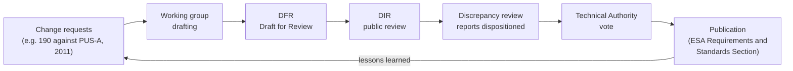
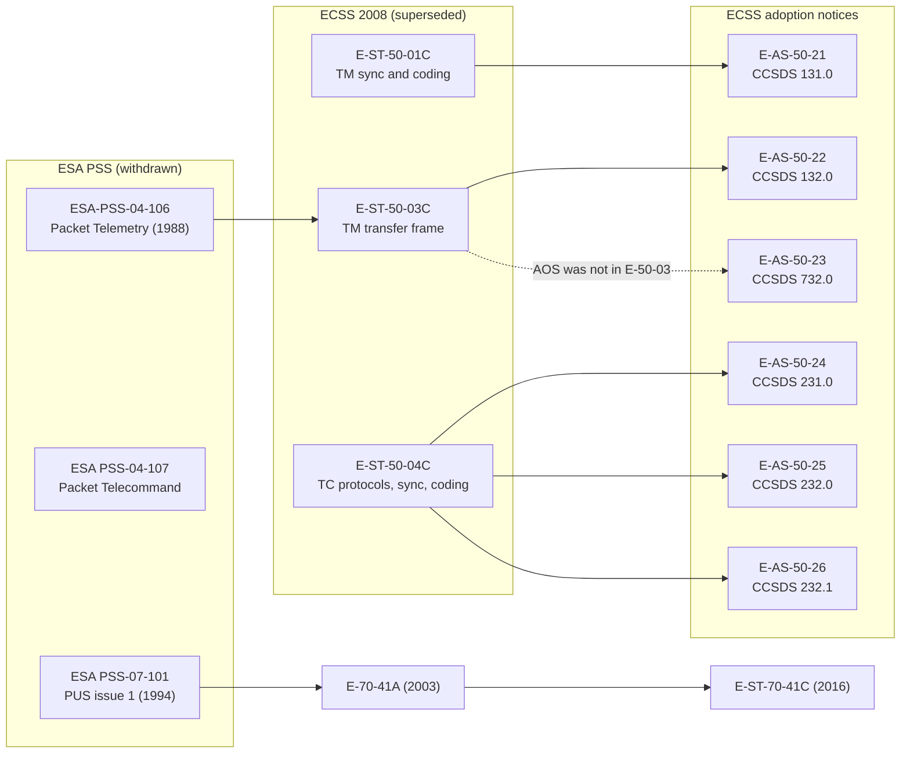
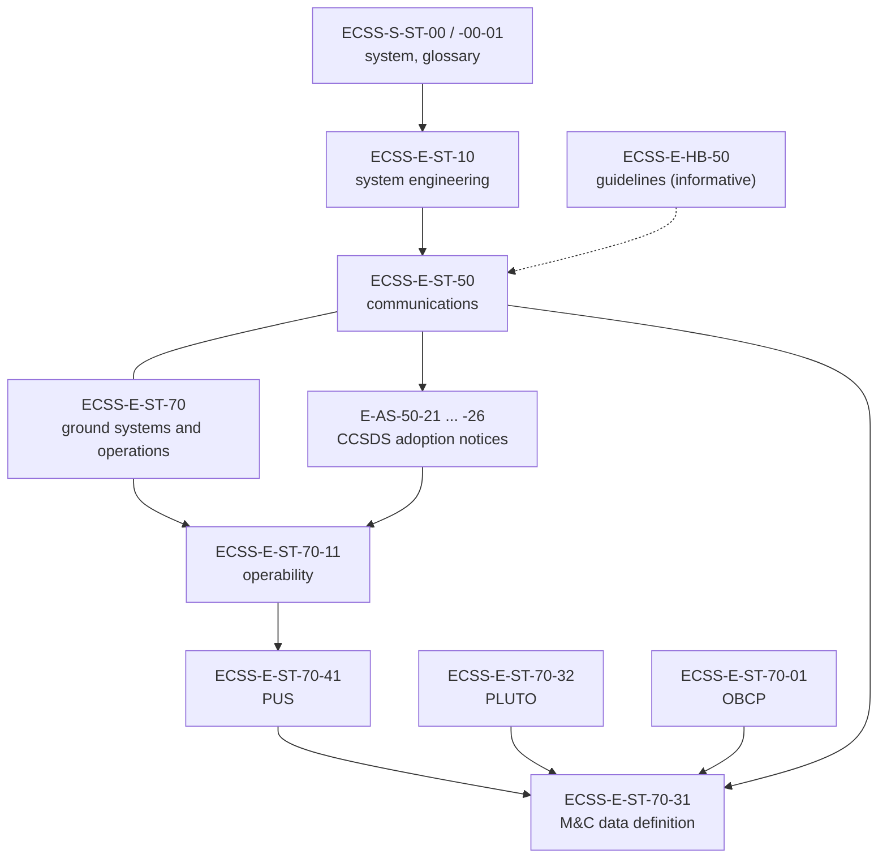

# ECSS: the European space standards system

The **European Cooperation for Space Standardization** (ECSS) is the body that writes the
standards European space projects apply to management, engineering, product assurance and
sustainability.[^ecss-name][^fw-50] It is a cooperative effort of the European Space Agency
(ESA), national space agencies and European industry associations, and its documents are
published by the ESA Requirements and Standards Section at ESTEC in Noordwijk.[^fw-50] For the
subject of this wiki, ECSS matters in three ways: its communications standards (the **E-50**
series) select and adapt the [CCSDS](../ccsds/index.md) space link protocols; its ground systems
and operations standards (the **E-70** series) define the
[Packet Utilization Standard](pus/index.md) (PUS), the operability requirements a spacecraft
must meet, and the monitoring and control data a supplier hands to the operator; and these
documents are what a mission control system such as [SCOS-2000](../scos2000/index.md) and its
[Mission Information Base](../mib/index.md) are built to serve.

This page explains how ECSS documents are organised, named and produced, and gives a linked map
of the documents relevant to telemetry and telecommand. The detailed pages are:

| Page | What it covers |
|---|---|
| [ECSS-E-ST-50C and the CCSDS adoption notices](e-st-50-communications.md) | The communications engineering standard, the adoption notices for the TC data link and COP-1, the superseded TM frame standard and the E-50 handbook |
| [ECSS-E-ST-70-31C](e-st-70-31c.md) | The space system model and the monitoring and control data a supplier delivers, compared with the SCOS-2000 MIB |
| [ECSS-E-ST-70-11C](e-st-70-11c.md) | Space segment operability: observability, commandability, autonomy, FDIR, time, PUS usage |
| [PUS: ECSS-E-ST-70-41C](pus/index.md) | The Packet Utilization Standard: 20 standard service types numbered 1 to 23 (7, 10 and 16 reserved)[^pus-annexd] |

## What ECSS documents are

ECSS standards open with a near-identical foreword. It says that requirements are stated as *what*
shall be accomplished rather than *how* the work is organised, and that this lets existing
organisations and methods be reused and evolve without rewriting the standards; in ECSS-E-ST-50C
Rev.1 and the adoption notices it also says that the series is meant to be applied together, a
sentence the forewords of ECSS-E-ST-70-11C Rev.1 and of the PUS Rev.1 draft omit.[^fw-50][^fw-as25][^fw-7011] Each document is prepared by a dedicated working group, reviewed
by the ECSS Executive Secretariat and approved by the ECSS Technical Authority.[^fw-50][^fw-as25]

ECSS standards are written to be **tailored**: each one states that it may be tailored to the
characteristics and constraints of a project in conformance with ECSS-S-ST-00.[^scope-50][^scope-70-11]
The PUS describes itself as a "menu" from which a mission selects services and service levels for
each on-board application process.[^pus-menu] ECSS-E-ST-70-11C Rev.1 goes further and says that every
mission needs to tailor it, choosing the applicable requirements and adding mission-specific
ones.[^scope-70-11]

### Branches and the system documents

The forewords name four areas: management, engineering, product assurance and
sustainability.[^fw-50] The documents cited in this wiki's library use the letter after "ECSS-" to
show the branch:

| Prefix | Branch | Examples cited by the library documents |
|---|---|---|
| `ECSS-S` | ECSS system (top-level documents) | ECSS-S-ST-00 (description, implementation and general requirements), ECSS-S-ST-00-01 (glossary of terms)[^bib-50][^glossary] |
| `ECSS-E` | Space engineering | ECSS-E-ST-10 (system engineering), ECSS-E-ST-50 (communications), ECSS-E-ST-70 (ground systems and operations)[^bib-50] |
| `ECSS-M` | Space project management | ECSS-M-ST-10 (project planning and implementation), ECSS-M-ST-40 (configuration and information management), ECSS-M-ST-00-03C (tailoring, referenced by E-ST-70-31C)[^bib-50][^m-00-03] |
| `ECSS-Q` | Space product assurance | not cited by the communications and operations documents read for this page; ECSS-Q-80B (Software Product Assurance, draft of 3 April 2000) is cited by the Herschel/Planck EGSE general requirements specification[^q80] |

The letter used for the sustainability branch is not stated in the available sources.

### Document types

| Type | Infix | Status | Example in the library |
|---|---|---|---|
| Standard | `-ST-` | Normative: "shall" requirements (in recent issues each with a unique identifier) | [ECSS-E-ST-50C Rev.1](../library/ecss-e-st-50c-rev-1-1march2021.md), [ECSS-E-ST-70-41C](../library/ecss-e-st-70-41c-15april2016.md) |
| Adoption notice | `-AS-` | Normative: applies a CCSDS Recommended Standard "with the following modifications" | [ECSS-E-AS-50-25C Rev.1](../library/ecss-e-as-50-25c-rev-1-13january2023.md), [ECSS-E-AS-50-26C](../library/ecss-e-as-50-26c-1march2021.md) |
| Handbook | `-HB-` | Informative guidance; not part of the standards, which prevail in any conflict | [ECSS-E-HB-50A](../library/ecss-e-hb-50a-15november2008.md) |
| Draft for public review | `DIR` suffix | A draft circulated for public review before publication | [ECSS-E-ST-70-41C Rev.1 DIR1](../library/ecss-e-st-70-41c-rev1-dir1.md) |

Sources for the rows: the adoption-notice wording;[^as25-req] the handbook disclaimer;[^hb-scope]
the DIR change log.[^dir-steps] The brief for this page also lists "technical memoranda" (TM) as a
document type; no technical memorandum is in this wiki's library, and the available sources do
not describe that category.

**Normative words.** ECSS-E-ST-70-11C Rev.1 spells out the convention shared by the series: "shall"
expresses a requirement, "should" a recommendation (which tailoring turns into a requirement or
removes), "may" and "need not" express permission, and "can" is descriptive only. Present and
past tense state facts.[^nomen]

**Requirement identifiers.** In the recent documents of the library every requirement carries a
unique label that combines the document number and a running number, for example
`ECSS-E-ST-50_0970031` (the in-sequence telecommand delivery service of ECSS-E-ST-50C Rev.1, 2021),
`ECSS-E-ST-70-11_1670115` (essential telecommands without on-board software, Rev.1 of 2025) or
`ECSS-E-AS-50-25_1560001` (the clause that applies CCSDS 232.0-B-4, 2023).[^req-50][^req-70-11][^as25-req]
The PUS change log lists "naming each requirement to facilitate tailoring, traceability" among the
ECSS drafting rules applied in issue C.[^pus-changelog] The 2008 issues in the library
(ECSS-E-ST-50-03C, ECSS-E-ST-70-31C) carry no such labels: their requirements are identified only
by clause number and letter (for example 5.1b of ECSS-E-ST-50-03C).[^5003-51]

### Issues and revisions

The issue letter and revision appear in the document number. The change logs in the library show
a consistent pattern:

| Document line | Issue A | Issue B | Issue C | Later |
|---|---|---|---|---|
| Communications | ECSS-E-50 Part 1A (20 October 2003) and Part 2A (4 July 2005) | never issued | ECSS-E-ST-50C (31 July 2008) | Rev.1, 1 March 2021[^cl-50] |
| TM transfer frame | ECSS-E-50-03A (6 November 2007) | never issued | ECSS-E-ST-50-03C (31 July 2008) | superseded by adoption notices[^cl-5003][^as25-ctx] |
| Operability | ECSS-E-70-11A (5 August 2005) | never issued | ECSS-E-ST-70-11C (31 July 2008) | Rev.1, 15 October 2025[^cl-7011] |
| M&C data definition | ECSS-E-70-31A (9 October 2007) | never issued | ECSS-E-ST-70-31C (31 July 2008) | none in the library[^cl-7031] |
| PUS | ECSS-E-70-41A (30 January 2003) | never issued | ECSS-E-ST-70-41C (15 April 2016) | Rev.1 in public review (DIR1, 11 December 2024)[^pus-changelog][^dir-steps] |

The C issues of 2008 were produced by applying the new ECSS template, renumbering the requirements
and checking consistency with CCSDS and other ECSS standards.[^cl-5003][^cl-7011][^cl-7031]

!!! warning "Inference"
    The A issues are numbered without the `ST` infix (ECSS-E-70-41A, ECSS-E-70-11A) and the C
    issues with it (ECSS-E-ST-70-41C, ECSS-E-ST-70-11C). The change logs link the 2008 C issues to
    the new ECSS template; that the `ST` infix itself was introduced by that template is this
    wiki's reading of the numbering, not a statement in the sources.

## How a standard is produced

The PUS gives the most complete record in the library of an ECSS standard's life. In January 2011
the working group for issue C had 190 change requests against issue A. A first draft for public review
(DIR1) was reviewed publicly for four months in 2014 and produced 620 discrepancy reports; the
status presentation of October 2015 planned delivery of the final draft to ECSS for December 2015, and
the standard was published on 15 April 2016.[^valera-2][^pus-changelog] The disposition statistics show 464 review reports from
agencies, 156 from industry and 44 from the working group itself.[^valera-15] The revision now under
way follows named steps: Draft for Review (DFR), Draft for public review (DIR, with the public
review of ECSS-E-ST-70-41C Rev.1 running from 12 December 2024 to 28 February 2025), draft with
implemented review reports, Technical Authority vote for publication, and publication.[^dir-steps]

*The ECSS document life cycle as recorded for ECSS-E-ST-70-41C and its Rev.1 draft.*[^valera-2][^dir-steps]

## ECSS and CCSDS

The [Consultative Committee for Space Data Systems](../ccsds/index.md) was formed in 1982 by the
major space agencies to standardise space data systems for cross support.[^hb-ccsds] Its
Recommended Standards (Blue Books) are not binding on its members: an agency may adopt them,
endorse them or write a related standard of its own.[^hb-ccsds2]

ESA historically did the last of these. CCSDS recommendations were modified for European needs and
republished in the ESA **PSS** series (Procedures, Specifications and Standards), including or
excluding options according to European preferences; all PSS documents have since been withdrawn in
favour of ECSS standards or CCSDS Recommended Standards.[^hb-pss] ECSS continued the practice for
the core telemetry and telecommand standards (ECSS-E-ST-50-01, -03 and -04 of 2008), with two
structural differences from CCSDS: the PUS is an ECSS application-layer protocol with no CCSDS
equivalent, and the three CCSDS telecommand books were combined into the single ECSS-E-ST-50-04.[^hb-rel]
The handbook announced that this practice was being phased out in favour of direct reuse through
**adoption notices**, which may remove options but otherwise apply the CCSDS text, and that ECSS
expected to adopt all new communications-related CCSDS recommendations.[^hb-rel][^hb-future]

That is what happened. ECSS-E-ST-50C Rev.1 lists six adoption notices, ECSS-E-AS-50-21 to -26,
which replace ECSS-E-ST-50-01C, -03C and -04C:[^as-table]

*Lineage of the European telemetry and telecommand standards. The Packet Telecommand Standard is
"ESA PSS-04-107 Issue 2, 1992" in the Herschel/Planck operations interface requirements; the
SCOS-2000 import ICD prints its number as "PSS-074-107". The PSS-07-101 to PUS-A edge rests on PUS-A's
note that packet version 0 "was used by the ESA PUS"; ECSS-E-ST-50-04C's own PSS heritage is not
documented in the library, so ESA PSS-04-107 has no outgoing edge.*[^as-table][^as25-ctx][^b-pss][^icd-rd][^pss107][^pusa-v0]

## The documents relevant to this wiki

### E-50: communications

| Document | Title | Status in the library | Wiki page |
|---|---|---|---|
| [ECSS-E-ST-50C Rev.1](../library/ecss-e-st-50c-rev-1-1march2021.md) (1 March 2021) | Space engineering – Communications | Current; process and system requirements, eight DRDs | [E-50 page](e-st-50-communications.md) |
| ECSS-E-ST-50-01C (31 July 2008) | Telemetry synchronization and channel coding | Superseded by ECSS-E-AS-50-21; not in the library | [TM coding](../ccsds/tm-coding.md) |
| ECSS-E-ST-50-02 | Ranging and Doppler tracking | Referenced only | not planned |
| [ECSS-E-ST-50-03C](../library/ecss-e-st-50-03c-31july2008.md) (31 July 2008) | Telemetry transfer frame protocol | Superseded by ECSS-E-AS-50-22 and -23 | [E-50 page](e-st-50-communications.md#the-superseded-tm-transfer-frame-standard-ecss-e-st-50-03c) |
| ECSS-E-ST-50-04C (31 July 2008) | Telecommand protocols, synchronization and channel coding | Superseded by ECSS-E-AS-50-24, -25, -26; not in the library | [TC SDLP](../ccsds/tc-sdlp.md), [CLTU](../ccsds/tc-coding-cltu.md) |
| ECSS-E-ST-50-05 | Radio frequency and modulation | Referenced only | not planned |
| ECSS-E-ST-50-12, -13, -14 | SpaceWire; MIL-STD-1553 extension; spacecraft discrete interfaces | Referenced only | not planned |
| ECSS-E-AS-50-21 / -22 / -23 / -24 | Adoption notices of CCSDS 131.0, 132.0, 732.0 and 231.0 | Referenced only | [TM coding](../ccsds/tm-coding.md), [TM SDLP](../ccsds/tm-sdlp.md), [AOS](../ccsds/aos.md), [CLTU](../ccsds/tc-coding-cltu.md) |
| [ECSS-E-AS-50-25C Rev.1](../library/ecss-e-as-50-25c-rev-1-13january2023.md) (13 January 2023) | Adoption Notice of CCSDS 232.0-B-4, TC Space Data Link Protocol | Current | [E-50 page](e-st-50-communications.md#ecss-e-as-50-25c-rev1-tc-space-data-link-protocol), [TC SDLP](../ccsds/tc-sdlp.md) |
| [ECSS-E-AS-50-26C](../library/ecss-e-as-50-26c-1march2021.md) (1 March 2021) | Adoption Notice of CCSDS 232.1-B-2, COP-1 | Current | [E-50 page](e-st-50-communications.md#ecss-e-as-50-26c-cop-1), [COP-1](../ccsds/cop-1.md) |
| [ECSS-E-HB-50A](../library/ecss-e-hb-50a-15november2008.md) (15 November 2008) | Communications guidelines | Handbook (informative) | [E-50 page](e-st-50-communications.md#the-communications-guidelines-handbook-ecss-e-hb-50a) |

Titles and issue dates: E-ST-50C Rev.1 bibliography and adoption-notice table, the handbook's
tables 3-1 and 3-2, and the adoption notices themselves.[^bib-50][^as-table][^hb-tables][^as25-bib]

### E-70: ground systems and operations

| Document | Title | Role | Wiki page |
|---|---|---|---|
| ECSS-E-ST-70 | Ground systems and operations | Parent standard of the series; referenced only | [SCOS-2000](../scos2000/index.md) |
| ECSS-E-ST-70-01 | Spacecraft on-board control procedures | Referenced only | [ST[18]](pus/st18-onboard-operations-procedure.md) |
| [ECSS-E-ST-70-11C Rev.1](../library/ecss-e-st-70-11c-rev-1-15october2025.md) (15 October 2025) | Space segment operability | What the spacecraft must offer the operator | [E-70-11 page](e-st-70-11c.md) |
| [ECSS-E-ST-70-31C](../library/ecss-e-st-70-31c.md) (31 July 2008) | Monitoring and control data definition | What data the supplier delivers for monitoring and control | [E-70-31 page](e-st-70-31c.md) |
| ECSS-E-ST-70-32 | Test and operations procedure language (PLUTO) | Referenced only | [E-70-31 page](e-st-70-31c.md#the-languages) |
| [ECSS-E-70-41A](../library/ecss-e-70-41a-30jan2003-pus.md) (30 January 2003) | Telemetry and telecommand packet utilization (PUS-A) | Superseded by issue C | [PUS-A vs PUS-C](pus/pus-a-vs-pus-c.md) |
| [ECSS-E-ST-70-41C](../library/ecss-e-st-70-41c-15april2016.md) (15 April 2016) | Telemetry and telecommand packet utilization (PUS-C) | Current | [PUS](pus/index.md) |
| [ECSS-E-ST-70-41C Rev.1 DIR1](../library/ecss-e-st-70-41c-rev1-dir1.md) (11 December 2024) | PUS revision 1, draft | Public review draft | [PUS-A vs PUS-C](pus/pus-a-vs-pus-c.md) |

Titles: the normative references of ECSS-E-ST-70-41C and ECSS-E-ST-70-31C.[^pus-refs][^7031-refs]

### How the documents depend on each other

*Reference relationships: E-ST-50 follows the ECSS-E-ST-10 process and is complementary to
E-ST-70; E-ST-70-11 normatively references the adoption notices -24, -25, -26 and the PUS; the PUS
satisfies the operability requirements of E-ST-70-11; E-ST-70-31 assumes E-ST-50, E-ST-70,
E-ST-70-41 and E-ST-70-32.*[^rel-50][^refs-7011][^pus-scope][^scope-7031]

The division of labour, in one paragraph (this wiki's summary of the cited scopes): ECSS-E-ST-50 says *how to engineer* the end-to-end
communication system and what it must achieve (for example that commands are delivered in sequence
and that every frame identifies its spacecraft); the adoption notices say *which protocol* does it;
ECSS-E-ST-70-11 says *what the spacecraft must let the operator see and do*; ECSS-E-ST-70-41 says
*which standard services and packets* do that; and ECSS-E-ST-70-31 says *what data must be handed
over* so that a ground system can drive those services, which in ESA's world ends up as the
SCOS-2000 MIB.[^req-50][^pus-scope][^intro-7031]

## How Solar Orbiter used the series

The Solar Orbiter TM/TC and packet structure ICD shows how a mission of the 2010s cited ECSS. Its
applicable documents include ECSS-E-70-41A (the PUS of 2003), and its reference documents include
ECSS-E-ST-50-03C for the TM transfer frame and ECSS-E-ST-50-04C for the telecommand link, both of
July 2008.[^solo-docs] The SCOS-2000 Database Import ICD (issue 7.0, 2017) in turn references the
older ESA PSS standards, the Packet Utilisation Standard ESA PSS-07-101 of May 1994 and the ESA Packet
Telecommand Standard, and, as RD-20, ECSS-E-70-41A with the remark that it "will be replaced by
ECSS-E-ST-70-41C".[^icd-rd][^icd-rd20] Standards therefore live on in missions and ground systems long after
ECSS supersedes them, which is why this wiki covers the superseded documents too.

## Related pages

* [The standards landscape](../overview/standards-map.md)
* [CCSDS: overview of the protocol stack](../ccsds/index.md)
* [PUS-A vs PUS-C (and the 2024 Rev.1 draft)](pus/pus-a-vs-pus-c.md)
* [The reference catalogue](../references/index.md) and the [glossary](../glossary.md)

[^ecss-name]: [Bruegge et al., Integrating small satellite missions with EGS-CC (4S 2024)](../library/4s-2024-egscc-bruegge.md), list of acronyms, PDF p. 16; the expansion also appears on the cover of [ECSS-E-70-41A](../library/ecss-e-70-41a-30jan2003-pus.md), PDF p. 1.
[^fw-50]: [ECSS-E-ST-50C Rev.1, Communications](../library/ecss-e-st-50c-rev-1-1march2021.md), Foreword and publisher block, PDF p. 2.
[^fw-as25]: [ECSS-E-AS-50-25C Rev.1](../library/ecss-e-as-50-25c-rev-1-13january2023.md), Foreword, PDF p. 2.
[^fw-7011]: [ECSS-E-ST-70-11C Rev.1](../library/ecss-e-st-70-11c-rev-1-15october2025.md), Foreword, PDF p. 2; [ECSS-E-ST-70-41C Rev.1 DIR1](../library/ecss-e-st-70-41c-rev1-dir1.md), Foreword, PDF p. 2.
[^scope-50]: [ECSS-E-ST-50C Rev.1](../library/ecss-e-st-50c-rev-1-1march2021.md), clause 1 "Scope", PDF p. 9.
[^scope-70-11]: [ECSS-E-ST-70-11C Rev.1, Space segment operability](../library/ecss-e-st-70-11c-rev-1-15october2025.md), clause 1 "Scope", PDF p. 8.
[^pus-menu]: [ECSS-E-ST-70-41C, Telemetry and telecommand packet utilization](../library/ecss-e-st-70-41c-15april2016.md), clause 1 "Scope", PDF pp. 9–10.
[^bib-50]: [ECSS-E-ST-50C Rev.1](../library/ecss-e-st-50c-rev-1-1march2021.md), Bibliography, PDF p. 89.
[^glossary]: [ECSS-E-ST-50C Rev.1](../library/ecss-e-st-50c-rev-1-1march2021.md), clause 2 "Normative references", PDF p. 10.
[^m-00-03]: [ECSS-E-ST-70-31C, Monitoring and control data definition](../library/ecss-e-st-70-31c.md), Annex A.1, PDF p. 127.
[^as25-req]: [ECSS-E-AS-50-25C Rev.1](../library/ecss-e-as-50-25c-rev-1-13january2023.md), clause 4 "Application requirements", requirement ECSS-E-AS-50-25_1560001, PDF p. 8.
[^hb-scope]: [ECSS-E-HB-50A, Communications guidelines](../library/ecss-e-hb-50a-15november2008.md), §1.2 "Scope", PDF p. 17.
[^dir-steps]: [ECSS-E-ST-70-41C Rev.1 DIR1](../library/ecss-e-st-70-41c-rev1-dir1.md), change log for draft development (DFR, DIR public review 12 December 2024 – 28 February 2025, DIR + implemented DRRs, DIA TA vote, publication), PDF p. 3.
[^nomen]: [ECSS-E-ST-70-11C Rev.1](../library/ecss-e-st-70-11c-rev-1-15october2025.md), §3.5 "Nomenclature", PDF pp. 16–17.
[^req-50]: [ECSS-E-ST-50C Rev.1](../library/ecss-e-st-50c-rev-1-1march2021.md), §5.4.2, requirement ECSS-E-ST-50_0970031, PDF p. 37.
[^req-70-11]: [ECSS-E-ST-70-11C Rev.1](../library/ecss-e-st-70-11c-rev-1-15october2025.md), §5.5.1p, requirement ECSS-E-ST-70-11_1670115, PDF p. 37.
[^pus-annexd]: [ECSS-E-ST-70-41C](../library/ecss-e-st-70-41c-15april2016.md), Annex D "System and interface specification index", PDF p. 655.
[^pus-changelog]: [ECSS-E-ST-70-41C](../library/ecss-e-st-70-41c-15april2016.md), Change log, PDF p. 3.
[^cl-50]: [ECSS-E-ST-50C Rev.1](../library/ecss-e-st-50c-rev-1-1march2021.md), Change log, PDF p. 3.
[^cl-5003]: [ECSS-E-ST-50-03C, Telemetry transfer frame protocol](../library/ecss-e-st-50-03c-31july2008.md), Change log, PDF p. 3.
[^as25-ctx]: [ECSS-E-AS-50-25C Rev.1](../library/ecss-e-as-50-25c-rev-1-13january2023.md), clause 2 "Context information" and the overview of superseded ECSS-E-50-xx standards, PDF p. 6.
[^cl-7011]: [ECSS-E-ST-70-11C Rev.1](../library/ecss-e-st-70-11c-rev-1-15october2025.md), Change log, PDF p. 3.
[^cl-7031]: [ECSS-E-ST-70-31C](../library/ecss-e-st-70-31c.md), Change log, PDF p. 3.
[^valera-2]: [S. Valera, ECSS-E-ST-70-41C status (ADCSS 2015)](../library/valera-2015-adcss-ecss-e-st-70-41c-status.md), slide 2, PDF p. 2.
[^valera-15]: [S. Valera, ECSS-E-ST-70-41C status (ADCSS 2015)](../library/valera-2015-adcss-ecss-e-st-70-41c-status.md), slide 15 "Processing public review output", PDF p. 15.
[^hb-ccsds]: [ECSS-E-HB-50A](../library/ecss-e-hb-50a-15november2008.md), §3.1.2 "CCSDS standards", PDF p. 24.
[^hb-ccsds2]: [ECSS-E-HB-50A](../library/ecss-e-hb-50a-15november2008.md), §3.1.2 (continued), PDF p. 25.
[^hb-pss]: [ECSS-E-HB-50A](../library/ecss-e-hb-50a-15november2008.md), §3.1.3 "Relationship to PSS standards", PDF p. 25.
[^hb-rel]: [ECSS-E-HB-50A](../library/ecss-e-hb-50a-15november2008.md), §3.1.4 "Relationship of ECSS standards to CCSDS standards", PDF p. 26.
[^hb-future]: [ECSS-E-HB-50A](../library/ecss-e-hb-50a-15november2008.md), §6.1.5 "CCSDS and ECSS standards", PDF p. 139.
[^as-table]: [ECSS-E-ST-50C Rev.1](../library/ecss-e-st-50c-rev-1-1march2021.md), §4.2, table of ECSS adoption notices and superseded ECSS standards, PDF p. 20.
[^b-pss]: [ECSS-E-ST-50-03C](../library/ecss-e-st-50-03c-31july2008.md), Annex B "Changes from ESA-PSS-04-106", PDF p. 34.
[^icd-rd]: [SCOS-2000 Database Import ICD, issue 7.0](../library/icd-7-0-final.md), §1.4.2 "Reference documents" (RD-6 ESA PSS-07-101; RD-14 "ESA PSS-074-107", ESA Packet Telecommand Standard, Issue 2.0, April 1992), PDF p. 19.
[^icd-rd20]: [SCOS-2000 Database Import ICD, issue 7.0](../library/icd-7-0-final.md), §1.4.2 "Reference documents" (RD-20 ECSS-E-70-41A), PDF p. 20.
[^pss107]: [Herschel/Planck Operations Interface Requirements Document, SCI-PT-RS-07360](../library/cosmos-operations-interface-requirements.md), §1.3 "Applicable Documents" (AD-6 ESA PSS/04-106, AD-7 ESA PSS-04-107 Issue 2, 1992), PDF p. 10.
[^pusa-v0]: [ECSS-E-70-41A](../library/ecss-e-70-41a-30jan2003-pus.md), §5.3.3, footnote 3 to the TC Packet PUS Version Number, PDF p. 44.
[^5003-51]: [ECSS-E-ST-50-03C](../library/ecss-e-st-50-03c-31july2008.md), §5.1, requirements 5.1a to 5.1c, PDF p. 12.
[^q80]: [Herschel/Planck EGSE General Requirements Specification, H-P-1-ASPI-SP-0045](../library/h-p-1-aspi-sp-0045-egse-general-req.md), §2.1 "Standards" (S4 ECSS-Q-80B), PDF p. 8.
[^hb-tables]: [ECSS-E-HB-50A](../library/ecss-e-hb-50a-15november2008.md), §3.2, tables 3-1 and 3-2, PDF pp. 27–28.
[^as25-bib]: [ECSS-E-AS-50-25C Rev.1](../library/ecss-e-as-50-25c-rev-1-13january2023.md), Bibliography, PDF p. 23.
[^pus-refs]: [ECSS-E-ST-70-41C](../library/ecss-e-st-70-41c-15april2016.md), clause 2 "Normative references", PDF p. 11.
[^7031-refs]: [ECSS-E-ST-70-31C](../library/ecss-e-st-70-31c.md), clause 2 "Normative references", PDF p. 11.
[^rel-50]: [ECSS-E-ST-50C Rev.1](../library/ecss-e-st-50c-rev-1-1march2021.md), §4.4.1 and §4.5 "Relationship with other standards", PDF pp. 25 and 27.
[^refs-7011]: [ECSS-E-ST-70-11C Rev.1](../library/ecss-e-st-70-11c-rev-1-15october2025.md), clause 2 "Normative references", PDF p. 9.
[^pus-scope]: [ECSS-E-ST-70-41C](../library/ecss-e-st-70-41c-15april2016.md), clause 1 "Scope", PDF p. 9.
[^scope-7031]: [ECSS-E-ST-70-31C](../library/ecss-e-st-70-31c.md), clause 1 "Scope", PDF p. 10.
[^intro-7031]: [ECSS-E-ST-70-31C](../library/ecss-e-st-70-31c.md), Introduction, PDF p. 9.
[^solo-docs]: [Solar Orbiter TM-TC and Packet Structure ICD, SOL.S.ASTR.TN.00079 issue 7](../library/sol-s-astr-tn-00079-07.md), §2 "Documents" (AD1, RD1, RD2), PDF p. 13.
