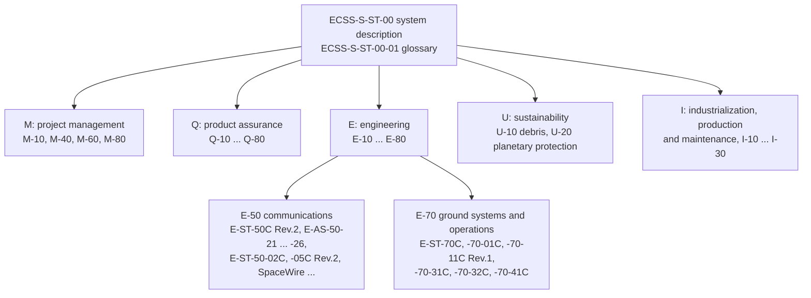
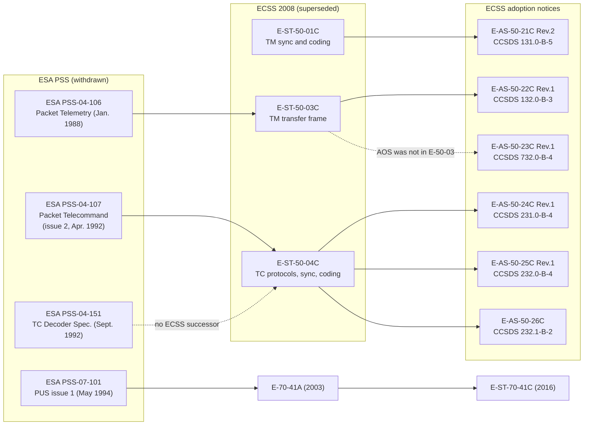
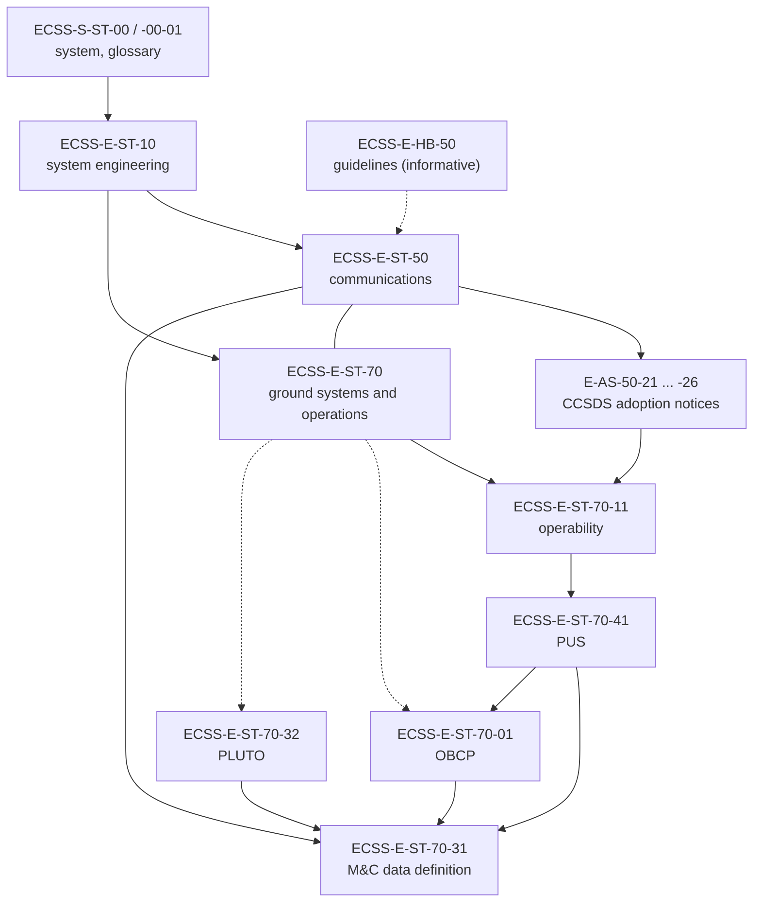

# ECSS: the European space standards system

The **European Cooperation for Space Standardization** (ECSS) is the body that writes the
standards European space projects apply to management, engineering, product assurance and
sustainability.[^ecss-name][^fw-50] It is a cooperative effort of the European Space Agency
(ESA), national space agencies and European industry associations, and its documents are
published by the ESA Requirements and Standards Section at ESTEC in Noordwijk.[^fw-50] For the
subject of this wiki, ECSS matters in three ways: its communications standards (the **E-50**
series) select and adapt the [CCSDS](../ccsds/index.md) space link protocols; its ground systems
and operations standards (the **E-70** series) define the
[Packet Utilization Standard](pus/index.md) (PUS), the operability requirements a spacecraft
must meet, and the monitoring and control data a supplier hands to the operator; and these
documents are what a mission control system such as [SCOS-2000](../scos2000/index.md) and its
[Mission Information Base](../mib/index.md) are built to serve.

This page explains how ECSS documents are organised, named and produced, and gives a linked map
of the documents relevant to telemetry and telecommand. ECSS publishes its own map of the whole
system as the **ECSS Trees**, a set of charts that this wiki holds in its November 2025 edition;
each chart carries its own "as of" date, from June 2024 to November 2025.[^trees-1][^trees-p] The
detailed pages are:

| Page | What it covers |
|---|---|
| [ECSS-E-ST-50C and the CCSDS adoption notices](e-st-50-communications.md) | The communications engineering standard (Rev.1 and Rev.2), all six CCSDS adoption notices, the superseded 2008 TM frame and TC standards, the RF and ranging companions and the E-50 handbook |
| [ECSS-E-ST-70C](e-st-70c.md) | The parent ground systems and operations standard: operations and ground segment engineering processes and their documents |
| [ECSS-E-ST-70-31C](e-st-70-31c.md) | The space system model and the monitoring and control data a supplier delivers, compared with the SCOS-2000 MIB |
| [ECSS-E-ST-70-11C](e-st-70-11c.md) | Space segment operability: observability, commandability, autonomy, FDIR, time, PUS usage |
| [ECSS-E-ST-70-32C](e-st-70-32c.md) | PLUTO, the test and operations procedure language |
| [ECSS-E-ST-70-01C](e-st-70-01c.md) | On-board control procedures (OBCPs) |
| [PUS: ECSS-E-ST-70-41C](pus/index.md) | The Packet Utilization Standard: 20 standard service types numbered 1 to 23 (7, 10 and 16 reserved)[^pus-annexd] |
| [From ESA PSS to CCSDS and ECSS](../overview/history.md) | The ESA PSS packet standards of 1988 to 1994 from which the ECSS documents descend |

## What ECSS documents are

ECSS standards open with a near-identical foreword. It says that requirements are stated as *what*
shall be accomplished rather than *how* the work is organised, and that this lets existing
organisations and methods be reused and evolve without rewriting the standards. Its first sentence,
which calls each document one of a series meant to be applied together, has changed over time:

| Documents in the library | Areas named in the opening sentence |
|---|---|
| Issues of 2008 to 2016 (for example ECSS-E-ST-70C, ECSS-E-ST-50-04C, ECSS-E-ST-70-41C) | management, engineering and product assurance |
| Issues of 2021 to 2023 (ECSS-E-ST-50C Rev.1, ECSS-E-AS-50-22C to -26C) | management, engineering, product assurance and sustainability |
| Issues from December 2024 (ECSS-E-ST-50C Rev.2, ECSS-E-AS-50-21C Rev.2, the PUS Rev.1 draft, ECSS-E-ST-70-11C Rev.1) | sentence omitted |

Sources: the forewords, PDF p. 2 of each.[^fw-2008][^fw-50][^fw-as25][^fw-2024][^fw-7011] Each document
is prepared by a dedicated working group (for the adoption notices, the ECSS Space Communications
Working Group), reviewed by the ECSS Executive Secretariat and approved by the ECSS Technical
Authority.[^fw-50][^fw-as25][^fw-2024]

ECSS standards are written to be **tailored**: each one states that it may be tailored to the
characteristics and constraints of a project in conformance with ECSS-S-ST-00.[^scope-50][^scope-70-11]
The PUS describes itself as a "menu" from which a mission selects services and service levels for
each on-board application process.[^pus-menu] ECSS-E-ST-70-11C Rev.1 goes further and says that every
mission needs to tailor it, choosing the applicable requirements and adding mission-specific
ones.[^scope-70-11]

### Branches, disciplines and the system documents

The 2021 to 2023 forewords name four areas: management, engineering, product assurance and
sustainability.[^fw-50] The ECSS Trees of November 2025 show the full structure: two system documents
at the top, ECSS-S-ST-00 (system description) and ECSS-S-ST-00-01 (glossary of terms), and below them
**five branches**, each divided into numbered **disciplines**. The letter after "ECSS-" names the
branch, and the Trees file each document under the discipline whose number matches the leading
digit of the document number: ECSS-E-ST-50C and ECSS-E-ST-50-04C under E-50, ECSS-E-ST-31C and
ECSS-E-ST-32C Rev.1 under E-30 (mechanical engineering).[^trees-1][^trees-e30]

| Letter | Branch (as named in the Trees) | Disciplines | Examples |
|---|---|---|---|
| `S` | ECSS system (top-level documents) | — | ECSS-S-ST-00, ECSS-S-ST-00-01 (glossary of terms, the one normative reference of ECSS-E-ST-50C)[^trees-1][^glossary] |
| `M` | Space project management | M-10 project planning and implementation; M-40 configuration and information management; M-60 cost and schedule management; M-80 risk management | ECSS-M-ST-10C Rev.1, ECSS-M-ST-10-01C (organization and conduct of reviews), ECSS-M-ST-40C Rev.1; ECSS-M-ST-00-03C (tailoring) is referenced by E-ST-70-31C[^trees-m][^m-00-03] |
| `Q` | Space product assurance | Q-10 product assurance management; Q-20 quality assurance; Q-30 dependability; Q-40 safety; Q-60 EEE components; Q-70 materials, mechanical parts and processes; Q-80 software product assurance | ECSS-Q-ST-80C Rev.2; ECSS-Q-ST-10-09 and ECSS-Q-ST-80 are normative references of ECSS-E-ST-70C; the draft ECSS-Q-80B of 3 April 2000 is cited by the Herschel/Planck EGSE specification[^trees-q][^7000-refs][^q80] |
| `E` | Space engineering | E-10 system engineering; E-20 electrical and optical; E-30 mechanical; E-40 software; E-50 communications; E-60 control; E-70 ground systems and operations; E-80 security | ECSS-E-ST-10C Rev.1, ECSS-E-ST-50C Rev.2, ECSS-E-ST-70C, ECSS-E-ST-80C (security in space systems lifecycles)[^trees-e] |
| `U` | Space sustainability | U-10 space debris; U-20 planetary protection | ECSS-U-AS-10C Rev.2 (adoption notice of ISO 24113, space debris mitigation), ECSS-U-ST-20C[^trees-u] |
| `I` | Industrialization, production and maintenance | I-10 industrialization; I-20 manufacturing; I-30 maintenance, repair and overhaul (MRO) | ECSS-I-ST-30-10C (integrated production support)[^trees-i] |

Besides the branches, the Trees list the documents that run ECSS itself: discipline P-00 (policy,
ECSS-P-00C on standardization objectives, policies and organization) and discipline D-00
(configuration and information management of the documentation: ECSS-D-00B on ECSS processes,
the drafting rules and templates for standards, ECSS-D-00-01C, and for handbooks, ECSS-D-00-02A,
and ECSS-D-00-11A, the criteria for accepting a draft for public review and for releasing a handbook).[^trees-p]

*The ECSS branch structure and the two disciplines this wiki covers, after the ECSS Trees of
November 2025.*[^trees-1][^trees-e][^trees-e50]

!!! warning "Inference"
    None of the forewords in the library mentions the industrialization branch, and the 2008 to
    2016 forewords do not mention sustainability either. That the branches were added over time
    is this wiki's reading of the forewords and the Trees; the dates at which ECSS created the U
    and I branches are not stated in the available sources.

### Document types

| Type | Infix | Status | Example |
|---|---|---|---|
| Standard | `-ST-` | Normative: "shall" requirements (in recent issues each with a unique identifier) | [ECSS-E-ST-50C Rev.2](../library/ecss-e-st-50c-rev-2-5december2024.md), [ECSS-E-ST-70-41C](../library/ecss-e-st-70-41c-15april2016.md) |
| Adoption notice | `-AS-` | Normative: applies another body's standard "with the following modifications"; in E-50 the six CCSDS notices, elsewhere ISO standards (the adoption of IEC 61025 on fault tree analysis is numbered ECSS-Q-ST-40-12C, with an `-ST-` infix) | [ECSS-E-AS-50-21C Rev.2](../library/ecss-e-as-50-21c-rev-2-5december2024.md) to [ECSS-E-AS-50-26C](../library/ecss-e-as-50-26c-1march2021.md); ECSS-E-AS-11C (ISO 16290, technology readiness levels) and ECSS-U-AS-10C Rev.2 (ISO 24113) in the Trees |
| Handbook | `-HB-` | Informative guidance; not part of the standards, which prevail in any conflict | [ECSS-E-HB-50A](../library/ecss-e-hb-50a-15november2008.md) |
| Technical memorandum | `-TM-` | Listed with the handbooks; the Trees distinguish a handbook that is "published" from a memorandum that is "made available" | ECSS-E-TM-10-20A (product data exchange), ECSS-E-TM-10-23A (space system data repository); none in the library |
| Draft for public review | `DIR` suffix | A draft circulated for public review before publication | [ECSS-E-ST-70-41C Rev.1 DIR1](../library/ecss-e-st-70-41c-rev1-dir1.md) |

Sources for the rows: the adoption-notice wording; the handbook disclaimer; the Trees charts of the
engineering, sustainability, product assurance and handbook series; the DIR change log.[^as25-req][^hb-scope][^trees-e][^trees-u][^trees-q][^trees-hb][^dir-steps]
What distinguishes a technical memorandum from a handbook beyond that legend is not stated in the
available sources.

**Status in the Trees.** The legend of each standards chart distinguishes four states: published;
affected by the update of another document (`M`); ongoing (or planned) update of an existing
document (`U`); new document in production (or planned) (`N`). The handbook charts use "HB published" and "TM made available" with the same `U` and `N` marks.[^trees-e][^trees-e50][^trees-hb] In the
engineering chart of October 2025, for example, ECSS-E-ST-70-41C is published and its Rev.1 is
marked `U`, and ECSS-E-ST-40-02C (machine learning software engineering) is marked `N`.[^trees-e]

**Normative words.** ECSS-E-ST-70-11C Rev.1 spells out the convention shared by the series: "shall"
expresses a requirement, "should" a recommendation (which tailoring turns into a requirement or
removes), "may" and "need not" express permission, and "can" is descriptive only. Present and
past tense state facts.[^nomen]

**Requirement identifiers.** In the recent documents of the library every requirement carries a
unique label that combines the document number and a running number, for example
`ECSS-E-ST-50_0970031` (the in-sequence telecommand delivery service of ECSS-E-ST-50C, 2021),
`ECSS-E-ST-70-11_1670115` (essential telecommands without on-board software, Rev.1 of 2025) or
`ECSS-E-AS-50-25_1560001` (the clause that applies CCSDS 232.0-B-4, 2023).[^req-50][^req-70-11][^as25-req]
Labels survive revisions: `ECSS-E-ST-50_0970031` is unchanged in Rev.2 of 2024.[^req-50-r2] The
PUS change log lists "naming each requirement to facilitate tailoring, traceability" among the
ECSS drafting rules applied in issue C.[^pus-changelog] The 2008 to 2011 issues in the library
(ECSS-E-ST-50-01C to -05C, ECSS-E-ST-70C, -70-01C, -70-31C, -70-32C) carry no such labels: their
requirements are identified only by clause number and letter (for example 5.1b of
ECSS-E-ST-50-03C).[^5003-51]

!!! warning "Inference"
    The seven digits after the underscore appear to start with a three-digit code per document:
    `097` for ECSS-E-ST-50, `167` for ECSS-E-ST-70-11, and `152` to `156` for the adoption notices
    -21 to -25 (`ECSS-E-AS-50-21_1520001` up to `ECSS-E-AS-50-25_1560001`).[^req-50][^req-70-11][^as-req]
    The sources do not explain the numbering.

### Issues and revisions

The issue letter and revision appear in the document number. The change logs in the library show
a consistent pattern:

| Document line | Issue A | Issue B | Issue C | Later |
|---|---|---|---|---|
| Communications | ECSS-E-50 Part 1A (20 October 2003) and Part 2A (4 July 2005) | never issued | ECSS-E-ST-50C (31 July 2008) | Rev.1, 1 March 2021; Rev.2, 5 December 2024[^cl-50][^cl-50r2] |
| TM synchronization and channel coding | ECSS-E-50-01A (6 November 2007) | never issued | ECSS-E-ST-50-01C (31 July 2008) | superseded by ECSS-E-AS-50-21[^cl-5001][^as21-cl] |
| Ranging and Doppler tracking | ECSS-E-50-02A (24 November 2005) | never issued | ECSS-E-ST-50-02C (31 July 2008) | none; still listed as published in May 2025[^cl-5002][^trees-e50] |
| TM transfer frame | ECSS-E-50-03A (6 November 2007) | never issued | ECSS-E-ST-50-03C (31 July 2008) | superseded by adoption notices[^cl-5003][^as25-ctx] |
| TC protocols, synchronization and coding | ECSS-E-50-04A (14 November 2007) | never issued | ECSS-E-ST-50-04C (31 July 2008) | superseded by ECSS-E-AS-50-24, -25 and -26[^cl-5004][^as24-cl] |
| Radio frequency and modulation | ECSS-E-50-05A (14 November 2007) | never issued | ECSS-E-ST-50-05C (31 July 2008) | Rev.1, 6 March 2009; Rev.2, 4 October 2011[^cl-5005] |
| CCSDS adoption notices -21 to -26 | none | none | first issues, 1 March 2021 | Rev.1 of -21 to -25, 13 January 2023; Rev.2 of -21, 5 December 2024[^as21-cl][^as24-cl][^as25-cl][^as26-cl] |
| Ground systems and operations | ECSS-E-70 Part 1A (25 April 2000) and Part 2A (2 April 2001) | never issued | ECSS-E-ST-70C (31 July 2008) | none in the library[^cl-7000] |
| On-board control procedures | never issued | never issued | ECSS-E-ST-70-01C (16 April 2010), the first issue | none in the library[^cl-7001] |
| Operability | ECSS-E-70-11A (5 August 2005) | never issued | ECSS-E-ST-70-11C (31 July 2008) | Rev.1, 15 October 2025[^cl-7011] |
| M&C data definition | ECSS-E-70-31A (9 October 2007) | never issued | ECSS-E-ST-70-31C (31 July 2008) | none in the library[^cl-7031] |
| Procedure language (PLUTO) | ECSS-E-70-32A (24 April 2006) | never issued | ECSS-E-ST-70-32C (31 July 2008), editorial changes | none in the library[^cl-7032] |
| PUS | ECSS-E-70-41A (30 January 2003) | never issued | ECSS-E-ST-70-41C (15 April 2016) | Rev.1 in public review (DIR1, 11 December 2024), marked as an ongoing update in October 2025[^pus-changelog][^dir-steps][^trees-e] |

The C issues of 2008 were produced by applying the new ECSS template, renumbering the requirements
and checking consistency with CCSDS and other ECSS standards.[^cl-5003][^cl-7011][^cl-7031] For
ECSS-E-ST-70C the change was larger: it merged the two parts of ECSS-E-70A (principles and
requirements; document requirements definitions) into one document and replaced the phase-based
approach with a process approach that separates operations engineering from ground segment
engineering, each with its own customer–supplier relationship.[^cl-7000] ECSS-E-ST-50C Rev.2 changes
little: its change log says it was done mainly to stop naming the issues of the adopted CCSDS books,
so that the standard need not change when CCSDS updates them, and otherwise lists only the foreword,
the deletion of twelve definitions, one typo correction and the bibliography.[^cl-50r2]

!!! warning "Inference"
    The A issues are numbered without the `ST` infix (ECSS-E-70-41A, ECSS-E-70-11A) and the C
    issues with it (ECSS-E-ST-70-41C, ECSS-E-ST-70-11C). The change logs link the 2008 C issues to
    the new ECSS template; that the `ST` infix itself was introduced by that template is this
    wiki's reading of the numbering, not a statement in the sources. Documents first published
    after 2008 also start at letter C: ECSS-E-ST-70-01C of 2010 (A and B "never issued") and the
    adoption notices of 2021, whose change logs call issue C the "First issue".[^cl-7001][^as21-cl]
    The letter therefore seems to mark the generation of the ECSS document system rather than
    count the issues of each document; the sources do not say so.

## How a standard is produced

The PUS gives the most complete record in the library of an ECSS standard's life. In January 2011
the working group for issue C had 190 change requests against issue A. A first draft for public review
(DIR1) was reviewed publicly for four months in 2014 and produced 620 discrepancy reports; the
status presentation of October 2015 planned delivery of the final draft to ECSS for December 2015, and
the standard was published on 15 April 2016.[^valera-2][^pus-changelog] The disposition statistics show 464 review reports from
agencies, 156 from industry and 44 from the working group itself.[^valera-15] The revision now under
way follows named steps: Draft for Review (DFR), Draft for public review (DIR, with the public
review of ECSS-E-ST-70-41C Rev.1 running from 12 December 2024 to 28 February 2025), draft with
implemented review reports, Technical Authority vote for publication, and publication.[^dir-steps]
The rules behind these steps are ECSS documents themselves: ECSS-D-00-01C and ECSS-D-00-02A give the
drafting rules and templates for standards and handbooks, and ECSS-D-00-11A the criteria for
accepting a draft for public review and for releasing a handbook.[^trees-p] In the Trees of October
2025 the PUS revision is still marked as an ongoing update; its outcome is not stated in the
available sources.[^trees-e]

*The ECSS document life cycle as recorded for ECSS-E-ST-70-41C and its Rev.1 draft.*[^valera-2][^dir-steps]

## ECSS and CCSDS

The [Consultative Committee for Space Data Systems](../ccsds/index.md) was formed in 1982 by the
major space agencies to standardise space data systems for cross support.[^hb-ccsds] Its
Recommended Standards (Blue Books) are not binding on its members: an agency may adopt them,
endorse them or write a related standard of its own.[^hb-ccsds2]

ESA historically did the last of these. CCSDS recommendations were modified for European needs and
republished in the ESA **PSS** series (Procedures, Specifications and Standards), including or
excluding options according to European preferences; all PSS documents have since been withdrawn in
favour of ECSS standards or CCSDS Recommended Standards.[^hb-pss] ECSS continued the practice for
the core telemetry and telecommand standards (ECSS-E-ST-50-01, -03 and -04 of 2008), with two
structural differences from CCSDS: the PUS is an ECSS application-layer protocol with no CCSDS
equivalent, and the three CCSDS telecommand books were combined into the single ECSS-E-ST-50-04.[^hb-rel]
The handbook announced that this practice was being phased out in favour of direct reuse through
**adoption notices**, which may remove options but otherwise apply the CCSDS text, and that ECSS
expected to adopt all new communications-related CCSDS recommendations.[^hb-rel][^hb-future]

That is what happened. ECSS-E-ST-50C lists six adoption notices, ECSS-E-AS-50-21 to -26,
which replace ECSS-E-ST-50-01C, -03C and -04C.[^as-table] The 2021 Rev.1 named the CCSDS issue each
notice was based on; Rev.2 of December 2024 names only the book (for example "CCSDS 131.0-B"), and
each notice states which issue applies, so that a new CCSDS issue requires a new revision of the
notice but not of ECSS-E-ST-50C.[^cl-50r2][^as21-ctx]

*Lineage of the European telemetry and telecommand standards, with the revisions of the notices
held by this wiki. ECSS-E-ST-50-03C and -04C each have an annex of changes from their PSS
predecessor (ESA-PSS-04-106 and ESA-PSS-04-107, issue 2, April 1992). The SCOS-2000 import ICD
prints the telecommand standard's number as "PSS-074-107"; the PSS document itself, now in the
library, reads PSS-04-107. The PSS-07-101 to PUS-A edge rests on PUS-A's note that packet version 0
"was used by the ESA PUS". The dotted PSS-04-151 edge records the handbook's remark that ECSS has no
telecommand decoder specification and that the withdrawn PSS-04-151 still holds important
information.*[^as-table][^as25-ctx][^b-pss][^b-pss107][^icd-rd][^pss107][^pss-covers][^pusa-v0][^hb-decoder]

The PSS documents themselves were "prepared by" ESA boards and approved by the ESA Inspector General:
the Standards Approval Board (STAB) for Space Data Communications for PSS-04-106, -107 and -151,
and the Committee for Operations and EGSE Standards (COES) for PSS-07-101.[^pss-covers] PSS-04-106 of
January 1988 says it is derived directly from the CCSDS Packet Telemetry Blue Book 102.0-B-2 of
January 1987, and PSS-04-107 that its first issue (June 1990) was derived directly from the CCSDS
Telecommand recommendations.[^pss106-cr][^pss107-cr] Their full story is on the
[history](../overview/history.md) page.

## The documents relevant to this wiki

### E-50: communications

| Document | Title | Status | Wiki page |
|---|---|---|---|
| [ECSS-E-ST-50C Rev.2](../library/ecss-e-st-50c-rev-2-5december2024.md) (5 December 2024) | Space engineering – Communications | Current (Trees, May 2025); requirements as in Rev.1, one typo corrected | [E-50 page](e-st-50-communications.md#what-rev2-changed) |
| [ECSS-E-ST-50C Rev.1](../library/ecss-e-st-50c-rev-1-1march2021.md) (1 March 2021) | Space engineering – Communications | Superseded by Rev.2; this wiki cites its clause and page numbers | [E-50 page](e-st-50-communications.md) |
| [ECSS-E-ST-50-01C](../library/ecss-e-st-50-01c31july2008.md) (31 July 2008) | Space data links – Telemetry synchronization and channel coding | Superseded by ECSS-E-AS-50-21 | [E-50 page](e-st-50-communications.md#ecss-e-as-50-21c-rev2-tm-synchronization-and-channel-coding), [TM coding](../ccsds/tm-coding.md) |
| [ECSS-E-ST-50-02C](../library/ecss-e-st-50-02c31july2008.md) (31 July 2008) | Ranging and Doppler tracking | Published (Trees, May 2025) | [RF and ranging](../ccsds/rf-and-ranging.md) |
| [ECSS-E-ST-50-03C](../library/ecss-e-st-50-03c-31july2008.md) (31 July 2008) | Space data links – Telemetry transfer frame protocol | Superseded by ECSS-E-AS-50-22 and -23 | [E-50 page](e-st-50-communications.md#the-superseded-tm-transfer-frame-standard-ecss-e-st-50-03c) |
| [ECSS-E-ST-50-04C](../library/ecss-e-st-50-04c31july2008.md) (31 July 2008) | Space data links – Telecommand protocols synchronization and channel coding | Superseded by ECSS-E-AS-50-24, -25, -26 | [E-50 page](e-st-50-communications.md#the-superseded-telecommand-standard-ecss-e-st-50-04c), [TC SDLP](../ccsds/tc-sdlp.md), [CLTU](../ccsds/tc-coding-cltu.md) |
| [ECSS-E-ST-50-05C Rev.2](../library/ecss-e-st-50-05c-rev24october2011.md) (4 October 2011) | Radio frequency and modulation | Published (Trees, May 2025) | [RF and ranging](../ccsds/rf-and-ranging.md) |
| ECSS-E-ST-50-11C, -12C Rev.1, -13C, -14C, -15C, -16, -51C, -52C, -53C | SpaceFibre; SpaceWire links, nodes, routers and networks; MIL-STD-1553B interface and protocol; spacecraft discrete interfaces; CAN bus extension protocol; time-triggered ethernet; SpaceWire protocol identification, remote memory access and CCSDS packet transfer protocols | Listed in the Trees (May 2025); not in the library | not planned |
| [ECSS-E-AS-50-21C Rev.2](../library/ecss-e-as-50-21c-rev-2-5december2024.md) (5 December 2024) | Adoption Notice of CCSDS 131.0-B-5, TM Synchronization and Channel Coding | Current (Trees, May 2025) | [E-50 page](e-st-50-communications.md#ecss-e-as-50-21c-rev2-tm-synchronization-and-channel-coding), [TM coding](../ccsds/tm-coding.md) |
| [ECSS-E-AS-50-22C Rev.1](../library/ecss-e-as-50-22c-rev-1-13january2023.md) (13 January 2023) | Adoption Notice of CCSDS 132.0-B-3, TM Space Data Link Protocol | Current (Trees, May 2025) | [E-50 page](e-st-50-communications.md#ecss-e-as-50-22c-rev1-tm-space-data-link-protocol), [TM SDLP](../ccsds/tm-sdlp.md) |
| [ECSS-E-AS-50-23C Rev.1](../library/ecss-e-as-50-23c-rev-1-13january2023.md) (13 January 2023) | Adoption Notice of CCSDS 732.0-B-4, AOS Space Data Link Protocol | Current (Trees, May 2025) | [E-50 page](e-st-50-communications.md#ecss-e-as-50-23c-rev1-aos-space-data-link-protocol), [AOS](../ccsds/aos.md) |
| [ECSS-E-AS-50-24C Rev.1](../library/ecss-e-as-50-24c-rev-1-13january2023.md) (13 January 2023) | Adoption Notice of CCSDS 231.0-B-4, TC Synchronization and Channel Coding | Current (Trees, May 2025) | [E-50 page](e-st-50-communications.md#ecss-e-as-50-24c-rev1-tc-synchronization-and-channel-coding), [CLTU](../ccsds/tc-coding-cltu.md) |
| [ECSS-E-AS-50-25C Rev.1](../library/ecss-e-as-50-25c-rev-1-13january2023.md) (13 January 2023) | Adoption Notice of CCSDS 232.0-B-4, TC Space Data Link Protocol | Current (Trees, May 2025) | [E-50 page](e-st-50-communications.md#ecss-e-as-50-25c-rev1-tc-space-data-link-protocol), [TC SDLP](../ccsds/tc-sdlp.md) |
| [ECSS-E-AS-50-26C](../library/ecss-e-as-50-26c-1march2021.md) (1 March 2021) | Adoption Notice of CCSDS 232.1-B-2, COP-1 | Current (Trees, May 2025) | [E-50 page](e-st-50-communications.md#ecss-e-as-50-26c-cop-1), [COP-1](../ccsds/cop-1.md) |
| [ECSS-E-HB-50A](../library/ecss-e-hb-50a-15november2008.md) (15 November 2008) | Communications guidelines | Handbook (informative); published (Trees, November 2024) | [E-50 page](e-st-50-communications.md#the-communications-guidelines-handbook-ecss-e-hb-50a) |

Titles, issue dates and status: the title pages and change logs of the documents, the adoption-notice
table of ECSS-E-ST-50C and the Trees charts of the E-50 discipline and of the engineering
handbooks, and the handbook's tables 3-1 and 3-2.[^bib-50][^as-table][^hb-tables][^cl-50r2][^cl-5001][^cl-5002][^cl-5004][^cl-5005][^as21-cl][^as24-cl][^as25-bib][^trees-e50][^trees-hb]

### E-70: ground systems and operations

| Document | Title | Role | Wiki page |
|---|---|---|---|
| [ECSS-E-ST-70C](../library/ecss-e-st-70c31july2008.md) (31 July 2008) | Ground systems and operations | Parent standard of the series: ground segment engineering and operations engineering processes, customer–supplier relationships, document requirements definitions | [E-ST-70C page](e-st-70c.md), [SCOS-2000](../scos2000/index.md) |
| [ECSS-E-ST-70-01C](../library/ecss-e-st-70-01c16april2010.md) (16 April 2010) | Spacecraft on-board control procedures | OBCP concept, on-board and ground functions and development lifecycle; assumes PUS compliance | [E-ST-70-01C page](e-st-70-01c.md), [ST[18]](pus/st18-onboard-operations-procedure.md) |
| [ECSS-E-ST-70-11C Rev.1](../library/ecss-e-st-70-11c-rev-1-15october2025.md) (15 October 2025) | Space segment operability | What the spacecraft must offer the operator | [E-70-11 page](e-st-70-11c.md) |
| [ECSS-E-ST-70-31C](../library/ecss-e-st-70-31c.md) (31 July 2008) | Monitoring and control data definition | What data the supplier delivers for monitoring and control | [E-70-31 page](e-st-70-31c.md) |
| [ECSS-E-ST-70-32C](../library/ecss-e-st-70-32c31july2008.md) (31 July 2008) | Test and operations procedure language | Capabilities of a procedure language for testing and operations, and the PLUTO language itself | [E-ST-70-32C page](e-st-70-32c.md), [E-70-31 page](e-st-70-31c.md#the-languages) |
| [ECSS-E-70-41A](../library/ecss-e-70-41a-30jan2003-pus.md) (30 January 2003) | Telemetry and telecommand packet utilization (PUS-A) | Superseded by issue C | [PUS-A vs PUS-C](pus/pus-a-vs-pus-c.md) |
| [ECSS-E-ST-70-41C](../library/ecss-e-st-70-41c-15april2016.md) (15 April 2016) | Telemetry and telecommand packet utilization (PUS-C) | Current (Trees, October 2025) | [PUS](pus/index.md) |
| [ECSS-E-ST-70-41C Rev.1 DIR1](../library/ecss-e-st-70-41c-rev1-dir1.md) (11 December 2024) | PUS revision 1, draft | Public review draft; marked as an ongoing update in October 2025 | [PUS-A vs PUS-C](pus/pus-a-vs-pus-c.md) |

Titles and roles: the title pages and scopes of the documents, the normative references of
ECSS-E-ST-70-41C and ECSS-E-ST-70-31C, and the engineering chart of the Trees.[^pus-refs][^7031-refs][^scope-7000][^scope-7001][^scope-7032][^trees-e]

### How the documents depend on each other

*Reference relationships: E-ST-50 follows the ECSS-E-ST-10 process and is complementary to
E-ST-70; E-ST-70 references ECSS-E-ST-10 normatively and lists E-ST-70-01, -11, -31, -32 and -41 in
its bibliography (dotted where no other link is shown) and defines the space segment operability
requirements document by reference to E-ST-70-11; E-ST-70-11 normatively references the adoption
notices -24, -25, -26 and the PUS; the PUS satisfies the operability requirements of E-ST-70-11;
E-ST-70-01 assumes PUS compliance; E-ST-70-31 assumes E-ST-50, E-ST-70, E-ST-70-41 and E-ST-70-32
and normatively references E-ST-70-01.*[^rel-50][^7000-refs][^7000-bib][^refs-7011][^pus-scope][^scope-7001][^scope-7031][^7031-refs]

The division of labour, in one paragraph (this wiki's summary of the cited scopes): ECSS-E-ST-50 says *how to engineer* the end-to-end
communication system and what it must achieve (for example that commands are delivered in sequence
and that every frame identifies its spacecraft); the adoption notices say *which protocol* does it;
ECSS-E-ST-70-11 says *what the spacecraft must let the operator see and do*; ECSS-E-ST-70-41 says
*which standard services and packets* do that; and ECSS-E-ST-70-31 says *what data must be handed
over* so that a ground system can drive those services, which in ESA's world ends up as the
SCOS-2000 MIB.[^req-50][^pus-scope][^intro-7031]

## How Solar Orbiter used the series

The Solar Orbiter TM/TC and packet structure ICD shows how a mission of the 2010s cited ECSS. Its
applicable documents include ECSS-E-70-41A (the PUS of 2003), and its reference documents include
[ECSS-E-ST-50-03C](../library/ecss-e-st-50-03c-31july2008.md) for the TM transfer frame and
[ECSS-E-ST-50-04C](../library/ecss-e-st-50-04c31july2008.md) for the telecommand link, both of July
2008 and both since superseded by the adoption notices first issued on 1 March 2021.[^solo-docs][^as-table][^as21-cl] The SCOS-2000 Database Import ICD (issue 7.0, 2017) in turn references the
older ESA PSS standards, the Packet Utilisation Standard
[ESA PSS-07-101](../library/esa-pss-07-101-issue1-may1994.md) of May 1994 and the ESA Packet
Telecommand Standard, and, as RD-20, ECSS-E-70-41A with the remark that it "will be replaced by
ECSS-E-ST-70-41C".[^icd-rd][^icd-rd20] Standards therefore live on in missions and ground systems long after
ECSS supersedes them, which is why this wiki covers the superseded documents too.

## Related pages

* [The standards landscape](../overview/standards-map.md), with the version matrix of every standard in the library
* [From ESA PSS to CCSDS and ECSS](../overview/history.md)
* [CCSDS: overview of the protocol stack](../ccsds/index.md)
* [ECSS-E-ST-50C and the CCSDS adoption notices](e-st-50-communications.md)
* [ECSS-E-ST-70C](e-st-70c.md), [ECSS-E-ST-70-11C (operability)](e-st-70-11c.md), [ECSS-E-ST-70-31C (M&C data)](e-st-70-31c.md), [ECSS-E-ST-70-32C (PLUTO)](e-st-70-32c.md), [ECSS-E-ST-70-01C (OBCP)](e-st-70-01c.md)
* [Radio frequency, modulation and ranging](../ccsds/rf-and-ranging.md) (ECSS-E-ST-50-02C and -05C) and [space link identifiers](../ccsds/space-link-identifiers.md)
* [Security in CCSDS space links](../ccsds/security.md); the ECSS security discipline E-80 itself is not in the library
* [Operations preparation](../scos2000/operations-preparation.md), where the operability standard and the PUS meet ESA's Generic OIRD
* [PUS-A vs PUS-C (and the 2024 Rev.1 draft)](pus/pus-a-vs-pus-c.md)
* [The reference catalogue](../references/index.md) and the [glossary](../glossary.md)

[^ecss-name]: [Bruegge et al., Integrating small satellite missions with EGS-CC (4S 2024)](../library/4s-2024-egscc-bruegge.md), list of acronyms, PDF p. 16; the expansion also appears on the cover of [ECSS-E-70-41A](../library/ecss-e-70-41a-30jan2003-pus.md), PDF p. 1.
[^fw-50]: [ECSS-E-ST-50C Rev.1, Communications](../library/ecss-e-st-50c-rev-1-1march2021.md), Foreword and publisher block, PDF p. 2.
[^fw-as25]: [ECSS-E-AS-50-25C Rev.1](../library/ecss-e-as-50-25c-rev-1-13january2023.md), Foreword, PDF p. 2.
[^fw-7011]: [ECSS-E-ST-70-11C Rev.1](../library/ecss-e-st-70-11c-rev-1-15october2025.md), Foreword, PDF p. 2; [ECSS-E-ST-70-41C Rev.1 DIR1](../library/ecss-e-st-70-41c-rev1-dir1.md), Foreword, PDF p. 2.
[^scope-50]: [ECSS-E-ST-50C Rev.1](../library/ecss-e-st-50c-rev-1-1march2021.md), clause 1 "Scope", PDF p. 9.
[^scope-70-11]: [ECSS-E-ST-70-11C Rev.1, Space segment operability](../library/ecss-e-st-70-11c-rev-1-15october2025.md), clause 1 "Scope", PDF p. 8.
[^pus-menu]: [ECSS-E-ST-70-41C, Telemetry and telecommand packet utilization](../library/ecss-e-st-70-41c-15april2016.md), clause 1 "Scope", PDF pp. 9–10.
[^bib-50]: [ECSS-E-ST-50C Rev.1](../library/ecss-e-st-50c-rev-1-1march2021.md), Bibliography, PDF p. 89.
[^glossary]: [ECSS-E-ST-50C Rev.1](../library/ecss-e-st-50c-rev-1-1march2021.md), clause 2 "Normative references", PDF p. 10.
[^m-00-03]: [ECSS-E-ST-70-31C, Monitoring and control data definition](../library/ecss-e-st-70-31c.md), Annex A.1, PDF p. 127.
[^as25-req]: [ECSS-E-AS-50-25C Rev.1](../library/ecss-e-as-50-25c-rev-1-13january2023.md), clause 4 "Application requirements", requirement ECSS-E-AS-50-25_1560001, PDF p. 8.
[^hb-scope]: [ECSS-E-HB-50A, Communications guidelines](../library/ecss-e-hb-50a-15november2008.md), §1.2 "Scope", PDF p. 17.
[^dir-steps]: [ECSS-E-ST-70-41C Rev.1 DIR1](../library/ecss-e-st-70-41c-rev1-dir1.md), change log for draft development (DFR, DIR public review 12 December 2024 – 28 February 2025, DIR + implemented DRRs, DIA TA vote, publication), PDF p. 3.
[^nomen]: [ECSS-E-ST-70-11C Rev.1](../library/ecss-e-st-70-11c-rev-1-15october2025.md), §3.5 "Nomenclature", PDF pp. 16–17.
[^req-50]: [ECSS-E-ST-50C Rev.1](../library/ecss-e-st-50c-rev-1-1march2021.md), §5.4.2, requirement ECSS-E-ST-50_0970031, PDF p. 37.
[^req-70-11]: [ECSS-E-ST-70-11C Rev.1](../library/ecss-e-st-70-11c-rev-1-15october2025.md), §5.5.1p, requirement ECSS-E-ST-70-11_1670115, PDF p. 37.
[^pus-annexd]: [ECSS-E-ST-70-41C](../library/ecss-e-st-70-41c-15april2016.md), Annex D "System and interface specification index", PDF p. 655.
[^pus-changelog]: [ECSS-E-ST-70-41C](../library/ecss-e-st-70-41c-15april2016.md), Change log, PDF p. 3.
[^cl-50]: [ECSS-E-ST-50C Rev.1](../library/ecss-e-st-50c-rev-1-1march2021.md), Change log, PDF p. 3.
[^cl-5003]: [ECSS-E-ST-50-03C, Telemetry transfer frame protocol](../library/ecss-e-st-50-03c-31july2008.md), Change log, PDF p. 3.
[^as25-ctx]: [ECSS-E-AS-50-25C Rev.1](../library/ecss-e-as-50-25c-rev-1-13january2023.md), clause 2 "Context information" and the overview of superseded ECSS-E-50-xx standards, PDF p. 6.
[^cl-7011]: [ECSS-E-ST-70-11C Rev.1](../library/ecss-e-st-70-11c-rev-1-15october2025.md), Change log, PDF p. 3.
[^cl-7031]: [ECSS-E-ST-70-31C](../library/ecss-e-st-70-31c.md), Change log, PDF p. 3.
[^valera-2]: [S. Valera, ECSS-E-ST-70-41C status (ADCSS 2015)](../library/valera-2015-adcss-ecss-e-st-70-41c-status.md), slide 2, PDF p. 2.
[^valera-15]: [S. Valera, ECSS-E-ST-70-41C status (ADCSS 2015)](../library/valera-2015-adcss-ecss-e-st-70-41c-status.md), slide 15 "Processing public review output", PDF p. 15.
[^hb-ccsds]: [ECSS-E-HB-50A](../library/ecss-e-hb-50a-15november2008.md), §3.1.2 "CCSDS standards", PDF p. 24.
[^hb-ccsds2]: [ECSS-E-HB-50A](../library/ecss-e-hb-50a-15november2008.md), §3.1.2 (continued), PDF p. 25.
[^hb-pss]: [ECSS-E-HB-50A](../library/ecss-e-hb-50a-15november2008.md), §3.1.3 "Relationship to PSS standards", PDF p. 25.
[^hb-rel]: [ECSS-E-HB-50A](../library/ecss-e-hb-50a-15november2008.md), §3.1.4 "Relationship of ECSS standards to CCSDS standards", PDF p. 26.
[^hb-future]: [ECSS-E-HB-50A](../library/ecss-e-hb-50a-15november2008.md), §6.1.5 "CCSDS and ECSS standards", PDF p. 139.
[^as-table]: [ECSS-E-ST-50C Rev.1](../library/ecss-e-st-50c-rev-1-1march2021.md), §4.2, table of ECSS adoption notices and superseded ECSS standards, PDF p. 20.
[^b-pss]: [ECSS-E-ST-50-03C](../library/ecss-e-st-50-03c-31july2008.md), Annex B "Changes from ESA-PSS-04-106", PDF p. 34.
[^icd-rd]: [SCOS-2000 Database Import ICD, issue 7.0](../library/icd-7-0-final.md), §1.4.2 "Reference documents" (RD-6 ESA PSS-07-101; RD-14 "ESA PSS-074-107", ESA Packet Telecommand Standard, Issue 2.0, April 1992), PDF p. 19.
[^icd-rd20]: [SCOS-2000 Database Import ICD, issue 7.0](../library/icd-7-0-final.md), §1.4.2 "Reference documents" (RD-20 ECSS-E-70-41A), PDF p. 20.
[^pss107]: [Herschel/Planck Operations Interface Requirements Document, SCI-PT-RS-07360](../library/cosmos-operations-interface-requirements.md), §1.3 "Applicable Documents" (AD-6 ESA PSS/04-106, AD-7 ESA PSS-04-107 Issue 2, 1992), PDF p. 10.
[^pusa-v0]: [ECSS-E-70-41A](../library/ecss-e-70-41a-30jan2003-pus.md), §5.3.3, footnote 3 to the TC Packet PUS Version Number, PDF p. 44.
[^5003-51]: [ECSS-E-ST-50-03C](../library/ecss-e-st-50-03c-31july2008.md), §5.1, requirements 5.1a to 5.1c, PDF p. 12.
[^q80]: [Herschel/Planck EGSE General Requirements Specification, H-P-1-ASPI-SP-0045](../library/h-p-1-aspi-sp-0045-egse-general-req.md), §2.1 "Standards" (S4 ECSS-Q-80B), PDF p. 8.
[^hb-tables]: [ECSS-E-HB-50A](../library/ecss-e-hb-50a-15november2008.md), §3.2, tables 3-1 and 3-2, PDF pp. 27–28.
[^as25-bib]: [ECSS-E-AS-50-25C Rev.1](../library/ecss-e-as-50-25c-rev-1-13january2023.md), Bibliography, PDF p. 23.
[^pus-refs]: [ECSS-E-ST-70-41C](../library/ecss-e-st-70-41c-15april2016.md), clause 2 "Normative references", PDF p. 11.
[^7031-refs]: [ECSS-E-ST-70-31C](../library/ecss-e-st-70-31c.md), clause 2 "Normative references", PDF p. 11.
[^rel-50]: [ECSS-E-ST-50C Rev.1](../library/ecss-e-st-50c-rev-1-1march2021.md), §4.4.1 and §4.5 "Relationship with other standards", PDF pp. 25 and 27.
[^refs-7011]: [ECSS-E-ST-70-11C Rev.1](../library/ecss-e-st-70-11c-rev-1-15october2025.md), clause 2 "Normative references", PDF p. 9.
[^pus-scope]: [ECSS-E-ST-70-41C](../library/ecss-e-st-70-41c-15april2016.md), clause 1 "Scope", PDF p. 9.
[^scope-7031]: [ECSS-E-ST-70-31C](../library/ecss-e-st-70-31c.md), clause 1 "Scope", PDF p. 10.
[^intro-7031]: [ECSS-E-ST-70-31C](../library/ecss-e-st-70-31c.md), Introduction, PDF p. 9.
[^solo-docs]: [Solar Orbiter TM-TC and Packet Structure ICD, SOL.S.ASTR.TN.00079 issue 7](../library/sol-s-astr-tn-00079-07.md), §2 "Documents" (AD1, RD1, RD2), PDF p. 13.
[^trees-1]: [ECSS Trees, November 2025](../library/ecss-trees-nov2025.md), chart "ECSS Disciplines" (as of November 2025), PDF p. 1.
[^trees-m]: [ECSS Trees, November 2025](../library/ecss-trees-nov2025.md), chart "Management branch" (as of March 2025), PDF p. 2.
[^trees-i]: [ECSS Trees, November 2025](../library/ecss-trees-nov2025.md), chart "Industrialization branch" (as of October 2024), PDF p. 3.
[^trees-e]: [ECSS Trees, November 2025](../library/ecss-trees-nov2025.md), chart "Engineering branch" with its legend (as of October 2025), PDF p. 4; status markers read from the page image.
[^trees-e50]: [ECSS Trees, November 2025](../library/ecss-trees-nov2025.md), chart "E-50 discipline – Communications" (as of May 2025), PDF p. 6.
[^trees-q]: [ECSS Trees, November 2025](../library/ecss-trees-nov2025.md), chart "Product assurance branch" (as of May 2025), PDF p. 7.
[^trees-u]: [ECSS Trees, November 2025](../library/ecss-trees-nov2025.md), chart "Sustainability branch" (as of November 2025), PDF p. 9.
[^trees-hb]: [ECSS Trees, November 2025](../library/ecss-trees-nov2025.md), chart "Engineering branch HBs and TMs" with the legend "HB Published" / "TM made available" (as of November 2024), PDF p. 11.
[^trees-p]: [ECSS Trees, November 2025](../library/ecss-trees-nov2025.md), chart "ECSS Policy (P) and Configuration and information management (D) documents" (as of June 2024), PDF p. 12; the "as of" dates of all charts, PDF pp. 1–12.
[^fw-2008]: Forewords, PDF p. 2: [ECSS-E-ST-70C](../library/ecss-e-st-70c31july2008.md) (2008), [ECSS-E-ST-50-04C](../library/ecss-e-st-50-04c31july2008.md) (2008), [ECSS-E-ST-70-41C](../library/ecss-e-st-70-41c-15april2016.md) (2016).
[^fw-2024]: Forewords, PDF p. 2: [ECSS-E-ST-50C Rev.2](../library/ecss-e-st-50c-rev-2-5december2024.md) and [ECSS-E-AS-50-21C Rev.2](../library/ecss-e-as-50-21c-rev-2-5december2024.md); the 2023 forewords of [ECSS-E-AS-50-22C Rev.1](../library/ecss-e-as-50-22c-rev-1-13january2023.md), [-23C Rev.1](../library/ecss-e-as-50-23c-rev-1-13january2023.md) and [-24C Rev.1](../library/ecss-e-as-50-24c-rev-1-13january2023.md) still carry the sentence with four areas.
[^7000-refs]: [ECSS-E-ST-70C, Ground systems and operations](../library/ecss-e-st-70c31july2008.md), clause 2 "Normative references", PDF p. 12.
[^7000-bib]: [ECSS-E-ST-70C](../library/ecss-e-st-70c31july2008.md), Bibliography, PDF p. 128, and table 7-8 (space segment operability requirements document, reference ECSS-E-ST-70-11), PDF p. 79.
[^scope-7000]: [ECSS-E-ST-70C](../library/ecss-e-st-70c31july2008.md), clause 1 "Scope", PDF p. 11.
[^scope-7001]: [ECSS-E-ST-70-01C, Spacecraft on-board control procedures](../library/ecss-e-st-70-01c16april2010.md), clause 1 "Scope", PDF p. 7.
[^scope-7032]: [ECSS-E-ST-70-32C, Test and operations procedure language](../library/ecss-e-st-70-32c31july2008.md), clause 1 "Scope", PDF p. 8.
[^cl-50r2]: [ECSS-E-ST-50C Rev.2](../library/ecss-e-st-50c-rev-2-5december2024.md), Change log, PDF p. 3.
[^req-50-r2]: [ECSS-E-ST-50C Rev.2](../library/ecss-e-st-50c-rev-2-5december2024.md), §5.4.2, requirement ECSS-E-ST-50_0970031, PDF p. 36.
[^cl-5001]: [ECSS-E-ST-50-01C](../library/ecss-e-st-50-01c31july2008.md), title page and Change log, PDF pp. 1 and 3.
[^cl-5002]: [ECSS-E-ST-50-02C](../library/ecss-e-st-50-02c31july2008.md), title page and Change log, PDF pp. 1 and 3.
[^cl-5004]: [ECSS-E-ST-50-04C](../library/ecss-e-st-50-04c31july2008.md), title page and Change log, PDF pp. 1 and 3.
[^cl-5005]: [ECSS-E-ST-50-05C Rev.2](../library/ecss-e-st-50-05c-rev24october2011.md), title page and Change log, PDF pp. 1 and 3.
[^cl-7000]: [ECSS-E-ST-70C](../library/ecss-e-st-70c31july2008.md), Change log, PDF p. 3.
[^cl-7001]: [ECSS-E-ST-70-01C](../library/ecss-e-st-70-01c16april2010.md), Change log, PDF p. 3.
[^cl-7032]: [ECSS-E-ST-70-32C](../library/ecss-e-st-70-32c31july2008.md), Change log, PDF p. 3.
[^as21-cl]: [ECSS-E-AS-50-21C Rev.2](../library/ecss-e-as-50-21c-rev-2-5december2024.md), Change log (first issue 1 March 2021, Rev.1 13 January 2023, Rev.2 5 December 2024), PDF p. 3.
[^as21-ctx]: [ECSS-E-AS-50-21C Rev.2](../library/ecss-e-as-50-21c-rev-2-5december2024.md), clause 2 "Context information" (mapping table with "CCSDS 131.0-B-x" and its note), PDF p. 6.
[^as24-cl]: [ECSS-E-AS-50-24C Rev.1](../library/ecss-e-as-50-24c-rev-1-13january2023.md), Change log, PDF p. 3; the change logs of [-22C Rev.1](../library/ecss-e-as-50-22c-rev-1-13january2023.md) and [-23C Rev.1](../library/ecss-e-as-50-23c-rev-1-13january2023.md), PDF p. 3, give the same dates (the first row of the -23C log misprints the first issue as "ECSS-E-AS-50-23C Rev.1, 13 January 2023", but its Rev.1 row refers to the issue of 1 March 2021).
[^as25-cl]: [ECSS-E-AS-50-25C Rev.1](../library/ecss-e-as-50-25c-rev-1-13january2023.md), Change log, PDF p. 3.
[^as26-cl]: [ECSS-E-AS-50-26C](../library/ecss-e-as-50-26c-1march2021.md), Change log, PDF p. 3.
[^as-req]: Clause 4 "Application requirements", PDF p. 8 of each: [ECSS-E-AS-50-21C Rev.2](../library/ecss-e-as-50-21c-rev-2-5december2024.md), [-22C Rev.1](../library/ecss-e-as-50-22c-rev-1-13january2023.md), [-23C Rev.1](../library/ecss-e-as-50-23c-rev-1-13january2023.md), [-24C Rev.1](../library/ecss-e-as-50-24c-rev-1-13january2023.md).
[^b-pss107]: [ECSS-E-ST-50-04C](../library/ecss-e-st-50-04c31july2008.md), Annex B "Changes from ESA-PSS-04-107", PDF pp. 131–133.
[^pss-covers]: Covers, PDF p. 1 of each (OCR text of scans): [ESA PSS-04-106 Issue 1](../library/esa-pss-04-106-issue1-january1988.md), [ESA PSS-04-107 Issue 2](../library/esa-pss-04-107-issue2-april1992.md), [ESA PSS-04-151 Issue 1](../library/esa-pss-04-151-issue1-september1992.md), [ESA PSS-07-101 Issue 1](../library/esa-pss-07-101-issue1-may1994.md).
[^pss106-cr]: [ESA PSS-04-106 Issue 1, Packet Telemetry Standard](../library/esa-pss-04-106-issue1-january1988.md), Document change record (OCR text of a scan), PDF p. 6.
[^pss107-cr]: [ESA PSS-04-107 Issue 2, Packet telecommand standard](../library/esa-pss-04-107-issue2-april1992.md), Document change record (OCR text of a scan), PDF p. 6.
[^hb-decoder]: [ECSS-E-HB-50A](../library/ecss-e-hb-50a-15november2008.md), §4.7.7 "Telecommand decoder specification", PDF p. 76.
[^trees-e30]: [ECSS Trees, November 2025](../library/ecss-trees-nov2025.md), chart "E-30 discipline – Mechanical engineering" (as of October 2025), PDF p. 5.
