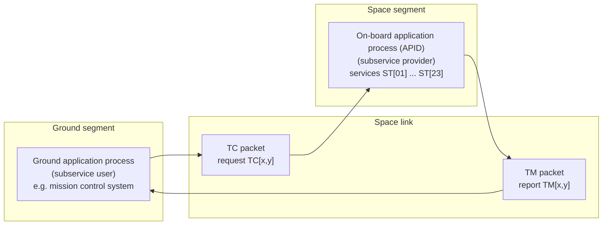
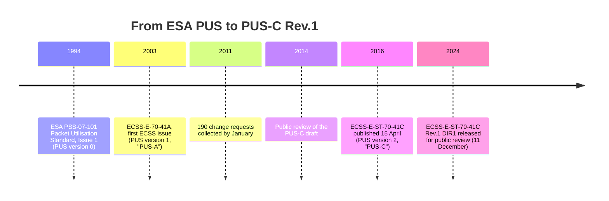
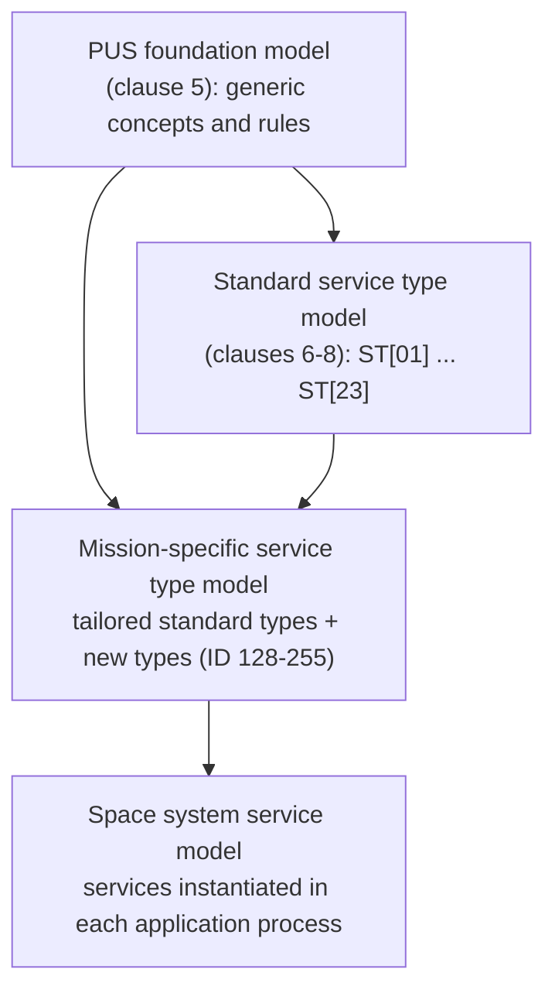
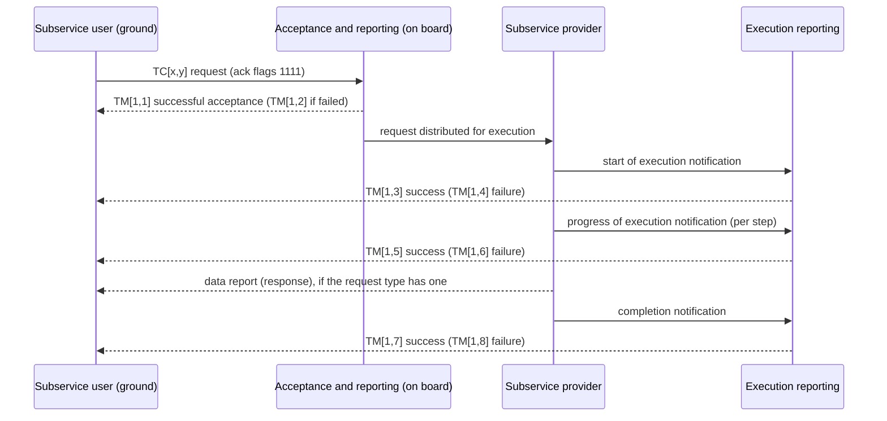
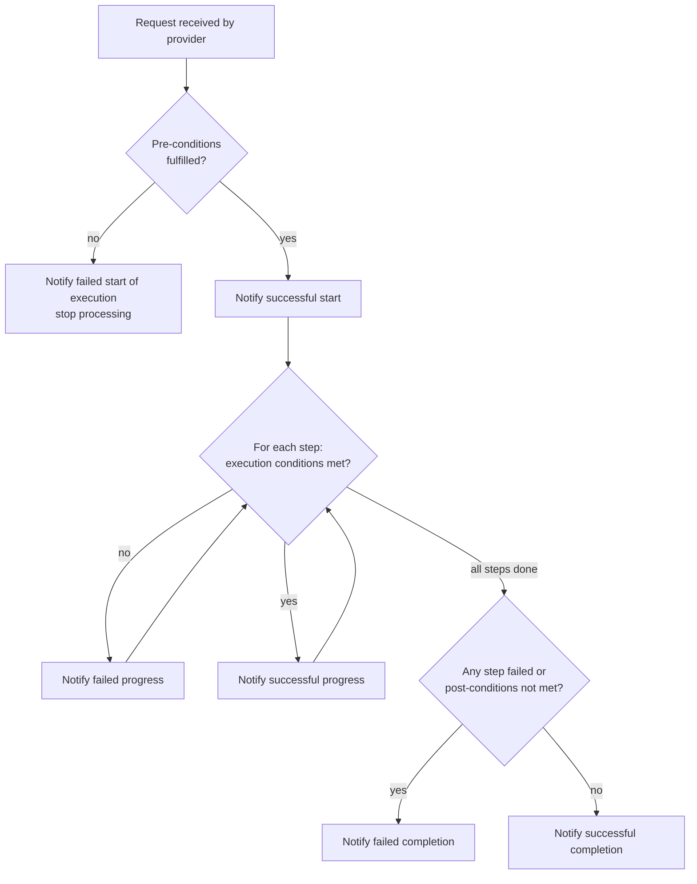

# PUS: the Packet Utilization Standard

The **Packet Utilization Standard (PUS)**, ECSS-E-ST-70-41C "Telemetry and telecommand packet
utilization", defines the *application-level* interface between a spacecraft and its ground
segment. The [CCSDS Space Packet Protocol](../../ccsds/space-packet.md) and the ECSS-E-ST-50
communication standards move packets end to end; PUS says what those packets *mean*: which
requests the ground can send, which reports the spacecraft returns, and how both are laid out
bit by bit, so that integration, testing and flight operations can rely on a common
interface.[^c-intro] This wiki writes PUS message types as TC[x,y] and TM[x,y], for example TM[3,25]
"housekeeping parameter report" or TC[11,4] "insert activities into the time-based
schedule".[^c-annexc]

!!! info "At a glance"
    | Item | Value |
    |---|---|
    | Current issue | ECSS-E-ST-70-41C, 15 April 2016 (656 pages)[^c-changelog] |
    | Previous issue | ECSS-E-70-41A, 30 January 2003; issue B was never published[^c-changelog] |
    | Draft revision | ECSS-E-ST-70-41C Rev.1 DIR1, 11 December 2024, public review until 28 February 2025[^r-cover] |
    | Scope | Use of TC and TM packets for remote monitoring and control of subsystems and payloads, during integration, testing and operations[^c-scope] |
    | Out of scope | Mission-specific payload data packets, audio and video, on-board message transport, ground processing[^c-scope][^c-711] |
    | Standard service types | 20 (ST[01] to ST[23], with 7, 10 and 16 reserved)[^c-table41] |
    | Packet version on the wire | PUS version number 2 in every TC and TM secondary header[^c-7431] |

## Where PUS sits

PUS complements the space packet and data link standards: it does not move bits, it defines the
messages carried by them.[^c-intro] Requests initiated on the ground travel as *telecommand
packets* to an on-board application process, and reports travel back as *telemetry packets*;
how on-board processes exchange messages among themselves is mission-dependent and outside the
standard.[^c-711]



The packets ride in [TC transfer frames](../../ccsds/tc-sdlp.md) and
[TM transfer frames](../../ccsds/tm-sdlp.md) (or [AOS](../../ccsds/aos.md) frames); on the
telemetry side virtual channels separate data streams, and on the telecommand side MAP
identifiers create sub-channels inside a virtual channel - up to 64 per virtual channel.[^c-712]
For the overall chain see [downlink](../../overview/downlink.md) and
[uplink](../../overview/uplink.md).

## History



The PUS began as an ESA standard, ESA PSS-07-101 (Issue 1, May 1994), whose packets carry PUS
version number 0.[^c-biblio][^c-7431] ECSS-E-70-41A of 30 January 2003 became the first ECSS
issue and introduced version number 1; ECSS-E-70-41B was never issued.[^c-changelog][^c-7431]

By January 2011 the working group preparing the third version had 190 change requests asking to remove
PUS-A deficiencies, inject lessons learned, meet the needs of future missions, stay consistent
with newer ECSS and CCSDS standards, follow the ECSS drafting rules and keep backward
compatibility where possible.[^v15-purpose][^v14-purpose] The working group was convened by ESA
with members from Astrium, CNES, DLR, EUMETSAT, Spacebel and TAS.[^v14-wg] The
four-month public review of the draft (ECSS-E-ST-70-41C DIR1) ended in December 2014 with 620
discrepancy reports,[^v15-purpose] 464 of them from agencies and 156 from industry; the working
group added 44 of its own in 2015, giving 664 in total, 72 of them major. Of these, 72 concerned
the new PUS foundation model alone.[^v15-drr] The reviewers asked, among
other things, for more background information, a clearer explanation of how services relate to
application processes and packets, a simpler ground segment model, and more tailoring
flexibility.[^v15-review]

ECSS-E-ST-70-41C was published on 15 April 2016. Its change log names the main changes: the
introduction of the **PUS foundation model**, used to produce the standard service types and to
be used by missions for their own service types and services, and a proper separation of
**system requirements** from **interface requirements**.[^c-changelog] At the ADCSS 2015
workshop the convenor summarised the result as a new, formally defined vocabulary, a system
specification focused on what is expected on board, and a drafting process supported by the
foundation model - about 150 generic requirements in clause 5, 2 300 system requirements in
clause 6 and 750 interface requirements in clauses 7 and 8.[^v15-structure][^v15-vs]

The latest step is **ECSS-E-ST-70-41C Rev.1 DIR1** (11 December 2024), a draft distributed for
public review from 12 December 2024 to 28 February 2025 that "may not be referred to as an ECSS
Standard until published as such".[^r-cover] It deletes ST[08] and adds ST[24] to ST[27] (see
[PUS-A vs PUS-C](pus-a-vs-pus-c.md#what-the-2024-rev1-draft-proposes)).[^r-changelog]

## The vocabulary

PUS-C defines a precise set of terms; the most important are:

| Term | Meaning in PUS-C |
|---|---|
| **Application process** | Element of the space system that hosts one or more subservice entities; on board or on ground; implemented in software, firmware or hardware.[^c-term-ap][^c-41] |
| **Service** | Functional element providing closely related, remotely operable functions; composed of subservices.[^c-term-svc] |
| **Subservice** | Elementary part of a service: exactly one *subservice provider* and its *subservice users*, interacting through dedicated messages.[^c-term-svc] |
| **Subservice provider / user** | The provider executes requests and generates reports; the user initiates requests and processes reports.[^c-term-svc] |
| **Capability** | A functionality of a service or subservice, specified as operational requirements.[^c-term-cap] |
| **Message** | A request or a report.[^c-term-msg] |
| **Request / instruction** | A request is a message of one or more *instructions* issued by a subservice user for execution by a provider.[^c-term-msg] |
| **Report / notification** | A report is a message of one or more *notifications*; three kinds: verification reports, data reports and event reports.[^c-term-msg] |
| **Transaction** | The set of messages related to one capability: request-related, autonomous data reporting, or event reporting.[^c-term-tr] |

Usually the on-board processes host the providers and the ground hosts the users, but the
standard allows the reverse: ground equipment can host providers so that a control centre can
command it, and a payload can host users, for example to manage a mass memory with file
management requests.[^c-41]

## The PUS model

PUS-C is organised as a multi-layer model:[^c-42]



* The **foundation model** fixes the generic object types - service type, subservice type,
  capability type, message, request and report types, transaction types - and the rules that
  every service type, standard or mission-specific, must obey.[^c-422][^c-51]
* The **standard service type model** is the set of service types specified by the standard. Each
  one has a *system* specification in clause 6 (semantics: what the service does and how it
  reacts to requests) and an *interface* specification in clause 8 (syntax: packet layouts,
  using the field types of clause 7.3).[^c-4232]
* The **mission-specific service type model** is recorded by each mission in a
  "mission-specific packet utilization definition document" that lists the standard service
  types it uses, each tailored, plus any mission-specific service types.[^c-4233]
* The **space system service model** deploys these types: it says which application process
  hosts which service instance, with its full tailored specification.[^c-424]

The 2015 presentation explains why: the foundation model was written with a formal
"fact based modelling" technique to remove PUS-A ambiguities, keep all requirements consistent,
ease tailoring, and enable the automatic generation of software and
documentation.[^v15-fbm] A prototype "PUS foundation database" was used to verify the
consistency of the message type requirements and to generate parts of clauses 6 and 8 and the
message type summary annex.[^v15-fdb]

## Identifiers and notation

Names are for humans and identifiers are for the spacecraft; both are unique within their context,
and the widest context is the single spacecraft.[^c-52]

| Identifier | Range in PUS-C | Rule |
|---|---|---|
| Service type ID | 1-255 | standard types at most 127, mission-specific types at least 128; withdrawn standard IDs are not reused[^c-531] |
| Message subtype ID | 1-255 | standard subtypes at most 127; mission-specific subtypes in a standard service type at least 128[^c-5331] |
| Message type ID | (service type ID, message subtype ID) | uniquely identifies the message type; carried in the packet secondary header[^c-5331] |
| Application process identifier (APID) | 0-2046 | identifies an application process that hosts a provider; 2047 reserved for idle packets, 0 for spacecraft time packets[^c-5421] |
| Application process user identifier | 0-65535 | identifies an application process that hosts a user; used as *source ID* of requests and *destination ID* of reports[^c-5421] |

This wiki follows the standard's own notation:

* **ST[xx]** - a service type, for example ST[03] housekeeping;[^c-table41]
* **TC[x,y]** - a request (telecommand) of service type x and subtype y, for example TC[17,1];
* **TM[x,y]** - a report (telemetry), for example TM[1,1] "successful acceptance verification
  report".[^c-annexc1]

A **request identifier** combines the source ID, the destination APID (plus a system identifier)
and the sequence count or packet name; a **report identifier** combines the source APID, the
destination ID and the source sequence count. The standard assumes these are unique for the
mission but notes that counter wrap-around or testing can repeat them, so timing information may
be needed.[^c-reqid][^c-repid] Where each identifier lives in the packet is shown on
[packet structures](packets.md).

## Messages and transactions

Every message type is either a request type or a report type. A request type defines one or more
instruction types and declares whether a request may carry one or several instructions (its
"instruction slots"), which instruction types may be combined, and the arguments of each.[^c-5332]
A report type defines exactly one notification type and declares whether one report may hold
several notifications.[^c-5333] Each request type is linked to at most one data report type that
serves as its response.[^c-53522]

Three transaction types use these messages:[^c-535][^c-5410]

* a **request-related transaction**: one request, zero or more verification reports (depending on
  the acknowledgement flags and the execution checks), and, if the request asks for data, one or
  more responses;
* an **autonomous data reporting transaction**: a data report generated on the provider's own
  initiative, for example a periodic housekeeping report;
* an **event reporting transaction**: one event report (informative, low, medium or high
  severity), the event being identified by an event definition within the application process.



The diagram combines the request acknowledgement rules of clause 5.4.11.2.2 with the report types
of [ST[01]](st01-request-verification.md).[^c-ack][^c-annexc1] Success reports are only sent when
the corresponding flag is set; failure reports are always sent. A request whose response would
not fit into one telemetry packet of the maximum CCSDS size (65 542 bytes) is rejected; larger
transfers are left to file management or mission-specific means.[^c-ack][^c-resp]

### Request execution verification

When a provider receives a request, it follows a fixed sequence:[^c-54113ver]



A successful completion only means that the provider checked every post-condition in the
request type's *execution verification profile*; it does not necessarily mean that the activity
achieved its purpose.[^c-54113ver] Each profile lists the condition codes and failure notices
(code plus parameters) that can be reported at start, progress and completion.[^c-53523] Whether
failed progress is reported in its own TM[1,6] report or folded into the completion report is
declared per request type.[^c-549]

## Capabilities and applicability constraints

Each subservice type defines at least one **capability type**, and each capability type carries an
**applicability constraint** that tells a mission whether it must, may or must not provide
it:[^c-534]

| Constraint | Meaning | Example given by the standard |
|---|---|---|
| minimum | every subservice of this type provides the capability | the ST[01] verification reports |
| by declaration | the mission decides when specifying the subservice | enabling periodic housekeeping generation |
| implied by another capability | provided automatically if the other one is | disabling periodic housekeeping generation |
| by declaration, only if another capability is provided | optional, but only on top of another capability | register dump on top of register load |
| exclusive-or (on a set) | at most one of the set | CUC *or* CDS time reports |
| inclusive-or (on a set) | at least one of the set | at least one device access capability |

Annex C of the standard tags every message type with its constraint ("minimum", "by declaration",
"requires TC[x,y]" ...).[^c-annexc] PUS-A instead defined, per service, a "minimum capability set"
plus "additional capability sets".[^a-scope] The PUS-C scope clause still uses the capability-set
wording to describe service levels, but the requirements themselves work with per-capability
applicability constraints.[^c-scope][^c-scope2][^c-534]

## Tailoring: the menu approach

The standard says plainly that it is not meant to be applied in full: the services cover a wide
range of scenarios, and the mission picks what it needs. PUS should be viewed as a "Menu" from
which services and service levels are selected, separately for each application
process.[^c-scope][^c-scope2] Early design choices fix the on-board architecture (number, location
and role of application processes) and the services each process supports; missions usually
record the result in a space-to-ground interface control document.[^c-scope] All services are
optional, and each can be implemented at several levels, the minimum level being the simplest
coherent one.[^c-scope2]

Tailoring the generic level means only *adding*: mission-specific service types, subservice types,
capability types and message types. Reducing the standard capabilities is not recommended because
it hampers the reuse of existing hardware and software.[^c-536] The standard also assumes that the
ground segment implements every standardized capability, so the ground does not constrain
tailoring - a point the 2015 presentation repeats: "PUS-C mainly only addresses the on-board
capabilities".[^c-scope2][^v15-review2]

!!! note "Mandated interdependencies"
    Even a minimal tailoring must respect the dependencies stated by the standard: request
    verification is accessible to every service in the same application process; event reporting
    and large packet transfer are accessible to every service; on-board monitoring and event-action
    need an event reporting service; and an OBCP service that supports observability levels needs
    one too.[^c-424]

Other things a mission must *declare* include the checksum algorithm used by each provider, the virtual channels used for reports, the on-board
memories and their addressing schemes, and the on-board file systems.[^c-5443][^c-544][^c-545]

## The standard service types

| ST | PUS-C name | Subservice types (Annex C) | System / interface clause | PUS-A name | Page |
|---|---|---|---|---|---|
| 1 | request verification | routing and reporting; acceptance and reporting; execution reporting | 6.1 (p. 55) / 8.1 (p. 445) | telecommand verification | [ST[01]](st01-request-verification.md) |
| 2 | device access | device access | 6.2 (p. 64) / 8.2 (p. 451) | device command distribution | [ST[02]](st02-device-access.md) |
| 3 | housekeeping | housekeeping reporting; diagnostic reporting; parameter functional reporting configuration | 6.3 (p. 78) / 8.3 (p. 456) | housekeeping and diagnostic data reporting | [ST[03]](st03-housekeeping.md) |
| 4 | parameter statistics reporting | parameter statistics reporting | 6.4 (p. 111) / 8.4 (p. 473) | parameter statistics reporting | [ST[04]](st04-parameter-statistics.md) |
| 5 | event reporting | event reporting | 6.5 (p. 121) / 8.5 (p. 477) | event reporting | [ST[05]](st05-event-reporting.md) |
| 6 | memory management | raw data; structured data; common; memory configuration | 6.6 (p. 127) / 8.6 (p. 481) | memory management | [ST[06]](st06-memory-management.md) |
| 7 | (reserved) | - | 6.7 (p. 156) | not used | - |
| 8 | function management | function management | 6.8 (p. 157) / 8.8 (p. 492) | function management | [ST[08]](st08-function-management.md) |
| 9 | time management | time reporting; time reporting control | 6.9 (p. 160) / 8.9 (p. 493) | time management | [ST[09]](st09-time-management.md) |
| 10 | (reserved) | - | 6.10 (p. 167) | not used | - |
| 11 | time-based scheduling | time-based scheduling | 6.11 (p. 168) / 8.11 (p. 496) | on-board operations scheduling | [ST[11]](st11-time-based-scheduling.md) |
| 12 | on-board monitoring | parameter monitoring; functional monitoring | 6.12 (p. 198) / 8.12 (p. 508) | on-board monitoring | [ST[12]](st12-onboard-monitoring.md) |
| 13 | large packet transfer | large packet downlink; large packet uplink | 6.13 (p. 229) / 8.13 (p. 526) | large data transfer | [ST[13]](st13-large-packet-transfer.md) |
| 14 | real-time forwarding control | real-time forwarding control | 6.14 (p. 237) / 8.14 (p. 529) | packet forwarding control | [ST[14]](st14-real-time-forwarding-control.md) |
| 15 | on-board storage and retrieval | storage and retrieval; packet selection | 6.15 (p. 265) / 8.15 (p. 538) | on-board storage and retrieval | [ST[15]](st15-onboard-storage-retrieval.md) |
| 16 | (reserved) | - | 6.16 (p. 317) | not used | - |
| 17 | test | test | 6.17 (p. 318) / 8.17 (p. 558) | test | [ST[17]](st17-test.md) |
| 18 | on-board control procedure | OBCP management; OBCP engine management | 6.18 (p. 321) / 8.18 (p. 560) | on-board operations procedure | [ST[18]](st18-onboard-operations-procedure.md) |
| 19 | event-action | event-action | 6.19 (p. 342) / 8.19 (p. 568) | event-action | [ST[19]](st19-event-action.md) |
| 20 | parameter management | parameter management | 6.20 (p. 352) / 8.20 (p. 573) | - (new) | [ST[20]](st20-onboard-parameter-management.md) |
| 21 | request sequencing | request sequencing | 6.21 (p. 358) / 8.21 (p. 577) | - (new) | [ST[21]](st21-request-sequencing.md) |
| 22 | position-based scheduling | position-based scheduling | 6.22 (p. 369) / 8.22 (p. 583) | - (new) | [ST[22]](st22-position-based-scheduling.md) |
| 23 | file management | file handling; file copy | 6.23 (p. 403) / 8.23 (p. 596) | - (new) | [ST[23]](st23-file-management.md) |

Sources: PUS-C Table 4-1, Annex C and Annex D (page numbers are PDF pages, identical to the printed
ones); PUS-A Table 2.[^c-table41][^c-annexc][^c-annexd][^a-table2] The reserved identifiers 7, 10
and 16 were used in earlier versions; the standard no longer promotes them but does not forbid
reusing existing implementations.[^c-table41] The full list of message types is in the
[message type catalogue](message-types.md).

!!! note "Two names for ST[18] and ST[20]"
    PUS-C itself is not fully consistent: Table 4-1 and clause 6.18 say "on-board control
    procedure" and Table 4-1 says "parameter management", while Annex D says "On-board operations
    procedure" and clause 8.20 and Annex D say "on-board parameter management".[^c-table41][^c-annexd]

The standard types fall into three families: services with basic functions (for example parameter
statistics), services that *hold and release* requests (the standard's examples are time-based
scheduling, position-based scheduling and event-action) and services that offer standard
interfaces to devices, to an OBCP engine or to a file system.[^c-4232]

## How a ground system sees PUS

PUS mainly specifies the spacecraft side, assuming a ground segment that implements every
capability.[^c-scope2] In practice the ground knowledge of a mission's PUS tailoring lives in its
mission database. In SCOS-2000:

* incoming telemetry is recognised by APID, service type and subtype - which must sit at the same
  position in every TM packet of the spacecraft - plus up to two extra identification fields; the
  combination is looked up in the [PID](../../mib/tables/pid.md) table to find the packet's SPID
  and structure;[^icd-pid]
* every command definition in [CCF](../../mib/tables/ccf.md) carries its service type, subtype,
  APID and acknowledgement flags, which the header definition copies into the TC
  packet;[^icd-pcdf]
* SCOS-2000 decodes and encodes all PUS data types except a few formats (see
  [parameter types](parameter-types.md#ptcpfc-in-scos-2000)), but deduced *structures* are not
  supported, and parameters extracted from variable packets cannot feed full TM processing such as
  limit checks and synthetic parameters, so variable packets should not carry routine
  housekeeping;[^icd-appc1][^icd-appc2]
* a few services get ground modelling: service 1 reports drive command verification (using the
  4-octet copy of the TC header, and ignoring the failure code), service 9 time reports feed time
  correlation, and service 11 is modelled with a ground image of the on-board schedule, while most
  other services get no specific processing.[^icd-appc3][^icd-appc4]

!!! warning "Inference: which PUS the ICD appendix cites"
    Appendix C of the ICD points to "Section 23.5 of [AD-2]" for data types, "Section 23.6" for
    data structures and "Section 6" to "Section 21 of [AD-5]" for services 1 to 19, although its
    reference list gives [AD-2] and [AD-5] as SCOS-2000 documents (the Commanding SRD and a
    displays ICD).[^icd-appc1][^icd-appc4][^icd-ad] Those section numbers match ECSS-E-70-41A,
    where clause 23.5 is "Simple parameter types", 23.6 "Structured field types", clause 6 the
    telecommand verification service and clause 14 on-board operations scheduling.[^a-toc] The
    appendix therefore appears to have been written against PUS-A.

See also
[MIB data model](../../mib/data-model.md), [commanding](../../mib/commanding.md) and
[command verification](../../mib/command-verification.md).

## PUS on Solar Orbiter

Solar Orbiter is a PUS-A mission: its space-to-ground ICD makes ECSS-E-70-41A its applicable PUS
and only allows standard TM/TC within its capability sets unless agreed with ESA and the
manufacturer.[^solo-ad1] Counting the service types in the September 2025 MIB gives a picture of
a real tailoring:[^mib-types]

| Service type | TM packet definitions (PID) | Commands (CCF, nominal header) | Notes |
|---|---|---|---|
| 0 (no type) | 11 | 0 | idle packet (APID 2047), OBC high-priority TM packet (APID 34), three frame pseudo-packets, six ground (LMS) packets on APIDs 2048-2065 |
| 1 verification | 1 809 | 0 | reports only |
| 2 device | 1 | 1 363 | |
| 3 housekeeping | 397 | 345 | |
| 5 events | 7 156 | 35 | one definition per event |
| 6 memory | 309 | 221 | |
| 8 function | 1 | 69 | |
| 9 time | 1 | 4 | the TM(9,2) time report on APID 0 (SPID 9999), keyed as type 9 although it has no data field header |
| 11 scheduling | 3 | 33 | |
| 12 monitoring | 32 | 254 | |
| 13 large data | 9 | 28 | |
| 14 forwarding | 4 | 12 | |
| 15 storage | 7 | 47 | |
| 16 | 0 | 5 | Solar Orbiter "on-board traffic management" |
| 17 test | 17 | 27 | |
| 18 procedures | 2 | 46 | |
| 19 event-action | 2 | 48 | |
| 20 | 0 | 17 | Solar Orbiter "information distribution" |
| 21 | 334 | 33 | Solar Orbiter "science data transfer" |
| 22 | 1 | 6 | Solar Orbiter "context saving" |
| 128-255 (70 types) | 1 054 | 2 725 | mission-specific services |

Service types 4, 7 and 10 do not occur at all. The command column counts only commands built on
the nominal `NOM_TC` header; the 125 CPDU commands (header `HPC1_TC`, no service type in CCF), the
five frame-level directives and the six NIS throw events are left out.[^mib-types] Types 16 and
20-22 are numbered in the standard range but carry Solar Orbiter's own mission services as defined
in its ICD; PUS-A leaves 16 unused and defines no 20-22, while PUS-C reserves 16 and uses 20-22 for
other standard services.[^solo-svc][^a-table2][^c-table41][^mib-types] The details of each service are on
[How Solar Orbiter uses PUS](../../missions/solar-orbiter/pus-usage.md); individual packets and
commands can be browsed in the [MIB explorer](../../explorer/index.md#/solo/search/TM).

??? example "SQL used"
    ```sql
    -- solo-2025-09-16.sqlite (MIB__20250916M25925PFMS001_SOL)
    SELECT t, SUM(tm) AS tm_spids, SUM(tc) AS tc_cmds FROM (
      SELECT CAST(PID_TYPE AS INT) t, 1 tm, 0 tc FROM pid
      UNION ALL
      SELECT CAST(CCF_TYPE AS INT), 0, 1 FROM ccf WHERE CCF_PKTID = 'NOM_TC')
    GROUP BY t ORDER BY t;
    -- aggregated: type 0 / 1-127 / 128-255
    SELECT CASE WHEN t = 0 THEN '0' WHEN t < 128 THEN '1-127' ELSE '128-255' END r,
           SUM(tm), SUM(tc), COUNT(DISTINCT t)
      FROM (SELECT CAST(PID_TYPE AS INT) t, 1 tm, 0 tc FROM pid
            UNION ALL SELECT CAST(CCF_TYPE AS INT), 0, 1 FROM ccf WHERE CCF_PKTID = 'NOM_TC')
     GROUP BY r;
    -- the packets behind types 0 and 9, and the commands left out
    SELECT PID_TYPE, PID_STYPE, PID_APID, PID_SPID, PID_DESCR FROM pid
     WHERE CAST(PID_TYPE AS INT) IN (0, 9);
    SELECT CCF_PKTID, CCF_CTYPE, COUNT(*) FROM ccf WHERE CCF_PKTID != 'NOM_TC' GROUP BY 1, 2;
    ```

!!! warning "Inference"
    The large number of service 1 and service 5 packet definitions reflects how SCOS-2000 keys
    telemetry: PID entries are distinct per APID and per extra identification field (such as an
    event identifier), so a single report type such as "low severity event" becomes thousands of
    database packets.

## Reading the standard

ECSS-E-ST-70-41C is long (656 pages) but regular:[^c-toc]

| Part | Content |
|---|---|
| Clauses 1-4 | scope, references, terms, context and the PUS model |
| Clause 5 | the PUS foundation model (generic service type and service deployment levels) |
| Clause 6 | system requirements of each service type ST[01]-ST[23] |
| Clause 7 | space-to-ground interface: packet field types (7.3) and the Space Packet with PUS headers (7.4) |
| Clause 8 | interface requirements: the layout of every TC[x,y] and TM[x,y] |
| Clause 9 | the command pulse distribution unit (CPDU) |
| Annexes A-D | real number formats, CRC and ISO checksum, summary of all message types with applicability, index of clauses per service |

Requirements use "shall", recommendations "should" (to be turned into requirements or tailored
out), permissions "may" / "need not", and "can" is descriptive only.[^c-nomen] Clause 6 tells you
*what* a request does; clause 8 tells you *how* it is encoded, using the PTC/PFC field types of
clause 7.3, described on [PUS parameter types](parameter-types.md). The headers of clause 7.4 are
described on [PUS packet structures](packets.md), and the differences from the 2003 edition on
[PUS-A vs PUS-C](pus-a-vs-pus-c.md). The wider ECSS context is on [ECSS](../index.md),
[ECSS-E-ST-70-11C](../e-st-70-11c.md) (space segment operability) and
[ECSS-E-ST-70-31C](../e-st-70-31c.md) (monitoring and control data definition).

[^c-intro]: [ECSS-E-ST-70-41C, Telemetry and telecommand packet utilization](../../library/ecss-e-st-70-41c-15april2016.md), Introduction, PDF p. 8.
[^c-changelog]: [ECSS-E-ST-70-41C](../../library/ecss-e-st-70-41c-15april2016.md), Change log, PDF p. 3.
[^c-scope]: [ECSS-E-ST-70-41C](../../library/ecss-e-st-70-41c-15april2016.md), clause 1 Scope, PDF p. 9.
[^c-scope2]: [ECSS-E-ST-70-41C](../../library/ecss-e-st-70-41c-15april2016.md), clause 1 Scope (continued), PDF p. 10.
[^c-711]: [ECSS-E-ST-70-41C](../../library/ecss-e-st-70-41c-15april2016.md), §7.1.1, PDF p. 425.
[^c-712]: [ECSS-E-ST-70-41C](../../library/ecss-e-st-70-41c-15april2016.md), §7.1.2.2-7.1.2.3, PDF pp. 426-427.
[^c-table41]: [ECSS-E-ST-70-41C](../../library/ecss-e-st-70-41c-15april2016.md), §4.2.3.2, Table 4-1, PDF pp. 22-23.
[^c-7431]: [ECSS-E-ST-70-41C](../../library/ecss-e-st-70-41c-15april2016.md), §7.4.3.1c and §7.4.4.1c, PDF pp. 439 and 442.
[^c-biblio]: [ECSS-E-ST-70-41C](../../library/ecss-e-st-70-41c-15april2016.md), Bibliography, PDF p. 656.
[^c-41]: [ECSS-E-ST-70-41C](../../library/ecss-e-st-70-41c-15april2016.md), §4.1, PDF pp. 18-19.
[^c-term-ap]: [ECSS-E-ST-70-41C](../../library/ecss-e-st-70-41c-15april2016.md), §3.2.3, PDF pp. 12-13.
[^c-term-svc]: [ECSS-E-ST-70-41C](../../library/ecss-e-st-70-41c-15april2016.md), §3.2.21-3.2.25, PDF pp. 15-16.
[^c-term-cap]: [ECSS-E-ST-70-41C](../../library/ecss-e-st-70-41c-15april2016.md), §3.2.4, PDF p. 13.
[^c-term-msg]: [ECSS-E-ST-70-41C](../../library/ecss-e-st-70-41c-15april2016.md), §3.2.9-3.2.11, 3.2.16 and 3.2.18, PDF pp. 14-15.
[^c-term-tr]: [ECSS-E-ST-70-41C](../../library/ecss-e-st-70-41c-15april2016.md), §3.2.26, PDF p. 16.
[^c-42]: [ECSS-E-ST-70-41C](../../library/ecss-e-st-70-41c-15april2016.md), §4.2.1, PDF p. 21.
[^c-422]: [ECSS-E-ST-70-41C](../../library/ecss-e-st-70-41c-15april2016.md), §4.2.2, PDF p. 22.
[^c-4232]: [ECSS-E-ST-70-41C](../../library/ecss-e-st-70-41c-15april2016.md), §4.2.3.2, PDF pp. 22-23.
[^c-4233]: [ECSS-E-ST-70-41C](../../library/ecss-e-st-70-41c-15april2016.md), §4.2.3.3, PDF p. 24.
[^c-424]: [ECSS-E-ST-70-41C](../../library/ecss-e-st-70-41c-15april2016.md), §4.2.4, PDF p. 24.
[^c-51]: [ECSS-E-ST-70-41C](../../library/ecss-e-st-70-41c-15april2016.md), §5.1, PDF pp. 25-26.
[^c-52]: [ECSS-E-ST-70-41C](../../library/ecss-e-st-70-41c-15april2016.md), §5.2, PDF p. 26.
[^c-531]: [ECSS-E-ST-70-41C](../../library/ecss-e-st-70-41c-15april2016.md), §5.3.1, PDF pp. 26-27.
[^c-5331]: [ECSS-E-ST-70-41C](../../library/ecss-e-st-70-41c-15april2016.md), §5.3.3.1, PDF p. 28.
[^c-5332]: [ECSS-E-ST-70-41C](../../library/ecss-e-st-70-41c-15april2016.md), §5.3.3.2, PDF pp. 28-30.
[^c-5333]: [ECSS-E-ST-70-41C](../../library/ecss-e-st-70-41c-15april2016.md), §5.3.3.3, PDF pp. 30-31.
[^c-534]: [ECSS-E-ST-70-41C](../../library/ecss-e-st-70-41c-15april2016.md), §5.3.4, PDF pp. 32-33.
[^c-535]: [ECSS-E-ST-70-41C](../../library/ecss-e-st-70-41c-15april2016.md), §5.3.5, PDF pp. 33-38.
[^c-53522]: [ECSS-E-ST-70-41C](../../library/ecss-e-st-70-41c-15april2016.md), §5.3.5.2.2, PDF pp. 33-34.
[^c-53523]: [ECSS-E-ST-70-41C](../../library/ecss-e-st-70-41c-15april2016.md), §5.3.5.2.3, PDF pp. 34-37.
[^c-536]: [ECSS-E-ST-70-41C](../../library/ecss-e-st-70-41c-15april2016.md), §5.3.6, PDF p. 38.
[^c-5421]: [ECSS-E-ST-70-41C](../../library/ecss-e-st-70-41c-15april2016.md), §5.4.2.1, PDF pp. 39-40.
[^c-5443]: [ECSS-E-ST-70-41C](../../library/ecss-e-st-70-41c-15april2016.md), §5.4.3.3-5.4.3.4, PDF pp. 42-44.
[^c-544]: [ECSS-E-ST-70-41C](../../library/ecss-e-st-70-41c-15april2016.md), §5.4.4, PDF pp. 44-45.
[^c-545]: [ECSS-E-ST-70-41C](../../library/ecss-e-st-70-41c-15april2016.md), §5.4.5, PDF p. 45.
[^c-549]: [ECSS-E-ST-70-41C](../../library/ecss-e-st-70-41c-15april2016.md), §5.4.9, PDF p. 47.
[^c-5410]: [ECSS-E-ST-70-41C](../../library/ecss-e-st-70-41c-15april2016.md), §5.4.10, PDF pp. 47-48.
[^c-reqid]: [ECSS-E-ST-70-41C](../../library/ecss-e-st-70-41c-15april2016.md), §5.4.11.2.1c, PDF p. 49.
[^c-ack]: [ECSS-E-ST-70-41C](../../library/ecss-e-st-70-41c-15april2016.md), §5.4.11.2.2, PDF pp. 50-51.
[^c-54113ver]: [ECSS-E-ST-70-41C](../../library/ecss-e-st-70-41c-15april2016.md), §5.4.11.2.3, PDF pp. 51-52.
[^c-repid]: [ECSS-E-ST-70-41C](../../library/ecss-e-st-70-41c-15april2016.md), §5.4.11.3.1c, PDF pp. 52-53.
[^c-resp]: [ECSS-E-ST-70-41C](../../library/ecss-e-st-70-41c-15april2016.md), §5.4.11.3.2, PDF p. 53.
[^c-nomen]: [ECSS-E-ST-70-41C](../../library/ecss-e-st-70-41c-15april2016.md), §3.4, PDF p. 17.
[^c-annexc]: [ECSS-E-ST-70-41C](../../library/ecss-e-st-70-41c-15april2016.md), Annex C (C.1-C.2), PDF pp. 628-654.
[^c-annexc1]: [ECSS-E-ST-70-41C](../../library/ecss-e-st-70-41c-15april2016.md), Annex C.2.1, Tables C-1 to C-3, PDF pp. 628-629.
[^c-annexd]: [ECSS-E-ST-70-41C](../../library/ecss-e-st-70-41c-15april2016.md), Annex D, PDF p. 655.
[^c-toc]: [ECSS-E-ST-70-41C](../../library/ecss-e-st-70-41c-15april2016.md), Table of contents, PDF pp. 4-7.
[^a-scope]: [ECSS-E-70-41A, Telemetry and telecommand packet utilization](../../library/ecss-e-70-41a-30jan2003-pus.md), clause 1 Scope and §3.1.1/§3.1.6, PDF pp. 14 and 17-18.
[^a-table2]: [ECSS-E-70-41A](../../library/ecss-e-70-41a-30jan2003-pus.md), §5.5, Table 2, PDF p. 50.
[^a-toc]: [ECSS-E-70-41A](../../library/ecss-e-70-41a-30jan2003-pus.md), Contents (clauses 6, 14 and 23.5-23.6), PDF pp. 7-10.
[^icd-ad]: [SCOS-2000 Database Import ICD 7.0](../../library/icd-7-0-final.md), §1.4.1 Applicable documents (AD-2 SRD-0002, AD-5 ICD-5001), PDF p. 18.
[^r-cover]: [ECSS-E-ST-70-41C Rev.1 DIR1 (draft, 11 December 2024)](../../library/ecss-e-st-70-41c-rev1-dir1.md), cover page, PDF p. 1.
[^r-changelog]: [ECSS-E-ST-70-41C Rev.1 DIR1](../../library/ecss-e-st-70-41c-rev1-dir1.md), Change log, PDF pp. 3-4.
[^v14-purpose]: [S. Valera, ECSS-E-ST-70-41C status, SAVOIR Mass Memory Day, 13 February 2014](../../library/valera-2014-ecss-e-st-70-41c-status.md), slide 2, PDF p. 2.
[^v14-wg]: [S. Valera, ECSS-E-ST-70-41C status (2014)](../../library/valera-2014-ecss-e-st-70-41c-status.md), slide 3, PDF p. 3.
[^v15-purpose]: [S. Valera, ECSS-E-ST-70-41C status, ADCSS 2015](../../library/valera-2015-adcss-ecss-e-st-70-41c-status.md), slide 2, PDF p. 2.
[^v15-structure]: [S. Valera, ADCSS 2015](../../library/valera-2015-adcss-ecss-e-st-70-41c-status.md), slide 3, PDF p. 3.
[^v15-vs]: [S. Valera, ADCSS 2015](../../library/valera-2015-adcss-ecss-e-st-70-41c-status.md), slide 4, PDF p. 4.
[^v15-drr]: [S. Valera, ADCSS 2015](../../library/valera-2015-adcss-ecss-e-st-70-41c-status.md), slide 15, PDF p. 15.
[^v15-review]: [S. Valera, ADCSS 2015](../../library/valera-2015-adcss-ecss-e-st-70-41c-status.md), slide 16, PDF p. 16.
[^v15-review2]: [S. Valera, ADCSS 2015](../../library/valera-2015-adcss-ecss-e-st-70-41c-status.md), slide 17, PDF p. 17.
[^v15-fbm]: [S. Valera, ADCSS 2015](../../library/valera-2015-adcss-ecss-e-st-70-41c-status.md), slide 20, PDF p. 20.
[^v15-fdb]: [S. Valera, ADCSS 2015](../../library/valera-2015-adcss-ecss-e-st-70-41c-status.md), slides 30-32, PDF pp. 30-32.
[^icd-pid]: [SCOS-2000 Database Import ICD, issue 7.0](../../library/icd-7-0-final.md), §3.3.2.4 and §3.3.2.4.1, PDF pp. 82-84.
[^icd-pcdf]: [SCOS-2000 Database Import ICD 7.0](../../library/icd-7-0-final.md), §3.3.3.1.3 (pcdf), PDF pp. 129-130.
[^icd-appc1]: [SCOS-2000 Database Import ICD 7.0](../../library/icd-7-0-final.md), Appendix C, sections 1-2, PDF pp. 234-236.
[^icd-appc2]: [SCOS-2000 Database Import ICD 7.0](../../library/icd-7-0-final.md), Appendix C, section 2 (support of PUS data structures), PDF p. 236.
[^icd-appc3]: [SCOS-2000 Database Import ICD 7.0](../../library/icd-7-0-final.md), Appendix C, §3.1-3.8, PDF pp. 237-240.
[^icd-appc4]: [SCOS-2000 Database Import ICD 7.0](../../library/icd-7-0-final.md), Appendix C, §3.9-3.16, PDF pp. 240-243.
[^solo-ad1]: [SOL.S.ASTR.TN.00079 Issue 7, Solar Orbiter PUS/space-ground ICD](../../library/sol-s-astr-tn-00079-07.md), §1 and applicable documents, PDF pp. 11, 13 and 31.
[^solo-svc]: [SOL.S.ASTR.TN.00079 Issue 7](../../library/sol-s-astr-tn-00079-07.md), service summary table (services 16 and 20-22), PDF pp. 36-37.
[^mib-types]: [Solar Orbiter MIB release MIB__20250916M25925PFMS001_SOL](../../library/mib-20250916m25925pfms001-sol.md), tables pid and ccf, queried by this wiki.
