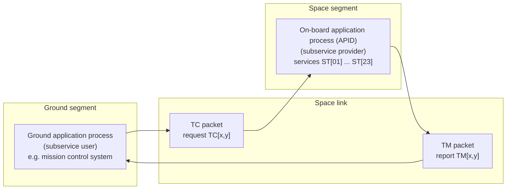
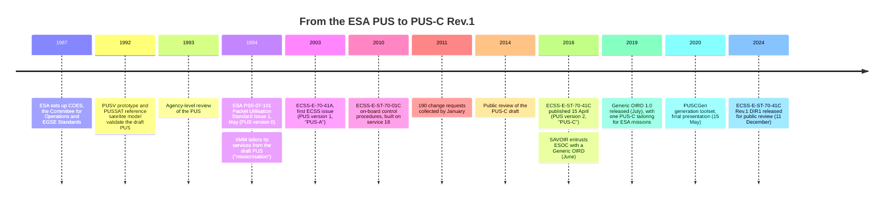
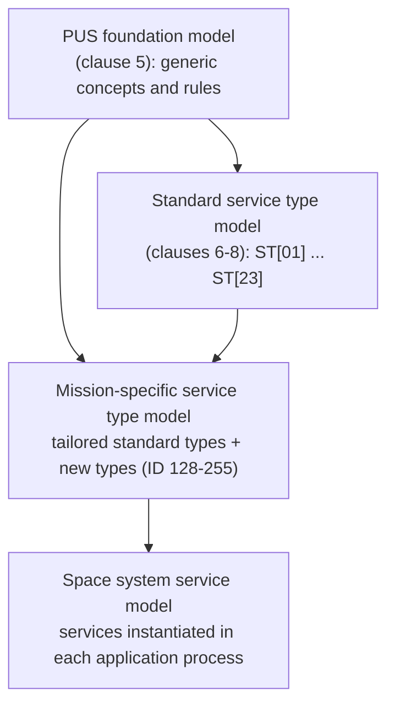
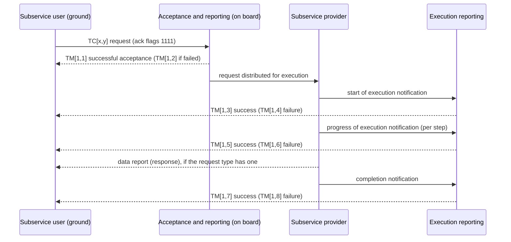
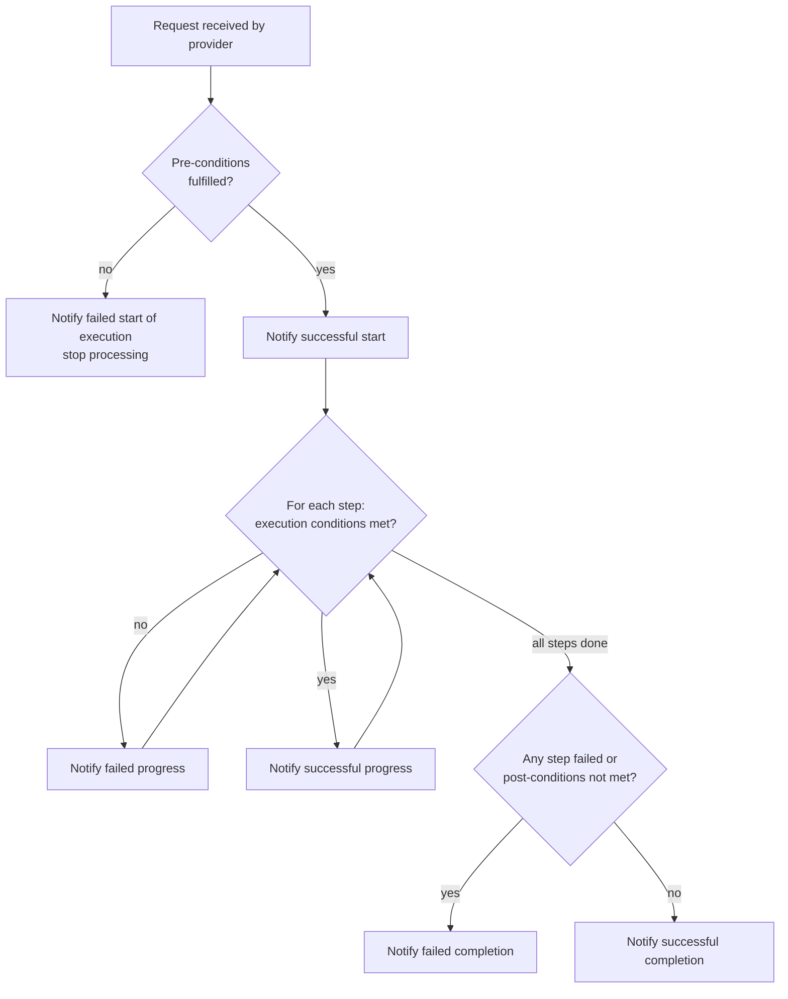

# PUS: the Packet Utilization Standard

The **Packet Utilization Standard (PUS)**, ECSS-E-ST-70-41C "Telemetry and telecommand packet
utilization", defines the *application-level* interface between a spacecraft and its ground
segment. The [CCSDS Space Packet Protocol](../../ccsds/space-packet.md) and the ECSS-E-ST-50
communication standards move packets end to end; PUS says what those packets *mean*: which
requests the ground can send, which reports the spacecraft returns, and how both are laid out
bit by bit, so that integration, testing and flight operations can rely on a common
interface.[^c-intro] This wiki writes PUS message types as TC[x,y] and TM[x,y], for example TM[3,25]
"housekeeping parameter report" or TC[11,4] "insert activities into the time-based
schedule".[^c-annexc] The standard did not start in the ECSS system: it began as an ESA standard,
ESA PSS-07-101 of May 1994, and many of today's service and subtype numbers were fixed then (see [History](#history)).[^pss-cover][^pss-t221]

!!! info "At a glance"
    | Item | Value |
    |---|---|
    | Origin | ESA PSS-07-101 Packet Utilisation Standard, Issue 1, May 1994, prepared by COES; PUS version number 0[^pss-cover][^pss-442] |
    | Current issue | ECSS-E-ST-70-41C, 15 April 2016 (656 pages)[^c-changelog] |
    | Previous issue | ECSS-E-70-41A, 30 January 2003; issue B was never published[^c-changelog] |
    | Draft revision | ECSS-E-ST-70-41C Rev.1 DIR1, 11 December 2024, public review until 28 February 2025[^r-cover] |
    | Scope | Use of TC and TM packets for remote monitoring and control of subsystems and payloads, during integration, testing and operations[^c-scope] |
    | Out of scope | Mission-specific payload data packets, audio and video, on-board message transport, ground processing[^c-scope][^c-711] |
    | Standard service types | 20 (ST[01] to ST[23], with 7, 10 and 16 reserved)[^c-table41] |
    | Packet version on the wire | PUS version number 2 in every TC and TM secondary header[^c-7431] |

## Where PUS sits

PUS complements the space packet and data link standards: it does not move bits, it defines the
messages carried by them.[^c-intro] Requests initiated on the ground travel as *telecommand
packets* to an on-board application process, and reports travel back as *telemetry packets*;
how on-board processes exchange messages among themselves is mission-dependent and outside the
standard.[^c-711]



The packets ride in [TC transfer frames](../../ccsds/tc-sdlp.md) and
[TM transfer frames](../../ccsds/tm-sdlp.md) (or [AOS](../../ccsds/aos.md) frames); on the
telemetry side virtual channels separate data streams, and on the telecommand side MAP
identifiers create sub-channels inside a virtual channel - up to 64 per virtual channel.[^c-712]
For the overall chain see [downlink](../../overview/downlink.md) and
[uplink](../../overview/uplink.md).

## History

The PUS began as an ESA standard in 1994 and moved into the ECSS system in 2003. The wider story of
the ESA packet standards and how they map onto today's CCSDS and ECSS documents is told in
[From ESA PSS to CCSDS and ECSS](../../overview/history.md); this section follows the PUS itself.



The timeline combines the 1994 papers, the standards' title pages and change logs, and the
presentations cited below.[^k-coes][^k-valid][^k-future][^pss-cover][^x-refs][^c-changelog][^obcp-cl][^v15-purpose][^g-found][^g-status][^pcg-title][^r-cover]

### Before ECSS: the ESA Packet Utilisation Standard (1987-1994)

Satellites used to be monitored and controlled largely at the "hardware" level: telemetry
parameters sat at fixed positions in a telemetry format, and commands were fixed-length frames
that loaded on-board registers or set switches. Through the 1980s more and more functions moved
into on-board software, which still had to be operated with these hardware-oriented techniques -
a constraint on its flexibility and on the trend towards on-board autonomy.[^k-intro] The CCSDS packet recommendations, and
the ESA Packet Telemetry Standard (PSS-04-106, January 1988) and Packet Telecommand Standard
(PSS-04-107, April 1992) derived from them, opened a flexible end-to-end exchange between ground
applications and on-board *application processes*, each identified by an APID - but they left the
internal structure and content of the packets open.[^k-intro][^pss-11] (The packet layers
themselves are described on [Space Packet Protocol](../../ccsds/space-packet.md).)

In 1987 ESA set up the **Committee for Operations and EGSE Standards (COES)** to define the
functions common to a satellite checkout system ([EGSE](../../scos2000/egse.md)) and a satellite
control system, so that one monitoring and control system could serve pre-launch checkout and
post-launch operations, within a project and across projects. Because packets let the same control
function be implemented in many different ways, COES found its task feasible only with a clear,
packet-based satellite-ground interface, so its first job became a standard defining precisely how
telemetry and telecommand packets are used.[^k-coes]

The result was **ESA PSS-07-101, Packet Utilisation Standard, Issue 1 (May 1994)**, prepared by
COES and approved by the ESA Inspector General after an Agency-level review during
1993.[^pss-cover][^k-future] It defines the application-level interface between ground and space
for electrical integration and testing and for flight operations, and it sits in the PSS-07 ground
segment documentation tree under the "Mission Data Utilisation Standards" (PSS-07-10), next to
standards for orbit and navigation data, station monitoring and control data, and time data
(PSS-07-102 to PSS-07-104).[^pss-11] Its scope already matches today's: monitoring and remote
control of subsystems and payloads through packets, but neither the protocols between on-board
application processes nor the content of science packets, and no audio or video.[^pss-12]

The 1994 document has two layers. Chapter 3 states operational requirements for nominal and
contingency operations, each with a mnemonic and a serial number (for example TC-1: a telecommand
packet carries one and only one telecommand function), and writes mission-dependent quantities as
"Mission Parameters" in angle brackets, such as `<TIME_CORREL_ACCUR>`, collected in Appendix B.
Chapters 4 to 21 then specify the services that satisfy those requirements, with their telecommand
and telemetry packets; chapter 22 summarises every request and report, and chapter 23 defines the
parameter types and structure rules.[^pss-13][^pss-313][^pss-toc] Every packet except CPDU
commands and the spacecraft time packet has a data field header carrying a service type and a
service subtype, with values 0-127 reserved for the standard and 128-255 for missions, and PUS
version number 0.[^pss-441][^pss-442][^k-pdfh] Seventeen standard services
were defined; three of them - task management (7), time reporting (10) and on-board traffic
management (16) - were not kept as separate services in the ECSS issues (PUS-A moved the time
report into service 9), and PUS-C still reserves their numbers because earlier versions used
them.[^pss-t41][^a-table2][^a-t43][^c-table41] The 1994 packet headers and the service-by-service lineage are on
[PUS-A vs PUS-C](pus-a-vs-pus-c.md#before-pus-a-esa-pss-07-101-1994).

Before approval the standard was validated by a prototyping exercise completed in 1992: a prototype
called PUSV, running on one or two SPARC workstations, emulated the on-board behaviour in response
to a ground control system and could model different on-board application architectures, while a
reference satellite model called PUSSAT served for validation and demonstration.[^k-valid] The
1994 paper that presented the standard to the community expected it to evolve incrementally as new
services matured, and announced that ESOC's distributed mission control infrastructure, SCOS-II,
would give full application-level support to PUS missions while COES specified a generic
checkout and operations system.[^k-future] That ground-system lineage continues on
[SCOS-2000](../../scos2000/index.md).

The X-ray observatory **XMM** gives an early example of tailoring. A 1994 ESOC paper, written while
the PUS was still awaiting approval, describes how the project selected services from the draft
standard to fit a classical operations concept - real-time control from ESOC through a single
ground station with up to 22 hours of contact a day and no bulk on-board storage - and calls this
selection and tailoring "missionisation".[^x-intro][^x-concept] XMM grouped its services into
on-line control, safety management and operations maintenance and numbered them its own way:
periodic housekeeping was TM type 1, device commands TC type 2, telecommand verification TM type 3,
time-tagged commands type 7 and on-board monitoring of up to 30 parameters type 8. Its requirements
came from an XMM Operations Interface Requirements Document (OIRD) and its packets from an XMM
Packet Structure Definition.[^x-services][^x-refs]

!!! info "Scanned sources"
    ESA PSS-07-101 and the two 1994 papers on NTRS are scanned documents. This wiki read them
    through OCR text, which contains recognition errors and merged words, and checked every number,
    field size, bit position and subtype quoted on this page and on
    [PUS-A vs PUS-C](pus-a-vs-pus-c.md) against the rendered page images.

### From PUS-A to PUS-C and Rev.1

ECSS-E-70-41A of 30 January 2003 became the first ECSS issue and introduced PUS version number 1;
its footnotes record that version 0 "was used by the ESA PUS". ECSS-E-70-41B was never
issued.[^c-changelog][^c-7431][^a-ver0] PUS-C still lists PSS-07-101 in its
bibliography.[^c-biblio]

By January 2011 the working group preparing the third version had 190 change requests asking to remove
PUS-A deficiencies, inject lessons learned, meet the needs of future missions, stay consistent
with newer ECSS and CCSDS standards, follow the ECSS drafting rules and keep backward
compatibility where possible.[^v15-purpose][^v14-purpose] The working group was convened by ESA
with members from Astrium, CNES, DLR, EUMETSAT, Spacebel and TAS.[^v14-wg] The
four-month public review of the draft (ECSS-E-ST-70-41C DIR1) ended in December 2014 with 620
discrepancy reports,[^v15-purpose] 464 of them from agencies and 156 from industry; the working
group added 44 of its own in 2015, giving 664 in total, 72 of them major. Of these, 72 concerned
the new PUS foundation model alone.[^v15-drr] The reviewers asked, among
other things, for more background information, a clearer explanation of how services relate to
application processes and packets, a simpler ground segment model, and more tailoring
flexibility.[^v15-review]

ECSS-E-ST-70-41C was published on 15 April 2016. Its change log names the main changes: the
introduction of the **PUS foundation model**, used to produce the standard service types and to
be used by missions for their own service types and services, and a proper separation of
**system requirements** from **interface requirements**.[^c-changelog] At the ADCSS 2015
workshop the convenor summarised the result as a new, formally defined vocabulary, a system
specification focused on what is expected on board, and a drafting process supported by the
foundation model - about 150 generic requirements in clause 5, 2 300 system requirements in
clause 6 and 750 interface requirements in clauses 7 and 8.[^v15-structure][^v15-vs]

The latest step is **ECSS-E-ST-70-41C Rev.1 DIR1** (11 December 2024), a draft distributed for
public review from 12 December 2024 to 28 February 2025 that "may not be referred to as an ECSS
Standard until published as such".[^r-cover] It deletes ST[08] and adds ST[24] to ST[27] (see
[PUS-A vs PUS-C](pus-a-vs-pus-c.md#what-the-2024-rev1-draft-proposes)).[^r-changelog]

## The vocabulary

PUS-C defines a precise set of terms; the most important are:

| Term | Meaning in PUS-C |
|---|---|
| **Application process** | Element of the space system that hosts one or more subservice entities; on board or on ground; implemented in software, firmware or hardware.[^c-term-ap][^c-41] |
| **Service** | Functional element providing closely related, remotely operable functions; composed of subservices.[^c-term-svc] |
| **Subservice** | Elementary part of a service: exactly one *subservice provider* and its *subservice users*, interacting through dedicated messages.[^c-term-svc] |
| **Subservice provider / user** | The provider executes requests and generates reports; the user initiates requests and processes reports.[^c-term-svc] |
| **Capability** | A functionality of a service or subservice, specified as operational requirements.[^c-term-cap] |
| **Message** | A request or a report.[^c-term-msg] |
| **Request / instruction** | A request is a message of one or more *instructions* issued by a subservice user for execution by a provider.[^c-term-msg] |
| **Report / notification** | A report is a message of one or more *notifications*; three kinds: verification reports, data reports and event reports.[^c-term-msg] |
| **Transaction** | The set of messages related to one capability: request-related, autonomous data reporting, or event reporting.[^c-term-tr] |

Usually the on-board processes host the providers and the ground hosts the users, but the
standard allows the reverse: ground equipment can host providers so that a control centre can
command it, and a payload can host users, for example to manage a mass memory with file
management requests.[^c-41]

## The PUS model

PUS-C is organised as a multi-layer model:[^c-42]



* The **foundation model** fixes the generic object types - service type, subservice type,
  capability type, message, request and report types, transaction types - and the rules that
  every service type, standard or mission-specific, must obey.[^c-422][^c-51]
* The **standard service type model** is the set of service types specified by the standard. Each
  one has a *system* specification in clause 6 (semantics: what the service does and how it
  reacts to requests) and an *interface* specification in clause 8 (syntax: packet layouts,
  using the field types of clause 7.3).[^c-4232]
* The **mission-specific service type model** is recorded by each mission in a
  "mission-specific packet utilization definition document" that lists the standard service
  types it uses, each tailored, plus any mission-specific service types.[^c-4233]
* The **space system service model** deploys these types: it says which application process
  hosts which service instance, with its full tailored specification.[^c-424]

The 2015 presentation explains why: the foundation model was written with a formal
"fact based modelling" technique to remove PUS-A ambiguities, keep all requirements consistent,
ease tailoring, and enable the automatic generation of software and
documentation.[^v15-fbm] A prototype "PUS foundation database" was used to verify the
consistency of the message type requirements and to generate parts of clauses 6 and 8 and the
message type summary annex.[^v15-fdb]

### Tooling built on the foundation model

A study called **PUSCGen** ("PUS C Gen"; final presentation dated 15 May 2020, slides carrying
a Spacebel copyright notice; it started from an ORM model supplied by ESA and reported its findings
to ESA) took this idea to a toolset. Its motivation was the size of PUS-C: it
wanted to check the standard's internal consistency by producing its content systematically from
the foundation model, and to make tailoring easier.[^pcg-title][^pcg-context] The study captured
clause 5 in **Object Role Modelling (ORM)** with the NORMA tool, reviewing and extending the ESA-supplied
model, and treated the specification in clauses 6 and 8 as a *population* of that model. One stated
limitation is that the "system objects" a subservice defines or accesses (functions, memories ...)
are modelled only generically.[^pcg-orm][^pcg-lim] The review produced 21 change requests against
PUS-C - 7 major (a functional problem), 7 minor (missing internal consistency or not covered by the
foundation) and 7 editorial - and a relational database generated from the ORM model.[^pcg-cr]

On that database the study built three cooperating tools:[^pcg-tools][^pcg-docgen][^pcg-tailor][^pcg-asn1]

| Tool | What it does |
|---|---|
| Population Tool | defines service, subservice, capability, message, instruction and notification types, and their arguments; tailors them per mission, subject to the dependency and exclusion constraints of the population |
| DOC-GEN | regenerates clauses 6 and 8 and Annexes C and D in ECSS-E-ST-70-41C form; a population of the whole standard recreates it "with good fidelity", and in many cases a generated page is "hard to distinguish" from the original |
| ASN1-GEN | turns a tailored population into ASN.1/ACN definitions of the TC and TM, which ESA's ASN1SCC compiler converts into data structures, C encoders and decoders (with optional Python bindings) and ICDs |

The study observed that almost all PUS-C services follow a very simple, practically stateless
template, so it modelled in SDL and MSC only service 1, a "generic PUS C service" template and
services 6, 9 and 12; the modelling found that the generation of some
[ST[01]](st01-request-verification.md) notifications is not properly defined in the
standard.[^pcg-sdl][^pcg-msc] The toolset was validated on a Proba-3 use case, which added a
housekeeping-compression subservice to service 3 and a mission-specific reaction-wheel management
service numbered 8, and was then adopted by two other ESA activities: an R&D project (not flight
software) on CoreSight software-execution tracing, which used services 1 and 6 plus a custom
service 192, and a TASTE enhancement project whose MSP430 microcontroller demonstrator used services
1, 2, 3 and a custom service 222, with bare-bones encapsulation instead of CCSDS packets to save
memory.[^pcg-proba3][^pcg-coresight][^pcg-msp] Spacebel was also connecting the ASN.1 output to its
SRDB tooling, whose database components can be integrated in SCOS-2000, so that on-board software
and ground database are consistent by construction.[^pcg-srdb] Other database tools are listed on
[MIB tooling](../../mib/tooling.md).

## Identifiers and notation

Names are for humans and identifiers are for the spacecraft; both are unique within their context,
and the widest context is the single spacecraft.[^c-52]

| Identifier | Range in PUS-C | Rule |
|---|---|---|
| Service type ID | 1-255 | standard types at most 127, mission-specific types at least 128; withdrawn standard IDs are not reused[^c-531] |
| Message subtype ID | 1-255 | standard subtypes at most 127; mission-specific subtypes in a standard service type at least 128[^c-5331] |
| Message type ID | (service type ID, message subtype ID) | uniquely identifies the message type; carried in the packet secondary header[^c-5331] |
| Application process identifier (APID) | 0-2046 | identifies an application process that hosts a provider; 2047 reserved for idle packets, 0 for spacecraft time packets[^c-5421] |
| Application process user identifier | 0-65535 | identifies an application process that hosts a user; used as *source ID* of requests and *destination ID* of reports[^c-5421] |

This wiki follows the standard's own notation:

* **ST[xx]** - a service type, for example ST[03] housekeeping;[^c-table41]
* **TC[x,y]** - a request (telecommand) of service type x and subtype y, for example TC[17,1];
* **TM[x,y]** - a report (telemetry), for example TM[1,1] "successful acceptance verification
  report".[^c-annexc1]

A **request identifier** combines the source ID, the destination APID (plus a system identifier)
and the sequence count or packet name; a **report identifier** combines the source APID, the
destination ID and the source sequence count. The standard assumes these are unique for the
mission but notes that counter wrap-around or testing can repeat them, so timing information may
be needed.[^c-reqid][^c-repid] Where each identifier lives in the packet is shown on
[packet structures](packets.md).

## Messages and transactions

Every message type is either a request type or a report type. A request type defines one or more
instruction types and declares whether a request may carry one or several instructions (its
"instruction slots"), which instruction types may be combined, and the arguments of each.[^c-5332]
A report type defines exactly one notification type and declares whether one report may hold
several notifications.[^c-5333] Each request type is linked to at most one data report type that
serves as its response.[^c-53522]

Three transaction types use these messages:[^c-535][^c-5410]

* a **request-related transaction**: one request, zero or more verification reports (depending on
  the acknowledgement flags and the execution checks), and, if the request asks for data, one or
  more responses;
* an **autonomous data reporting transaction**: a data report generated on the provider's own
  initiative, for example a periodic housekeeping report;
* an **event reporting transaction**: one event report (informative, low, medium or high
  severity), the event being identified by an event definition within the application process.



The diagram combines the request acknowledgement rules of clause 5.4.11.2.2 with the report types
of [ST[01]](st01-request-verification.md).[^c-ack][^c-annexc1] Success reports are only sent when
the corresponding flag is set; failure reports are always sent. A request whose response would
not fit into one telemetry packet of the maximum CCSDS size (65 542 bytes) is rejected; larger
transfers are left to file management or mission-specific means.[^c-ack][^c-resp]

### Request execution verification

When a provider receives a request, it follows a fixed sequence:[^c-54113ver]



A successful completion only means that the provider checked every post-condition in the
request type's *execution verification profile*; it does not necessarily mean that the activity
achieved its purpose.[^c-54113ver] Each profile lists the condition codes and failure notices
(code plus parameters) that can be reported at start, progress and completion.[^c-53523] Whether
failed progress is reported in its own TM[1,6] report or folded into the completion report is
declared per request type.[^c-549]

## Capabilities and applicability constraints

Each subservice type defines at least one **capability type**, and each capability type carries an
**applicability constraint** that tells a mission whether it must, may or must not provide
it:[^c-534]

| Constraint | Meaning | Example given by the standard |
|---|---|---|
| minimum | every subservice of this type provides the capability | the ST[01] verification reports |
| by declaration | the mission decides when specifying the subservice | enabling periodic housekeeping generation |
| implied by another capability | provided automatically if the other one is | disabling periodic housekeeping generation |
| by declaration, only if another capability is provided | optional, but only on top of another capability | register dump on top of register load |
| exclusive-or (on a set) | at most one of the set | CUC *or* CDS time reports |
| inclusive-or (on a set) | at least one of the set | at least one device access capability |

Annex C of the standard tags every message type with its constraint ("minimum", "by declaration",
"requires TC[x,y]" ...).[^c-annexc] PUS-A instead defined, per service, a "minimum capability set"
plus "additional capability sets".[^a-scope] That scheme comes from PSS-07-101, where the minimum
set is the simplest level that is still sensible and coherent and must be part of every
implementation of the service, and additional sets are optional.[^pss-14][^pss-42] The PUS-C scope clause still uses the capability-set
wording to describe service levels, but the requirements themselves work with per-capability
applicability constraints.[^c-scope][^c-scope2][^c-534]

## Tailoring: the menu approach

The standard says plainly that it is not meant to be applied in full: the services cover a wide
range of scenarios, and the mission picks what it needs. PUS should be viewed as a "Menu" from
which services and service levels are selected, separately for each application
process.[^c-scope][^c-scope2] Early design choices fix the on-board architecture (number, location
and role of application processes) and the services each process supports; missions usually
record the result in a space-to-ground interface control document.[^c-scope] All services are
optional, and each can be implemented at several levels, the minimum level being the simplest
coherent one.[^c-scope2]

The idea is as old as the PUS. In 1994 PSS-07-101 asked to be viewed as a "Shopping List"; PUS-A
and PUS-C use the word "Menu".[^pss-14][^a-scope][^c-scope2] The 1994 standard also gave three strong
recommendations for the selection: de-select requirements and services from the PUS rather than
pick them positively, so that each one is considered and dropped only with a sound technical or
operational reason; use the standard service whenever the mission needs its function; and
implement each service at one of several levels built from "capability sets", the minimum set
being included in every implementation. The outcome of the selection was to be recorded in a
mission-specific ground/space ICD.[^pss-14] Field lengths were already a mission
choice: the standard fixes only the *type* of each field, and "mission-optional" fields that belong
to capability sets a mission does not implement can be omitted, so a mission can remain compliant
without extra packet overhead.[^k-tailor][^pss-234]

Tailoring the generic level means only *adding*: mission-specific service types, subservice types,
capability types and message types. Reducing the standard capabilities is not recommended because
it hampers the reuse of existing hardware and software.[^c-536] The standard also assumes that the
ground segment implements every standardized capability, so the ground does not constrain
tailoring - a point the 2015 presentation repeats: "PUS-C mainly only addresses the on-board
capabilities".[^c-scope2][^v15-review2]

!!! note "Mandated interdependencies"
    Even a minimal tailoring must respect the dependencies stated by the standard: request
    verification is accessible to every service in the same application process; event reporting
    and large packet transfer are accessible to every service; on-board monitoring and event-action
    need an event reporting service; and an OBCP service that supports observability levels needs
    one too.[^c-424]

Other things a mission must *declare* include the checksum algorithm used by each provider, the virtual channels used for reports, the on-board
memories and their addressing schemes, and the on-board file systems.[^c-5443][^c-544][^c-545]

### ESA's common tailoring: the Generic OIRD

At ESA the operability requirements that drive this tailoring are written by the Agency, for most
missions in a mission-specific **Operations Interface Requirements Document (OIRD)**, an early input to spacecraft
development, either stand-alone or inside the system requirements document, and tightly coupled
with the CCSDS and ECSS standards.[^g-intro] (XMM already had one in 1994.[^x-refs]) Mission OIRDs
used to be derived from earlier ones, so lessons learnt did not always propagate, differences
between missions were not always justified, and the OIRDs had evolved independently of PUS-C and
the OBCP standard, partly overlapping them; the resulting variability hampered product-oriented
on-board software and mission control systems.[^g-problem] In June 2016 SAVOIR entrusted ESOC with
a **Generic OIRD (GOIRD)** as the baseline for future missions and for compatible on-board software
libraries. GOIRD 1.0 was formally released in July 2019 and had already been used for the
Copernicus high-priority candidate missions, ERO/Mars Sample Return and HERA.[^g-found][^g-status]

The GOIRD has two parts, delivered as a PDF document with Excel files (and DOORS modules on
request): Part I holds architecture-independent, PUS-agnostic functional requirements traced to the
operability standard [ECSS-E-ST-70-11C](../e-st-70-11c.md); Part II is a tailoring of PUS-C, written
against the PUS-C text in DOORS with a flag (unchanged, modified, deleted or new) and a
justification for every change.[^g-struct][^g-format][^g-func][^g-pusfmt] The talk that presented it
explains why PUS-C cannot be used as it stands (the GOIRD is also described, with its functional
groups and requirement classes, on [operations preparation](../../scos2000/operations-preparation.md#the-generic-oird)):[^g-why]

| Size of the full PUS-C, as counted in the GOIRD talk | Value |
|---|---|
| Service types / subservices | 20 / 33, with no mapping to an architecture |
| TC and TM message types if every subservice is implemented | 316, of which 88 mandatory |
| "shall be declared when specifying" statements | 382 |

These are the talk's own figures. This wiki's count of the clause 8 message type headings gives 318
message types, 81 of them with "minimum" applicability in Annex C (see the
[message type catalogue](message-types.md)); how the talk arrived at 316 and 88 is not stated in
the available sources.[^g-why][^c-annexc]

Without tailoring two PUS-C implementations would give very different interfaces, and some functions
important to ESOC missions were missing (critical event log or system log, file transfer, backup
mission timeline).[^g-why] The PUS-C part of the GOIRD therefore:[^g-class1][^g-class2][^g-class3][^g-class4][^g-class5]

* fixes **one common set** of services, subservices, capabilities and TC/TM types for all future
  ESA missions (about 60% of its PUS-C requirements);
* adds **observables** to most services, because PUS-C relies heavily on on-demand reports (about
  2%);
* specifies **new capabilities** at a high level, without TC/TM interfaces - critical event log /
  system log, parameter extraction from housekeeping, backup mission timeline, file-based
  operations - to be raised as change requests (about 19%);
* constrains the **avionics architecture**: [ST[11]](st11-time-based-scheduling.md) is implemented
  centrally, while services 1, 3, 5, 6 (if applicable) and 17 are required in every packetised unit
  (under 1%);
* adds **clarifications** from earlier missions (about 12%) and changes PUS-C behaviour only
  minimally, never the defined TC/TM interfaces (under 1%).

A mission OIRD is then produced from the GOIRD - never by copying a previous mission's OIRD - with
only mission-specific deltas, mission constants, the sizing of PUS-C services (for example the
capacity of the mission timeline) and the de-scoping of what does not apply.[^g-found][^g-gen] The
OBCP standard [ECSS-E-ST-70-01C](../e-st-70-01c.md) is not tailored; a few extra requirements go
into service 18.[^g-obcp] The talk also warns that PUS-C leaves key low-level choices open, such as
the number of bytes used to encode certain fields, which matters for interoperability between
PUS-C units, and calls for coordination among PUS-C library developers.[^g-prob] How the 2024
draft compares with some of these points is discussed on
[PUS-A vs PUS-C](pus-a-vs-pus-c.md#what-the-2024-rev1-draft-proposes).

## The standard service types

| ST | PUS-C name | Subservice types (Annex C) | System / interface clause | PUS-A name | ESA PUS 1994 name | Page |
|---|---|---|---|---|---|---|
| 1 | request verification | routing and reporting; acceptance and reporting; execution reporting | 6.1 (p. 55) / 8.1 (p. 445) | telecommand verification | telecommand verification | [ST[01]](st01-request-verification.md) |
| 2 | device access | device access | 6.2 (p. 64) / 8.2 (p. 451) | device command distribution | device-level commanding (clause 6: device command distribution) | [ST[02]](st02-device-access.md) |
| 3 | housekeeping | housekeeping reporting; diagnostic reporting; parameter functional reporting configuration | 6.3 (p. 78) / 8.3 (p. 456) | housekeeping and diagnostic data reporting | housekeeping & diagnostic data reporting | [ST[03]](st03-housekeeping.md) |
| 4 | parameter statistics reporting | parameter statistics reporting | 6.4 (p. 111) / 8.4 (p. 473) | parameter statistics reporting | parameter statistics reporting | [ST[04]](st04-parameter-statistics.md) |
| 5 | event reporting | event reporting | 6.5 (p. 121) / 8.5 (p. 477) | event reporting | event reporting | [ST[05]](st05-event-reporting.md) |
| 6 | memory management | raw data; structured data; common; memory configuration | 6.6 (p. 127) / 8.6 (p. 481) | memory management | memory management | [ST[06]](st06-memory-management.md) |
| 7 | (reserved) | - | 6.7 (p. 156) | not used | task management | - |
| 8 | function management | function management | 6.8 (p. 157) / 8.8 (p. 492) | function management | function management | [ST[08]](st08-function-management.md) |
| 9 | time management | time reporting; time reporting control | 6.9 (p. 160) / 8.9 (p. 493) | time management | time management | [ST[09]](st09-time-management.md) |
| 10 | (reserved) | - | 6.10 (p. 167) | not used | time reporting | - |
| 11 | time-based scheduling | time-based scheduling | 6.11 (p. 168) / 8.11 (p. 496) | on-board operations scheduling | onboard scheduling | [ST[11]](st11-time-based-scheduling.md) |
| 12 | on-board monitoring | parameter monitoring; functional monitoring | 6.12 (p. 198) / 8.12 (p. 508) | on-board monitoring | onboard monitoring | [ST[12]](st12-onboard-monitoring.md) |
| 13 | large packet transfer | large packet downlink; large packet uplink | 6.13 (p. 229) / 8.13 (p. 526) | large data transfer | large data transfer | [ST[13]](st13-large-packet-transfer.md) |
| 14 | real-time forwarding control | real-time forwarding control | 6.14 (p. 237) / 8.14 (p. 529) | packet forwarding control | packet transmission control | [ST[14]](st14-real-time-forwarding-control.md) |
| 15 | on-board storage and retrieval | storage and retrieval; packet selection | 6.15 (p. 265) / 8.15 (p. 538) | on-board storage and retrieval | onboard storage and retrieval | [ST[15]](st15-onboard-storage-retrieval.md) |
| 16 | (reserved) | - | 6.16 (p. 317) | not used | onboard traffic management | - |
| 17 | test | test | 6.17 (p. 318) / 8.17 (p. 558) | test | test | [ST[17]](st17-test.md) |
| 18 | on-board control procedure | OBCP management; OBCP engine management | 6.18 (p. 321) / 8.18 (p. 560) | on-board operations procedure | - | [ST[18]](st18-onboard-operations-procedure.md) |
| 19 | event-action | event-action | 6.19 (p. 342) / 8.19 (p. 568) | event-action | - | [ST[19]](st19-event-action.md) |
| 20 | parameter management | parameter management | 6.20 (p. 352) / 8.20 (p. 573) | - (new) | - | [ST[20]](st20-onboard-parameter-management.md) |
| 21 | request sequencing | request sequencing | 6.21 (p. 358) / 8.21 (p. 577) | - (new) | - | [ST[21]](st21-request-sequencing.md) |
| 22 | position-based scheduling | position-based scheduling | 6.22 (p. 369) / 8.22 (p. 583) | - (new) | - | [ST[22]](st22-position-based-scheduling.md) |
| 23 | file management | file handling; file copy | 6.23 (p. 403) / 8.23 (p. 596) | - (new) | - | [ST[23]](st23-file-management.md) |

Sources: PUS-C Table 4-1, Annex C and Annex D (page numbers are PDF pages, identical to the printed
ones); PUS-A Table 2; PSS-07-101 Table 4-1 and clause 6 (the 1994 document itself uses two names
for service 2).[^c-table41][^c-annexc][^c-annexd][^a-table2][^pss-t41][^pss-toc] The reserved identifiers 7, 10
and 16 were used in earlier versions; the standard no longer promotes them but does not forbid
reusing existing implementations.[^c-table41] They are the 1994 task management, time reporting
and on-board traffic management services. PUS-A had already marked all three "not used": the time
report became subtype 2 of a time reporting subservice inside ST[09], and the traffic management
service had never received any subtypes, its specification being left to an Issue 2 of
PSS-07-101.[^a-table2][^a-t43][^pss-t221][^pss-20] The full list of message types is in the
[message type catalogue](message-types.md).

!!! note "Two names for ST[18] and ST[20]"
    PUS-C itself is not fully consistent: Table 4-1 and clause 6.18 say "on-board control
    procedure" and Table 4-1 says "parameter management", while the Annex C heading C.2.18 and
    Annex D say "on-board operations procedure" and clause 8.20 and Annex D say "on-board parameter
    management".[^c-table41][^c-annexc][^c-annexd]

The standard types fall into three families: services with basic functions (for example parameter
statistics), services that *hold and release* requests (the standard's examples are time-based
scheduling, position-based scheduling and event-action) and services that offer standard
interfaces to devices, to an OBCP engine or to a file system.[^c-4232]

## How a ground system sees PUS

PUS mainly specifies the spacecraft side, assuming a ground segment that implements every
capability.[^c-scope2] In practice the ground knowledge of a mission's PUS tailoring lives in its
mission database. In SCOS-2000:

* incoming telemetry is recognised by APID, service type and subtype - which must sit at the same
  position in every TM packet of the spacecraft - plus up to two extra identification fields; the
  combination is looked up in the [PID](../../mib/tables/pid.md) table to find the packet's SPID
  and structure;[^icd-pid]
* every command definition in [CCF](../../mib/tables/ccf.md) carries its service type, subtype,
  APID and acknowledgement flags, which the header definition copies into the TC
  packet;[^icd-pcdf]
* SCOS-2000 decodes and encodes all PUS data types except a few formats (see
  [parameter types](parameter-types.md#ptcpfc-in-scos-2000)), but deduced *structures* are not
  supported, and parameters extracted from variable packets cannot feed full TM processing such as
  limit checks and synthetic parameters, so variable packets should not carry routine
  housekeeping;[^icd-appc1][^icd-appc2]
* a few services get ground modelling: service 1 reports drive command verification (using the
  4-octet copy of the TC header, and ignoring the failure code), service 9 time reports feed time
  correlation, and service 11 is modelled with a ground image of the on-board schedule, while most
  other services get no specific processing.[^icd-appc3][^icd-appc4] The 4-octet copy is as old as
  the PUS: the PSS-07-101 verification reports already start with copies of the telecommand's
  packet ID and packet sequence control, 2 octets each, followed by an optional code and optional
  parameters.[^pss-53]

!!! warning "Inference: which PUS the ICD appendix cites"
    Appendix C of the ICD points to "Section 23.5 of [AD-2]" for data types, "Section 23.6" for
    data structures and "Section 6" to "Section 21 of [AD-5]" for services 1 to 19, although its
    reference list gives [AD-2] and [AD-5] as SCOS-2000 documents (the Commanding SRD and a
    displays ICD).[^icd-appc1][^icd-appc4][^icd-ad] Those section numbers match ECSS-E-70-41A,
    where clause 23.5 is "Simple parameter types", 23.6 "Structured field types", clause 6 the
    telecommand verification service and clause 14 on-board operations scheduling.[^a-toc] The
    appendix therefore appears to have been written against PUS-A. The other candidate, ESA
    PSS-07-101 (which the ICD lists as RD-6 and cites, for example, for the PID packet type and
    subtype fields),[^icd-rd] also has "simple parameter types" in clause 23.5 and "structured
    field types" in clause 23.6, but it specifies telecommand verification in clause 5 and has no
    services 18 and 19, so the service section numbers fit only PUS-A.[^pss-toc]

See also
[MIB data model](../../mib/data-model.md), [commanding](../../mib/commanding.md) and
[command verification](../../mib/command-verification.md).

## PUS on Solar Orbiter

Solar Orbiter is a PUS-A mission: its space-to-ground ICD makes ECSS-E-70-41A its applicable PUS
and only allows standard TM/TC within its capability sets unless agreed with ESA and the
manufacturer.[^solo-ad1] Counting the service types in the September 2025 MIB gives a picture of
a real tailoring:[^mib-types]

| Service type | TM packet definitions (PID) | Commands (CCF, nominal header) | Notes |
|---|---|---|---|
| 0 (no type) | 11 | 0 | idle packet (APID 2047), OBC high-priority TM packet (APID 34), three frame pseudo-packets, six ground (LMS) packets on APIDs 2048-2065 |
| 1 verification | 1 809 | 0 | reports only |
| 2 device | 1 | 1 363 | |
| 3 housekeeping | 397 | 345 | |
| 5 events | 7 156 | 35 | one definition per event |
| 6 memory | 309 | 221 | |
| 8 function | 1 | 69 | |
| 9 time | 1 | 4 | the TM(9,2) time report on APID 0 (SPID 9999), keyed as type 9 although it has no data field header |
| 11 scheduling | 3 | 33 | |
| 12 monitoring | 32 | 254 | |
| 13 large data | 9 | 28 | |
| 14 forwarding | 4 | 12 | |
| 15 storage | 7 | 47 | |
| 16 | 0 | 5 | Solar Orbiter "on-board traffic management" |
| 17 test | 17 | 27 | |
| 18 procedures | 2 | 46 | |
| 19 event-action | 2 | 48 | |
| 20 | 0 | 17 | Solar Orbiter "information distribution" |
| 21 | 334 | 33 | Solar Orbiter "science data transfer" |
| 22 | 1 | 6 | Solar Orbiter "context saving" |
| 128-255 (70 types) | 1 054 | 2 725 | mission-specific services |

Service types 4, 7 and 10 do not occur at all. The command column counts only commands built on
the nominal `NOM_TC` header; the 125 CPDU commands (header `HPC1_TC`, no service type in CCF), the
five frame-level directives and the six NIS throw events are left out.[^mib-types] Types 16 and
20-22 are numbered in the standard range but carry Solar Orbiter's own mission services as defined
in its ICD; PUS-A leaves 16 unused and defines no 20-22, while PUS-C reserves 16 and uses 20-22 for
other standard services.[^solo-svc][^a-table2][^c-table41][^mib-types] Solar Orbiter's service 16
even carries the name of the 1994 PSS-07-101 service 16, on-board traffic management (see
[PUS-A vs PUS-C](pus-a-vs-pus-c.md#reserved-numbers-and-mission-specific-collisions)).[^solo-svc][^pss-t41] The details of each service are on
[How Solar Orbiter uses PUS](../../missions/solar-orbiter/pus-usage.md); individual packets and
commands can be browsed in the [MIB explorer](../../explorer/index.md#/solo/search/TM). The
instrument side of the same tailoring is analysed on the [STIX instrument database](../../missions/solar-orbiter/stix.md)
and [Solar Orbiter instrument interfaces](../../missions/solar-orbiter/instrument-interfaces.md) (the SWA DPU
communications ICD) pages.

??? example "SQL used"
    ```sql
    -- solo-2025-09-16.sqlite (MIB__20250916M25925PFMS001_SOL)
    SELECT t, SUM(tm) AS tm_spids, SUM(tc) AS tc_cmds FROM (
      SELECT CAST(PID_TYPE AS INT) t, 1 tm, 0 tc FROM pid
      UNION ALL
      SELECT CAST(CCF_TYPE AS INT), 0, 1 FROM ccf WHERE CCF_PKTID = 'NOM_TC')
    GROUP BY t ORDER BY t;
    -- aggregated: type 0 / 1-127 / 128-255
    SELECT CASE WHEN t = 0 THEN '0' WHEN t < 128 THEN '1-127' ELSE '128-255' END r,
           SUM(tm), SUM(tc), COUNT(DISTINCT t)
      FROM (SELECT CAST(PID_TYPE AS INT) t, 1 tm, 0 tc FROM pid
            UNION ALL SELECT CAST(CCF_TYPE AS INT), 0, 1 FROM ccf WHERE CCF_PKTID = 'NOM_TC')
     GROUP BY r;
    -- the packets behind types 0 and 9, and the commands left out
    SELECT PID_TYPE, PID_STYPE, PID_APID, PID_SPID, PID_DESCR FROM pid
     WHERE CAST(PID_TYPE AS INT) IN (0, 9);
    SELECT CCF_PKTID, CCF_CTYPE, COUNT(*) FROM ccf WHERE CCF_PKTID != 'NOM_TC' GROUP BY 1, 2;
    ```

!!! warning "Inference"
    The large number of service 1 and service 5 packet definitions reflects how SCOS-2000 keys
    telemetry: PID entries are distinct per APID and per extra identification field (such as an
    event identifier), so a single report type such as "low severity event" becomes thousands of
    database packets.

## Reading the standard

ECSS-E-ST-70-41C is long (656 pages) but regular:[^c-toc]

| Part | Content |
|---|---|
| Clauses 1-4 | scope, references, terms, context and the PUS model |
| Clause 5 | the PUS foundation model (generic service type and service deployment levels) |
| Clause 6 | system requirements of each service type ST[01]-ST[23] |
| Clause 7 | space-to-ground interface: packet field types (7.3) and the Space Packet with PUS headers (7.4) |
| Clause 8 | interface requirements: the layout of every TC[x,y] and TM[x,y] |
| Clause 9 | the command pulse distribution unit (CPDU) |
| Annexes A-D | real number formats, CRC and ISO checksum, summary of all message types with applicability, index of clauses per service |

Requirements use "shall", recommendations "should" (to be turned into requirements or tailored
out), permissions "may" / "need not", and "can" is descriptive only.[^c-nomen] Clause 6 tells you
*what* a request does; clause 8 tells you *how* it is encoded, using the PTC/PFC field types of
clause 7.3, described on [PUS parameter types](parameter-types.md). The headers of clause 7.4 are
described on [PUS packet structures](packets.md), and the differences from the 2003 edition on
[PUS-A vs PUS-C](pus-a-vs-pus-c.md). The wider ECSS context is on [ECSS](../index.md),
[ECSS-E-ST-70-11C](../e-st-70-11c.md) (space segment operability) and
[ECSS-E-ST-70-31C](../e-st-70-31c.md) (monitoring and control data definition).

One companion standard is tied to a single PUS service. [ECSS-E-ST-70-01C](../e-st-70-01c.md)
(16 April 2010) specifies on-board control procedures (OBCPs) and the engine that runs them; it
assumes that missions with OBCPs also comply with ECSS-E-70-41, whose services support OBCP
operation and the interaction with the ground (OBCP operations are initiated by service 18
telecommands), and it maps each OBCP operation onto a service 18 subtype
(load 1, delete 2, activate 3, stop 4, suspend 5, resume 6, communicate parameters 7, abort
12).[^obcp-scope][^obcp-ops] See [ST[18]](st18-onboard-operations-procedure.md).

[^c-intro]: [ECSS-E-ST-70-41C, Telemetry and telecommand packet utilization](../../library/ecss-e-st-70-41c-15april2016.md), Introduction, PDF p. 8.
[^c-changelog]: [ECSS-E-ST-70-41C](../../library/ecss-e-st-70-41c-15april2016.md), Change log, PDF p. 3.
[^c-scope]: [ECSS-E-ST-70-41C](../../library/ecss-e-st-70-41c-15april2016.md), clause 1 Scope, PDF p. 9.
[^c-scope2]: [ECSS-E-ST-70-41C](../../library/ecss-e-st-70-41c-15april2016.md), clause 1 Scope (continued), PDF p. 10.
[^c-711]: [ECSS-E-ST-70-41C](../../library/ecss-e-st-70-41c-15april2016.md), §7.1.1, PDF p. 425.
[^c-712]: [ECSS-E-ST-70-41C](../../library/ecss-e-st-70-41c-15april2016.md), §7.1.2.2-7.1.2.3, PDF pp. 426-427.
[^c-table41]: [ECSS-E-ST-70-41C](../../library/ecss-e-st-70-41c-15april2016.md), §4.2.3.2, Table 4-1, PDF pp. 22-23.
[^c-7431]: [ECSS-E-ST-70-41C](../../library/ecss-e-st-70-41c-15april2016.md), §7.4.3.1c and §7.4.4.1c, PDF pp. 439 and 442.
[^c-biblio]: [ECSS-E-ST-70-41C](../../library/ecss-e-st-70-41c-15april2016.md), Bibliography, PDF p. 656.
[^c-41]: [ECSS-E-ST-70-41C](../../library/ecss-e-st-70-41c-15april2016.md), §4.1, PDF pp. 18-19.
[^c-term-ap]: [ECSS-E-ST-70-41C](../../library/ecss-e-st-70-41c-15april2016.md), §3.2.3, PDF pp. 12-13.
[^c-term-svc]: [ECSS-E-ST-70-41C](../../library/ecss-e-st-70-41c-15april2016.md), §3.2.21-3.2.25, PDF pp. 15-16.
[^c-term-cap]: [ECSS-E-ST-70-41C](../../library/ecss-e-st-70-41c-15april2016.md), §3.2.4, PDF p. 13.
[^c-term-msg]: [ECSS-E-ST-70-41C](../../library/ecss-e-st-70-41c-15april2016.md), §3.2.9-3.2.11, 3.2.16 and 3.2.18, PDF pp. 14-15.
[^c-term-tr]: [ECSS-E-ST-70-41C](../../library/ecss-e-st-70-41c-15april2016.md), §3.2.26, PDF p. 16.
[^c-42]: [ECSS-E-ST-70-41C](../../library/ecss-e-st-70-41c-15april2016.md), §4.2.1, PDF p. 21.
[^c-422]: [ECSS-E-ST-70-41C](../../library/ecss-e-st-70-41c-15april2016.md), §4.2.2, PDF p. 22.
[^c-4232]: [ECSS-E-ST-70-41C](../../library/ecss-e-st-70-41c-15april2016.md), §4.2.3.2, PDF pp. 22-23.
[^c-4233]: [ECSS-E-ST-70-41C](../../library/ecss-e-st-70-41c-15april2016.md), §4.2.3.3, PDF p. 24.
[^c-424]: [ECSS-E-ST-70-41C](../../library/ecss-e-st-70-41c-15april2016.md), §4.2.4, PDF p. 24.
[^c-51]: [ECSS-E-ST-70-41C](../../library/ecss-e-st-70-41c-15april2016.md), §5.1, PDF pp. 25-26.
[^c-52]: [ECSS-E-ST-70-41C](../../library/ecss-e-st-70-41c-15april2016.md), §5.2, PDF p. 26.
[^c-531]: [ECSS-E-ST-70-41C](../../library/ecss-e-st-70-41c-15april2016.md), §5.3.1, PDF pp. 26-27.
[^c-5331]: [ECSS-E-ST-70-41C](../../library/ecss-e-st-70-41c-15april2016.md), §5.3.3.1, PDF p. 28.
[^c-5332]: [ECSS-E-ST-70-41C](../../library/ecss-e-st-70-41c-15april2016.md), §5.3.3.2, PDF pp. 28-30.
[^c-5333]: [ECSS-E-ST-70-41C](../../library/ecss-e-st-70-41c-15april2016.md), §5.3.3.3, PDF pp. 30-31.
[^c-534]: [ECSS-E-ST-70-41C](../../library/ecss-e-st-70-41c-15april2016.md), §5.3.4, PDF pp. 32-33.
[^c-535]: [ECSS-E-ST-70-41C](../../library/ecss-e-st-70-41c-15april2016.md), §5.3.5, PDF pp. 33-38.
[^c-53522]: [ECSS-E-ST-70-41C](../../library/ecss-e-st-70-41c-15april2016.md), §5.3.5.2.2, PDF pp. 33-34.
[^c-53523]: [ECSS-E-ST-70-41C](../../library/ecss-e-st-70-41c-15april2016.md), §5.3.5.2.3, PDF pp. 34-37.
[^c-536]: [ECSS-E-ST-70-41C](../../library/ecss-e-st-70-41c-15april2016.md), §5.3.6, PDF p. 38.
[^c-5421]: [ECSS-E-ST-70-41C](../../library/ecss-e-st-70-41c-15april2016.md), §5.4.2.1, PDF pp. 39-40.
[^c-5443]: [ECSS-E-ST-70-41C](../../library/ecss-e-st-70-41c-15april2016.md), §5.4.3.3-5.4.3.4, PDF pp. 42-44.
[^c-544]: [ECSS-E-ST-70-41C](../../library/ecss-e-st-70-41c-15april2016.md), §5.4.4, PDF pp. 44-45.
[^c-545]: [ECSS-E-ST-70-41C](../../library/ecss-e-st-70-41c-15april2016.md), §5.4.5, PDF p. 45.
[^c-549]: [ECSS-E-ST-70-41C](../../library/ecss-e-st-70-41c-15april2016.md), §5.4.9, PDF p. 47.
[^c-5410]: [ECSS-E-ST-70-41C](../../library/ecss-e-st-70-41c-15april2016.md), §5.4.10, PDF pp. 47-48.
[^c-reqid]: [ECSS-E-ST-70-41C](../../library/ecss-e-st-70-41c-15april2016.md), §5.4.11.2.1c, PDF p. 49.
[^c-ack]: [ECSS-E-ST-70-41C](../../library/ecss-e-st-70-41c-15april2016.md), §5.4.11.2.2, PDF pp. 50-51.
[^c-54113ver]: [ECSS-E-ST-70-41C](../../library/ecss-e-st-70-41c-15april2016.md), §5.4.11.2.3, PDF pp. 51-52.
[^c-repid]: [ECSS-E-ST-70-41C](../../library/ecss-e-st-70-41c-15april2016.md), §5.4.11.3.1c, PDF pp. 52-53.
[^c-resp]: [ECSS-E-ST-70-41C](../../library/ecss-e-st-70-41c-15april2016.md), §5.4.11.3.2, PDF p. 53.
[^c-nomen]: [ECSS-E-ST-70-41C](../../library/ecss-e-st-70-41c-15april2016.md), §3.4, PDF p. 17.
[^c-annexc]: [ECSS-E-ST-70-41C](../../library/ecss-e-st-70-41c-15april2016.md), Annex C (C.1-C.2), PDF pp. 628-654.
[^c-annexc1]: [ECSS-E-ST-70-41C](../../library/ecss-e-st-70-41c-15april2016.md), Annex C.2.1, Tables C-1 to C-3, PDF pp. 628-629.
[^c-annexd]: [ECSS-E-ST-70-41C](../../library/ecss-e-st-70-41c-15april2016.md), Annex D, PDF p. 655.
[^c-toc]: [ECSS-E-ST-70-41C](../../library/ecss-e-st-70-41c-15april2016.md), Table of contents, PDF pp. 4-7.
[^a-scope]: [ECSS-E-70-41A, Telemetry and telecommand packet utilization](../../library/ecss-e-70-41a-30jan2003-pus.md), clause 1 Scope and §3.1.1/§3.1.6, PDF pp. 14 and 17-18.
[^a-table2]: [ECSS-E-70-41A](../../library/ecss-e-70-41a-30jan2003-pus.md), §5.5, Table 2, PDF p. 50.
[^a-toc]: [ECSS-E-70-41A](../../library/ecss-e-70-41a-30jan2003-pus.md), Contents (clauses 6, 14 and 23.5-23.6), PDF pp. 7-10.
[^icd-ad]: [SCOS-2000 Database Import ICD 7.0](../../library/icd-7-0-final.md), §1.4.1 Applicable documents (AD-2 SRD-0002, AD-5 ICD-5001), PDF p. 18.
[^r-cover]: [ECSS-E-ST-70-41C Rev.1 DIR1 (draft, 11 December 2024)](../../library/ecss-e-st-70-41c-rev1-dir1.md), cover page, PDF p. 1.
[^r-changelog]: [ECSS-E-ST-70-41C Rev.1 DIR1](../../library/ecss-e-st-70-41c-rev1-dir1.md), Change log, PDF pp. 3-4.
[^v14-purpose]: [S. Valera, ECSS-E-ST-70-41C status, SAVOIR Mass Memory Day, 13 February 2014](../../library/valera-2014-ecss-e-st-70-41c-status.md), slide 2, PDF p. 2.
[^v14-wg]: [S. Valera, ECSS-E-ST-70-41C status (2014)](../../library/valera-2014-ecss-e-st-70-41c-status.md), slide 3, PDF p. 3.
[^v15-purpose]: [S. Valera, ECSS-E-ST-70-41C status, ADCSS 2015](../../library/valera-2015-adcss-ecss-e-st-70-41c-status.md), slide 2, PDF p. 2.
[^v15-structure]: [S. Valera, ADCSS 2015](../../library/valera-2015-adcss-ecss-e-st-70-41c-status.md), slide 3, PDF p. 3.
[^v15-vs]: [S. Valera, ADCSS 2015](../../library/valera-2015-adcss-ecss-e-st-70-41c-status.md), slide 4, PDF p. 4.
[^v15-drr]: [S. Valera, ADCSS 2015](../../library/valera-2015-adcss-ecss-e-st-70-41c-status.md), slide 15, PDF p. 15.
[^v15-review]: [S. Valera, ADCSS 2015](../../library/valera-2015-adcss-ecss-e-st-70-41c-status.md), slide 16, PDF p. 16.
[^v15-review2]: [S. Valera, ADCSS 2015](../../library/valera-2015-adcss-ecss-e-st-70-41c-status.md), slide 17, PDF p. 17.
[^v15-fbm]: [S. Valera, ADCSS 2015](../../library/valera-2015-adcss-ecss-e-st-70-41c-status.md), slide 20, PDF p. 20.
[^v15-fdb]: [S. Valera, ADCSS 2015](../../library/valera-2015-adcss-ecss-e-st-70-41c-status.md), slides 30-32, PDF pp. 30-32.
[^icd-pid]: [SCOS-2000 Database Import ICD, issue 7.0](../../library/icd-7-0-final.md), §3.3.2.4 and §3.3.2.4.1, PDF pp. 82-84.
[^icd-pcdf]: [SCOS-2000 Database Import ICD 7.0](../../library/icd-7-0-final.md), §3.3.3.1.3 (pcdf), PDF pp. 129-130.
[^icd-appc1]: [SCOS-2000 Database Import ICD 7.0](../../library/icd-7-0-final.md), Appendix C, sections 1-2, PDF pp. 234-236.
[^icd-appc2]: [SCOS-2000 Database Import ICD 7.0](../../library/icd-7-0-final.md), Appendix C, section 2 (support of PUS data structures), PDF p. 236.
[^icd-appc3]: [SCOS-2000 Database Import ICD 7.0](../../library/icd-7-0-final.md), Appendix C, §3.1-3.8, PDF pp. 237-240.
[^icd-appc4]: [SCOS-2000 Database Import ICD 7.0](../../library/icd-7-0-final.md), Appendix C, §3.9-3.16, PDF pp. 240-243.
[^solo-ad1]: [SOL.S.ASTR.TN.00079 Issue 7, Solar Orbiter TM-TC and Packet Structure ICD](../../library/sol-s-astr-tn-00079-07.md), §1 and applicable documents, PDF pp. 11, 13 and 31.
[^solo-svc]: [SOL.S.ASTR.TN.00079 Issue 7](../../library/sol-s-astr-tn-00079-07.md), service summary table (services 16 and 20-22), PDF pp. 36-37.
[^mib-types]: [Solar Orbiter MIB release MIB__20250916M25925PFMS001_SOL](../../library/mib-20250916m25925pfms001-sol.md), tables pid and ccf, queried by this wiki.
[^icd-rd]: [SCOS-2000 Database Import ICD 7.0](../../library/icd-7-0-final.md), §1.4.2 Reference documents (RD-6 ESA PSS-07-101, RD-20 ECSS-E-70-41A), PDF pp. 19-20; §3.3.2.4.1 (PID_TYPE, PID_STYPE), PDF p. 84.
[^a-ver0]: [ECSS-E-70-41A](../../library/ecss-e-70-41a-30jan2003-pus.md), §5.3.3 and §5.4.3, footnotes 3 and 4, PDF pp. 44 and 48.
[^a-t43]: [ECSS-E-70-41A](../../library/ecss-e-70-41a-30jan2003-pus.md), clause 22, Table 43 (time management service: rate control and time reporting subservices), PDF pp. 183-187.
[^pss-cover]: [ESA PSS-07-101, Packet Utilisation Standard, Issue 1, May 1994](../../library/esa-pss-07-101-issue1-may1994.md), title page and document change record, PDF pp. 2 and 5 (scanned document, read through OCR and checked against the page images).
[^pss-11]: [ESA PSS-07-101](../../library/esa-pss-07-101-issue1-may1994.md), §1.1 Purpose, with the PSS-07 and PSS-07-10 documentation trees, PDF pp. 16-17; Applicable documents AD1 and AD3 (issues and dates of PSS-04-106 and PSS-04-107), PDF p. 13.
[^pss-12]: [ESA PSS-07-101](../../library/esa-pss-07-101-issue1-may1994.md), §1.2 Scope, PDF p. 17.
[^pss-13]: [ESA PSS-07-101](../../library/esa-pss-07-101-issue1-may1994.md), §1.3 Structure of the standard, PDF p. 18.
[^pss-14]: [ESA PSS-07-101](../../library/esa-pss-07-101-issue1-may1994.md), §1.4 Applicability, PDF p. 18.
[^pss-313]: [ESA PSS-07-101](../../library/esa-pss-07-101-issue1-may1994.md), §3.1.3 Conventions and §3.2 Telecommanding (requirement TC-1), PDF pp. 23-24; Appendix B Mission parameters, PDF p. 217.
[^pss-toc]: [ESA PSS-07-101](../../library/esa-pss-07-101-issue1-may1994.md), Contents, PDF pp. 6-9.
[^pss-42]: [ESA PSS-07-101](../../library/esa-pss-07-101-issue1-may1994.md), §4.2 Definitions (item 1), PDF p. 51.
[^pss-234]: [ESA PSS-07-101](../../library/esa-pss-07-101-issue1-may1994.md), §4.3 Conventions (optional and mission-optional fields), PDF p. 53; §23.4 Tailoring of packet structures for a mission, PDF pp. 187-188.
[^pss-442]: [ESA PSS-07-101](../../library/esa-pss-07-101-issue1-may1994.md), §4.4.2 Packet data field (telecommand data field header), PDF pp. 56-57; §4.5.2 (telemetry data field header), PDF pp. 59-60.
[^pss-t41]: [ESA PSS-07-101](../../library/esa-pss-07-101-issue1-may1994.md), §4.6, Table 4-1 Standard services, PDF p. 61.
[^pss-53]: [ESA PSS-07-101](../../library/esa-pss-07-101-issue1-may1994.md), §5.3.1 Telecommand acceptance (report layout), PDF p. 63.
[^pss-20]: [ESA PSS-07-101](../../library/esa-pss-07-101-issue1-may1994.md), §20.1 Onboard traffic management service, scope, PDF p. 178.
[^pss-t221]: [ESA PSS-07-101](../../library/esa-pss-07-101-issue1-may1994.md), clause 22, Table 22-1 Summary of requests and reports, PDF pp. 181-185.
[^k-intro]: [J.-F. Kaufeler (ESA/ESOC), "The ESA standard for telemetry & telecommand packet utilisation - P.U.S."](../../library/ntrs-19950011180-esa-pus-paper.md), Abstract and §1 Introduction, PDF p. 1 (printed p. 1229; scanned).
[^k-coes]: [J.-F. Kaufeler, ESA PUS paper](../../library/ntrs-19950011180-esa-pus-paper.md), §1 Introduction (COES) and Fig. 1, PDF p. 2.
[^k-pdfh]: [J.-F. Kaufeler, ESA PUS paper](../../library/ntrs-19950011180-esa-pus-paper.md), §2 Scope of the PUS, Fig. 2 and service type ranges, PDF p. 3.
[^k-tailor]: [J.-F. Kaufeler, ESA PUS paper](../../library/ntrs-19950011180-esa-pus-paper.md), §4 Mission-tailoring, PDF pp. 5-6.
[^k-valid]: [J.-F. Kaufeler, ESA PUS paper](../../library/ntrs-19950011180-esa-pus-paper.md), §5 Validation, PDF p. 6.
[^k-future]: [J.-F. Kaufeler, ESA PUS paper](../../library/ntrs-19950011180-esa-pus-paper.md), §6 Future perspective, PDF p. 6.
[^x-intro]: [H. R. Nye (ESOC), "Packet utilisation definitions for the ESA XMM mission"](../../library/ntrs-19950011181-xmm-packet-utilisation.md), Abstract and Introduction, PDF pp. 1-3 (printed pp. 1235-1237; scanned).
[^x-concept]: [H. R. Nye, XMM packet utilisation paper](../../library/ntrs-19950011181-xmm-packet-utilisation.md), "XMM operations concept", PDF p. 2.
[^x-services]: [H. R. Nye, XMM packet utilisation paper](../../library/ntrs-19950011181-xmm-packet-utilisation.md), "XMM services", PDF pp. 3-5.
[^x-refs]: [H. R. Nye, XMM packet utilisation paper](../../library/ntrs-19950011181-xmm-packet-utilisation.md), Conclusion and References 3-5 (PUS "not yet approved"; XMM OIRD RS-PX-0028 Issue 2a, March 1994; XMM Packet Structure Definition RS-PX-0032 Issue 2, 29 June 1994), PDF p. 6.
[^obcp-cl]: [ECSS-E-ST-70-01C, Spacecraft on-board control procedures](../../library/ecss-e-st-70-01c16april2010.md), Change log, PDF p. 3.
[^obcp-scope]: [ECSS-E-ST-70-01C](../../library/ecss-e-st-70-01c16april2010.md), clause 1 Scope, PDF p. 7; §3.2.3 Note 2 and §3.2.4, PDF p. 10.
[^obcp-ops]: [ECSS-E-ST-70-01C](../../library/ecss-e-st-70-01c16april2010.md), §5.4.2.3 OBCP operations and reporting, PDF pp. 27-28.
[^g-intro]: [I. Clerigo (ESA), Generic Operations Interface Requirements Document (GOIRD), 13th ADCSS workshop, 12 November 2019](../../library/15-05-generic-oird.md), "Introduction", PDF p. 3.
[^g-problem]: [Generic OIRD talk](../../library/15-05-generic-oird.md), "Introduction - the problem", PDF p. 4.
[^g-found]: [Generic OIRD talk](../../library/15-05-generic-oird.md), "Generic OIRD (GOIRD) foundations", PDF p. 5.
[^g-struct]: [Generic OIRD talk](../../library/15-05-generic-oird.md), "Generic OIRD - Structure", PDF p. 7.
[^g-format]: [Generic OIRD talk](../../library/15-05-generic-oird.md), "Generic OIRD - Format", PDF p. 8; "Functional requirements - Format", PDF p. 16.
[^g-gen]: [Generic OIRD talk](../../library/15-05-generic-oird.md), "Mission OIRD generation", PDF pp. 10-11.
[^g-status]: [Generic OIRD talk](../../library/15-05-generic-oird.md), "Generic OIRD - Status", PDF p. 12.
[^g-func]: [Generic OIRD talk](../../library/15-05-generic-oird.md), "Functional requirements - Content", PDF pp. 14-15.
[^g-why]: [Generic OIRD talk](../../library/15-05-generic-oird.md), "PUS-C requirements", PDF pp. 19-20.
[^g-pusfmt]: [Generic OIRD talk](../../library/15-05-generic-oird.md), "PUS-C requirements - Format", PDF p. 21.
[^g-class1]: [Generic OIRD talk](../../library/15-05-generic-oird.md), "PUS-C requirements - Classification" (services, subtypes and capabilities selection), PDF p. 23.
[^g-class2]: [Generic OIRD talk](../../library/15-05-generic-oird.md), "Classification" (additional observables), PDF p. 24.
[^g-class3]: [Generic OIRD talk](../../library/15-05-generic-oird.md), "Classification" (new capabilities), PDF p. 25.
[^g-class4]: [Generic OIRD talk](../../library/15-05-generic-oird.md), "Classification" (avionics architecture definition), PDF p. 26.
[^g-class5]: [Generic OIRD talk](../../library/15-05-generic-oird.md), "Classification" (clarifications and refinements; changes to the standard), PDF p. 27.
[^g-prob]: [Generic OIRD talk](../../library/15-05-generic-oird.md), "PUS-C requirements - Problems", PDF p. 28; "Conclusions", PDF p. 31.
[^g-obcp]: [Generic OIRD talk](../../library/15-05-generic-oird.md), "OBCP requirements", PDF p. 29.
[^pcg-title]: [Deployment of the PUS-C Standard in Projects supported by an Automatic Generation Toolset, final presentation (PUS C Gen), 15 May 2020](../../library/presentation-deployment-of-the-pus-c-standard.md), title slide, PDF p. 1.
[^pcg-context]: [PUS C Gen final presentation](../../library/presentation-deployment-of-the-pus-c-standard.md), "Project context" and "Project overview", PDF pp. 3-5.
[^pcg-orm]: [PUS C Gen final presentation](../../library/presentation-deployment-of-the-pus-c-standard.md), "PUS foundation model" (ORM, NORMA, methodology), PDF pp. 6-8.
[^pcg-lim]: [PUS C Gen final presentation](../../library/presentation-deployment-of-the-pus-c-standard.md), "Generation assessment" (system objects), PDF p. 10.
[^pcg-cr]: [PUS C Gen final presentation](../../library/presentation-deployment-of-the-pus-c-standard.md), "Modelling activity outcomes", PDF p. 11.
[^pcg-tools]: [PUS C Gen final presentation](../../library/presentation-deployment-of-the-pus-c-standard.md), "PUS-C Toolset" and "Toolset workflow (part 1)", PDF pp. 12-13.
[^pcg-docgen]: [PUS C Gen final presentation](../../library/presentation-deployment-of-the-pus-c-standard.md), "Document generation", PDF p. 16.
[^pcg-tailor]: [PUS C Gen final presentation](../../library/presentation-deployment-of-the-pus-c-standard.md), "Toolset workflow (part 2)", PDF p. 18.
[^pcg-asn1]: [PUS C Gen final presentation](../../library/presentation-deployment-of-the-pus-c-standard.md), "ASN.1/ACN generation", PDF p. 19.
[^pcg-sdl]: [PUS C Gen final presentation](../../library/presentation-deployment-of-the-pus-c-standard.md), "SDL modelling", PDF p. 22.
[^pcg-msc]: [PUS C Gen final presentation](../../library/presentation-deployment-of-the-pus-c-standard.md), "SDL and MSC modelling", PDF p. 28.
[^pcg-proba3]: [PUS C Gen final presentation](../../library/presentation-deployment-of-the-pus-c-standard.md), "Toolset deployment - Proba 3", PDF pp. 29-32.
[^pcg-coresight]: [PUS C Gen final presentation](../../library/presentation-deployment-of-the-pus-c-standard.md), "Toolset deployment - CoreSight", PDF pp. 33-34.
[^pcg-msp]: [PUS C Gen final presentation](../../library/presentation-deployment-of-the-pus-c-standard.md), "Toolset deployment - MSP", PDF pp. 36-37.
[^pcg-srdb]: [PUS C Gen final presentation](../../library/presentation-deployment-of-the-pus-c-standard.md), "Latest activities and way forward", PDF p. 39.
[^pss-441]: [ESA PSS-07-101](../../library/esa-pss-07-101-issue1-may1994.md), §4.4 Telecommand packet structure, Figure 4-1 and notes, PDF p. 54; §4.5 Telemetry source packet structure, Figure 4-2 and note, PDF p. 58.
