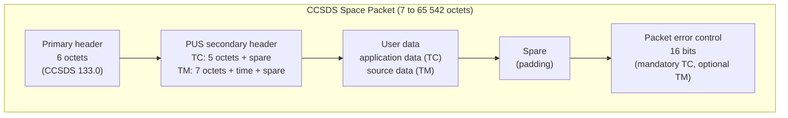
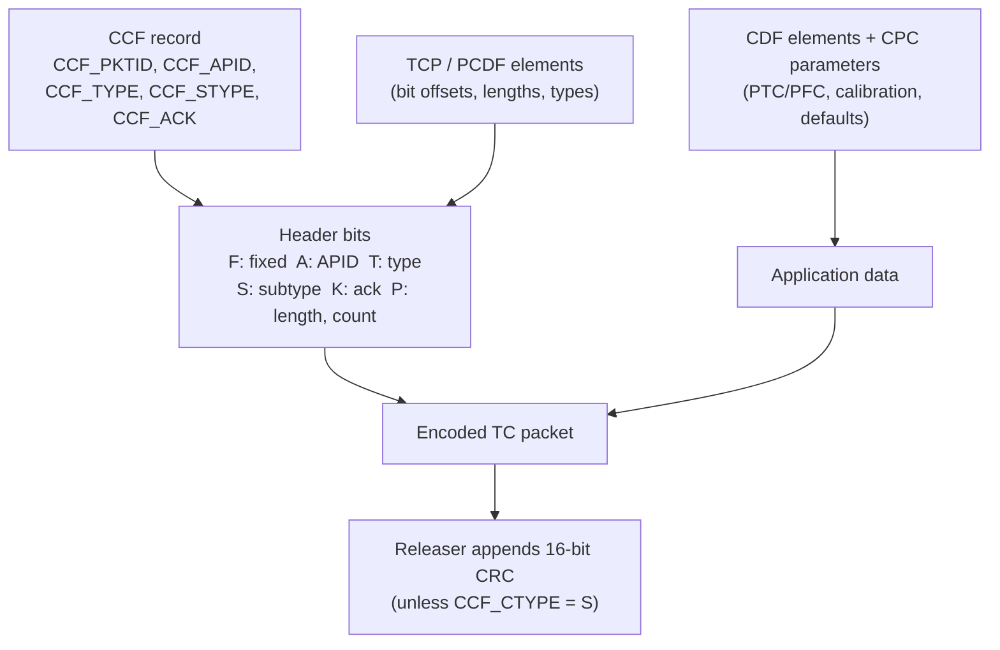

# PUS packet structures: TC and TM headers

Every PUS request travels from ground to spacecraft inside a **telecommand (TC) packet**, and
every PUS report travels back inside a **telemetry (TM) packet**. Both are CCSDS
[Space Packets](../../ccsds/space-packet.md): a 6-octet primary header defined by CCSDS,
followed by a packet data field whose first part, the **packet secondary header**, is
defined by the [Packet Utilization Standard](index.md).[^c-711] The secondary header
carries the PUS version, the message type (service type and subtype), the
acknowledgement flags of a request, the source or destination of the message and, for
telemetry, the on-board time stamp. This page dissects these headers bit by bit for
ECSS-E-ST-70-41C ("PUS-C", 2016), compares them with ECSS-E-70-41A ("PUS-A", 2003) and
the 2024 Rev.1 draft, explains the packet error control algorithms, and shows how the
SCOS-2000 [Mission Information Base](../../mib/index.md) describes the same headers in the
real Solar Orbiter database.

!!! info "Where this page sits"
    The CCSDS rules for the primary header are covered in depth on
    [Space Packet Protocol](../../ccsds/space-packet.md). The data types used inside the
    headers and the user data field (PTC/PFC) are on
    [PUS parameter types](parameter-types.md). The differences between issues are
    summarised on [PUS-A vs PUS-C](pus-a-vs-pus-c.md). The packets then ride in
    [TC frames](../../ccsds/tc-sdlp.md) and [TM frames](../../ccsds/tm-sdlp.md).

## 1. The overall layout

PUS-C promotes CCSDS Space Packets for all ground-space messages: a "telecommand packet"
carries a request from a ground application process to an on-board one, and a "telemetry
packet" carries a report the other way.[^c-711] A Space Packet is a primary header of
6 octets followed by a packet data field of 1 to 65 536 octets, so a packet is between 7 and
65 542 octets long.[^spp-412] PUS-C repeats that the maximum packet size of the Space
Packet Protocol is 65 542 bytes and requires a request to be rejected if its response
would not fit into one telemetry packet of that size.[^c-resp]



The secondary header octet counts in the diagram assume PUS-C field sizes (4 + 4 + 8 + 8 + 16
bits for TC; 4 + 4 + 8 + 8 + 16 + 16 bits plus the time field for TM).[^c-7431][^c-7441]
Once an application process has generated a packet, nobody may modify it.[^c-742]

## 2. The packet primary header

The primary header is defined by CCSDS 133.0-B-2 and reused unchanged by PUS. It has four
fields - version (3 bits), packet identification (13 bits), sequence control (16 bits) and
data length (16 bits).[^spp-413] Bit 0 is the first transmitted, most significant bit of a
field.[^spp-conv] PUS uses the same left-to-right "Bit 0 first" numbering for every field.[^c-722]

<div class="bitfield" data-title="Space Packet primary header (48 bits)" data-width="16"
     data-fields='[{"n":"Version","b":3,"v":"000","g":"Packet ID","d":"Packet version number, 000 = CCSDS Space Packet (version 1 CCSDS packet)"},{"n":"Type","b":1,"g":"Packet ID","d":"0 = telemetry, 1 = telecommand"},{"n":"Sec. hdr flag","b":1,"g":"Packet ID","d":"1 = PUS secondary header present"},{"n":"APID","b":11,"g":"Packet ID","d":"Application process identifier"},{"n":"Sequence flags","b":2,"v":"11","g":"Sequence control","d":"PUS packets are stand-alone (11)"},{"n":"Sequence count / packet name","b":14,"g":"Sequence control","d":"TM: count per APID modulo 16384. TC: count or name"},{"n":"Packet data length","b":16,"d":"Octets in the packet data field minus one"}]'></div>

| Field | Bits | Values | Meaning and PUS usage |
|---|---|---|---|
| Packet version number | 0-2 (3) | `0b000` | Identifies a CCSDS Space Packet ("version 1 CCSDS packet"). PUS-C sets it to 0.[^c-741] |
| Packet type | 3 (1) | 0 = TM, 1 = TC | Distinguishes reporting from requesting packets.[^spp-413] |
| Secondary header flag | 4 (1) | 0 / 1 | 1 when the PUS secondary header is present. All PUS-C TM packets have one except spacecraft time packets; all TC packets have one except CPDU command packets.[^c-741] |
| APID | 5-15 (11) | 0-2047 | Names the on-board application process that is the source of a TM packet and the destination of a TC packet. CCSDS reserves only 2047 (all ones) for idle packets; PUS-C adds APID 0 for spacecraft time packets and limits application processes to 0-2046.[^spp-413][^c-5421] |
| Sequence flags | 16-17 (2) | `0b11` | CCSDS segmentation flags. PUS-C uses `11` (stand-alone) for every packet it defines.[^c-741] |
| Packet sequence count or packet name | 18-31 (14) | 0-16383 | TM: incremented by 1 per packet released by the APID, wrapping from 16 383 to 0. TC: a count or a name which, together with the source ID, identifies the packet.[^c-741] |
| Packet data length | 32-47 (16) | 0-65535 | Number of octets in the packet data field minus one; the whole packet is 6 octets longer than the data field.[^c-741] |

The primary header fields also carry part of the PUS **request identifier** and **report
identifier**. A request is identified by its source identifier (in the TC secondary header),
its destination (the APID plus a system identifier) and the sequence count or name; a report
by its source APID, its destination identifier (in the TM secondary header) and its source
sequence count.[^c-reqid][^c-repid] This is why the request verification reports of
[ST[01]](st01-request-verification.md) copy the TC packet ID and sequence control fields into
their source data: TM[1,1] starts with a "request ID" made of the 3-bit version, the type,
the secondary header flag, the APID, the sequence flags and the 14-bit sequence count of the
request.[^c-811]

!!! note "Why the APID alone is not enough"
    PUS-C points out that the request ID copied into a verification report cannot identify
    the request on its own, because it does not contain the source of the request. The source
    is recovered from the destination ID field in the secondary header of the verification
    report itself.[^c-811]

## 3. PUS-C telecommand packet

### 3.1 TC secondary header

In PUS-C every telecommand packet except the CPDU command packet has a TC packet secondary
header with the structure below.[^c-7441]

<div class="bitfield" data-title="PUS-C TC packet secondary header (40 bits + optional spare)" data-width="8"
     data-fields='[{"n":"PUS version","b":4,"v":"0010","d":"TC packet PUS version number, 2 for ECSS-E-ST-70-41C"},{"n":"Ack flags","b":4,"d":"Bit 0 completion, bit 1 progress, bit 2 start, bit 3 acceptance"},{"n":"Service type ID","b":8,"g":"Message type ID","d":"1 to 255, standard types up to 127"},{"n":"Message subtype ID","b":8,"g":"Message type ID","d":"1 to 255, standard subtypes up to 127"},{"n":"Source ID","b":16,"d":"Application process user identifier of the issuer"}]'></div>

| Field | Bits | Type | Values | Meaning |
|---|---|---|---|---|
| TC packet PUS version number | 4 | enumerated | 2 | Version of the PUS used. 0 was ESA PSS-07-101, 1 is ECSS-E-70-41A, 2 is ECSS-E-ST-70-41C.[^c-7441] |
| Acknowledgement flags | 4 | enumerated | `0b0000`-`0b1111` | Which successful verification stages the destination must report (table below).[^c-7441b] |
| Service type ID | 8 | enumerated | 1-255 | First half of the message type identifier.[^c-7441b] |
| Message subtype ID | 8 | enumerated | 1-255 | Second half of the message type identifier.[^c-7441b] |
| Source ID | 16 | enumerated | 0-65535 | The application process user identifier of the issuing application process.[^c-7441b][^c-5421] |
| Spare | mission | fixed-size bit-string | all zeros | Optional padding of the secondary header to an integral number of words; presence and size declared per application process.[^c-7441b][^c-737] |

The **message type ID** is the pair (service type ID, message subtype ID). Service types and
subtypes run from 1 to 255; the standard ones are at most 127 and mission-specific ones start
at 128.[^c-msgid] The notation `TC[x,y]` used throughout this wiki is exactly this pair.

### 3.2 The acknowledgement flags

A request carries four flags that ask the destination application process to report the
successful acceptance, start, progress and completion of execution.[^c-ack] Failures do not
depend on the flags: failed acceptance, start and completion are always reported, and failed
progress is reported either in its own report or within the completion report, as declared for
the request type.[^c-ack]

| Bit (0 = MSB) | Weight | Stage reported on success | Report generated |
|---|---|---|---|
| 0 | `0b1000` | completion of execution | TM[1,7] |
| 1 | `0b0100` | progress of execution | TM[1,5] |
| 2 | `0b0010` | start of execution | TM[1,3] |
| 3 | `0b0001` | acceptance | TM[1,1] |

The bit assignments come from requirement 7.4.4.1d;[^c-7441b] the report types are the
[ST[01]](st01-request-verification.md) successful verification reports.[^c-annexc1]

Example: `0b1001` (decimal 9) asks for acceptance and completion reports only; `0b0000`
suppresses every success report, leaving only failure reports. Solar Orbiter uses 9 for almost
all of its commands (see [section 9](#9-solar-orbiter-the-headers-in-a-real-mib)).

### 3.3 TC user data field

<div class="bitfield" data-title="PUS-C TC user data field" data-width="32"
     data-fields='[{"n":"Application data (deduced from message type)","b":16,"d":"Variable length, structure defined per request type"},{"n":"Spare (opt.)","b":8,"d":"Variable padding to the TC padding word size"},{"n":"Packet error control","b":16,"d":"16-bit CRC or ISO checksum, mandatory for TC"}]'></div>

The TC user data field is the application data (whose structure is deduced from the message
type), an optional spare field, and a 16-bit packet error control field.[^c-7442] Each
application process declares a telecommand padding word size, and the spare field has the
minimum size that makes the total packet length a multiple of it.[^c-7442] The mission
declares whether all TC packets use the ISO 16-bit checksum or the 16-bit CRC; the issuer
computes it last, over the complete packet, and the receiving application process verifies
it.[^c-7442]

!!! warning "Inference"
    The bitfield above draws the application data (16 bits) and the spare field (8 bits) with
    nominal widths chosen by this wiki; both are variable in the standard. Only the 16-bit packet
    error control field has a fixed size.

## 4. PUS-C telemetry packet

### 4.1 TM secondary header

All PUS-C telemetry packets except the spacecraft time packets of
[ST[09]](st09-time-management.md) carry the TM packet secondary header below.[^c-7431]

<div class="bitfield" data-title="PUS-C TM packet secondary header (56 bits + time + optional spare)" data-width="8"
     data-fields='[{"n":"PUS version","b":4,"v":"0010","d":"TM packet PUS version number, 2 for ECSS-E-ST-70-41C"},{"n":"S/C time ref. status","b":4,"d":"Status of the on-board time reference, 0 if not supported"},{"n":"Service type ID","b":8,"g":"Message type ID"},{"n":"Message subtype ID","b":8,"g":"Message type ID"},{"n":"Message type counter","b":16,"d":"Per destination and message type, 0 if not supported"},{"n":"Destination ID","b":16,"d":"Application process user identifier of the addressee"},{"n":"Time (absolute time, PFC declared by the time service)","b":48,"d":"Example width: CUC 4+2 octets"}]'></div>

| Field | Bits | Type | Values | Meaning |
|---|---|---|---|---|
| TM packet PUS version number | 4 | enumerated | 2 | Version of the PUS (0 = ESA PSS-07-101, 1 = ECSS-E-70-41A, 2 = PUS-C).[^c-7431] |
| Spacecraft time reference status | 4 | enumerated | mission | Status of the on-board time reference used to time-tag this packet. Set to 0 by application processes that do not support the capability.[^c-7431b] |
| Service type ID | 8 | enumerated | 1-255 | Message type identifier, first half.[^c-7431b] |
| Message subtype ID | 8 | enumerated | 1-255 | Message type identifier, second half.[^c-7431b] |
| Message type counter | 16 | unsigned integer | 0-65535 | Counter of generated messages of this type for this destination; 0 if the application process does not count.[^c-7431b] |
| Destination ID | 16 | enumerated | 0-65535 | Application process user identifier of the application process addressed by the report.[^c-7431b] |
| Time | PFC | absolute time | mission | Time tag of the report. Its PFC is declared when specifying the time service.[^c-7431b] |
| Spare | mission | fixed-size bit-string | zeros | Optional padding to an integral number of words, declared per application process.[^c-7431c] |

Each application process declares three related properties: whether it reports the time
reference status, whether it counts messages per destination and type (the two optional
capabilities behind these header fields), and whether it time-tags reports before or after
collecting their parameter values.[^c-5421] The
meaning of each time reference status value is itself declared by the mission when it
specifies the time reporting subservice.[^c-9status]

!!! example "Why a message type counter?"
    The 14-bit sequence count in the primary header tells the ground that *some* packet of an
    APID is missing. A counter per message type and destination tells it *which kind* of
    packet is missing. PUS-A introduced this idea as the 8-bit "packet sub-counter" for exactly
    this purpose;[^a-43] PUS-C widens it to 16 bits and keys it by destination as
    well.[^c-7431b]

### 4.2 TM user data field

The TM user data field contains the source data (deduced from the message type), an optional
spare field and an optional 16-bit packet error control field.[^c-7432] Each application
process declares a telemetry padding word size and pads every packet to a multiple of
it.[^c-7432] Whether telemetry is checksummed at all, and with which algorithm (ISO 16-bit
checksum or CRC 16-bit), are mission tailoring decisions; if used, the checksum is computed
when the packet is complete and is verified by the ground.[^c-7432]

## 5. Packets without a PUS secondary header

Three kinds of packets in or around PUS have no PUS secondary header:

| Packet | Primary header settings | Data field | Source |
|---|---|---|---|
| Spacecraft time packet (TM[9,2] CUC or TM[9,3] CDS time report) | Secondary header flag 0; APID 0 is reserved for these packets. | Optional rate exponential value, spacecraft time, optional time reference status. | [^c-741][^c-5421][^c-9rep] |
| CPDU command packet | Version 0, type 1, secondary header flag 0, APID of the CPDU, sequence flags `11`, sequence count or name 0. | Application data only, no spare, then a 16-bit CRC identical to the one of the TC frame error control field. | [^c-cpdu] |
| Idle packet | APID `11111111111` (2047), secondary header flag 0. | Idle data (mission pattern). | [^spp-413][^spp-idle] |

The CPDU (command pulse distribution unit) is a simple unit that gives the ground direct
access to equipment, for example to reset an S-band transponder in a contingency. Each CPDU
request contains one or more command pulse instructions, up to a maximum declared per CPDU that
must lie between 12 and 504 (PUS-A allowed at most 120).[^c-cpdu][^a-annexb]

<div class="bitfield" data-title="CPDU command pulse instruction (16 bits, repeated N times)" data-width="16"
     data-fields='[{"n":"Output line ID","b":12,"d":"CPDU addressable output, 0 to 4095"},{"n":"Res.","b":1,"d":"Reserved bit-string"},{"n":"Duration exp.","b":3,"d":"Pulse = duration unit x 2 to this power, 0 to 7"}]'></div>

The pulse duration unit of a CPDU is between 10 ms and 15 ms, and the emitted pulse lasts
the unit multiplied by 2 raised to the duration exponential value (0 to 7). A CPDU exposes up
to 4096 addressable outputs.[^c-cpdu]

## 6. Packet error control

The packet error control field detects corruption introduced by lower layers during
transmission, processing or storage. PUS offers two 16-bit algorithms, both computed over the
whole packet including the primary header but excluding the packet error control field
itself.[^c-crc][^c-iso]

### 6.1 CRC-16-CCITT

* Generator polynomial $G(x) = x^{16} + x^{12} + x^{5} + 1$ (`0x1021`), modulo-2
  arithmetic.[^c-crc]
* The shift register is preset to all ones (`0xFFFF`) for every packet; the encoding adds
  $x^{n-16} L(x)$ to the message polynomial to achieve this preset.[^c-crc2]
* The decoder runs the same register over the data *and* the received CRC; a zero syndrome
  means no error was detected.[^c-crc2]
* Detection properties: about $1.53 \times 10^{-5}$ of all errors go undetected; every
  odd number of bit errors, every double-bit error no more than 65 535 bits apart and every
  burst of 16 bits or less are detected.[^c-crc]

### 6.2 ISO checksum (ISO 8473-1)

* Two running sums modulo 255: $C_0 = C_0 + B_i$ and $C_1 = C_1 + C_0$, starting from
  zero.[^c-iso2]
* The checksum octets are $CK1 = \lnot(C_0 + C_1)$ and $CK2 = C_1$, and a value of zero in
  either octet is replaced by 255.[^c-iso2]
* The decoder runs the sums over the data plus the two checksum octets and accepts the packet
  if both sums are zero; it rejects immediately if exactly one checksum octet is
  zero.[^c-iso3]
* It is easy to implement in software (no look-up table, no bit operations), detects every
  single-bit error and every double-bit error no more than 2 040 bits apart, and leaves about
  $1.54 \times 10^{-5}$ of all errors undetected - almost the same as the CRC.[^c-iso]

!!! warning "Inference: a typo in clause B.2.3"
    The prose of PUS-C clause B.2.3 says "If CK2 = 0, then CK1 = 255". The C code in B.2.6
    sets `CK2 = 255` instead, and only that reading reproduces the published test vector
    `00 00` giving `FF FF`.[^c-iso2] This wiki treats the prose as a typo.

### 6.3 Test vectors

The standard publishes these test vectors (hexadecimal, most significant digit first). The
values were re-computed by this wiki with its own implementation of both algorithms and
match.[^c-crc3][^c-iso3]

| Data | CRC-16 | ISO checksum |
|---|---|---|
| `00 00` | `1D 0F` | `FF FF` |
| `00 00 00` | `CC 9C` | `FF FF` |
| `AB CD EF 01` | `04 A2` | `9C F8` |
| `14 56 F8 9A 00 01` | `7F D5` | `24 DC` |

### 6.4 Worked example (illustrative bytes)

The bytes below are **illustrative**, constructed by this wiki from the PUS-C field
definitions; they are not taken from a real mission. They encode an are-you-alive connection
test request, TC[17,1], which has no application data,[^c-annexc17] sent to APID `0x064`
with sequence count 1, acknowledgement flags `0b1001` and source ID `0x0010`.

| Octets | Value | Decoding |
|---|---|---|
| 0-1 | `18 64` | version `000`, type 1 (TC), secondary header flag 1, APID `0x064` |
| 2-3 | `C0 01` | sequence flags `11`, sequence count 1 |
| 4-5 | `00 06` | packet data length 6, so the data field is 7 octets |
| 6 | `29` | PUS version 2 (`0010`), ack flags `1001` |
| 7-8 | `11 01` | service type 17, message subtype 1 |
| 9-10 | `00 10` | source ID 16 |
| 11-12 | `07 1D` | CRC-16 over octets 0-10 |

Running the CRC decoder over all 13 octets gives a zero syndrome, so the packet is accepted.
With the ISO checksum instead of the CRC, the last two octets would be `63 0D`.

A matching illustrative report, TM[17,2] (which has no source data),[^c-annexc17] from the same APID with sequence count `0x42`,
message type counter 1, destination ID 16 and a CUC time of 4 coarse and 2 fine octets
(PFC 17, see [parameter types](parameter-types.md#absolute-time-ptc-9)) is:

```text
08 64 C0 42 00 0E | 20 11 02 00 01 00 10 1E 2C 9A 00 80 00 | B0 4B
primary header    | secondary header (time = 0x1E2C9A00 s + 0x8000/65536 s) | CRC
```

The first secondary header octet `0x20` is PUS version 2 with time reference status 0; the
time field encodes 506 239 488.5 seconds after the mission epoch.

## 7. PUS-A (2003) equivalents side by side

ECSS-E-70-41A called the secondary header the **data field header** and built it from
smaller, often optional fields whose sizes were fixed by mission constants.[^a-53][^a-54]

=== "TC header"

    <div class="bitfield" data-title="PUS-A TC data field header (24 bits + optional fields)" data-width="8"
         data-fields='[{"n":"CCSDS sec. hdr flag","b":1,"v":"0","d":"0 = non-CCSDS defined secondary header"},{"n":"PUS version","b":3,"v":"001","d":"1 for ECSS-E-70-41A"},{"n":"Ack","b":4,"d":"Same bit meanings as PUS-C"},{"n":"Service type","b":8},{"n":"Service subtype","b":8}]'></div>

    | PUS-A field | Bits | PUS-C counterpart |
    |---|---|---|
    | CCSDS secondary header flag (Boolean, 0) | 1 | absorbed into the 4-bit PUS version |
    | TC packet PUS version number (1) | 3 | TC packet PUS version number (2), 4 bits |
    | Ack | 4 | Acknowledgement flags, same bit meanings |
    | Service type | 8 | Service type ID |
    | Service subtype | 8 | Message subtype ID |
    | Source ID (optional, length known for the mission) | n | Source ID, 16 bits, always present |
    | Spare (optional) | n | Spare (optional) |

    In PUS-A the secondary header flag bit was set to 0 to mark a "non-CCSDS defined"
    secondary header, the version was 1, and the source ID was omitted when the mission had
    only one TC source.[^a-53b] The packet error control field was mandatory for all TC
    packets, with its type fixed per application process by the mission constant
    `<TC_CHECKSUM_TYPE>`.[^a-53b]

=== "TM header"

    <div class="bitfield" data-title="PUS-A TM data field header (24 bits + optional fields)" data-width="8"
         data-fields='[{"n":"Spare","b":1,"v":"0"},{"n":"PUS version","b":3,"v":"001"},{"n":"Spare","b":4,"v":"0000"},{"n":"Service type","b":8},{"n":"Service subtype","b":8}]'></div>

    | PUS-A field | Bits | PUS-C counterpart |
    |---|---|---|
    | Spare (former CCSDS secondary header flag) | 1 | absorbed into the 4-bit PUS version |
    | TM source packet PUS version number (1) | 3 | TM packet PUS version number (2), 4 bits |
    | Spare | 4 | Spacecraft time reference status |
    | Service type | 8 | Service type ID |
    | Service subtype | 8 | Message subtype ID |
    | Packet sub-counter (optional) | 8 | Message type counter, 16 bits |
    | Destination ID (optional, length known for the mission) | n | Destination ID, 16 bits |
    | Time (optional, CUC or CDS, per `<APPL_TIME_CODE>`) | n | Time (PFC declared by the time service) |
    | Spare (optional) | n | Spare (optional) |

    The packet sub-counter counted packets of one type and subtype (per destination if the
    destination ID was used); the destination ID was omitted when the ground was the only
    destination; and the presence and encoding of the time field were given per
    application process by `<APPL_TIME_CODE>`.[^a-54b] The TM packet error control field
    was optional, its presence and type set by `<TM_CHECKSUM_TYPE>`.[^a-54b]

=== "Primary header"

    | Item | PUS-A | PUS-C |
    |---|---|---|
    | Referenced CCSDS documents | CCSDS 102.0-B-5 (TM) and 203.0-B-2 (TC)[^a-53] | CCSDS 133.0-B-1 Space Packet Protocol[^c-711] |
    | Sequence flags in TM | "grouping flags" 01/00/10/11, standard packets stand-alone[^a-54b] | always `11`[^c-741] |
    | Sequence flags in TC | 01/00/10/11, standard packets stand-alone[^a-53b] | always `11`[^c-741] |
    | TC sequence count | one count per TC source and APID[^a-53b] | count or packet name, combined with source ID[^c-741] |
    | TM source sequence count | per APID, and per destination when a destination ID is used; never "short-cycle"[^a-54b] | per APID, wraps at 16 384[^c-741] |
    | Reserved APIDs | 0 time packet, 2047 idle, one APID per CPDU[^a-42] | 0 time packets, 2047 idle, others per SANA[^c-5421] |

Mission constants such as `<TCPKT_MAX_LENGTH>` and `<TMPKT_MAX_LENGTH>` let a PUS-A mission
cap packet sizes below the CCSDS maximum.[^a-annexb] PUS-C replaces mission constants by
"declarations" made when tailoring; the Rev.1 draft makes the declaration of both maximum
packet sizes an explicit requirement.[^r-742]

## 8. What the 2024 Rev.1 draft changes in the headers

ECSS-E-ST-70-41C Rev.1 DIR1 (11 December 2024, a draft for public review) keeps the field
sizes of PUS-C but changes the meaning of several fields:[^r-74]

| Item | PUS-C (2016) | Rev.1 DIR1 (2024 draft) |
|---|---|---|
| TC secondary header 16-bit field | source ID = application process *user* identifier | **source APID** = the issuer's application process identifier[^r-7441] |
| TM secondary header 16-bit field | destination ID = application process *user* identifier | **destination APID** = APID of the targeted application process[^r-7431] |
| Ground application processes | identified by user identifiers 0-65535 | APIDs 2048-65535, never reused on board; on-board APIDs stay at most 2046[^r-5421] |
| TM packet error control | optional | field mandatory in the user data field; the checksum calculation is application process dependent[^r-7432] |
| Maximum packet sizes | not stated as requirements | TM and TC maximum sizes declared for the mission, not above the CCSDS maximum[^r-742] |
| Packets without secondary header | time packets, CPDU packets | also CFDP PDUs and idle packets (TM), CFDP PDUs and SDLS extended procedure PDUs (TC)[^r-noshdr] |

!!! warning "Inference"
    Moving source and destination identification into the APID space lets one 16-bit
    number name both on-board processes (0-2046) and ground processes (2048 and above). The
    draft is not an approved standard, and missions already flying PUS-C keep the 2016
    meaning.

## 9. Solar Orbiter: the headers in a real MIB

The public Solar Orbiter MIB lets us see how a real mission's headers are described to
SCOS-2000. Solar Orbiter's space-to-ground ICD makes ECSS-E-70-41A its applicable PUS, so the
mission uses PUS-A headers.[^solo-ad1]

### 9.1 Telecommand headers (TCP, PCPC, PCDF)

SCOS-2000 builds the first portion of every encoded TC packet from a packet header definition:
[TCP](../../mib/tables/tcp.md) names the header, [PCPC](../../mib/tables/pcpc.md) defines
header parameters and [PCDF](../../mib/tables/pcdf.md) lists the elements with their length in
bits and their bit offset from the start of the packet.[^icd-tcp] Each PCDF element has a type:
`F` fixed value, `A` APID from `CCF_APID`, `T` service type from `CCF_TYPE`, `S` subtype from
`CCF_STYPE`, `K` acknowledgement flags from `CCF_ACK`, or `P` a parameter set automatically by
the command subsystem, such as the packet length or the sequence counter maintained by the
multiplexer for each APID.[^icd-pcdf]

The September 2025 release defines four headers. `NOM_TC` ("NOM_DH_TC_Packet_Header") is the
nominal header:[^mib-pcdf]

| PCDF_BIT | PCDF_LEN | Element | PCDF_TYPE | Value / parameter |
|---|---|---|---|---|
| 0 | 3 | Version Number | F | 0 |
| 3 | 1 | Type | F | 1 |
| 4 | 1 | DataFieldHeaderFlag | F | 1 |
| 5 | 11 | APID | A | `PH_APID` |
| 16 | 2 | Sequence Flag | F | 3 (`11`) |
| 18 | 14 | Sequence Count | P | `PH_SSC` |
| 32 | 16 | Packet Length | P | `PH_LEN` |
| 48 | 1 | Secondary Header Flag | F | 0 |
| 49 | 3 | PUS Version | F | 1 |
| 52 | 4 | Ack | K | `DFH_ACK` |
| 56 | 8 | Service Type | T | `DFH_TYPE` |
| 64 | 8 | Service Subtype | S | `DFH_STPE` |
| 72 | 8 | Source ID | O | `DFH_SRC` |

<div class="bitfield" data-title="Solar Orbiter NOM_TC data field header from the MIB (32 bits)" data-width="8"
     data-fields='[{"n":"Sec. hdr flag","b":1,"v":"0"},{"n":"PUS ver.","b":3,"v":"001"},{"n":"Ack (DFH_ACK)","b":4},{"n":"Service type (DFH_TYPE)","b":8},{"n":"Service subtype (DFH_STPE)","b":8},{"n":"Source ID (DFH_SRC)","b":8}]'></div>

This is exactly the PUS-A TC data field header with an 8-bit source ID, 4 octets in total,
which the Solar Orbiter ICD confirms: a TC packet data field of at most 242 octets is 4 octets
of data field header, 236 of application data and 2 of packet error control.[^solo-tc] The ICD
lists reserved ground source IDs (110 mission timeline, 111 TC sequences, 112 recovery actions,
113 back-up mission timeline, 120 direct commands, 121-122 spare) and on-board ones (11 AOCS,
14 system control, 15 OBCP).[^solo-src]

!!! warning "Inference: PCDF_TYPE `O`"
    The ICD issues available to this wiki (5.1, 6.9 and 7.0) list only the types `F`, `A`,
    `T`, `S`, `K` and `P` for PCDF_TYPE.[^icd-pcdf][^icd69-pcdf][^icd51-pcdf] The 2025
    release uses `O` for the source ID, whereas the April 2020 release defined the same
    element as a fixed (`F`) area with value 0.[^mib2020-pcdf] In ICD 7.0 the letter `O`
    appears in this table only as the octal value of PCDF_RADIX, not as a PCDF_TYPE.[^icd-pcdf]
    The meaning of `O` as a type is not stated in the available sources; it plausibly lets the
    command source set the source ID.

The other headers are `HPC1_TC` (primary header only, secondary header flag 0), used by 125
commands to APID 44 on MAP ID 0 - the CPDU "HPC-1" commands that the Solar Orbiter ICD sends
directly to the command pulse distribution unit on MAP 0 - then `NO_HDR` (5 directives: two
control frames such as `UNLOCK` and `SETVR`, three control segments such as `RESET`) and
`NOS2KHDR` (6 NIS throw events on APID 1964, such as open and close TC link, all with
CCF_CTYPE `N`).[^mib-ccf][^solo-map] SCOS-2000 uses the CCF_CTYPE values `R` (control
segment) and `F` (control frame) for such directives, whose PCDF/CDF entries define a frame data
field rather than a packet, and `N` for NIS throw events, which the NIS executes without
forwarding them to the ground station.[^icd-ctype]

The acknowledgement flags of each command come from `CCF_ACK`:[^mib-ccf]

| CCF_ACK | Binary | Commands | Meaning |
|---|---|---|---|
| 9 | `1001` | 5 225 | acceptance and completion reports |
| (empty) | - | 130 | headerless commands and directives |
| 1 | `0001` | 78 | acceptance report only |
| 0 | `0000` | 21 | failure reports only (15 `NOM_TC` commands and the 6 NIS throw events) |

This matches the Solar Orbiter ICD, which defines only the acceptance and completion bits and
requires the start and progress bits to be zero.[^solo-tc2]

??? example "SQL used (TC headers)"
    ```sql
    -- solo-2025-09-16.sqlite (MIB__20250916M25925PFMS001_SOL)
    SELECT * FROM tcp;
    SELECT * FROM pcpc;
    SELECT * FROM pcdf ORDER BY PCDF_TCNAME, CAST(PCDF_BIT AS INT);
    SELECT CCF_PKTID, COUNT(*) FROM ccf GROUP BY 1;
    SELECT CCF_ACK, COUNT(*) n FROM ccf GROUP BY 1 ORDER BY n DESC;
    SELECT CCF_PKTID, CCF_CTYPE, CCF_APID, CCF_MAPID, CCF_ACK, COUNT(*) FROM ccf
     WHERE CCF_PKTID != 'NOM_TC' OR CCF_ACK = '0' GROUP BY 1, 2, 3, 4, 5;
    -- solo-2020-04-16.sqlite
    SELECT * FROM pcdf WHERE PCDF_TCNAME = 'NOM_TC' ORDER BY CAST(PCDF_BIT AS INT);
    ```

A real Solar Orbiter command shows the pieces together: `ZCD00B04` "Insert Telecommands in
Command Schedule" is TC[11,4] sent to APID 172 with header `NOM_TC` and `CCF_ACK` 9.[^mib-11-4]
APID 172 is `0b0001010_1100`: Solar Orbiter splits the APID into a 7-bit process ID (here 10)
and a 4-bit packet category that is fixed to 12 for telecommands.[^solo-apid] See it in the
[explorer](../../explorer/index.md#/solo/command/ZCD00B04) and in the
[TC worked example](../../overview/worked-example-tc.md).

### 9.2 Telemetry headers (PID_DFHSIZE and friends)

On the telemetry side the MIB does not describe the secondary header field by field. The
SCOS-2000 packetiser extracts the APID from the primary header and the type and subtype from a
configurable position that must be the same in every packet of the spacecraft; it then looks up
the [PID](../../mib/tables/pid.md) table with the key APID, type, subtype and up to two extra
identification fields defined in [PIC](../../mib/tables/pic.md).[^icd-pidintro] A packet with no
data field header is identified by APID alone and gets type and subtype 0.[^icd-pidintro2] Solar
Orbiter follows this for its idle and ground packets but not for its time packet: SPID 9999
"Time Report" on APID 0 is keyed as type 9, subtype 2 although the packet has no data field
header.[^mib-pid][^solo-dest] Three PID fields then describe the header:

| PID field | Meaning |
|---|---|
| `PID_DFHSIZE` | Number of octets (0-99) from the start of the source packet to where variable-packet ([VPD](../../mib/tables/vpd.md)) processing starts; typically the primary header plus the data field header.[^icd-dfh] |
| `PID_TIME` | `Y` if the packet carries a generation time field, `N` otherwise.[^icd-time] |
| `PID_CHECK` | `0` do not check the packet error control field; `1` check it with the CRC.[^icd-check] |

In the 2025 Solar Orbiter release these fields take the following combinations:[^mib-pid]

| PID_DFHSIZE | PID_TIME | PID_CHECK | Packets (SPIDs) | Examples |
|---|---|---|---|---|
| 16 | Y | 0 | 11 132 | almost every spacecraft TM packet |
| 16 | N | 0 | 6 | non-spacecraft packets (`LMS_...`) on APIDs 2048-2065, a range the ICD reserves for packets not generated by the spacecraft[^icd-apid] |
| 6 | Y | 0 | 6 | TM[9,2] "Time Report" on APID 0, and five type 160/161 packets on APID 1966 |
| 0 | Y or N | 1 | 6 | frame-level pseudo-packets (good, bad and idle transfer frames, MATIS) |

`PID_DFHSIZE` = 16 is the 6-octet primary header plus a 10-octet data field header. The Solar
Orbiter ICD gives the TM packet data field as at most 4 106 octets, made of 4 096 octets of
source data and 10 octets of data field header, with the time in CUC format of 4 coarse and
2 fine octets (6 octets).[^solo-tm] Its destination ID field is 8 bits, set to the source ID of
the command for solicited telemetry except for several packet categories that are always sent
to ground (`00000000`).[^solo-dest] The time packet TM[9,2] has no data field header, which is
why its `PID_DFHSIZE` is 6.[^solo-dest]

!!! warning "Inference: the 10-octet Solar Orbiter TM data field header"
    The figure of the TM data field header in the Solar Orbiter ICD is not available as text.
    From the documented sizes (10 octets in total, 6 octets of time, an 8-bit destination ID)
    and the PUS-A layout, the most likely arrangement is: 1 octet spare/version/spare, 1 octet
    service type, 1 octet subtype, 1 octet destination ID and 6 octets of time, with no packet
    sub-counter. The 4 106-octet maximum with no octets left for a packet error control field
    is consistent with `PID_CHECK` = 0.

??? example "SQL used (TM headers)"
    ```sql
    -- solo-2025-09-16.sqlite
    SELECT PID_DFHSIZE, PID_TIME, PID_CHECK, COUNT(*) n
      FROM pid GROUP BY 1, 2, 3 ORDER BY n DESC;
    SELECT PID_TYPE, PID_STYPE, PID_APID, PID_SPID, PID_DESCR, PID_DFHSIZE, PID_TIME, PID_CHECK
      FROM pid WHERE PID_DFHSIZE != '16' OR PID_TIME != 'Y';
    -- first parameter offset per packet (PLF): 16 octets for 9 020 SPIDs
    SELECT m, COUNT(*) FROM (SELECT PLF_SPID, MIN(CAST(PLF_OFFBY AS INT)) m
      FROM plf GROUP BY PLF_SPID) GROUP BY m ORDER BY 2 DESC;
    ```

The [PLF](../../mib/tables/plf.md) table agrees: in 9 020 of the fixed packets that have PLF
entries, the first parameter starts at byte offset 16, immediately after the 16-octet
headers.[^mib-pid] PLF_OFFBY counts octets from the end of the SCOS-2000 TM header, which for
missions using the SCOS-2000 packetiser is the beginning of the TM source packet - so offsets
include the primary and data field headers.[^icd-plf]

### 9.3 How SCOS-2000 assembles a TC packet



The packet length and the sequence counter are set by the command subsystem, not by the
operator.[^icd-pcdf] The releaser appends the 16-bit CRC to standard commands; CCF_CTYPE `S`
marks a command packet without packet error control, typically for EGSE.[^icd-ctype] By default
SCOS-2000 limits an encoded command to 248 bytes (`CMDP_MAX_BLOCK_SIZE`), from which the header,
the CRC (`CMD_CRC_SIZE`, default 2 bytes) and any time-tag wrapper are subtracted.[^icd-maxsize]
The data that follows the header is described on
[Commanding in the MIB](../../mib/commanding.md) and in the
[MIB data model](../../mib/data-model.md).

## 10. Summary table

| Item | PUS-A (2003) | PUS-C (2016) | Rev.1 DIR1 (2024 draft) |
|---|---|---|---|
| PUS version field | 3 bits, value 1 | 4 bits, value 2 | 4 bits, value 2 |
| TC header fixed part | 24 bits | 40 bits | 40 bits |
| TM header fixed part (before time) | 24 bits | 56 bits | 56 bits |
| TC source identification | optional, n bits | source ID, 16 bits | source APID, 16 bits |
| TM destination identification | optional, n bits | destination ID, 16 bits | destination APID, 16 bits |
| Per-type TM counter | packet sub-counter, 8 bits, optional | message type counter, 16 bits | message type counter, 16 bits |
| Time reference status | none (spare) | 4 bits | 4 bits |
| TC PEC | mandatory | mandatory | mandatory |
| TM PEC | optional | optional | field mandatory |

Sources for the rows: PUS-A clauses 5.3 and 5.4,[^a-53b][^a-54b] PUS-C clause 7.4[^c-7431][^c-7441]
and Rev.1 DIR1 clause 7.4.[^r-74]

[^c-711]: [ECSS-E-ST-70-41C, Telemetry and telecommand packet utilization](../../library/ecss-e-st-70-41c-15april2016.md), §7.1.1, PDF p. 425.
[^c-resp]: [ECSS-E-ST-70-41C](../../library/ecss-e-st-70-41c-15april2016.md), §5.4.11.3.2, PDF p. 53.
[^c-742]: [ECSS-E-ST-70-41C](../../library/ecss-e-st-70-41c-15april2016.md), §7.4.2a, PDF p. 439.
[^c-722]: [ECSS-E-ST-70-41C](../../library/ecss-e-st-70-41c-15april2016.md), §7.2.2, PDF p. 428.
[^c-741]: [ECSS-E-ST-70-41C](../../library/ecss-e-st-70-41c-15april2016.md), §7.4.1, PDF pp. 438-439.
[^c-5421]: [ECSS-E-ST-70-41C](../../library/ecss-e-st-70-41c-15april2016.md), §5.4.2.1, PDF pp. 39-40.
[^c-reqid]: [ECSS-E-ST-70-41C](../../library/ecss-e-st-70-41c-15april2016.md), §5.4.11.2.1c, PDF p. 49.
[^c-repid]: [ECSS-E-ST-70-41C](../../library/ecss-e-st-70-41c-15april2016.md), §5.4.11.3.1c, PDF pp. 52-53.
[^c-811]: [ECSS-E-ST-70-41C](../../library/ecss-e-st-70-41c-15april2016.md), §8.1.2.1, Figure 8-1, PDF p. 445.
[^c-7441]: [ECSS-E-ST-70-41C](../../library/ecss-e-st-70-41c-15april2016.md), §7.4.4.1a-c, Figure 7-9, PDF p. 442.
[^c-7441b]: [ECSS-E-ST-70-41C](../../library/ecss-e-st-70-41c-15april2016.md), §7.4.4.1d-g, PDF p. 443.
[^c-737]: [ECSS-E-ST-70-41C](../../library/ecss-e-st-70-41c-15april2016.md), §7.3.7e-f, PDF p. 432.
[^c-msgid]: [ECSS-E-ST-70-41C](../../library/ecss-e-st-70-41c-15april2016.md), §5.3.1b-d and §5.3.3.1c-f, PDF pp. 26-28.
[^c-ack]: [ECSS-E-ST-70-41C](../../library/ecss-e-st-70-41c-15april2016.md), §5.4.11.2.2, PDF pp. 50-51.
[^c-annexc1]: [ECSS-E-ST-70-41C](../../library/ecss-e-st-70-41c-15april2016.md), Annex C.2.1, Tables C-1 and C-2, PDF pp. 628-629.
[^c-7442]: [ECSS-E-ST-70-41C](../../library/ecss-e-st-70-41c-15april2016.md), §7.4.4.2, Figure 7-10, PDF p. 444.
[^c-7431]: [ECSS-E-ST-70-41C](../../library/ecss-e-st-70-41c-15april2016.md), §7.4.3.1a-c, Figure 7-7, PDF p. 439.
[^c-7431b]: [ECSS-E-ST-70-41C](../../library/ecss-e-st-70-41c-15april2016.md), §7.4.3.1d-k, PDF pp. 440-441.
[^c-7431c]: [ECSS-E-ST-70-41C](../../library/ecss-e-st-70-41c-15april2016.md), §7.4.3.1l, PDF p. 441.
[^c-9status]: [ECSS-E-ST-70-41C](../../library/ecss-e-st-70-41c-15april2016.md), §6.9.4.1b-c, PDF p. 162.
[^c-9rep]: [ECSS-E-ST-70-41C](../../library/ecss-e-st-70-41c-15april2016.md), §8.9.2.2-8.9.2.3, Figures 8-89 and 8-90, PDF p. 494.
[^c-7432]: [ECSS-E-ST-70-41C](../../library/ecss-e-st-70-41c-15april2016.md), §7.4.3.2, Figure 7-8, PDF pp. 441-442.
[^c-cpdu]: [ECSS-E-ST-70-41C](../../library/ecss-e-st-70-41c-15april2016.md), clause 9 (§9.1-9.3.1, Figure 9-1), PDF pp. 606-609.
[^c-crc]: [ECSS-E-ST-70-41C](../../library/ecss-e-st-70-41c-15april2016.md), Annex B.1.1, PDF pp. 615-616.
[^c-crc2]: [ECSS-E-ST-70-41C](../../library/ecss-e-st-70-41c-15april2016.md), Annex B.1.2-B.1.4, PDF p. 616.
[^c-crc3]: [ECSS-E-ST-70-41C](../../library/ecss-e-st-70-41c-15april2016.md), Annex B.1.5, Table B-2, PDF p. 617.
[^c-iso]: [ECSS-E-ST-70-41C](../../library/ecss-e-st-70-41c-15april2016.md), Annex B.2.1, PDF pp. 622-623.
[^c-iso2]: [ECSS-E-ST-70-41C](../../library/ecss-e-st-70-41c-15april2016.md), Annex B.2.3 and B.2.6, PDF pp. 623-625.
[^c-iso3]: [ECSS-E-ST-70-41C](../../library/ecss-e-st-70-41c-15april2016.md), Annex B.2.4-B.2.5, Table B-4, PDF p. 624.
[^c-annexc17]: [ECSS-E-ST-70-41C](../../library/ecss-e-st-70-41c-15april2016.md), §8.17.2.1b and §8.17.2.2b (application data and source data omitted), PDF p. 558; Annex C.2.17, PDF p. 646.
[^spp-412]: [CCSDS 133.0-B-2, Space Packet Protocol](../../library/ccsds-133-0-133x0b2e2.md), §4.1.2, PDF p. 31.
[^spp-conv]: [CCSDS 133.0-B-2](../../library/ccsds-133-0-133x0b2e2.md), §1.6.3 Conventions, Figure 1-1, PDF p. 14.
[^spp-413]: [CCSDS 133.0-B-2](../../library/ccsds-133-0-133x0b2e2.md), §4.1.3, PDF pp. 32-36.
[^spp-idle]: [CCSDS 133.0-B-2](../../library/ccsds-133-0-133x0b2e2.md), §4.1.2.2 Note 2 and §4.1.4.2.1.4 Note 2, PDF pp. 31 and 36.
[^a-53]: [ECSS-E-70-41A, Ground systems and operations - Telemetry and telecommand packet utilization](../../library/ecss-e-70-41a-30jan2003-pus.md), §5.3.1, Figure 3, PDF pp. 42-43.
[^a-53b]: [ECSS-E-70-41A](../../library/ecss-e-70-41a-30jan2003-pus.md), §5.3.2-5.3.3, PDF pp. 43-45.
[^a-54]: [ECSS-E-70-41A](../../library/ecss-e-70-41a-30jan2003-pus.md), §5.4.1, Figure 4, PDF p. 46.
[^a-54b]: [ECSS-E-70-41A](../../library/ecss-e-70-41a-30jan2003-pus.md), §5.4.2-5.4.3, PDF pp. 46-49.
[^a-42]: [ECSS-E-70-41A](../../library/ecss-e-70-41a-30jan2003-pus.md), §4.2.1, PDF p. 24.
[^a-43]: [ECSS-E-70-41A](../../library/ecss-e-70-41a-30jan2003-pus.md), §4.3.2, PDF p. 25.
[^a-annexb]: [ECSS-E-70-41A](../../library/ecss-e-70-41a-30jan2003-pus.md), Annex B, PDF pp. 215-216.
[^r-74]: [ECSS-E-ST-70-41C Rev.1 DIR1 (draft, 11 December 2024)](../../library/ecss-e-st-70-41c-rev1-dir1.md), §7.4, PDF pp. 487-494.
[^r-742]: [ECSS-E-ST-70-41C Rev.1 DIR1](../../library/ecss-e-st-70-41c-rev1-dir1.md), §7.4.2b-c, PDF p. 488.
[^r-7441]: [ECSS-E-ST-70-41C Rev.1 DIR1](../../library/ecss-e-st-70-41c-rev1-dir1.md), §7.4.4.1b and f, Figure 7-9, PDF pp. 492-493.
[^r-7431]: [ECSS-E-ST-70-41C Rev.1 DIR1](../../library/ecss-e-st-70-41c-rev1-dir1.md), §7.4.3.1b and i, Figure 7-7, PDF pp. 488-490.
[^r-7432]: [ECSS-E-ST-70-41C Rev.1 DIR1](../../library/ecss-e-st-70-41c-rev1-dir1.md), §7.4.3.2a and d, PDF pp. 490-491.
[^r-5421]: [ECSS-E-ST-70-41C Rev.1 DIR1](../../library/ecss-e-st-70-41c-rev1-dir1.md), §5.4.2.1b-f, PDF pp. 39-40.
[^r-noshdr]: [ECSS-E-ST-70-41C Rev.1 DIR1](../../library/ecss-e-st-70-41c-rev1-dir1.md), §7.4.3.1a Note and §7.4.4.1a Note, PDF pp. 488 and 492.
[^solo-ad1]: [SOL.S.ASTR.TN.00079 Issue 7, Solar Orbiter PUS/space-ground ICD](../../library/sol-s-astr-tn-00079-07.md), applicable documents (AD1 = ECSS-E-70-41A), PDF pp. 11 and 13.
[^solo-tc]: [SOL.S.ASTR.TN.00079 Issue 7](../../library/sol-s-astr-tn-00079-07.md), §3.2.1.3 and §3.2.2.1, PDF p. 16.
[^solo-tc2]: [SOL.S.ASTR.TN.00079 Issue 7](../../library/sol-s-astr-tn-00079-07.md), §3.2.2.1 (PUS-55), PDF p. 17.
[^solo-src]: [SOL.S.ASTR.TN.00079 Issue 7](../../library/sol-s-astr-tn-00079-07.md), §13.2, PDF pp. 275-276.
[^solo-dest]: [SOL.S.ASTR.TN.00079 Issue 7](../../library/sol-s-astr-tn-00079-07.md), §13.3, PDF pp. 276-277.
[^solo-apid]: [SOL.S.ASTR.TN.00079 Issue 7](../../library/sol-s-astr-tn-00079-07.md), §3.2.1.1 (PUS-31), PDF p. 15.
[^solo-map]: [SOL.S.ASTR.TN.00079 Issue 7](../../library/sol-s-astr-tn-00079-07.md), §3.3.1-3.3.1.1, PDF pp. 18-19.
[^solo-tm]: [SOL.S.ASTR.TN.00079 Issue 7](../../library/sol-s-astr-tn-00079-07.md), §4.2.1.3 and §4.2.2.1, PDF pp. 25-26.
[^icd-tcp]: [SCOS-2000 Database Import ICD, issue 7.0](../../library/icd-7-0-final.md), §3.3.3.1-3.3.3.1.2, PDF pp. 128-129.
[^icd-pcdf]: [SCOS-2000 Database Import ICD 7.0](../../library/icd-7-0-final.md), §3.3.3.1.3 (pcdf), PDF pp. 129-131.
[^icd69-pcdf]: [SCOS-2000 Database Import ICD, issue 6.9](../../library/icd-6-9-archive-org.md), pcdf table, PCDF_TYPE, PDF p. 127.
[^icd51-pcdf]: [SCOS-2000 Database Import ICD, issue 5.1](../../library/icd-5-1-tos-gci.md), §3.3.3.1.3 (pcdf), PDF p. 61.
[^icd-ctype]: [SCOS-2000 Database Import ICD 7.0](../../library/icd-7-0-final.md), §3.3.3.2.1, CCF_CTYPE, PDF pp. 134-135.
[^icd-maxsize]: [SCOS-2000 Database Import ICD 7.0](../../library/icd-7-0-final.md), §3.3.3.2, PDF p. 132.
[^icd-pidintro]: [SCOS-2000 Database Import ICD 7.0](../../library/icd-7-0-final.md), §3.3.2.4, PDF p. 82.
[^icd-pidintro2]: [SCOS-2000 Database Import ICD 7.0](../../library/icd-7-0-final.md), §3.3.2.4.1, PDF p. 83.
[^icd-dfh]: [SCOS-2000 Database Import ICD 7.0](../../library/icd-7-0-final.md), §3.3.2.4.1, PID_DFHSIZE, PDF p. 87.
[^icd-time]: [SCOS-2000 Database Import ICD 7.0](../../library/icd-7-0-final.md), §3.3.2.4.1, PID_TIME, PDF p. 88.
[^icd-check]: [SCOS-2000 Database Import ICD 7.0](../../library/icd-7-0-final.md), §3.3.2.4.1, PID_CHECK, PDF p. 89.
[^icd-apid]: [SCOS-2000 Database Import ICD 7.0](../../library/icd-7-0-final.md), §3.3.2.4.1, PID_APID, PDF p. 84.
[^icd-plf]: [SCOS-2000 Database Import ICD 7.0](../../library/icd-7-0-final.md), §3.3.2.5.1 (plf), PLF_OFFBY, PDF p. 97.
[^mib-pcdf]: [Solar Orbiter MIB release MIB__20250916M25925PFMS001_SOL](../../library/mib-20250916m25925pfms001-sol.md), tables tcp, pcpc and pcdf, queried by this wiki.
[^mib-ccf]: [Solar Orbiter MIB release MIB__20250916M25925PFMS001_SOL](../../library/mib-20250916m25925pfms001-sol.md), table ccf (CCF_PKTID, CCF_CTYPE, CCF_ACK), queried by this wiki.
[^mib-11-4]: [Solar Orbiter MIB release MIB__20250916M25925PFMS001_SOL](../../library/mib-20250916m25925pfms001-sol.md), tables ccf and cdf, command ZCD00B04, queried by this wiki.
[^mib-pid]: [Solar Orbiter MIB release MIB__20250916M25925PFMS001_SOL](../../library/mib-20250916m25925pfms001-sol.md), tables pid and plf, queried by this wiki.
[^mib2020-pcdf]: [Solar Orbiter MIB release MIB__20200416M10720PFMS001_SOL](../../library/mib-20200416m10720pfms001-sol.md), table pcdf, queried by this wiki.
