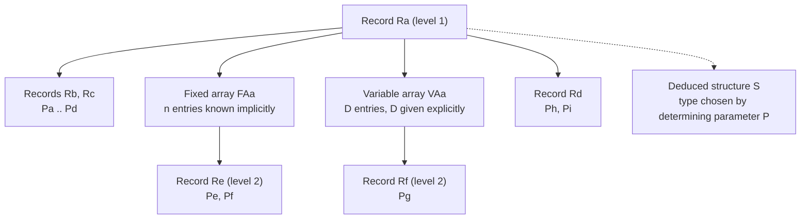

# PUS parameter types (PTC/PFC)

Every field of a PUS packet - a housekeeping value, a command argument, a time tag, even the
spare bits - has a type that is identified by two small numbers: the **packet field type
code (PTC)**, which says *what kind* of value the field holds (Boolean, unsigned integer,
real, absolute time ...), and the **packet field format code (PFC)**, which says *how* that
value is encoded (how many bits, which floating-point format, which time code).[^c-731] The
pair is the common vocabulary between the on-board software, the
[space-to-ground ICD](index.md#tailoring-the-menu-approach) and ground systems such as
[SCOS-2000](../../scos2000/index.md), whose [MIB](../../mib/index.md) stores a PTC and a PFC
for every monitoring parameter ([PCF](../../mib/tables/pcf.md)) and every command parameter
([CPC](../../mib/tables/cpc.md)).[^icd-pcf][^icd-cpc] This page lists every type and format
defined by ECSS-E-ST-70-41C ("PUS-C"), compares them with ECSS-E-70-41A ("PUS-A") and the
2024 Rev.1 draft, and shows what the SCOS-2000 import ICD and the Solar Orbiter database
actually use. The MIB-specific view continues on
[MIB parameter types](../../mib/parameter-types.md).

## Why a type code system

PUS-A explains the motivation: the standard does not fix a length or encoding for each field
of each packet; instead a mission selects, field by field, the length and encoding that best
suit it, and records the choice as a parameter code.[^a-231] The tabular notation is a simple
alternative to ASN.1, and the encoding rules deliberately differ from the ASN.1 Basic Encoding
Rules, mainly because of the limited space-link bandwidth.[^a-231] PUS-C keeps the idea but
renames the codes: a "packet field code" is the combination of a PTC and a PFC, and the
meaning of a PFC depends only on its PTC.[^c-731]

Tailoring therefore happens at two moments:[^c-731]

* when a mission defines a new message type, it declares the PTC of each of its fields;
* when a standard message type leaves a format open (for example the length of a parameter
  identifier), the mission declares the PFC when specifying the application process that
  uses that message type.

PUS-A describes four scopes at which such a choice can be made: mission defined (one format
everywhere), application process defined, service instance defined, or request/report defined
(the format is deduced from preceding fields, possibly together with mission constants).[^a-234]

## Conventions used in packet structure diagrams

PUS specifies packet contents with **structure diagrams**: the first row names each field and
the second row gives its type. A field marked "optional" is present or absent at mission,
application process or service-instance level, and its omission can mean that both ends
already know the value (a fixed value, a "current value" set by other means, or a look-up
table indexed by earlier fields).[^c-721] A group of fields marked "repeated N times" is an
array; for a variable-length array, N is carried explicitly in front of the entries, while for
a fixed-length array N is a mission constant.[^c-721] The Rev.1 draft adds that N is 0 when
the array is empty.[^r-72]

Bits are numbered from the left: the first, most significant bit of an n-bit field is "Bit 0"
and the last is "Bit N-1"; 8 adjacent bits form an octet.[^c-722] This is the same convention
as CCSDS (see [Space Packet Protocol](../../ccsds/space-packet.md)).

## The twelve packet field types

| PTC | PUS-C type | Formats (PFC) | Also in PUS-A? | Section |
|---|---|---|---|---|
| 1 | Boolean | 0 = 1 bit, n > 1 = n bits | yes, PFC 0 only | [PTC 1](#boolean-ptc-1) |
| 2 | enumerated | 1 to 64 bits | yes, PFC 1-16, 24, 32 | [PTC 2](#enumerated-ptc-2) |
| 3 | unsigned integer | PFC 0-19 | yes, PFC 0-16 | [PTC 3](#unsigned-integer-ptc-3) |
| 4 | signed integer | PFC 0-16 | yes, PFC 0-16 | [PTC 4](#signed-integer-ptc-4) |
| 5 | real | PFC 1-4 | yes, PFC 1-4 | [PTC 5](#real-ptc-5) |
| 6 | bit-string | 0 = variable, n = n bits | yes | [PTC 6](#bit-string-ptc-6) |
| 7 | octet-string | 0 = variable, n = n octets | yes | [PTC 7](#octet-string-ptc-7) |
| 8 | character-string | 0 = variable, n = n characters | yes | [PTC 8](#character-string-ptc-8) |
| 9 | absolute time | PFC 0-46 | yes, PFC 0-18 | [PTC 9](#absolute-time-ptc-9) |
| 10 | relative time | PFC 2-18 | yes, PFC 0-16 (different numbering) | [PTC 10](#relative-time-ptc-10) |
| 11 | deduced | 0 | yes | [PTC 11](#deduced-ptc-11) |
| 12 | packet | 0 = TM packet, 1 = TC packet | no PTC ("Any TM", "Any TC") | [PTC 12](#packet-ptc-12) |

The PTC column is Table 7-1 of PUS-C;[^c-731] the PUS-A column summarises clause
23.5 and the "Any TC"/"Any TM" abbreviations of clause 5.2.[^a-235][^a-52]

## Boolean (PTC 1)

A Boolean field is PTC 1. A value greater than 0 means TRUE and 0 means FALSE. PFC 0 is a
1-bit Boolean; any PFC n > 1 is an n-bit Boolean (for example PFC 8 is an 8-bit
Boolean).[^c-732] PUS-A defined only the 1-bit form (PFC 0), with 1 = TRUE and
0 = FALSE.[^a-2351]

## Enumerated (PTC 2)

An enumerated value is an unsigned integer that may appear in logical and comparative
expressions but not in arithmetic: each value stands for a text meaning, an error code being
the typical example (0 "unchecked", 3 "invalid").[^c-733] The PFC is simply the length in bits,
from 1 to 64.[^c-733] PUS-A allowed only the lengths 1-16, 24 and 32 bits.[^a-2352]

Enumerated is the type of every identifier in the PUS headers: PUS version, acknowledgement
flags, service type, message subtype, source ID and destination ID are all enumerated
fields (see [packet structures](packets.md)).[^c-7441]

## Unsigned integer (PTC 3)

Unsigned integers are encoded with Bit 0 as the most significant bit.[^c-734]

| PFC | Size | Range | Notes |
|---|---|---|---|
| 0 | 4 bits | 0-15 | PFC 0-12 are (PFC + 4) bits |
| 1 | 5 bits | 0-31 | |
| 2 | 6 bits | 0-63 | |
| 3 | 7 bits | 0-127 | |
| 4 | 8 bits | 0-255 | one octet |
| 5 | 9 bits | 0-511 | |
| 6 | 10 bits | 0-1 023 | |
| 7 | 11 bits | 0-2 047 | e.g. an APID |
| 8 | 12 bits | 0-4 095 | |
| 9 | 13 bits | 0-8 191 | |
| 10 | 14 bits | 0-16 383 | e.g. a sequence count |
| 11 | 15 bits | 0-32 767 | |
| 12 | 16 bits | 0-65 535 | two octets |
| 13 | 3 octets | 0 to $2^{24}-1$ (16 777 215) | |
| 14 | 4 octets | 0 to $2^{32}-1$ | |
| 15 | 6 octets | 0 to $2^{48}-1$ | |
| 16 | 8 octets | 0 to $2^{64}-1$ | |
| 17 | 1 bit | 0-1 | new in PUS-C |
| 18 | 2 bits | 0-3 | new in PUS-C |
| 19 | 3 bits | 0-7 | new in PUS-C |

PFC 0-16 are identical in PUS-A; PFC 17-19 (1 to 3 bits) appear only in PUS-C.[^c-734][^a-2353]
The "e.g." notes are this wiki's illustrations of where such widths occur in packet headers.

## Signed integer (PTC 4)

Bit 0 is the sign (0 positive, 1 negative) and negative values are the two's complement of
the absolute value.[^c-735]

| PFC | Size | Range |
|---|---|---|
| 0-12 | (PFC + 4) bits | $-2^{PFC+3}$ to $2^{PFC+3}-1$ (from -8..7 for PFC 0 up to -32 768..32 767 for PFC 12) |
| 13 | 3 octets | -8 388 608 to 8 388 607 |
| 14 | 4 octets | $-2^{31}$ to $2^{31}-1$ |
| 15 | 6 octets | $-2^{47}$ to $2^{47}-1$ |
| 16 | 8 octets | $-2^{63}$ to $2^{63}-1$ |

The signed formats are the same in PUS-A and PUS-C; unlike PTC 3, PTC 4 has no 1-3 bit
formats.[^c-735][^a-2354]

## Real (PTC 5)

| PFC | Format | Size |
|---|---|---|
| 1 | IEEE 754 single precision | 4 octets |
| 2 | IEEE 754 double precision | 8 octets |
| 3 | MIL-STD-1750A single precision | 4 octets |
| 4 | MIL-STD-1750A extended precision | 6 octets |

The four formats are the same in PUS-A and PUS-C.[^c-736][^a-2355]

=== "IEEE single (PFC 1)"

    <div class="bitfield" data-title="IEEE 754 single precision (32 bits)" data-width="32"
         data-fields='[{"n":"Sign","b":1},{"n":"Exponent (E + 127)","b":8},{"n":"Fraction","b":23}]'></div>

    Normal values are $(-1)^{sign} \times 2^{exponent-127} \times 1.fraction$; exponent 255
    encodes infinities (fraction 0) and NaN (fraction not 0); exponent 0 encodes zero and
    denormalized values. Range about $1.12 \times 10^{-38}$ to $3.40 \times 10^{38}$ with a
    precision of about $1.15 \times 10^{-7}$.[^c-annexa1]

=== "IEEE double (PFC 2)"

    <div class="bitfield" data-title="IEEE 754 double precision (64 bits)" data-width="32"
         data-fields='[{"n":"Sign","b":1},{"n":"Exponent (E + 1023)","b":11},{"n":"Fraction","b":52}]'></div>

    Exponent 2 047 encodes infinities and NaN; range about $2.22 \times 10^{-308}$ to
    $1.79 \times 10^{308}$, precision about $2.22 \times 10^{-16}$.[^c-annexa1]

=== "MIL-STD-1750A (PFC 3 and 4)"

    <div class="bitfield" data-title="MIL-STD-1750A single precision (32 bits)" data-width="32"
         data-fields='[{"n":"S","b":1,"d":"Sign of the mantissa"},{"n":"Mantissa (two complement)","b":23},{"n":"Exponent (two complement)","b":8}]'></div>

    <div class="bitfield" data-title="MIL-STD-1750A extended precision (48 bits)" data-width="16"
         data-fields='[{"n":"S","b":1},{"n":"Mantissa MS","b":23},{"n":"Exponent","b":8},{"n":"Mantissa LS","b":16}]'></div>

    The 1750A formats are a normalized fractional two's-complement mantissa times 2 to the
    power of a two's-complement exponent: 24-bit mantissa plus 8-bit exponent for single
    precision, and a 40-bit mantissa split around the 8-bit exponent for extended precision.
    Zero is all zeros. Real example from the standard: `40 00 00 7F` is $0.5 \times 2^{127}$
    and `80 00 00 00` is $-1.0$.[^c-annexa2][^a-2355b]

## Bit-string (PTC 6)

A bit-string carries bits whose meaning is application process specific. PFC 0 is a
variable-length bit-string; PFC n > 0 is a fixed-length bit-string of n bits.[^c-737]

<div class="bitfield" data-title="Variable-length bit-string (PTC 6, PFC 0)" data-width="16"
     data-fields='[{"n":"Length N (unsigned integer, PFC declared per application process)","b":8},{"n":"Data: N bits","b":24}]'></div>

The length field is an unsigned integer whose own PFC is declared per application
process.[^c-737] Two rules make PTC 6 special:[^c-737]

* **every spare field** of a TM or TC packet is a fixed-length PTC 6 field, and all its bits
  are zero;
* the length of a fixed-length bit-string may be **deduced**, but only from preceding fields of
  the same packet, from mission constants, or both - never from later fields.

!!! warning "Inference"
    The widths in the diagram above (8-bit length, 24-bit data) are illustrative. The standard
    leaves the length-field size to the application process declaration.

## Octet-string (PTC 7)

PFC 0 is a variable-length octet-string with the same "length then data" structure as the
variable bit-string, the length counting octets; PFC n > 0 is a fixed string of n
octets.[^c-738] The length-field PFC is declared per application process, and a deduced fixed
length may only depend on preceding fields or mission constants.[^c-738] As with bit-strings,
the meaning of the octets is application process specific;[^c-738] the Solar Orbiter examples
below show octet strings carrying whole tables, science blocks and embedded commands.

## Character-string (PTC 8)

Character strings hold visible characters, each encoded as its ASCII code on one octet. PFC 0 is
variable length (length then characters), PFC n > 0 is a fixed string of n
characters.[^c-739] The Rev.1 draft makes "visible" precise - the space `0x20` plus the
printable characters `0x21` to `0x7E` - and requires shorter values to be padded at the end
with spaces up to the PFC length.[^r-739]

## Absolute time (PTC 9)

An absolute time is a positive number of seconds and fractions of a second from an epoch. With
CUC, the epoch is either the CCSDS epoch of 1 January 1958 or an agency-defined epoch - in the
latter case the field is effectively a free-running counter that the ground converts with
[time correlation](../../scos2000/time-correlation.md) coefficients. CDS always uses the 1958
epoch.[^c-7310] Both codes are defined in CCSDS 301.0-B-4 (see
[time code formats](../../ccsds/time-codes.md)); PUS-C notes that CCSDS allows 1-7 octets of
coarse time and 1-10 octets of fine time, of which PUS implements coarse time of 1-4 octets and
fine time of 1-10 octets.[^c-7310]

| PFC | Encoding | Length |
|---|---|---|
| 0 | explicit format, P-field included (CUC or CDS) | variable |
| 1 | CDS, 2-octet day, no microseconds | 6 octets |
| 2 | CDS, 2-octet day, with microseconds | 8 octets |
| 3-18 | CUC: coarse = (PFC + 1) div 4 octets, fine = (PFC + 1) mod 4 octets; implicit P-field | 1-7 octets |
| 19-46 | CUC: coarse = (PFC - 12) div 7 octets, fine = 4 + (PFC - 12) mod 7 octets; implicit P-field | 5-14 octets |

The rows paraphrase PUS-C Table 7-10.[^c-7310b] PUS-A had PFC 0-18 with the same meanings;
PFC 19-46 (fine time of 4-10 octets) are new in PUS-C.[^a-2359]

<div class="bitfield" data-title="CDS with microseconds (PTC 9, PFC 2, 64 bits)" data-width="16"
     data-fields='[{"n":"Day (0 to 65535)","b":16},{"n":"Milliseconds of day","b":32},{"n":"Microseconds of millisecond","b":16}]'></div>

<div class="bitfield" data-title="Full CUC (PTC 9, PFC 18, 56 bits)" data-width="8"
     data-fields='[{"n":"C1","b":8},{"n":"C2","b":8},{"n":"C3","b":8},{"n":"C4","b":8},{"n":"F1","b":8},{"n":"F2","b":8},{"n":"F3","b":8}]'></div>

For PFC 18 the time is $t = C_1 256^3 + C_2 256^2 + C_3 256 + C_4 + F_1 256^{-1} + F_2 256^{-2} + F_3 256^{-3}$
seconds from the epoch.[^c-7310b]

### CUC PFC table

The table below expands the two formulas. The resolution ($2^{-8f}$ s for f fine octets) and the
range before wrap-around ($2^{8c}$ s for c coarse octets) are computed by this wiki from the
formula above; they are not printed in the standard.

| PFC | Coarse | Fine | Octets | Resolution | Range |
|---|---|---|---|---|---|
| 3 | 1 | 0 | 1 | 1 s | 256 s |
| 4 | 1 | 1 | 2 | 3.9 ms | 256 s |
| 5 | 1 | 2 | 3 | 15.3 µs | 256 s |
| 6 | 1 | 3 | 4 | 59.6 ns | 256 s |
| 7 | 2 | 0 | 2 | 1 s | 18.2 h |
| 8 | 2 | 1 | 3 | 3.9 ms | 18.2 h |
| 9 | 2 | 2 | 4 | 15.3 µs | 18.2 h |
| 10 | 2 | 3 | 5 | 59.6 ns | 18.2 h |
| 11 | 3 | 0 | 3 | 1 s | 194 days |
| 12 | 3 | 1 | 4 | 3.9 ms | 194 days |
| 13 | 3 | 2 | 5 | 15.3 µs | 194 days |
| 14 | 3 | 3 | 6 | 59.6 ns | 194 days |
| 15 | 4 | 0 | 4 | 1 s | 136 years |
| 16 | 4 | 1 | 5 | 3.9 ms | 136 years |
| **17** | **4** | **2** | **6** | **15.3 µs** | **136 years** |
| 18 | 4 | 3 | 7 | 59.6 ns | 136 years |
| 19-25 | 1 | 4-10 | 5-11 | 0.23 ns and finer | 256 s |
| 26-32 | 2 | 4-10 | 6-12 | 0.23 ns and finer | 18.2 h |
| 33-39 | 3 | 4-10 | 7-13 | 0.23 ns and finer | 194 days |
| 40-46 | 4 | 4-10 | 8-14 | 0.23 ns and finer | 136 years |

PFC 17 - 4 octets of seconds and 2 octets of fraction - is the format Solar Orbiter uses for its
packet time stamps ("CUC 9/17").[^solo-time]

!!! example "Decoding a CUC value (illustrative bytes)"
    The six octets `1E 2C 9A 00 80 00` read as PTC 9, PFC 17 give coarse time
    `0x1E2C9A00` = 506 239 488 s and fine time `0x8000` / 65 536 = 0.5 s, so the value is
    506 239 488.5 s after the mission epoch. The bytes are invented for illustration.

## Relative time (PTC 10)

A relative time is a positive or negative offset in seconds and fractions from an event
identified by other fields, or the difference between two absolute times. Negative offsets are
the two's complement of the positive offset.[^c-7311]

| PFC | PUS-A (2003) | PUS-C (2016) | Rev.1 DIR1 (2024 draft) |
|---|---|---|---|
| 0 | explicit CUC, P-field included | - | - |
| 1 | CUC 1 coarse, 0 fine | - | CDS without microseconds, 6 octets |
| 2 | CUC 1 coarse, 1 fine | CDS with microseconds, 8 octets | CDS with microseconds, 8 octets |
| 1-16 (PUS-A) | coarse = (PFC + 3) div 4, fine = (PFC + 3) mod 4 | - | - |
| 3-18 | (PUS-A meanings continue up to 16) | CUC, coarse = (PFC + 1) div 4, fine = (PFC + 1) mod 4 | same as PUS-C |

Sources: PUS-A clause 23.5.10, PUS-C Table 7-11 and Rev.1 DIR1 Table 7-11.[^a-23510][^c-7311][^r-7311]
In the full 7-octet CUC form, a positive offset has C1 in the range 0-127, leaving the sign bit
free.[^c-7311]

!!! warning "Inference: the relative-time renumbering"
    The two formulas mean that a PUS-A relative-time format n equals the PUS-C format n + 2:
    PUS-A PFC 1 (1 coarse octet) is PUS-C PFC 3, and PUS-A PFC 16 (4 + 3 octets) is PUS-C PFC 18.
    PUS-C thereby aligns the relative-time CUC numbering with the absolute-time numbering. Anyone
    converting a PUS-A interface document into a ground database must therefore not copy
    relative-time PFC values blindly.

## Deduced (PTC 11)

A deduced field (PTC 11, PFC 0) has a structure and format that is worked out from preceding
fields of the same packet, from mission constants, or both; the rule must be declared when the
field is specified.[^c-7312] PUS-A illustrates it with a pair "Parameter#" (enumerated) followed
by "Parameter Value" (deduced): the value field changes type from packet to packet according to
the parameter identifier in front of it.[^a-23511] Ground databases use the same idea for
generic reports that carry values of arbitrary parameters, for instance the value of a
parameter that failed an [ST[12]](st12-onboard-monitoring.md) monitoring check (see the Solar
Orbiter examples below).

## Packet (PTC 12)

PTC 12 carries a whole packet inside a field: PFC 0 is a CCSDS telemetry packet and PFC 1 a CCSDS
telecommand packet, both compliant with PUS.[^c-7313] For example, TC[11,4] "insert activities
into the time-based schedule" of [ST[11]](st11-time-based-scheduling.md) carries an optional
sub-schedule ID and a count N, followed by N instructions, each an optional group ID, a release
time (absolute time) and the request itself as a "TC packet" field,[^c-11-4] and
TC[21,1] of [ST[21]](st21-request-sequencing.md) loads a sequence of "TC packet" fields each
followed by a relative-time delay.[^c-21-1] PUS-A had no PTC for this; its structure diagrams
simply used the abbreviations "Any TC" and "Any TM".[^a-52]

## Structured fields

Simple types are combined into structures. PUS-A formalised this as **structure rules set #1**:[^a-236]

* a **record** is a fixed sequence of distinct components (simple or structured);
* an **array** repeats one component; a fixed array repeats it an implicit number of times, a
  variable array is preceded by an unsigned integer D giving the number of entries;
* a **deduced structure** is one component whose type is chosen by "determining parameters"
  (preceding fields or mission constants), which may only be Boolean, enumerated, integer or
  character-string values, or themselves deduced.

PUS-A added six nesting and identification rules (NIR1-NIR6): fields outside any array are at
level 1 and array components one level deeper; a concrete parameter may be named only once, at
level 1 or 2, unless each extra occurrence has a specialised meaning (NIR5); and the last
determining parameter must sit at the level of the structure it determines or one level above,
the first one at level 1 or 2.[^a-2363] Encoded fields are packed bit-aligned one after the other, with optional
zero padding to reach a mission word boundary.[^a-2364][^a-234]



The solid part of the diagram follows the second example of PUS-A clause 23.6.5; the dashed
deduced structure S is added from the example of clause 23.6.4, where S is a variable array, a
record A or a record B depending on a preceding parameter P.[^a-2365][^a-2364] PUS-C expresses the same
ideas with "repeated N times" arrays and PTC 11 deduced fields instead of a separate set of
structure rules.[^c-721][^c-7312]

## Differences between issues at a glance

| Item | PUS-A (2003) | PUS-C (2016) | Rev.1 DIR1 (2024 draft) |
|---|---|---|---|
| Name of the pair | parameter code (PTC "parameter type code", PFC "parameter format code") | packet field code (PTC "packet field type code", PFC "packet field format code") | as PUS-C |
| Boolean | 1 bit only | 1 bit or n bits | as PUS-C |
| Enumerated | 1-16, 24, 32 bits | 1-64 bits | as PUS-C |
| Unsigned integer | PFC 0-16 | adds PFC 17-19 (1-3 bits) | as PUS-C |
| Absolute time | PFC 0-18 | adds PFC 19-46 (fine time up to 10 octets) | as PUS-C |
| Relative time | PFC 0-16, own formula | PFC 2 (CDS), 3-18 (CUC, absolute-time formula) | adds PFC 1 (CDS without µs) |
| Packet type | none ("Any TC"/"Any TM") | PTC 12 | PTC 12 |
| Character strings | visible ASCII characters | visible ASCII characters | visible = `0x20`-`0x7E`, pad with spaces |
| Empty variable arrays | only if the definition says so (D = 0 present) | not stated | N = 0 |
| Key element sizes | mission choice | mission choice | fixed by Table 7-13 |

Sources: PUS-A clauses 23.3-23.6, PUS-C clause 7.3, Rev.1 DIR1 clauses 7.2-7.3.[^a-233][^a-235][^a-236b][^c-731][^r-72][^r-739][^r-7311][^r-7314]

## Key element sizes in the Rev.1 draft

The 2024 draft adds a requirement that fixes the size of common elements "to ensure
inter-operability of PUS-C implementations from different providers".[^r-7314] Its Table 7-13:

| Key element | Size |
|---|---|
| Number of instructions in a request | 2 bytes |
| Boolean | 1 byte (1 bit in the secondary header) |
| Collection interval | 4 bytes |
| Parameter ID, event ID | 4 bytes each |
| Housekeeping report structure ID | 2 bytes |
| Memory ID | 2 bytes |
| Memory start address, register address, memory bit-mask | 4 bytes |
| Sub-schedule ID, group ID | 2 bytes each |
| PMON ID, FMON ID | 2 bytes each |
| APID | 2 bytes (11 bits in the primary header) |
| Packet store ID | 2 bytes |
| OBCP ID | 2 bytes |
| CPDU ID | 1 byte |
| CFDP entity ID | 2 bytes |
| CFDP transaction sequence number | 4 bytes |
| Data source ID | 2 bytes |

The rows restate DIR1 Table 7-13.[^r-7314] Until the revision is published, these sizes are a
proposal; PUS-C (2016) leaves them to each mission.

## PTC/PFC in SCOS-2000

The SCOS-2000 Database Import ICD lists, in its Appendix A, every PTC/PFC combination the
importer accepts and how it is held internally. It refers to the original ESA PUS, ESA
PSS-07-101 (1994), as its PUS reference.[^icd-a][^icd-rd6] Monitoring parameters store their
type in `PCF_PTC` (range 1-13) and `PCF_PFC`, command parameters in `CPC_PTC` and
`CPC_PFC`.[^icd-pcf][^icd-cpc]

| PTC | PFC accepted by SCOS-2000 | Internal type | Restrictions and extensions |
|---|---|---|---|
| 1 | 0 | unsigned integer, 1 bit | - |
| 2 | 1-32 | unsigned integer | only limit is 32 bits |
| 3 | 0-14 | unsigned integer | PFC 15 and 16 (48 and 64 bits) not supported |
| 4 | 0-14 | signed integer | PFC 15 and 16 not supported |
| 5 | 1, 2, 3, 4 | real | PFC 4 (1750A extended) only for command parameters, from R3.0 |
| 6 | 1-32 | unsigned integer | PFC 0 not supported; monitoring side only |
| 7 | 0, n | octet string | PFC 0 only for command/sequence parameters |
| 8 | 0, n | ASCII string | PFC 0 only for command/sequence parameters |
| 9 | 1, 2, 3-18, **30** | absolute time | PFC 0 not supported; PFC 1 from R5.0; PFC 2 only for commands; PFC 30 = Unix time (SCOS-2000 extension) |
| 10 | 3-18 | relative time | CUC only |
| 11 | 0, **n > 0** | deduced | PFC > 0 forces a fixed width, command parameters only |
| **13** | 0 | saved synthetic parameter | SCOS-2000 extension, characteristics taken from `PCF_RELATED` |

Sources: ICD 7.0 Appendix A, Table 4, the PCF/CPC field descriptions, and the summary of exceptions
in Appendix C.[^icd-a][^icd-a2][^icd-pcf][^icd-cpc][^icd-appc]
The bold values are not defined by the PUS. The `PCF_WIDTH` field lets a monitoring parameter
occupy a padded slot wider than its PTC/PFC implies, which matters for variable packets and
deduced parameters.[^icd-width]

!!! warning "Inference: where SCOS-2000 and PUS-C disagree"
    * **PTC 9 PFC 30**: SCOS-2000 uses it for Unix time (4 octets of seconds since 1970 plus
      4 octets of microseconds), described as "Not defined in PUS".[^icd-a2] The ICD's PUS
      reference is ESA PSS-07-101, which is not in this wiki's library;[^icd-rd6] PUS-A defines
      absolute-time PFCs only up to 18,[^a-2359] but PUS-C assigns PFC 30 to a CUC code of 2
      coarse and 8 fine octets.[^c-7310b] A PUS-C mission that needs that CUC format cannot
      express it with this code in an ICD 7.0-compliant SCOS-2000 database.
    * **PTC 3 PFC 17-19, PTC 9 PFC 19-46, PTC 12** are absent from the ICD 7.0 table. Whether
      later SCOS-2000 releases accept them is not stated in the available sources.
    * **PTC 10**: SCOS-2000 numbers relative CUC times with the absolute-time formula (PFC
      3-18), i.e. the PUS-C numbering, not the PUS-A one (see the relative-time inference above).

SCOS-2000 also defines special command parameter types that build PUS requests more easily:
**Command ID** parameters (`CPC_CATEG` = `A`, PTC 7 PFC 0) are filled with the raw encoding of
another command; **Parameter ID** parameters (`CPC_CATEG` = `P`, PTC 3) receive the on-board
identifier of a telemetry parameter; and **Deduced** command parameters (PTC 11) inherit type,
width and calibration from the TM parameter named by the preceding Parameter ID.[^icd-special]
Configuration variables must be 32-bit signed integers (PTC 4, PFC 14), double-precision reals
(PTC 5, PFC 2) or character strings (PTC 8).[^icd-cfg]

## The Solar Orbiter MIB in numbers

The September 2025 Solar Orbiter release defines 126 745 monitoring parameters and 7 155 command
parameters. Their PTC distribution:[^mib-pcf][^mib-cpc]

| PTC | Type | PCF (monitoring) | Distinct PFC in PCF | CPC (command) | Distinct PFC in CPC |
|---|---|---|---|---|---|
| 1 | Boolean | 4 380 | 1 (0) | 225 | 1 (0) |
| 2 | enumerated | 29 443 | 23 (1-32) | 1 552 | 13 (1-32) |
| 3 | unsigned integer | 50 341 | 15 (0-14) | 4 349 | 15 (0-14) |
| 4 | signed integer | 1 950 | 8 (0-14) | 178 | 6 (2-14) |
| 5 | real | 29 718 | 2 (1, 2) | 702 | 2 (1, 2) |
| 6 | bit-string | 950 | 12 (1-20) | 0 | - |
| 7 | octet-string | 5 990 | 104 (1-6448) | 84 | 22 (0-236) |
| 8 | character-string | 120 | 17 (1-70) | 6 | 5 (0-32) |
| 9 | absolute time | 3 796 | 4 (2, 15, 17, 30) | 58 | 2 (15, 17) |
| 10 | relative time | 47 | 3 (6, 15, 17) | 1 | 1 (17) |
| 11 | deduced | 8 | 1 (0) | 0 | - |
| 13 | saved synthetic | 2 | 1 (0) | 0 | - |

Observations from the same queries:[^mib-pcf][^mib-cpc]

* **Reals are almost all IEEE single precision**: 28 316 of the 29 718 real monitoring
  parameters are PTC 5 PFC 1, and 630 of 702 real command parameters. No MIL-STD-1750A format is
  used.
* **Time**: 2 116 absolute-time parameters are PFC 15 (4-octet CUC seconds) and 1 677 are PFC 17
  (4 + 2 octets, the packet time stamp format). Two parameters of the "Time Correlation Report"
  packet (SPID 66840, type 164, APID 1966) use the SCOS-2000 Unix format PFC 30
  ([NYG02101](../../explorer/index.md#/solo/param/NYG02101) "Period From" and
  [NYG02102](../../explorer/index.md#/solo/param/NYG02102) "Period To"), and one uses CDS with
  microseconds, [NYG02204](../../explorer/index.md#/solo/param/NYG02204) "GS Acceptance Time"
  (see the inference box below).
* **No PTC 12 and no PFC beyond the ICD 7.0 table** appear: unsigned integers stop at PFC 14,
  absolute CUC times at PFC 17.
* **Deduced parameters** are the value fields of generic on-board reports, for example
  [NCD0C0B5](../../explorer/index.md#/solo/param/NCD0C0B5) "OBCHP_S12_Par value", whose type
  follows the parameter identifier [NCD0C095](../../explorer/index.md#/solo/param/NCD0C095)
  given in `PCF_RELATED`. It is placed in eight fixed event packets (SPIDs 66652-66659, TM(5,3)
  "RW Mom Lvl Check" reports on APIDs 1964 and 1973) and in 1 431 variable-packet (VPD)
  structures.
* **Saved synthetic parameters** (PTC 13): [NTTSS030](../../explorer/index.md#/solo/param/NTTSS030)
  and [NTTSS031](../../explorer/index.md#/solo/param/NTTSS031) ("Last C_Lock DST-1/2"), derived
  from the synthetic parameters NTTSX030 and NTTSX031. The April 2020 release had none (it had
  102 104 PCF records and no PTC 13).[^mib2020-pcf] See
  [synthetic parameters](../../mib/synthetic-parameters.md).
* **Variable-length strings** appear only on the command side: 13 command parameters are PTC 7
  PFC 0 and one is PTC 8 PFC 0, as the ICD requires.[^icd-a2]
* **Long fixed octet strings** (up to PFC 6448, i.e. 6 448 octets) hold whole tables and
  science blocks as single parameters, for example
  [NCAMBP00](../../explorer/index.md#/solo/param/NCAMBP00) "SSE segments" (6 448 octets) and
  [NIM02004](../../explorer/index.md#/solo/param/NIM02004) "1920 Science" (4 048 octets).

!!! warning "Inference"
    NYG02204 is a monitoring parameter (`PCF_NATUR` = `R`) of type PTC 9 PFC 2, a combination that
    ICD 7.0 says is supported only for command parameters.[^icd-a2] It belongs to a packet that,
    judging by its description, is produced by the ground segment; whether the SCOS-2000 release used by Solar Orbiter accepts it for
    monitoring is not stated in the available sources. The packet is SPID 66850, "TM Packet used
    by the Releaser G/S response" (type 165, subtype 1, APID 1966). APID 1966 also carries
    packets described as "MISC_PACKET", "Saved Synthetics", "Time Correlation Report" and "TCO
    Time_Couples", so the PFC 30 and PFC 2 time parameters most likely belong to packets
    generated by SCOS-2000 on ground rather than to spacecraft telemetry.

### A real command: time-tagging with PTC 9 and PTC 7

The command `ZCD00B04`, TC[11,4] "Insert Telecommands in Command Schedule", shows four types
working together. Its application data, as defined in the [CDF](../../mib/tables/cdf.md) and CPC
tables, is:[^mib-cdf]

| CDF_BIT | Parameter | Description | PTC/PFC | Size |
|---|---|---|---|---|
| 0 | PCD0B041 | Sub_schedule Identifier | 3/4 | 8 bits |
| 8 | PCD0B042 | Nb TCs to add in Sub-Sch (repeat counter, group size 2) | 3/4 | 8 bits |
| 16 | PCD0B043 | Time Tag | 9/17 | 48 bits (CUC 4 + 2) |
| 64 | PCD0B044 | Complete TC packet (Command ID, `CPC_CATEG` = `A`) | 7/0 | variable |

The repeated group (time tag plus embedded packet) is the PUS-A equivalent of a "repeated N
times" array, and the embedded command is a variable octet string filled by SCOS-2000 with the
encoding of another command - the role PTC 12 plays in PUS-C. Event-action definitions such as
`ZCS01301` (TC[19,1]) use the same Command ID mechanism with PCD13013 "TC to send upon
event".[^mib-cdf] Explore it in the [MIB explorer](../../explorer/index.md#/solo/command/ZCD00B04).

??? example "SQL used"
    ```sql
    -- solo-2025-09-16.sqlite (MIB__20250916M25925PFMS001_SOL)
    SELECT PCF_PTC, COUNT(*) n, COUNT(DISTINCT PCF_PFC),
           MIN(CAST(PCF_PFC AS INT)), MAX(CAST(PCF_PFC AS INT))
      FROM pcf GROUP BY 1 ORDER BY CAST(PCF_PTC AS INT);
    SELECT PCF_PTC, PCF_PFC, COUNT(*) FROM pcf GROUP BY 1, 2;
    SELECT CPC_PTC, COUNT(*), COUNT(DISTINCT CPC_PFC), GROUP_CONCAT(DISTINCT CPC_PFC)
      FROM cpc GROUP BY 1 ORDER BY CAST(CPC_PTC AS INT);
    SELECT PCF_NAME, PCF_DESCR, PCF_PTC, PCF_PFC, PCF_NATUR, PCF_RELATED FROM pcf
     WHERE (PCF_PTC = '9' AND PCF_PFC IN ('2', '30')) OR PCF_PTC IN ('11', '13');
    SELECT CPC_NAME, CPC_DESCR, CPC_PTC, CPC_PFC, CPC_CATEG FROM cpc WHERE CPC_CATEG = 'A';
    SELECT d.CDF_BIT, d.CDF_PNAME, d.CDF_ELLEN, d.CDF_GRPSIZE
      FROM cdf d WHERE d.CDF_CNAME = 'ZCD00B04' ORDER BY CAST(d.CDF_BIT AS INT);
    SELECT l.PLF_NAME, p.PID_SPID, p.PID_TYPE, p.PID_STYPE, p.PID_APID, p.PID_DESCR
      FROM plf l JOIN pid p ON p.PID_SPID = l.PLF_SPID
     WHERE l.PLF_NAME IN ('NYG02204', 'NYG02101', 'NYG02102', 'NCD0C0B5');
    SELECT COUNT(DISTINCT VPD_TPSD) FROM vpd WHERE VPD_NAME = 'NCD0C0B5';
    SELECT PID_TYPE, PID_STYPE, PID_SPID, PID_DESCR FROM pid WHERE PID_APID = '1966';
    -- solo-2020-04-16.sqlite
    SELECT PCF_PTC, COUNT(*) FROM pcf GROUP BY 1;
    ```

[^c-731]: [ECSS-E-ST-70-41C, Telemetry and telecommand packet utilization](../../library/ecss-e-st-70-41c-15april2016.md), §7.3.1, Table 7-1, PDF pp. 428-429.
[^c-721]: [ECSS-E-ST-70-41C](../../library/ecss-e-st-70-41c-15april2016.md), §7.2.1, PDF pp. 427-428.
[^c-722]: [ECSS-E-ST-70-41C](../../library/ecss-e-st-70-41c-15april2016.md), §7.2.2, PDF p. 428.
[^c-732]: [ECSS-E-ST-70-41C](../../library/ecss-e-st-70-41c-15april2016.md), §7.3.2, Table 7-2, PDF p. 429.
[^c-733]: [ECSS-E-ST-70-41C](../../library/ecss-e-st-70-41c-15april2016.md), §7.3.3, Table 7-3, PDF p. 430.
[^c-734]: [ECSS-E-ST-70-41C](../../library/ecss-e-st-70-41c-15april2016.md), §7.3.4, Table 7-4, PDF p. 430.
[^c-735]: [ECSS-E-ST-70-41C](../../library/ecss-e-st-70-41c-15april2016.md), §7.3.5, Table 7-5, PDF p. 431.
[^c-736]: [ECSS-E-ST-70-41C](../../library/ecss-e-st-70-41c-15april2016.md), §7.3.6, Table 7-6, PDF p. 431.
[^c-annexa1]: [ECSS-E-ST-70-41C](../../library/ecss-e-st-70-41c-15april2016.md), Annex A.1, Figures A-1 and A-2, PDF pp. 610-612.
[^c-annexa2]: [ECSS-E-ST-70-41C](../../library/ecss-e-st-70-41c-15april2016.md), Annex A.2, Figure A-3 and Table A-3, PDF pp. 613-614.
[^c-737]: [ECSS-E-ST-70-41C](../../library/ecss-e-st-70-41c-15april2016.md), §7.3.7, Table 7-7, Figure 7-3, PDF p. 432.
[^c-738]: [ECSS-E-ST-70-41C](../../library/ecss-e-st-70-41c-15april2016.md), §7.3.8, Table 7-8, Figure 7-4, PDF p. 433.
[^c-739]: [ECSS-E-ST-70-41C](../../library/ecss-e-st-70-41c-15april2016.md), §7.3.9, Table 7-9, Figure 7-5, PDF pp. 433-434.
[^c-7310]: [ECSS-E-ST-70-41C](../../library/ecss-e-st-70-41c-15april2016.md), §7.3.10a-c, PDF p. 435.
[^c-7310b]: [ECSS-E-ST-70-41C](../../library/ecss-e-st-70-41c-15april2016.md), §7.3.10d, Table 7-10, PDF p. 436.
[^c-7311]: [ECSS-E-ST-70-41C](../../library/ecss-e-st-70-41c-15april2016.md), §7.3.11, Table 7-11, PDF pp. 436-437.
[^c-7312]: [ECSS-E-ST-70-41C](../../library/ecss-e-st-70-41c-15april2016.md), §7.3.12, PDF p. 437.
[^c-7313]: [ECSS-E-ST-70-41C](../../library/ecss-e-st-70-41c-15april2016.md), §7.3.13, Table 7-12, PDF p. 437.
[^c-11-4]: [ECSS-E-ST-70-41C](../../library/ecss-e-st-70-41c-15april2016.md), §8.11.2.4, Figure 8-91, PDF pp. 496-497.
[^c-21-1]: [ECSS-E-ST-70-41C](../../library/ecss-e-st-70-41c-15april2016.md), §8.21.2.1, Figure 8-228, PDF p. 577.
[^c-7441]: [ECSS-E-ST-70-41C](../../library/ecss-e-st-70-41c-15april2016.md), §7.4.4.1, Figure 7-9, and §7.4.3.1, Figure 7-7, PDF pp. 439 and 442.
[^a-231]: [ECSS-E-70-41A, Telemetry and telecommand packet utilization](../../library/ecss-e-70-41a-30jan2003-pus.md), §23.1, PDF p. 189.
[^a-233]: [ECSS-E-70-41A](../../library/ecss-e-70-41a-30jan2003-pus.md), §23.3, PDF p. 190.
[^a-234]: [ECSS-E-70-41A](../../library/ecss-e-70-41a-30jan2003-pus.md), §23.4, PDF p. 191.
[^a-235]: [ECSS-E-70-41A](../../library/ecss-e-70-41a-30jan2003-pus.md), §23.5 (23.5.1-23.5.11), PDF pp. 192-199.
[^a-2351]: [ECSS-E-70-41A](../../library/ecss-e-70-41a-30jan2003-pus.md), §23.5.1, PDF p. 192.
[^a-2352]: [ECSS-E-70-41A](../../library/ecss-e-70-41a-30jan2003-pus.md), §23.5.2, PDF p. 192.
[^a-2353]: [ECSS-E-70-41A](../../library/ecss-e-70-41a-30jan2003-pus.md), §23.5.3, PDF p. 192.
[^a-2354]: [ECSS-E-70-41A](../../library/ecss-e-70-41a-30jan2003-pus.md), §23.5.4, PDF pp. 192-193.
[^a-2355]: [ECSS-E-70-41A](../../library/ecss-e-70-41a-30jan2003-pus.md), §23.5.5, PDF p. 193.
[^a-2355b]: [ECSS-E-70-41A](../../library/ecss-e-70-41a-30jan2003-pus.md), §23.5.5.2, PDF pp. 194-196.
[^a-2359]: [ECSS-E-70-41A](../../library/ecss-e-70-41a-30jan2003-pus.md), §23.5.9, PDF p. 198.
[^a-23510]: [ECSS-E-70-41A](../../library/ecss-e-70-41a-30jan2003-pus.md), §23.5.10, PDF pp. 198-199.
[^a-23511]: [ECSS-E-70-41A](../../library/ecss-e-70-41a-30jan2003-pus.md), §23.5.11, PDF p. 199.
[^a-236]: [ECSS-E-70-41A](../../library/ecss-e-70-41a-30jan2003-pus.md), §23.6.1-23.6.2, PDF pp. 199-202.
[^a-236b]: [ECSS-E-70-41A](../../library/ecss-e-70-41a-30jan2003-pus.md), §23.6.2, Figure 10 (variable array), PDF p. 201.
[^a-2363]: [ECSS-E-70-41A](../../library/ecss-e-70-41a-30jan2003-pus.md), §23.6.3, PDF pp. 202-203.
[^a-2364]: [ECSS-E-70-41A](../../library/ecss-e-70-41a-30jan2003-pus.md), §23.6.4, PDF pp. 203-204.
[^a-2365]: [ECSS-E-70-41A](../../library/ecss-e-70-41a-30jan2003-pus.md), §23.6.5, PDF p. 205.
[^a-52]: [ECSS-E-70-41A](../../library/ecss-e-70-41a-30jan2003-pus.md), §5.2, PDF p. 42.
[^r-72]: [ECSS-E-ST-70-41C Rev.1 DIR1 (draft, 11 December 2024)](../../library/ecss-e-st-70-41c-rev1-dir1.md), §7.2.1, PDF p. 476.
[^r-739]: [ECSS-E-ST-70-41C Rev.1 DIR1](../../library/ecss-e-st-70-41c-rev1-dir1.md), §7.3.9b Notes 1-2, PDF p. 482.
[^r-7311]: [ECSS-E-ST-70-41C Rev.1 DIR1](../../library/ecss-e-st-70-41c-rev1-dir1.md), §7.3.11, Table 7-11, PDF pp. 484-485.
[^r-7314]: [ECSS-E-ST-70-41C Rev.1 DIR1](../../library/ecss-e-st-70-41c-rev1-dir1.md), §7.3.14, Table 7-13, PDF p. 486.
[^icd-a]: [SCOS-2000 Database Import ICD, issue 7.0](../../library/icd-7-0-final.md), Appendix A, Table 4, PDF pp. 214-218.
[^icd-a2]: [SCOS-2000 Database Import ICD 7.0](../../library/icd-7-0-final.md), Appendix A, Table 4 (continued), PDF pp. 216-224.
[^icd-appc]: [SCOS-2000 Database Import ICD 7.0](../../library/icd-7-0-final.md), Appendix C, section 1 (support of PUS data types), PDF p. 235.
[^icd-rd6]: [SCOS-2000 Database Import ICD 7.0](../../library/icd-7-0-final.md), §1.4.2, RD-6, PDF p. 19.
[^icd-pcf]: [SCOS-2000 Database Import ICD 7.0](../../library/icd-7-0-final.md), §3.3.2.1.1, PCF_PTC and PCF_PFC, PDF p. 43.
[^icd-width]: [SCOS-2000 Database Import ICD 7.0](../../library/icd-7-0-final.md), §3.3.2.1.1, PCF_WIDTH, PDF p. 44.
[^icd-cpc]: [SCOS-2000 Database Import ICD 7.0](../../library/icd-7-0-final.md), §3.3.3.2.2, CPC_PTC, CPC_PFC and CPC_CATEG, PDF pp. 144-146.
[^icd-special]: [SCOS-2000 Database Import ICD 7.0](../../library/icd-7-0-final.md), §3.3.3.2.2, "Special PUS Command Parameter Types", PDF p. 143.
[^icd-cfg]: [SCOS-2000 Database Import ICD 7.0](../../library/icd-7-0-final.md), §3.3.2.1.4 (Dynamic Configuration Variables), PDF p. 61.
[^solo-time]: [SOL.S.ASTR.TN.00079 Issue 7](../../library/sol-s-astr-tn-00079-07.md), §4.2.2.1 (PUS-233), PDF p. 26.
[^mib-pcf]: [Solar Orbiter MIB release MIB__20250916M25925PFMS001_SOL](../../library/mib-20250916m25925pfms001-sol.md), table pcf, queried by this wiki.
[^mib-cpc]: [Solar Orbiter MIB release MIB__20250916M25925PFMS001_SOL](../../library/mib-20250916m25925pfms001-sol.md), table cpc, queried by this wiki.
[^mib-cdf]: [Solar Orbiter MIB release MIB__20250916M25925PFMS001_SOL](../../library/mib-20250916m25925pfms001-sol.md), tables ccf, cdf and cpc (commands ZCD00B04 and ZCS01301), queried by this wiki.
[^mib2020-pcf]: [Solar Orbiter MIB release MIB__20200416M10720PFMS001_SOL](../../library/mib-20200416m10720pfms001-sol.md), table pcf, queried by this wiki.
