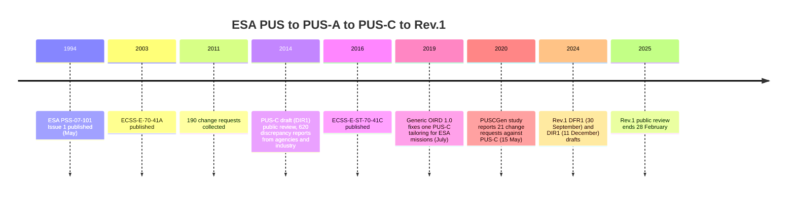

# PUS-A vs PUS-C (and the 2024 Rev.1 draft)

Three generations of the [Packet Utilization Standard](index.md) are in use or in preparation
today: **PUS-A** (ECSS-E-70-41A, 30 January 2003), flown by many ESA missions of the 2000s and
2010s; **PUS-C** (ECSS-E-ST-70-41C, 15 April 2016), the current standard; and **Rev.1 DIR1**
(ECSS-E-ST-70-41C Rev.1, 11 December 2024), a draft distributed for public
review.[^c-changelog][^r-cover] Behind them stands the **ESA PUS**, ESA PSS-07-101 Issue 1 of May
1994, whose packets carry PUS version number 0 and from which PUS-A inherited most of its
structure and numbering.[^pss-cover][^a-ver0] A ground segment often has to support more than one
of these, so the differences matter in practice: the same service number can mean different
things, the same field can have a different size, and the same PFC value can encode a different
time format. This page compares the documents clause by clause. The bit-level PUS-A and PUS-C
header details are on [PUS packet structures](packets.md), the data types on
[PUS parameter types](parameter-types.md), and the wider history of the ESA packet standards on
[From ESA PSS to CCSDS and ECSS](../../overview/history.md).

| | ESA PUS | PUS-A | PUS-C | Rev.1 DIR1 |
|---|---|---|---|---|
| Document | ESA PSS-07-101 Issue 1 | ECSS-E-70-41A | ECSS-E-ST-70-41C | ECSS-E-ST-70-41C Rev.1 DIR1 |
| Date | May 1994 | 30 January 2003 | 15 April 2016 | 11 December 2024 |
| Status | ESA standard, prepared by COES, approved by the ESA Inspector General | first ECSS issue | second issue, in force | draft for public review (12 December 2024 - 28 February 2025) |
| PUS version number in packets | 0 | 1 | 2 | 2 |
| Length (PDF pages) | 225 (scan) | 228 | 656 | 733 |
| Standard service types | 17 (1-17) | 16 (1-19 with 7, 10, 16 unused) | 20 (1-23 with 7, 10, 16 reserved) | 23 (1-27 with 7, 8, 10, 16 reserved) |

Sources: the title pages, change logs and cover pages, PSS-07-101 Table 4-1, PUS-A Table 2, PUS-C
Table 4-1 and DIR1 Table 4.2-1.[^pss-cover][^pss-442][^pss-t41][^c-changelog][^r-cover][^r-changelog][^a-table2][^c-table41][^r-table41][^c-7431] Page
counts are those of the copies in this wiki's [library](../../references/index.md).

## Before PUS-A: ESA PSS-07-101 (1994)

PUS-A did not start from a blank page. Its direct ancestor, **ESA PSS-07-101 Packet Utilisation
Standard, Issue 1 (May 1994)**, was prepared by ESA's Committee for Operations and EGSE Standards
(COES), set up in 1987 to define a monitoring and control system common to satellite checkout and
mission control, and it was approved by the ESA Inspector General after an Agency-level review in
1993.[^pss-cover][^k-coes][^k-future] Why it was written, how a prototype validated it and how XMM
tailored it first are told on the
[PUS overview](index.md#before-ecss-the-esa-packet-utilisation-standard-1987-1994). This section
compares its content with its successors.

!!! info "Source note: a scanned standard"
    PSS-07-101 exists here only as a scanned PDF. This wiki read it through OCR text, which
    contains recognition errors, merged words and scrambled table layouts, and checked every field
    size, bit position, value and subtype number quoted on this page against the rendered page
    images. The same applies to the two 1994 conference papers on NTRS.

### Concepts in 1994

The 1994 vocabulary is already close to PUS-A's. A **Service** is a set of on-board functions with
conceptually related capabilities that a ground system controls and monitors through **Service
Requests** and **Service Reports**; a report that only returns requested data is a **Service
Response**, every other report a **Service Indication**. The **Service Provider** is the on-board
application process that executes the service, the **Service User** is the ground system, and a
**Supporting Service** is one used only in the context of another service.[^pss-42][^pss-42b] Three
criteria selected the standard services: *commonality* (functions many missions need), *coherence*
(strongly related capabilities with an unambiguous scope and minimal interaction with other
services) and *implementation independence* (no assumed on-board architecture).[^pss-41] One rule
differs from today's model: a service cannot be split across application processes, although one
process may host several services and, where permitted, several processes may host distinct
instances of a service.[^pss-42] PUS-C instead deploys services subservice by subservice: each
subservice has exactly one provider, each subservice entity is hosted by an application process
on board or on ground, and an application process hosts at most one provider of a given subservice
type.[^c-54722][^c-41]

The 1994 document puts operational requirements first (chapter 3, each with a mnemonic such as TC-1
or TRAFF-1 and with mission parameters in angle brackets) and then one chapter per service with its
scope, concept, requests and reports and capability sets; it ends with the summary of requests and
reports in chapter 22 and the parameter types in chapter 23 - the same clause numbers that PUS-A
kept.[^pss-13][^pss-313][^pss-toc][^a-toc]

### The 1994 packet headers

PSS-07-101 takes the packet header from the ESA packet telemetry (PSS-04-106) and telecommand
(PSS-04-107) standards and standardises the start of the packet data field, the **data field
header**. In both directions it has the same 24-bit core; telemetry adds an optional time field.
The 1994 paper presenting the standard prints the same two layouts.[^pss-441][^pss-442][^pss-452][^k-pdfh]

<div class="bitfield" data-title="PSS-07-101 telecommand data field header (24 bits)" data-width="8"
     data-fields='[{"n":"PUS version","b":3,"v":"000","d":"TC packet PUS version number; only version 0 permitted"},{"n":"Checksum type","b":1,"d":"0 = ISO 16-bit checksum, 1 = CRC, used in the packet error control field"},{"n":"Ack","b":4,"d":"---1 acceptance, --1- start, -1-- progress, 1--- completion of execution"},{"n":"Service type","b":8,"d":"0-127 reserved for the PUS, 128-255 mission-specific"},{"n":"Service subtype","b":8,"d":"0-127 reserved for the PUS, 128-255 mission-specific"}]'></div>

<div class="bitfield" data-title="PSS-07-101 telemetry data field header, fixed part (24 bits); a mission-optional CUC or CDS time field follows" data-width="8"
     data-fields='[{"n":"PUS version","b":3,"v":"000","d":"TM source packet PUS version number; only version 0 permitted"},{"n":"Checksum type","b":1,"d":"0 = ISO 16-bit checksum or no check (ground knows which), 1 = CRC"},{"n":"Spare","b":4,"d":"Reserved for future use"},{"n":"Service type","b":8,"d":"0-127 reserved for the PUS, 128-255 mission-specific"},{"n":"Service subtype","b":8,"d":"0-127 reserved for the PUS, 128-255 mission-specific"}]'></div>

| Field | Size | Meaning in PSS-07-101 |
|---|---|---|
| PUS version number | 3 bits | Only version 0; a new version was foreseen for telemetry packets carrying more than one service data unit.[^pss-442][^pss-452] |
| Checksum type | 1 bit | Selects the packet error control algorithm: ISO 16-bit checksum (0) or CRC (1). In telemetry, 0 can also mean that no check is included.[^pss-442][^pss-452] |
| Ack (TC only) | 4 bits | Which *success* reports the application process sends, one bit per stage; failure reports are always sent. `1111` means at least four verification steps are expected.[^pss-442] |
| Spare (TM only) | 4 bits | Reserved.[^pss-452] |
| Service type, subtype | 8 + 8 bits | Unique across all application processes; on ground their combination may set the processing priority (TM).[^pss-442][^pss-452] |
| Time (TM only) | variable | On-board reference time in CUC or CDS, chosen per application process by the mission parameter `<APPL_TIME_CODE>`, possibly absent; CDS uses the CCSDS epoch of 1 January 1958; the time is any well-defined time before the sampling of the packet's data.[^pss-452] |

The packet header around this core also differs from later practice:[^pss-441][^pss-451]

* telecommand packets have version number 0, but telemetry source packets have "version 2",
  coded as the value 4 (`0b100`); PUS-A and PUS-C use 0 for both;[^a-54b][^c-741]
* the 14-bit telecommand sequence count is split: its `<NUM_SOURCE_BITS>` most significant bits
  carry a **source ID** (for example, one per ground control centre; zero bits if there is a single
  source) and the rest a sequence count kept per source and per APID - PUS-A moved the source ID
  into an optional data field header field, PUS-C made it a 16-bit field;[^a-53b][^c-7441]
* telecommand sequence flags are always `11` for ESA missions and telemetry "segmentation flags"
  are always `11` (unsegmented);
* the telecommand packet error control field (16 bits) is mandatory, and the largest telecommand
  packet is 65 542 octets; the telemetry error control field is optional.[^pss-441][^pss-452]

The CRC of Appendix A.2 is the one still used today: generator polynomial
$x^{16} + x^{12} + x^5 + 1$, encoder and decoder initialised to all ones, computed over the whole
packet except the error control field; PUS-C Annex B specifies the same CRC-16-CCITT.[^pss-a2][^c-crc] For the PUS-A and PUS-C fields see
[Packet header changes](#packet-header-changes) below and [PUS packet structures](packets.md).

!!! warning "Inference: reading the first four bits"
    In PSS-07-101 the first data-field-header bits are the 3-bit version `000` followed by the
    checksum-type bit; PUS-A starts with a 0 flag bit followed by the 3-bit version `001`; PUS-C
    has a 4-bit version `0010`.[^pss-442][^a-53b][^c-7441] Read as one 4-bit number, a PSS-07-101
    telecommand using a CRC therefore shows the same value (1) as a PUS-A packet. A decoder that
    must tell the ESA PUS from PUS-A cannot rely on these bits alone and needs mission knowledge.
    The multi-SDU telemetry version foreseen in 1994 (and again in PUS-A) does not appear in PUS-C,
    whose version 2 simply identifies ECSS-E-ST-70-41C.

### Service lineage: 1994 to 2016

The 1994 summary table (Table 22-1) fixes subtype numbers that are still in use. The table follows
each service through the three issues; the PUS-C column restates the comparisons made further down
this page.[^pss-t221][^a-22][^c-annexc]

| ST | PSS-07-101 (1994): name and message types | Change in PUS-A (2003) | In PUS-C (2016) |
|---|---|---|---|
| 1 | Telecommand verification: acceptance, execution started, progress and complete reports, success and failure, (1,1)-(1,8); minimum set: acceptance reports (1,1), (1,2) | unchanged | TM[1,1]-TM[1,8] kept; TM[1,10] added |
| 2 | Device-level commanding (clause 6: device command distribution): on/off (2,1), register load (2,2), CPDU (2,3), "distribute command in TC segment" (2,4) | (2,4) dropped | CPDU moved to TC[2,4]; subtype 3 unused |
| 3 | Housekeeping & diagnostic data reporting: define and clear (1-4), enable and disable (5-8), report definitions (9-12), sampling-time offsets (13-16), periodic or filtered mode (17-20), "masked" parameter reports (21-24), parameter reports (3,25), (3,26) | sampling-time-offset requests renumbered 13, 14 and their reports 15, 16; the "masked" reports replaced by "unfiltered" ones (requests 21, 22, reports 23, 24) | 13-24 unused; TM[3,25], TM[3,26] kept |
| 4 | Parameter statistics reporting, (4,1)-(4,10) | unchanged | 1-9 kept, 10 dropped |
| 5 | Event reporting: normal/progress and error/anomaly low/medium/high reports, (5,1)-(5,4) | enable/disable generation (5,5), (5,6) added | TM[5,1]-TM[5,4] renamed; TC[5,7], TM[5,8] added |
| 6 | Memory management: load, dump, check, by base plus offsets or absolute addresses, (6,1)-(6,10) | unchanged | same numbers, now object and raw memory |
| 7 | Task management: start, stop, suspend, resume, abort task, perform activity within task, (7,1)-(7,6) | not used | reserved |
| 8 | Function management: activate (8,1), de-activate (8,2), perform activity of function (8,3) | only (8,1) "perform function" | TC[8,1] (deleted in Rev.1 DIR1) |
| 9 | Time management: change time report generation rate (9,1) | time report added as (9,2) | TM[9,2] CUC or TM[9,3] CDS |
| 10 | Time reporting: the time report (10,1) | merged into service 9 | reserved |
| 11 | Onboard scheduling: enable, disable, reset, insert (1-4), delete (5, 6), time-shift (7, 8), detailed reports (9, 11 with report 10), summary reports (12, 14 with report 13) | requests 9, 11, 12, 14 now report a subset of the schedule; 15-19 added (time-shift all, full detailed and summary reports, schedule status request and report) | 1-4, TM[11,10], TM[11,13] kept |
| 12 | Onboard monitoring: (12,1)-(12,11), out-of-limit report (12,12) | (12,12) becomes "check transition report" | 1-12 kept, renamed |
| 13 | Large data transfer: downlink (13,1)-(13,8), uplink (13,9)-(13,16) | unchanged | only 1-3, 9-11 and 16 kept |
| 14 | Packet transmission control: enable, disable and report transmission of packets, housekeeping, diagnostic and event reports, (14,1)-(14,16) | renamed "forwarding", same 16 subtypes | remodelled as forward-control configurations |
| 15 | Onboard storage and retrieval: packet selection (15,1)-(15,6), storage and retrieval (15,7)-(15,11) | catalogue report (15,12), (15,13) added | redefined around packet stores |
| 16 | Onboard traffic management: no subtypes; specification left to an Issue 2 | not used | reserved |
| 17 | Test: perform connection test (17,1), connection test report (17,2) | unchanged | kept; on-board connection test added |
| 18, 19 | - | on-board operations procedure; event-action (new) | kept, extended |

The 1994 time report is the spacecraft time source packet, the one telemetry packet without a data
field header.[^pss-451][^pss-14t] The reserved numbers 7, 10 and 16 of PUS-C are therefore the 1994
task management, time reporting and on-board traffic management services; PUS-A had already marked
them "not used".[^c-table41][^a-table2] Several names also predate ECSS: "telecommand
verification" and the "Normal/Progress" and "Error/Anomaly" event reports were PSS-07-101 names
that PUS-A kept and PUS-C replaced.[^pss-t221][^a-22][^c-annexc4]

!!! warning "Inference"
    Because of this continuity, a decoder written for PUS-A and keyed on (type, subtype) would find
    the same message types in a mission built to the 1994 PUS for services 1, 4, 5, 6, 13 and 17
    and for most of services 3 and 12. The differences that matter are the sampling-time-offset,
    masked/unfiltered and out-of-limit/check-transition subtypes of services 3 and 12, services 2,
    7-11 and 14-16, and the headers above.

### Parameter types in 1994

PSS-07-101 already uses the **parameter code** made of a parameter type code (PTC) and a parameter
format code (PFC), with eleven PTCs: Boolean (1), enumerated (2), unsigned (3) and signed (4)
integer, real (5), bit string (6), octet string (7), character string (8), absolute time (9),
relative time (10) and deduced (11). Packet structures follow a single "structure rules set number
1" of records, fixed and variable arrays and "choice structures" (whose type is deduced from
preceding fields, a deduced parameter being a special case), and each mission selects the
physical format of each field by giving its parameter code.[^pss-233][^pss-235][^pss-236] Notable
details:

* enumerated parameters may be 1, 2, 4, 8, 12, 16, 24 or 32 bits long (PUS-A: 1-16, 24, 32; PUS-C:
  1-64), and unsigned integers use PFC 0-16 as in PUS-A;[^pss-235][^a-23]
* absolute and relative time share **one** format table: PFC 0 is an explicit format with P-field,
  PFC 1 and 2 are CDS without and with microseconds (absolute time only), and PFC 3-18 are CUC with
  (PFC + 1) div 4 octets of coarse time and (PFC + 1) mod 4 octets of fine time;[^pss-2359]
* the time code reference is the CCSDS time code format CCSDS 301.0-B-1 together with a planned
  ESA time code standard, PSS-04-202, "not available before mid 1995".[^pss-ad]

!!! warning "Inference: where SCOS-2000 got its relative-time numbering"
    PUS-A renumbered relative time (PFC 1-16 with (PFC + 3) div 4 coarse octets), and PUS-C went
    back to PFC 3-18 with (PFC + 1).[^a-23510][^c-73] The SCOS-2000 Database Import ICD 7.0 lists
    ESA PSS-07-101 as its PUS reference (RD-6) and numbers relative CUC times like PSS-07-101: PTC
    10 PFC 4 is 1 coarse plus 1 fine octet.[^icd-rd6][^icd-a10] SCOS-2000's relative-time numbering
    is therefore most likely inherited from the 1994 standard rather than borrowed from PUS-C.
    See [parameter types](parameter-types.md#ptcpfc-in-scos-2000).

## Why PUS-C was written

The PUS-C change log gives five reasons for replacing issue A: remove its deficiencies and inject
lessons learned, meet the needs of future missions, acknowledge newer ECSS and CCSDS standards,
apply the ECSS drafting rules (for example naming every requirement for tailoring and
traceability), and keep backward compatibility when possible.[^c-changelog] By January 2011
the working group had collected 190 change requests.[^v15-purpose] At the 2014 SAVOIR Mass Memory Day
the convenor listed the planned service types, still showing large data transfer (ST13) and a new
"large packet transfer" (ST24) as "TBC", and the options under study for transferring data larger
than one packet.[^v14-list][^v14-large] The final standard kept number 13 for a simplified "large
packet transfer" that only moves packets of up to about 65 KB, without retransmission.[^v15-st13]



The timeline combines the title pages, the presentations and the change logs.[^pss-cover][^v15-purpose][^v15-drr][^c-changelog][^g-status][^pcg-cr][^r-changelog]

## Document structure

| Topic | PSS-07-101 clause (PDF p.) | PUS-A clause (PDF p.) | PUS-C clause (PDF p.) | Rev.1 DIR1 clause (PDF p.) |
|---|---|---|---|---|
| Concepts | 2 "Context of the PUS" (19); 3 "Operational requirements" (22) | 4 "PUS operations concepts" (23) | 4 "Context and background" (18); 5 "PUS foundation model" (25) | 4 (19); 5 (26) |
| Packet structures | 4.4 TC packet (54), 4.5 TM source packet (58) | 5.3 TC packet (42), 5.4 TM source packet (46) | 7.4 "The CCSDS Space Packet" (438) | 7.4 (487) |
| Services | 5-21, one chapter per service, each with scope, concept, requests and reports, capability sets (62-180) | 6-21, one clause per service, each with scope, concept, requests and reports, capability sets | 6 system requirements (55) and 8 interface requirements (445), one sub-clause per service type | 6 (56) and 8 (495) |
| Data types | 23 "Parameter types and structure rules" (186) | 23 "Parameter types and structure rules" (189) | 7.3 "Packet field type code" (428) | 7.3 (476) |
| Message summary | 22 (181) | 22 (183) | Annex C (628) | Annex C (700) |
| CPDU | commanding via a CPDU in 6.2.2 (67); the decoder itself in ESA PSS-04-151 | Annex D, normative (221) | clause 9 (606) | clause 9 (679) |
| CRC and ISO checksum | Appendix A.2 CRC (207) and A.3 ISO checksum | Annex A, normative examples (207) | Annex B, informative (615) | Annex B (688) |
| Mission constants | "Mission Parameters", Appendix B (217) | Annex B (215) | replaced by declarations in the requirements | as PUS-C |
| Spacecraft time | 14 "Time reporting service" (110), referring to ESA PSS-04-106 | Annex C (217) | ST[09] (160) | ST[09] (146) |

Sources: the tables of contents of the four documents and, for PSS-07-101, the clause pages
themselves.[^pss-toc][^pss-a2][^pss-14t][^pss-b][^pss-ad][^a-toc][^c-toc][^r-toc] PUS-A's Annexes C
and D are transcriptions of ESA PSS-04-106 and PSS-04-151 text.[^a-annexcd] The 2015
presentation quantifies the PUS-C structure as about 150 generic requirements in clause 5,
2 300 system requirements in clause 6 and 750 interface requirements in clauses 7 and 8, plus about
500 related to tailoring.[^v15-structure]

## Vocabulary and modelling

| Concept | PSS-07-101 (1994) | PUS-A | PUS-C |
|---|---|---|---|
| What a mission tailors | requirements and services de-selected from a "Shopping List"[^pss-14] | operations concepts, services and capability sets per application process[^a-scope] | service types, subservice types, capability types and message types built on the foundation model[^c-536] |
| Service parts | sub-services in a few services, for example packet selection and storage and retrieval in service 15[^pss-t221] | "sub-service" for independently implementable parts[^a-52] | subservice type with one provider and one or more users; "implicitly required" or "required by tailoring"[^c-532] |
| Levels of a service | minimum capability set plus additional capability sets[^pss-42] | minimum capability set plus additional capability sets[^a-terms] | capability types with applicability constraints: minimum, by declaration, implied, exclusive-or, inclusive-or[^c-534] |
| Messages | service request (telecommand packet); service report = service response or service indication[^pss-42b] | service request (telecommand packet); service report = response or indication[^a-terms2] | request made of instructions; report made of notifications: verification, data or event report[^c-terms] |
| Message identification | (service type, service subtype), notation (x,y), for example (1,1)[^pss-43][^pss-53] | "couplet" (service type, service subtype), notation (x,y)[^a-52] | message type ID (service type ID, message subtype ID), notation TC[x,y] / TM[x,y][^c-5331] |
| Mission parameters | "Mission Parameters" in angle brackets, for example `<TIME_CORREL_ACCUR>`, listed in Appendix B[^pss-313][^pss-b] | mission constants in angle brackets, e.g. `<TC_CHECKSUM_TYPE>`[^a-annexb] | "shall be declared when specifying ..." requirements[^c-5421] |
| Interface document | mission-specific ground/space interface control document[^pss-14] | space-ground interface control document (SGICD)[^a-scope] | mission-specific packet utilization definition document[^c-4233] |
| Ground segment | service user = the ground system; service provider = an on-board application process, a service never being split across processes[^pss-42] | service user, e.g. the ground system | ground application processes hosting subservice users; providers may also be on ground[^c-41] |

The 2015 presentation summarises the change as "a new vocabulary (involving types)", formally
specified in the foundation model and used consistently through the system and interface
requirements.[^v15-vs] The foundation model was drafted with fact-based modelling and a prototype
foundation database that generated parts of clauses 6 and 8 and the message summary
annex.[^v15-fbm][^v15-fdb]

## Identifier ranges

| Identifier | PUS-A | PUS-C | Rev.1 DIR1 |
|---|---|---|---|
| Service type | 0-127 standard, 128-255 mission-specific[^a-53b] | 1-255; at most 127 standard, at least 128 mission-specific; withdrawn IDs never reused[^c-531] | as PUS-C[^r-table41] |
| Subtype in a standard service | 0-127 standard, 128-255 mission-specific[^a-53b] | 1-255; at most 127 standard, at least 128 mission-specific[^c-5331] | as PUS-C |
| Subtype in a mission service | 0-255 all mission-specific[^a-53b] | 1-255 | as PUS-C |
| On-board APID | 0 time packet, 2047 idle, one APID per CPDU[^a-42] | at most 2046; 0 time packets, 2047 idle[^c-5421] | at most 2046; ground APIDs 2048-65535[^r-5421] |
| TC source / TM destination | optional fields of mission-defined length[^a-53b][^a-54b] | application process user identifier, 0-65535[^c-5421] | source APID / destination APID[^r-7441][^r-7431] |

## Service list

| ST | PUS-A name (clause, p.) | PUS-C name (clause, p.) | Rev.1 DIR1 |
|---|---|---|---|
| 1 | Telecommand verification (6, 51) | request verification (6.1, 55) | kept; observables added, reports renamed |
| 2 | Device command distribution (7, 57) | device access (6.2, 64) | kept |
| 3 | Housekeeping & diagnostic data reporting (8, 61) | housekeeping (6.3, 78) | diagnostic subservice removed; six report categories |
| 4 | Parameter statistics reporting (9, 73) | parameter statistics reporting (6.4, 111) | kept |
| 5 | Event reporting (10, 79) | event reporting (6.5, 121) | TC[5,9] added |
| 6 | Memory management (11, 83) | memory management (6.6, 127) | kept |
| 7 | not used | (reserved) | (reserved) |
| 8 | Function management (12, 91) | function management (6.8, 157) | **deleted**, now (reserved) |
| 9 | Time management (13, 95) | time management (6.9, 160) | time control and time distribution added |
| 10 | not used | (reserved) | (reserved) |
| 11 | On-board operations scheduling (14, 99) | time-based scheduling (6.11, 168) | kept |
| 12 | On-board monitoring (15, 119) | on-board monitoring (6.12, 198) | check transition logging added |
| 13 | Large data transfer (16, 135) | large packet transfer (6.13, 229) | kept |
| 14 | Packet forwarding control (17, 145) | real-time forwarding control (6.14, 237) | diagnostic report forward-control removed |
| 15 | On-board storage and retrieval (18, 153) | on-board storage and retrieval (6.15, 265) | diagnostic storage-control removed; TC[15,10] and TC[15,41] added |
| 16 | not used | (reserved) | (reserved) |
| 17 | Test (19, 167) | test (6.17, 318) | variable-size are-you-alive added |
| 18 | On-board operations procedure (20, 169) | on-board control procedure (6.18, 321) | kept |
| 19 | Event-action (21, 177) | event-action (6.19, 342) | kept |
| 20 | - | parameter management (6.20, 352) | kept |
| 21 | - | request sequencing (6.21, 358) | request sequence directory messages added |
| 22 | - | position-based scheduling (6.22, 369) | kept |
| 23 | - | file management (6.23, 403) | file checksum and directory protection added |
| 24 | - | - | **file transfer** (6.24, 414) |
| 25 | - | - | **file data storage** (6.25, 439) |
| 26 | - | - | **parameter extraction** (6.26, 462) |
| 27 | - | - | **critical packet log management** (6.27, 467) |

Sources: PUS-A Table 2 and table of contents, PUS-C Table 4-1 and Annex D, DIR1 Table 4.2-1, table
of contents and Annex C.[^a-table2][^a-toc][^c-table41][^c-annexd][^r-table41][^r-toc][^r-annexc]
The DIR1 column is detailed [below](#what-the-2024-rev1-draft-proposes).

## Service-by-service changes from PUS-A to PUS-C

The message names below are those of PUS-A clause 22 and PUS-C Annex C and clause 8.[^a-22][^c-annexc]
Where PUS-C kept a subtype number, the meaning is usually close; where a number disappears, the
function was redesigned.

### ST[01] request verification

| Subtype | PUS-A | PUS-C |
|---|---|---|
| 1-8 | TC acceptance, execution started, execution progress and execution completed reports, each success and failure | successful/failed acceptance, start, progress and completion of execution verification reports |
| 10 | - | failed routing verification report |

PUS-C adds a routing and reporting subservice for the on-board routing of requests and its failure
report TM[1,10].[^c-annexc1][^c-61] PUS-A listed standard acceptance failure codes (0 illegal APID,
1 invalid length, 2 incorrect checksum, 3 illegal type, 4 illegal subtype, 5 illegal or inconsistent
application data);[^a-63] PUS-C instead asks each request type to declare an execution verification
profile with its own codes and failure parameters.[^c-53523] See
[ST[01]](st01-request-verification.md).

### ST[02] device access

PUS-A had three requests: distribute on-off commands (2,1), register load commands (2,2) and CPDU
commands (2,3).[^a-22] PSS-07-101 had a fourth, (2,4) "distribute command in TC segment", for
hardware commands carried at telecommand segment level that need no software to execute, for
example to unblock or reset the on-board packet assembly controller; PUS-A dropped it.[^pss-t221][^k-services] PUS-C keeps (2,1) and (2,2), **moves CPDU commands to TC[2,4]**, and adds
register dumps (TC[2,5], TM[2,6]) and physical and logical device commanding and data acquisition
(TC[2,7]-TM[2,12]); subtype 3 is no longer used.[^c-annexc2] The 2015 presentation lists these as new capabilities for register
acquisition, software-distributed CPDU commands and low-level device commands.[^v15-st2] See
[ST[02]](st02-device-access.md).

### ST[03] housekeeping

| Subtypes | PUS-A | PUS-C |
|---|---|---|
| 1-4 | define new / clear HK and diagnostic report definitions | create / delete HK and diagnostic parameter report structures |
| 5-8 | enable / disable HK and diagnostic report generation | enable / disable the periodic generation of HK and diagnostic reports |
| 9-12 | report the definitions, definition reports | report the structures, structure reports |
| 13-24 | sampling-time offsets, periodic / filtered generation modes, unfiltered parameter reports | **not used** |
| 25, 26 | housekeeping / diagnostic parameter report | housekeeping / diagnostic parameter report |
| 27-36 | - | one-shot reports, append parameters, modify collection interval, report periodic generation properties |
| 37-44 | - | parameter functional reporting configuration subservice |

Sources: PUS-A clause 22 and PUS-C Annex C.2.3.[^a-22][^c-annexc3] PUS-A's optional filtered mode
generated a housekeeping packet only when its parameters changed beyond ground-set thresholds, with a
long timeout as a fallback;[^a-451] it has no counterpart in PUS-C ST[03]. The new functional reporting
subservice operates on sets of HK and diagnostic reports, reducing the number of requests needed to
change the telemetry plan.[^v15-st3] See [ST[03]](st03-housekeeping.md).

### ST[04] parameter statistics and ST[05] event reporting

ST[04] keeps subtypes 1-9 (report, reset, enable/disable periodic reporting, add, delete and report
the list - now called "parameter statistics definitions"); PUS-A subtype 10 "Clear Parameter
Statistics List" is gone.[^a-22][^c-annexc4] ST[05] keeps the four event report subtypes, renaming
PUS-A's "Normal/Progress Report" and "Error/Anomaly Report" into "informative event report" and
"low/medium/high severity anomaly report", and adds TC[5,7] and TM[5,8] to report the list of
disabled event definitions.[^a-22][^c-annexc4] See [ST[04]](st04-parameter-statistics.md) and
[ST[05]](st05-event-reporting.md).

### ST[06] memory management

| Subtypes | PUS-A | PUS-C |
|---|---|---|
| 1, 3, 4, 7, 8 | load / dump / check memory using base plus offsets, and reports | load / dump / check **object** memory data, and reports |
| 2, 5, 6, 9, 10 | load / dump / check memory using absolute addresses, and reports | load / dump / check **raw** memory data, and reports |
| 11-22 | - | atomic raw load, abort all dumps, scrubbing, write protection, object checks, load/dump by reference and to files |

Sources: PUS-A clause 22 and PUS-C Annex C.2.6.[^a-22][^c-annexc6] PUS-C splits the service into
raw data, structured data, common and memory configuration subservices,[^c-annexc6] and extends the
base plus offset idea to memory objects such as files; the 2014 working-group draft still showed
only the first three subservices.[^v14-st6][^v14-files]

!!! warning "Inference"
    The subtype numbers line up: PUS-A's base-plus-offset messages (1, 3, 4, 7, 8) became PUS-C's
    object memory messages and its absolute-address messages (2, 5, 6, 9, 10) became raw memory
    messages. A ground system decoding by subtype number alone would still find the right report
    family, but the field layouts of clause 8.6 differ from PUS-A clause 11.

### ST[08] function management and ST[09] time management

ST[08] is unchanged in substance: PUS-A "Perform Function" (8,1) and PUS-C TC[8,1] "perform a
function".[^a-22][^c-annexc8] ST[09] keeps TC[9,1] (change / set the time report generation rate)
but splits PUS-A's single time report (9,2) into TM[9,2] "CUC time report" and TM[9,3] "CDS time
report", of which a mission provides exactly one.[^a-22][^c-annexc8][^c-694] Both services were
larger in 1994: PSS-07-101 function management had "activate", "de-activate" and "perform activity
of function" (8,1)-(8,3), and the time report was a separate service 10, so service 9 only changed
the time report generation rate.[^pss-t221] See
[ST[08]](st08-function-management.md) and [ST[09]](st09-time-management.md).

### ST[11], ST[21] and ST[22]: scheduling split in three

The PUS-A "on-board operations scheduling service" was "completely re-assessed" into three service
types: time-based scheduling (ST[11]), telecommand - later "request" - sequencing (ST[21]) and
orbit-position-based scheduling (ST[22]).[^v15-st11] ST[11] keeps the first four subtypes (enable,
disable, reset, insert) and the detail and summary reports TM[11,10] and TM[11,13], adds
sub-schedules and groups (subtypes 18-27), and reuses subtype 19 for a sub-schedule status
report where PUS-A had a "Command Schedule Status Report".[^a-22][^c-annexc11] The report numbers
10 (detailed) and 13 (summary) and the first four request subtypes already had these roles in the
1994 "onboard scheduling service", which also allowed a command to be interlocked to the success or
failure of an earlier one.[^pss-t221][^k-services] See
[ST[11]](st11-time-based-scheduling.md), [ST[21]](st21-request-sequencing.md) and
[ST[22]](st22-position-based-scheduling.md).

### ST[12] on-board monitoring

| Subtypes | PUS-A | PUS-C |
|---|---|---|
| 1, 2 | enable / disable monitoring of parameters | enable / disable parameter monitoring definitions |
| 3 | change maximum reporting delay | change the maximum transition reporting delay |
| 4-7 | clear list, add, delete parameters, modify checking information | delete all, add, delete, modify parameter monitoring definitions |
| 8, 9 | report current monitoring list, list report | report parameter monitoring definitions, definition report |
| 10, 11 | report current out-of-limit list, list report | report the out-of-limits, out-of-limits report |
| 12 | check transition report | check transition report |
| 13-16 | - | status of each definition, enable / disable the monitoring function |
| 17-28 | - | functional monitoring subservice |

Sources: PUS-A clause 22, PUS-C Annex C.2.12.[^a-22][^c-annexc12] ST[12] is the most backward
compatible of the redesigned services; its big addition is functional monitoring. See
[ST[12]](st12-onboard-monitoring.md).

### ST[13] large packet transfer

PUS-A had a data downlink operation with acknowledgement and repetition (subtypes 1-8) and an uplink
operation with acceptance, repeated parts and reception reports (9-16).[^a-22] PUS-C keeps only the
first, intermediate and last part reports TM[13,1]-TM[13,3], the uplink parts TC[13,9]-TC[13,11] and
the uplink abortion report TM[13,16].[^c-annexc13] The 2015 presentation describes it as a
simplification limited to packets of up to 65 KB, without retransmission.[^v15-st13] See
[ST[13]](st13-large-packet-transfer.md).

### ST[14] forwarding and ST[15] storage

PUS-A ST[14] enabled and disabled the forwarding of whole packet classes (TM source, housekeeping,
diagnostic, event report packets).[^a-22] PUS-C ST[14] manages forward-control configurations: add or
delete report types per application process, housekeeping and diagnostic structure identifiers, and
event definitions to block.[^c-annexc14] The 2015 presentation says the service was "completely
remodelled" to keep service types independent.[^v15-review2] PUS-C ST[15] keeps the two subservices
(packet selection, storage and retrieval) but redefines them around packet stores that can be
created, deleted, resized and copied, with open and by-time-range retrieval.[^a-22][^c-annexc15] See
[ST[14]](st14-real-time-forwarding-control.md) and [ST[15]](st15-onboard-storage-retrieval.md).

### ST[17], ST[18], ST[19]

* **ST[17]**: PUS-A "Perform Connection Test" (17,1) and its report (17,2) become the "are-you-alive
  connection test" TC[17,1] / TM[17,2]; PUS-C adds an on-board connection test TC[17,3] /
  TM[17,4] towards another, declared application process.[^a-22][^c-annexc17][^c-6174]
* **ST[18]**: subtypes 1-7 and 12 keep their roles (load, delete/unload, start/activate, stop,
  suspend, resume, communicate parameters, abort); PUS-C replaces the two list reports with an
  execution status report (TC[18,8], TM[18,9]) and adds loading by reference, step-by-step execution,
  observability levels and an OBCP engine management subservice.[^a-22][^c-annexc18] The OBCP
  standard [ECSS-E-ST-70-01C](../e-st-70-01c.md) (2010), written when PUS-A was in force, maps its
  OBCP operations onto exactly the subtypes PUS-C kept: load 1, delete 2, activate 3, stop 4,
  suspend 5, resume 6, communicate parameters 7 and abort 12; it notes that PUS-A calls OBCP code
  "procedure code".[^obcp-ops][^obcp-scope]
* **ST[19]**: PUS-A's event detection list becomes a set of event-action definitions; PUS-C adds
  enabling and disabling of the whole event-action function (TC[19,8], TC[19,9]) and a definition
  report (TC[19,10], TM[19,11]).[^a-22][^c-annexc19]

See [ST[17]](st17-test.md), [ST[18]](st18-onboard-operations-procedure.md) and
[ST[19]](st19-event-action.md).

### New in PUS-C: ST[20] and ST[23]

**ST[20] parameter management** reads and sets on-board parameter values and maintains parameter
definitions - identifier, memory address and PTC/PFC - with an optional capability to create new
parameters by associating a new memory location or field code with a predefined identifier.[^c-620] **ST[23] file management** handles flat or structured on-board
file systems through a file handling subservice and a file copy subservice, without imposing a file
delivery protocol such as CFDP.[^c-623][^v14-st23] See
[ST[20]](st20-onboard-parameter-management.md) and [ST[23]](st23-file-management.md).

## Packet header changes

| Field | PSS-07-101 (1994) | PUS-A | PUS-C |
|---|---|---|---|
| TM primary header: packet version number | "version 2", value 4 (`0b100`) | 0 | 0 |
| TC: first 4 bits | 3-bit PUS version (0) + checksum type bit | CCSDS secondary header flag (0) + 3-bit PUS version (1) | 4-bit PUS version (2) |
| TC: source | `<NUM_SOURCE_BITS>` top bits of the packet sequence count | optional source ID, mission length | source ID, 16 bits |
| TM: first octet | 3-bit version (0) + checksum type bit + 4 spare bits | spare + 3-bit version + 4 spare bits | 4-bit version + 4-bit spacecraft time reference status |
| TM: per-type counter | - | optional packet sub-counter, 8 bits | message type counter, 16 bits |
| TM: destination | - | optional destination ID, mission length | destination ID, 16 bits |
| TM: time | mission-optional, CUC or CDS per `<APPL_TIME_CODE>` | optional, CUC or CDS per `<APPL_TIME_CODE>` | mandatory, PFC declared by the time service |
| Sequence flags | always `11` (TC stand-alone, TM unsegmented) | grouping / sequence flags allowed | always `11` |
| TC packet error control | mandatory, 16 bits, ISO checksum or CRC per header bit | mandatory, type per `<TC_CHECKSUM_TYPE>` | mandatory, ISO or CRC declared for the mission |
| TM packet error control | optional, ISO checksum or CRC per header bit | optional, per `<TM_CHECKSUM_TYPE>` | optional, declared for the mission |

Sources: PSS-07-101 clauses 4.4-4.5, PUS-A clauses 5.3-5.4 and PUS-C clause
7.4.[^pss-441][^pss-442][^pss-451][^pss-452][^a-53b][^a-54b][^c-741][^c-7431][^c-7441] Bit diagrams
of the 1994 headers are [above](#the-1994-packet-headers); those of PUS-A and PUS-C are on
[PUS packet structures](packets.md).

## Parameter types and time formats

| Item | PSS-07-101 (1994) | PUS-A | PUS-C |
|---|---|---|---|
| Terminology | parameter code = parameter type code + parameter format code | parameter code = parameter type code + parameter format code | packet field code = packet field type code + packet field format code |
| Boolean | 1 bit (PFC 0) | 1 bit | 1 bit or n bits |
| Enumerated lengths | 1, 2, 4, 8, 12, 16, 24, 32 bits | 1-16, 24, 32 bits | 1-64 bits |
| Unsigned integer | PFC 0-16 | PFC 0-16 | adds PFC 17-19 (1, 2, 3 bits) |
| Absolute time | PFC 0 explicit, 1-2 CDS, 3-18 CUC | PFC 0-18 (CUC up to 4 + 3 octets, CDS) | adds PFC 19-46 (fine time 4-10 octets) |
| Relative time | same table as absolute time, CDS excluded; CUC coarse (PFC + 1) div 4 | PFC 0 explicit CUC; PFC 1-16 CUC with coarse (PFC + 3) div 4 | PFC 2 CDS; PFC 3-18 CUC with coarse (PFC + 1) div 4 |
| Embedded packets | - ("Any" denotes a structure following rules set 1) | "Any TC" / "Any TM" abbreviations | PTC 12, PFC 0 (TM) or 1 (TC) |
| Structures | structure rules set number 1: record, fixed or variable array, choice structure | structure rules set #1, nesting rules NIR1-NIR6 | "repeated N times" arrays, PTC 11 deduced fields |
| Time code reference | CCSDS 301.0-B-1, pending an ESA time code standard | CCSDS 301.0-B-2 | CCSDS 301.0-B-4 |

Sources: PSS-07-101 clauses 4.3 and 23, PUS-A clause 23 and PUS-C clause
7.3.[^pss-43][^pss-233][^pss-235][^pss-2359][^pss-236][^pss-ad][^a-23][^c-73] The relative-time
renumbering means that PUS-A relative format n is PUS-C format n + 2, while the PUS-C CUC formats
3-18 are numbered exactly as in 1994; see [parameter types](parameter-types.md#relative-time-ptc-10).

## Reserved numbers and mission-specific collisions

PUS-C reserves service types 7, 10 and 16 because they were used in earlier versions of the
standard, while allowing existing implementations to be reused.[^c-table41] The earlier version is
PSS-07-101: 7 was task management (start, stop, suspend, resume and abort on-board software tasks,
in many missions only for contingencies), 10 the time reporting service carrying the spacecraft time
packet, and 16 on-board traffic management, meant for on-board routing (for example APID to MAP
mapping), packet assembly controller reports, packet bus load and retransmission statistics, and
ground control of traffic problems, but never given any subtypes.[^pss-t41][^pss-t221][^pss-20][^k-services]
PUS-A already listed all three as "not used".[^a-table2] Missions designed to
PUS-A sometimes used numbers in the standard range for their own services. Solar Orbiter, whose
applicable PUS is ECSS-E-70-41A, defines:[^solo-ad1][^solo-svc]

| Service type | Solar Orbiter meaning (PUS-A based) | PUS-C meaning |
|---|---|---|
| 16 | On-board traffic management (MilBus configuration) | (reserved) |
| 20 | Information distribution (incl. TC(20,128) inter-instrument communication) | parameter management |
| 21 | Science data transfer | request sequencing |
| 22 | Context saving | position-based scheduling |

All four are present in the 2025 Solar Orbiter MIB: 5, 17, 33 and 6 commands, and 0, 0, 334 and 1
telemetry packet definitions respectively.[^mib-types] Solar Orbiter also numbers its CPDU command as
TC(2,3), the PUS-A subtype, where PUS-C uses TC[2,4].[^solo-map][^c-annexc2]

??? example "SQL used"
    ```sql
    -- solo-2025-09-16.sqlite (MIB__20250916M25925PFMS001_SOL)
    SELECT CAST(PID_TYPE AS INT) t, COUNT(*) FROM pid
     WHERE CAST(PID_TYPE AS INT) IN (16, 20, 21, 22) GROUP BY t;
    SELECT CAST(CCF_TYPE AS INT) t, COUNT(*) FROM ccf
     WHERE CCF_PKTID = 'NOM_TC' AND CAST(CCF_TYPE AS INT) IN (16, 20, 21, 22) GROUP BY t;
    ```

The practice continues with PUS-C: the PUSCGen study's Proba-3 use case defines a mission-specific
"reaction wheels management" service numbered 8, a number that PUS-C assigns to function
management.[^pcg-proba3][^c-table41]

!!! warning "Inference"
    A ground system that serves several missions cannot interpret a service type number without
    knowing the mission's PUS edition and tailoring. The 4-bit PUS version field (1 for PUS-A, 2 for
    PUS-C) identifies the edition, but not the mission-specific use of standard-range numbers.
    Solar Orbiter's service 16 also carries the name of the 1994 service 16, "Onboard Traffic
    Management", and its requests TC(16,1)-TC(16,5) set the MilBus configuration and switch the bus
    and its remote-terminal channels between nominal and redundant, close to the 1994 scope of
    on-board routing and bus control. This suggests that the mission or its platform reused the
    PSS-07-101 number and name for a function PUS-A had dropped, but no source in this library says
    so.[^solo-s16][^pss-20]

## What the 2024 Rev.1 draft proposes

ECSS-E-ST-70-41C Rev.1 DIR1 is a draft for public review (12 December 2024 to 28 February 2025) and
"may not be referred to as an ECSS Standard until published as such".[^r-cover] Its change log
repeats the PUS-C goals - remove deficiencies, meet future missions' needs, stay consistent with ECSS
and CCSDS, apply drafting rules - and adds consistency with the foundation model. It lists the main
changes:[^r-changelog]

* evolution of the request verification approach (ST[01]);
* evolution of housekeeping reporting (ST[03]);
* deletion of a service not used in current and future missions: ST[08] function management;
* standardization of services used in current and future missions: ST[26] parameter extraction
  and ST[27] critical packet log management;
* standardization of services for **file based operations**: ST[24] file transfer and ST[25] file
  data storage;
* configuration policies formalised as requirements for the applicable services.

### New services

| ST | Name | Subservices | Purpose |
|---|---|---|---|
| 24 | file transfer | file transaction; file downlink manager | Manages file transmission and reception through CFDP entities (CCSDS 727.0-B-5) and automates the downlink of files generated on board with "downlink managers".[^r-624][^r-annexc] |
| 25 | file data storage | data storage control; PUS report-type data source control | Stores data from on-board sources into files in directories for later downlink; a data source maps to at most one directory and has a recording status.[^r-625] |
| 26 | parameter extraction | parameter extraction | Extracts parameters from other application processes' telemetry so that central autonomy functions (FDIR, OBCPs) can use them.[^r-626] |
| 27 | critical packet log management | critical packet log management | Keeps critical packets (events of mission-specified severity and negative TC acknowledgements) in a bounded on-board log that can only be cleared once downlinked; exactly one per space system.[^r-627] |

The file transfer service's requests include opening and closing file transmission and reception
opportunities (TC[24,1]-TC[24,4]), suspending, resuming and cancelling transactions, configuring
remote CFDP entities, and starting, suspending and stopping downlink managers
(TC[24,18]-TC[24,20]).[^r-824] File data storage adds directory attributes, data-source mapping and
recording control (TC[25,1]-TM[25,16]).[^r-825] Parameter extraction has add, delete and report
requests TC[26,1]-TC[26,3] with the definition report TM[26,4], and critical packet log management
has two requests, TC[27,1] "downlink critical packet log" and TC[27,2] to clear the packets already
downlinked.[^r-826] See [CFDP](../../ccsds/cfdp.md) for the underlying protocol.

### Changes to existing services

| Service | Change in DIR1 |
|---|---|
| ST[01] | Observables are now defined (numbers of requests whose routing or acceptance verification succeeded or failed), and the execution reports are renamed "... of request execution ...".[^r-61] |
| ST[03] | The diagnostic reporting subservice is gone; reports belong to six housekeeping **categories**, signalled by the message type: TM[3,25], TM[3,26], TM[3,50], TM[3,51], TM[3,52], TM[3,53]. The periodic generation properties report moves from TM[3,35] to TM[3,34].[^r-63][^r-83] |
| ST[05] | New request TC[5,9] "generate event report".[^r-85] |
| ST[08] | Deleted; 8 becomes a reserved identifier.[^r-table41] |
| ST[09] | New time control and time distribution subservices: TC[9,4] / TC[9,5] set the reference time with absolute or relative time, TC[9,6] / TC[9,7] start and stop time distribution to on-board users.[^r-89][^r-annexc] |
| ST[12] | TC[12,10] / TM[12,11] become "current out-of-limits"; new TC[12,29] / TC[12,30] enable and disable check transition list logging.[^r-812] |
| ST[14] | With the diagnostic subservice gone, the diagnostic parameter report forward-control messages (PUS-C TC[14,9]-TM[14,12]) disappear; clause 8.14 keeps the application process, housekeeping and event report blocking forward-control messages.[^r-814][^c-annexc14] |
| ST[15] | The diagnostic storage-control messages (PUS-C TC[15,31], TC[15,32], TC[15,37], TM[15,38]) disappear; new TC[15,10] aborts all requests to copy the packets of a packet store selected by time window, and TC[15,41] changes the default retrieval priority of a packet store.[^r-815] |
| ST[17] | New variable-size are-you-alive test TC[17,5] / TM[17,6].[^r-817] |
| ST[21] | New TC[21,15] "change request sequence directory attributes" and TC[21,16] / TM[21,17] to report the attributes of the request sequence directory.[^r-821] |
| ST[23] | New TC[23,25] "checksum a file" with its checksum report (printed as "TC[23,26]" in the clause heading), and TC[23,27] / TC[23,28] to enable and disable directory protection.[^r-823] |

### Changes to the space-to-ground interface

Clause 7.4 of the draft keeps the PUS-C secondary header field sizes; the changes are in meaning and
in the declarations required:[^r-74]

| Item | Change in DIR1 |
|---|---|
| Source / destination | TC "source APID" and TM "destination APID" replace the user identifiers; ground application processes get APIDs 2048-65535.[^r-7441][^r-7431][^r-5421] |
| TM packet error control | the field becomes mandatory in the TM user data field.[^r-7432] |
| Maximum packet sizes | must be declared for TM and TC.[^r-742] |
| Packets without secondary header | CFDP PDUs, idle packets and SDLS extended procedure PDUs are acknowledged.[^r-noshdr] |
| Relative time | PFC 1 (CDS without microseconds) added.[^r-7311] |
| Character strings | visible characters defined as `0x20`-`0x7E`, padding with spaces.[^r-739] |
| Key element sizes | Table 7-13 fixes sizes such as 4-byte parameter and event IDs and 2-byte APID fields.[^r-7314] |

!!! warning "Inference: the draft and ESA's Generic OIRD"
    Several DIR1 changes answer gaps that ESA's Generic OIRD (2019) listed for PUS-C. The GOIRD
    added, as high-level "new capabilities" to be raised as change requests, a critical event log
    or system log, parameter extraction from housekeeping, a backup mission timeline and file-based
    operations, and it complained that PUS-C leaves the number of bytes of key fields
    open.[^g-class3][^g-prob] DIR1 adds critical packet log management (ST[27]), parameter
    extraction (ST[26]) and file transfer and file data storage (ST[24], ST[25]), and its Table 7-13
    fixes key element sizes.[^r-changelog][^r-7314] The DIR1 change log describes ST[26] and ST[27]
    as services "used in current and future missions"; no source in this library states that the GOIRD change
    requests were their origin, and a backup mission timeline does not appear among the DIR1 main
    changes.

!!! warning "Inference: state of the draft"
    The DIR1 text still contains drafting artefacts that a reviewer will notice: unresolved
    cross-references printed as "Error! Reference source not found." (for example in clauses
    7.4.3.2 and 7.4.4.1), and a change log whose "current step" line names ECSS-E-ST-32-02C Rev.2 and
    whose description refers to "ECSS-E-70-41C (15 April 2026)".[^r-changelog][^r-74err] Such details,
    and the content itself, may change before publication.

## PUS-C in practice: tailoring and tooling

Two ESA activities give a practitioner's view of the PUS-A to PUS-C step. The Generic OIRD talk of
2019 calls PUS-C "a major step forward compared to PUS-A": a solid foundation model, clear and
extensive system requirements in which the behaviour of each service type and its requests is
(almost) unambiguous, an interface definition separated from the system requirements, and new
service types and subservices such as file management and housekeeping functional
reporting.[^g-pusc] The same talk counts what that thoroughness costs - 20 service types, 33
subservices, 316 message types of which 88 are mandatory (this wiki's own count of the clause 8
headings is 318, 81 of them "minimum" in Annex C; see the [message type catalogue](message-types.md)),[^c-annexc]
and 382 "shall be declared" options - and
concludes that ESA missions need one common PUS-C tailoring, which the GOIRD provides.[^g-why][^g-class1]
The 2020 PUSCGen study, which rebuilt PUS-C from its foundation model in a database, raised 21 change requests
(7 major) and showed that the standard can be regenerated and tailored automatically and turned
into ASN.1/ACN definitions from which ESA's ASN1SCC compiler generates encoders and
decoders.[^pcg-cr][^pcg-docgen][^pcg-asn1] Both are described on the PUS overview, under
[the Generic OIRD](index.md#esas-common-tailoring-the-generic-oird) and
[tooling built on the foundation model](index.md#tooling-built-on-the-foundation-model).

The contrast with the 1990s is instructive. In 1994 XMM selected services from the draft PUS and
gave them its own type numbers (periodic housekeeping as TM type 1, telecommand verification as TM
type 3, time-tagged commands as type 7), a process its author called "missionisation".[^x-intro][^x-services]
Twenty-five years later the GOIRD aims for the opposite: a single selection of services, subtypes
and capabilities shared by all new ESA missions, with mission OIRDs limited to deltas, constants and
sizing.[^g-class1][^g-gen]

## Practical consequences

!!! warning "Inference"
    * **Ground databases are edition-specific.** Header sizes ([PID_DFHSIZE](../../mib/tables/pid.md)
      and the [PCDF](../../mib/tables/pcdf.md) header definitions), service numbering and PFC values
      all change between PUS-A and PUS-C. Solar Orbiter's MIB, for example, defines a 4-octet PUS-A
      TC data field header and a 10-octet TM data field header (see [packet structures](packets.md)).
    * **SCOS-2000 documentation predates PUS-C.** The Database Import ICD 7.0 (2017) still refers to
      the ESA PUS PSS-07-101 for data types and quotes PUS-A section numbers for service support, and it uses
      PTC 9 PFC 30 for Unix time where PUS-C defines a CUC format (see
      [parameter types](parameter-types.md#ptcpfc-in-scos-2000)).[^icd-rd6][^icd-appc] Reading
      PSS-07-101 alongside the ICD explains some SCOS-2000 conventions, such as its relative-time
      PFC numbering and the 4-octet telecommand identification at the start of verification
      reports, which the 1994 standard already defines (see
      [above](#parameter-types-in-1994)).[^pss-2359][^pss-53]
    * **Migrating to PUS-C or Rev.1** is less about new services than about identifiers: the 16-bit
      source and destination fields, the message type counter, the time reference status and, in
      Rev.1, APID-based addressing all have to be reflected in the MIB and in on-board routing.

## Related pages

* [PUS: the Packet Utilization Standard](index.md), [PUS packet structures](packets.md), [PUS parameter types](parameter-types.md) and the [message type catalogue](message-types.md)
* [From ESA PSS to CCSDS and ECSS](../../overview/history.md), the 1988-1994 PSS standards in full
* [ECSS-E-ST-70-01C](../e-st-70-01c.md), the OBCP standard that ST[18] complements, and [ECSS-E-ST-70-11C](../e-st-70-11c.md)
* Missions on older issues: [Herschel/Planck interface documents](../../scos2000/herschel-planck-interfaces.md#the-services) (PUS version 0) and [How Solar Orbiter uses PUS](../../missions/solar-orbiter/pus-usage.md) (PUS-A)
* [Operations preparation](../../scos2000/operations-preparation.md#the-generic-oird), with the Generic OIRD tailoring of PUS-C

[^c-changelog]: [ECSS-E-ST-70-41C, Telemetry and telecommand packet utilization](../../library/ecss-e-st-70-41c-15april2016.md), Change log, PDF p. 3.
[^c-table41]: [ECSS-E-ST-70-41C](../../library/ecss-e-st-70-41c-15april2016.md), §4.2.3.2, Table 4-1, PDF pp. 22-23.
[^c-7431]: [ECSS-E-ST-70-41C](../../library/ecss-e-st-70-41c-15april2016.md), §7.4.3.1, Figure 7-7, PDF pp. 439-441.
[^c-7441]: [ECSS-E-ST-70-41C](../../library/ecss-e-st-70-41c-15april2016.md), §7.4.4 (7.4.4.1-7.4.4.2), PDF pp. 442-444.
[^c-toc]: [ECSS-E-ST-70-41C](../../library/ecss-e-st-70-41c-15april2016.md), Table of contents, PDF pp. 4-7.
[^c-41]: [ECSS-E-ST-70-41C](../../library/ecss-e-st-70-41c-15april2016.md), §4.1, PDF pp. 18-20.
[^c-4233]: [ECSS-E-ST-70-41C](../../library/ecss-e-st-70-41c-15april2016.md), §4.2.3.3, PDF p. 24.
[^c-531]: [ECSS-E-ST-70-41C](../../library/ecss-e-st-70-41c-15april2016.md), §5.3.1, PDF pp. 26-27.
[^c-532]: [ECSS-E-ST-70-41C](../../library/ecss-e-st-70-41c-15april2016.md), §5.3.2, PDF p. 27.
[^c-54722]: [ECSS-E-ST-70-41C](../../library/ecss-e-st-70-41c-15april2016.md), §5.4.7.2.2 Subservice provider ("exactly one subservice provider" per subservice), PDF p. 46.
[^c-5331]: [ECSS-E-ST-70-41C](../../library/ecss-e-st-70-41c-15april2016.md), §5.3.3.1, PDF p. 28.
[^c-534]: [ECSS-E-ST-70-41C](../../library/ecss-e-st-70-41c-15april2016.md), §5.3.4, PDF pp. 32-33.
[^c-53523]: [ECSS-E-ST-70-41C](../../library/ecss-e-st-70-41c-15april2016.md), §5.3.5.2.3, PDF pp. 34-37.
[^c-536]: [ECSS-E-ST-70-41C](../../library/ecss-e-st-70-41c-15april2016.md), §5.3.6, PDF p. 38.
[^c-5421]: [ECSS-E-ST-70-41C](../../library/ecss-e-st-70-41c-15april2016.md), §5.4.2.1, PDF pp. 39-40.
[^c-terms]: [ECSS-E-ST-70-41C](../../library/ecss-e-st-70-41c-15april2016.md), §3.2.9-3.2.18, PDF pp. 14-15.
[^c-61]: [ECSS-E-ST-70-41C](../../library/ecss-e-st-70-41c-15april2016.md), §6.1.1, PDF pp. 55-56.
[^c-620]: [ECSS-E-ST-70-41C](../../library/ecss-e-st-70-41c-15april2016.md), §6.20.1, PDF p. 352.
[^c-6174]: [ECSS-E-ST-70-41C](../../library/ecss-e-st-70-41c-15april2016.md), §6.17.4.1, PDF p. 319.
[^c-623]: [ECSS-E-ST-70-41C](../../library/ecss-e-st-70-41c-15april2016.md), §6.23.1, PDF p. 403.
[^c-694]: [ECSS-E-ST-70-41C](../../library/ecss-e-st-70-41c-15april2016.md), §6.9.4.1a, PDF p. 162.
[^c-73]: [ECSS-E-ST-70-41C](../../library/ecss-e-st-70-41c-15april2016.md), §7.3, PDF pp. 428-437.
[^c-annexc]: [ECSS-E-ST-70-41C](../../library/ecss-e-st-70-41c-15april2016.md), Annex C, PDF pp. 628-654.
[^c-annexc1]: [ECSS-E-ST-70-41C](../../library/ecss-e-st-70-41c-15april2016.md), Annex C.2.1, Tables C-1 to C-3, PDF pp. 628-629.
[^c-annexc2]: [ECSS-E-ST-70-41C](../../library/ecss-e-st-70-41c-15april2016.md), Annex C.2.2, PDF pp. 629-630; §8.2.2, PDF pp. 451-455.
[^c-annexc3]: [ECSS-E-ST-70-41C](../../library/ecss-e-st-70-41c-15april2016.md), Annex C.2.3, PDF pp. 630-632; §8.3.2, PDF pp. 456-471.
[^c-annexc4]: [ECSS-E-ST-70-41C](../../library/ecss-e-st-70-41c-15april2016.md), Annex C.2.4-C.2.5, PDF pp. 633-634.
[^c-annexc6]: [ECSS-E-ST-70-41C](../../library/ecss-e-st-70-41c-15april2016.md), Annex C.2.6, PDF pp. 634-636; §8.6.2, PDF pp. 481-490.
[^c-annexc8]: [ECSS-E-ST-70-41C](../../library/ecss-e-st-70-41c-15april2016.md), Annex C.2.8-C.2.9, PDF pp. 636-637.
[^c-annexc11]: [ECSS-E-ST-70-41C](../../library/ecss-e-st-70-41c-15april2016.md), Annex C.2.11, PDF pp. 637-639.
[^c-annexc12]: [ECSS-E-ST-70-41C](../../library/ecss-e-st-70-41c-15april2016.md), Annex C.2.12, PDF pp. 639-640; §8.12.2, PDF pp. 508-523.
[^c-annexc13]: [ECSS-E-ST-70-41C](../../library/ecss-e-st-70-41c-15april2016.md), Annex C.2.13, PDF p. 641.
[^c-annexc14]: [ECSS-E-ST-70-41C](../../library/ecss-e-st-70-41c-15april2016.md), Annex C.2.14, PDF pp. 641-642.
[^c-annexc15]: [ECSS-E-ST-70-41C](../../library/ecss-e-st-70-41c-15april2016.md), Annex C.2.15, PDF pp. 643-645.
[^c-annexc17]: [ECSS-E-ST-70-41C](../../library/ecss-e-st-70-41c-15april2016.md), Annex C.2.17 and §8.17.2, PDF pp. 558-559 and 646.
[^c-annexc18]: [ECSS-E-ST-70-41C](../../library/ecss-e-st-70-41c-15april2016.md), Annex C.2.18, PDF pp. 646-647.
[^c-annexc19]: [ECSS-E-ST-70-41C](../../library/ecss-e-st-70-41c-15april2016.md), Annex C.2.19, PDF pp. 648-649.
[^c-annexd]: [ECSS-E-ST-70-41C](../../library/ecss-e-st-70-41c-15april2016.md), Annex D, PDF p. 655.
[^a-toc]: [ECSS-E-70-41A, Telemetry and telecommand packet utilization](../../library/ecss-e-70-41a-30jan2003-pus.md), Contents, PDF pp. 7-10.
[^a-scope]: [ECSS-E-70-41A](../../library/ecss-e-70-41a-30jan2003-pus.md), clause 1 Scope, PDF pp. 13-14.
[^a-terms]: [ECSS-E-70-41A](../../library/ecss-e-70-41a-30jan2003-pus.md), §3.1.1 and §3.1.6, PDF pp. 17-18.
[^a-terms2]: [ECSS-E-70-41A](../../library/ecss-e-70-41a-30jan2003-pus.md), §3.1.13-3.1.14, PDF pp. 19-20.
[^a-42]: [ECSS-E-70-41A](../../library/ecss-e-70-41a-30jan2003-pus.md), §4.2.1, PDF p. 24.
[^a-52]: [ECSS-E-70-41A](../../library/ecss-e-70-41a-30jan2003-pus.md), §5.2, PDF pp. 40-41.
[^a-53b]: [ECSS-E-70-41A](../../library/ecss-e-70-41a-30jan2003-pus.md), §5.3, PDF pp. 42-45.
[^a-54b]: [ECSS-E-70-41A](../../library/ecss-e-70-41a-30jan2003-pus.md), §5.4, PDF pp. 46-49.
[^a-table2]: [ECSS-E-70-41A](../../library/ecss-e-70-41a-30jan2003-pus.md), §5.5, Table 2, PDF p. 50.
[^a-63]: [ECSS-E-70-41A](../../library/ecss-e-70-41a-30jan2003-pus.md), §6.3.2, PDF pp. 52-53.
[^a-451]: [ECSS-E-70-41A](../../library/ecss-e-70-41a-30jan2003-pus.md), §4.5.1, PDF p. 30.
[^a-22]: [ECSS-E-70-41A](../../library/ecss-e-70-41a-30jan2003-pus.md), clause 22, Table 43, PDF pp. 183-187.
[^a-23]: [ECSS-E-70-41A](../../library/ecss-e-70-41a-30jan2003-pus.md), clause 23, PDF pp. 189-205.
[^a-annexb]: [ECSS-E-70-41A](../../library/ecss-e-70-41a-30jan2003-pus.md), Annex B, PDF pp. 215-216.
[^r-cover]: [ECSS-E-ST-70-41C Rev.1 DIR1 (draft, 11 December 2024)](../../library/ecss-e-st-70-41c-rev1-dir1.md), cover page, PDF p. 1.
[^r-changelog]: [ECSS-E-ST-70-41C Rev.1 DIR1](../../library/ecss-e-st-70-41c-rev1-dir1.md), Change log, PDF pp. 3-4.
[^r-toc]: [ECSS-E-ST-70-41C Rev.1 DIR1](../../library/ecss-e-st-70-41c-rev1-dir1.md), clause and annex start pages (table of contents as extracted), PDF pp. 13-700.
[^r-table41]: [ECSS-E-ST-70-41C Rev.1 DIR1](../../library/ecss-e-st-70-41c-rev1-dir1.md), §4.2.3.2, Table 4.2-1, PDF pp. 24-25.
[^r-5421]: [ECSS-E-ST-70-41C Rev.1 DIR1](../../library/ecss-e-st-70-41c-rev1-dir1.md), §5.4.2.1, PDF pp. 39-40.
[^r-61]: [ECSS-E-ST-70-41C Rev.1 DIR1](../../library/ecss-e-st-70-41c-rev1-dir1.md), §6.1.3.4, 6.1.4.4 and 6.1.5, PDF pp. 60-64.
[^r-63]: [ECSS-E-ST-70-41C Rev.1 DIR1](../../library/ecss-e-st-70-41c-rev1-dir1.md), §6.3.1, PDF pp. 78-79.
[^r-83]: [ECSS-E-ST-70-41C Rev.1 DIR1](../../library/ecss-e-st-70-41c-rev1-dir1.md), §8.3.2, PDF pp. 506-518.
[^r-85]: [ECSS-E-ST-70-41C Rev.1 DIR1](../../library/ecss-e-st-70-41c-rev1-dir1.md), §8.5.2.9, PDF p. 526.
[^r-89]: [ECSS-E-ST-70-41C Rev.1 DIR1](../../library/ecss-e-st-70-41c-rev1-dir1.md), §8.9.2.4-8.9.2.7, PDF pp. 540-542.
[^r-812]: [ECSS-E-ST-70-41C Rev.1 DIR1](../../library/ecss-e-st-70-41c-rev1-dir1.md), §8.12.2.10-8.12.2.11 and 8.12.2.29-8.12.2.30, PDF pp. 564 and 571.
[^r-817]: [ECSS-E-ST-70-41C Rev.1 DIR1](../../library/ecss-e-st-70-41c-rev1-dir1.md), §8.17.2.5-8.17.2.6, PDF p. 605.
[^r-814]: [ECSS-E-ST-70-41C Rev.1 DIR1](../../library/ecss-e-st-70-41c-rev1-dir1.md), §8.14.2.1-8.14.2.12 (clause headings), PDF pp. 578-584.
[^r-815]: [ECSS-E-ST-70-41C Rev.1 DIR1](../../library/ecss-e-st-70-41c-rev1-dir1.md), §8.15.2.8 and §8.15.2.35, PDF pp. 589 and 601.
[^r-821]: [ECSS-E-ST-70-41C Rev.1 DIR1](../../library/ecss-e-st-70-41c-rev1-dir1.md), §8.21.2.15-8.21.2.17, PDF pp. 627-628.
[^r-823]: [ECSS-E-ST-70-41C Rev.1 DIR1](../../library/ecss-e-st-70-41c-rev1-dir1.md), §8.23.2.25-8.23.2.28, PDF pp. 652-653.
[^r-826]: [ECSS-E-ST-70-41C Rev.1 DIR1](../../library/ecss-e-st-70-41c-rev1-dir1.md), §8.26.2.1-8.26.2.4 and §8.27.2.1-8.27.2.2, PDF pp. 676-678.
[^r-624]: [ECSS-E-ST-70-41C Rev.1 DIR1](../../library/ecss-e-st-70-41c-rev1-dir1.md), §6.24.1.1, PDF p. 414.
[^r-625]: [ECSS-E-ST-70-41C Rev.1 DIR1](../../library/ecss-e-st-70-41c-rev1-dir1.md), §6.25.1, PDF p. 439.
[^r-626]: [ECSS-E-ST-70-41C Rev.1 DIR1](../../library/ecss-e-st-70-41c-rev1-dir1.md), §6.26.1, PDF p. 462.
[^r-627]: [ECSS-E-ST-70-41C Rev.1 DIR1](../../library/ecss-e-st-70-41c-rev1-dir1.md), §6.27.1-6.27.2, PDF p. 467.
[^r-824]: [ECSS-E-ST-70-41C Rev.1 DIR1](../../library/ecss-e-st-70-41c-rev1-dir1.md), §8.24.2, PDF pp. 655-665.
[^r-825]: [ECSS-E-ST-70-41C Rev.1 DIR1](../../library/ecss-e-st-70-41c-rev1-dir1.md), §8.25.2, PDF pp. 667-674.
[^r-annexc]: [ECSS-E-ST-70-41C Rev.1 DIR1](../../library/ecss-e-st-70-41c-rev1-dir1.md), Annex C.2 (subservice tables C.2.9 and C.2.24), PDF pp. 700-733.
[^r-74]: [ECSS-E-ST-70-41C Rev.1 DIR1](../../library/ecss-e-st-70-41c-rev1-dir1.md), §7.4, PDF pp. 487-494.
[^r-74err]: [ECSS-E-ST-70-41C Rev.1 DIR1](../../library/ecss-e-st-70-41c-rev1-dir1.md), §7.4.3.2e Note 2 and §7.4.4.1a, PDF p. 491.
[^r-742]: [ECSS-E-ST-70-41C Rev.1 DIR1](../../library/ecss-e-st-70-41c-rev1-dir1.md), §7.4.2b-c, PDF p. 488.
[^r-7431]: [ECSS-E-ST-70-41C Rev.1 DIR1](../../library/ecss-e-st-70-41c-rev1-dir1.md), §7.4.3.1b and i, PDF pp. 489-490.
[^r-7432]: [ECSS-E-ST-70-41C Rev.1 DIR1](../../library/ecss-e-st-70-41c-rev1-dir1.md), §7.4.3.2d Note, PDF p. 491.
[^r-7441]: [ECSS-E-ST-70-41C Rev.1 DIR1](../../library/ecss-e-st-70-41c-rev1-dir1.md), §7.4.4.1b and f, PDF pp. 492-493.
[^r-noshdr]: [ECSS-E-ST-70-41C Rev.1 DIR1](../../library/ecss-e-st-70-41c-rev1-dir1.md), §7.4.3.1a Note and §7.4.4.1a Note, PDF pp. 488 and 492.
[^r-7311]: [ECSS-E-ST-70-41C Rev.1 DIR1](../../library/ecss-e-st-70-41c-rev1-dir1.md), §7.3.11, Table 7-11, PDF p. 485.
[^r-739]: [ECSS-E-ST-70-41C Rev.1 DIR1](../../library/ecss-e-st-70-41c-rev1-dir1.md), §7.3.9b, PDF p. 482.
[^r-7314]: [ECSS-E-ST-70-41C Rev.1 DIR1](../../library/ecss-e-st-70-41c-rev1-dir1.md), §7.3.14, Table 7-13, PDF p. 486.
[^v14-list]: [S. Valera, ECSS-E-ST-70-41C status, SAVOIR Mass Memory Day 2014](../../library/valera-2014-ecss-e-st-70-41c-status.md), slide 12, PDF p. 12.
[^v14-large]: [S. Valera (2014)](../../library/valera-2014-ecss-e-st-70-41c-status.md), slides 14-15, PDF pp. 14-15.
[^v14-st6]: [S. Valera (2014)](../../library/valera-2014-ecss-e-st-70-41c-status.md), slide 17, PDF p. 17.
[^v14-st23]: [S. Valera (2014)](../../library/valera-2014-ecss-e-st-70-41c-status.md), slide 19, PDF p. 19.
[^v14-files]: [S. Valera (2014)](../../library/valera-2014-ecss-e-st-70-41c-status.md), slide 21, PDF p. 21.
[^v15-purpose]: [S. Valera, ECSS-E-ST-70-41C status, ADCSS 2015](../../library/valera-2015-adcss-ecss-e-st-70-41c-status.md), slide 2, PDF p. 2.
[^v15-structure]: [S. Valera, ADCSS 2015](../../library/valera-2015-adcss-ecss-e-st-70-41c-status.md), slide 3, PDF p. 3.
[^v15-vs]: [S. Valera, ADCSS 2015](../../library/valera-2015-adcss-ecss-e-st-70-41c-status.md), slide 4, PDF p. 4.
[^v15-st2]: [S. Valera, ADCSS 2015](../../library/valera-2015-adcss-ecss-e-st-70-41c-status.md), slide 6, PDF p. 6.
[^v15-st3]: [S. Valera, ADCSS 2015](../../library/valera-2015-adcss-ecss-e-st-70-41c-status.md), slide 7, PDF p. 7.
[^v15-st11]: [S. Valera, ADCSS 2015](../../library/valera-2015-adcss-ecss-e-st-70-41c-status.md), slide 9, PDF p. 9.
[^v15-st13]: [S. Valera, ADCSS 2015](../../library/valera-2015-adcss-ecss-e-st-70-41c-status.md), slide 10, PDF p. 10.
[^v15-drr]: [S. Valera, ADCSS 2015](../../library/valera-2015-adcss-ecss-e-st-70-41c-status.md), slide 15, PDF p. 15.
[^v15-review2]: [S. Valera, ADCSS 2015](../../library/valera-2015-adcss-ecss-e-st-70-41c-status.md), slide 17, PDF p. 17.
[^v15-fbm]: [S. Valera, ADCSS 2015](../../library/valera-2015-adcss-ecss-e-st-70-41c-status.md), slide 20, PDF p. 20.
[^v15-fdb]: [S. Valera, ADCSS 2015](../../library/valera-2015-adcss-ecss-e-st-70-41c-status.md), slides 30-32, PDF pp. 30-32.
[^solo-ad1]: [SOL.S.ASTR.TN.00079 Issue 7, Solar Orbiter TM-TC and Packet Structure ICD](../../library/sol-s-astr-tn-00079-07.md), applicable documents, PDF pp. 11 and 13.
[^solo-svc]: [SOL.S.ASTR.TN.00079 Issue 7](../../library/sol-s-astr-tn-00079-07.md), service summary table (services 16 and 20-22), PDF pp. 36-37.
[^solo-map]: [SOL.S.ASTR.TN.00079 Issue 7](../../library/sol-s-astr-tn-00079-07.md), §3.3.1 (MAP ID for CPDU command TC(2,3)), PDF p. 18.
[^icd-rd6]: [SCOS-2000 Database Import ICD, issue 7.0](../../library/icd-7-0-final.md), §1.4.2, RD-6, PDF p. 19.
[^icd-appc]: [SCOS-2000 Database Import ICD 7.0](../../library/icd-7-0-final.md), Appendix C, PDF pp. 234-243.
[^mib-types]: [Solar Orbiter MIB release MIB__20250916M25925PFMS001_SOL](../../library/mib-20250916m25925pfms001-sol.md), tables pid and ccf, queried by this wiki.
[^c-741]: [ECSS-E-ST-70-41C](../../library/ecss-e-st-70-41c-15april2016.md), §7.4.1 (packet version number 0), PDF p. 438.
[^c-crc]: [ECSS-E-ST-70-41C](../../library/ecss-e-st-70-41c-15april2016.md), Annex B.1.1, PDF p. 615.
[^a-ver0]: [ECSS-E-70-41A](../../library/ecss-e-70-41a-30jan2003-pus.md), §5.3.3 and §5.4.3, footnotes 3 and 4 ("Version 0 was used by the ESA PUS"), PDF pp. 44 and 48.
[^a-annexcd]: [ECSS-E-70-41A](../../library/ecss-e-70-41a-30jan2003-pus.md), Annex C.1 and Annex D.1, PDF pp. 217 and 221.
[^a-23510]: [ECSS-E-70-41A](../../library/ecss-e-70-41a-30jan2003-pus.md), §23.5.10, PDF p. 198.
[^pss-cover]: [ESA PSS-07-101, Packet Utilisation Standard, Issue 1, May 1994](../../library/esa-pss-07-101-issue1-may1994.md), title page and document change record, PDF pp. 2 and 5 (scanned document, read through OCR and checked against the page images).
[^pss-ad]: [ESA PSS-07-101](../../library/esa-pss-07-101-issue1-may1994.md), Applicable documents (AD4 PSS-04-202, AD7 PSS-04-151) and Reference documents (RD2 CCSDS 301.0-B-1), PDF pp. 13-14.
[^pss-toc]: [ESA PSS-07-101](../../library/esa-pss-07-101-issue1-may1994.md), Contents, PDF pp. 6-9.
[^pss-13]: [ESA PSS-07-101](../../library/esa-pss-07-101-issue1-may1994.md), §1.3 Structure of the standard, PDF p. 18.
[^pss-14]: [ESA PSS-07-101](../../library/esa-pss-07-101-issue1-may1994.md), §1.4 Applicability, PDF p. 18.
[^pss-313]: [ESA PSS-07-101](../../library/esa-pss-07-101-issue1-may1994.md), §3.1.3 Conventions and §3.2 Telecommanding, PDF pp. 23-24.
[^pss-41]: [ESA PSS-07-101](../../library/esa-pss-07-101-issue1-may1994.md), §4.1 Introduction (criteria for the standard services), PDF p. 50.
[^pss-42]: [ESA PSS-07-101](../../library/esa-pss-07-101-issue1-may1994.md), §4.2 Definitions, items 1-4, PDF p. 51.
[^pss-42b]: [ESA PSS-07-101](../../library/esa-pss-07-101-issue1-may1994.md), §4.2 Definitions, items 5-7, PDF p. 52.
[^pss-43]: [ESA PSS-07-101](../../library/esa-pss-07-101-issue1-may1994.md), §4.3 Conventions (parameter type abbreviations, "Any"), PDF pp. 53-54.
[^pss-441]: [ESA PSS-07-101](../../library/esa-pss-07-101-issue1-may1994.md), §4.4 and §4.4.1 Telecommand packet structure and packet header, Figure 4-1, PDF pp. 54-56.
[^pss-442]: [ESA PSS-07-101](../../library/esa-pss-07-101-issue1-may1994.md), §4.4.2 Packet data field (telecommand data field header, Ack bits, application data, packet error control), PDF pp. 56-57.
[^pss-451]: [ESA PSS-07-101](../../library/esa-pss-07-101-issue1-may1994.md), §4.5 and §4.5.1 Telemetry source packet structure and source packet header, Figure 4-2, PDF pp. 58-59.
[^pss-452]: [ESA PSS-07-101](../../library/esa-pss-07-101-issue1-may1994.md), §4.5.2 Packet data field (telemetry data field header, time, packet error control), PDF pp. 59-60.
[^pss-t41]: [ESA PSS-07-101](../../library/esa-pss-07-101-issue1-may1994.md), §4.6, Table 4-1 Standard services, PDF p. 61.
[^pss-53]: [ESA PSS-07-101](../../library/esa-pss-07-101-issue1-may1994.md), §5.3.1 Telecommand acceptance (report layout), PDF p. 63.
[^pss-14t]: [ESA PSS-07-101](../../library/esa-pss-07-101-issue1-may1994.md), clause 14 Time reporting service, §14.1-14.2, PDF p. 110.
[^pss-20]: [ESA PSS-07-101](../../library/esa-pss-07-101-issue1-may1994.md), §20.1 Onboard traffic management service, scope, PDF p. 178.
[^pss-t221]: [ESA PSS-07-101](../../library/esa-pss-07-101-issue1-may1994.md), clause 22, Table 22-1 Summary of requests and reports, PDF pp. 181-185.
[^pss-233]: [ESA PSS-07-101](../../library/esa-pss-07-101-issue1-may1994.md), §23.3 Encoding formats of parameter types and §23.4, PDF p. 187.
[^pss-235]: [ESA PSS-07-101](../../library/esa-pss-07-101-issue1-may1994.md), §23.5 Simple parameter types (PTC 1-11), PDF pp. 189-195.
[^pss-2359]: [ESA PSS-07-101](../../library/esa-pss-07-101-issue1-may1994.md), §23.5.9 Time parameter (PTC 9) and relative time parameter (PTC 10), PDF p. 194.
[^pss-236]: [ESA PSS-07-101](../../library/esa-pss-07-101-issue1-may1994.md), §23.6.1-23.6.2 Structured field types, structure rules set number 1, PDF p. 196.
[^pss-a2]: [ESA PSS-07-101](../../library/esa-pss-07-101-issue1-may1994.md), Appendix A.2 Specification of the cyclic redundancy code, PDF p. 207.
[^pss-b]: [ESA PSS-07-101](../../library/esa-pss-07-101-issue1-may1994.md), Appendix B Mission parameters, PDF p. 217.
[^k-coes]: [J.-F. Kaufeler (ESA/ESOC), "The ESA standard for telemetry & telecommand packet utilisation - P.U.S."](../../library/ntrs-19950011180-esa-pus-paper.md), §1 Introduction (COES), PDF p. 2 (scanned).
[^k-pdfh]: [J.-F. Kaufeler, ESA PUS paper](../../library/ntrs-19950011180-esa-pus-paper.md), §2 Scope of the PUS, Fig. 2 Packet data field headers, PDF p. 3.
[^k-services]: [J.-F. Kaufeler, ESA PUS paper](../../library/ntrs-19950011180-esa-pus-paper.md), §3 PUS services (device command distribution, task management, on-board scheduling, on-board traffic management), PDF pp. 4-5.
[^k-future]: [J.-F. Kaufeler, ESA PUS paper](../../library/ntrs-19950011180-esa-pus-paper.md), §6 Future perspective, PDF p. 6.
[^x-intro]: [H. R. Nye (ESOC), "Packet utilisation definitions for the ESA XMM mission"](../../library/ntrs-19950011181-xmm-packet-utilisation.md), Abstract and Introduction, PDF pp. 1-3 (scanned).
[^x-services]: [H. R. Nye, XMM packet utilisation paper](../../library/ntrs-19950011181-xmm-packet-utilisation.md), "XMM services", PDF pp. 3-5.
[^obcp-scope]: [ECSS-E-ST-70-01C, Spacecraft on-board control procedures](../../library/ecss-e-st-70-01c16april2010.md), clause 1 Scope, PDF p. 7; §3.2.3 Note 2 and §3.2.4, PDF p. 10.
[^obcp-ops]: [ECSS-E-ST-70-01C](../../library/ecss-e-st-70-01c16april2010.md), §5.4.2.3 OBCP operations and reporting, PDF pp. 27-28.
[^g-status]: [I. Clerigo (ESA), Generic Operations Interface Requirements Document (GOIRD), 13th ADCSS workshop, 12 November 2019](../../library/15-05-generic-oird.md), "Generic OIRD - Status", PDF p. 12.
[^g-gen]: [Generic OIRD talk](../../library/15-05-generic-oird.md), "Mission OIRD generation", PDF pp. 10-11.
[^g-pusc]: [Generic OIRD talk](../../library/15-05-generic-oird.md), "PUS-C requirements" (comparison with PUS-A), PDF p. 19.
[^g-why]: [Generic OIRD talk](../../library/15-05-generic-oird.md), "PUS-C requirements" (why not use the standard as is), PDF p. 20.
[^g-class1]: [Generic OIRD talk](../../library/15-05-generic-oird.md), "PUS-C requirements - Classification" (services, subtypes and capabilities selection), PDF p. 23.
[^g-class3]: [Generic OIRD talk](../../library/15-05-generic-oird.md), "Classification" (new capabilities), PDF p. 25.
[^g-prob]: [Generic OIRD talk](../../library/15-05-generic-oird.md), "PUS-C requirements - Problems", PDF p. 28.
[^pcg-cr]: [Deployment of the PUS-C Standard in Projects supported by an Automatic Generation Toolset, final presentation (PUS C Gen), 15 May 2020](../../library/presentation-deployment-of-the-pus-c-standard.md), "Modelling activity outcomes", PDF p. 11.
[^pcg-docgen]: [PUS C Gen final presentation](../../library/presentation-deployment-of-the-pus-c-standard.md), "Document generation", PDF p. 16.
[^pcg-asn1]: [PUS C Gen final presentation](../../library/presentation-deployment-of-the-pus-c-standard.md), "ASN.1/ACN generation", PDF p. 19.
[^pcg-proba3]: [PUS C Gen final presentation](../../library/presentation-deployment-of-the-pus-c-standard.md), "Toolset deployment - Proba 3" (reaction wheels management, S8 in Proba-3), PDF p. 31.
[^icd-a10]: [SCOS-2000 Database Import ICD 7.0](../../library/icd-7-0-final.md), Appendix A, Table 4 (PTC 9 and PTC 10 rows), PDF pp. 219-223.
[^solo-s16]: [SOL.S.ASTR.TN.00079 Issue 7](../../library/sol-s-astr-tn-00079-07.md), §5.17 Service 16: Onboard Traffic Management, TC(16,1)-TC(16,5), PDF pp. 196-199 (contents, PDF pp. 6-7).
