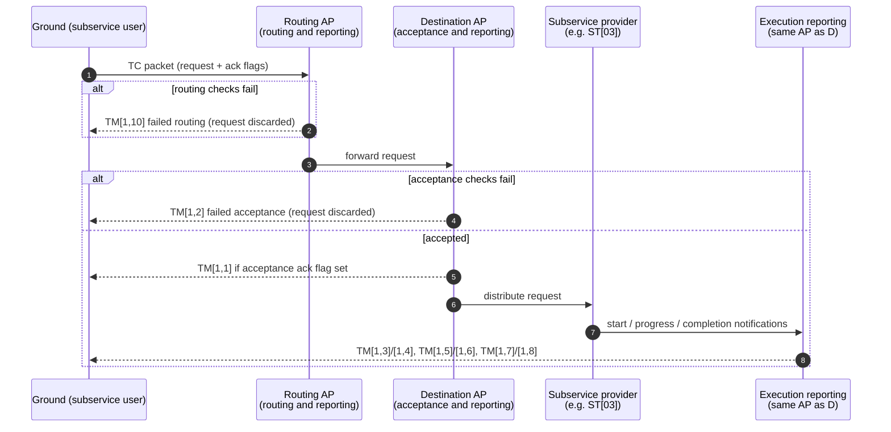
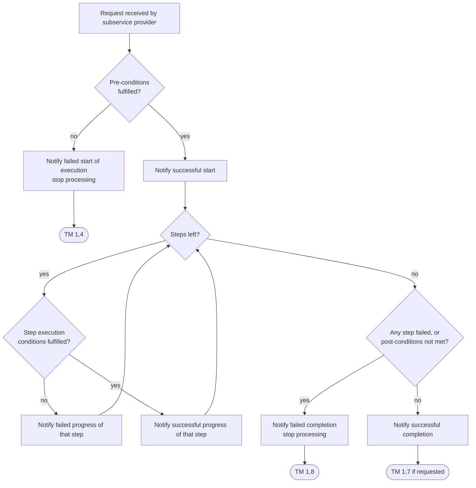
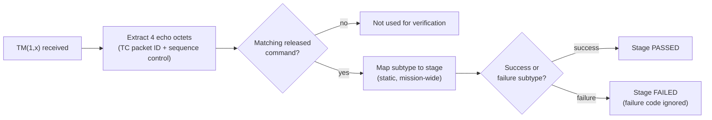

# ST[01] Request verification

When a ground operator sends a telecommand, the first question is always the same: did it arrive, was
it accepted, and did it do what it should? Service type 1 of the
[Packet Utilization Standard](index.md) answers that question. It defines a family of telemetry
reports, TM[1,1] to TM[1,10], with which the on-board software tells the request's originator that a
request passed or failed each stage of its life: routing, acceptance, start of execution, each
progress step, and completion. The service has no requests of its own; it is a supporting service for
the requests of every other standard and mission-specific service.[^c-611][^a-61] This page explains
the model behind the reports, every report layout, the acknowledgement flags that select which
success reports are sent, the capability sets, the differences between PUS-A (2003), PUS-C (2016) and
the 2024 Rev.1 draft, and how the SCOS-2000 [MIB](../../mib/index.md) and the real Solar Orbiter
database turn these reports into command verification.

!!! info "Where this page sits"
    The packet headers that carry the acknowledgement flags and the request identifier are dissected
    on [PUS packet structures](packets.md). The ground-side tables that consume the reports
    ([`cvs`](../../mib/tables/cvs.md), [`cve`](../../mib/tables/cve.md),
    [`cvp`](../../mib/tables/cvp.md)) are covered in depth on
    [Command verification in the MIB](../../mib/command-verification.md). The lower-layer
    acknowledgement of telecommand frames by [COP-1](../../ccsds/cop-1.md) is a separate mechanism that
    works below the packet level.

## 1. At a glance

| Item | Value |
|---|---|
| Service type | 1 (all its packets are of service type 1)[^c-811] |
| PUS-C name | ST[01] request verification[^c-611] |
| PUS-A name | Telecommand verification service[^a-61] |
| Subservice types | routing and reporting; acceptance and reporting; execution reporting[^c-611] |
| Requests (TC) | none |
| Reports (TM) | TM[1,1] to TM[1,8] and TM[1,10]; subtype 9 is not defined[^c-annexc1] |
| Minimum capability (PUS-C) | every report type of a subservice that is present[^c-annexc1] |
| Minimum capability (PUS-A) | (1,1) and (1,2)[^a-64] |

| Message type | Name in ECSS-E-ST-70-41C | Generated | Subservice | Clauses |
|---|---|---|---|---|
| TM[1,1] | successful acceptance verification report | only if requested by the acknowledgement flags | acceptance and reporting | 6.1.4.2, 8.1.2.1 |
| TM[1,2] | failed acceptance verification report | always | acceptance and reporting | 6.1.4.3, 8.1.2.2 |
| TM[1,3] | successful start of execution verification report | only if requested | execution reporting | 6.1.5.1.1, 8.1.2.3 |
| TM[1,4] | failed start of execution verification report | always | execution reporting | 6.1.5.1.2, 8.1.2.4 |
| TM[1,5] | successful progress of execution verification report | only if requested | execution reporting | 6.1.5.2.1, 8.1.2.5 |
| TM[1,6] | failed progress of execution verification report | if the reporting policy says so | execution reporting | 6.1.5.2.2, 8.1.2.6 |
| TM[1,7] | successful completion of execution verification report | only if requested | execution reporting | 6.1.5.3.1, 8.1.2.7 |
| TM[1,8] | failed completion of execution verification report | always | execution reporting | 6.1.5.3.2, 8.1.2.8 |
| TM[1,10] | failed routing verification report | always | routing and reporting | 6.1.3.3, 8.1.2.9 |

[^c-annexc1][^c-ack]

The success/failure split into separate subtypes is deliberate: PUS-A explains that the difference is
operationally so important that each outcome gets its own subtype, so that failure reports can be
selected by type alone, for example for priority routing or storage on board or on the ground.[^a-62]
The [PUS message type catalogue](message-types.md) lists these types next to those of all other services.

## 2. The model: requests, verification stages and reports

### 2.1 Who generates what

PUS-C describes the service in terms of the entities of its service model. A **request** is generated
by a subservice user (for a telecommand, a ground application process) and addressed to exactly one
subservice provider in an on-board **application process**.[^c-541121] Along the way three kinds of
on-board functions look at the request, and each is a different ST[01] subservice:

- the **routing and reporting** subservice, hosted by every application process that routes requests on
  board (for example a central computer forwarding a packet to an instrument), checks that the routing
  can continue and reports routing failures;[^c-6112][^c-61222]
- the **acceptance and reporting** subservice, hosted exactly once by every application process that
  executes requests, checks a request before handing it to the service it addresses;[^c-6113][^c-61223]
- the **execution reporting** subservice, hosted at most once by such an application process, turns the
  execution notifications of the subservice providers into verification reports on their
  behalf.[^c-6114][^c-61223]

A request verification service contains at least one of these subservices; PUS-C explicitly allows the
routing reports of one request to come from the subservices of different request verification services,
for example one attached to the platform and one to a payload.[^c-6121] Acceptance and execution reports can only come from the application process
that executes the request.[^c-6121] Whether an application process implements the execution reporting
subservice is not its own choice: it follows from the operational needs of the services it
hosts.[^c-61223]

Every verification report is addressed to the application process that hosts the subservice user that
generated the request; in packet terms the report's destination is the request's source
identifier.[^c-61221] The Rev.1 draft turns this into an interface rule: the destination ID field of
every service 1 telemetry packet carries the value of the source ID field of the related telecommand
packet.[^r-811]



The diagram is this wiki's rendering of clauses 6.1.3 to 6.1.5 of ECSS-E-ST-70-41C.[^c-613][^c-614][^c-615]

### 2.2 Identifying the request: the request ID

A PUS-C request is uniquely identified by three things: the **source identifier** of the application
process that generated it, the **destination identifier** (the APID of the executing application process
plus the identifier of the system that hosts it) and a **sequence count or request name** produced by the
source.[^c-541121] In a CCSDS telecommand packet the APID goes into the
[Space Packet](../../ccsds/space-packet.md) primary header, the count or name into the packet sequence
control field, and the source identifier into the TC secondary header.[^c-541121]

Every ST[01] report therefore starts with a **request ID** field that is a copy of the first 32 bits of
the telecommand's primary header: the packet ID (version, type, secondary header flag, APID) and the
packet sequence control (sequence flags and count).[^c-812] The request ID alone is not unique: the
standard points out that the missing source identifier is carried in the destination identifier of the
report's own telemetry secondary header.[^c-812] PUS-C also admits that identifiers repeat in practice,
for example during tests or when the 14-bit counter wraps around, so a ground system may need timing
information to keep requests apart over a whole mission.[^c-541121]

<div class="bitfield" data-title="Request ID: first 32 bits of every ST[01] report (copy of the TC primary header)" data-width="16"
     data-fields='[{"n":"Version","b":3,"g":"Packet ID","d":"Packet version number of the verified TC (enumerated, 3 bits)"},{"n":"Type","b":1,"g":"Packet ID","d":"Packet type of the TC: 1 (enumerated)"},{"n":"SH flag","b":1,"g":"Packet ID","d":"Secondary header flag of the TC (Boolean)"},{"n":"APID","b":11,"g":"Packet ID","d":"Application process ID of the TC destination (enumerated)"},{"n":"Seq. flags","b":2,"g":"Packet sequence control","d":"Sequence flags of the TC (enumerated)"},{"n":"Packet sequence count","b":14,"g":"Packet sequence control","d":"Sequence count or packet name of the TC (unsigned integer)"}]'></div>

| Field | Bits | PUS-C type | Meaning |
|---|---|---|---|
| Packet version number | 3 | enumerated | Copied from the verified TC. |
| Packet type | 1 | enumerated | Copied (always 1 for a TC). |
| Secondary header flag | 1 | Boolean | Copied. |
| Application process ID | 11 | enumerated | APID of the destination of the TC. |
| Sequence flags | 2 | enumerated | Copied. |
| Packet sequence count | 14 | unsigned integer | Sequence count or packet name of the TC. |

[^c-812]

PUS-A describes the same 4 octets more loosely, as a 2-octet "Telecommand Packet ID" and a 2-octet
"Packet Sequence Control", both copies of the telecommand header fields.[^a-632] It also requires each
telecommand source to keep a separate sequence count per APID, so that each packet can be traced through
the end-to-end telecommand system, and it states that the packet sequence control is copied into the
acknowledgement as the identifier of the acknowledged packet.[^a-532]

### 2.3 The stages of execution

PUS-C defines an **execution verification profile** for every request type: the pre-conditions checked
before execution starts, the conditions checked during each step, the post-conditions checked at the
end, and the codes to report for each successful or failed condition.[^c-53523] The subservice provider
executes each request in a fixed order:[^c-541123]



[^c-541123]

Two subtleties matter for operations:

- A **successful completion** only means that the provider checked all post-conditions in the profile;
  it does not necessarily mean that the request achieved its purpose. What "success" means depends on
  the profile.[^c-541123]
- A **failed progress** does not stop the request: the provider records it and continues with the next
  step, and the request then ends with a failed completion.[^c-541123] Each progress notification must
  identify the step or instruction it refers to.[^c-53523]

PUS-A uses the same four stages and gives the operational motivation. Acceptance includes the checksum
check and the check that the application process supports the requested service and subservice; start
of execution covers feasibility and validity checks of the parameters against the current state;
progress steps are telecommand-specific; completion closes the profile.[^a-62] Its overview table shows
which reports suit which kind of command, with 10 s of execution time as the example threshold:[^a-443]

| Command | Short execution (under 10 s) | Long execution (over 10 s) |
|---|---|---|
| Immediate | A + Et, or Et alone | A + Es + Ep + Et, or Es + Ep + Et |
| Delayed execution | A + Et | A + Es + Ep + Et |

A = acceptance, Es = execution start, Ep = execution progress (one or more), Et = execution
complete.[^a-443] For an immediate command a separate acceptance report is not needed, and a short command
may only need a single execution report.[^a-443]

PUS-A also limits the scope of the service: it covers telecommands that originate from the ground,
including those stored in an on-board schedule for later release, but not commands generated
autonomously on board, whose invocation is reported through [event reporting](st05-event-reporting.md)
instead.[^a-443b]

## 3. The acknowledgement flags

### 3.1 PUS-C

Every PUS-C request carries four flags that say which **successful** stages the destination
application process must report: acceptance, start of execution, progress of execution and completion
of execution.[^c-ack] Failures are not optional: failed acceptance, failed start and failed completion
are always reported, and failed progress follows the reporting policy described below.[^c-ack] In a
telecommand packet the four flags form the 4-bit acknowledgement flags field of the TC secondary
header, after the 4-bit TC packet PUS version number (2 for PUS-C).[^c-7441]

<div class="bitfield" data-title="PUS-C TC packet secondary header (40 bits plus optional spare)" data-width="8"
     data-fields='[{"n":"TC PUS version","b":4,"v":"0010","d":"2 for ECSS-E-ST-70-41C (1 = PUS-A, 0 = ESA PUS)"},{"n":"Ack: completion","b":1,"g":"Acknowledgement flags","d":"Bit 0 of the flags: report successful completion of execution"},{"n":"Ack: progress","b":1,"g":"Acknowledgement flags","d":"Bit 1: report successful progress of execution"},{"n":"Ack: start","b":1,"g":"Acknowledgement flags","d":"Bit 2: report successful start of execution"},{"n":"Ack: acceptance","b":1,"g":"Acknowledgement flags","d":"Bit 3: report successful acceptance"},{"n":"Service type ID","b":8,"d":"1 to 255"},{"n":"Message subtype ID","b":8,"d":"1 to 255"},{"n":"Source ID","b":16,"d":"Application process user identifier of the request source"}]'></div>

| Bit of the flags field | Requests the report of | Report generated if set | Clause |
|---|---|---|---|
| 0 (first transmitted, most significant) | successful completion of execution | TM[1,7] | 7.4.4.1d.4 |
| 1 | successful progress of execution | TM[1,5] | 7.4.4.1d.3 |
| 2 | successful start of execution | TM[1,3] | 7.4.4.1d.2 |
| 3 (last transmitted, least significant) | successful acceptance | TM[1,1] | 7.4.4.1d.1 |

[^c-7441b]

Read as a 4-bit unsigned number, the field is therefore 8 for "completion only", 1 for "acceptance
only", 9 (`0b1001`) for both, and 15 (`0b1111`) for all four. This numeric reading is what the SCOS-2000
`CCF_ACK` field stores (see section 7).[^icd-ack]

### 3.2 PUS-A

In PUS-A the "Ack" field has the same four bits and the same bit numbering: bit 3 asks for acceptance,
bit 2 for start, bit 1 for progress and bit 0 for completion, and all zeros means that no success
acknowledgements are sent.[^a-533] PUS-A points out a ground-side benefit of the flags: because the
ground knows which stages it asked for, it can report "packets uplinked but not yet verified".[^a-533]
It also notes that acknowledgement packets go only to the source of the original telecommand, so the
ground never receives acknowledgements for commands generated on board.[^a-533b] The PUS-A data field
header differs around the flags: it starts with a 1-bit CCSDS secondary header flag (set to 0) and a 3-bit
PUS version number (set to 1), and its source ID field has a mission-defined length or is
omitted.[^a-533]

!!! note "Why the success reports are selectable"
    PUS-A ties the choice of success reports to the operational scenario of each command instance, for
    example whether there is ground coverage when it executes, and requires the ground system to be
    configured so that it only asks for stages that a given command can actually verify.[^a-443b]

## 4. The subservices in detail

### 4.1 Routing and reporting

The application processes that a routing and reporting subservice serves, and the list of routing
checks it performs, are declared when the spacecraft architecture and the subservice are specified.
Typical checks are that the request is not corrupted, that the destination exists, that it is ready (for
example that the unit that hosts it is switched on) and that routing can continue.[^c-613] For each
request that fails, the subservice generates exactly one failed routing notification, carried in one
TM[1,10] report, and discards the request.[^c-6133] The failure codes, and the auxiliary data attached
to each code, are declared per subservice and are common to all requests it routes.[^c-6133] There is
no successful routing report, and the standard leaves the routing architecture itself
unspecified.[^c-6112]

### 4.2 Acceptance and reporting

The acceptance checks are declared when specifying the subservice; the standard's examples are the
integrity check and the availability of the addressed service.[^c-6141] A request that passes generates
one TM[1,1] report, but only when its acceptance flag asks for it; a request that fails generates one
TM[1,2] report and is discarded.[^c-6142][^c-6143] The failure codes for failed acceptance are declared
per subservice and do not depend on the request.[^c-6143]

PUS-A fixes six standard acceptance failure codes and leaves all other values to the application process
or to the individual command:[^a-632b]

| Code | Meaning (PUS-A) |
|---|---|
| 0 | illegal APID (PAC error) |
| 1 | incomplete or invalid length packet |
| 2 | incorrect checksum |
| 3 | illegal packet type |
| 4 | illegal packet subtype |
| 5 | illegal or inconsistent application data |

PUS-C does not carry this list over: it only requires that each acceptance subservice declares its own
failure codes.[^c-6143] PUS-A also states that failure codes for the later stages are always
mission-specific.[^a-443b]

### 4.3 Execution reporting

The execution reporting subservice does not check anything itself. It receives the notifications that
the subservice providers raise while executing the request (see 2.3) and wraps each of them into a
report:[^c-6114][^c-615]

- a successful start, progress or completion notification becomes a TM[1,3], TM[1,5] or TM[1,7] report
  only if the corresponding acknowledgement flag is set;[^c-615]
- a failed start or failed completion notification always becomes a TM[1,4] or TM[1,8]
  report;[^c-615][^c-6153]
- a failed progress notification becomes a TM[1,6] report only if the application process is configured
  to do so for that request type; otherwise it is folded into the failed completion
  notification.[^c-6152][^c-6153]

That last policy is declared per request type of each subservice, including the standard request types
of clause 6 that do not specify it themselves.[^c-549] [ST[02]](st02-device-access.md) gives an example
of the folded form: a request to distribute physical device commands produces one failed completion
report containing the first failed progress notification of the request.[^c-62712h]

### 4.4 Requests with several instructions

Many PUS-C requests contain an ordered list of instructions (for example "enable the periodic generation
of" several housekeeping reports in one packet).[^c-541121f] Each request type declares whether all
instructions are checked before execution starts; if so, one unsuitable instruction fails the start of
the whole request.[^c-53523c] Requests whose instructions are independent are instead processed
instruction by instruction: the faulty ones produce a failed start of execution notification for that
instruction while the valid ones are executed.[^c-53523c][^c-63341] For the ground this means that a
TM[1,4] for one instruction does not prove that nothing happened.

## 5. Report layouts

All ST[01] reports are telemetry packets of service type 1 whose source data field starts with the request
ID of section 2.2.[^c-811][^c-812] The field types (enumerated, Boolean, unsigned integer, deduced) are the
PUS types described on [PUS parameter types](parameter-types.md); a mission declares the format code, and
hence the size, of each field whose size the standard does not fix.[^c-7231]

| Report | Source data field (in order) | Fixed sizes |
|---|---|---|
| TM[1,1], TM[1,3], TM[1,7] | request ID | 32 bits |
| TM[1,2], TM[1,4], TM[1,8], TM[1,10] | request ID, failure notice (code, data) | request ID only |
| TM[1,5] | request ID, step ID | request ID only |
| TM[1,6] | request ID, step ID, failure notice (code, data) | request ID only |

[^c-812][^c-812b]

| Field | PUS-C type | Size | Meaning |
|---|---|---|---|
| request ID | see 2.2 | 32 bits | Identifies the verified request together with the report's destination ID. |
| step ID | enumerated | declared by the mission | Identifies the step (or instruction) whose progress is reported; values are request-specific. |
| failure notice: code | enumerated | declared by the mission | The reason for the failure, from the list declared for the subservice or request type. |
| failure notice: data | deduced | deduced from the code | Auxiliary data "used to explain the reason"; its presence and structure are deduced from the code. |

[^c-812][^c-812b][^c-6133]

The failure notice illustrates the PUS "deduced" mechanism: the code determines what follows. PUS-A
expresses the same idea as a "Parameters" field of any structure that conforms to its structure rules
and is identified by the code.[^a-632b] The PUS-A step field of TM(1,5) and TM(1,6) is called "Step
Number" and indicates which intermediate step of the execution profile has completed.[^a-634]

A worked example with illustrative bytes shows how compact the reports are. Suppose the ground sends a
request to APID 172 with sequence count 291 (`0x123`). Its first 32 bits are `0x18AC` (version 0, type 1,
secondary header flag 1, APID 172) and `0xC123` (stand-alone flags `11`, count 291). A TM[1,1] for that
request carries exactly the 4 source data octets `18 AC C1 23`; a failed completion report carries the same
4 octets followed by the failure code and its data.[^c-812]

## 6. Capability sets and the 2016 and 2024 changes

### 6.1 Applicability in PUS-C

In PUS-C every capability type, and through it every message type, has an applicability constraint;
the values used in Annex C are minimum, by declaration, implied by, requires and response.[^c-534][^c-annexc1]
For ST[01] all report types are **minimum** within their subservice:
if a mission includes an execution reporting subservice, it supports all six execution reports, and an
acceptance subservice supports both TM[1,1] and TM[1,2].[^c-annexc1] What is tailored is which
subservices exist (6.1.2.1) and, through the acknowledgement flags and the execution verification
profile, which reports a given request actually produces.[^c-6121][^c-53523]

### 6.2 Capability sets in PUS-A

PUS-A organised the same choice as capability sets:[^a-64]

| Set | Subtypes | Rule |
|---|---|---|
| Minimum | 1 (acceptance success), 2 (acceptance failure) | always implemented |
| Additional | 3 and 4 (execution started) | each requires the other |
| Additional | 5 and 6 (execution progress) | each requires the other |
| Additional | 7 and 8 (execution completed) | each requires the other |

The additional capabilities can be chosen per telecommand.[^a-64] PUS-A had no routing report: TM(1,10)
and the routing and reporting subservice are new in PUS-C, as is the formal execution verification
profile.[^a-63][^c-6112]

### 6.3 Differences between issues

| Aspect | PUS-A (ECSS-E-70-41A, 2003) | PUS-C (ECSS-E-ST-70-41C, 2016) | Rev.1 DIR1 draft (2024) |
|---|---|---|---|
| Service name | Telecommand verification | Request verification | Request verification |
| Reports | (1,1) to (1,8) | TM[1,1] to TM[1,8], TM[1,10] | unchanged; execution reports renamed "... of request execution verification report" |
| Routing failure | not defined | TM[1,10] | TM[1,10] |
| Standard failure codes | 0 to 5 for acceptance | none; declared per subservice | none |
| Ack field position | after a 1-bit secondary header flag and a 3-bit PUS version (1) | after a 4-bit PUS version (2) | same as PUS-C |
| Report destination | to the TC source | to the application process of the request source | the destination ID must equal the TC source ID |
| Failed reports in a critical log | not defined | not defined | may be stored in the ST[27] critical packet log, by declaration |

[^a-62][^a-632b][^a-533][^c-annexc1][^c-7441][^r-811][^r-names][^r-cpl]

The full comparison of the two issues is on [PUS-A vs PUS-C](pus-a-vs-pus-c.md).

## 7. How SCOS-2000 uses service 1

### 7.1 The verifier

SCOS-2000's **verifier** uses the incoming type 1 reports to close the report-based verification stages of
released commands. It extracts the 4 octets that echo the telecommand packet ID and sequence control from
each service 1 report and uses them to find the command instance the report refers to.[^icd-s1] The ICD
lists the constraints this imposes on a mission:[^icd-s1]

- the 4 echo octets must sit at the same position in every type 1 packet;
- the mapping from subtypes to verification stages is a static configuration that applies to every
  command of the mission (typically subtype 1 closes the acceptance stage successfully);
- progress reports TM(1,5) and TM(1,6) are processed, but only for progress stage 0; further progress
  stages can only be verified through telemetry parameters;
- the failure code in negative reports is ignored: only the subtype decides that the stage failed.



The flowchart is this wiki's summary of ICD 7.0 Appendix C §3.1.[^icd-s1] The section numbers that the
appendix quotes for the PUS services (section 6 for service 1, 7 for service 2, 8 for service 3) match the
clause numbers of these services in ECSS-E-70-41A, although the appendix cites them as "[AD-5]", which the
ICD's own list of applicable documents assigns to a different document.[^icd-s1][^a-61][^icd-ad]

### 7.2 The database side

Three groups of MIB fields drive this behaviour:

| Item | Table / field | Role |
|---|---|---|
| Ack flags of a command | [`ccf`](../../mib/tables/ccf.md).`CCF_ACK` | Default value 0 to 15 of the complete Ack field; can be changed when loading a command (from SCOS-2000 R4.0).[^icd-ack] |
| Position of the Ack field | [`pcdf`](../../mib/tables/pcdf.md) element of type `K` | Header element whose value is taken from `CCF_ACK`.[^icd-pcdf] |
| Verification stages | [`cvs`](../../mib/tables/cvs.md) | `CVS_TYPE` `A` (acceptance), `S` (start), `0`-`9` (progress step), `C` (completion); `CVS_SOURCE` `R` (report) or `V` (parameter values).[^icd-cvs] |
| Stage window | `cvs`.`CVS_START`, `CVS_INTERVAL`, `CVS_UNCERTAINTY` | Delay in seconds after release (or execution, for time-tagged commands) before the window opens; length in seconds of the sampling interval used to calculate the overall window; optional specific window that replaces the TC SPACON default (`-1` keeps the default).[^icd-cvs2] |
| Parameter checks | [`cve`](../../mib/tables/cve.md) | Expected value and tolerance of monitoring parameters for `V` stages.[^icd-cve] |
| Profile | [`cvp`](../../mib/tables/cvp.md) | Associates commands with stages, at most one stage of each type per command.[^icd-cvp] |

A report-based progress stage can only be of type `0`, which is how the verifier limitation shows up in the
data.[^icd-cvs2] Unsetting an acknowledgement flag when loading a command disables the matching report
stage, but it cannot add a stage that is not in `cvp`; every command for which the spacecraft generates
service 1 reports must therefore be given the corresponding stages in the database.[^icd-cvp] The stage
statuses, the window arithmetic and interlocks are explained on
[Command verification in the MIB](../../mib/command-verification.md).

## 8. Solar Orbiter

### 8.1 The tailoring

Solar Orbiter's TM/TC ICD applies PUS-A (ECSS-E-70-41A is its applicable document AD1)[^solo-ad1] and
restricts service 1 to two stages, acceptance and completion. Only four Ack values are allowed: `0000` (no
success reports), `0001` (acceptance success or failure, TM(1,1) or (1,2)), `1000` (execution success or
failure, TM(1,7) or (1,8)) and `1001` (both). The start and progress bits are "not used" and set to zero;
the value for each command is coded in the spacecraft database.[^solo-s1][^solo-ack] (The ICD text introduces
these bit settings with the words "defined for BepiColombo", although the document is the Solar Orbiter
ICD.)[^solo-ack] The mission's service list contains only
subtypes 1, 2, 7 and 8 for service 1, all four marked "M", i.e. part of the minimum capability set that
every user must implement.[^solo-list]

The central software (CSW) applies two groups of checks to every incoming packet, whatever its Ack
flags:[^solo-s1b]

| Group | Checks | Failure report |
|---|---|---|
| Static acceptance checks | constant header fields (version, type, data field header flag, sequence flags, PUS version); packet length field between 5 and 241; length against received bytes; packet error control; process ID against the allocation; packet category 12 for TCs; service type and subtype supported by the addressed process | TM(1,2) |
| Consistency checks (addressed process only) | actual length against the length expected for the type and subtype; parameters defined, in range and of the expected type | TM(1,8) |

Consistency checks only start after all static checks pass, and execution only starts after all
consistency checks pass; type-specific success checks (for example reading back written hardware data)
may follow before the completion report.[^solo-s1b] All four Solar Orbiter report layouts start with the
2-octet TC packet ID and the 2-octet TC packet sequence control; the failure reports add a 2-octet Failure
ID and optional parameters of any size.[^solo-s1rep]

<div class="bitfield" data-title="Solar Orbiter TM(1,2) / TM(1,8) source data (parameters shown as 16 bits)" data-width="16"
     data-fields='[{"n":"TC packet ID","b":16,"d":"16-bit copy of the packet ID of the TC being reported on"},{"n":"TC packet sequence control","b":16,"d":"16-bit copy of the sequence control of the TC"},{"n":"Failure ID","b":16,"d":"Failure identification code, see Annex 9 of the ICD"},{"n":"Parameters (any size)","b":16,"d":"Optional complementary information for this failure code; length depends on the code"}]'></div>

Annex 9 of the ICD allocates the **standard Failure IDs** used by the CSW (and optionally by other
software) together with their parameters:[^solo-fid]

| Failure ID | Meaning | Parameters |
|---|---|---|
| 0 | illegal APID | type, subtype of the received TC (1 octet each) |
| 1 | incomplete or invalid length | type, subtype |
| 2 | incorrect checksum (CRC) | type, subtype, received checksum (2 octets), computed checksum (2 octets) |
| 3 | illegal packet type | type, subtype |
| 4 | illegal packet subtype | type, subtype |
| 5 | illegal or inconsistent application data field | type, subtype, position of the first inconsistent parameter (1 octet), its received value (1 octet) |
| 6 | illegal segment sequence flag | type, subtype, two application-specific 2-octet values |
| 7 | illegal MAP ID | type, subtype |

Codes 0 to 5 are the PUS-A acceptance codes, extended by two link-layer codes.[^solo-fid][^a-632b] The
type and subtype parameters are set to zero when they were not received.[^solo-fid] Table 14.3-1
reserves 0 to 500 for standard codes and gives each user a range: 1000-1999 SSMM, 2000-2999 star trackers,
4000-9999 OBCPs, 10000-39999 CSW (10000-19999 command and control, 20000-29999 AOCS, 30000-39999 other
CSW processes), 40000-59999 payload (one block of 1,000 codes per instrument: EPD 40000, MAG 41000, RPW
42000, SWA 43000, SPICE 44000, PHI 45000, EUI 46000, METIS 47000, STIX 48000, SoloHI 49000; 50000-59999
spare) and 60000-64999 the ground (60000-63999 SCOEs, 64000-64999 the ESOC mission control
system).[^solo-frange]

### 8.2 What the MIB contains

The September 2025 Solar Orbiter MIB defines service 1 reports for 29 APIDs, all of packet category 1
(the low 4 bits of the APID), which the ICD reserves for service 1 acknowledgements:[^mib-s1][^solo-cat]

| Report | Packets in `pid` | APIDs | Additional identification (`pic`) |
|---|---|---|---|
| TM(1,1) acceptance success | 29 | 29 | none |
| TM(1,2) acceptance failure | 274 | 29 | Failure ID: byte offset 20, 16 bits |
| TM(1,7) completion success | 29 | 29 | none |
| TM(1,8) completion failure | 1,477 | 29 | Failure ID: byte offset 20, 16 bits |

[^mib-s1]

Byte 20 is where the Failure ID sits: 16 octets of PUS-A TM headers, then the 4 echo octets. Because of
this [`pic`](../../mib/tables/pic.md) entry the SCOS-2000 packetiser treats every failure code as a
separate packet with its own SPID and description, while the verifier itself still ignores the code
(section 7.1).[^mib-s1][^icd-s1] The April 2020 release had the same structure with 273 TM(1,2) and 1,457
TM(1,8) packets.[^mib2020-s1] The SWA instrument database follows the same convention for its own
reports, with the same `pic` entries for (1,2) and (1,8) at offset 20.[^swa-s1]

For the central software's DMS application (APID 161, process ID 10) the codes are grouped in a way
that suggests one block per service:[^mib-s1]

| Code (hex) | Report | Example description in `pid` |
|---|---|---|
| 256 (`0x0100`) to 271 (`0x010F`) | TM(1,2) | 256 "Illegal CCSDS packet version number", 259 "Unknown Process Identifier", 268 "Unknown service type", 271 "Calculated checksum not equal to received checksum" |
| 262, 264 (`0x0106`, `0x0108`) | TM(1,8) | "Number of parameters is out of the allowed range", "The actual TC length is different from the expected TC length" |
| 512 (`0x0200`) to 520 | TM(1,8) | "At least one CPDU command failed", "Wrong MilBus 1553 bus ID or bus coupler ID" |
| 768 (`0x0300`) to 785 | TM(1,8) | 768 "SID is out of the allowed range", 778 "SID is not defined", 781 "HK/Diagnostic structure exceeds TM size" |
| 1280 (`0x0500`) to 1300 | TM(1,8) | "Selected EID does not exist", "A CEL dump is still ongoing" |

!!! warning "Inference"
    The high octet of the CSW codes matches the service whose requests they refer to (`0x01` generic
    packet checks, `0x02` device commands, `0x03` housekeeping, `0x05` event reporting, and so on, for
    example `0x12` OBCP loading and `0x13` event-action detection lists; high octets from `0x80` = 128
    upwards appear to belong to private services). This is deduced from the descriptions in `pid`; the
    ICD does not describe the scheme. As a result, of the 289 distinct CSW codes in the MIB (256 to 37,000
    across the six CSW report APIDs), 194 lie below 10000, outside the 10000-39999 CSW range of ICD Table
    14.3-1, and the 95 that fall inside it (32769 = `0x8001` and above) follow the same high-octet pattern
    rather than the table's sub-ranges. By contrast, every code above 500 of the SSMM, star tracker and
    instrument APIDs lies in its allocated range (the EGSE APID 1937 uses 64997 to 64999, in the ground
    range). A reviewer should treat the table as a design intent for the CSW rather than a description of
    its codes.

A real report from the MIB shows the layout of a failure packet. SPID
[14028](../../explorer/index.md#/solo/packet/14028), TM(1,2) code 271 "Calculated checksum not equal to
received checksum" on APID 161, is decoded through the [`plf`](../../mib/tables/plf.md) table as the TC
packet ID at byte 16, the TC sequence control at byte 18 (both PTC 3, PFC 12), the Failure ID at byte 20
(PTC 2, PFC 16) and two 32-bit fields "Received Checksum" and "Calculated Checksum" at bytes 22 and
26.[^mib-s1plf] This differs from the parameters that Annex 9 lists for the standard code 2 (1-octet type
and subtype, then 2-octet received and computed checksums): the DMS application defines no code 2 in the
MIB (its TM(1,2) codes are 256 to 271) and reports a checksum error as code 271 with this different
layout.[^solo-fid][^mib-s1][^mib-s1plf] Success packets such as SPID [14181](../../explorer/index.md#/solo/packet/14181) contain
only the two echo fields.[^mib-s1plf] See the [APID 161 page of the explorer](../../explorer/index.md#/solo/apid/161)
for the full list.

### 8.3 Verification profiles of the commands

Because service 1 has no requests, no command in [`ccf`](../../mib/tables/ccf.md) has `CCF_TYPE` = 1, in
the 2025 and 2020 releases and in the SWA database alike.[^mib-s1prof][^mib2020-s1][^swa-s1] The command
definitions agree with the tailoring. Grouping the 5,454 commands of
[`ccf`](../../mib/tables/ccf.md) by their default Ack value and by the stages attached to them in
`cvp` gives:[^mib-s1prof]

| `CCF_ACK` | Meaning | Stages (`CVS_TYPE`/`CVS_SOURCE`) | Commands |
|---|---|---|---|
| 9 (`0b1001`) | acceptance + completion reports | `A`/`R` + `C`/`R` | 5,225 |
| 1 (`0b0001`) | acceptance report only | `A`/`R` + `C`/`V` | 78 |
| null | no PUS data field header | `C`/`V` only (89) or none (41) | 130 |
| 0 | no success reports | none | 21 |

[^mib-s1prof]

The 78 commands with Ack 1 are all TC(2,128) MIL-STD-1553 commands to the two PCDUs (39 each for PCDU A
and B, names starting `ZPW0` and `ZPW1`), whose
completion is verified by checking a telemetry parameter rather than by a TM(1,7)
([ST[02]](st02-device-access.md) has a worked example). The commands with a null Ack are the 125 CPDU
commands of header `HPC1_TC` and the five commands of header `NO_HDR` ("FARM UNLOCK directive",
"SETV( R ) Directive", "PAC RESET directive", "Reinit TTR" and "CPDU TC_Only").[^mib-s1prof] Only
acceptance and completion stages exist in the whole `cvs` table: 16 report-based acceptance stages, 23
report-based completion stages and 167 parameter-based completion stages.[^mib-s1prof]

### 8.4 Worked example: enabling a housekeeping report

The command [`ZCD00305`](../../explorer/index.md#/solo/command/ZCD00305) "Enable HK Para Rpt Gen" is
TC(3,5) to APID 172 (process ID 10, category 12) with one 8-bit parameter, the housekeeping SID. Its
`CCF_ACK` is 9 and its profile is stage [14001](../../explorer/index.md#/solo/verif/14001) (acceptance,
report-based, `CVS_START` 0 s, `CVS_INTERVAL` 20 s) plus stage 14007 (completion, report-based, same
timing), both without a specific `CVS_UNCERTAINTY` window.[^mib-zcd][^icd-cvs2]

1. SCOS-2000 builds the header `NOM_TC`, whose [`pcdf`](../../mib/tables/pcdf.md) definition places a
   4-bit `K` element at bit 52, and fills it with 9 (`0b1001`).[^mib-zcd][^icd-pcdf]
2. On board, the DMS application checks the packet. If, for example, the checksum is wrong, it sends
   TM(1,2) with Failure ID 271 from APID 161; the verifier sets stage 14001 to failed, and the packetiser
   files the report as SPID 14028 with its own description.[^mib-s1][^icd-s1]
3. Otherwise it sends TM(1,1) (SPID 14181) because bit 3 is set, and stage 14001 passes.[^mib-s1][^solo-s1]
4. If the SID is unknown, execution fails and a TM(1,8) with code 778 "SID is not defined" (SPID
   [14149](../../explorer/index.md#/solo/packet/14149)) closes stage 14007 as failed; otherwise TM(1,7)
   (SPID 14182) closes it as passed.[^mib-s1]

With the illustrative header of section 5 (sequence count 291), the TM(1,1) source data would be
`18 AC C1 23` and the TM(1,8) source data `18 AC C1 23 03 0A`, followed by any parameters of code 778.
The bytes are constructed for this explanation; the codes and SPIDs are real MIB entries.[^mib-s1]

??? example "SQL used"
    ```sql
    -- solo-2025-09-16.sqlite (MIB__20250916M25925PFMS001_SOL)
    -- service 1 packets per subtype and APID count
    SELECT PID_STYPE, COUNT(*), COUNT(DISTINCT PID_APID) FROM pid
     WHERE PID_TYPE = '1' GROUP BY PID_STYPE;
    SELECT DISTINCT CAST(PID_APID AS INT) % 16 FROM pid WHERE PID_TYPE = '1';  -- packet category
    SELECT * FROM pic WHERE PIC_TYPE = '1';
    -- failure codes of the DMS application
    SELECT PID_STYPE, PID_PI1_VAL, PID_SPID, PID_DESCR FROM pid
     WHERE PID_TYPE = '1' AND PID_APID = '161' ORDER BY CAST(PID_PI1_VAL AS INT);
    SELECT PID_APID, PID_STYPE, MIN(CAST(PID_PI1_VAL AS INT)), MAX(CAST(PID_PI1_VAL AS INT))
      FROM pid WHERE PID_TYPE = '1' AND PID_STYPE IN ('2','8') GROUP BY 1, 2;
    -- layout of a failure report
    SELECT p.PLF_NAME, p.PLF_OFFBY, c.PCF_DESCR, c.PCF_PTC, c.PCF_PFC
      FROM plf p JOIN pcf c ON c.PCF_NAME = p.PLF_NAME WHERE p.PLF_SPID = '14028';
    -- Ack values and verification profiles (cvs/cvp columns are COL1..COLn in ICD order)
    SELECT COUNT(*) FROM ccf WHERE CCF_TYPE = '1';  -- 0 in all three databases
    SELECT CCF_ACK, COUNT(*) FROM ccf GROUP BY 1;
    SELECT IFNULL(c.CCF_ACK,'NULL'), prof, COUNT(*) FROM (
      SELECT c.*, (SELECT GROUP_CONCAT(t,'+') FROM (SELECT s.COL2||s.COL3 t FROM cvp v
              JOIN cvs s ON s.COL1 = v.COL3 WHERE v.COL1 = c.CCF_CNAME ORDER BY 1)) prof
        FROM ccf c) c GROUP BY 1, 2;
    SELECT COL2, COL3, COUNT(*) FROM cvs GROUP BY 1, 2;
    SELECT * FROM pcdf WHERE PCDF_TCNAME = 'NOM_TC' ORDER BY CAST(PCDF_BIT AS INT);
    -- the worked example
    SELECT CCF_CNAME, CCF_TYPE, CCF_STYPE, CCF_APID, CCF_ACK FROM ccf WHERE CCF_CNAME = 'ZCD00305';
    SELECT s.* FROM cvp v JOIN cvs s ON s.COL1 = v.COL3 WHERE v.COL1 = 'ZCD00305';
    -- solo-2020-04-16.sqlite and swa-idb.sqlite: same pid and pic queries
    ```

## 9. Design notes and pitfalls

- **Verification is end to end, not link level.** [COP-1](../../ccsds/cop-1.md) confirms that a TC
  frame reached the on-board decoder; only ST[01] says what the application process did with the
  packet. A command can be "transferred" at frame level and still fail acceptance.[^c-611]
- **The request ID needs context.** Two requests from different sources can carry the same 32-bit
  request ID; the source is in the report's secondary header destination ID.[^c-812] The Solar Orbiter
  ICD likewise keeps the TC sequence counter per APID and source ID.[^solo-seq]
- **Absence of a success report is not a failure.** Success reports exist only if they were requested;
  a ground system has to know the Ack value of each instance, which is why SCOS-2000 disables the
  report stages whose flags were unset at load time.[^c-ack][^icd-cvp]
- **Failure codes are mission data.** PUS-C defines no standard codes, so their meaning lives in the
  mission ICD and in the MIB. On Solar Orbiter they become separate packet definitions.[^c-6143][^mib-s1]

!!! warning "Inference"
    Defining one SPID per failure code, as Solar Orbiter does, gives operators a readable reason for each
    failure in the packet history even though the SCOS-2000 verifier ignores the code. The cost is a
    large number of near-identical packet definitions (1,751 of the 1,809 service 1 packets in the 2025
    release are failure packets). This trade-off is this wiki's reading of the data; no source discusses it.

## Related pages

- [PUS packet structures](packets.md) - the TC and TM headers that carry the Ack flags and request IDs.
- [Command verification in the MIB](../../mib/command-verification.md) - `cvs`, `cve`, `cvp`, statuses and windows.
- [Commanding in the MIB](../../mib/commanding.md) - how `CCF_ACK` and `pcdf` build the header.
- [Uplink: from operator command to on-board execution](../../overview/uplink.md) - the whole chain.
- [How Solar Orbiter uses PUS](../../missions/solar-orbiter/pus-usage.md) and [The Solar Orbiter MIB](../../missions/solar-orbiter/mib.md).
- [ST[02] Device access](st02-device-access.md) and [ST[03] Housekeeping](st03-housekeeping.md).
- Instrument failure codes: [STIX](../../missions/solar-orbiter/stix.md#failure-codes-and-event-ids-against-the-mission-allocation) and the [SWA DPU verification codes](../../missions/solar-orbiter/instrument-interfaces.md#verification-tarf-and-tecf-codes).
- [Operations preparation: command verification beyond the database](../../scos2000/operations-preparation.md#command-verification-beyond-the-database).

[^c-611]: [ECSS-E-ST-70-41C, Space engineering - Telemetry and telecommand packet utilization](../../library/ecss-e-st-70-41c-15april2016.md), §6.1.1.1, PDF p. 55.
[^c-6112]: [ECSS-E-ST-70-41C](../../library/ecss-e-st-70-41c-15april2016.md), §6.1.1.2, PDF pp. 55-56.
[^c-6113]: [ECSS-E-ST-70-41C](../../library/ecss-e-st-70-41c-15april2016.md), §6.1.1.3, PDF p. 56.
[^c-6114]: [ECSS-E-ST-70-41C](../../library/ecss-e-st-70-41c-15april2016.md), §6.1.1.4, PDF p. 56.
[^c-6121]: [ECSS-E-ST-70-41C](../../library/ecss-e-st-70-41c-15april2016.md), §6.1.2.1a and Notes 1-4, PDF pp. 56-57.
[^c-61221]: [ECSS-E-ST-70-41C](../../library/ecss-e-st-70-41c-15april2016.md), §6.1.2.2.1a, PDF p. 57.
[^c-61222]: [ECSS-E-ST-70-41C](../../library/ecss-e-st-70-41c-15april2016.md), §6.1.2.2.2a, PDF p. 57.
[^c-61223]: [ECSS-E-ST-70-41C](../../library/ecss-e-st-70-41c-15april2016.md), §6.1.2.2.3a and Note, PDF p. 57.
[^c-613]: [ECSS-E-ST-70-41C](../../library/ecss-e-st-70-41c-15april2016.md), §6.1.3.1-6.1.3.2, PDF p. 58.
[^c-6133]: [ECSS-E-ST-70-41C](../../library/ecss-e-st-70-41c-15april2016.md), §6.1.3.3a-f and §6.1.3.4, PDF pp. 58-59.
[^c-614]: [ECSS-E-ST-70-41C](../../library/ecss-e-st-70-41c-15april2016.md), §6.1.4, PDF pp. 59-61.
[^c-6141]: [ECSS-E-ST-70-41C](../../library/ecss-e-st-70-41c-15april2016.md), §6.1.4.1a-c, PDF p. 59.
[^c-6142]: [ECSS-E-ST-70-41C](../../library/ecss-e-st-70-41c-15april2016.md), §6.1.4.2a-d, PDF pp. 59-60.
[^c-6143]: [ECSS-E-ST-70-41C](../../library/ecss-e-st-70-41c-15april2016.md), §6.1.4.3a-f, PDF p. 60.
[^c-615]: [ECSS-E-ST-70-41C](../../library/ecss-e-st-70-41c-15april2016.md), §6.1.5.1-6.1.5.2.1, PDF pp. 61-62.
[^c-6152]: [ECSS-E-ST-70-41C](../../library/ecss-e-st-70-41c-15april2016.md), §6.1.5.2.2b and Note 2, PDF p. 62.
[^c-6153]: [ECSS-E-ST-70-41C](../../library/ecss-e-st-70-41c-15april2016.md), §6.1.5.3.1-6.1.5.3.2c, PDF pp. 62-63.
[^c-549]: [ECSS-E-ST-70-41C](../../library/ecss-e-st-70-41c-15april2016.md), §5.4.9a and Note, PDF p. 47.
[^c-534]: [ECSS-E-ST-70-41C](../../library/ecss-e-st-70-41c-15april2016.md), §5.3.4b and Note, PDF pp. 32-33.
[^c-53523]: [ECSS-E-ST-70-41C](../../library/ecss-e-st-70-41c-15april2016.md), §5.3.5.2.3a-h, PDF pp. 34-36.
[^c-53523c]: [ECSS-E-ST-70-41C](../../library/ecss-e-st-70-41c-15april2016.md), §5.3.5.2.3c and Notes 1-3, PDF p. 35.
[^c-541121]: [ECSS-E-ST-70-41C](../../library/ecss-e-st-70-41c-15april2016.md), §5.4.11.2.1a-c and Notes 1-4, PDF pp. 48-49.
[^c-541121f]: [ECSS-E-ST-70-41C](../../library/ecss-e-st-70-41c-15april2016.md), §5.4.11.2.1e-f, PDF p. 49.
[^c-ack]: [ECSS-E-ST-70-41C](../../library/ecss-e-st-70-41c-15april2016.md), §5.4.11.2.2a and Notes 1-4, PDF pp. 50-51.
[^c-541123]: [ECSS-E-ST-70-41C](../../library/ecss-e-st-70-41c-15april2016.md), §5.4.11.2.3a and Note, PDF pp. 51-52.
[^c-63341]: [ECSS-E-ST-70-41C](../../library/ecss-e-st-70-41c-15april2016.md), §6.3.3.4.1d-g (example of instruction-level rejection), PDF p. 83.
[^c-62712h]: [ECSS-E-ST-70-41C](../../library/ecss-e-st-70-41c-15april2016.md), §6.2.7.1.2g-h, PDF p. 71.
[^c-7231]: [ECSS-E-ST-70-41C](../../library/ecss-e-st-70-41c-15april2016.md), §7.2.1 and §7.3.1a-c, PDF pp. 427-428.
[^c-7441]: [ECSS-E-ST-70-41C](../../library/ecss-e-st-70-41c-15april2016.md), §7.4.4.1a-c, Figure 7-9, PDF p. 442.
[^c-7441b]: [ECSS-E-ST-70-41C](../../library/ecss-e-st-70-41c-15april2016.md), §7.4.4.1d, PDF p. 443; bit numbering (bit 0 is the most significant, leftmost bit) in §7.2.2, PDF p. 428.
[^c-811]: [ECSS-E-ST-70-41C](../../library/ecss-e-st-70-41c-15april2016.md), §8.1.1a, PDF p. 445.
[^c-812]: [ECSS-E-ST-70-41C](../../library/ecss-e-st-70-41c-15april2016.md), §8.1.2.1-8.1.2.4, Figures 8-1 to 8-4 and their Notes, PDF pp. 445-447.
[^c-812b]: [ECSS-E-ST-70-41C](../../library/ecss-e-st-70-41c-15april2016.md), §8.1.2.5-8.1.2.9, Figures 8-5 to 8-9, PDF pp. 447-450.
[^c-annexc1]: [ECSS-E-ST-70-41C](../../library/ecss-e-st-70-41c-15april2016.md), Annex C.1 and C.2.1, Tables C-1 to C-3, PDF pp. 628-629 (applicability values of other services in Tables C-4 to C-7, PDF pp. 629-632).
[^a-61]: [ECSS-E-70-41A, Ground systems and operations - Telemetry and telecommand packet utilization](../../library/ecss-e-70-41a-30jan2003-pus.md), §6.1, PDF p. 51.
[^a-62]: [ECSS-E-70-41A](../../library/ecss-e-70-41a-30jan2003-pus.md), §6.2, PDF pp. 51-52.
[^a-63]: [ECSS-E-70-41A](../../library/ecss-e-70-41a-30jan2003-pus.md), §6.3, PDF pp. 52-54.
[^a-632]: [ECSS-E-70-41A](../../library/ecss-e-70-41a-30jan2003-pus.md), §6.3.2, report (1,1), PDF p. 52.
[^a-632b]: [ECSS-E-70-41A](../../library/ecss-e-70-41a-30jan2003-pus.md), §6.3.2, report (1,2) and standard codes, PDF p. 53.
[^a-634]: [ECSS-E-70-41A](../../library/ecss-e-70-41a-30jan2003-pus.md), §6.3.4, reports (1,5) and (1,6), PDF p. 54.
[^a-64]: [ECSS-E-70-41A](../../library/ecss-e-70-41a-30jan2003-pus.md), §6.4, Tables 3 and 4, PDF p. 55.
[^a-443]: [ECSS-E-70-41A](../../library/ecss-e-70-41a-30jan2003-pus.md), §4.4.3, Figure 1 and Table 1, PDF p. 27.
[^a-443b]: [ECSS-E-70-41A](../../library/ecss-e-70-41a-30jan2003-pus.md), §4.4.3 (continued), PDF p. 28.
[^a-532]: [ECSS-E-70-41A](../../library/ecss-e-70-41a-30jan2003-pus.md), §5.3.2, sequence count, PDF p. 43.
[^a-533]: [ECSS-E-70-41A](../../library/ecss-e-70-41a-30jan2003-pus.md), §5.3.3, data field header, Ack field and source ID, PDF pp. 44-45.
[^a-533b]: [ECSS-E-70-41A](../../library/ecss-e-70-41a-30jan2003-pus.md), §5.3.3, Ack field Note, PDF p. 45.
[^r-811]: [ECSS-E-ST-70-41C Rev.1 DIR1 (draft, 11 December 2024)](../../library/ecss-e-st-70-41c-rev1-dir1.md), §8.1.1b, PDF p. 495.
[^r-names]: [ECSS-E-ST-70-41C Rev.1 DIR1](../../library/ecss-e-st-70-41c-rev1-dir1.md), §6.1.5 (report names), PDF pp. 62-64, and §8.1.2, PDF pp. 495-500.
[^r-cpl]: [ECSS-E-ST-70-41C Rev.1 DIR1](../../library/ecss-e-st-70-41c-rev1-dir1.md), §6.27.4.1c and Note, PDF p. 469.
[^icd-s1]: [SCOS-2000 Database Import ICD, issue 7.0](../../library/icd-7-0-final.md), Appendix C §3.1 "Service 1: Telecommand verification service", PDF p. 237.
[^icd-ad]: [SCOS-2000 Database Import ICD 7.0](../../library/icd-7-0-final.md), §1.4.1 "Applicable documents", PDF p. 18.
[^icd-ack]: [SCOS-2000 Database Import ICD 7.0](../../library/icd-7-0-final.md), §3.3.3.2.1, field CCF_ACK, PDF p. 140.
[^icd-pcdf]: [SCOS-2000 Database Import ICD 7.0](../../library/icd-7-0-final.md), §3.3.3.1.3, field PCDF_TYPE, PDF p. 130.
[^icd-cvs]: [SCOS-2000 Database Import ICD 7.0](../../library/icd-7-0-final.md), §3.3.3.4 and §3.3.3.4.1, fields CVS_ID and CVS_TYPE, PDF pp. 191-192.
[^icd-cvs2]: [SCOS-2000 Database Import ICD 7.0](../../library/icd-7-0-final.md), §3.3.3.4.1, fields CVS_SOURCE to CVS_UNCERTAINTY, PDF pp. 193-194.
[^icd-cve]: [SCOS-2000 Database Import ICD 7.0](../../library/icd-7-0-final.md), §3.3.3.4.2, PDF pp. 194-199.
[^icd-cvp]: [SCOS-2000 Database Import ICD 7.0](../../library/icd-7-0-final.md), §3.3.3.4.3, PDF pp. 199-200.
[^solo-s1]: [SOL.S.ASTR.TN.00079 Issue 7, Solar Orbiter TM-TC and Packet Structure ICD](../../library/sol-s-astr-tn-00079-07.md), §5.2 "Service 1: Telecommand Verification", objective and description, PDF p. 40.
[^solo-s1b]: [SOL.S.ASTR.TN.00079 Issue 7](../../library/sol-s-astr-tn-00079-07.md), §5.2 Notes (static and consistency checks), PDF pp. 40-41.
[^solo-ack]: [SOL.S.ASTR.TN.00079 Issue 7](../../library/sol-s-astr-tn-00079-07.md), §3.2.2.1 (PUS-55, Ack), PDF p. 17.
[^solo-ad1]: [SOL.S.ASTR.TN.00079 Issue 7](../../library/sol-s-astr-tn-00079-07.md), §2.1 Applicable Documents (AD1 = ECSS-E-70-41A, 30 January 2003), PDF p. 13.
[^solo-s1rep]: [SOL.S.ASTR.TN.00079 Issue 7](../../library/sol-s-astr-tn-00079-07.md), §5.2.1-5.2.4, TM(1,1), (1,2), (1,7), (1,8), PDF pp. 41-44.
[^solo-list]: [SOL.S.ASTR.TN.00079 Issue 7](../../library/sol-s-astr-tn-00079-07.md), §5.1, Table 5.1-1 and its mnemonics, PDF p. 31.
[^solo-seq]: [SOL.S.ASTR.TN.00079 Issue 7](../../library/sol-s-astr-tn-00079-07.md), §3.2.1.2 (PUS-39), PDF p. 16.
[^solo-fid]: [SOL.S.ASTR.TN.00079 Issue 7](../../library/sol-s-astr-tn-00079-07.md), Annex 9 §14.1, Figure 14.1-1, PDF pp. 278-279.
[^solo-frange]: [SOL.S.ASTR.TN.00079 Issue 7](../../library/sol-s-astr-tn-00079-07.md), Annex 9 §14.3, Table 14.3-1, PDF pp. 279-280.
[^solo-cat]: [SOL.S.ASTR.TN.00079 Issue 7](../../library/sol-s-astr-tn-00079-07.md), Annex 8 §13.1, Figure 13.1-1 and note PUS-14184, PDF pp. 272 and 275.
[^mib-s1]: [Solar Orbiter MIB release MIB__20250916M25925PFMS001_SOL](../../library/mib-20250916m25925pfms001-sol.md), tables pid and pic (PID_TYPE = 1), queried by this wiki.
[^mib-s1plf]: [Solar Orbiter MIB release MIB__20250916M25925PFMS001_SOL](../../library/mib-20250916m25925pfms001-sol.md), tables plf and pcf, SPIDs 14028 and 14181, queried by this wiki.
[^mib-s1prof]: [Solar Orbiter MIB release MIB__20250916M25925PFMS001_SOL](../../library/mib-20250916m25925pfms001-sol.md), tables ccf, cvp and cvs, queried by this wiki.
[^mib-zcd]: [Solar Orbiter MIB release MIB__20250916M25925PFMS001_SOL](../../library/mib-20250916m25925pfms001-sol.md), tables ccf, cdf, cvp, cvs and pcdf, command ZCD00305 and header NOM_TC, queried by this wiki.
[^mib2020-s1]: [Solar Orbiter MIB release MIB__20200416M10720PFMS001_SOL](../../library/mib-20200416m10720pfms001-sol.md), tables pid (PID_TYPE = 1) and ccf (CCF_TYPE = 1), queried by this wiki.
[^swa-s1]: [Solar Orbiter SWA instrument database (ASCII)](../../library/swa-idb-ascii.md), tables pid, pic and ccf, queried by this wiki.
