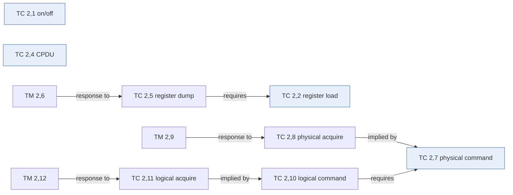
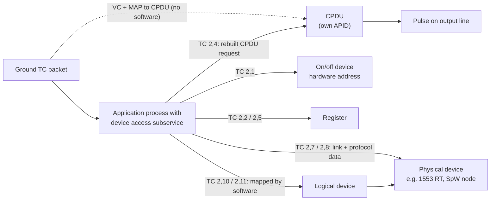

# ST[02] Device access

Most of the time a spacecraft is operated through high-level functions: "switch the instrument to
science mode", "load this schedule". Underneath, every such function ends in a handful of elementary
actions on hardware: a relay pulse, a register write, a message on a data bus. Service type 2 of the
[Packet Utilization Standard](index.md) gives the ground direct access to those elementary actions. It
exists for contingencies and troubleshooting, when the nominal on-board function may itself be the
problem, and for assembly, integration and test, when the basic communication with a unit must be
validated before any software runs on it.[^c-621][^a-441] This page describes the device model of
ECSS-E-ST-70-41C, every request and report with its data field, the command pulse distribution unit
(CPDU) of clause 9, the capability rules, the much smaller PUS-A service, and the way Solar Orbiter
implements the service with CPDU pulses, MIL-STD-1553 bus commands and SpaceWire packets in its MIB.

!!! info "Related pages"
    The CPDU packet is the one standard telecommand packet without a PUS secondary header; its header
    rules are on [PUS packet structures](packets.md). CPDU packets travel over the lowest layers of the
    telecommand chain, the [TC Space Data Link Protocol](../../ccsds/tc-sdlp.md) and the
    [CLTU](../../ccsds/tc-coding-cltu.md). Memory loads, which some missions use instead of register
    loads, belong to [ST[06] Memory management](st06-memory-management.md).

## 1. At a glance

| Item | Value |
|---|---|
| Service type | 2[^c-821] |
| PUS-C name | ST[02] device access[^c-621] |
| PUS-A name | Device command distribution service[^a-71] |
| Subservice type | device access (a single type)[^c-621] |
| Minimum capability | at least one of TC[2,1], TC[2,2], TC[2,4], TC[2,7][^c-623][^c-annexc2] |
| Observables | none defined[^c-628] |

| Message type | Name | Applicability | Response to | Clauses |
|---|---|---|---|---|
| TC[2,1] | distribute on/off device commands | by declaration | - | 6.2.4.2, 8.2.2.1 |
| TC[2,2] | distribute register load commands | by declaration | - | 6.2.5.2, 8.2.2.2 |
| TC[2,4] | distribute CPDU commands | by declaration | - | 6.2.6.2, 8.2.2.3 |
| TC[2,5] | distribute register dump commands | requires TC[2,2] | - | 6.2.5.3, 8.2.2.4 |
| TM[2,6] | register dump report | response | TC[2,5] | 6.2.5.3, 8.2.2.5 |
| TC[2,7] | distribute physical device commands | by declaration | - | 6.2.7.1.2, 8.2.2.6 |
| TC[2,8] | acquire data from physical devices | implied by TC[2,7] | - | 6.2.7.1.3, 8.2.2.7 |
| TM[2,9] | physical device data report | response | TC[2,8] | 6.2.7.1.3, 8.2.2.8 |
| TC[2,10] | distribute logical device commands | requires TC[2,7] | - | 6.2.7.2.2, 8.2.2.9 |
| TC[2,11] | acquire data from logical devices | implied by TC[2,10] | - | 6.2.7.2.3, 8.2.2.10 |
| TM[2,12] | logical device data report | response | TC[2,11] | 6.2.7.2.3, 8.2.2.11 |

[^c-annexc2]

Subtype 3 is not used in PUS-C: it was the CPDU request in PUS-A (see section 9).[^a-733] Each
application process hosts at most one device access subservice provider, and each device access service
contains at least one device access subservice.[^c-622] The
[PUS message type catalogue](message-types.md) lists these types next to all others.



The graph is this wiki's drawing of Annex C Table C-4; shaded boxes are the four "by declaration"
capabilities of which at least one must be present.[^c-annexc2][^c-623]

## 2. Why the service exists

PUS-A explains the motivation in its telecommanding concept. A spacecraft design contains many
**elementary control actions** implemented in hardware or software, such as switching a relay, loading a
hardware register or starting a software task; higher-level commands end up triggering one or more of
them. Although routine operations do not use them, the ground system must have direct access to all
elementary control actions, so that it can bypass a malfunctioning on-board function during
contingencies.[^a-441] One group of these actions, the **device commands**, is executed by hardware: hard
wired pulse commands, on-off commands and register loads.[^a-442]

PUS-A lists three ways to route device commands: embedded directly in a telecommand segment and routed
by the decoder to the device (bypassing software, for example when the processor has failed); through a
CPDU inside the telecommand decoder; or inside a telecommand packet to an application process that
extracts and forwards them. It also recommends that commands of the same type can be packed into one
packet so that a multi-command function is executed completely or not at all.[^a-442]

PUS-C keeps the purpose but generalises the devices. A device is any on-board entity that can be
configured by commands or that generates data, including actuators, sensors, transponders and units with
no PUS support of their own. Device commands bypass the nominal functions of the on-board software, so
the service performs only a minimum of verification on board.[^c-621]

## 3. The device model

ECSS-E-ST-70-41C defines five kinds of addressable object for this service. All of them are declared when
the subservice (or, for CPDUs, the spacecraft architecture) is specified; none is created by
telecommand.[^c-6241][^c-6251][^c-6261][^c-62711][^c-62721]

| Object | Declared properties | Requests |
|---|---|---|
| On/off device | the list of devices and, per device, the hardware addresses used to command it (for example switch on, switch off, cold or warm reset, open or close a valve) | TC[2,1] |
| Register | hardware address, the register fields, and the "register consistency checks" applied when loading it; the sets of loadable and dumpable registers may differ | TC[2,2], TC[2,5] |
| CPDU | the CPDUs managed by the subservice (see section 6) | TC[2,4] |
| Physical device | device identifier, communication links (for example a MIL-STD-1553B bus and a SpaceWire link) and, per link, the protocols for commanding and for receiving data | TC[2,7], TC[2,8] |
| Logical device | logical device identifier, supported commands and their arguments, and the parameter identifiers usable for data acquisition | TC[2,10], TC[2,11] |

[^c-6241][^c-6251][^c-6261][^c-62711][^c-62721]

The physical/logical distinction is explained with a MIL-STD-1553B remote terminal. Commanded as a
**physical device**, the request contains the bus command word itself: address, transmission direction,
subaddress and data word count. Commanded as a **logical device**, the request contains only a logical
device identifier, a command identifier and its parameters, and the on-board software maps them onto the
right link and protocol.[^c-621]



The flowchart is this wiki's summary of clauses 6.2 and 9.1.[^c-621][^c-91]

## 4. On/off device and register commands

### 4.1 TC[2,1] distribute on/off device commands

A request contains an ordered list of one or more instructions; each instruction holds a single device
address. The delay applied between consecutive instructions depends on the spacecraft
architecture.[^c-6242] The request is rejected as a whole, with a failed start of execution notification,
if any instruction names an unknown address; otherwise the instructions are executed in the order in which
they appear.[^c-6242]

| Field | PUS-C type | Repetition | Meaning |
|---|---|---|---|
| N | unsigned integer | once | number of instructions |
| on/off device address | enumerated | N times | hardware address to which the on/off command is sent |

[^c-8221]

### 4.2 TC[2,2] distribute register load commands

Each instruction holds a register address and the data for the register fields. The whole request is
rejected if any instruction names an unknown register or fails its register consistency checks, because,
as the standard notes, a partial load can leave a device in an unknown or inconsistent
state.[^c-6252] Valid requests are executed in order.[^c-6252]

| Field | PUS-C type | Repetition | Meaning |
|---|---|---|---|
| N | unsigned integer | once | number of instructions |
| register address | enumerated | N times | hardware address of the register |
| register data | deduced | N times | values of the register fields; structure deduced from the address |

[^c-8222]

### 4.3 TC[2,5] distribute register dump commands and TM[2,6] register dump report

Register dumps are processed differently from loads. Each instruction (a register address) is checked
on its own: an unknown address produces a failed start of execution notification for that instruction,
and the valid instructions are processed regardless. For each valid instruction the subservice
distributes the dump command and builds a register dump notification (address plus the value of each
register field); all notifications of one request go into a single TM[2,6] report.[^c-6253] Dumping
requires the load capability.[^c-6253]

| Field (TM[2,6]) | PUS-C type | Repetition | Meaning |
|---|---|---|---|
| N | unsigned integer | once | number of dumped registers |
| register address | enumerated | N times | address of the dumped register |
| register data | deduced | N times | value of each register field |

[^c-8224][^c-8225]

!!! note "Request-level versus instruction-level rejection"
    All "distribute" requests of ST[02] (on/off, register load, CPDU, physical and logical commands, and
    both acquisition requests) are rejected as a whole when one instruction is invalid, and their
    instructions are executed in order. Only the register dump request is checked instruction by
    instruction.[^c-6242][^c-6252][^c-6253][^c-6262] The consequences for verification reports are
    described on [ST[01] Request verification](st01-request-verification.md).

## 5. Physical and logical devices

### 5.1 TC[2,7] distribute physical device commands

Each instruction contains a physical device identifier, protocol-specific data and command data. For a
MIL-STD-1553B remote terminal the standard's example maps them to the terminal address (which also
selects the bus), the transfer direction, subaddress or mode code indicator and word count or mode code,
and up to 32 sixteen-bit data words.[^c-62712] Instructions for the same device are sent in order at the
maximum rate the protocol allows; no ordering can be assumed between instructions for different
devices.[^c-62712]

The request is rejected if any instruction names an unknown device or contains invalid protocol data.
During execution the subservice checks the result of each transmission. A failed transmission produces a
failed execution notification with the instruction index, the transmission return code and any auxiliary
data, and the request then ends with a single failed completion of execution report containing the first
of these notifications.[^c-62712]

| Field | PUS-C type | Repetition | Meaning |
|---|---|---|---|
| N | unsigned integer | once | number of instructions |
| physical device ID | enumerated | N times | device (and implicitly link) to address |
| protocol-specific data | deduced | N times | for example the 1553 direction, subaddress and word count |
| command data | deduced | N times | the data to transmit |

[^c-8226]

### 5.2 TC[2,8] acquire data from physical devices and TM[2,9]

The acquisition request is the read counterpart. Each instruction carries a **transaction ID**, chosen by
the requester to recognise the answer, the device ID and the protocol data that select the data to
report. For each successful acquisition the subservice generates one TM[2,9] report; a failed acquisition
produces a failed execution notification with the transaction ID and the transaction execution status,
and the request ends with one failed completion report containing the first such notification.[^c-62713]
The data acquisition return codes and their auxiliary data are declared per device and link.[^c-62713]

| Field (TC[2,8]) | PUS-C type | Repetition |
|---|---|---|
| N | unsigned integer | once |
| transaction ID | unsigned integer | N times |
| physical device ID | enumerated | N times |
| protocol-specific data | deduced | N times |

| Field (TM[2,9]) | PUS-C type | Meaning |
|---|---|---|
| transaction ID | unsigned integer | copied from the instruction |
| data acquisition return code | enumerated | part of the transaction execution status |
| auxiliary data | deduced, deduced presence | detail for the return code, if any |
| data block | deduced | the acquired data |

[^c-8227][^c-8228]

### 5.3 TC[2,10] and TC[2,11]: logical devices and TM[2,12]

A logical device command names the logical device, a command ID and the command arguments, with no
reference to the physical link or protocol. The subservice maps the logical device to a physical device,
link and protocol, maps the command ID to protocol-specific data, formats the arguments as command data,
transmits and checks the result, reporting failures as for physical commands.[^c-62722] The standard's
stated benefit is that the same request can be used during on-board software development and in
flight, even though the physical access to the device differs.[^c-62722]

A logical acquisition names the logical device and a **parameter ID**; the subservice maps the parameter
to protocol data, acquires it, and returns one TM[2,12] report per successful acquisition with the
acquired parameter value.[^c-62723] Logical commanding requires physical commanding, and logical
acquisition is implied by logical commanding.[^c-annexc2]

| Message | Fields in order |
|---|---|
| TC[2,10] | N (unsigned integer); repeated N times: logical device ID (enumerated), command ID (deduced), command arguments (deduced) |
| TC[2,11] | N (unsigned integer); repeated N times: transaction ID (unsigned integer), logical device ID (enumerated), parameter ID (enumerated) |
| TM[2,12] | transaction ID (unsigned integer), data acquisition return code (enumerated), auxiliary data (deduced, deduced presence), parameter value (deduced) |

[^c-8229][^c-82210][^c-82211]

## 6. The command pulse distribution unit (CPDU)

### 6.1 Concept

Clause 9 of ECSS-E-ST-70-41C defines the CPDU: a simple unit that gives the ground direct access to
equipment, for example to reset a transponder or a sensor during a contingency. Each CPDU is logically an
application process with its own APID. It can be reached **directly**, through a virtual channel and a
multiplexer access point (MAP) that is physically linked to it, or **indirectly**, through an application
process that hosts a device access subservice and receives TC[2,4].[^c-91] A CPDU request is a list of
command pulse instructions, each naming an addressable output and the duration of the pulse.[^c-91]

### 6.2 Rules

| Property | Rule (PUS-C) |
|---|---|
| Pulse duration unit | declared per CPDU, from 10 ms to 15 ms |
| Addressable outputs | declared per CPDU; up to 2^12 (4,096), identified by values 0 to 2^12 - 1; only some are equipped with output lines |
| Instructions per request | maximum declared per CPDU, at least 12 and at most 504, constrained by the TC segment size |
| Duration exponential value | 0 to 7 |
| Pulse length | pulse duration unit × 2^(duration exponential value) |
| Access | APID, MAPs physically linked to the CPDU and the VC used for each MAP declared in the spacecraft architecture; MAP 0 is usual for a CPDU behind a decoder without cross-coupling |
| Connected outputs | each physically connected output has a declared minimum and maximum pulse duration |

[^c-921][^c-922][^c-923]

With the allowed range of the unit, the eight duration codes span from 10 ms (unit 10 ms, code 0) to
1.92 s (unit 15 ms, code 7):

| Code | Factor | Unit 10 ms | Unit 15 ms |
|---|---|---|---|
| 0 | 1 | 10 ms | 15 ms |
| 1 | 2 | 20 ms | 30 ms |
| 2 | 4 | 40 ms | 60 ms |
| 3 | 8 | 80 ms | 120 ms |
| 4 | 16 | 160 ms | 240 ms |
| 5 | 32 | 320 ms | 480 ms |
| 6 | 64 | 640 ms | 960 ms |
| 7 | 128 | 1.28 s | 1.92 s |

The table is computed from the formula in requirement 9.2.3c.[^c-923] PUS-A gives the same end point,
128 × D "between 1,28 and 1,92 seconds".[^a-d23]

### 6.3 The CPDU packet

A CPDU request travels in a CCSDS Space Packet with version 0, type 1, **secondary header flag 0**, the
CPDU's APID, sequence flags `11` and sequence count or name 0. Its data field has no secondary header and
no spare, only the application data and a 16-bit CRC identical to the frame error control field of the
TC data link.[^c-931]

<div class="bitfield" data-title="CPDU command packet primary header (PUS-C clause 9.3.1)" data-width="16"
     data-fields='[{"n":"Version","b":3,"v":"000"},{"n":"Type","b":1,"v":"1"},{"n":"SH flag","b":1,"v":"0","d":"No PUS secondary header"},{"n":"APID of the CPDU","b":11},{"n":"Seq. flags","b":2,"v":"11"},{"n":"Sequence count or name","b":14,"v":"0","d":"Set to 0"},{"n":"Packet data length","b":16,"d":"Octets in the data field minus one"}]'></div>

<div class="bitfield" data-title="CPDU command pulse instruction (PUS-C Figure 9-1, repeated N times)" data-width="16"
     data-fields='[{"n":"Output line ID","b":12,"d":"Enumerated, 0 to 4095: a physically connected CPDU output"},{"n":"Res.","b":1,"d":"Reserved bit-string"},{"n":"Duration exp.","b":3,"d":"0 to 7: pulse = unit x 2^value"}]'></div>

[^c-931][^c-923]

When a device access subservice receives TC[2,4], it rebuilds the CPDU request in the format the CPDU
expects and distributes it; the standard imposes no delay between consecutive CPDU requests.[^c-6262]
The TC[2,4] data field wraps the instructions in two levels of repetition:

| Field | PUS-C type | Repetition | Meaning |
|---|---|---|---|
| N1 | unsigned integer | once (optional) | number of CPDU instructions |
| CPDU ID | enumerated | N1 times (optional) | which CPDU, if the subservice manages several |
| N2 | unsigned integer | N1 times | number of command pulse instructions |
| output line ID | enumerated, 12 bits | N2 times | output to pulse |
| reserved | bit-string, 1 bit | N2 times | - |
| duration exponential value | unsigned integer, 3 bits | N2 times | pulse length code |

[^c-8223][^c-6262]

!!! warning "Inference"
    The upper limit of 504 instructions matches the largest CCSDS TC frame. A TC transfer frame is at most
    1,024 octets, of which 5 are the primary header, 2 the frame error control field and 1 the segment
    header, leaving 1,016 octets for one packet.[^tc-len][^tc-hdr][^tc-seg][^tc-fecf] A CPDU packet
    of 6 header octets, 504 two-octet instructions and a 2-octet CRC is exactly 6 + 1,008 + 2 = 1,016
    octets. PUS-C only says that the limit is constrained by the segment size.[^c-921] The same
    arithmetic links the PUS-A maximum of 120 instructions to its maximum CPDU packet length of 248
    octets (6 + 240 + 2).[^a-722][^a-d22]

## 7. Capability rules and verification

PUS-C requires at least one of four capabilities: on/off commands, register commands, software CPDU
commands, or physical device commanding.[^c-623] The remaining message types depend on them (section 1).
Each of the "distribute" and "acquire" requests reports a rejected request with a failed start of
execution notification. Execution checks are defined only for the physical and logical device requests:
there, a failed transmission or acquisition produces a single failed completion report built from the
first failed notification.[^c-6242][^c-62712][^c-62713][^c-62722][^c-62723] The device access subservice defines no
observables.[^c-628]

Device commands bypass the nominal on-board functions and get only a minimum of on-board
verification.[^c-621] The confirmation that a relay actually switched therefore has to come from
telemetry: Solar Orbiter verifies the completion of its PCDU power commands with parameter checks rather
than with a completion report (section 10.4).[^mib-zpw]

## 8. Rev.1 draft

The December 2024 draft for public review keeps the same eleven message types with the same subtypes,
TC[2,1] to TM[2,12], and the same clause structure.[^r-82]

## 9. PUS-A: the device command distribution service

PUS-A's service 2 is much smaller. It distributes on/off and register load commands and CPDU commands
for the reconfiguration of vital spacecraft functions, and it defines no reports.[^a-71][^a-73]

| PUS-A request | Application data | Notes |
|---|---|---|
| (2,1) Distribute On-Off Commands | N (unsigned integer, optional), then N addresses (enumerated) | N is omitted if the service handles one command at a time |
| (2,2) Distribute Register Load Commands | N (optional), then N × (register address, register data) | the data structure is known from the address and follows structure rule set 1 |
| (2,3) Distribute CPDU Commands | a CPDU packet: N × (output line ID, 1 octet; duration, 1 octet) | no data field header; processed by the CPDU itself |

[^a-731][^a-732][^a-733]

On reception, the application process unpacks the commands, reformats them for the internal bus or
device driver (the address structure is mission-dependent and may contain subfields) and distributes
them in packet order. Annex A.3 of PUS-A gives an example with a 24-bit OBDH command.[^a-721]

The PUS-A CPDU is described in more detail than in PUS-C, in Annex D, which is transcribed from ESA
PSS-04-151 (the telecommand decoder specification, issue 1, which PUS-A dates September 1993; the
cover of the document itself says September 1992 and its inner pages September 1993, see
[the history page](../../overview/history.md#pss-04-151-the-telecommand-decoder-specification-1992-1993)):[^a-722][^a-d1][^pss151]

- a CPDU is solely accessible from the ground, has up to 256 output lines and a dedicated APID, and
  receives one complete packet per telecommand segment, in practice on MAP 0 (MAP 1 is a likely second
  interface when CPDUs are cross-coupled);[^a-722][^a-d21]
- the packet is 10 to 248 octets long, always an even number, ends with the frame CRC, and is checked to
  be "CLEAN" (length and CRC) and then "LEGAL" (version 0, type 1, data field header flag 0, programmed
  APID, sequence flags `11`); a packet failing a check is erased;[^a-d22]
- each instruction is two octets: the first selects one of 256 outputs, and in the second the 5 most
  significant bits are reserved and ignored and the 3 least significant bits select a duration of 1 × D to
  128 × D, with D between 10 and 15 ms;[^a-d23]
- once a packet is accepted, the CPDU ignores further segments until all its pulses are issued; there is
  no "abort", and an instruction for an output that is not physically implemented is processed as if the
  output existed, without any anomaly report;[^a-d21][^a-d23]
- the mission constants `<CPDU_DURATION_UNIT>` (10 to 15 ms) and `<CPDU_MAX_INSTR>` (12 to 120
  instructions) characterise each CPDU.[^a-b]

<div class="bitfield" data-title="PUS-A CPDU command instruction (Annex D.2.3, repeated N times)" data-width="16"
     data-fields='[{"n":"Output line ID","b":8,"d":"One of 256 command pulse outputs"},{"n":"Reserved","b":5,"d":"Bits 0-4 of the second octet, normally 0, ignored by the CPDU"},{"n":"Duration","b":3,"d":"000 = 1 x D ... 111 = 128 x D"}]'></div>

[^a-d23]

!!! note "A small inconsistency in PUS-A"
    The text of request (2,3) describes the duration as "a value between 0 and 8", while Annex D defines
    a 3-bit field with values `000` to `111`, i.e. 0 to 7.[^a-733][^a-d23] PUS-C settles the range at 0
    to 7.[^c-923]

The capability sets of PUS-A require either (2,3), because a CPDU is a dedicated application process, or
one of (2,1) and (2,2); a service without CPDU commands may add the other of the two.[^a-74]

| Aspect | PUS-A | PUS-C |
|---|---|---|
| CPDU request | (2,3), sent to the CPDU APID | TC[2,4] to a software subservice; the direct CPDU packet is defined in clause 9 |
| CPDU outputs, instruction size | 256, 2 octets (8 + 5 + 3 bits) | up to 2^12, 2 octets (12 + 1 + 3 bits) |
| Max instructions | 12 to 120 | 12 to 504 |
| Register dump | not defined | TC[2,5] / TM[2,6] |
| Physical and logical devices | not defined | TC[2,7] to TM[2,12] |
| Reports | none | TM[2,6], TM[2,9], TM[2,12] |

[^a-733][^a-b][^c-921][^c-annexc2]

## 10. Solar Orbiter

### 10.1 What the ICD defines

Solar Orbiter's TM/TC ICD, based on PUS-A, describes service 2 as the distribution of CPDU commands for
the reconfiguration of vital unit functions, of MIL-STD-1553 bus command messages and of SpaceWire
command messages. It distinguishes two CPDU paths: packets received by the CPDU TC decoder on MAP 0, with
no software involved and a non-PUS structure, and the software-distributed TC(2,3), which the central
software (CSW) receives on MAP 1 and routes to the CPDU. If the processing of a CPDU packet is not
complete, new commands are ignored. No register load commands exist, because all OBC registers are mapped
in memory and reachable through [service 6](st06-memory-management.md).[^solo-s2]

The ICD names three kinds of CPDU pulse command. **HPC-1** commands are sent from the ground directly to
the CPDU inside the on-board computer, without the central software; **HPC-2** commands use the same
command lines but are issued by the on-board computer's reconfiguration module; **HPC-3** commands are
generated by the CSW writing dedicated CPDU registers.[^solo-hpc] The ICD's acronym list expands HPC as
"High Power Command".[^solo-acr] Its MAP assignments are not fully consistent: the segment header clause
gives MAP 0 ("CPDU") for "CPDU command (i.e. TC(2,3))" and MAP 1 for all other commanding, whereas the
TC(2,3) clause says that the CSW receives TC(2,3) on MAP 1.[^solo-hpc][^solo-s2] In the MIB, only the 125
HPC-1 commands carry `CCF_MAPID` = 0, while the TC(2,3) commands leave `CCF_MAPID` empty (section
10.2).[^mib-s2]

| Request / report | Content | Verification |
|---|---|---|
| TC(2,3) CSW-distributed CPDU commands (HPC3) | command number (1 octet), filler (5 bits), pulse length (3 bits) | TM(1,2) for static check failures, TM(1,8) as defined in a referenced document |
| TC(2,128) Distribute MilBus 1553 Commands | bus, bus coupler, N command words, then per command the 1553 command word fields and M data words | same |
| TM(2,129) MilBus 1553 Commands Answer | bus, echoed command word, bus coupler and its status word, RT status word, N and the returned data words | - |
| TC(2,130) Distribute SpaceWire Commands | SpW link (1 octet), coupler (1 octet), N (2 octets), raw SpW packet | same |

[^solo-s2][^solo-2128][^solo-2129][^solo-2130]

These four are the only service 2 entries in the mission's service list.[^solo-list] The TC(2,3) layout is the PUS-A Annex D instruction; TC(2,128) is a mission-specific implementation of
what PUS-C calls physical device commanding, with the 1553 command word fields given explicitly; TC(2,130)
carries a complete SpaceWire packet, whose data is a PUS command plus a 4-octet SpaceWire
header.[^solo-s2][^solo-2130][^c-62712]

### 10.2 What the MIB contains

The September 2025 MIB holds 1,363 service 2 commands and one service 2 report, plus 125 CPDU commands
without a PUS header:[^mib-s2]

| Kind | Header (`CCF_PKTID`) | APID | Commands | `CCF_ACK` | Verification profile |
|---|---|---|---|---|---|
| Direct CPDU (HPC-1), MAP 0 | `HPC1_TC` | 44 | 125 | null | parameter check or none |
| TC(2,3) software CPDU (HPC-3) | `NOM_TC` | 172 | 105 | 9 | acceptance + completion reports |
| TC(2,128) MIL-STD-1553 | `NOM_TC` | 172 | 1,257 | 9 (1,179) or 1 (78) | reports, or acceptance report + parameter check |
| TC(2,130) SpaceWire | `NOM_TC` | 172 | 1 | 9 | acceptance + completion reports |
| TM(2,129) 1553 command report | - | 161 | SPID 14002 | - | variable packet (VPD) |

[^mib-s2][^mib-s2v]

APID 44 is process ID 2 (OBC hardware, high-priority TC functions to the CPDU on MAP 0) with packet
category 12; APID 172 is process ID 10, the CSW data management application.[^solo-apid][^mib-s2] The
single report, TM(2,129), is defined on APID 161, i.e. process ID 10 with packet category 1, although the
ICD gives TM(2,129) packet category 2 and Annex 8 reserves category 1 for service 1
acknowledgements.[^mib-s2v][^solo-2129][^solo-apid] The
April 2020 release had the same counts for TC(2,3), (2,128) and (2,130).[^mib2020-s2] No TC(2,1),
(2,2) or (2,4) exists in either release, which matches the ICD.[^mib-s2][^solo-s2]

The [`pcdf`](../../mib/tables/pcdf.md) definition of `HPC1_TC` is the CPDU packet header of PUS: fixed
version 0, type 1, data field header flag 0, the APID from `CCF_APID`, sequence flags `0b11`, and the
sequence count and length set by the commanding system. It has no secondary header elements at
all.[^mib-s2h]

<div class="bitfield" data-title="Solar Orbiter HPC1_TC header (pcdf) and HPC-1 command (cdf)" data-width="16"
     data-fields='[{"n":"Version","b":3,"v":"000","g":"Primary header"},{"n":"Type","b":1,"v":"1","g":"Primary header"},{"n":"DFH flag","b":1,"v":"0","g":"Primary header"},{"n":"APID (44)","b":11,"g":"Primary header","d":"From CCF_APID"},{"n":"Seq. flags","b":2,"v":"11","g":"Primary header"},{"n":"Sequence count","b":14,"g":"Primary header","d":"Set by SCOS-2000 (PH_SSC)"},{"n":"Packet length","b":16,"g":"Primary header","d":"Set by SCOS-2000 (PH_LEN)"},{"n":"HPC-LINE_ID","b":8,"g":"Application data","d":"Fixed area, e.g. 0x02"},{"n":"HPC_PULSE_LENGTH","b":8,"g":"Application data","d":"Fixed area, e.g. 0x01"}]'></div>

[^mib-s2h]

All 125 HPC-1 commands carry exactly one instruction: two 8-bit fixed areas, an output line (values 2 to
215 in the MIB) and a pulse length code. Code 2 is used 81 times and code 1 38 times; one series of
"Dummy commands" (`ZBC04100` to `ZBC04107`) uses each of the eight codes 0 to 7 once.[^mib-s2h] Since fixed
areas in [`cdf`](../../mib/tables/cdf.md) are hexadecimal raw values, the pulse code octet holds the
3-bit duration code in its least significant bits, as in the PUS-A instruction.[^icd-cdfval][^a-d23]

### 10.3 Worked example: two CPDU commands

| | HPC-1 (direct) | HPC-3 (through the CSW) |
|---|---|---|
| Command | [`ZBC04001`](../../explorer/index.md#/solo/command/ZBC04001) "Select PM A EEPROM Image 1" | [`ZCSXZ600`](../../explorer/index.md#/solo/command/ZCSXZ600) "HPC-3 IMU 1 Channel 1 On" |
| Packet | `HPC1_TC`, APID 44, MAP 0, no secondary header | `NOM_TC`, TC(2,3), APID 172 |
| Application data | `02 01`: output line 2, code 1 | `10 02`: output line 0x10 = 16, code 2 |
| Pulse length | 2 × D | 4 × D |
| Ack / verification | no Ack field; completion stage [9000](../../explorer/index.md#/solo/verif/9000): parameter `NCDD05GE` "PM A Image select status" must read `IMAGE_1` | Ack 9; acceptance and completion reports (stages 11 and 17) |

[^mib-s2ex][^a-d23]

The application data bytes are real (fixed areas from the MIB). The pulse unit D of the Solar Orbiter
CPDU is not stated in the available sources; the ICD refers to the unit documentation for the pulse
length.[^solo-s2]

### 10.4 Worked example: a PCDU switch-off over MIL-STD-1553

[`ZPW04800`](../../explorer/index.md#/solo/command/ZPW04800) "PCDU A APR1_C1 SwitchOFF" is a TC(2,128)
with Ack 1 (acceptance report only). Its `cdf` entries fill the generic 1553 layout of
[`ZCD00280`](../../explorer/index.md#/solo/command/ZCD00280) "Distribute 1553 commands" with fixed
values:[^mib-zpw]

| Bits | Element | Value in the MIB | Meaning |
|---|---|---|---|
| 0-7 | Bus ID (`PCD02801`, textual calibration) | `BUS_1` (engineering) | MIL bus 1 |
| 8-15 | Bus Coupler ID (`PCD02802`) | `BUSCPLR_DEF` (editable) | default coupler |
| 16-23 | number of bus commands | `0001` | one 1553 message |
| 24-39 | command word | `2281` (hex) | see the bit field below |
| 40-47 | number of data words | `1` | one data word |
| 48-63 | data word `RPW04800` "APR1_APR1_OFF" | default `8401` (hex) | the PCDU command itself |

<div class="bitfield" data-title="MIL-STD-1553 command word 0x2281 of ZPW04800 (decoded with the TC(2,128) field order)" data-width="16"
     data-fields='[{"n":"RT address","b":5,"v":"00100","d":"Remote terminal 4"},{"n":"T/R","b":1,"v":"0","d":"0 = RT to receive"},{"n":"Subaddress","b":5,"v":"10100","d":"Subaddress 20"},{"n":"Word count","b":5,"v":"00001","d":"1 data word"}]'></div>

[^mib-zpw][^solo-2128]

The bit split (5 + 1 + 5 + 5 bits) is the one defined by the generic command `ZCD00280` (RT address,
transmit/receive flag, subaddress or mode, number of data words or mode code), and the word count of 1
agrees with the separate data word count field.[^mib-zpw] The command's completion is verified by stage
[40](../../explorer/index.md#/solo/verif/40): telemetry parameter
[`NPWD0764`](../../explorer/index.md#/solo/param/NPWD0764) "IFA_APR1_Conv1_ST" must read raw 0 (tolerance
0) with a `CVS_INTERVAL` of 60 s.[^mib-zpw] The hex values and the field layout are real MIB data; the assignment of
remote terminal 4 to PCDU A is not stated in the available sources beyond the command description.

The answer path uses TM(2,129) (SPID [14002](../../explorer/index.md#/solo/packet/14002)), defined as a
variable packet in [`vpd`](../../mib/tables/vpd.md): the bus ID, the 16-bit command word decoded again into
its four fields by negative offsets, the bus coupler status, the RT status word with its individual flags
(message error, instrumentation, service request, busy, terminal flag and others), and a counted list of
data words.[^mib-s2v]

??? example "SQL used"
    ```sql
    -- solo-2025-09-16.sqlite (MIB__20250916M25925PFMS001_SOL)
    SELECT CCF_TYPE, CCF_STYPE, CCF_PKTID, COUNT(*), GROUP_CONCAT(DISTINCT CCF_APID),
           GROUP_CONCAT(DISTINCT CCF_ACK), GROUP_CONCAT(DISTINCT CCF_MAPID)
      FROM ccf WHERE CCF_TYPE = '2' OR CCF_PKTID = 'HPC1_TC' GROUP BY 1, 2, 3;
    SELECT CCF_STYPE, CCF_ACK, COUNT(*) FROM ccf WHERE CCF_TYPE = '2' GROUP BY 1, 2;
    SELECT * FROM pid WHERE PID_TYPE = '2';
    SELECT * FROM pcdf WHERE PCDF_TCNAME = 'HPC1_TC' ORDER BY CAST(PCDF_BIT AS INT);
    SELECT CDF_VALUE, COUNT(*) FROM cdf WHERE CDF_DESCR = 'HPC_PULSE_LENGTH' GROUP BY 1;
    SELECT * FROM cdf WHERE CDF_CNAME IN ('ZBC04001','ZCSXZ600','ZCD00280','ZCD00282','ZPW04800')
     ORDER BY CDF_CNAME, CAST(CDF_BIT AS INT);
    SELECT CPC_NAME, CPC_DESCR, CPC_PTC, CPC_PFC, CPC_RADIX, CPC_CATEG, CPC_DEFVAL
      FROM cpc WHERE CPC_NAME IN ('RPW04800','PCD02801','PCD02802','PCD02803');
    -- verification (cvs/cvp/cve use COL1..COLn in ICD order)
    SELECT v.COL1, s.* FROM cvp v JOIN cvs s ON s.COL1 = v.COL3
     WHERE v.COL1 IN ('ZBC04001','ZCSXZ600','ZPW04800');
    SELECT * FROM cve WHERE COL1 IN ('9000','40');
    SELECT * FROM vpd WHERE VPD_TPSD = '14002' ORDER BY CAST(VPD_POS AS INT);
    -- grouping of TC(2,128) by name prefix
    SELECT SUBSTR(CCF_CNAME,1,4), COUNT(*), MIN(CCF_DESCR) FROM ccf
     WHERE CCF_TYPE = '2' AND CCF_STYPE = '128' GROUP BY 1 ORDER BY 2 DESC;
    ```

### 10.5 What the 1,257 bus commands are

Grouping the TC(2,128) commands by the first four characters of their names shows which units are
commanded directly over the bus. The descriptions quoted are the alphabetically first and last of each
group:[^mib-s2pfx]

| Prefix | Commands | Example descriptions |
|---|---|---|
| `ZCSX` | 468 | "TCS BEA-MEA_Group_1_Grp_LCL_OFF" ... "TCS Module_4_Group_6_Htr_192_LCL_ON" |
| `ZPW0`, `ZPW1` | 248 + 248 | "PCDU A APR1_C1 SwitchOFF" ... "PCDU_A DPL2_CH2_FIRE_TK_060SEC" (and the same for PCDU B) |
| `ZDSG` | 38 | "DST A Coherence ON-OFF" ... "Dst-Tx B Set RF Power (DST-B FM1)" |
| `ZAMG`, `ZAMK`, `ZAHG`, `ZAHK` | 4 × 24 | "H-APME_A Clear Alarms" ... "MAPME_B Set Thresholds" |
| `ZMU0`, `ZMU1`, `ZMUG`, `ZMUK` | 16 + 16 + 8 + 8 | "IMU_11 Enable/Disable critical mode" ... "IMU_24 Pump diode current" |
| `ZRUG`, `ZRUK`, `ZRU0`, `ZRU1` | 15 + 15 + 12 + 12 | "RIU BIT Start" ... "RIU TLV Open Red" |
| `ZDMG`, `ZDMK` | 15 + 15 | "DEU A Arm Pinpuller" ... "DEU B Switches ST Info" |
| `ZSDG`, `ZSDK`, `ZSD0`, `ZSD1` | 8 + 8 + 1 + 1 | "SADE A MY Motor Config" ... "SADE B System Mode Set" |
| `ZRWG` | 4 | "RW_1 Torque Command" ... "RW_4 Torque Command" |
| `ZPWG`, `ZPWK` | 2 + 2 | "PCDUA SNAPSHOT_CMD", "PCDU_B TEST_CMD" |
| `ZCD0` | 1 | the generic "Distribute 1553 commands" `ZCD00280` |

!!! warning "Inference"
    The unit names are read from the command descriptions, and the group boundaries from a naming
    convention that is not documented in the available sources. The picture they give is that Solar
    Orbiter implements the PUS idea of "physical device commanding" mainly for power distribution,
    heaters and RF equipment, with each useful bus message stored in the MIB as a fully defined command,
    rather than with on/off or register commands.

## 11. How SCOS-2000 handles service 2

The SCOS-2000 import ICD states that the mission control system does no specific processing of service 2
packets. It can aggregate several packets into one TC segment, and so into one frame and CLTU, but it
cannot dynamically pack several command definitions into one TC packet. A TC(2,3) therefore either holds
one pulse instruction or has several instructions defined in the database, in which case it is handled as
a single command for history and verification. CPDU commands can be defined so that they may not be
inserted into a time-tagged TC(11,4) or aggregated with other commands in the same segment.[^icd-s2]

!!! note "Where the bits are defined"
    Because SCOS-2000 has no service-specific logic here, everything about a device command lives in the
    MIB: the header in [`tcp`](../../mib/tables/tcp.md) and [`pcdf`](../../mib/tables/pcdf.md), the
    command in [`ccf`](../../mib/tables/ccf.md), its elements in [`cdf`](../../mib/tables/cdf.md) and
    [`cpc`](../../mib/tables/cpc.md), and the check of its effect in
    [`cvs`](../../mib/tables/cvs.md) and [`cve`](../../mib/tables/cve.md). See
    [Commanding in the MIB](../../mib/commanding.md) and
    [Command verification in the MIB](../../mib/command-verification.md).

## Related pages

- [ST[01] Request verification](st01-request-verification.md) - the reports produced for these requests.
- [PUS packet structures](packets.md) - the CPDU packet as an exception to the PUS headers.
- [TC Space Data Link Protocol](../../ccsds/tc-sdlp.md) - virtual channels, MAPs and segments used to reach a CPDU.
- [COP-1](../../ccsds/cop-1.md) - the frame-level protocol below.
- [Worked example: building a real Solar Orbiter telecommand](../../overview/worked-example-tc.md).
- [How Solar Orbiter uses PUS](../../missions/solar-orbiter/pus-usage.md).

[^c-621]: [ECSS-E-ST-70-41C, Space engineering - Telemetry and telecommand packet utilization](../../library/ecss-e-st-70-41c-15april2016.md), §6.2.1.1-6.2.1.2, PDF pp. 64-65.
[^c-622]: [ECSS-E-ST-70-41C](../../library/ecss-e-st-70-41c-15april2016.md), §6.2.2.1-6.2.2.2, PDF p. 65.
[^c-623]: [ECSS-E-ST-70-41C](../../library/ecss-e-st-70-41c-15april2016.md), §6.2.3a, PDF p. 65.
[^c-6241]: [ECSS-E-ST-70-41C](../../library/ecss-e-st-70-41c-15april2016.md), §6.2.4.1, PDF p. 65.
[^c-6242]: [ECSS-E-ST-70-41C](../../library/ecss-e-st-70-41c-15april2016.md), §6.2.4.2a-g, PDF p. 66.
[^c-6251]: [ECSS-E-ST-70-41C](../../library/ecss-e-st-70-41c-15april2016.md), §6.2.5.1a-d, PDF pp. 66-67.
[^c-6252]: [ECSS-E-ST-70-41C](../../library/ecss-e-st-70-41c-15april2016.md), §6.2.5.2a-g, PDF p. 67.
[^c-6253]: [ECSS-E-ST-70-41C](../../library/ecss-e-st-70-41c-15april2016.md), §6.2.5.3a-h, PDF p. 68.
[^c-6261]: [ECSS-E-ST-70-41C](../../library/ecss-e-st-70-41c-15april2016.md), §6.2.6.1a, PDF p. 69.
[^c-6262]: [ECSS-E-ST-70-41C](../../library/ecss-e-st-70-41c-15april2016.md), §6.2.6.2a-g, PDF p. 69.
[^c-62711]: [ECSS-E-ST-70-41C](../../library/ecss-e-st-70-41c-15april2016.md), §6.2.7.1.1, PDF p. 70.
[^c-62712]: [ECSS-E-ST-70-41C](../../library/ecss-e-st-70-41c-15april2016.md), §6.2.7.1.2a-h, PDF pp. 70-71.
[^c-62713]: [ECSS-E-ST-70-41C](../../library/ecss-e-st-70-41c-15april2016.md), §6.2.7.1.3a-i, PDF pp. 72-73.
[^c-62721]: [ECSS-E-ST-70-41C](../../library/ecss-e-st-70-41c-15april2016.md), §6.2.7.2.1a, PDF p. 73.
[^c-62722]: [ECSS-E-ST-70-41C](../../library/ecss-e-st-70-41c-15april2016.md), §6.2.7.2.2a-h, PDF pp. 73-75.
[^c-62723]: [ECSS-E-ST-70-41C](../../library/ecss-e-st-70-41c-15april2016.md), §6.2.7.2.3a-i, PDF pp. 75-76.
[^c-628]: [ECSS-E-ST-70-41C](../../library/ecss-e-st-70-41c-15april2016.md), §6.2.8, PDF p. 77.
[^c-821]: [ECSS-E-ST-70-41C](../../library/ecss-e-st-70-41c-15april2016.md), §8.2.1a, PDF p. 451.
[^c-8221]: [ECSS-E-ST-70-41C](../../library/ecss-e-st-70-41c-15april2016.md), §8.2.2.1, Figure 8-10, PDF p. 451.
[^c-8222]: [ECSS-E-ST-70-41C](../../library/ecss-e-st-70-41c-15april2016.md), §8.2.2.2, Figure 8-11, PDF p. 451.
[^c-8223]: [ECSS-E-ST-70-41C](../../library/ecss-e-st-70-41c-15april2016.md), §8.2.2.3, Figure 8-12, PDF pp. 451-452.
[^c-8224]: [ECSS-E-ST-70-41C](../../library/ecss-e-st-70-41c-15april2016.md), §8.2.2.4, Figure 8-13, PDF p. 452.
[^c-8225]: [ECSS-E-ST-70-41C](../../library/ecss-e-st-70-41c-15april2016.md), §8.2.2.5, Figure 8-14, PDF p. 452.
[^c-8226]: [ECSS-E-ST-70-41C](../../library/ecss-e-st-70-41c-15april2016.md), §8.2.2.6, Figure 8-15, PDF p. 453.
[^c-8227]: [ECSS-E-ST-70-41C](../../library/ecss-e-st-70-41c-15april2016.md), §8.2.2.7, Figure 8-16, PDF p. 453.
[^c-8228]: [ECSS-E-ST-70-41C](../../library/ecss-e-st-70-41c-15april2016.md), §8.2.2.8, Figure 8-17, PDF pp. 453-454.
[^c-8229]: [ECSS-E-ST-70-41C](../../library/ecss-e-st-70-41c-15april2016.md), §8.2.2.9, Figure 8-18, PDF p. 454.
[^c-82210]: [ECSS-E-ST-70-41C](../../library/ecss-e-st-70-41c-15april2016.md), §8.2.2.10, Figure 8-19, PDF p. 454.
[^c-82211]: [ECSS-E-ST-70-41C](../../library/ecss-e-st-70-41c-15april2016.md), §8.2.2.11, Figure 8-20, PDF p. 455.
[^c-91]: [ECSS-E-ST-70-41C](../../library/ecss-e-st-70-41c-15april2016.md), §9.1, PDF p. 606.
[^c-921]: [ECSS-E-ST-70-41C](../../library/ecss-e-st-70-41c-15april2016.md), §9.2.1a-g (the PDF text renders 2^12 as "212"), PDF pp. 606-607.
[^c-922]: [ECSS-E-ST-70-41C](../../library/ecss-e-st-70-41c-15april2016.md), §9.2.2a-f, PDF pp. 607-608.
[^c-923]: [ECSS-E-ST-70-41C](../../library/ecss-e-st-70-41c-15april2016.md), §9.2.3a-c, PDF p. 608.
[^c-931]: [ECSS-E-ST-70-41C](../../library/ecss-e-st-70-41c-15april2016.md), §9.3.1a-b, Figure 9-1, PDF pp. 608-609.
[^c-annexc2]: [ECSS-E-ST-70-41C](../../library/ecss-e-st-70-41c-15april2016.md), Annex C.2.2, Table C-4, PDF pp. 629-630.
[^r-82]: [ECSS-E-ST-70-41C Rev.1 DIR1 (draft, 11 December 2024)](../../library/ecss-e-st-70-41c-rev1-dir1.md), §6.2, PDF pp. 65-77, and §8.2.2.1-8.2.2.11, PDF pp. 501-505.
[^a-441]: [ECSS-E-70-41A, Ground systems and operations - Telemetry and telecommand packet utilization](../../library/ecss-e-70-41a-30jan2003-pus.md), §4.4.1, PDF p. 26.
[^a-442]: [ECSS-E-70-41A](../../library/ecss-e-70-41a-30jan2003-pus.md), §4.4.2, PDF pp. 26-27.
[^a-71]: [ECSS-E-70-41A](../../library/ecss-e-70-41a-30jan2003-pus.md), §7.1, PDF p. 57.
[^a-721]: [ECSS-E-70-41A](../../library/ecss-e-70-41a-30jan2003-pus.md), §7.2.1, PDF p. 57.
[^a-722]: [ECSS-E-70-41A](../../library/ecss-e-70-41a-30jan2003-pus.md), §7.2.2, PDF p. 58.
[^a-73]: [ECSS-E-70-41A](../../library/ecss-e-70-41a-30jan2003-pus.md), §7.3, PDF p. 58.
[^a-731]: [ECSS-E-70-41A](../../library/ecss-e-70-41a-30jan2003-pus.md), §7.3.1, PDF p. 58.
[^a-732]: [ECSS-E-70-41A](../../library/ecss-e-70-41a-30jan2003-pus.md), §7.3.2, PDF pp. 58-59.
[^a-733]: [ECSS-E-70-41A](../../library/ecss-e-70-41a-30jan2003-pus.md), §7.3.3, PDF p. 59.
[^a-74]: [ECSS-E-70-41A](../../library/ecss-e-70-41a-30jan2003-pus.md), §7.4, Tables 5 and 6, PDF pp. 59-60.
[^a-b]: [ECSS-E-70-41A](../../library/ecss-e-70-41a-30jan2003-pus.md), Annex B, `<CPDU_DURATION_UNIT>` and `<CPDU_MAX_INSTR>`, PDF p. 215.
[^a-d1]: [ECSS-E-70-41A](../../library/ecss-e-70-41a-30jan2003-pus.md), Annex D.1, PDF p. 221.
[^pss151]: [ESA PSS-04-151, Telecommand Decoder Specification, Issue 1](../../library/esa-pss-04-151-issue1-september1992.md), cover (September 1992) and page headers (Issue 1, September 1993), PDF pp. 1-3 (scanned; OCR text).
[^a-d21]: [ECSS-E-70-41A](../../library/ecss-e-70-41a-30jan2003-pus.md), Annex D.2.1, PDF p. 222.
[^a-d22]: [ECSS-E-70-41A](../../library/ecss-e-70-41a-30jan2003-pus.md), Annex D.2.2, PDF pp. 222-223.
[^a-d23]: [ECSS-E-70-41A](../../library/ecss-e-70-41a-30jan2003-pus.md), Annex D.2.3, PDF p. 223.
[^tc-len]: [CCSDS 232.0-B-4, TC Space Data Link Protocol](../../library/ccsds-232-0-232x0b4e1c1.md), §4.1.2.7 Note 2, PDF p. 73.
[^tc-hdr]: [CCSDS 232.0-B-4](../../library/ccsds-232-0-232x0b4e1c1.md), Figure 4-2 (Transfer Frame Primary Header, 5 octets), PDF p. 70.
[^tc-seg]: [CCSDS 232.0-B-4](../../library/ccsds-232-0-232x0b4e1c1.md), §4.1.3.2.2.1.4 (Segment Header: 2-bit sequence flags, 6-bit MAP ID), PDF p. 75.
[^tc-fecf]: [CCSDS 232.0-B-4](../../library/ccsds-232-0-232x0b4e1c1.md), §4.1.4.1.2 (two-octet Frame Error Control Field), PDF p. 77.
[^icd-s2]: [SCOS-2000 Database Import ICD, issue 7.0](../../library/icd-7-0-final.md), Appendix C §3.2 "Service 2: Device command distribution service", PDF pp. 237-238.
[^icd-cdfval]: [SCOS-2000 Database Import ICD 7.0](../../library/icd-7-0-final.md), §3.3.3.2.3, field CDF_VALUE, PDF p. 157.
[^solo-s2]: [SOL.S.ASTR.TN.00079 Issue 7, Solar Orbiter TM-TC and Packet Structure ICD](../../library/sol-s-astr-tn-00079-07.md), §5.3 and §5.3.1 TC(2,3), PDF pp. 44-45.
[^solo-2128]: [SOL.S.ASTR.TN.00079 Issue 7](../../library/sol-s-astr-tn-00079-07.md), §5.3.2 TC(2,128), PDF pp. 45-46.
[^solo-2129]: [SOL.S.ASTR.TN.00079 Issue 7](../../library/sol-s-astr-tn-00079-07.md), §5.3.3 TM(2,129), PDF pp. 46-47.
[^solo-2130]: [SOL.S.ASTR.TN.00079 Issue 7](../../library/sol-s-astr-tn-00079-07.md), §5.3.4 TC(2,130), PDF pp. 47-48.
[^solo-list]: [SOL.S.ASTR.TN.00079 Issue 7](../../library/sol-s-astr-tn-00079-07.md), §5.1, Table 5.1-1, PDF p. 31.
[^solo-hpc]: [SOL.S.ASTR.TN.00079 Issue 7](../../library/sol-s-astr-tn-00079-07.md), §3.3.1 (PUS-95, MAP identifier) and §3.3.1.1 CPDU Telecommands (HPC-1, HPC-2, HPC-3), PDF pp. 18-19.
[^solo-acr]: [SOL.S.ASTR.TN.00079 Issue 7](../../library/sol-s-astr-tn-00079-07.md), Annex 7.1 Acronyms, PDF p. 270.
[^solo-apid]: [SOL.S.ASTR.TN.00079 Issue 7](../../library/sol-s-astr-tn-00079-07.md), Annex 8 §13.1, Figures 13.1-1 and 13.1-2, PDF pp. 272-273.
[^mib-s2]: [Solar Orbiter MIB release MIB__20250916M25925PFMS001_SOL](../../library/mib-20250916m25925pfms001-sol.md), tables ccf, cvp, cvs and pid (service 2 and header HPC1_TC), queried by this wiki.
[^mib-s2v]: [Solar Orbiter MIB release MIB__20250916M25925PFMS001_SOL](../../library/mib-20250916m25925pfms001-sol.md), tables pid, pic and vpd (SPID/TPSD 14002), queried by this wiki.
[^mib-s2h]: [Solar Orbiter MIB release MIB__20250916M25925PFMS001_SOL](../../library/mib-20250916m25925pfms001-sol.md), tables tcp, pcdf (HPC1_TC) and cdf (HPC-1 commands), queried by this wiki.
[^mib-s2ex]: [Solar Orbiter MIB release MIB__20250916M25925PFMS001_SOL](../../library/mib-20250916m25925pfms001-sol.md), tables ccf, cdf, cvp, cvs and cve, commands ZBC04001 and ZCSXZ600, queried by this wiki.
[^mib-zpw]: [Solar Orbiter MIB release MIB__20250916M25925PFMS001_SOL](../../library/mib-20250916m25925pfms001-sol.md), tables ccf, cdf, cpc, cvp, cvs and cve, commands ZPW04800 and ZCD00280, queried by this wiki.
[^mib-s2pfx]: [Solar Orbiter MIB release MIB__20250916M25925PFMS001_SOL](../../library/mib-20250916m25925pfms001-sol.md), table ccf (CCF_TYPE 2, CCF_STYPE 128), queried by this wiki.
[^mib2020-s2]: [Solar Orbiter MIB release MIB__20200416M10720PFMS001_SOL](../../library/mib-20200416m10720pfms001-sol.md), table ccf (CCF_TYPE 2), queried by this wiki.
