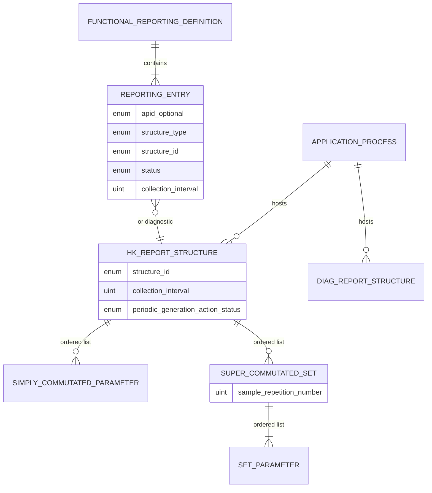
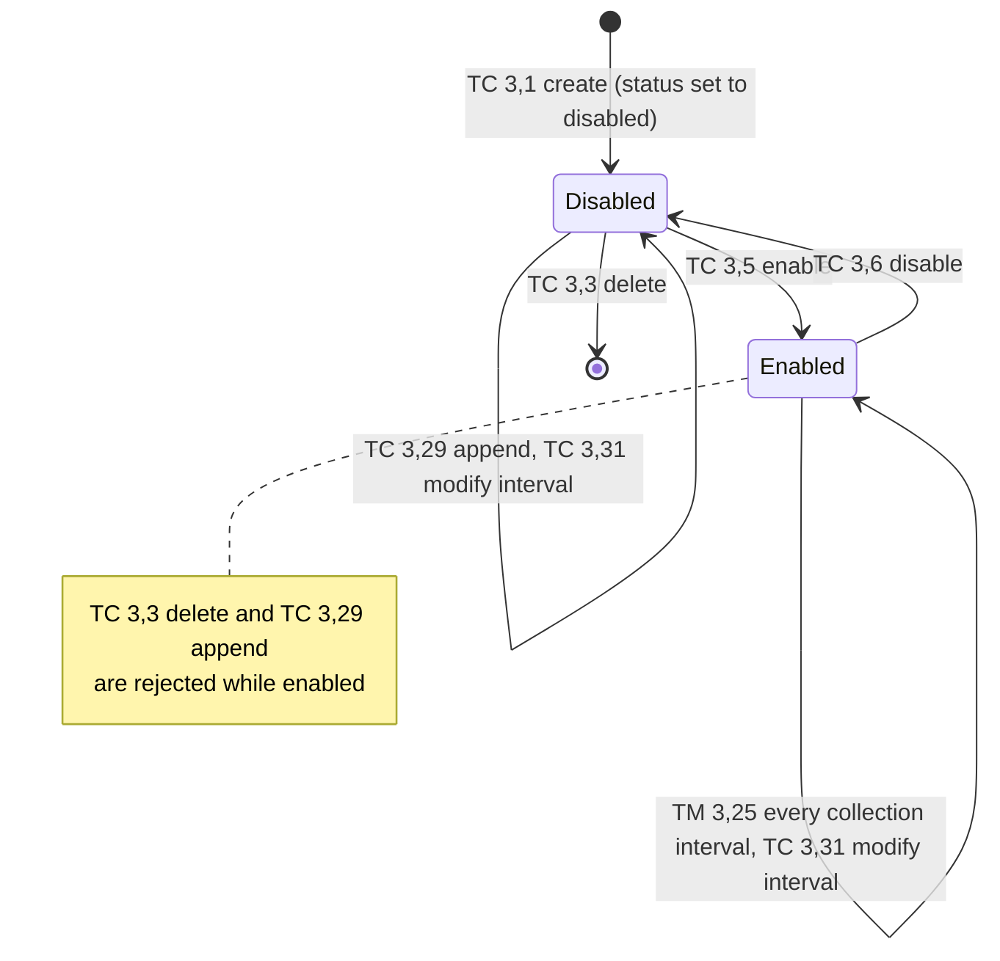
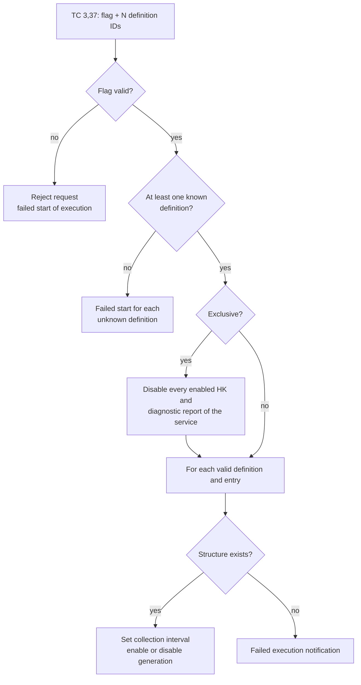
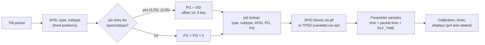

# ST[03] Housekeeping

Housekeeping telemetry is the steady stream of temperatures, voltages, currents, modes, counters and
status flags that tells the ground what state the spacecraft is in. Service type 3 of the
[Packet Utilization Standard](index.md) defines how an on-board application process assembles such
**on-board parameters** into periodic reports, how the ground creates, changes, enables and disables
those report definitions, and how it asks for one-shot snapshots. A second, parallel set of reports, the
**diagnostic** reports, serves anomaly investigation with fast, temporary sampling. PUS-C adds a third
layer, **parameter functional reporting**, that switches whole sets of reports at once on mode
changes.[^c-6311][^c-6312][^c-6313] This page covers every concept, request and report of
ECSS-E-ST-70-41C, the very different PUS-A service with its filtered mode and sampling-time offsets, the
categories of the 2024 Rev.1 draft, and the full decoding chain in SCOS-2000, with real Solar Orbiter
packets from the [MIB](../../mib/index.md).

!!! info "Where this page sits"
    The packet headers around a housekeeping report are on [PUS packet structures](packets.md); the
    parameter encodings are on [PUS parameter types](parameter-types.md). How SCOS-2000 describes
    parameters and packets in general is on [Monitoring in the MIB](../../mib/monitoring.md). Whether a
    generated report actually reaches the ground is decided by
    [ST[14] Real-time forwarding control](st14-real-time-forwarding-control.md) and, for stored data,
    [ST[15] On-board storage and retrieval](st15-onboard-storage-retrieval.md).

## 1. At a glance

| Item | Value |
|---|---|
| Service type | 3[^c-831] |
| PUS-C name | ST[03] housekeeping[^c-6311] |
| PUS-A name | Housekeeping and diagnostic data reporting service[^a-81] |
| Subservice types | housekeeping reporting (at least one), diagnostic reporting (zero or more), parameter functional reporting configuration (at most one)[^c-632] |
| Providers per application process | at most one of each subservice type[^c-632] |
| Minimum capability | TM[3,25] for housekeeping reporting; TC[3,2], [3,4], [3,7], [3,8] and TM[3,26] for diagnostic reporting; TC[3,37] for functional reporting[^c-annexc3] |
| Observables | none defined[^c-63311][^c-63413][^c-6357] |

The table lists every message type of ECSS-E-ST-70-41C. "Decl." means "by declaration", "impl." means
"implied by", "req." means "requires" and "resp." marks a report sent in response to a request.

| Type | Name | Applicability | Clauses |
|---|---|---|---|
| TC[3,1] | create a housekeeping parameter report structure | decl. | 6.3.3.5.1, 8.3.2.1 |
| TC[3,2] | create a diagnostic parameter report structure | minimum | 6.3.4.6, 8.3.2.2 |
| TC[3,3] | delete housekeeping parameter report structures | impl. TC[3,1] | 6.3.3.5.2, 8.3.2.3 |
| TC[3,4] | delete diagnostic parameter report structures | minimum | 6.3.4.7, 8.3.2.4 |
| TC[3,5] | enable the periodic generation of housekeeping parameter reports | decl. | 6.3.3.4.1, 8.3.2.5 |
| TC[3,6] | disable the periodic generation of housekeeping parameter reports | impl. TC[3,5] | 6.3.3.4.2, 8.3.2.6 |
| TC[3,7] | enable the periodic generation of diagnostic parameter reports | minimum | 6.3.4.4, 8.3.2.7 |
| TC[3,8] | disable the periodic generation of diagnostic parameter reports | minimum | 6.3.4.5, 8.3.2.8 |
| TC[3,9] | report housekeeping parameter report structures | req. TC[3,1] | 6.3.3.6, 8.3.2.9 |
| TM[3,10] | housekeeping parameter report structure report | resp. TC[3,9] | 6.3.3.6, 8.3.2.10 |
| TC[3,11] | report diagnostic parameter report structures | req. TC[3,2] | 6.3.4.8, 8.3.2.11 |
| TM[3,12] | diagnostic parameter report structure report | resp. TC[3,11] | 6.3.4.8, 8.3.2.12 |
| TM[3,25] | housekeeping parameter report | minimum; resp. TC[3,27] | 6.3.3.3, 8.3.2.13 |
| TM[3,26] | diagnostic parameter report | minimum; resp. TC[3,28] | 6.3.4.3, 8.3.2.14 |
| TC[3,27] | generate a one shot report for housekeeping parameter report structures | decl. | 6.3.3.7, 8.3.2.15 |
| TC[3,28] | generate a one shot report for diagnostic parameter report structures | decl. | 6.3.4.9, 8.3.2.16 |
| TC[3,29] | append parameters to a housekeeping parameter report structure | req. TC[3,1] | 6.3.3.8, 8.3.2.17 |
| TC[3,30] | append parameters to a diagnostic parameter report structure | req. TC[3,2] | 6.3.4.10, 8.3.2.18 |
| TC[3,31] | modify the collection interval of housekeeping parameter report structures | decl. | 6.3.3.9, 8.3.2.19 |
| TC[3,32] | modify the collection interval of diagnostic parameter report structures | decl. | 6.3.4.11, 8.3.2.20 |
| TC[3,33] | report the periodic generation properties of housekeeping parameter report structures | decl. | 6.3.3.10, 8.3.2.21 |
| TC[3,34] | report the periodic generation properties of diagnostic parameter report structures | decl. | 6.3.4.12, 8.3.2.22 |
| TM[3,35] | housekeeping parameter report periodic generation properties report | resp. TC[3,33] | 6.3.3.10, 8.3.2.23 |
| TM[3,36] | diagnostic parameter report periodic generation properties report | resp. TC[3,34] | 6.3.4.12, 8.3.2.24 |
| TC[3,37] | apply parameter functional reporting configurations | minimum | 6.3.5.3, 8.3.2.25 |
| TC[3,38] | create a parameter functional reporting definition | decl. | 6.3.5.4.1, 8.3.2.26 |
| TC[3,39] | delete parameter functional reporting definitions | impl. TC[3,38] | 6.3.5.4.2, 8.3.2.27 |
| TC[3,40] | report parameter functional reporting definitions | req. TC[3,38] | 6.3.5.5, 8.3.2.28 |
| TM[3,41] | parameter functional reporting definition report | resp. TC[3,40] | 6.3.5.5, 8.3.2.29 |
| TC[3,42] | add parameter report definitions to a parameter functional reporting definition | req. TC[3,38] | 6.3.5.6.1, 8.3.2.30 |
| TC[3,43] | remove parameter report definitions from a parameter functional reporting definition | impl. TC[3,42] | 6.3.5.6.2, 8.3.2.31 |
| TC[3,44] | modify the periodic generation properties of parameter report definitions of a parameter functional reporting definition | decl. | 6.3.5.6.3, 8.3.2.32 |

[^c-annexc3]

Subtypes 13 to 24 are not used by PUS-C; in PUS-A they were the sampling-time offset and filtered mode
requests (section 7).[^c-annexc3][^a-83] All message types are also listed in the [PUS message type catalogue](message-types.md).

## 2. Concepts

### 2.1 Report structures and their identifier

A **housekeeping parameter report structure** is the on-board definition of one kind of report. It
consists of an identifier, a collection interval, an ordered list of **simply commutated** parameters, an
ordered list of **super commutated parameter sets** and, if the subservice can enable and disable reports,
a periodic generation action status.[^c-6332] The structure is identified by the combination of the
hosting application process and the structure identifier,[^c-6332] traditionally called the **SID**
(structure identification) in PUS-A, where the ground uses it together with the APID and the report's
nature (housekeeping or diagnostic) to interpret the content.[^a-8211] A diagnostic parameter report
structure has the same elements, except that its status field is always present.[^c-6342]



The entity diagram is this wiki's rendering of requirements 6.3.3.2c, 6.3.4.2c and 6.3.5.2.[^c-6332][^c-6342][^c-6352]

The on-board resources available for structures (how many, how many parameters) and for evaluating them
at the same time are declared when the subservice is specified.[^c-6332] Structures may be predefined on
board or created on request, and the standard assumes that all of them, including predefined ones, can be
deleted, appended to and re-timed.[^c-6311][^c-63352][^c-6338][^c-6339]

### 2.2 Collection interval and sampling interval

The **collection interval** of a structure is the interval at which its parameters are collected and one
report is generated. It is expressed in units of the **minimum sampling interval** of the on-board
parameters.[^c-6312][^c-6332] Each on-board parameter has a spacecraft-wide unique identifier and is
associated with exactly one minimum sampling interval; all parameters accessed by one application
process share the same interval, and different subsystems may use different ones (the standard's example
is 125 ms for the platform and 500 ms for a payload).[^c-5432] The **sampling interval** of a parameter,
by contrast, belongs to the application process that acquires or computes its value.[^c-6312]

### 2.3 Simply and super commutated parameters

A **simply commutated** parameter contributes one sampled value per report. A **super commutated**
parameter contributes several values, sampled at a sub-period equal to the collection interval divided by
the **super commutated sample repetition number**. Each parameter appears only once in a structure,
in one of the two forms.[^c-6312] Super commutated parameters come in sets, and the samples are
interleaved by set: for a set of A and B with two samples, the report contains A1, B1, A2, B2.[^c-6333] If
the sub-period is shorter than the update period of the on-board value, some samples are
identical.[^c-6333]

For a real example of the timing, see the Solar Orbiter AOCS diagnostic report in section 9.7: a 2 s
collection interval with 16 samples, so one sample every 125 ms.[^mib-ex2]

### 2.4 Periodic generation and its status

When the periodic generation of a structure is **enabled**, the subservice generates one report per
collection interval, collecting one value of each simply commutated parameter and all samples of each
super commutated parameter during that interval.[^c-6333] A newly created structure always starts
**disabled**.[^c-63351] If a housekeeping subservice offers no enable/disable capability, its reports are
always enabled.[^c-6332] Clause 6.3 of PUS-C does not state whether predefined structures start enabled or disabled; the
Rev.1 draft makes the start and restart configuration policy a declaration of the
subservice.[^r-6332]



The state diagram is this wiki's summary of clauses 6.3.3.4 to 6.3.3.9; one-shot reports (TC[3,27]) can be
requested in either state.[^c-6334][^c-63351][^c-63352][^c-6338][^c-6339]

### 2.5 Housekeeping versus diagnostic

The two reporting subservices provide "similar functions": housekeeping for nominal operations,
diagnostic for contingency operations. A diagnostic report type can be enabled when a particular anomaly
occurs and disabled at other times.[^c-6312] PUS-A calls the scenario "diagnostic mode", a selected set of
parameters sampled at a higher rate than normal, and says it was previously known as "dwell mode" or
"oversampling mode".[^a-414] It also explains why the reports are distinct even though they work the same
way: the different subtypes let them be routed, stored and processed separately.[^a-822][^a-414]

### 2.6 Parameter functional reporting

The parameter functional reporting configuration subservice controls the reports of the housekeeping and
diagnostic subservices of its own service, for example on mode transitions.[^c-6313][^c-6351] A
**parameter functional reporting definition** has an identifier and a list of entries; each entry names a
report structure (by optional APID when the service is distributed over several application processes,
by its nature as housekeeping or diagnostic, and by its identifier) together with the status and
collection interval to apply.[^c-6352] Applying a definition can be **exclusive**: all reports of the
service are disabled first.[^c-6313][^c-6353]

## 3. The housekeeping reporting subservice

Every request of the subservice follows the same pattern. Rejected instructions (or, for single-instruction
requests, rejected requests) produce a failed start of execution notification, which reaches the ground as
a [TM[1,4]](st01-request-verification.md), and the valid instructions of a multi-instruction request are
executed regardless of the faulty ones.[^c-6334][^c-63352]

| Capability | Request | Instructions | Rejected if | Effect |
|---|---|---|---|---|
| Create | TC[3,1] | exactly one | the identifier is in use; a parameter appears twice; resources exceeded | structure created, status disabled |
| Delete | TC[3,3] | one or more | unknown identifier; status enabled | structure deleted |
| Enable | TC[3,5] | one or more | unknown identifier | status enabled |
| Disable | TC[3,6] | one or more | unknown identifier | status disabled |
| Report structures | TC[3,9] | one or more | unknown identifier | one TM[3,10] per valid instruction |
| One-shot | TC[3,27] | one or more | unknown identifier | one TM[3,25] per valid instruction |
| Append | TC[3,29] | exactly one | status enabled; unknown structure or parameter; simply commutated parameters added to a structure that has super commutated ones; parameter already present; resources exceeded | parameters added at the end: simply commutated first, then sets |
| Modify interval | TC[3,31] | one or more | unknown identifier | new collection interval |
| Report generation properties | TC[3,33] | one or more | unknown identifier | one TM[3,35] holding all notifications |

[^c-6334][^c-63351][^c-63352][^c-6336][^c-6337][^c-6338][^c-6339][^c-63310]

Three details are easy to miss:

- **Report structures** answers each instruction with its own TM[3,10], while **report generation
  properties** puts all answers into a single TM[3,35].[^c-6336][^c-63310]
- **One-shot** reports of structures with super commutated parameters are not specified: the content of the
  super commutated part is implementation dependent.[^c-6337]
- **Append** to a structure that already has super commutated sets may only add further sets, which keeps
  the simple parameters in front of the arrays.[^c-6338]

TC[3,5] and TC[3,6] are mandatory when the service includes a parameter functional reporting
configuration subservice, since that subservice works by enabling and disabling reports.[^c-6334]

## 4. The diagnostic reporting subservice

The diagnostic subservice mirrors the housekeeping one: TC[3,2], [3,4], [3,7], [3,8], [3,11], [3,28],
[3,30], [3,32] and [3,34] correspond to TC[3,1], [3,3], [3,5], [3,6], [3,9], [3,27], [3,29], [3,31] and
[3,33], with TM[3,26], [3,12] and [3,36] as reports.[^c-634] The differences are:

| Aspect | Housekeeping | Diagnostic |
|---|---|---|
| Create, delete, enable, disable | by declaration | minimum (always provided) |
| Status in the structure | only if enable/disable is provided | always present |
| One-shot report | generates one report | generates one report "independently" of the periodic generation status |
| Number per service | at least one subservice | zero or more subservices |

[^c-annexc3][^c-6342][^c-6349][^c-632]

## 5. The parameter functional reporting configuration subservice

### 5.1 Applying configurations: TC[3,37]

A TC[3,37] carries a **configuration execution flag** and one or more definition identifiers. The whole
request is rejected if the flag is invalid; unknown definitions are rejected individually. If at least one
instruction is valid and the flag is "exclusive", every enabled housekeeping and diagnostic report of the
service is first disabled. Then, for each valid definition, each referenced report structure is told to take
the entry's collection interval and to enable or disable its periodic generation; entries pointing at
structures that do not exist produce a failed execution notification.[^c-6353]



The flowchart is this wiki's reading of requirement 6.3.5.3.[^c-6353]

### 5.2 Managing definitions

| Capability | Request | Rejected if | Effect |
|---|---|---|---|
| Create | TC[3,38] (one instruction) | unknown APID or report structure; definition already exists; two entries for the same structure | new definition |
| Delete | TC[3,39] | unknown definition | definition deleted |
| Report | TC[3,40] | unknown definition | one TM[3,41] per definition |
| Add entries | TC[3,42] | unknown definition, duplicate entry in the request (whole request); entry already present (instruction) | entries added |
| Remove entries | TC[3,43] | unknown definition (request); entry not present (instruction) | entries removed |
| Modify entries | TC[3,44] | unknown definition (request); entry not present (instruction) | new status and interval for the entry |

[^c-63541][^c-63542][^c-6355][^c-63561][^c-63562][^c-63563]

## 6. Data field layouts (PUS-C)

ECSS-E-ST-70-41C gives the types of the ST[03] fields but not their sizes: the format code of each
field is declared by the mission.[^c-7231] The tables below give the fields in transmission
order.

### 6.1 Creating and reporting structures

TC[3,1] and TC[3,2] (create) have the same layout; TM[3,10] and TM[3,12] (structure reports) add the
status after the identifier, optional for housekeeping.[^c-8321][^c-83210]

| Field | PUS-C type | Repetition | Meaning |
|---|---|---|---|
| structure ID (SID) | enumerated | once | housekeeping or diagnostic parameter report structure ID |
| periodic generation action status | enumerated | once, TM[3,10] (optional) and TM[3,12] only | enabled or disabled |
| collection interval | unsigned integer | once | in minimum sampling intervals |
| N1 | unsigned integer | once | number of simply commutated parameters |
| parameter ID | enumerated | N1 times | simply commutated parameters, in report order |
| NFA | unsigned integer | once | number of super commutated parameter sets |
| super commutated sample repetition number | unsigned integer | NFA times | samples per parameter of the set |
| N2 | unsigned integer | NFA times | parameters in the set |
| parameter ID | enumerated | N2 times per set | parameters of the set |

[^c-8321][^c-83210]

TC[3,29] and TC[3,30] (append) use the same layout without the collection interval.[^c-83217]

### 6.2 Lists of structure identifiers

TC[3,3] to TC[3,9], TC[3,11], TC[3,27], TC[3,28], TC[3,33] and TC[3,34] all carry N (unsigned integer)
followed by N structure IDs (enumerated).[^c-8323][^c-83215][^c-83221] TC[3,31] and TC[3,32] add a
collection interval (unsigned integer) to each ID.[^c-83219] TM[3,35] and TM[3,36] carry N followed by N
triples of structure ID, periodic generation action status (enumerated) and collection interval.[^c-83223]

### 6.3 The reports themselves

TM[3,25] and TM[3,26] contain the structure ID (the figure gives it as unsigned integer) followed by a
"deduced" sequence of parameter values: their number, order and types follow from the structure
definition.[^c-83213]

<div class="bitfield" data-title="TM[3,25] / TM[3,26] source data (PUS-C Figures 8-33 and 8-34; sizes are mission-defined, shown here with an 8-bit SID)" data-width="32"
     data-fields='[{"n":"SID","b":8,"d":"Structure ID; its size is a mission choice (8 bits on Solar Orbiter)"},{"n":"Parameter values (deduced from the structure)","b":24,"d":"Simply commutated values in order, then the super commutated sets, sample by sample"}]'></div>

[^c-83213]

### 6.4 Functional reporting messages

| Message | Fields in order |
|---|---|
| TC[3,37] | configuration execution flag (enumerated); N (unsigned integer); N × definition ID (enumerated) |
| TC[3,38], TM[3,41], TC[3,42], TC[3,44] | definition ID (enumerated); N1 (unsigned integer, optional); N1 × [APID (enumerated, optional); N2 (unsigned integer); N2 × (structure type, structure ID, periodic generation action status (all enumerated), collection interval (unsigned integer))] |
| TC[3,43] | as above, without status and collection interval |
| TC[3,39], TC[3,40] | N; N × definition ID |

[^c-83225][^c-83226][^c-83229][^c-83231]

| Enumeration (8.3.3) | Engineering value | Raw value |
|---|---|---|
| Parameter report structure type | "housekeeping" | 25 |
| | "diagnostic" | 26 |
| Configuration execution flag | "non-exclusive" | 0 |
| | "exclusive" | 1 |

[^c-833]

The structure type values reuse the subtypes of the two reports. The values of the periodic generation
action status are not listed in the ST[03] enumeration clause of ECSS-E-ST-70-41C.[^c-833]

## 7. PUS-A: the housekeeping and diagnostic data reporting service

PUS-A's service 3 has two independent subservices (housekeeping, periodic and filtered, and diagnostic)
and is designed around the needs of the time: report content and frequency must be changeable in flight
because initial designs turn out suboptimal, sensors age and failures happen.[^a-81][^a-451] Its minimum
housekeeping implementation is the periodic reporting of predefined packets.[^a-451]

### 7.1 Requests and reports

| Subtype | PUS-A name | Data (in order) |
|---|---|---|
| (3,1), (3,2) | Define New Housekeeping / Diagnostic Parameter Report | SID; collection interval (optional); NPAR1; NPAR1 × parameter#; NFA; NFA × [NREP; NPAR2; NPAR2 × parameter#] |
| (3,3), (3,4) | Clear Housekeeping / Diagnostic Parameter Report Definitions | NSID (optional); NSID × SID |
| (3,5) to (3,8) | Enable / Disable Housekeeping / Diagnostic Parameter Report Generation | NSID (optional); NSID × SID |
| (3,9), (3,11) | Report Housekeeping / Diagnostic Parameter Report Definitions | NSID (optional); NSID × SID |
| (3,10), (3,12) | ... Report Definitions Report | NSID (optional); NSID × [SID; collection interval (optional); NPAR1; parameters; NFA; arrays] |
| (3,13), (3,14) | Report ... Parameter Sampling-Time Offsets | SID |
| (3,15), (3,16) | ... Sampling-Time Offset Report | SID; one relative time per parameter |
| (3,17), (3,18) | Select Periodic ... Generation Mode | SID |
| (3,19), (3,20) | Select Filtered ... Generation Mode | SID; timeout (optional); N (optional); N × [parameter#; threshold type (optional); threshold (optional)] |
| (3,21), (3,22) | Report Unfiltered ... Parameters | SID |
| (3,23), (3,24) | Unfiltered ... Parameters Report | SID; N; N × [parameter#; threshold type; threshold] |
| (3,25), (3,26) | Housekeeping / Diagnostic Parameter Report | SID; mode (optional); parameters |

[^a-831][^a-832][^a-833][^a-834][^a-835][^a-836][^a-837][^a-838]

PUS-A details worth knowing:

- The **parameter#** is an on-board number used for optimisation, with a one-to-one correspondence to the
  ground's parameter ID.[^a-831] SCOS-2000 stores it as `PCF_PID` (section 9.3).
- The **collection interval** is expressed in units of the mission constant `<DIAG_MIN_INTERV>`, the
  minimum sampling interval of diagnostic mode (typically 10 to 30 ms), and is omitted when the service
  uses a default.[^a-831][^a-414]
- NFA counts the **fixed-length arrays**, NREP the samples per parameter in an array, and NPAR2 the
  parameters of the array.[^a-831] This is the PUS-A form of the super commutated set.
- A new definition starts with its "Report Generation Flag" disabled and in periodic mode.[^a-831]
- Requests that can only handle one SID at a time omit NSID.[^a-832][^a-833]
- **Forwarding** of reports to the ground is not part of service 3 but of the packet forwarding control
  service (PUS-C [ST[14]](st14-real-time-forwarding-control.md)).[^a-8213]

### 7.2 Filtered mode

PUS-A's second generation mode, the **filtered** mode, produces a report at the end of a collection
interval only if at least one unfiltered parameter changed by more than its threshold since the previous
interval; for parameters sampled several times, any change of a sample counts.[^a-8213] The threshold of
each parameter is either a percentage (threshold type 0) or an absolute delta (type 1), and a
**timeout**, a multiple of the collection interval, forces a one-shot report when nothing has changed for
too long.[^a-836][^a-8213] The optional **mode** field of (3,25) and (3,26) tells the ground why the report
exists: 0 periodic, 1 filtered and a threshold was exceeded, 2 filtered but generated by the
timeout.[^a-838] Filtered mode was intended mainly for status parameters, so that a report is only sent
when something changes, with noisy analogue values filtered out of the comparison.[^a-451][^a-8213]
Selecting a mode that is already active generates an error report.[^a-836]

### 7.3 Sampling-time offsets

PUS-A requires that absolute and relative sampling times of housekeeping parameters can be determined on
the ground to accuracies set by mission constants, and allows three methods: knowledge of the on-board
sampling mechanism, explicit time-stamping of parameters, or offsets measured on board and reported with
(3,15)/(3,16). In the third case the report is also generated automatically when a new SID is defined,
before its first report, and only the first sample of each array is given an offset.[^a-8214][^a-835]
The static time offsets of SCOS-2000 (section 9.1) suit the first method, or the third once the measured
offsets have been entered in the database; this pairing is this wiki's reading, not a statement of either
source.[^icd-s3][^a-8214]

### 7.4 Capability sets

| Set | Subtypes | Rule |
|---|---|---|
| Minimum, housekeeping | 25 | always |
| Minimum, diagnostic | 2, 4, 7, 8, 26 | 2 and 4 require each other, 7 and 8 require each other |
| Report definitions control | 1, 3, 5, 6 | all four |
| Report definitions reporting | 9/10, 11/12 | at least one request/report pair |
| Sampling time offset reporting | 13/15, 14/16 | at least one pair |
| Filtered mode | 17/19, 18/20 | at least one pair |
| Filtered mode, additional | 21/23, 22/24 | optional pairs |

[^a-84]

### 7.5 From PUS-A to PUS-C

| PUS-A | PUS-C | Change |
|---|---|---|
| (3,1) to (3,12) | TC[3,1] to TM[3,12] | same subtypes; "define" and "clear" become "create" and "delete"; N lists become mandatory |
| (3,13) to (3,16) | none | sampling-time offset reporting removed |
| (3,17) to (3,24) | none | filtered mode removed |
| (3,25), (3,26) with mode field | TM[3,25], TM[3,26] | no mode field |
| none | TC[3,27] to TM[3,36] | one-shot, append, modify interval, report generation properties |
| none | TC[3,37] to TC[3,44] | parameter functional reporting |

[^a-83][^c-annexc3]

The general comparison of the two issues is on [PUS-A vs PUS-C](pus-a-vs-pus-c.md).

## 8. The Rev.1 draft: one subservice, six categories

The December 2024 draft for public review restructures the service. It defines only two subservice types,
housekeeping reporting and parameter functional reporting configuration; the diagnostic subservice
disappears.[^r-631] Instead, every housekeeping structure has one of **six categories**, statically deduced
from its structure identifier, and the category selects the message type of the report: TM[3,25] for
category 1, TM[3,26] for category 2 and the new TM[3,50] to TM[3,53] for categories 3 to 6.[^r-6333][^r-6334]
The draft's example of a tailoring is category 1 for nominal reports, 2 for diagnostic reports, 3 for
essential reports used at low bit rate and 4 for troubleshooting reports stored only on board.[^r-6333]
The diagnostic requests disappear from the interface clause, and the housekeeping periodic generation
properties report is printed as TM[3,34] instead of TM[3,35], consistently in clause 6.3.3.11, in clause
8.3.2.11 and in Annex C, so it is not a single misprint; the reason is not stated in the available
sources.[^r-832]

!!! note "Comparison with Solar Orbiter"
    Solar Orbiter separates kinds of housekeeping with the packet category field of its APIDs (section
    9.4) rather than with the message type.[^solo-cat] The parallel with the Rev.1 categories is this
    wiki's comparison; neither document draws it.

## 9. SCOS-2000 and the Solar Orbiter MIB

### 9.1 What SCOS-2000 does (and does not do) with service 3

The SCOS-2000 import ICD says that there is no service-specific processing of service 3 packets, and lists
the consequences:[^icd-s3]

- every TM packet must be recognised from the MIB, so a new housekeeping or diagnostic packet created with
  service 3 commands must first be added to the database; the efficient approach, typical of ESA missions,
  is to define the packet in the database first and generate the service 3 commands from it, in the
  mission's database manager rather than in the SCOS-2000 kernel;
- the time stamp of each parameter sample is the packet time plus a time offset statically defined in the
  database, so the offsets must be known in advance and identical for every instance of the packet;
- the collection interval of periodic packets is also static in the database and is not updated when a
  service 3 command changes it on board.

### 9.2 How a housekeeping packet is recognised

The SCOS-2000 telemetry **packetiser** identifies a packet from its APID, type and subtype and, for some
type/subtype combinations, up to two additional identification fields defined in
[`pic`](../../mib/tables/pic.md) by byte offset and bit width. The full key (type, subtype, APID, PI1,
PI2) is then looked up in [`pid`](../../mib/tables/pid.md) to find the SCOS-2000 packet ID (SPID) and,
for variable packets, the structure definition (TPSD).[^icd-pidintro][^icd-pic] For housekeeping this
first additional field is naturally the SID.



The offsets in the diagram are those of the Solar Orbiter MIB; the flow is the ICD's description of the
packetiser.[^icd-pidintro][^icd-pic][^mib-pic]

In [`plf`](../../mib/tables/plf.md), each parameter of a fixed packet has a byte offset `PLF_OFFBY`
counted from the start of the TM source packet, a bit offset `PLF_OFFBI`, and four fields for super
commutation and timing: `PLF_NBOCC` (number of occurrences, 1 for a simply commutated parameter),
`PLF_LGOCC` (bits between consecutive occurrences), `PLF_TIME` (offset of the first occurrence from the
packet time, in ms) and `PLF_TDOCC` (ms between occurrences). A super commutated parameter is a single
record.[^icd-plf] Overlapping records and gaps are allowed.[^icd-plf] Variable packets such as the structure
reports TM(3,10) and TM(3,12) are described in [`vpd`](../../mib/tables/vpd.md) instead, and
`PID_INTER` gives the expected interval of periodic packets, after which their samples expire.[^icd-vpd][^icd-pid]

### 9.3 How a definition command is built

A create command contains parameter identifiers. SCOS-2000 supports a special command parameter type,
"Parameter ID" (`CPC_CATEG` = `P`, PTC 3), that accepts the name of a monitoring parameter and encodes its
on-board identifier `PCF_PID`, which corresponds one to one to the PUS parameter#.[^icd-pidtype][^icd-cpccateg][^icd-pcfpid]
This is how a generic "Define New Housekeeping Parameter Report" can be filled from the database.

### 9.4 Solar Orbiter's tailoring

Solar Orbiter's TM/TC ICD uses PUS-A service 3 with private subtypes. It describes housekeeping for
nominal operations, configurable per mission phase, and diagnostic reports for error investigation, with
SIDs unique within a process ID (the note under TC(3,1) adds: unique across housekeeping and diagnostic
definitions of one process ID).[^solo-s3][^solo-s31] In the mission's service list only TM(3,25) is
marked "M" (minimum capability for every user); all other service 3 subtypes are optional ("O").[^solo-list] For the central software, the predefined definitions
can be modified, deleted or extended by the ground, but the defaults are reloaded after a software
reset.[^solo-s3b]

| Subtype | Solar Orbiter name | Notes |
|---|---|---|
| TC(3,1) | Define New HK Parameter Report | SID (1 octet), collection interval (2 octets), NPAR (1 octet), parameter IDs (4 octets); no arrays |
| TC(3,2) | Define New diagnostic Parameter Report | as (3,1) plus NFA (0 or 1), NREP, NPAR2 (1 octet each) and parameter IDs |
| TC(3,3), (3,4) | Clear HK / Diag Parameter Report Definition | one SID; only after disabling |
| TC(3,5) to (3,8) | Enable / Disable HK / Diag Parameter Report Generation | one SID |
| TC(3,9), TM(3,10), TC(3,11), TM(3,12) | Report definitions | layouts as (3,1) and (3,2) |
| TM(3,25), TM(3,26) | HK / Diag Parameter Report | SID (1 octet) then parameters; SSMM reports put the SSMM mode in the first octet after the SID |
| TC(3,128), TM(3,134) | HK/Diag definitions in summary form | per SID: status (0 disabled, 1 enabled) and collection interval |
| TC(3,129) | Update HK Report Generation Period | SSMM only; collection interval in 8 Hz cycles, minimum 1 s, default 16 s |
| TC(3,130), (3,131) | Define HK / Diagnostic Report Collection Interval | diagnostic: only while disabled, interval divisible by NREP |
| TC(3,136) | Request HK/Diagnostic Parameter Report | one-shot report |
| TC(3,138) | Append Parameters to a HK Parameter Report | SID, NPAR, parameter IDs |
| TC(3,139) | Request Snapshot HK Parameter Anomaly Report | EID (2 octets), SID: one TM(5,x) event carrying the HK packet's parameters |

[^solo-s31][^solo-s32][^solo-s33][^solo-s34][^solo-s35][^solo-s36]

The collection interval is counted in **cycles** of the application's scheduling: the ICD's example is an
application scheduled at 10 Hz that needs a value of 10 for one report per second.[^solo-s31] The SID
ranges of Annex 10 are 1-127 for TM(3,25) (with sub-ranges for status, mode, equipment, specific
requests, ESOC and ancillary data) and 128-255 for TM(3,26), the last block (232-255) being "diagnostic to
packet store only".[^solo-sid] The packet category in the low 4 bits of the APID separates the kinds of
report: 2 for high-priority telemetry (HPTM) housekeeping of the platform, 4 for routine housekeeping, 5
for "functional cyclic" housekeeping produced on ground request, and 8 for diagnostics.[^solo-cat]

!!! warning "Inference"
    By function, TC(3,130)/(3,131) correspond to PUS-C TC[3,31]/[3,32], TC(3,136) to TC[3,27]/[3,28],
    TC(3,138) to TC[3,29], and TC(3,128)/TM(3,134) to TC[3,33]/TM[3,35] combined for both kinds of report.
    Solar Orbiter thus implemented as private subtypes several capabilities that PUS-C later standardised.
    This mapping is this wiki's comparison; the ICD does not state it.

### 9.5 The numbers in the MIB

The September 2025 release defines 397 service 3 packets and 345 service 3 commands:[^mib-s3]

| Packet | Count | APIDs | Packet category | Structure |
|---|---|---|---|---|
| TM(3,25) | 288 | 62 | 2 (68), 4 (169), 5 (51) | fixed, `plf` |
| TM(3,26) | 89 | 14 | 8 (89) | fixed, `plf` |
| TM(3,10) | 7 | 7 | 3 | variable, `vpd` |
| TM(3,12) | 6 | 6 | 3 | variable, `vpd` |
| TM(3,134) | 7 | 7 | 3 | variable, `vpd` |

[^mib-s3]

The `pic` table identifies TM(3,25) and TM(3,26) by a first additional field at **byte offset 16, 8 bits
wide**, for all APIDs: the 1-octet SID right after the 16 octets of headers. The three definition and
summary reports have no additional identification.[^mib-pic] Every one of the 377 HK and diagnostic packets
starts its `plf` layout at byte 16, i.e. the SID is itself decoded as a parameter (for the platform
software, `NCD030A1` "OBCHP_HK SID" and `NCD030C1` "OBCHP_DIAG SID", PTC 3, PFC 4).[^mib-plf] No process ID
uses the same SID for two report packets, which is consistent with the ICD rule that SIDs are unique per
process ID across both kinds.[^mib-s3][^solo-s31] `PID_INTER` is empty for all 11,150 packets of the
release, so no packet has an expiry interval.[^mib-s3]

| `plf` statistic | TM(3,25) | TM(3,26) |
|---|---|---|
| packets / records | 288 / 65,567 | 89 / 17,578 |
| distinct parameters | 31,581 | 17,437 |
| super commutated records (`PLF_NBOCC` > 1) | 0 | 99 in 10 packets (up to 257 occurrences) |
| records with a non-zero `PLF_TIME` | 0 | 91 |

[^mib-plf]

The ICD's layouts predict this: its TC(3,1) has no array fields, and it expects diagnostic reports to
contain "a predominance of fixed-length arrays". In the data, super commutation and sample timing appear
only in diagnostic packets.[^mib-plf][^solo-s31][^solo-s3b]

The central software's SID allocation in the MIB is denser than Annex 10. For the six CSW applications
(process IDs 10 to 14 and 16) the routine housekeeping SIDs on category 4 run from 77 to 102, the functional cyclic
ones on category 5 from 153 to 192 and the HPTM ones on category 2 from 1 to 21, while the diagnostics use
193 to 255.[^mib-s3] The CSW category 5 housekeeping SIDs thus lie in the range that Annex 10 gives to
TM(3,26).[^solo-sid] For the DMS application the 15 HPTM packets on APID 162 (SIDs 1 to 16, without 15)
have the same descriptions as the routine packets with SIDs 77 to 92 on APID 164, and 14 of the 15 pairs
have identical `plf` layouts; the exception is "DMS Overview Fast", whose HPTM version (SID 11, SPID
19539) has two more records (`NCDX0001` and `NCDX0002` at bytes 17 and 25) than its routine version (SID
87, SPID 19559).[^mib-dup]

!!! warning "Inference"
    The CSW appears to generate nearly the same report contents under two SIDs, one routed as
    high-priority telemetry and one as routine housekeeping, with SID = HPTM SID + 76. The MIB shows the
    duplication;
    the reason (for example HPTM availability when the software is degraded) is not stated in the
    available sources.

The April 2020 release had 269 TM(3,25), 86 TM(3,26) and 331 service 3 commands; the 2025 release adds
19, 3 and 14 respectively. The SWA instrument database defines 12 TM(3,25) and 9 TM(3,26) packets with the
same `pic` convention.[^mib2020-s3][^swa-s3]

| Command | Commands in 2025 | Of which fully predefined |
|---|---|---|
| TC(3,1) define HK | 82 (on 7 APIDs) | 75 |
| TC(3,2) define diagnostic | 77 | 71 |
| TC(3,138) append | 40 | 34 |
| TC(3,5), TC(3,6) enable, disable HK | 24 each (24 APIDs) | - |
| TC(3,129) update HK period | 19 (13 APIDs, used by several instruments as well as the SSMM) | - |
| TC(3,130) define HK interval | 14 | - |
| others (3,3), (3,4), (3,7), (3,8), (3,9), (3,11), (3,128), (3,131), (3,136), (3,139) | 6 to 8 each | - |

[^mib-s3cmd]

"Fully predefined" means that no element in [`cdf`](../../mib/tables/cdf.md) is editable: every element
is a fixed area or a fixed (non-editable) parameter, so the command creates one specific report (for TC(3,1)
72 commands use fixed areas only and 3 use fixed parameters; for TC(3,2) 66 and 5); the others are generic commands with editable parameters. This is the
ICD's recommended practice in action: the packet exists in the database and the command that creates it
on board is generated alongside.[^mib-s3cmd][^icd-s3]

### 9.6 Worked example 1: from TC(3,1) to TM(3,25)

The command [`ZCA2Z05B`](../../explorer/index.md#/solo/command/ZCA2Z05B) "Define HK: AOCS Dynamics FAST" is
a TC(3,1) to APID 188 (process ID 11, AOCS, category 12). Its application data is entirely made of fixed
areas, so its bytes are real data from the MIB:[^mib-ex1]

```text
4D | 00 30 | 08 | 0B201C1C 0B201950 0B201C1B 0B20143B 0B201459 0B201477 0B201495 0B201C29
SID   CI     NPAR  eight 32-bit on-board parameter IDs (PCF_PID)
```

<div class="bitfield" data-title="Solar Orbiter TC(3,1) application data (first parameter ID shown; values of ZCA2Z05B)" data-width="32"
     data-fields='[{"n":"SID","b":8,"v":"0x4D","d":"77"},{"n":"Collection interval","b":16,"v":"0x0030","d":"48 cycles"},{"n":"NPAR","b":8,"v":"0x08","d":"8 parameters"},{"n":"Parameter ID","b":32,"v":"0x0B201C1C","d":"PCF_PID 186653724 = NCAG6VN0 GyrStarOutputEstRateEst; repeated NPAR times"}]'></div>

Each parameter ID matches exactly one [`pcf`](../../mib/tables/pcf.md) entry through `PCF_PID`, and the
resulting packet is TM(3,25) SID 77 on APID 180 (process ID 11, category 4), SPID
[29530](../../explorer/index.md#/solo/packet/29530) "AOCS Dynamics FAST":[^mib-ex1]

| Order | Parameter ID (hex) | Parameter | Type (PTC/PFC) | Byte offset in SPID 29530 |
|---|---|---|---|---|
| - | - | `NCD030A1` OBCHP_HK SID | 3/4 | 16 |
| 1 | `0B201C1C` | [`NCAG6VN0`](../../explorer/index.md#/solo/param/NCAG6VN0) GyrStarOutputEstRateEst | 7/24 | 17 |
| 2 | `0B201950` | `NCAG4NP0` ErrGenErrAngErr | 7/24 | 41 |
| 3 | `0B201C1B` | `NCAG6VL0` GyrStarOutputEstQuat | 7/32 | 65 |
| 4 | `0B20143B` | `NCAT1AG0` RW1_RATE | 5/1 | 97 |
| 5 | `0B201459` | `NCAT1B10` RW2_RATE | 5/1 | 101 |
| 6 | `0B201477` | `NCAT1BK0` RW3_RATE | 5/1 | 105 |
| 7 | `0B201495` | `NCAT1C40` RW4_RATE | 5/1 | 109 |
| 8 | `0B201C29` | `NCAG6VZ0` WsEstTrqFricEST | 7/16 | 113 |

[^mib-ex1]

The offsets follow from the sizes: 16 header octets, the SID, then 24 + 24 + 32 + 4 × 4 + 16 octets, so
the last parameter occupies bytes 113 to 128.[^mib-ex1] The octet strings (PTC 7) are additionally decoded by overlapping
`plf` records into their components: for example `NCAD6VN1`, `NCAD6VN2` and `NCAD6VN3` (GSE_EST_RATE-X, -Y,
-Z, PTC 5/PFC 2, 64-bit reals) at offsets 17, 25 and 33 inside `NCAG6VN0`.[^mib-ex1] This is the ICD's
allowance for overlapping records used to show both the raw block and its engineering
components.[^icd-plf]

The parameter identifiers themselves follow the 32-bit layout that Annex 11 of the Solar Orbiter ICD
defines for the central software's data pool: a 1-bit filler (0), the 7-bit process ID, a read/write flag
(0 = read and write, 1 = read only) and a 23-bit local ID made of a 3-bit filler `0b010`, an 8-bit unit ID
and a 12-bit counter (for CSW-generated parameters its last 4 bits give the functional type of the
parameter).[^solo-pid] Decoded this
way, `0x0B201C1C` is filler 0, process ID 11 (AOCS), read/write flag 0, filler `0b010`, unit ID 1 and
counter `0xC1C`; the process ID matches the AOCS APIDs 180 and 188 of the example.[^solo-pid][^mib-ex1]

<div class="bitfield" data-title="Solar Orbiter CSW parameter ID 0x0B201C1C (ICD Annex 11 layout)" data-width="32"
     data-fields='[{"n":"Filler","b":1,"v":"0"},{"n":"Process ID","b":7,"v":"0001011","d":"11 = AOCS application"},{"n":"R/W","b":1,"v":"0","d":"0 = read and write"},{"n":"Filler","b":3,"v":"010","g":"Local ID"},{"n":"Unit ID","b":8,"v":"00000001","g":"Local ID"},{"n":"Counter","b":8,"v":"11000001","g":"Local ID","d":"First part of the counter"},{"n":"Functional part","b":4,"v":"1100","g":"Local ID","d":"Functional type of the parameter"}]'></div>

!!! warning "Inference"
    The `cdf` description of the collection interval fixed area is "Interval=6000 ms (cycl)" for these 48
    cycles, and "Interval=2000 ms (cycl)" for the 16 cycles of the next example; both imply a 125 ms (8 Hz)
    AOCS application cycle.[^mib-ex1][^mib-ex2] The ICD does not state the AOCS cycle; it only says that
    the interval counts cycles of the application's scheduling.[^solo-s31]

### 9.7 Worked example 2: a super commutated diagnostic report

[`ZCA2Z06V`](../../explorer/index.md#/solo/command/ZCA2Z06V) "Define Diag: AOCS OCM 8Hz Diag" is a
TC(3,2) whose fixed areas, with the descriptions stored in `cdf`, are: SID `0xE5` (229), collection
interval `0x0010` described as "Interval=2000 ms (cycl)", NPAR1 = 1 (`OCMT_AUTO_TRANS_ENABLED`), one fixed
length array (NFA = 1), "NoOfSamples=16" (NREP = 16) and NPAR2 = 16 parameters (accelerometer measurement,
estimated quaternion and rate, nine durations `AOCS_NC_FCV_1_DUR` to `AOCS_NC_FCV_9_DUR` and four wheel
rates).[^mib-ex2] Sixteen cycles
for 2,000 ms means a 125 ms cycle, i.e. 8 Hz, as the name says.

The matching TM(3,26) is SPID [29540](../../explorer/index.md#/solo/packet/29540) on APID 184 (process ID
11, category 8). Its `plf` has the SID at byte 16, the simply commutated flag at byte 17, and from byte 18
the 16-parameter record repeated 16 times: `PLF_NBOCC` = 16, `PLF_LGOCC` = 744 bits (93 octets per
record), `PLF_TDOCC` = 125 ms and `PLF_TIME` = -1,875 ms.[^mib-ex2]

| Sample | 1 | 2 | 3 | ... | 15 | 16 |
|---|---|---|---|---|---|---|
| Byte offset of the record | 18 | 111 | 204 | ... | 1,320 | 1,413 |
| Time relative to packet time | -1,875 ms | -1,750 ms | -1,625 ms | ... | -125 ms | 0 ms |

The table is computed from the four `plf` fields. The 16 samples are spaced by the collection interval
divided by the repetition number (2,000 / 16 = 125 ms), exactly the PUS-C sub-period rule, and the last
sample carries the packet time.[^mib-ex2][^c-6333] Because SCOS-2000 applies these offsets statically,
the on-board sampling must always follow this pattern.[^icd-s3]

### 9.8 The structure reports as variable packets

The definition reports are decoded as variable packets. For the DMS application, TM(3,10) (TPSD
[14164](../../explorer/index.md#/solo/packet/14164)) is SID (8 bits), collection interval (16 bits), a
counter of parameters and then one 32-bit parameter ID per entry; TM(3,12) (TPSD 14163) adds the array
counter, the number of samples, the number of super commutated parameters and their IDs; TM(3,134) (TPSD
14165) is a counter of SIDs followed by SID, report generation status (8 bits) and collection interval for
each.[^mib-vpd] These are the ICD layouts of section 9.4 expressed as `vpd` repeat groups.[^mib-vpd][^solo-s32]

??? example "SQL used"
    ```sql
    -- solo-2025-09-16.sqlite (MIB__20250916M25925PFMS001_SOL)
    SELECT PID_STYPE, COUNT(*), COUNT(DISTINCT PID_APID), SUM(PID_TPSD != '-1')
      FROM pid WHERE PID_TYPE = '3' GROUP BY 1;
    SELECT PID_STYPE, CAST(PID_APID AS INT) % 16 AS cat, COUNT(*) FROM pid
     WHERE PID_TYPE = '3' AND PID_STYPE IN ('25','26') GROUP BY 1, 2;
    SELECT * FROM pic WHERE PIC_TYPE = '3';
    SELECT COUNT(*) FROM pid WHERE PID_INTER IS NOT NULL AND PID_INTER != '';
    -- SID ranges per APID, and uniqueness of SIDs per process ID
    SELECT PID_STYPE, PID_APID, COUNT(*), MIN(CAST(PID_PI1_VAL AS INT)), MAX(CAST(PID_PI1_VAL AS INT))
      FROM pid WHERE PID_TYPE = '3' AND PID_STYPE IN ('25','26') GROUP BY 1, 2;
    SELECT CAST(PID_APID AS INT)/16, PID_PI1_VAL, COUNT(*) n FROM pid
     WHERE PID_TYPE = '3' AND PID_STYPE IN ('25','26') GROUP BY 1, 2 HAVING n > 1;  -- empty
    -- plf statistics
    SELECT d.PID_STYPE, COUNT(*), COUNT(DISTINCT p.PLF_SPID), SUM(CAST(p.PLF_NBOCC AS INT) > 1),
           MAX(CAST(p.PLF_NBOCC AS INT)), SUM(CAST(p.PLF_TIME AS INT) != 0), COUNT(DISTINCT p.PLF_NAME)
      FROM plf p JOIN pid d ON d.PID_SPID = p.PLF_SPID
     WHERE d.PID_TYPE = '3' AND d.PID_STYPE IN ('25','26') GROUP BY 1;
    -- worked examples
    SELECT * FROM cdf WHERE CDF_CNAME IN ('ZCA2Z05B','ZCA2Z06V') ORDER BY CDF_CNAME, CAST(CDF_BIT AS INT);
    SELECT PCF_PID, PCF_NAME, PCF_DESCR, PCF_PTC, PCF_PFC FROM pcf WHERE PCF_PID = '186653724';
    SELECT p.*, c.PCF_DESCR FROM plf p JOIN pcf c ON c.PCF_NAME = p.PLF_NAME
     WHERE p.PLF_SPID IN ('29530','29540') ORDER BY p.PLF_SPID, CAST(p.PLF_OFFBY AS INT);
    SELECT * FROM vpd WHERE VPD_TPSD IN ('14163','14164','14165') ORDER BY VPD_TPSD, CAST(VPD_POS AS INT);
    -- service 3 commands
    SELECT CCF_STYPE, COUNT(*), COUNT(DISTINCT CCF_APID) FROM ccf WHERE CCF_TYPE = '3' GROUP BY 1;
    -- "fully predefined" = no editable cdf element
    SELECT c.CCF_STYPE, COUNT(*), SUM(NOT EXISTS (SELECT 1 FROM cdf d
           WHERE d.CDF_CNAME = c.CCF_CNAME AND d.CDF_ELTYPE = 'E'))
      FROM ccf c WHERE c.CCF_TYPE = '3' AND c.CCF_STYPE IN ('1','2','138') GROUP BY 1;
    -- HPTM versus routine DMS packets (APIDs 162 and 164)
    SELECT PID_APID, PID_PI1_VAL, PID_SPID, PID_DESCR FROM pid WHERE PID_TYPE = '3' AND PID_APID IN ('162','164');
    -- solo-2020-04-16.sqlite and swa-idb.sqlite: same pid/ccf counts
    ```

## 10. Design notes

- **One packet type, many structures.** All housekeeping reports share TM[3,25]; the SID is what makes them
  different. Ground systems therefore need an identification rule that looks inside the packet, which
  SCOS-2000 provides with `pic`, and an on-board design that puts the SID at a fixed position.[^icd-pidintro]
- **Ground and board must agree.** Because SCOS-2000 decodes packets only from the database, a service 3
  change on board without a matching MIB change produces undecodable telemetry; changing an interval on
  board does not change the expected interval or the sample time offsets on the ground.[^icd-s3]
- **Delete and append need a disabled report.** Both are rejected while periodic generation is enabled, so
  a change to a running report is a disable, change, enable sequence.[^c-63352][^c-6338] Solar Orbiter
  applies the same rule to its clear and diagnostic interval commands.[^solo-s33][^solo-s35]
- **Diagnostics are temporary by design.** PUS-A asks the ground to weigh carefully how much of the
  downlink diagnostic packets may take; PUS-C makes their enabling and disabling a minimum capability.[^a-414][^c-annexc3]

## Related pages

- [ST[01] Request verification](st01-request-verification.md) - the reports that confirm or reject these requests.
- [ST[04] Parameter statistics reporting](st04-parameter-statistics.md) and [ST[12] On-board monitoring](st12-onboard-monitoring.md) - other uses of on-board parameters.
- [ST[20] On-board parameter management](st20-onboard-parameter-management.md) - defining and setting the parameters themselves.
- [Monitoring in the MIB](../../mib/monitoring.md) - `pid`, `pic`, `plf`, `vpd` and `pcf` in depth.
- [Worked example: decoding a real Solar Orbiter telemetry packet](../../overview/worked-example-tm.md).
- [Downlink: from on-board parameter to operator display](../../overview/downlink.md).
- [How Solar Orbiter uses PUS](../../missions/solar-orbiter/pus-usage.md) and [Solar Orbiter SWA instrument database](../../missions/solar-orbiter/swa.md).
- Instrument housekeeping: [STIX](../../missions/solar-orbiter/stix.md#housekeeping-and-the-inter-instrument-packet) and the [SWA DPU communications ICD](../../missions/solar-orbiter/instrument-interfaces.md#housekeeping-and-diagnostic-telemetry).
- [Operations preparation: dynamic housekeeping](../../scos2000/operations-preparation.md#telemetry-definitions-on-the-fly-dynamic-housekeeping), how a ground system follows report structures defined in flight with service 3 commands.

[^c-6311]: [ECSS-E-ST-70-41C, Space engineering - Telemetry and telecommand packet utilization](../../library/ecss-e-st-70-41c-15april2016.md), §6.3.1.1, PDF p. 78.
[^c-6312]: [ECSS-E-ST-70-41C](../../library/ecss-e-st-70-41c-15april2016.md), §6.3.1.2, PDF pp. 78-79.
[^c-6313]: [ECSS-E-ST-70-41C](../../library/ecss-e-st-70-41c-15april2016.md), §6.3.1.3, PDF p. 79.
[^c-632]: [ECSS-E-ST-70-41C](../../library/ecss-e-st-70-41c-15april2016.md), §6.3.2.1-6.3.2.2, PDF pp. 79-80.
[^c-6332]: [ECSS-E-ST-70-41C](../../library/ecss-e-st-70-41c-15april2016.md), §6.3.3.2a-c and Notes 1-4, PDF pp. 80-81.
[^c-6333]: [ECSS-E-ST-70-41C](../../library/ecss-e-st-70-41c-15april2016.md), §6.3.3.3a-f and Notes, PDF pp. 81-82.
[^c-6334]: [ECSS-E-ST-70-41C](../../library/ecss-e-st-70-41c-15april2016.md), §6.3.3.4.1-6.3.3.4.2, PDF pp. 82-84.
[^c-63351]: [ECSS-E-ST-70-41C](../../library/ecss-e-st-70-41c-15april2016.md), §6.3.3.5.1a-f, PDF pp. 84-85.
[^c-63352]: [ECSS-E-ST-70-41C](../../library/ecss-e-st-70-41c-15april2016.md), §6.3.3.5.2a-g, PDF p. 85.
[^c-6336]: [ECSS-E-ST-70-41C](../../library/ecss-e-st-70-41c-15april2016.md), §6.3.3.6a-g, PDF pp. 86-87.
[^c-6337]: [ECSS-E-ST-70-41C](../../library/ecss-e-st-70-41c-15april2016.md), §6.3.3.7a-g and Note 2, PDF p. 87.
[^c-6338]: [ECSS-E-ST-70-41C](../../library/ecss-e-st-70-41c-15april2016.md), §6.3.3.8a-f, PDF pp. 88-89.
[^c-6339]: [ECSS-E-ST-70-41C](../../library/ecss-e-st-70-41c-15april2016.md), §6.3.3.9a-g, PDF p. 89.
[^c-63310]: [ECSS-E-ST-70-41C](../../library/ecss-e-st-70-41c-15april2016.md), §6.3.3.10a-h, PDF p. 90.
[^c-63311]: [ECSS-E-ST-70-41C](../../library/ecss-e-st-70-41c-15april2016.md), §6.3.3.11, PDF p. 91.
[^c-634]: [ECSS-E-ST-70-41C](../../library/ecss-e-st-70-41c-15april2016.md), §6.3.4.1-6.3.4.12, PDF pp. 91-101.
[^c-6342]: [ECSS-E-ST-70-41C](../../library/ecss-e-st-70-41c-15april2016.md), §6.3.4.2a-c and Notes, PDF pp. 91-92.
[^c-6349]: [ECSS-E-ST-70-41C](../../library/ecss-e-st-70-41c-15april2016.md), §6.3.4.9g, PDF p. 98.
[^c-63413]: [ECSS-E-ST-70-41C](../../library/ecss-e-st-70-41c-15april2016.md), §6.3.4.13, PDF p. 101.
[^c-6351]: [ECSS-E-ST-70-41C](../../library/ecss-e-st-70-41c-15april2016.md), §6.3.5.1, PDF p. 101.
[^c-6352]: [ECSS-E-ST-70-41C](../../library/ecss-e-st-70-41c-15april2016.md), §6.3.5.2a-b and Notes, PDF pp. 101-102.
[^c-6353]: [ECSS-E-ST-70-41C](../../library/ecss-e-st-70-41c-15april2016.md), §6.3.5.3a-k, PDF pp. 102-103.
[^c-63541]: [ECSS-E-ST-70-41C](../../library/ecss-e-st-70-41c-15april2016.md), §6.3.5.4.1a-f, PDF pp. 103-104.
[^c-63542]: [ECSS-E-ST-70-41C](../../library/ecss-e-st-70-41c-15april2016.md), §6.3.5.4.2a-g, PDF pp. 104-105.
[^c-6355]: [ECSS-E-ST-70-41C](../../library/ecss-e-st-70-41c-15april2016.md), §6.3.5.5a-g, PDF pp. 105-106.
[^c-63561]: [ECSS-E-ST-70-41C](../../library/ecss-e-st-70-41c-15april2016.md), §6.3.5.6.1a-i, PDF pp. 106-107.
[^c-63562]: [ECSS-E-ST-70-41C](../../library/ecss-e-st-70-41c-15april2016.md), §6.3.5.6.2a-i, PDF pp. 108-109.
[^c-63563]: [ECSS-E-ST-70-41C](../../library/ecss-e-st-70-41c-15april2016.md), §6.3.5.6.3a-i, PDF pp. 109-110.
[^c-6357]: [ECSS-E-ST-70-41C](../../library/ecss-e-st-70-41c-15april2016.md), §6.3.5.7, PDF p. 110.
[^c-5432]: [ECSS-E-ST-70-41C](../../library/ecss-e-st-70-41c-15april2016.md), §5.4.3.2a-d and Notes, PDF pp. 41-42.
[^c-7231]: [ECSS-E-ST-70-41C](../../library/ecss-e-st-70-41c-15april2016.md), §7.2.1 and §7.3.1a-c, PDF pp. 427-428.
[^c-831]: [ECSS-E-ST-70-41C](../../library/ecss-e-st-70-41c-15april2016.md), §8.3.1a, PDF p. 456.
[^c-8321]: [ECSS-E-ST-70-41C](../../library/ecss-e-st-70-41c-15april2016.md), §8.3.2.1-8.3.2.2, Figures 8-21 and 8-22, PDF pp. 456-457.
[^c-8323]: [ECSS-E-ST-70-41C](../../library/ecss-e-st-70-41c-15april2016.md), §8.3.2.3-8.3.2.9, Figures 8-23 to 8-29, PDF pp. 457-460.
[^c-83210]: [ECSS-E-ST-70-41C](../../library/ecss-e-st-70-41c-15april2016.md), §8.3.2.10-8.3.2.12, Figures 8-30 to 8-32, PDF pp. 460-462.
[^c-83213]: [ECSS-E-ST-70-41C](../../library/ecss-e-st-70-41c-15april2016.md), §8.3.2.13-8.3.2.14, Figures 8-33 and 8-34, PDF p. 462.
[^c-83215]: [ECSS-E-ST-70-41C](../../library/ecss-e-st-70-41c-15april2016.md), §8.3.2.15-8.3.2.16, Figures 8-35 and 8-36, PDF p. 463.
[^c-83217]: [ECSS-E-ST-70-41C](../../library/ecss-e-st-70-41c-15april2016.md), §8.3.2.17-8.3.2.18, Figures 8-37 and 8-38, PDF pp. 463-464.
[^c-83219]: [ECSS-E-ST-70-41C](../../library/ecss-e-st-70-41c-15april2016.md), §8.3.2.19-8.3.2.20, Figures 8-39 and 8-40, PDF pp. 464-465.
[^c-83221]: [ECSS-E-ST-70-41C](../../library/ecss-e-st-70-41c-15april2016.md), §8.3.2.21-8.3.2.22, Figures 8-41 and 8-42, PDF pp. 465-466.
[^c-83223]: [ECSS-E-ST-70-41C](../../library/ecss-e-st-70-41c-15april2016.md), §8.3.2.23-8.3.2.24, Figures 8-43 and 8-44, PDF pp. 466-467.
[^c-83225]: [ECSS-E-ST-70-41C](../../library/ecss-e-st-70-41c-15april2016.md), §8.3.2.25, Figure 8-45, PDF pp. 467-468.
[^c-83226]: [ECSS-E-ST-70-41C](../../library/ecss-e-st-70-41c-15april2016.md), §8.3.2.26-8.3.2.28, Figures 8-46 to 8-48, PDF pp. 468-469.
[^c-83229]: [ECSS-E-ST-70-41C](../../library/ecss-e-st-70-41c-15april2016.md), §8.3.2.29-8.3.2.30, Figures 8-49 and 8-50, PDF pp. 469-470.
[^c-83231]: [ECSS-E-ST-70-41C](../../library/ecss-e-st-70-41c-15april2016.md), §8.3.2.31-8.3.2.32, Figures 8-51 and 8-52, PDF pp. 471-472.
[^c-833]: [ECSS-E-ST-70-41C](../../library/ecss-e-st-70-41c-15april2016.md), §8.3.3, Tables 8-1 and 8-2, PDF p. 472.
[^c-annexc3]: [ECSS-E-ST-70-41C](../../library/ecss-e-st-70-41c-15april2016.md), Annex C.2.3, Tables C-5 to C-7, PDF pp. 630-632.
[^r-631]: [ECSS-E-ST-70-41C Rev.1 DIR1 (draft, 11 December 2024)](../../library/ecss-e-st-70-41c-rev1-dir1.md), §6.3.1-6.3.2, PDF pp. 78-79.
[^r-6332]: [ECSS-E-ST-70-41C Rev.1 DIR1](../../library/ecss-e-st-70-41c-rev1-dir1.md), §6.3.3.2a, PDF p. 80.
[^r-6333]: [ECSS-E-ST-70-41C Rev.1 DIR1](../../library/ecss-e-st-70-41c-rev1-dir1.md), §6.3.1.2 (categories) and §6.3.3.3d-f and Note, PDF pp. 79 and 81.
[^r-6334]: [ECSS-E-ST-70-41C Rev.1 DIR1](../../library/ecss-e-st-70-41c-rev1-dir1.md), §6.3.3.4a and Note, PDF p. 81.
[^r-832]: [ECSS-E-ST-70-41C Rev.1 DIR1](../../library/ecss-e-st-70-41c-rev1-dir1.md), §8.3.2.1-8.3.2.25 (TM[3,34] in §8.3.2.11, PDF p. 511), PDF pp. 506-518; also §6.3.3.11 (PDF p. 91) and Annex C (PDF p. 703).
[^a-81]: [ECSS-E-70-41A, Ground systems and operations - Telemetry and telecommand packet utilization](../../library/ecss-e-70-41a-30jan2003-pus.md), §8.1, PDF p. 61.
[^a-8211]: [ECSS-E-70-41A](../../library/ecss-e-70-41a-30jan2003-pus.md), §8.2.1.1, PDF pp. 61-62.
[^a-8213]: [ECSS-E-70-41A](../../library/ecss-e-70-41a-30jan2003-pus.md), §8.2.1.2-8.2.1.3, PDF p. 62.
[^a-8214]: [ECSS-E-70-41A](../../library/ecss-e-70-41a-30jan2003-pus.md), §8.2.1.4, PDF p. 63.
[^a-822]: [ECSS-E-70-41A](../../library/ecss-e-70-41a-30jan2003-pus.md), §8.2.2, PDF p. 63.
[^a-83]: [ECSS-E-70-41A](../../library/ecss-e-70-41a-30jan2003-pus.md), §8.3, PDF pp. 64-70.
[^a-831]: [ECSS-E-70-41A](../../library/ecss-e-70-41a-30jan2003-pus.md), §8.3.1, PDF pp. 64-65.
[^a-832]: [ECSS-E-70-41A](../../library/ecss-e-70-41a-30jan2003-pus.md), §8.3.2, PDF p. 65.
[^a-833]: [ECSS-E-70-41A](../../library/ecss-e-70-41a-30jan2003-pus.md), §8.3.3, PDF p. 65.
[^a-834]: [ECSS-E-70-41A](../../library/ecss-e-70-41a-30jan2003-pus.md), §8.3.4, PDF p. 66.
[^a-835]: [ECSS-E-70-41A](../../library/ecss-e-70-41a-30jan2003-pus.md), §8.3.5, PDF p. 67.
[^a-836]: [ECSS-E-70-41A](../../library/ecss-e-70-41a-30jan2003-pus.md), §8.3.6, PDF pp. 67-68.
[^a-837]: [ECSS-E-70-41A](../../library/ecss-e-70-41a-30jan2003-pus.md), §8.3.7, PDF p. 69.
[^a-838]: [ECSS-E-70-41A](../../library/ecss-e-70-41a-30jan2003-pus.md), §8.3.8, PDF pp. 69-70.
[^a-84]: [ECSS-E-70-41A](../../library/ecss-e-70-41a-30jan2003-pus.md), §8.4, Tables 7 to 13, PDF pp. 70-72.
[^a-451]: [ECSS-E-70-41A](../../library/ecss-e-70-41a-30jan2003-pus.md), §4.5.1, PDF p. 30.
[^a-414]: [ECSS-E-70-41A](../../library/ecss-e-70-41a-30jan2003-pus.md), §4.14, PDF p. 36.
[^icd-s3]: [SCOS-2000 Database Import ICD, issue 7.0](../../library/icd-7-0-final.md), Appendix C §3.3 "Service 3: Housekeeping and diagnostic data reporting service", PDF pp. 238-239.
[^icd-pidintro]: [SCOS-2000 Database Import ICD 7.0](../../library/icd-7-0-final.md), §3.3.2.4 (packet identification by the packetiser) and §3.3.2.4.1, PDF pp. 81-82.
[^icd-pid]: [SCOS-2000 Database Import ICD 7.0](../../library/icd-7-0-final.md), §3.3.2.4.1, fields PID_TYPE to PID_INTER, PDF pp. 84-88.
[^icd-pic]: [SCOS-2000 Database Import ICD 7.0](../../library/icd-7-0-final.md), §3.3.2.4.2 "Packets identification criteria: pic", PDF pp. 91-93.
[^icd-plf]: [SCOS-2000 Database Import ICD 7.0](../../library/icd-7-0-final.md), §3.3.2.5.1 "Parameters location in fixed packets: plf", PDF pp. 97-99.
[^icd-vpd]: [SCOS-2000 Database Import ICD 7.0](../../library/icd-7-0-final.md), §3.3.2.5 and §3.3.2.5.2 "Variable packet definition: vpd", PDF pp. 96-100.
[^icd-pidtype]: [SCOS-2000 Database Import ICD 7.0](../../library/icd-7-0-final.md), Appendix C §1 "Support of PUS data types" (command parameters of type Parameter ID), PDF p. 235, and §3.3.3.2.2 "Special PUS Command Parameter Types" (Parameter ID parameters are unsigned integers, PTC 3), PDF p. 143.
[^icd-cpccateg]: [SCOS-2000 Database Import ICD 7.0](../../library/icd-7-0-final.md), §3.3.3.2.2, field CPC_CATEG, PDF p. 146.
[^icd-pcfpid]: [SCOS-2000 Database Import ICD 7.0](../../library/icd-7-0-final.md), §3.3.2.1.1, field PCF_PID, PDF p. 42.
[^solo-s3]: [SOL.S.ASTR.TN.00079 Issue 7, Solar Orbiter TM-TC and Packet Structure ICD](../../library/sol-s-astr-tn-00079-07.md), §5.4 "Service 3: Housekeeping and Diagnostic Data Reporting", objective, PDF p. 48.
[^solo-s3b]: [SOL.S.ASTR.TN.00079 Issue 7](../../library/sol-s-astr-tn-00079-07.md), §5.4 description (housekeeping, diagnostic and data collection), PDF p. 49.
[^solo-s31]: [SOL.S.ASTR.TN.00079 Issue 7](../../library/sol-s-astr-tn-00079-07.md), §5.4.1-5.4.2, TC(3,1) and TC(3,2), PDF pp. 49-51.
[^solo-s32]: [SOL.S.ASTR.TN.00079 Issue 7](../../library/sol-s-astr-tn-00079-07.md), §5.4.9-5.4.12, TC(3,9) to TM(3,12), PDF pp. 55-58.
[^solo-s33]: [SOL.S.ASTR.TN.00079 Issue 7](../../library/sol-s-astr-tn-00079-07.md), §5.4.3-5.4.8, TC(3,3) to TC(3,8), PDF pp. 52-55.
[^solo-s34]: [SOL.S.ASTR.TN.00079 Issue 7](../../library/sol-s-astr-tn-00079-07.md), §5.4.13-5.4.14, TM(3,25) and TM(3,26), PDF pp. 59-60.
[^solo-s35]: [SOL.S.ASTR.TN.00079 Issue 7](../../library/sol-s-astr-tn-00079-07.md), §5.4.15-5.4.19, TC(3,128) to TM(3,134), PDF pp. 60-64.
[^solo-s36]: [SOL.S.ASTR.TN.00079 Issue 7](../../library/sol-s-astr-tn-00079-07.md), §5.4.20-5.4.22, TC(3,136), TC(3,138), TC(3,139), PDF pp. 64-66.
[^solo-list]: [SOL.S.ASTR.TN.00079 Issue 7](../../library/sol-s-astr-tn-00079-07.md), §5.1, Table 5.1-1 and its mnemonics, PDF pp. 31-32.
[^solo-sid]: [SOL.S.ASTR.TN.00079 Issue 7](../../library/sol-s-astr-tn-00079-07.md), Annex 10 §15.1, Tables 15.1-1 and 15.1-2, PDF p. 281.
[^solo-cat]: [SOL.S.ASTR.TN.00079 Issue 7](../../library/sol-s-astr-tn-00079-07.md), Annex 8 §13.1, Figure 13.1-1 (packet categories), PDF p. 272.
[^solo-pid]: [SOL.S.ASTR.TN.00079 Issue 7](../../library/sol-s-astr-tn-00079-07.md), Annex 11 §16 "Common structure of parameter ID" (figure and notes), PDF p. 282; process IDs in Annex 8, Figure 13.1-2, PDF p. 273.
[^mib-s3]: [Solar Orbiter MIB release MIB__20250916M25925PFMS001_SOL](../../library/mib-20250916m25925pfms001-sol.md), table pid (PID_TYPE = 3, and PID_INTER over all packets), queried by this wiki.
[^mib-pic]: [Solar Orbiter MIB release MIB__20250916M25925PFMS001_SOL](../../library/mib-20250916m25925pfms001-sol.md), table pic (PIC_TYPE = 3), queried by this wiki.
[^mib-plf]: [Solar Orbiter MIB release MIB__20250916M25925PFMS001_SOL](../../library/mib-20250916m25925pfms001-sol.md), tables plf, pid and pcf (TM(3,25) and TM(3,26) packets), queried by this wiki.
[^mib-dup]: [Solar Orbiter MIB release MIB__20250916M25925PFMS001_SOL](../../library/mib-20250916m25925pfms001-sol.md), tables pid, tpcf and plf (APIDs 162 and 164, e.g. SPIDs 19500 and 19557), queried by this wiki.
[^mib-s3cmd]: [Solar Orbiter MIB release MIB__20250916M25925PFMS001_SOL](../../library/mib-20250916m25925pfms001-sol.md), tables ccf and cdf (CCF_TYPE = 3), queried by this wiki.
[^mib-ex1]: [Solar Orbiter MIB release MIB__20250916M25925PFMS001_SOL](../../library/mib-20250916m25925pfms001-sol.md), tables ccf, cdf, pcf, pid and plf (command ZCA2Z05B, SPID 29530), queried by this wiki.
[^mib-ex2]: [Solar Orbiter MIB release MIB__20250916M25925PFMS001_SOL](../../library/mib-20250916m25925pfms001-sol.md), tables ccf, cdf, pid and plf (command ZCA2Z06V, SPID 29540), queried by this wiki.
[^mib-vpd]: [Solar Orbiter MIB release MIB__20250916M25925PFMS001_SOL](../../library/mib-20250916m25925pfms001-sol.md), tables pid and vpd (TPSDs 14163, 14164, 14165), queried by this wiki.
[^mib2020-s3]: [Solar Orbiter MIB release MIB__20200416M10720PFMS001_SOL](../../library/mib-20200416m10720pfms001-sol.md), tables pid and ccf (type 3), queried by this wiki.
[^swa-s3]: [Solar Orbiter SWA instrument database (ASCII)](../../library/swa-idb-ascii.md), tables pid and pic (type 3), queried by this wiki.
