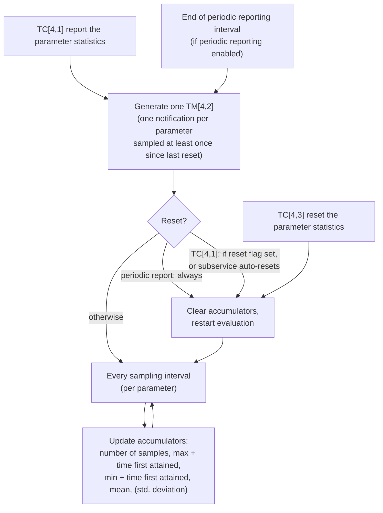
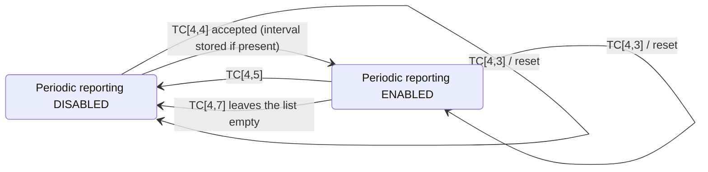
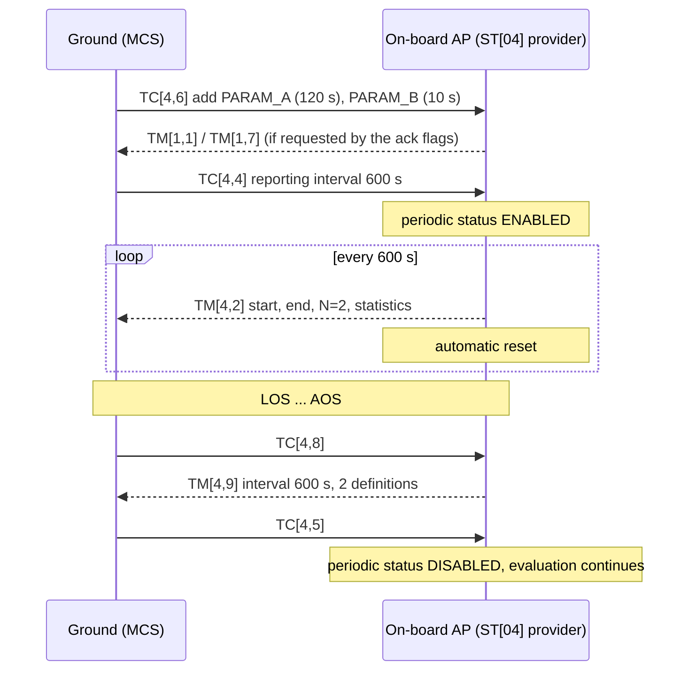

# ST[04] Parameter statistics reporting

The **parameter statistics reporting** service, service type 4 of the
[Packet Utilization Standard](index.md), lets an on-board application process watch a list of
[on-board parameters](parameter-types.md) and compute, for each of them, the **maximum**,
**minimum**, **mean** and (optionally) **standard deviation** of the values it samples during a
time interval. Instead of downlinking every sample, the spacecraft sends a single
**parameter statistics report** TM[4,2] that summarises the interval.[^c-641] The standard names
the typical use: missions with limited ground coverage, such as low Earth orbiters, can read one
report after acquisition of signal and learn how parameters behaved during the previous period
of "no contact".[^c-641][^a-453]

This page describes the service as defined by ECSS-E-ST-70-41C ("PUS-C", clause 6.4 for the
system requirements and clause 8.4 for the packet layouts), compares it with ECSS-E-70-41A
("PUS-A", clause 9), lists the tailoring data required by
[ECSS-E-ST-70-31C](../e-st-70-31c.md), summarises the changes in the 2024 Rev.1 draft, and
explains how ground systems such as [SCOS-2000](../../scos2000/index.md) handle it - including
the finding that the real [Solar Orbiter MIB](../../missions/solar-orbiter/mib.md) contains no
service 4 packet at all.

!!! info "At a glance"
    | Item | Value |
    |---|---|
    | Service type | 4, "parameter statistics reporting"[^c-841] |
    | Subservice types | exactly one: the parameter statistics reporting subservice[^c-641] |
    | Providers per application process | at most one[^c-642] |
    | Message types (PUS-C) | 7 requests TC[4,1], [4,3]-[4,8]; 2 reports TM[4,2], TM[4,9][^c-annexc8] |
    | Minimum capability | TC[4,1], TM[4,2], TC[4,3][^c-annexc8] |
    | Always evaluated | maximum, minimum, mean; standard deviation by declaration[^c-6432] |
    | Subservice observables | none in PUS-C; one in the 2024 draft[^c-648][^r-648] |
    | PUS-A equivalent | clause 9, subtypes 1-10 (10 = clear the list)[^a-22] |
    | Solar Orbiter | "Service 4: Not Used"; no type 4 packet or command in the MIB[^solo-s4][^mib-s4] |

## 1. Concept and rationale

### 1.1 Why evaluate statistics on board

PUS-A presents "statistical data reporting" as a second mechanism, next to
[housekeeping reporting](st03-housekeeping.md), for reducing the quantity of engineering data
sent to ground: evaluate mean, minimum, maximum and standard deviation on board and report only
the results. In its minimum form the parameter set and the evaluated attributes are predefined
and evaluation is continuous; optional extensions let the ground change the parameters and the
evaluation intervals.[^a-453] PUS-A also suggests the service as an alternative to housekeeping
reporting during non-coverage when on-board storage capacity is limited.[^a-91] PUS-C keeps that
rationale - the service is "especially appropriate" for missions with limited ground coverage -
and adds that it can reduce the engineering data that is systematically reported.[^c-641]

### 1.2 The model

Each **parameter statistics definition** names one parameter and its **sampling interval**. The
subservice keeps a list of such definitions (the "list of evaluated parameters"), at most one
definition per parameter, and the maximum number of definitions it can evaluate at the same time
is a declared constant of the subservice.[^c-6431] For each listed parameter it evaluates *all*
the supported statistic types at any time: maximum, minimum and mean always; standard deviation
only if the subservice declares that it supports it.[^c-6432] A default sampling interval is
declared per parameter.[^c-6433]

Evaluation is continuous. What varies is *when* results are reported and *when* the accumulators
are cleared:



Sources for the diagram: the sampling and notification rules of clause 6.4.5.3, the reset rules
of clauses 6.4.4, 6.4.5.1-6.4.5.2 and 6.4.6.2h.[^c-6453][^c-644][^c-6451][^c-6452][^c-6462]

The PUS-A version of the concept is the same: statistics are evaluated continuously from
successive samples, reports are generated on request or periodically, the evaluation is
systematically reset when a periodic report is generated and can be reset on request at any
time.[^a-92] PUS-A gives the operational recipe for covering a non-coverage period: reset the
evaluation just before loss of signal (LOS) and request the report shortly after acquisition of
signal (AOS).[^a-92]

!!! note "Which time is in the packet header?"
    Because the interval between reports can be long, PUS-A recommends that the time field of the
    packet header indicates the *report generation time*, not the beginning of the evaluation
    interval.[^a-92] PUS-C sidesteps the ambiguity by putting both the start time and the end time
    of the evaluation interval in the report itself.[^c-6453]

### 1.3 Statistics: what is and is not defined

| Quantity | Defined by PUS-C | Notes |
|---|---|---|
| Number of samples | yes, per parameter, in each notification[^c-6453] | new in PUS-C; PUS-A has no such field[^a-931] |
| Maximum and its time | the maximum sampled value and the time it was **first** attained[^c-6453] | |
| Minimum and its time | the minimum sampled value and the time it was **first** attained[^c-6453] | |
| Mean | mean of the sampled values during the interval[^c-6453] | |
| Standard deviation | of the sampled values, only if supported[^c-6453][^c-6432] | population or sample formula: not stated in the available sources |
| Value format | specific to the parameter identified by the parameter ID (deduced)[^c-8422] | the format of a mean or standard deviation of an integer parameter is not stated in the available sources |

## 2. Declarations a mission must make

PUS-C leaves most choices to the mission and records them as declarations "when specifying that
subservice". The full list for ST[04]:

| Declaration | Clause |
|---|---|
| Maximum number of parameter statistics definitions evaluated at the same time | 6.4.3.1a[^c-6431] |
| Whether the standard deviation is evaluated | 6.4.3.2b[^c-6432] |
| Default sampling interval of each parameter | 6.4.3.3a[^c-6433] |
| Exactly one of: reset flag carried in TC[4,1], or automatic reset after every TC[4,1] | 6.4.5.1a-c[^c-6451] |
| Whether periodic reporting is supported | 6.4.6.1a[^c-6461] |
| Periodic reporting interval implicitly known (and its value), or carried in TC[4,4] | 6.4.6.1b-d[^c-6461] |
| Whether definitions can be added or updated (TC[4,6]) | 6.4.7.1a[^c-6471] |
| Whether TC[4,6] can set the sampling interval | 6.4.7.1b[^c-6471] |
| Whether the definitions can be reported (TC[4,8]/TM[4,9]) | 6.4.7.3a[^c-6473] |

Sampling intervals are expressed against the spacecraft's **on-board parameter minimum sampling
interval**: each on-board parameter is associated to exactly one such interval, all parameters
accessed by an application process share the same one, and the standard gives the example of a
platform at 125 ms and a payload at 500 ms.[^c-5432] The 2024 draft adds an explicit note to the
ST[04] sampling interval clause pointing to that requirement.[^r-6433]

## 3. Message types and capability sets

PUS-C Annex C lists the ST[04] message types with their applicability constraint. "Minimum" means
every subservice provides the capability; "by declaration" means the mission decides; "implied
by" means the capability comes automatically with another one; "requires" means it can only be
chosen if the other is present.[^c-534][^c-annexc8]

| Message type | Name | Requirement / interface clause | Applicability |
|---|---|---|---|
| TC[4,1] | report the parameter statistics | 6.4.5.2 / 8.4.2.1 | minimum |
| TM[4,2] | parameter statistics report | 6.4.5.3 / 8.4.2.2 | response to TC[4,1] (also periodic) |
| TC[4,3] | reset the parameter statistics | 6.4.4 / 8.4.2.3 | minimum |
| - | support for periodic reporting | 6.4.6.1a | by declaration |
| TC[4,4] | enable the periodic parameter statistics reporting | 6.4.6.2 / 8.4.2.4 | implied by 6.4.6.1a |
| TC[4,5] | disable the periodic parameter statistics reporting | 6.4.6.3 / 8.4.2.5 | implied by 6.4.6.1a |
| TC[4,6] | add or update parameter statistics definitions | 6.4.7.1 / 8.4.2.6 | by declaration |
| TC[4,7] | delete parameter statistics definitions | 6.4.7.2 / 8.4.2.7 | implied by TC[4,6] |
| TC[4,8] | report the parameter statistics definitions | 6.4.7.3 / 8.4.2.8 | requires TC[4,6] |
| TM[4,9] | parameter statistics definition report | 6.4.7.3 / 8.4.2.9 | response to TC[4,8] |

Source: Table C-8.[^c-annexc8] Every ST[04] packet has service type 4.[^c-841] The notation and
the full catalogue across services are on [PUS message types](message-types.md).

## 4. The messages field by field

Field types below are the PUS types of [clause 7.3](parameter-types.md): *enumerated* (PTC 2),
*unsigned integer* (PTC 3), *Boolean* (PTC 1), *absolute time* (PTC 9), *relative time* (PTC 10)
and *deduced* (PTC 11, format deduced from a preceding field).[^c-ptc][^c-7310][^c-7311][^c-7312]
Their sizes (PFCs) are mission choices, so the byte layouts depend on the mission.

### 4.1 TC[4,1] report the parameter statistics

| Field | Type | Presence | Meaning |
|---|---|---|---|
| reset flag | Boolean | optional | Present only if the subservice uses the "explicit reset flag" option; asks for a reset after the report is generated.[^c-8421][^c-6452] |

Each request contains exactly one instruction (which itself has no argument) and produces exactly
one TM[4,2]. After the report is generated, the statistics are reset if the request asked for it
or if the subservice is configured to reset automatically after every request.[^c-6452] A Boolean
value greater than zero means TRUE.[^c-ptc]

### 4.2 TM[4,2] parameter statistics report

| Field | Type | Presence | Meaning |
|---|---|---|---|
| start time | absolute time | always | Start of the evaluation interval.[^c-8422][^c-6453] |
| end time | absolute time | always | End of the evaluation interval.[^c-8422][^c-6453] |
| N | unsigned integer | always | Number of parameter statistic notifications that follow.[^c-8422] |
| *repeated N times:* | | | |
| parameter ID | enumerated | always | The sampled parameter.[^c-8422] |
| number of samples | unsigned integer | always | Samples used to produce the statistics.[^c-8422][^c-6453] |
| max value | deduced | always | Maximum sampled value.[^c-8422] |
| max time | absolute time | always | Time the maximum was first attained.[^c-8422][^c-6453] |
| min value | deduced | always | Minimum sampled value.[^c-8422] |
| min time | absolute time | always | Time the minimum was first attained.[^c-8422][^c-6453] |
| mean value | deduced | always | Mean of the sampled values.[^c-8422] |
| standard deviation value | deduced | optional | Present only if the subservice evaluates the standard deviation.[^c-8422][^c-6432] |

The subservice emits one notification for each parameter that has been sampled at least once
since the last reset; parameters never sampled are left out.[^c-6453] The deduced fields take the
format of the parameter named by the preceding parameter ID.[^c-8422]

<div class="bitfield" data-title="TM[4,2] source data - one notification, ILLUSTRATIVE sizes (CUC 4+2 times, 8-bit N, 16-bit IDs and counts, 32-bit real values)" data-width="32"
     data-fields='[{"n":"start time","b":48,"g":"interval","d":"absolute time, here CUC 4+2 octets"},{"n":"end time","b":48,"g":"interval","d":"absolute time, here CUC 4+2 octets"},{"n":"N","b":8,"d":"number of notifications (unsigned integer)"},{"n":"parameter ID","b":16,"g":"notification 1","d":"enumerated"},{"n":"number of samples","b":16,"g":"notification 1","d":"unsigned integer"},{"n":"max value","b":32,"g":"notification 1","d":"deduced: format of the parameter"},{"n":"max time","b":48,"g":"notification 1","d":"time the maximum was first attained"},{"n":"min value","b":32,"g":"notification 1","d":"deduced"},{"n":"min time","b":48,"g":"notification 1","d":"time the minimum was first attained"},{"n":"mean value","b":32,"g":"notification 1","d":"deduced"},{"n":"standard deviation","b":32,"g":"notification 1","d":"deduced, optional"}]'></div>

The field order follows Figure 8-54;[^c-8422] the bit widths in the diagram are an illustrative
mission choice (they are the sizes used in the worked example of section 7), not values set by
the standard.

### 4.3 TC[4,3] reset the parameter statistics

No application data.[^c-8423] The subservice stops the evaluation, clears every accumulated
result and restarts the evaluation. The reset is independent of report generation.[^c-644]

### 4.4 TC[4,4] enable the periodic parameter statistics reporting

| Field | Type | Presence | Meaning |
|---|---|---|---|
| reporting interval | relative time | optional | Present only if the subservice lets TC[4,4] set the periodic reporting interval.[^c-8424][^c-6462] |

The subservice keeps a **periodic parameter statistics reporting status** (enabled or
disabled).[^c-6461] TC[4,4] is rejected - with a failed start of execution notification, see
[ST[01]](st01-request-verification.md) - if it specifies a reporting interval shorter than the
sampling interval of any evaluated parameter.[^c-6462] Otherwise the status becomes "enabled" and
the interval, if given, is stored. While enabled, the subservice generates exactly one TM[4,2] at
the end of each reporting interval and systematically resets the statistics each time.[^c-6462]

### 4.5 TC[4,5] disable the periodic parameter statistics reporting

No application data. It sets the status to "disabled".[^c-8425][^c-6463] Evaluation itself goes
on: in PUS-A terms, periodic reporting and resetting stop "and the parameter statistics
evaluation shall continue".[^a-933]

### 4.6 TC[4,6] add or update parameter statistics definitions

| Field | Type | Presence | Meaning |
|---|---|---|---|
| N | unsigned integer | always | Number of instructions.[^c-8426] |
| *repeated N times:* | | | |
| parameter ID | enumerated | always | Parameter to add or update.[^c-8426] |
| sampling interval | relative time | optional | Present only if TC[4,6] may set sampling intervals.[^c-8426][^c-6471] |

Each instruction is checked on its own and rejected (failed start of execution for that
instruction) if the parameter is unknown, if its sampling interval is greater than the reporting
interval, or if it would add a definition when the maximum is already reached; the valid
instructions are executed regardless of faulty ones.[^c-6471] A new parameter is added and its
evaluation starts immediately; an existing one gets the new sampling interval and its evaluation
restarts.[^c-6471]

!!! note "Partial intervals and duplicates"
    Because evaluation of a newly added parameter starts at once, independently of the reporting
    interval, the next report (and only that report) covers that parameter over a shorter interval
    than the others. If one request contains two instructions for the same parameter, the second
    overrides the first.[^c-6471]

### 4.7 TC[4,7] delete parameter statistics definitions

| Field | Type | Presence | Meaning |
|---|---|---|---|
| N | unsigned integer | always | Number of parameter IDs; **N = 0 deletes all definitions**.[^c-8427] |
| parameter ID | enumerated | repeated N times | Parameter whose definition is removed.[^c-8427] |

An instruction naming a parameter that is not in the list is rejected; valid instructions are
executed anyway. If the list is empty after the request, the periodic reporting status is set to
"disabled".[^c-6472]

### 4.8 TC[4,8] report the parameter statistics definitions and TM[4,9]

TC[4,8] has no application data.[^c-8428] Its response TM[4,9] has the following source data:

| Field | Type | Presence | Meaning |
|---|---|---|---|
| reporting interval | relative time | optional | Present if the subservice lets TC[4,4] change the interval; **set to 0 s when periodic reporting is not enabled**.[^c-8429][^c-6473] |
| N | unsigned integer | always | Number of definitions.[^c-8429] |
| parameter ID | enumerated | repeated N times | Parameter.[^c-8429] |
| sampling interval | relative time | repeated, optional | Present if sampling intervals can be set.[^c-8429][^c-6473] |

### 4.9 Observables

PUS-C defines no observables for this subservice.[^c-648] The 2024 draft defines one: the number of
parameter statistics definitions currently defined on board.[^r-648]

## 5. State model

The only persistent state, besides the accumulators and the list itself, is the periodic
reporting status. Its initial value after start-up is not stated in the available sources.



Transitions from clauses 6.4.4, 6.4.5.2, 6.4.6.2, 6.4.6.3 and 6.4.7.2i.[^c-644][^c-6452][^c-6462][^c-6463][^c-6472]

## 6. A typical exchange



The behaviour follows clauses 6.4.6 and 6.4.7;[^c-6462][^c-6463][^c-6471][^c-6473] request
verification reports are those of [ST[01]](st01-request-verification.md), and whether successful
stages are reported depends on the acknowledgement flags in the
[TC secondary header](packets.md).

## 7. Worked example (illustrative bytes)

!!! example "Illustrative TM[4,2] source data"
    **All values below are constructed for explanation; they are not from any mission.** The
    assumed mission choices are: absolute times in CUC with 4 octets of coarse and 2 of fine time
    (PTC 9, PFC 17, since (17 + 1) / 4 = 4 rem 2[^c-7310]), N as an 8-bit unsigned integer,
    parameter ID and number of samples as 16-bit fields, and a parameter `0x0102` whose format is
    an IEEE 754 32-bit real. Five samples of a temperature are taken every 120 s from
    coarse time 1 000 000 000 (`0x3B9ACA00`): 21.50, 21.75, 22.00, 21.25, 21.50 degC.

    | Offset (octets) | Bytes | Field | Value |
    |---|---|---|---|
    | 0 | `3B 9A CA 00 00 00` | start time | 1 000 000 000 s |
    | 6 | `3B 9A CC 58 00 00` | end time | start + 600 s |
    | 12 | `01` | N | 1 |
    | 13 | `01 02` | parameter ID | `0x0102` |
    | 15 | `00 05` | number of samples | 5 |
    | 17 | `41 B0 00 00` | max value | 22.0 |
    | 21 | `3B 9A CA F0 00 00` | max time | start + 240 s (third sample) |
    | 27 | `41 AA 00 00` | min value | 21.25 |
    | 31 | `3B 9A CB 68 00 00` | min time | start + 360 s |
    | 37 | `41 AC CC CD` | mean value | 21.6 |
    | 41 | `3E 82 88 EF` | standard deviation | 0.2550 (population formula) |

    The source data is 45 octets. With the sample (n - 1) formula the standard deviation would be
    0.2850 - PUS-C does not say which one applies, so a mission specification must.

## 8. PUS-A (ECSS-E-70-41A) differences

PUS-A clause 9 defines the same service with ten subtypes.[^a-22]

| Aspect | PUS-A (2003) | PUS-C (2016) |
|---|---|---|
| Instances | any number of application processes may each provide a single instance[^a-91] | at most one provider per application process[^c-642] |
| Name of the list | parameter statistics list, maximum `<PSLIST_MAX_PARAMS>`[^a-92] | list of evaluated parameters made of parameter statistics definitions[^c-6431] |
| TC 4,1 reset flag | *Enumerated*, "No" = 0, "Yes" = 1, omitted if the service always resets[^a-931] | *Boolean*, optional[^c-8421] |
| TM 4,2 header fields | `tstart` (last reset time) and `NPAR` only[^a-931] | start time, end time and N[^c-8422] |
| TM 4,2 per parameter | Parameter#, Maxval, tmax, Minval, tmin, Meanval, optional Stddevval[^a-931][^a-931b] | adds the **number of samples**; max/min times are "first attained"[^c-8422][^c-6453] |
| Reporting interval rule | must be *greater than* the sampling interval of every listed parameter[^a-933] | rejected only if *smaller than* a sampling interval[^c-6462] |
| Sampling interval rule | must be *smaller than* the reporting interval when periodic[^a-934] | rejected if *greater than* the reporting interval[^c-6471] |
| Subtype 6 | "Add Parameters to Parameter Statistics List"; NPAR omitted if one parameter at a time[^a-934] | "add or update ... definitions"; N always present; update restarts evaluation[^c-8426][^c-6471] |
| Subtype 7 | delete; evaluation stops immediately and the parameters are not reported in the next report[^a-935] | delete; N = 0 means delete all[^c-8427] |
| Subtypes 8/9 | "Report Parameter Statistics List" / "Parameter Statistics List Report"; reporting interval 0 s if not periodic; omitted if no periodic concept or a default is used[^a-936] | "report the parameter statistics definitions" / "definition report"; 0 s if not enabled[^c-8429] |
| Subtype 10 | "Clear Parameter Statistics List"[^a-937] | removed (use TC[4,7] with N = 0)[^c-annexc8][^c-8427] |

PUS-A capability sets:[^a-94]

| Set | Subtypes | Dependencies |
|---|---|---|
| Minimum | 1, 2, 3 | - |
| Additional: standard deviation | `Stddevval` in subtype 2 | - |
| Additional: periodic reporting | 4 and 5 | each requires the other |
| Additional: list maintenance | 6 | requires 7 and/or 10 |
| | 7 | requires 6 |
| | 8 and 9 | each requires the other |
| | 10 | requires 6 |

More PUS-A-to-PUS-C changes are summarised on [PUS-A vs PUS-C](pus-a-vs-pus-c.md).

## 9. Tailoring data in ECSS-E-ST-70-31C

[ECSS-E-ST-70-31C](../e-st-70-31c.md), the standard for ground-segment monitoring and control
data, defines the data a mission database must hold to describe its tailoring of service 4. Its
model follows the PUS-A subtype numbering.[^t-a5]

| Tailoring item (Boolean) | Meaning | Condition |
|---|---|---|
| S4 ST4 and ST5 Provider | periodic reporting supported | - |
| S4 Default Reporting Interval | a default reporting interval is used | if periodic supported |
| S4 Add Parameters | parameters can be added | - |
| S4 Default Sampling Interval | a default sampling interval is used | if add supported |
| S4 Multiple Parameters | several parameters per request | if add supported |
| S4 ST6 and ST7 Provider | parameters can be deleted | if add supported |
| S4 ST6 and ST10 Provider | the list can be cleared | if delete supported; forced TRUE if add is TRUE and delete is FALSE |
| S4 ST8 and ST9 Provider | the list can be reported | - |
| S4 Always Reset | evaluation always reset on report | - |
| S4 Standard Deviation | standard deviation evaluated | - |

Source: Table 6-27.[^t-6555] Table 6-28 then asks for the PFCs of the reset flag (PTC 2, only if
not "always reset"), the time fields (PTC 9), NPAR (PTC 3), the parameter number (PTC 2) and the
relative time fields (PTC 10); Table 6-29 asks for the maximum number of parameters (the PUS
mission constant `<PSLIST_MAX_PARAMS>`), the default reporting interval and the default sampling
interval.[^t-6555b] The decision tree of Figure A-5 walks through the same questions in
order.[^t-a5]

## 10. Changes in the 2024 Rev.1 draft

ECSS-E-ST-70-41C Rev.1 DIR1 (11 December 2024) keeps the nine message types and their layouts
(only the figures are renumbered, 8.4-1 to 8.4-6)[^r-84] but changes the error semantics of list
maintenance:[^r-6471][^r-6472]

* TC[4,6] and TC[4,7] now carry an **ordered list** of instructions, and the **whole request** is
  rejected if any instruction is invalid (unknown parameter, sampling interval greater than the
  reporting interval, list full, parameter not in the list). A request with only valid
  instructions is executed in order. In PUS-C each faulty instruction was rejected on its own and
  the others were executed.[^c-6471][^c-6472]
* TC[4,7]'s "delete all" becomes "a single instruction".[^r-6472]
* A subservice observable is added: the number of definitions currently on board.[^r-648]

## 11. Ground segment view

### 11.1 SCOS-2000

The SCOS-2000 Database Import ICD states that there is no specific processing of service 4 in
SCOS-2000 and no specific limitation, except that all service 4 reports are *variable packets*
and therefore inherit the general variable-packet limitation.[^icd-s4] That limitation is
important: parameter values extracted from variable packets cannot take part in full telemetry
processing - validity, monitoring checks, verification checks, synthetic parameters - because
their parameters and time references are only known once the packet is opened.[^icd-var] On the
command side SCOS-2000 offers command parameters of type "Parameter ID", which take the name of a
telemetry parameter and encode its on-board identifier; the ICD names TC(4,6) as an example.[^icd-types]

!!! warning "Inference: how a MIB would describe TM[4,2]"
    The ICD does not give a service 4 example. In the SCOS-2000 [MIB](../../mib/index.md) a TM[4,2]
    would be identified by [PID](../../mib/tables/pid.md) (type 4, subtype 2, APID), given a TPSD
    and described in the [VPD](../../mib/tables/vpd.md) table: `N` as a repeat counter
    (`VPD_GRPSIZE`), the parameter ID with `VPD_PIDREF = 'Y'` so that its value is matched
    against `PCF_PID` in [PCF](../../mib/tables/pcf.md), followed by the deduced value
    fields.[^icd-vpd] Because of the variable-packet limitation, statistics delivered this way
    could be displayed and archived, but not limit-checked like ordinary telemetry.

### 11.2 Not to be confused with ground-side statistics

ESA's ground archive services compute their own statistics. For example the
[EDDS](../../scos2000/edds.md) "Parameter Statistics" request returns statistics records with
start time, storage time, minimum, maximum, average, standard deviation and the number of valid
and invalid samples.[^edds-stats] These are evaluated on ground from archived samples; they are
unrelated to the on-board ST[04] service.

## 12. Mission usage

### 12.1 Solar Orbiter: not used

The Solar Orbiter space-to-ground ICD, whose applicable PUS is ECSS-E-70-41A, lists the service
simply as "Service 4: Not Used".[^solo-ad1][^solo-s4] The public MIB agrees: neither the April 2020 nor the
September 2025 release contains a single TM packet ([PID](../../mib/tables/pid.md)), packet
identification rule ([PIC](../../mib/tables/pic.md)) or telecommand
([CCF](../../mib/tables/ccf.md)) of service type 4, and neither does the SWA instrument
database.[^mib-s4][^mib2020-s4][^swa-s4] The only packet with "statistic" in its description is a
housekeeping report, TM(3,25) "DAS Housekeeping Parameter Report (failure statistics)" on APID 1204.[^mib-s4]

??? example "SQL used"
    ```sql
    -- run on solo-2025-09-16.sqlite, solo-2020-04-16.sqlite and swa-idb.sqlite
    SELECT COUNT(*) FROM pid WHERE PID_TYPE = '4';        -- 0 in all three
    SELECT COUNT(*) FROM pic WHERE PIC_TYPE = '4';        -- 0 in all three
    SELECT COUNT(*) FROM ccf WHERE CCF_TYPE = '4';        -- 0 in all three
    SELECT PID_TYPE, PID_STYPE, PID_APID, PID_DESCR
      FROM pid WHERE PID_DESCR LIKE '%statistic%';        -- one TM(3,25) packet
    -- infrastructure that ST[04] would need on the ground side:
    SELECT COUNT(*), SUM(PCF_PID IS NOT NULL AND PCF_PID <> '') FROM pcf;  -- 126745, 19803
    SELECT CPC_CATEG, COUNT(*) FROM cpc GROUP BY 1;       -- 152 'P' (Parameter ID) parameters
    ```

The ground infrastructure that ST[04] would rely on does exist in the database: 19 803 of the
126 745 monitoring parameters carry an on-board parameter identifier (`PCF_PID`), and 152 command
parameters are of the "Parameter ID" category (`CPC_CATEG` = `P`), the SCOS-2000 type that encodes
a telemetry parameter name as its on-board identifier.[^mib-s4][^icd-types][^icd-cpc]

### 12.2 Herschel and Planck: no requirement

The Herschel/Planck Operations Interface Requirements Document (2003) keeps a section
"Statistics Reporting (Service 4)" only as a placeholder: no requirement had been identified for
such a service.[^hp-s4] See [Herschel and Planck](../../missions/herschel-planck.md).

!!! warning "Inference: why ST[04] is rare in ESA science missions"
    Both missions documented in this wiki's library chose not to use ST[04]. A plausible reason,
    not stated in the sources, is that deep-space and L2 missions store all housekeeping on board
    and dump it at each pass, so a statistical summary adds little; the standard itself targets
    missions with limited ground coverage.[^c-641] The service drew only 8 of the 664 discrepancy
    review reports raised on the PUS-C draft, against 44 for ST[06].[^v15-drr]

## Related pages

* [PUS overview](index.md), [PUS packet structures](packets.md), [PUS parameter types](parameter-types.md)
* [ST[03] Housekeeping](st03-housekeeping.md) - the periodic alternative
* [ST[12] On-board monitoring](st12-onboard-monitoring.md) - on-board checks of the same parameters
* [ST[20] On-board parameter management](st20-onboard-parameter-management.md) - parameter identifiers
* [PUS-A vs PUS-C](pus-a-vs-pus-c.md), [PUS message type catalogue](message-types.md)
* [Glossary](../../glossary.md), [References](../../references/index.md)

[^c-641]: [ECSS-E-ST-70-41C, Telemetry and telecommand packet utilization](../../library/ecss-e-st-70-41c-15april2016.md), §6.4.1, PDF p. 111.
[^c-642]: [ECSS-E-ST-70-41C](../../library/ecss-e-st-70-41c-15april2016.md), §6.4.2, PDF p. 111.
[^c-6431]: [ECSS-E-ST-70-41C](../../library/ecss-e-st-70-41c-15april2016.md), §6.4.3.1a-c, PDF pp. 111-112.
[^c-6432]: [ECSS-E-ST-70-41C](../../library/ecss-e-st-70-41c-15april2016.md), §6.4.3.2, PDF p. 112.
[^c-6433]: [ECSS-E-ST-70-41C](../../library/ecss-e-st-70-41c-15april2016.md), §6.4.3.3, PDF p. 112.
[^c-644]: [ECSS-E-ST-70-41C](../../library/ecss-e-st-70-41c-15april2016.md), §6.4.4, PDF pp. 112-113.
[^c-6451]: [ECSS-E-ST-70-41C](../../library/ecss-e-st-70-41c-15april2016.md), §6.4.5.1, PDF p. 113.
[^c-6452]: [ECSS-E-ST-70-41C](../../library/ecss-e-st-70-41c-15april2016.md), §6.4.5.2, PDF pp. 113-114.
[^c-6453]: [ECSS-E-ST-70-41C](../../library/ecss-e-st-70-41c-15april2016.md), §6.4.5.3, PDF pp. 114-115.
[^c-6461]: [ECSS-E-ST-70-41C](../../library/ecss-e-st-70-41c-15april2016.md), §6.4.6.1, PDF p. 115.
[^c-6462]: [ECSS-E-ST-70-41C](../../library/ecss-e-st-70-41c-15april2016.md), §6.4.6.2, PDF pp. 115-116.
[^c-6463]: [ECSS-E-ST-70-41C](../../library/ecss-e-st-70-41c-15april2016.md), §6.4.6.3, PDF pp. 116-117.
[^c-6471]: [ECSS-E-ST-70-41C](../../library/ecss-e-st-70-41c-15april2016.md), §6.4.7.1, PDF pp. 117-118.
[^c-6472]: [ECSS-E-ST-70-41C](../../library/ecss-e-st-70-41c-15april2016.md), §6.4.7.2, PDF pp. 118-119.
[^c-6473]: [ECSS-E-ST-70-41C](../../library/ecss-e-st-70-41c-15april2016.md), §6.4.7.3, PDF pp. 119-120.
[^c-648]: [ECSS-E-ST-70-41C](../../library/ecss-e-st-70-41c-15april2016.md), §6.4.8, PDF p. 120.
[^c-841]: [ECSS-E-ST-70-41C](../../library/ecss-e-st-70-41c-15april2016.md), §8.4.1, PDF p. 473.
[^c-8421]: [ECSS-E-ST-70-41C](../../library/ecss-e-st-70-41c-15april2016.md), §8.4.2.1, Figure 8-53, PDF p. 473.
[^c-8422]: [ECSS-E-ST-70-41C](../../library/ecss-e-st-70-41c-15april2016.md), §8.4.2.2, Figure 8-54 and its note, PDF p. 473.
[^c-8423]: [ECSS-E-ST-70-41C](../../library/ecss-e-st-70-41c-15april2016.md), §8.4.2.3, PDF p. 474.
[^c-8424]: [ECSS-E-ST-70-41C](../../library/ecss-e-st-70-41c-15april2016.md), §8.4.2.4, Figure 8-55, PDF p. 474.
[^c-8425]: [ECSS-E-ST-70-41C](../../library/ecss-e-st-70-41c-15april2016.md), §8.4.2.5, PDF p. 474.
[^c-8426]: [ECSS-E-ST-70-41C](../../library/ecss-e-st-70-41c-15april2016.md), §8.4.2.6, Figure 8-56, PDF pp. 474-475.
[^c-8427]: [ECSS-E-ST-70-41C](../../library/ecss-e-st-70-41c-15april2016.md), §8.4.2.7, Figure 8-57, PDF p. 475.
[^c-8428]: [ECSS-E-ST-70-41C](../../library/ecss-e-st-70-41c-15april2016.md), §8.4.2.8, PDF p. 475.
[^c-8429]: [ECSS-E-ST-70-41C](../../library/ecss-e-st-70-41c-15april2016.md), §8.4.2.9, Figure 8-58, PDF pp. 475-476.
[^c-annexc8]: [ECSS-E-ST-70-41C](../../library/ecss-e-st-70-41c-15april2016.md), Annex C.2.4, Table C-8, PDF p. 633.
[^c-534]: [ECSS-E-ST-70-41C](../../library/ecss-e-st-70-41c-15april2016.md), §5.3.4b and notes, PDF pp. 32-33.
[^c-5432]: [ECSS-E-ST-70-41C](../../library/ecss-e-st-70-41c-15april2016.md), §5.4.3.2b-d, PDF p. 42.
[^c-ptc]: [ECSS-E-ST-70-41C](../../library/ecss-e-st-70-41c-15april2016.md), §7.3.1-7.3.2, Tables 7-1 and 7-2, PDF p. 429.
[^c-7310]: [ECSS-E-ST-70-41C](../../library/ecss-e-st-70-41c-15april2016.md), §7.3.10, Table 7-10, PDF pp. 435-436.
[^c-7311]: [ECSS-E-ST-70-41C](../../library/ecss-e-st-70-41c-15april2016.md), §7.3.11, Table 7-11, PDF pp. 436-437.
[^c-7312]: [ECSS-E-ST-70-41C](../../library/ecss-e-st-70-41c-15april2016.md), §7.3.12, PDF p. 437.
[^a-453]: [ECSS-E-70-41A, Ground systems and operations - Telemetry and telecommand packet utilization](../../library/ecss-e-70-41a-30jan2003-pus.md), §4.5.3, PDF p. 31.
[^a-91]: [ECSS-E-70-41A](../../library/ecss-e-70-41a-30jan2003-pus.md), §9.1, PDF p. 73.
[^a-92]: [ECSS-E-70-41A](../../library/ecss-e-70-41a-30jan2003-pus.md), §9.2, PDF pp. 73-74.
[^a-931]: [ECSS-E-70-41A](../../library/ecss-e-70-41a-30jan2003-pus.md), §9.3.1, PDF p. 74.
[^a-931b]: [ECSS-E-70-41A](../../library/ecss-e-70-41a-30jan2003-pus.md), §9.3.1 (field definitions continued), PDF p. 75.
[^a-933]: [ECSS-E-70-41A](../../library/ecss-e-70-41a-30jan2003-pus.md), §9.3.3, PDF p. 75.
[^a-934]: [ECSS-E-70-41A](../../library/ecss-e-70-41a-30jan2003-pus.md), §9.3.4, PDF p. 76.
[^a-935]: [ECSS-E-70-41A](../../library/ecss-e-70-41a-30jan2003-pus.md), §9.3.5, PDF p. 76.
[^a-936]: [ECSS-E-70-41A](../../library/ecss-e-70-41a-30jan2003-pus.md), §9.3.6, PDF p. 77.
[^a-937]: [ECSS-E-70-41A](../../library/ecss-e-70-41a-30jan2003-pus.md), §9.3.7, PDF p. 77.
[^a-94]: [ECSS-E-70-41A](../../library/ecss-e-70-41a-30jan2003-pus.md), §9.4, Tables 14 and 15, PDF pp. 77-78.
[^a-22]: [ECSS-E-70-41A](../../library/ecss-e-70-41a-30jan2003-pus.md), clause 22, Table 43, PDF p. 184.
[^r-6433]: [ECSS-E-ST-70-41C Rev.1 DIR1 (draft, 11 December 2024)](../../library/ecss-e-st-70-41c-rev1-dir1.md), §6.4.3.3 and note, PDF p. 102.
[^r-6471]: [ECSS-E-ST-70-41C Rev.1 DIR1](../../library/ecss-e-st-70-41c-rev1-dir1.md), §6.4.7.1c-g, PDF pp. 107-108.
[^r-6472]: [ECSS-E-ST-70-41C Rev.1 DIR1](../../library/ecss-e-st-70-41c-rev1-dir1.md), §6.4.7.2b-i, PDF pp. 108-109.
[^r-648]: [ECSS-E-ST-70-41C Rev.1 DIR1](../../library/ecss-e-st-70-41c-rev1-dir1.md), §6.4.8, PDF p. 110.
[^r-84]: [ECSS-E-ST-70-41C Rev.1 DIR1](../../library/ecss-e-st-70-41c-rev1-dir1.md), §8.4.2.1-8.4.2.9, Figures 8.4-1 to 8.4-6, PDF pp. 519-522.
[^t-6555]: [ECSS-E-ST-70-31C, Ground systems and operations - Monitoring and control data definition](../../library/ecss-e-st-70-31c.md), §6.5.5.5.1, Table 6-27, PDF pp. 66-67.
[^t-6555b]: [ECSS-E-ST-70-31C](../../library/ecss-e-st-70-31c.md), §6.5.5.5.2-6.5.5.5.3, Tables 6-28 and 6-29, PDF p. 68.
[^t-a5]: [ECSS-E-ST-70-31C](../../library/ecss-e-st-70-31c.md), Annex A.5, Figure A-5, PDF pp. 149-152.
[^icd-s4]: [SCOS-2000 Database Import ICD, issue 7.0](../../library/icd-7-0-final.md), Appendix C §3.4, PDF p. 239.
[^icd-var]: [SCOS-2000 Database Import ICD 7.0](../../library/icd-7-0-final.md), Appendix C §2, PDF p. 236.
[^icd-types]: [SCOS-2000 Database Import ICD 7.0](../../library/icd-7-0-final.md), Appendix C §1, PDF p. 235.
[^icd-cpc]: [SCOS-2000 Database Import ICD 7.0](../../library/icd-7-0-final.md), §3.3.3.2.2 (cpc), CPC_CATEG = 'P' for parameters of type 'Parameter ID', PDF p. 146.
[^icd-vpd]: [SCOS-2000 Database Import ICD 7.0](../../library/icd-7-0-final.md), §3.3.2.5.2 (vpd: VPD_GRPSIZE, VPD_CHOICE, VPD_PIDREF), PDF pp. 101-102; PCF_PID, PDF p. 42.
[^edds-stats]: [EDDS Software User Manual, version 22](../../library/sum-v22.md), §5.2.4 DARC Requests ("Parameter Statistics"), PDF p. 17.
[^solo-s4]: [SOL.S.ASTR.TN.00079 Issue 7, Solar Orbiter TM-TC and Packet Structure ICD](../../library/sol-s-astr-tn-00079-07.md), §5.5, PDF p. 66.
[^solo-ad1]: [SOL.S.ASTR.TN.00079 Issue 7](../../library/sol-s-astr-tn-00079-07.md), §1.1 and §2.1 (AD1 = ECSS-E-70-41A, 30 January 2003), PDF pp. 11 and 13.
[^mib-s4]: [Solar Orbiter MIB release MIB__20250916M25925PFMS001_SOL](../../library/mib-20250916m25925pfms001-sol.md), tables pid, pic, ccf, pcf and cpc, queried by this wiki.
[^mib2020-s4]: [Solar Orbiter MIB release MIB__20200416M10720PFMS001_SOL](../../library/mib-20200416m10720pfms001-sol.md), tables pid, pic and ccf, queried by this wiki.
[^swa-s4]: [Solar Orbiter SWA instrument database (ASCII export)](../../library/swa-idb-ascii.md), tables pid, pic and ccf, queried by this wiki.
[^hp-s4]: [Herschel/Planck Operations Interface Requirements Document, SCI-PT-RS-07360 issue 2.2](../../library/cosmos-operations-interface-requirements.md), §3.4.2, PDF p. 28.
[^v15-drr]: [S. Valera, ECSS-E-ST-70-41C status, ADCSS 2015](../../library/valera-2015-adcss-ecss-e-st-70-41c-status.md), slide 15, PDF p. 15.
