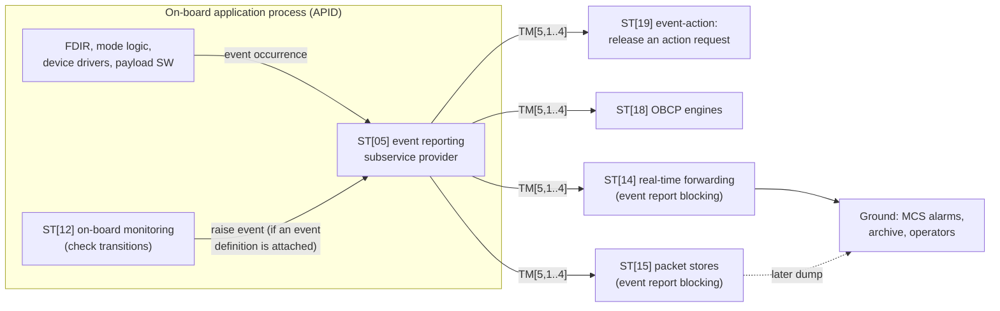
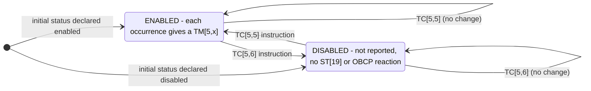
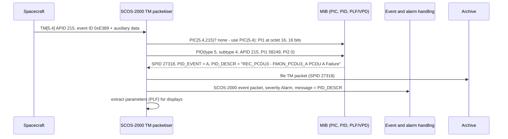

# ST[05] Event reporting

The **event reporting** service, service type 5 of the
[Packet Utilization Standard](index.md), is how a spacecraft tells the ground that *something
happened*: a failure or anomaly detected on board (including by FDIR - failure detection,
isolation and recovery), the start, progress or end of an activity initiated from ground or
autonomously, a built-in test result, or a normal payload event.[^c-6511] Each report carries a
**severity** (informative, low, medium or high), encoded in the message subtype to make ground
detection and routing easier, and an **event definition identifier**
that, together with the APID of the reporting application process, tells the ground exactly which
event occurred and how to read the **auxiliary data** that follows.[^c-6512]

Events are also an on-board currency. They feed the [event-action service ST[19]](st19-event-action.md),
on-board control procedures ([ST[18]](st18-onboard-operations-procedure.md)), the
[on-board monitoring service ST[12]](st12-onboard-monitoring.md) raises them, and the
[forwarding](st14-real-time-forwarding-control.md) and [storage](st15-onboard-storage-retrieval.md)
services can block them per event definition.[^c-6552][^c-6122][^c-6143][^c-6154] This page covers
the PUS-C definition (clauses 6.5 and 8.5), the PUS-A one (clause 10), the tailoring data of
[ECSS-E-ST-70-31C](../e-st-70-31c.md), the 2024 draft, the
[SCOS-2000](../../scos2000/index.md) event packet mechanism of the
[MIB](../../mib/index.md), and a data-driven tour of the 7 156 service 5 packet definitions of
the public [Solar Orbiter MIB](../../missions/solar-orbiter/mib.md).

!!! info "At a glance"
    | Item | Value |
    |---|---|
    | Service type | 5, "event reporting"[^c-851] |
    | Subservice types | exactly one: the event reporting subservice[^c-6511] |
    | Providers per application process | at most one[^c-652] |
    | Event reports | TM[5,1] informative, TM[5,2] low, TM[5,3] medium, TM[5,4] high severity[^c-654] |
    | Control requests | TC[5,5] enable, TC[5,6] disable, TC[5,7] report disabled list, TM[5,8][^c-annexc9] |
    | Minimum capability | the four event reports[^c-annexc9] |
    | 2024 draft addition | TC[5,9] generate event report[^r-6555] |
    | SCOS-2000 | no specific processing; any TM packet can raise an operator event (`PID_EVENT`)[^icd-s5][^icd-pidevent] |
    | Solar Orbiter MIB (Sept 2025) | 7 142 event report definitions on 43 APIDs, plus 14 private table reports[^mib-ev] |

## 1. Concept

### 1.1 Events, event definitions and event reports

PUS-C defines an **event report** simply as a report related to the occurrence of an event,
generated by a subservice provider; it is one of three report kinds, next to verification reports
and data reports.[^c-terms] The service exists to report information of operational significance
that the provider-initiated reports of other services do not already carry.[^c-6511]

The standard separates three notions:

| Notion | What it is | Identified by |
|---|---|---|
| Event report type | one of four, by severity; all low-severity reports share TM[5,2], and so on | message subtype[^c-5354] |
| Event definition | one detectable event, its severity, its identifier and its auxiliary data | **event definition system identifier** = APID of the hosting application process + event definition identifier, unique within that APID[^c-653] |
| Event notification | one occurrence: the event definition identifier plus the auxiliary data, if any | carried in exactly one event report of the definition's severity[^c-654] |

The note to clause 5.3.5.4 explains the design: since all reports of one severity share one
message type, the message type cannot say *which* event happened, so the standard adds event
definitions, each tied to a single event and a single event report type.[^c-5354]

### 1.2 Severity levels

| Subtype | PUS-C name | PUS-A name | Typical meaning |
|---|---|---|---|
| 1 | informative event report | Normal/Progress Report | normal progress, autonomous action not related to a fault |
| 2 | low severity anomaly report | Error/Anomaly Report - Low Severity | anomaly of low severity |
| 3 | medium severity anomaly report | Error/Anomaly Report - Medium Severity | anomaly of medium severity |
| 4 | high severity anomaly report | Error/Anomaly Report - High Severity | anomaly of high severity |

Names from PUS-C clause 6.5.4 and PUS-A clause 10.2-10.3.[^c-654][^a-102][^a-1031] Neither
standard defines what each level implies operationally; missions do. Solar Orbiter, for example,
uses "low" for warnings needing no recovery action, "medium" for anomalies requiring ground
recovery action, and "high" for anomalies requiring on-board recovery action (section 8.1).[^solo-s5]

PUS-A explains why severity sits in the header: event reports are infrequent and often unexpected,
so they should be unambiguous, by flagging the severity in the data field header to ease ground
detection and routing, and by including auxiliary data so that the ground understands context and
cause.[^a-452]

### 1.3 Who raises and who consumes events



* Every [on-board monitoring](st12-onboard-monitoring.md) service is associated with exactly one
  event reporting subservice, which catches the events it raises; a check definition can name an
  event definition for each kind of violation (below low limit, above high limit, unexpected
  value, delta thresholds), raised when the new checking status is established.[^c-6122][^c-612ev][^c-612tr]
* The [event-action](st19-event-action.md) subservice is associated with at least one event
  reporting subservice and must be able to react to all of its event reports.[^c-619]
* The [real-time forwarding control](st14-real-time-forwarding-control.md) service keeps an
  "event report blocking forward-control" definition per application process, listing event
  definition identifiers whose reports are not forwarded to ground; the
  [storage and retrieval](st15-onboard-storage-retrieval.md) service has the equivalent per
  packet store.[^c-6143][^c-6154]
* PUS-C notes that event reports are used by the ground but also by on-board functions such as
  event-action services and OBCP engines, which is why disabling an event definition also stops
  those on-board reactions (section 4.3).[^c-6552][^c-6553]

## 2. Declarations a mission must make

| Declaration | Clause |
|---|---|
| List of events the subservice can detect | 6.5.3a[^c-653] |
| For each event: event definition, severity level, event definition identifier, auxiliary data | 6.5.3b[^c-653] |
| Destination of the event reports (one destination for all reports of a subservice) | 6.5.4b[^c-654] |
| For each event: initial event report generation status (enabled or disabled) | 6.5.5.1b[^c-6551] |
| Whether TC[5,5]/TC[5,6] are provided | 6.5.5.2a[^c-6552] |
| Whether TC[5,7]/TM[5,8] are provided | 6.5.5.4a[^c-6554] |

The event definition identifier is an enumerated field and the auxiliary data a deduced field
whose presence and structure follow from the definition; their sizes are mission
choices.[^c-8521][^c-ptc]

## 3. Message types and capability sets

| Message type | Name | Requirement / interface clause | Applicability |
|---|---|---|---|
| TM[5,1] | informative event report | 6.5.4 / 8.5.2.1 | minimum |
| TM[5,2] | low severity anomaly report | 6.5.4 / 8.5.2.2 | minimum |
| TM[5,3] | medium severity anomaly report | 6.5.4 / 8.5.2.3 | minimum |
| TM[5,4] | high severity anomaly report | 6.5.4 / 8.5.2.4 | minimum |
| TC[5,5] | enable the report generation of event definitions | 6.5.5.2 / 8.5.2.5 | by declaration |
| TC[5,6] | disable the report generation of event definitions | 6.5.5.3 / 8.5.2.6 | implied by TC[5,5] |
| TC[5,7] | report the list of disabled event definitions | 6.5.5.4 / 8.5.2.7 | requires TC[5,5] |
| TM[5,8] | disabled event definitions list report | 6.5.5.4 / 8.5.2.8 | response to TC[5,7] |

Source: Annex C, Table C-9.[^c-annexc9] The applicability terms are explained in clause
5.3.4.[^c-534] Every packet of the service has service type 5.[^c-851]

## 4. The messages field by field

### 4.1 TM[5,1] to TM[5,4]: the event reports

All four reports have the same source data field:[^c-8521]

| Field | Type | Presence | Meaning |
|---|---|---|---|
| event definition ID | enumerated | always | Together with the APID, identifies the event definition - and therefore the presence and structure of the auxiliary data.[^c-8521] |
| auxiliary data | deduced | deduced presence | Context and cause of the occurrence, as declared for that event definition.[^c-8521][^c-653] |

A subservice that supports enabling and disabling generates an event notification for an
occurrence only if the definition is enabled; one that does not support it reports every
occurrence. Each notification goes into one event report of the definition's severity.[^c-654]

!!! warning "Inference: the time of an event"
    The PUS-C event report has no time field of its own.[^c-8521] This wiki reads that as relying
    on the time stamp of the [TM packet secondary header](packets.md), unless a mission adds a
    time to the auxiliary data. PUS-C does not say whether that time stamp is the occurrence time
    or the report generation time; Solar Orbiter's ICD defines the packet time as the time "when
    the generation of the packet was started".[^solo-time]

### 4.2 TC[5,5] enable and TC[5,6] disable the report generation

Both requests have the same application data:[^c-8525]

| Field | Type | Meaning |
|---|---|---|
| N | unsigned integer | Number of instructions. |
| event definition ID | enumerated, repeated N times | Event definition to enable or disable. |

The subservice keeps, for each detectable event, an **event report generation status** (enabled or
disabled).[^c-6551] Processing is per instruction: an instruction naming an unknown event
definition is rejected with a failed start of execution notification, and the valid instructions
of the same request are executed regardless.[^c-6552][^c-6553] Valid instructions set the status
to "enabled" or "disabled".[^c-6552][^c-6553]

### 4.3 What "disabled" really means

PUS-C is explicit: disabling the report generation of an event definition means the ground is no
longer told about occurrences **and** the on-board services configured to react to those event
reports are not triggered either. It does not prevent on-board software from catching the
occurrence directly, without going through event reports.[^c-6553] The standard gives the
reduction of on-board processing load as an example reason to disable reporting.[^c-6553]



State per event definition, from clauses 6.5.5.1-6.5.5.3.[^c-6551][^c-6552][^c-6553]

### 4.4 TC[5,7] report the list of disabled event definitions and TM[5,8]

TC[5,7] has no application data. The response TM[5,8] lists every event definition whose status is
"disabled":[^c-8527][^c-6554]

| Field | Type | Meaning |
|---|---|---|
| N | unsigned integer | Number of disabled event definitions. |
| event definition ID | enumerated, repeated N times | A disabled event definition. |

### 4.5 Observables

For each severity level the subservice must expose: the accumulated number of detected
occurrences, the number of disabled definitions, the accumulated number of generated reports, the
event definition identifier of the last report, and the generation time of the last
report.[^c-656] These are typically made available as on-board parameters that housekeeping can
sample.

!!! warning "Inference"
    The last sentence is this wiki's reading: PUS-C defines the observables but does not prescribe
    how they reach the ground.

## 5. PUS-A (ECSS-E-70-41A) differences

| Aspect | PUS-A (2003) | PUS-C (2016) |
|---|---|---|
| Report identifier | **RID** (Report ID), enumerated; with the APID it implicitly defines the parameters field[^a-1031] | event definition ID, enumerated; with the APID it identifies the event definition[^c-8521] |
| Auxiliary data | "Parameters", type *Any*, optional, following structure rules set #1 with standard data types[^a-1031][^a-2362] | "auxiliary data", deduced, deduced presence[^c-8521] |
| Enable/disable data | NRID (unsigned integer, omitted if only one RID per request) + RID repeated[^a-1032] | N always present + event definition ID repeated[^c-8525] |
| Disabled list report | none | TC[5,7] / TM[5,8][^c-annexc9] |
| Initial status, destination, observables | not specified | declared / defined[^c-6551][^c-654][^c-656] |
| Instances | any number of application processes, one instance each[^a-101] | at most one provider per application process[^c-652] |

PUS-A capability sets: the minimum set is the four reports (subtypes 1-4); the additional set is
subtypes 5 and 6, each requiring the other.[^a-104] PUS-A's scope lists three families of events
(failures or anomalies detected on board, autonomous on-board actions, normal progress of
operations), noting that one report can combine several, for example a unit switched off because a
temperature exceeded its limit.[^a-101] PUS-C's list is similar but has four items, adding FDIR
detections explicitly, hardware built-in test results and normal payload events.[^c-6511] The
motivation PUS-A gives for disabling reports is also processing load.[^a-102]

### 5.1 Tailoring data in ECSS-E-ST-70-31C

ECSS-E-ST-70-31C, which models the PUS-A service, asks a mission database for:[^t-6556][^t-a6]

| Item | Type | Meaning |
|---|---|---|
| S5 ST5 and ST6 Provider | Boolean | event reports can be enabled and disabled |
| S5 Multiple RIDs | Boolean | several RIDs per enable/disable request (if the above is TRUE) |
| S5 RID | PFC of PTC 2 | size of the report identifier field |
| S5 NRID | PFC of PTC 3 | size of the repetition counter (if multiple RIDs) |
| RID (per event) | PTC 2 | the unique identifier of each event raised by the service |

## 6. Changes in the 2024 Rev.1 draft

ECSS-E-ST-70-41C Rev.1 DIR1 (11 December 2024) changes the service in five ways:

1. **New TC[5,9] "generate event report"**, by declaration: one instruction carrying an *event
   APID*, an *event severity*, an *event definition identifier* and optional *event data*
   (a variable-length octet string); it is rejected for an invalid APID, severity or identifier,
   and otherwise generates the requested event report packet.[^r-6555][^r-8529][^r-annexc]
2. The event list must include at least all asynchronous error conditions that any subservice can
   raise and that request verification does not report, for example a telecommand not dispatched
   on time by time-based scheduling or data lost on file swapping by file data storage.[^r-653]
3. Instead of an initial status per event, a **configuration policy for start and restart** of the
   subservice is declared, which includes the initial statuses.[^r-6551]
4. TC[5,5] and TC[5,6] carry an **ordered list** of instructions and are rejected **as a whole**
   if any instruction names an unknown event definition; otherwise the instructions are executed
   in order.[^r-6552]
5. TM[5,8] reports an empty list with N = 0.[^r-8528]

!!! note "Editorial loose ends in the draft"
    In DIR1 the interface clause of TC[5,9] refers to system clause 6.5.5.4 and to "Figure 8.5-5",
    while the system requirement is 6.5.5.5 and the figure is numbered 8.5-8. In the Annex C table
    (Table C-8 in the draft) the rows for TC[5,5] and TC[5,9] both show "b" in the system-clause
    column, and the TC[5,9] row gives 8.5.2.5 instead of 8.5.2.9 as its interface
    clause.[^r-8529][^r-annexc] These are draft-stage inconsistencies, not technical changes.

## 7. Ground segment: SCOS-2000

### 7.1 No special service 5 processing - but a general event mechanism

The SCOS-2000 Database Import ICD states that SCOS-2000 has no specific processing of service 5
packets. Instead it can associate the generation of an **event** of a given severity and text
message with *any* received TM packet; these events are stored (visible in retrieval) and
distributed live to operators, with configurable severity depending on their role.[^icd-s5]

"Events & Actions (EVAC)" is one of the SCOS-2000 functions listed in a 2003 ESA Bulletin
description of the system.[^bul115] The association between a TM packet and an event is made per packet in the
[PID](../../mib/tables/pid.md) table:[^icd-pidevent][^icd-pidevid]

| PID field | Type | Meaning |
|---|---|---|
| `PID_DESCR` | Char(64) | Packet description; also the **message text** of the SCOS-2000 event packet. |
| `PID_EVENT` | Char(1) | `N` no event (default), `I` event of severity Info, `W` Warning, `A` Alarm. |
| `PID_EVID` | Char(17) | Optional event number; the full event ID becomes `TPKT_OBE::nnnn`. The ICD suggests 1-9999, because other SCOS-2000 events use 5-digit numbers from 10000. |

Because the on-board event definition identifier is a field inside the packet, the MIB needs an
extra identification rule to tell event definitions apart: the [PIC](../../mib/tables/pic.md)
table gives, per type/subtype (and optionally APID), the offset and width of up to two additional
identification fields, and the packetiser then looks up PID with APID, type, subtype, PI1 and PI2
to find the packet's SPID.[^icd-pic][^icd-pid] An APID-specific PIC entry takes precedence over a
type/subtype-only one.[^icd-pic]



The flow combines the ICD rules with real rows of the Solar Orbiter MIB.[^icd-pic][^icd-pidevent][^mib-ex]

### 7.2 Other SCOS-2000 event sources

Events can also be generated on ground from telemetry values: a monitoring check of type `E` in
[OCP](../../mib/tables/ocp.md) raises an event with full ID `BEHV::<parameter>` when the parameter
leaves the specified range, which can trigger system actions such as an e-mail or a script; such
checks are not shown as out-of-limits.[^icd-ocpe] The Solar Orbiter MIB defines no check of type
`E` (it uses only `C`, `D`, `H` and `S` checks).[^mib-ocp] Archived events can later be retrieved
from the archive; the [EDDS](../../scos2000/edds.md) user manual, for instance, lists "Packet Ev"
requests returning raw event packets and "Event Record Report" requests returning events with their
ID, category, time stamp, severity and message.[^edds-ev]

## 8. Solar Orbiter: the space-to-ground ICD

Solar Orbiter uses PUS-A (ECSS-E-70-41A) as its applicable standard (see
[PUS packet structures](packets.md)).[^solo-ad1] Its ICD extends service 5 considerably.

### 8.1 Categories, size and routing

* Four categories: TM(5,1) normal progress; TM(5,2) low criticality (warning, no recovery action
  required); TM(5,3) medium criticality (ground recovery action required); TM(5,4) high
  criticality (on-board recovery action required). Typically "low" events are just stored for
  downlink, while "high" events always have a predefined recovery response by the central
  software.[^solo-s5]
* Event reports are one of the prime means of controlling day-to-day operations.[^solo-s5]
* The source data field must not exceed 40 bytes (exceptions agreed with ESA); the event ID is
  2 bytes, *Enumerated*, and the parameters field at most 38 bytes, its structure defined by the
  combination of event ID and APID.[^solo-s5b][^solo-51]
* Event IDs are unique per process ID (PID).[^solo-s5b]
* A generated event can be recorded in the Safe Guard Memory (SGM) Critical Event Log (CEL) for
  medium and high levels, forwarded to ground, recorded in the OBC mass memory (OMM), and/or
  forwarded to service 19.[^solo-s5b]
* Event packets use packet category 7, "Event generation", which is exclusive to service 5 and to
  TM(17,2).[^solo-cat]

### 8.2 The Critical Event Log

The CEL combines a **linear buffer** holding the first *m* events and a **circular buffer** holding
the last *n*; in a burst, the first *m* and last *n* events survive. An occurrence counter per
event ID keeps track of history even when the buffers overflow. One TC reads the buffers and the
occurrence table (possibly producing several TM packets) and one TC clears all three together to
keep them consistent.[^solo-s5b]

### 8.3 Messages

| Message | Name in the ICD | Application / source data | Notes |
|---|---|---|---|
| TM(5,1)-(5,4) | Nominal/Progress, Error/Anomaly Low/Medium/High | Event ID (2 bytes) + parameters (n bytes) | Packet category 7.[^solo-51] |
| TC(5,5) | Enable Event Packet Generation | NEID (1 byte, 1..TBD) + EID (2 bytes) x NEID | Intended for ground testing, not recommended in flight.[^solo-55] |
| TC(5,6) | Disable Event Packet Generation | same as TC(5,5) | Same remark.[^solo-55] |
| TC(5,128) | Clear Critical Event Log | NoOfEntries (2 bytes); a number at least the log size clears everything | CSW only; clears both SGMs.[^solo-5128] |
| TC(5,129) | Downlink Critical Event Log | SGM ID (1 byte): `01` SGM A, `10` SGM B, `11` A or B | CSW only; events replayed into real-time TM "as recorded", so packets with past time stamps appear; also triggers TM(5,130).[^solo-5129] |
| TM(5,130) | Critical Event Log Occurrence Table Report | SGM ID, NEID, then PID, EID, occurrence count per entry | Occurrences since the last clear.[^solo-5130] |
| TC(5,131) / TM(5,132) | Report Enabled EID / Enabled EID Report | none / NEID (2 bytes) + EID (2 bytes) x NEID | [^solo-5131] |
| TC(5,133) / TM(5,134) | Report Disabled EID / Disabled EID Report | none / NEID (2 bytes) + EID (2 bytes) x NEID | [^solo-5133] |

!!! warning "Inference"
    TC(5,133)/TM(5,134) play the role that PUS-C standardises as TC[5,7]/TM[5,8]. On Solar
    Orbiter they are a mission-specific extension of PUS-A, which has no such
    report.[^a-22][^c-annexc9]

<div class="bitfield" data-title="Solar Orbiter TC(5,5)/TC(5,6) application data with NEID = 2 (real layout from ICD and MIB)" data-width="8"
     data-fields='[{"n":"NEID","b":8,"d":"number of event IDs, unsigned integer, 1 byte"},{"n":"EID #1","b":16,"d":"event ID, enumerated, 2 bytes"},{"n":"EID #2","b":16,"d":"event ID, enumerated, 2 bytes"}]'></div>

### 8.4 Event ID allocation: severity in the top two bits

For the central software (CSW), and optionally for other software, Annex 9 of the ICD allocates
event IDs so that the two most significant bits equal the subtype minus one, and the remaining
14 bits are split into functional ranges:[^solo-eid]

| Range (14 low bits) | TM(5,1) | TM(5,2) | TM(5,3) | TM(5,4) | Use |
|---|---|---|---|---|---|
| `0x0000` | `0x0000` | `0x4000` | `0x8000` | `0xC000` | reserved |
| `0x0001`-`0x001F` | `0x0001`- | `0x4001`- | `0x8001`- | `0xC001`- | Boot SW events |
| `0x0020`-`0x041F` | `0x0020`- | `0x4020`- | `0x8020`- | `0xC020`- | General application SW events |
| `0x0420`-`0x141F` | `0x0420`- | `0x4420`- | `0x8420`- | `0xC420`- | Specific application SW events |
| `0x1420`-`0x149F` | `0x1420`- | `0x5420`- | `0x9420`- | `0xD420`- | Events from unexpected SW and HW errors |
| `0x14A0`-`0x349F` | `0x14A0`- | `0x54A0`- | `0x94A0`- | `0xD4A0`- | Monitoring events (`0x2700`-`0x27FF` reserved for CDHS) |
| `0x34A0`-`0x3EFF` | `0x34A0`- | `0x74A0`- | `0xB4A0`- | `0xF4A0`- | OBCP events |
| `0x3F00`-`0x3FFE` | `0x3F00`- | `0x7F00`- | `0xBF00`- | `0xFF00`- | ESOC |
| `0x3FFF` | `0x3FFF` | `0x7FFF` | `0xBFFF` | `0xFFFF` | reserved |

<div class="bitfield" data-title="Solar Orbiter CSW event ID (16 bits, ICD Annex 9 convention)" data-width="16"
     data-fields='[{"n":"severity","b":2,"d":"00 = TM(5,1), 01 = TM(5,2), 10 = TM(5,3), 11 = TM(5,4)"},{"n":"event number within severity","b":14,"d":"functional range: boot, general, specific, unexpected errors, monitoring, OBCP, ESOC"}]'></div>

Annex 9 also gives decimal ranges per user for failure IDs of TM(1,2)/TM(1,8), "Failure and Event
ID allocation across APID": for example SSMM 1000-1999, STR 2000-2999, OBCP 4000-9999, CSW
10000-39999 and payloads 40000-59999 (EPD 40000, MAG 41000, RPW 42000, SWA 43000, SPICE 44000,
PHI 45000, EUI 46000, METIS 47000, STIX 48000, SoloHI 49000, each a block of 1000).[^solo-fid]
TC(3,139) "Request Snapshot HK Parameter Anomaly Report" relies on the severity bits: it makes the
software generate one TM(5,x) whose subtype is deduced from the given event ID and whose
parameters are those of the HK packet named by the SID.[^solo-3139]

## 9. Solar Orbiter: what the MIB contains

All statements in this section come from this wiki's queries of the September 2025 release
MIB__20250916M25925PFMS001_SOL unless the April 2020 release is named.[^mib-ev]

### 9.1 How many events, and where

| APID group (process ID) | Event packets | TM(5,1) | TM(5,2) | TM(5,3) | TM(5,4) | Private 5,13x |
|---|---|---|---|---|---|---|
| CSW (PID 10-16) | 2 321 | 397 | 167 | 278 | 1 466 | 13 |
| SSMM (PID 30-32) | 49 | 4 | 17 | 20 | 8 | 0 |
| Star trackers (PID 40-41) | 84 | 2 | 20 | 34 | 28 | 0 |
| Payload (PID 50-104) | 3 237 | 876 | 951 | 1 213 | 196 | 1 |
| EGSE range (PID 112-127) | 1 465 | 95 | 4 | 1 366 | 0 | 0 |
| **Total** | **7 156** | **1 374** | **1 159** | **2 911** | **1 698** | **14** |

The "CSW" row groups process IDs 10-16. Strictly, the ICD calls processes 10-14 "OBC CSW" and
15-16 (OBCP and thermal control) "OBC SW". The MIB defines no event packet for process 15, while
process 16 (APIDs 259 and 263) has 701.[^solo-pid][^mib-ev]

The April 2020 release had 5 667 type 5 packet definitions (CSW 2 130, payload 1 993); payload
event definitions grew by about 60 % in five years.[^mib2020-ev] Process IDs follow the ICD's
allocation (10 DMS, 11 AOCS, 12 payload application, 13 platform, 14 system control, 16 thermal
control, 30-32 SSMM, 40-41 STR, 50-104 instruments, 112-127 EGSE).[^solo-pid]

!!! warning "Inference: the EGSE-range APIDs"
    1 465 event packets sit on APIDs 1954-1991 (process IDs 122-124), a range the ICD allocates to
    EGSE.[^solo-pid] Most of them share a single event ID per APID (for example 33537, 33538 or
    33539) and are told apart by an 8-bit second identification field at octet 18; their
    descriptions (for example "S_TCS2 TCL 13 Temperature Level 2_LO", "S_MAG12_LO") look like
    monitoring transition messages. Their exact role is not stated in the available sources.

### 9.2 How SCOS-2000 recognises them

[PIC](../../mib/tables/pic.md) has one generic rule per event subtype - first identification
field at octet 16, 16 bits wide, no second field - which is exactly the 2-byte event ID right
after the 16 octets of packet headers (a 6-octet primary header and the 10-octet Solar Orbiter TM
data field header).[^mib-ev][^solo-tmlen] Twenty-five APID-specific PIC rules, all on the
EGSE-range APIDs 1954-1991, add a second field at octet 18 or 19 (8, 16 or 32 bits) for APIDs that
reuse one event ID for several packet layouts.[^mib-ev] The same rule (octet 16, 16 bits) appears
in the SWA instrument database, and a 2001 packet ICD for the HIFI test-equipment interfaces (TEI)
of Herschel places its 16-bit "Event ID" at the same byte position 16-17 of
TM(5,4).[^swa-ev][^hifi-ev]

The mapping to SCOS-2000 severities is uniform:[^mib-ev]

| On-board report | `PID_EVENT` | SCOS-2000 event severity |
|---|---|---|
| TM(5,1) | `I` (1 374) | Info |
| TM(5,2) | `W` (1 159) | Warning |
| TM(5,3) | `A` (2 911) | Alarm |
| TM(5,4) | `A` (1 698) | Alarm |
| TM(5,130/132/134) | empty (default `N`); `N` for the PHI TM(5,134) | none |

`PID_EVID` is empty for every packet in the database, so all events get the default event ID.
Service 1 failure reports TM(1,2) and TM(1,8) are also mapped to `A` (274 and 1 477 packet
definitions) - see [ST[01]](st01-request-verification.md).[^mib-ev]

The SWA instrument database delivered by the instrument team defines the same 248 SWA event
packets with `PID_EVENT = 'N'`; in the spacecraft MIB they carry `I`/`W`/`A`.[^swa-ev][^mib-ev]

!!! warning "Inference"
    The severity mapping is therefore applied when instrument databases are merged into the
    spacecraft MIB, not by the instrument teams.

### 9.3 Does the MIB follow the event ID convention?

| Software | Event packets (subtypes 1-4) | Top two bits = subtype - 1 |
|---|---|---|
| CSW, APIDs 167, 183, 199, 215, 231, 263 | 2 308 | 2 308 (100 %) |
| EGSE range, APIDs 1954-1991 | 1 465 | 1 465 (100 %) |
| SSMM, star trackers and instruments | 3 369 | 1 726 (51 %) |

For the CSW the convention holds without exception. Classifying the CSW event IDs by the 14-bit
ranges of Annex 9 gives 897 monitoring events, 707 general application events, 647 specific
application events and 57 in the ESOC range (for example the on-board monitoring messages
`S12_Lower_Limit_Exceeded_(DMS)_W`).[^mib-ev] Several instruments instead number their events in
their decimal block of the APID allocation table: EUI 46000-46619, PHI 45100-45476,
RPW 42101-42729, SWA 43501-43999.[^mib-ev][^solo-fid]

### 9.4 Examples of event definitions

| Severity | APID | Event ID | SPID | Description (PID_DESCR) |
|---|---|---|---|---|
| TM(5,1) | 215 | `0x0F1E` | [27284](../../explorer/index.md#/solo/packet/27284) | Recovery_Action_1_Started |
| TM(5,1) | 199 | `0x0BA9` | [32028](../../explorer/index.md#/solo/packet/32028) | METIS-A_PowerDown_Started-(LCL-RSA_status) |
| TM(5,1) | 167 | `0x0B41` | [14323](../../explorer/index.md#/solo/packet/14323) | OMM_Activate_End |
| TM(5,2) | 167 | `0x4902` | [14012](../../explorer/index.md#/solo/packet/14012) | TC_Segment_Error_occurred |
| TM(5,2) | 183 | `0x4425` | [20136](../../explorer/index.md#/solo/packet/20136) | RW_Direct_Command_Failed_(TM_ 5-2) |
| TM(5,2) | 1591 | `0xAA0A` | [58430](../../explorer/index.md#/solo/packet/58430) | SWA_E_PAS_MISS_SCI_PKT |
| TM(5,3) | 167 | `0x85C4` | [14214](../../explorer/index.md#/solo/packet/14214) | 1553_BUS1_RT5_Error |
| TM(5,3) | 231 | `0x8AC8` | [10195](../../explorer/index.md#/solo/packet/10195) | LEOP_AS_Step_9_SASM-P_Not_Reached |
| TM(5,3) | 1207 | `0xA553` | [55116](../../explorer/index.md#/solo/packet/55116) | LFR permanent error (too many RMAP errors). |
| TM(5,4) | 215 | `0xE389` | [27318](../../explorer/index.md#/solo/packet/27318) | REC_PCDU3 - FMON_PCDU3_A PCDU A Failure |
| TM(5,4) | 263 | `0xC1D1` | [27559](../../explorer/index.md#/solo/packet/27559) | SMON_TCS1 TCL 73 Low |
| TM(5,4) | 215 | `0xD1D3` | [27499](../../explorer/index.md#/solo/packet/27499) | This event is when Configure Coms cannot detect the separation |

Real rows of [PID](../../mib/tables/pid.md).[^mib-ex] All but one of the 2 308 CSW event packets
decode the event ID with parameter [NCD05011](../../explorer/index.md#/solo/param/NCD05011)
"OBCHP_PTM_EID" (PTC 2, PFC 16): 2 239 in fixed layouts ([PLF](../../mib/tables/plf.md)) and 68
in variable ones ([VPD](../../mib/tables/vpd.md)); the exception, SPID 64610 "REC_SYS1 Ops Alarm
Ground Cmd", uses a twin parameter, NCDX0950, with the same description. NCD05011 appears in
2 322 PLF layouts in all (83 of them on EGSE-range APIDs) and is calibrated by the textual
calibration [CCDT0004TX](../../explorer/index.md#/solo/calib/txt/CCDT0004TX) "Event ID list" with
1 419 entries (for example 58249 = `FMON_09`, 34244 = `BMERR_B1_R5`).[^mib-ex] The commands TC(5,5)
and TC(5,6) use a command alias set of the same name for their EID parameter.[^mib-tc]

Events can be large. In [TPCF](../../mib/tables/tpcf.md), 398 event packets have a declared size
that implies more than 40 octets of source data. 364 of them have "Snapshot" in their description,
which matches the events TC(3,139) produces, whose parameters are a whole HK
packet.[^mib-ev][^solo-3139]

!!! warning "Inference: TPCF_SIZE in this MIB"
    The ICD recommends that `TPCF_SIZE` include the SCOS-2000 packet header (64 or 76
    bytes).[^icd-tpcf] In this MIB the values match the bare source packet instead (18 octets for
    an event with only an event ID, 36 for packet 27318 below), so this wiki subtracts the
    16-octet headers to estimate the source data length.

### 9.5 Commands

| Subtype | Commands | APIDs | Examples |
|---|---|---|---|
| 5 | 10 | 172, 188, 204, 220, 236, 268 (CSW) and 812, 1164, 1212, 1532 (EPD, PHI, RPW, SWA) | [ZCD00505](../../explorer/index.md#/solo/command/ZCD00505) "Enable Event Report Generation", ZIA58058 "SWA_TC_EVENT_EN" |
| 6 | 10 | same | [ZCD00506](../../explorer/index.md#/solo/command/ZCD00506) "Disable Event Report Generation" |
| 128 | 1 | 172 | [ZCD00580](../../explorer/index.md#/solo/command/ZCD00580) "Clear Critical Event Log" |
| 129 | 1 | 172 | [ZCD00581](../../explorer/index.md#/solo/command/ZCD00581) "Downlink Crit. Event Log" |
| 131 | 6 | CSW | [ZCD00583](../../explorer/index.md#/solo/command/ZCD00583) "Report Enabled Event Packets" |
| 133 | 7 | CSW and 1164 (PHI) | [ZCD00585](../../explorer/index.md#/solo/command/ZCD00585) "Report Disabled Event Packets" |

All 35 have `CCF_ACK` = 9 (acceptance and completion reports) and none is flagged
critical.[^mib-tc] In [CDF](../../mib/tables/cdf.md), `ZCD00505` is an 8-bit counter "Nb EIDs"
(PTC 3, PFC 4) with group size 1, followed by the repeated 16-bit "EID" (PTC 2, PFC 16) - the
ICD layout of section 8.3. The SWA command `ZIA58058` instead starts with an 8-bit spare, then an
8-bit count and a 16-bit unsigned event ID (PTC 3, PFC 12), showing that instruments keep their
own variants.[^mib-tc]

The private table reports are variable packets ([VPD](../../mib/tables/vpd.md)): TM(5,134) on
APID 163 is a 16-bit count followed by repeated 16-bit EIDs; TM(5,130) is an 8-bit SGM ID, a
16-bit count, then repeated groups of PID (8 bits), EID (16 bits) and occurrence count (16 bits).
They use APIDs of packet category 3, "Table generation".[^mib-vpd][^solo-cat]

??? example "SQL used"
    ```sql
    -- solo-2025-09-16.sqlite (and solo-2020-04-16.sqlite for the 2020 counts)
    SELECT CASE WHEN p BETWEEN 10 AND 16 THEN 'CSW' WHEN p BETWEEN 30 AND 32 THEN 'SSMM'
                WHEN p BETWEEN 40 AND 41 THEN 'STR' WHEN p BETWEEN 50 AND 104 THEN 'payload'
                WHEN p BETWEEN 112 AND 127 THEN 'EGSE' END grp,
           COUNT(*), SUM(st='1'), SUM(st='2'), SUM(st='3'), SUM(st='4'), SUM(CAST(st AS INT) > 100)
      FROM (SELECT CAST(PID_APID AS INT) >> 4 p, PID_STYPE st FROM pid WHERE PID_TYPE = '5')
     GROUP BY 1;
    SELECT PID_STYPE, PID_EVENT, COUNT(*) FROM pid WHERE PID_TYPE = '5' GROUP BY 1, 2;
    SELECT * FROM pic WHERE PIC_TYPE = '5';
    -- event ID convention: top two bits = subtype - 1
    SELECT PID_STYPE, SUM(((CAST(PID_PI1_VAL AS INT) >> 14) + 1) = CAST(PID_STYPE AS INT)), COUNT(*)
      FROM pid WHERE PID_TYPE = '5' AND PID_STYPE IN ('1','2','3','4')
       AND (CAST(PID_APID AS INT) >> 4) BETWEEN 10 AND 16 GROUP BY 1;
    SELECT COUNT(*), SUM(TRIM(PID_EVID) <> '') FROM pid;
    SELECT * FROM txf WHERE TXF_NUMBR = 'CCDT0004TX';
    SELECT COUNT(DISTINCT PLF_SPID) FROM plf WHERE PLF_NAME = 'NCD05011';   -- 2 322
    -- CSW event packets (subtypes 1-4) with NCD05011 in PLF (2 239) or first in VPD (68)
    SELECT COUNT(*), SUM(EXISTS (SELECT 1 FROM plf WHERE PLF_NAME = 'NCD05011' AND PLF_SPID = p.PID_SPID))
      FROM pid p WHERE PID_TYPE = '5' AND PID_STYPE IN ('1','2','3','4')
       AND (CAST(PID_APID AS INT) >> 4) BETWEEN 10 AND 16;
    SELECT p.PID_DESCR, t.TPCF_SIZE FROM pid p JOIN tpcf t ON t.TPCF_SPID = p.PID_SPID
     WHERE p.PID_TYPE = '5' AND CAST(t.TPCF_SIZE AS INT) - 16 > 40;
    SELECT CCF_CNAME, CCF_DESCR, CCF_STYPE, CCF_APID, CCF_ACK, CCF_CRITICAL FROM ccf WHERE CCF_TYPE = '5';
    SELECT OCP_TYPE, COUNT(*) FROM ocp GROUP BY 1;
    -- swa-idb.sqlite
    SELECT PID_STYPE, PID_EVENT, COUNT(*) FROM pid WHERE PID_TYPE = '5' GROUP BY 1, 2;
    ```

## 10. Worked examples

### 10.1 Decoding a high-severity event (real layout, illustrative values)

The layout below is the real one of SPID 27318 in the MIB [PLF](../../mib/tables/plf.md)
table; the **byte values are illustrative**, constructed for explanation.[^mib-ex]

<div class="bitfield" data-title="Solar Orbiter TM(5,4) SPID 27318 source data (real layout from PLF, 160 bits)" data-width="32"
     data-fields='[{"n":"EID (NCD05011)","b":16,"v":"0xE389","d":"event ID 58249 = FMON_09, top bits 11 = high severity"},{"n":"FMON ID (NCD8E093)","b":32,"d":"OBCHP_S142_FMON ID, unsigned 32 bits"},{"n":"Nb of cycles (NCD8E098)","b":16,"d":"unsigned 16 bits"},{"n":"Logic type (NCD8E099)","b":8,"d":"0 = OR, 1 = AND (CCDT0015TX)"},{"n":"SMon ID (NCD8E09B)","b":32,"d":"unsigned 32 bits"},{"n":"Check status (NCAB0UJ0)","b":8,"d":"CCDT0011TX: 0 VALID, 1 UNCHECKED, 2 INVALID, 4 BELOW_LOW, 5 ABOVE_HIGH, 6 OUT_OF_LIMIT"},{"n":"Time stamp (NCAB0UM0)","b":48,"d":"PTC 9 PFC 17: CUC 4 coarse + 2 fine octets"}]'></div>

| Octets | Bytes (illustrative) | Parameter | Decoded |
|---|---|---|---|
| 0-5 | `08 D7 C0 05 00 1D` | primary header | TM, APID 215 (`0b0001101_0111`: process 13 platform, category 7 events), stand-alone, count 5, data length 29 |
| 6-15 | (10 octets) | data field header | type 5, subtype 4, time (CUC, 4 + 2 octets)[^solo-tmlen] |
| 16-17 | `E3 89` | NCD05011 EID | 58249 = `FMON_09`; `0b11...` = high severity |
| 18-21 | `00 00 00 09` | NCD8E093 FMON ID | 9 |
| 22-23 | `00 03` | NCD8E098 Nb of cycles | 3 |
| 24 | `01` | NCD8E099 logic type | AND |
| 25-28 | `00 00 00 2A` | NCD8E09B SMon ID | 42 |
| 29 | `06` | NCAB0UJ0 current check status | OUT_OF_LIMIT |
| 30-35 | `3B 9A CA 00 80 00` | NCAB0UM0 time stamp | coarse 1 000 000 000 s + 0.5 s |

The packet is 36 octets, matching `TPCF_SIZE` = 36. Its data field is 30 octets, so the
[Space Packet](../../ccsds/space-packet.md) data length field holds 30 - 1 = 29 (`0x001D`).
Its 20 octets of source data respect the ICD limit of 40 octets of source data.[^solo-s5b]
The auxiliary data come from Solar Orbiter's private service 142 "Functional Monitoring" (two of
the parameter descriptions begin with "OBCHP_S142_"), which serves FDIR by grouping service 12 monitors into a
Functional Monitor (FMON) evaluated with AND/OR logic.[^solo-s142] The event therefore says which
FMON triggered, after how many cycles and with which logic, then - judging by the description of NCD8E09B,
`OBCHP_SMon_Mon_ID`, an inference - which service 12 monitoring ID was involved, its check status,
and when.

### 10.2 Building a disable request (real layout, illustrative values)

Disable two DMS events, `0x4902` "TC_Segment_Error_occurred" and `0x85C4` "1553_BUS1_RT5_Error",
with [ZCD00506](../../explorer/index.md#/solo/command/ZCD00506) to APID 172 (process 10, category
12). The sequence count is **illustrative**; the CRC is computed with the CCITT polynomial
initialised to all ones, as the Solar Orbiter ICD prescribes for the packet error control.[^solo-crc]

| Octets | Bytes | Field |
|---|---|---|
| 0-1 | `18 AC` | version 0, type TC, secondary header flag 1, APID 172 |
| 2-3 | `C0 02` | stand-alone, sequence count 2 (illustrative) |
| 4-5 | `00 0A` | packet data length = 11 - 1 |
| 6 | `19` | secondary header flag 0, PUS version 1, ack `1001` (`CCF_ACK` = 9) |
| 7-8 | `05 06` | service type 5, subtype 6 |
| 9 | `78` | source ID 120 "direct commands"[^solo-src] |
| 10 | `02` | NEID = 2 |
| 11-12 | `49 02` | EID 18690 |
| 13-14 | `85 C4` | EID 34244 |
| 15-16 | `7C E2` | packet error control (CRC-16) |

The header layout is that of the MIB's `NOM_TC` definition, explained on
[PUS packet structures](packets.md); the ICD gives the TC data field header a length of 4 octets
(secondary header flag 0, PUS version 1, the 4 acknowledgement bits, service type, subtype and the
source ID) and sets the sequence flags to `11` (stand-alone).[^solo-tchdr][^solo-src] The ICD's remark applies: such commands are meant for ground
testing, not for flight.[^solo-55]

## 11. Other missions

The Herschel/Planck Operations Interface Requirements Document (2003) asks for three event
packet types - normal events, progress reports and warnings; exceptions requiring on-board
action; errors and anomalies requiring ground action - and requires that anomaly reports carry a
unique identification, the time of occurrence and the data relevant to the detection. To save
bandwidth, only transitions to and from an anomaly state are reported, with a minimum period
before the same event can be reported again, and the two anomaly types are also stored in a
Critical Events Log that can be read and cleared by dedicated telecommands.[^hp-ev] The same CEL
idea reappears in Solar Orbiter (section 8.2). See [Herschel and Planck](../../missions/herschel-planck.md).

## Related pages

* [PUS overview](index.md), [PUS packet structures](packets.md), [PUS parameter types](parameter-types.md)
* [ST[01] Request verification](st01-request-verification.md) - failure reports, also raised as SCOS-2000 alarms
* [ST[12] On-board monitoring](st12-onboard-monitoring.md), [ST[19] Event-action](st19-event-action.md)
* [ST[14] Real-time forwarding control](st14-real-time-forwarding-control.md), [ST[15] On-board storage and retrieval](st15-onboard-storage-retrieval.md)
* [Monitoring in the MIB](../../mib/monitoring.md), [MIB data model](../../mib/data-model.md), [Solar Orbiter PUS usage](../../missions/solar-orbiter/pus-usage.md)
* Instrument event IDs: [STIX](../../missions/solar-orbiter/stix.md#failure-codes-and-event-ids-against-the-mission-allocation) and the [SWA DPU communications ICD](../../missions/solar-orbiter/instrument-interfaces.md#asynchronous-reports-events-and-the-s20-contribution)
* [PUS-A vs PUS-C](pus-a-vs-pus-c.md), [Glossary](../../glossary.md)

[^c-6511]: [ECSS-E-ST-70-41C, Telemetry and telecommand packet utilization](../../library/ecss-e-st-70-41c-15april2016.md), §6.5.1.1, PDF p. 121.
[^c-6512]: [ECSS-E-ST-70-41C](../../library/ecss-e-st-70-41c-15april2016.md), §6.5.1.2, PDF p. 121.
[^c-652]: [ECSS-E-ST-70-41C](../../library/ecss-e-st-70-41c-15april2016.md), §6.5.2, PDF pp. 121-122.
[^c-653]: [ECSS-E-ST-70-41C](../../library/ecss-e-st-70-41c-15april2016.md), §6.5.3, PDF p. 122.
[^c-654]: [ECSS-E-ST-70-41C](../../library/ecss-e-st-70-41c-15april2016.md), §6.5.4, PDF pp. 122-123.
[^c-6551]: [ECSS-E-ST-70-41C](../../library/ecss-e-st-70-41c-15april2016.md), §6.5.5.1, PDF p. 123.
[^c-6552]: [ECSS-E-ST-70-41C](../../library/ecss-e-st-70-41c-15april2016.md), §6.5.5.2 and notes, PDF pp. 123-124.
[^c-6553]: [ECSS-E-ST-70-41C](../../library/ecss-e-st-70-41c-15april2016.md), §6.5.5.3 and notes 2-3, PDF pp. 124-125.
[^c-6554]: [ECSS-E-ST-70-41C](../../library/ecss-e-st-70-41c-15april2016.md), §6.5.5.4, PDF p. 125.
[^c-656]: [ECSS-E-ST-70-41C](../../library/ecss-e-st-70-41c-15april2016.md), §6.5.6, PDF p. 126.
[^c-851]: [ECSS-E-ST-70-41C](../../library/ecss-e-st-70-41c-15april2016.md), §8.5.1, PDF p. 477.
[^c-8521]: [ECSS-E-ST-70-41C](../../library/ecss-e-st-70-41c-15april2016.md), §8.5.2.1-8.5.2.4, Figures 8-59 to 8-62, PDF pp. 477-478.
[^c-8525]: [ECSS-E-ST-70-41C](../../library/ecss-e-st-70-41c-15april2016.md), §8.5.2.5-8.5.2.6, Figures 8-63 and 8-64, PDF pp. 478-479.
[^c-8527]: [ECSS-E-ST-70-41C](../../library/ecss-e-st-70-41c-15april2016.md), §8.5.2.7-8.5.2.8, Figure 8-65, PDF pp. 479-480.
[^c-annexc9]: [ECSS-E-ST-70-41C](../../library/ecss-e-st-70-41c-15april2016.md), Annex C.2.5, Table C-9, PDF pp. 633-634.
[^c-5354]: [ECSS-E-ST-70-41C](../../library/ecss-e-st-70-41c-15april2016.md), §5.3.5.4 and note, PDF pp. 37-38.
[^c-534]: [ECSS-E-ST-70-41C](../../library/ecss-e-st-70-41c-15april2016.md), §5.3.4b and notes, PDF pp. 32-33.
[^c-terms]: [ECSS-E-ST-70-41C](../../library/ecss-e-st-70-41c-15april2016.md), §3.2.6 and §3.2.16, PDF pp. 13-14.
[^c-ptc]: [ECSS-E-ST-70-41C](../../library/ecss-e-st-70-41c-15april2016.md), §7.3.1, Table 7-1, and §7.3.12, PDF pp. 429 and 437.
[^c-6122]: [ECSS-E-ST-70-41C](../../library/ecss-e-st-70-41c-15april2016.md), §6.12.2.3.1 and notes, PDF p. 199.
[^c-612ev]: [ECSS-E-ST-70-41C](../../library/ecss-e-st-70-41c-15april2016.md), §6.12.3.3 (check definitions with event definition identifiers), PDF pp. 202-203.
[^c-612tr]: [ECSS-E-ST-70-41C](../../library/ecss-e-st-70-41c-15april2016.md), §6.12.3.6.3, PDF p. 207.
[^c-619]: [ECSS-E-ST-70-41C](../../library/ecss-e-st-70-41c-15april2016.md), §6.19.1 and §6.19.3.1, PDF pp. 342-343.
[^c-6143]: [ECSS-E-ST-70-41C](../../library/ecss-e-st-70-41c-15april2016.md), §6.14.3.2.5, PDF p. 242.
[^c-6154]: [ECSS-E-ST-70-41C](../../library/ecss-e-st-70-41c-15april2016.md), §6.15.4.7, PDF p. 312.
[^a-452]: [ECSS-E-70-41A, Ground systems and operations - Telemetry and telecommand packet utilization](../../library/ecss-e-70-41a-30jan2003-pus.md), §4.5.2, PDF p. 30.
[^a-101]: [ECSS-E-70-41A](../../library/ecss-e-70-41a-30jan2003-pus.md), §10.1, PDF p. 79.
[^a-102]: [ECSS-E-70-41A](../../library/ecss-e-70-41a-30jan2003-pus.md), §10.2, PDF p. 79.
[^a-1031]: [ECSS-E-70-41A](../../library/ecss-e-70-41a-30jan2003-pus.md), §10.3.1, PDF p. 80.
[^a-1032]: [ECSS-E-70-41A](../../library/ecss-e-70-41a-30jan2003-pus.md), §10.3.2, PDF pp. 80-81.
[^a-104]: [ECSS-E-70-41A](../../library/ecss-e-70-41a-30jan2003-pus.md), §10.4, Tables 16 and 17, PDF p. 81.
[^a-2362]: [ECSS-E-70-41A](../../library/ecss-e-70-41a-30jan2003-pus.md), §23.6.1-23.6.2, PDF p. 199.
[^a-22]: [ECSS-E-70-41A](../../library/ecss-e-70-41a-30jan2003-pus.md), clause 22, Table 43, PDF p. 184.
[^t-6556]: [ECSS-E-ST-70-31C, Ground systems and operations - Monitoring and control data definition](../../library/ecss-e-st-70-31c.md), §6.5.5.6, Tables 6-30 to 6-32, PDF pp. 68-69.
[^t-a6]: [ECSS-E-ST-70-31C](../../library/ecss-e-st-70-31c.md), Annex A.6, Figure A-6, PDF pp. 152-154.
[^r-653]: [ECSS-E-ST-70-41C Rev.1 DIR1 (draft, 11 December 2024)](../../library/ecss-e-st-70-41c-rev1-dir1.md), §6.5.3b and note, PDF p. 112.
[^r-6551]: [ECSS-E-ST-70-41C Rev.1 DIR1](../../library/ecss-e-st-70-41c-rev1-dir1.md), §6.5.5.1, PDF p. 113.
[^r-6552]: [ECSS-E-ST-70-41C Rev.1 DIR1](../../library/ecss-e-st-70-41c-rev1-dir1.md), §6.5.5.2b-g and §6.5.5.3b-f, PDF pp. 114-115.
[^r-6555]: [ECSS-E-ST-70-41C Rev.1 DIR1](../../library/ecss-e-st-70-41c-rev1-dir1.md), §6.5.1.2 and §6.5.5.5, PDF pp. 111 and 116.
[^r-8528]: [ECSS-E-ST-70-41C Rev.1 DIR1](../../library/ecss-e-st-70-41c-rev1-dir1.md), §8.5.2.8c, PDF p. 526.
[^r-8529]: [ECSS-E-ST-70-41C Rev.1 DIR1](../../library/ecss-e-st-70-41c-rev1-dir1.md), §8.5.2.9, Figure 8.5-8, PDF p. 526.
[^r-annexc]: [ECSS-E-ST-70-41C Rev.1 DIR1](../../library/ecss-e-st-70-41c-rev1-dir1.md), Annex C, ST[05] table, PDF p. 705.
[^icd-s5]: [SCOS-2000 Database Import ICD, issue 7.0](../../library/icd-7-0-final.md), Appendix C §3.5, PDF p. 239.
[^icd-pidevent]: [SCOS-2000 Database Import ICD 7.0](../../library/icd-7-0-final.md), §3.3.2.4.1, PID_DESCR and PID_EVENT, PDF pp. 86 and 90.
[^icd-pidevid]: [SCOS-2000 Database Import ICD 7.0](../../library/icd-7-0-final.md), §3.3.2.4.1, PID_EVID, PDF p. 91.
[^icd-pid]: [SCOS-2000 Database Import ICD 7.0](../../library/icd-7-0-final.md), §3.3.2.4.1, packet identification key, PDF pp. 83-85.
[^icd-pic]: [SCOS-2000 Database Import ICD 7.0](../../library/icd-7-0-final.md), §3.3.2.4.2 (pic), PDF pp. 91-93.
[^icd-ocpe]: [SCOS-2000 Database Import ICD 7.0](../../library/icd-7-0-final.md), §3.3.2.2 (monitoring checks, OCP_TYPE 'E'), PDF p. 76.
[^icd-tpcf]: [SCOS-2000 Database Import ICD 7.0](../../library/icd-7-0-final.md), §3.3.2.4.3, TPCF_SIZE, PDF pp. 95-96.
[^bul115]: [M. Jones et al., "Checking Whether SCOS is up to SPEC", ESA Bulletin 115 (2003)](../../library/esa-bulletin-115-ch8.md), list of SCOS-2000 functions, PDF p. 2.
[^edds-ev]: [EDDS Software User Manual, version 22](../../library/sum-v22.md), §5.2.5 PARC Requests ("Packet Ev"), PDF p. 18.
[^solo-time]: [SOL.S.ASTR.TN.00079 Issue 7, Solar Orbiter TM-TC and Packet Structure ICD](../../library/sol-s-astr-tn-00079-07.md), §4.2.2.1, PDF p. 26.
[^solo-ad1]: [SOL.S.ASTR.TN.00079 Issue 7](../../library/sol-s-astr-tn-00079-07.md), §1.1 and §2.1 (AD1 = ECSS-E-70-41A, 30 January 2003), PDF pp. 11 and 13.
[^solo-tmlen]: [SOL.S.ASTR.TN.00079 Issue 7](../../library/sol-s-astr-tn-00079-07.md), §4.2.1.3 (maximum data field of 4106 octets = 4096 source data + 10 data field header) and §4.2.2.1 (time code CUC, 4 octets coarse and 2 octets fine), PDF pp. 25-26.
[^solo-tchdr]: [SOL.S.ASTR.TN.00079 Issue 7](../../library/sol-s-astr-tn-00079-07.md), §3.2.1.2-3.2.2.1 (sequence flags, packet length, TC data field header), PDF pp. 16-17.
[^solo-s5]: [SOL.S.ASTR.TN.00079 Issue 7](../../library/sol-s-astr-tn-00079-07.md), §5.6 objective and description, PDF p. 66.
[^solo-s5b]: [SOL.S.ASTR.TN.00079 Issue 7](../../library/sol-s-astr-tn-00079-07.md), §5.6 description (continued), PDF p. 67.
[^solo-51]: [SOL.S.ASTR.TN.00079 Issue 7](../../library/sol-s-astr-tn-00079-07.md), §5.6.1-5.6.4, PDF pp. 68-70.
[^solo-55]: [SOL.S.ASTR.TN.00079 Issue 7](../../library/sol-s-astr-tn-00079-07.md), §5.6.5-5.6.6, PDF pp. 71-72.
[^solo-5128]: [SOL.S.ASTR.TN.00079 Issue 7](../../library/sol-s-astr-tn-00079-07.md), §5.6.7, PDF pp. 72-73.
[^solo-5129]: [SOL.S.ASTR.TN.00079 Issue 7](../../library/sol-s-astr-tn-00079-07.md), §5.6.8, PDF pp. 73-74.
[^solo-5130]: [SOL.S.ASTR.TN.00079 Issue 7](../../library/sol-s-astr-tn-00079-07.md), §5.6.9, PDF p. 74.
[^solo-5131]: [SOL.S.ASTR.TN.00079 Issue 7](../../library/sol-s-astr-tn-00079-07.md), §5.6.10-5.6.11, PDF pp. 74-75.
[^solo-5133]: [SOL.S.ASTR.TN.00079 Issue 7](../../library/sol-s-astr-tn-00079-07.md), §5.6.12-5.6.13, PDF pp. 76-77.
[^solo-eid]: [SOL.S.ASTR.TN.00079 Issue 7](../../library/sol-s-astr-tn-00079-07.md), Annex 9 §14.2, Figure 14.2-1, PDF p. 279.
[^solo-fid]: [SOL.S.ASTR.TN.00079 Issue 7](../../library/sol-s-astr-tn-00079-07.md), Annex 9 §14.3, Table 14.3-1, PDF pp. 279-280.
[^solo-3139]: [SOL.S.ASTR.TN.00079 Issue 7](../../library/sol-s-astr-tn-00079-07.md), §5.4.22, PDF pp. 65-66.
[^solo-cat]: [SOL.S.ASTR.TN.00079 Issue 7](../../library/sol-s-astr-tn-00079-07.md), Annex 8 §13.1, Figure 13.1-1, PDF p. 272.
[^solo-pid]: [SOL.S.ASTR.TN.00079 Issue 7](../../library/sol-s-astr-tn-00079-07.md), Annex 8 §13.1, Figure 13.1-2, PDF pp. 272-274.
[^solo-src]: [SOL.S.ASTR.TN.00079 Issue 7](../../library/sol-s-astr-tn-00079-07.md), Annex 8 §13.2, PDF pp. 275-276.
[^solo-s142]: [SOL.S.ASTR.TN.00079 Issue 7](../../library/sol-s-astr-tn-00079-07.md), §5.32 objective and description, PDF pp. 249-250.
[^solo-crc]: [SOL.S.ASTR.TN.00079 Issue 7](../../library/sol-s-astr-tn-00079-07.md), Annex 6 §11.1, PDF pp. 268-269.
[^mib-ev]: [Solar Orbiter MIB release MIB__20250916M25925PFMS001_SOL](../../library/mib-20250916m25925pfms001-sol.md), tables pid, pic, tpcf and plf, queried by this wiki.
[^mib-ex]: [Solar Orbiter MIB release MIB__20250916M25925PFMS001_SOL](../../library/mib-20250916m25925pfms001-sol.md), tables pid, plf, vpd, pcf, tpcf, txf and txp (SPIDs 27318, 27284, 14214, 64610 and others), queried by this wiki.
[^mib-tc]: [Solar Orbiter MIB release MIB__20250916M25925PFMS001_SOL](../../library/mib-20250916m25925pfms001-sol.md), tables ccf, cdf, cpc and paf (commands ZCD00505, ZCD00506, ZIA58058), queried by this wiki.
[^mib-vpd]: [Solar Orbiter MIB release MIB__20250916M25925PFMS001_SOL](../../library/mib-20250916m25925pfms001-sol.md), table vpd (TPSD 14024 and 14278), queried by this wiki.
[^mib-ocp]: [Solar Orbiter MIB release MIB__20250916M25925PFMS001_SOL](../../library/mib-20250916m25925pfms001-sol.md), table ocp, queried by this wiki.
[^mib2020-ev]: [Solar Orbiter MIB release MIB__20200416M10720PFMS001_SOL](../../library/mib-20200416m10720pfms001-sol.md), table pid, queried by this wiki.
[^swa-ev]: [Solar Orbiter SWA instrument database (ASCII export)](../../library/swa-idb-ascii.md), tables pid and pic, queried by this wiki.
[^hifi-ev]: [HIFI TEI TMTC packet ICD, SRON-U/HIFI/SP/2001-011](../../library/cosmos-tei-tmtc-packet-icd.md), §4.1.2, Table 4, PDF p. 7.
[^hp-ev]: [Herschel/Planck Operations Interface Requirements Document, SCI-PT-RS-07360 issue 2.2](../../library/cosmos-operations-interface-requirements.md), §3.4.3 (EVRP-1 to EVRP-10), PDF pp. 28-29.
