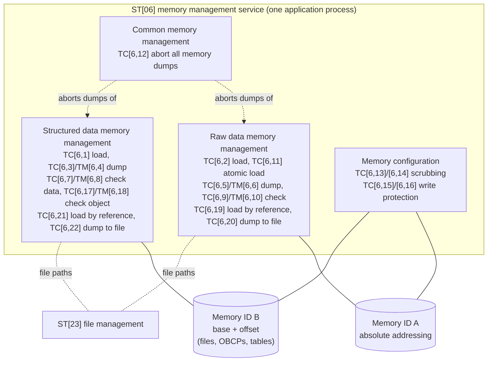
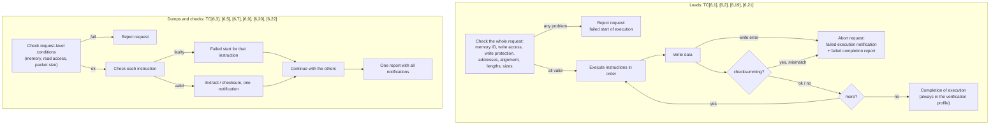
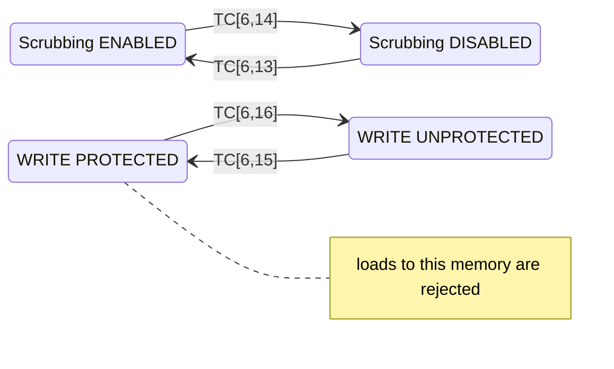
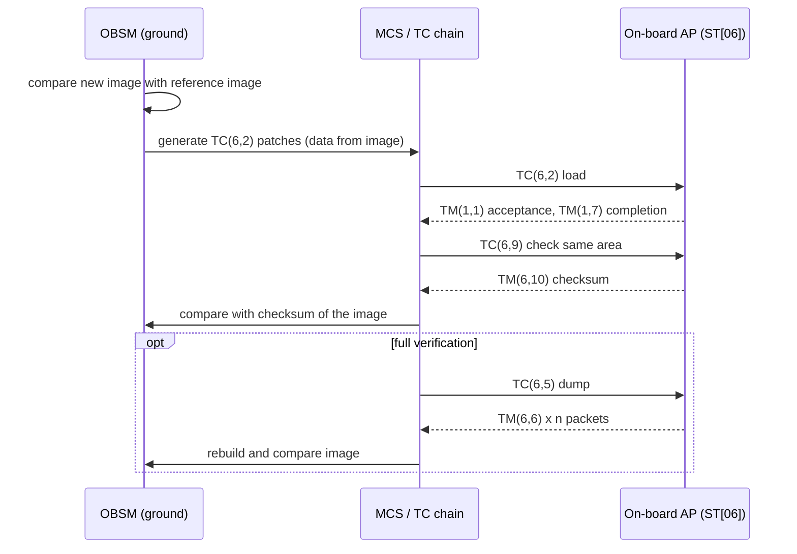

# ST[06] Memory management

The **memory management** service, service type 6 of the [Packet Utilization Standard](index.md),
lets the ground **load** data into on-board memories, **dump** their contents to ground and ask
the spacecraft to **check** an area by computing a checksum on board.[^c-6611] It is the
low-level tool behind on-board software maintenance: patching code, uploading tables, reading back
registers and logs, and verifying that memory has not been corrupted. PUS-A described it as an
"off-line" activity for troubleshooting and software maintenance rather than routine operations,
and asked that any on-board memory be readable and any RAM area loadable from ground.[^a-413]

PUS-C (ECSS-E-ST-70-41C, 2016) turned the PUS-A service into four subservices: **raw data**
memory management (absolute addresses), **structured data** memory management (memory *objects*
such as files or on-board control procedures, addressed by a base plus an offset), a **common**
subservice (abort all dumps) and a **memory configuration** subservice (scrubbing and write
protection).[^c-6611] This page covers all 22 message types, the declarations each mission must
make, the checksum algorithms, the PUS-A original (clause 11), the tailoring data of
[ECSS-E-ST-70-31C](../e-st-70-31c.md), the 2024 draft, the ground side in
[SCOS-2000](../../scos2000/index.md), and the real memory map and commands of
[Solar Orbiter](../../missions/solar-orbiter/index.md) as described in its ICD and
[MIB](../../missions/solar-orbiter/mib.md).

!!! info "At a glance"
    | Item | Value |
    |---|---|
    | Service type | 6, "memory management"[^c-861] |
    | Subservices | raw data, structured data (at least one of the two), common, memory configuration (at most one of each)[^c-662] |
    | Hosting | all memory management subservice providers in one application process (a note in PUS-C, a requirement in the 2024 draft; see section 9)[^c-662][^r-6622] |
    | Message types (PUS-C) | 22: subtypes 1-22[^c-annexc6] |
    | Minimum capability | raw: TC[6,2], TC[6,5]/TM[6,6]; structured: TC[6,1], TC[6,3]/TM[6,4]; common: TC[6,12][^c-annexc6] |
    | Checksum field | 16-bit bit-string; algorithm (ISO or CRC) declared per spacecraft[^c-8622][^c-544] |
    | PUS-A equivalent | clause 11, subtypes 1-10 (base plus offset: 1/3/4/7/8; absolute: 2/5/6/9/10)[^a-22] |
    | Solar Orbiter | absolute addressing only; TC(6,2), (6,5), (6,9) plus private 6,128-6,131 and 6,140; 221 commands in the MIB[^solo-s6][^mib-tc] |

## 1. On-board memories

### 1.1 The memory as a system object

In PUS-C an **on-board memory** is a *logical* memory space; the mapping onto physical memories,
possibly managed by different processors, is out of the standard's scope.[^c-terms][^c-5433] Each
memory has exactly one **memory identifier**, unique across the spacecraft at any time - although
the same identifier may serve several physical memories that cannot be accessed at the same time,
as in cold redundancy.[^c-5433] For each memory the mission declares:[^c-5433]

| Characteristic | Values |
|---|---|
| Memory access alignment constraint | minimum number of bytes the services use to address the memory |
| Memory size | in bytes |
| Allowed operations | "read only", "read and write" or "write only" |
| Addressing scheme | absolute and/or base plus offset exposed to ground |
| Scrubbing supported | yes / no |
| Write protection supported | yes / no |

Behind the alignment constraint sits the physical **smallest addressable unit**, the minimum number
of bytes a physical memory can address.[^c-5433] With **absolute addressing**, addresses and offsets
are in bytes. With **base plus offset addressing**, addresses are byte offsets from a base reference
that gives the "byte-zero" address - an explicit address, or a symbolic one such as a table, a
parameter set or a file whose absolute address is known on board.[^c-5433b]

### 1.2 Raw and structured data

| Subservice | Memory content | Addressing | Examples given by PUS-C |
|---|---|---|---|
| Raw data memory management | type not implicitly known | absolute: start address = offset from the start of the memory | none specific; memories in general are "e.g. RAM, mass memory unit" |
| Structured data memory management | type implicitly known | base (the object) + offset within the object | files, OBCPs, static configuration tables |

Definitions and examples from clauses 6.6.1.1-6.6.1.3 and 6.6.4.3.[^c-6611][^c-6612][^c-6643] The base of a structured memory is declared per
memory: for a file store it can be the file identifier used by [file management](st23-file-management.md)
(repository path plus file name); for the OBCP store it can be the [OBCP](st18-onboard-operations-procedure.md)
identifier.[^c-6643] Bases are either **static** (declared in advance, each with a maximum size, such
as a list of configuration tables) or **dynamic** (created at run time, for example when a file is
uploaded), and a dynamic base is identified either by a "base address" or by a "memory object
identifier".[^c-6643]



The 2014 draft of PUS-C presented three subservices (raw, structured, and a common one that also
handled scrubbing and write protection);[^v14-st6] the published standard separates the memory
configuration subservice, which manages each memory "as a whole", independently of content and
addressing scheme.[^c-6615][^v15-st6] With 44 discrepancy review reports (DRRs), ST[06] was the
second most discussed service type of the review, after ST[12] with 58 (the foundation model of
clause 5 drew 72).[^v15-drr]

### 1.3 Checksums

Whether the raw and the structured subservices checksum their data is declared per
subservice.[^c-6631][^c-6641] PUS-C does not fix the algorithm in the service: for each checksum
algorithm used on board, the spacecraft architecture declares which subservice providers use it, so
that every service checksumming the same object (for example an OBCP stored in a file, checked by
both the OBCP service and the memory service) uses the same algorithm; the algorithm implies the
type (ISO or CRC) and the size.[^c-544] In the packets the checksum is always a 16-bit
bit-string.[^c-8622] The two candidate algorithms are those of Annex B: the CRC-16-CCITT (polynomial
$x^{16}+x^{12}+x^5+1$, encoder and decoder initialised to all ones) and the ISO 8473-1 checksum,
which Annex B says can be used to check memory areas through the memory management
service.[^c-b1][^c-b2]

PUS-A was more prescriptive: memory management uses the 16-bit ISO checksum, computed over all
octets of the memory area.[^a-a2]

## 2. Message types and capability sets

| Message type | Name | Subservice | Applicability |
|---|---|---|---|
| TC[6,1] | load object memory data | structured | minimum |
| TC[6,2] | load raw memory data areas | raw | minimum |
| TC[6,3] | dump object memory data | structured | minimum |
| TM[6,4] | dumped object memory data report | structured | response to TC[6,3] |
| TC[6,5] | dump raw memory data | raw | minimum |
| TM[6,6] | dumped raw memory data report | raw | response to TC[6,5] |
| TC[6,7] | check object memory data | structured | by declaration |
| TM[6,8] | checked object memory data report | structured | response to TC[6,7] |
| TC[6,9] | check raw memory data | raw | by declaration |
| TM[6,10] | checked raw memory data report | raw | response to TC[6,9] |
| TC[6,11] | load a raw memory atomic data area in a non-interruptible transaction | raw | by declaration |
| TC[6,12] | abort all memory dumps | common | minimum |
| TC[6,13] / TC[6,14] | enable / disable the scrubbing of a memory | configuration | implied by "scrubbing memories support" (by declaration) |
| TC[6,15] / TC[6,16] | enable / disable the write protection of a memory | configuration | implied by "write protecting memories support" (by declaration) |
| TC[6,17] | check an object memory object | structured | by declaration |
| TM[6,18] | checked object memory object report | structured | response to TC[6,17] |
| TC[6,19] | load raw memory data areas by reference | raw | by declaration |
| TC[6,20] | dump raw memory data areas to file | raw | by declaration |
| TC[6,21] | load object memory data areas by reference | structured | by declaration |
| TC[6,22] | dump object memory data areas to file | structured | by declaration |

Source: Annex C, Tables C-10 to C-13.[^c-annexc6] "Minimum" applies to the subservices that the
service actually contains; the applicability vocabulary is explained in clause 5.3.4.[^c-534] Every
packet has service type 6, and whether multiple instructions per request are supported is declared
for the service.[^c-861]

!!! note "A subtype typo in the standard"
    Clause 8.6.2.22 of PUS-C says that TC[6,22] "shall be of message subtype 20"; the heading,
    clause 6.6.4.9 and Annex C all give 22. The 2024 draft repeats the slip.[^c-86222][^c-annexc6][^r-86222]

## 3. Request processing: why loads and dumps behave differently

PUS requests are made of **instructions** (for example one memory area each) and produce
**notifications** inside reports.[^c-terms2] Clause 5.3.5.2.3 lets each request type declare whether
all instructions must be suitable before execution starts; PUS-C names the raw memory load as an
example of a request that can only execute if all its instructions are suitable.[^c-53523] ST[06]
applies two regimes:



Sources: clauses 6.6.3.3-6.6.3.7 and 6.6.4.4-6.6.4.9.[^c-66331][^c-6634][^c-6635][^c-6644][^c-6645]
For every load the execution verification profile must include the completion of execution, so the
ground always learns whether the whole load succeeded.[^c-66331][^c-6644] PUS-C notes that checking
the instructions that follow a faulty one is optional for loads: if for instance a variable-length
data field does not match its length, the rest of the request can no longer be parsed.[^c-66331]

## 4. Raw data memory management

The raw subservice declares the list of memories it manages (all with absolute addressing), uses
memory identifiers if it manages more than one, and declares its write access per writeable
memory.[^c-6632] In all raw messages the **memory ID** field is omitted when the subservice manages
a single memory.[^c-6632][^c-8622]

### 4.1 TC[6,2] load raw memory data areas

| Field | Type | Presence | Meaning |
|---|---|---|---|
| memory ID | enumerated | optional | Target memory.[^c-8622] |
| N | unsigned integer | always | Number of instructions (areas).[^c-8622] |
| *repeated N times:* | | | |
| start address | unsigned integer | always | Byte pointer aligned on the access alignment constraint.[^c-8622][^c-66331] |
| data to load | variable octet-string (length + data) | always | The PFC of the length field is declared per application process (requirement 7.3.8d).[^c-8622][^c-738] |
| checksum | bit-string (16 bits) | optional | Present if the subservice checksums; verified after writing.[^c-8622][^c-66331] |

The request is rejected (failed start of execution) for an invalid memory ID, no write access, a
write-protected memory, a start address beyond the memory size or misaligned, a load length that is
not a multiple of the alignment constraint, or data running past the end of the memory.[^c-66331]
Otherwise instructions run in order; a write error, or a checksum mismatch after writing, aborts the
request immediately with a failed execution notification and a failed completion of execution
report.[^c-66331]

<div class="bitfield" data-title="TC[6,2] application data with N = 1 - ILLUSTRATIVE sizes (16-bit memory ID, 8-bit N, 32-bit address, 16-bit length, 4 data octets)" data-width="32"
     data-fields='[{"n":"memory ID","b":16,"d":"enumerated, optional"},{"n":"N","b":8,"d":"unsigned integer"},{"n":"start address","b":32,"g":"instruction 1","d":"byte pointer, aligned"},{"n":"length","b":16,"g":"instruction 1","d":"octet count of the variable octet-string"},{"n":"data","b":32,"g":"instruction 1","d":"4 octets in this example"},{"n":"checksum","b":16,"g":"instruction 1","d":"16-bit bit-string, optional"}]'></div>

### 4.2 TC[6,11] load a raw memory atomic data area in a non-interruptible transaction

This request changes **selected bits of one aligned memory word** without touching the others, in
a single non-interruptible transaction; it holds exactly one instruction.[^c-66332]

| Field | Type | Presence | Meaning |
|---|---|---|---|
| memory ID | enumerated | optional | Target memory.[^c-86211] |
| start address | unsigned integer | always | Aligned byte pointer.[^c-86211] |
| bit mask | fixed octet-string, deduced size | always | Selects the bits to change; size = access alignment constraint of the memory.[^c-86211][^c-66332] |
| data to load | fixed octet-string, deduced size | always | New values for the selected bits; same size.[^c-86211][^c-66332] |

The subservice reads the current value of the addressed word, replaces the bits selected by the mask
with the corresponding bits of the data, and writes the result:[^c-66332]

$$\text{new} = (\text{old} \land \lnot\,\text{mask}) \lor (\text{data} \land \text{mask})$$

It needs both read and write access and rejects an unknown or write-protected memory, an address
beyond the memory or misaligned, and a request whose size does not match the deduced mask and data
sizes. Its verification profile includes completion of execution.[^c-66332]

<div class="bitfield" data-title="TC[6,11] application data - ILLUSTRATIVE: 16-bit memory ID, 32-bit address, 4-octet alignment" data-width="32"
     data-fields='[{"n":"memory ID","b":16,"d":"enumerated, optional"},{"n":"start address","b":32,"d":"aligned byte pointer"},{"n":"bit mask","b":32,"d":"size = alignment constraint"},{"n":"data to load","b":32,"d":"size = alignment constraint"}]'></div>

### 4.3 TC[6,5] dump raw memory data and TM[6,6]

| TC[6,5] field | Type | Presence |
|---|---|---|
| memory ID | enumerated | optional |
| N | unsigned integer | always |
| start address | unsigned integer | repeated N times |
| length | unsigned integer | repeated N times |

| TM[6,6] field | Type | Presence |
|---|---|---|
| memory ID | enumerated | optional |
| N | unsigned integer | always |
| start address | unsigned integer | repeated N times |
| dumped data | variable octet-string (length + data) | repeated N times |
| checksum | bit-string (16 bits) | repeated, optional |

Layouts from Figures 8-70 and 8-71.[^c-8625] The request is rejected as a whole for an invalid
memory ID, no read access, or a response that would exceed the maximum CCSDS packet size of
65 542 octets.[^c-6634][^c-54113] Each instruction is then checked (address in range and aligned,
length within the memory and a multiple of the alignment); faulty instructions get their own failed
start notification and the valid ones are dumped anyway. Each valid instruction yields one
notification with the start address, the data and, if the subservice checksums, the checksum of the
dumped area; all go into a single TM[6,6].[^c-6634] Because a response may not exceed one packet,
PUS-C foresees [file management](st23-file-management.md) for data larger than a packet; other
mechanisms are mission-specific.[^c-54113] The 2024 draft replaces the rejection by splitting the
response over several packets (section 9).[^r-54113]

### 4.4 TC[6,9] check raw memory data and TM[6,10]

Same request layout as the dump; the report carries, per instruction, the start address, the length
and the 16-bit checksum.[^c-8629] Checking on board and comparing the checksum on ground avoids
downlinking memory suspected to be faulty.[^c-6635] The capability is "by declaration".[^c-annexc6]

### 4.5 TC[6,19] load raw memory data areas by reference

The data to load are not in the telecommand but in an on-board **file** (see
[ST[23] file management](st23-file-management.md)):[^c-6636][^c-86219]

| Field | Type | Presence |
|---|---|---|
| memory ID | enumerated | optional |
| repository path | variable character-string | always |
| file name | variable character-string | always |
| N | unsigned integer | always |
| start address | unsigned integer | repeated N times |
| offset in file | unsigned integer | repeated N times |
| length | unsigned integer | repeated N times |
| checksum | bit-string (16 bits) | repeated, optional |

Rejection adds two file conditions to those of TC[6,2]: the file does not exist, or is not
recognised as a file containing memory data; an offset beyond the file size is also an
error.[^c-6636] Execution reads each area from the file and writes it, with the same abort rules as
TC[6,2].[^c-6636] An object path is the combination of a repository path and an object
name.[^c-545]

### 4.6 TC[6,20] dump raw memory data areas to file

| Field | Type | Presence |
|---|---|---|
| memory ID | enumerated | optional |
| repository path, file name | variable character-strings | always |
| N | unsigned integer | always |
| start address, length | unsigned integers | repeated N times |

The request is rejected if the destination file already exists. The subservice creates the file and
appends each dumped area; the standard does not specify the formatting of the data in the file (raw
bytes or with headers).[^c-6637][^c-86220] The raw subservice defines no observables.[^c-6638]

## 5. Structured data memory management

The structured subservice manages memories with base plus offset addressing; write access is
declared per memory.[^c-6642] All its requests carry, after the optional memory ID, a **base**
field of type *deduced*: its format depends on the memory (a base address or a memory object
identifier).[^c-8621][^c-6643]

| Message | Fields (after memory ID, base) | Notes |
|---|---|---|
| TC[6,1] load object memory data | N; offset (unsigned integer), data to load (variable octet-string), checksum (optional) x N | Also called **scatter load** when N > 1. Rejected additionally for an unknown or write-protected memory object.[^c-6644][^c-8621] |
| TC[6,3] dump object memory data | N; offset, length x N | Rejected for unknown object, no read access, or response too large.[^c-6645][^c-8623] |
| TM[6,4] dumped object memory data report | memory ID, base, N; offset, dumped data (variable octet-string), checksum (optional) x N | One notification per valid instruction.[^c-6645][^c-8623] |
| TC[6,7] check object memory data | N; offset, length x N | By declaration.[^c-6646][^c-8627] |
| TM[6,8] checked object memory data report | memory ID, base, N; offset, length, checksum x N | [^c-6646][^c-8627] |
| TC[6,17] check an object memory object | (memory ID, base only) | Checksums the **whole object**; rejected if its length cannot be determined. Example: the checksum of a file.[^c-6647][^c-86217] |
| TM[6,18] checked object memory object report | memory ID, base, length, checksum | [^c-6647][^c-86217] |
| TC[6,21] load object memory data areas by reference | repository path, file name, N; destination offset, offset in file, length, checksum (optional) x N | [^c-6648][^c-86221] |
| TC[6,22] dump object memory data areas to file | repository path, file name, N; offset, length x N | File must not exist.[^c-6649][^c-86222] |

Offsets are byte offsets within the object identified by the base, independent of how the object is
physically stored.[^c-5433b] The structured subservice defines no observables.[^c-66410]

## 6. Common memory management: TC[6,12]

TC[6,12] "abort all memory dumps" has no application data.[^c-86212] It aborts every dump request
under execution by the raw subservice and by the structured subservice - including dumps to file.
The subservice exposes one observable: a flag saying that at least one dump is in
progress.[^c-665]

## 7. Memory configuration: scrubbing and write protection

For **scrubbing**, PUS-C does not specify the mechanism, which is memory dependent and can be
hardware or software; the service only keeps a **memory scrubbing status** per memory, which is used
to trigger the scrubbing.[^c-6661] **Write protection** can
likewise be hardware or software; its status is the **memory write protection status**.[^c-6662]
For each, the mission declares support, the list of memories concerned, and (for scrubbing) the
initial status.[^c-6661][^c-6662]

| Request | Application data | Effect | Rejected if |
|---|---|---|---|
| TC[6,13] enable the scrubbing of a memory | memory ID (optional) | status "enabled" | memory cannot be scrubbed[^c-6661][^c-86213] |
| TC[6,14] disable the scrubbing of a memory | memory ID (optional) | status "disabled" | memory cannot be scrubbed[^c-6661][^c-86213] |
| TC[6,15] enable the write protection of a memory | memory ID (optional) | "write protected" | memory cannot be write protected[^c-6662][^c-86213] |
| TC[6,16] disable the write protection of a memory | memory ID (optional) | "write unprotected" | memory cannot be write protected[^c-6662][^c-86213] |



Each request holds exactly one instruction.[^c-6661][^c-6662] The observables are the scrubbing
status and the write protection status of each controllable memory.[^c-6663] A load is rejected if
it targets a write-protected memory (section 4.1), and a write that fails because hardware
protection appears during the load aborts it.[^c-66331]

## 8. PUS-A (ECSS-E-70-41A) differences

PUS-A's memory management "provides basic dump, load and check facilities without the maintenance
of service state information" and need not know which areas are changeable, the block sizes or what
they contain.[^a-112]

| Aspect | PUS-A (2003) | PUS-C (2016) |
|---|---|---|
| Structure | one service, two addressing techniques[^a-112] | four subservices[^c-6611] |
| Memory ID | *fixed octet-string*, may be read as characters; omitted if only one memory block[^a-1131] | *enumerated*, optional[^c-8622] |
| Base | deduced: unsigned integer or symbolic fixed-length character string[^a-1131] | deduced; base address or memory object identifier[^c-8621][^c-6643] |
| Units | **SAU** (smallest addressable unit: 16, 24, 32 or 64-bit word possible), counts from zero[^a-112][^a-1131] | bytes, aligned on the access alignment constraint[^c-5433b] |
| Offset | *signed* integer[^a-1131] | unsigned integer[^c-8621] |
| Length / data | Length (SAUs) + Data (variable octet string)[^a-1131] | data to load as variable octet-string (length in octets)[^c-8622] |
| N | omitted if only one area per request[^a-1131] | always present[^c-8622] |
| Checksum | ISO 16-bit, computed over the data words only, optional[^a-1131] | 16-bit, algorithm declared[^c-8622][^c-544] |
| Load verification | compare uplinked checksum before writing; 11.2 says the data are loaded only if the checksums match, while the note in 11.3.1 makes skipping the write a design option; if completion is reported, re-read and compare[^a-112][^a-1131] | write, then checksum the loaded data; abort on mismatch[^c-66331] |
| Large dumps | may use the large data transfer service (ST[13])[^a-112] | response limited to one packet; files for larger data[^c-54113] |
| Subtypes 11-22 | - | atomic load, abort, scrubbing, write protection, object checks, by-reference and file operations[^c-annexc6] |

PUS-A message names: (6,1) Load Memory using Base plus Offsets; (6,2) Load Memory using Absolute
Addresses; (6,3) Dump Memory using Base plus Offsets; (6,4) Memory Dump using Base plus Offsets
Report; (6,5) Dump Memory using Absolute Addresses; (6,6) Memory Dump using Absolute Addresses
Report; (6,7) Check Memory using Base plus Offsets; (6,8) Memory Check using Base plus Offsets
Report; (6,9)/(6,10) the same with absolute addresses.[^a-1131][^a-1134][^a-1135][^a-1136] Its minimum capability set is
one load-and-dump family matching the memory's addressing: (6,1), (6,3), (6,4) or (6,2), (6,5),
(6,6); Table 18 then lists the dependencies (each load requires its dump and report, each check its
report) and the optional support of symbolic base references.[^a-114] The concept clause adds
scatter loads and dumps, optional checksum protection of loads, end-to-end verification by
reading back, and checking memory without dumping it.[^a-413] More on the transition:
[PUS-A vs PUS-C](pus-a-vs-pus-c.md).

### 8.1 Tailoring data in ECSS-E-ST-70-31C

ECSS-E-ST-70-31C models the PUS-A service. Its tailoring data (Table 6-33) are Booleans per
addressing technique:[^t-6557]

| Item | Meaning |
|---|---|
| S6 ST1 ST3 and ST4 Provider | a managed memory uses base plus offset |
| S6 Symbolic Base References, S6 Base Multiple Memory Blocks, S6 Base Data Level Checksum, S6 Base Scatter Load, S6 Base Scatter Dump | options of base plus offset |
| S6 ST7 and ST8 Provider, S6 Base Scatter Check | on-board checking (base plus offset) |
| S6 ST2 ST5 and ST6 Provider | a managed memory uses absolute addressing (forced TRUE if base plus offset is FALSE) |
| S6 Absolute Multiple Memory Blocks, S6 Absolute Data Level Checksum, S6 Absolute Scatter Load, S6 Absolute Scatter Dump | options of absolute addressing |
| S6 ST9 and ST10 Provider, S6 Absolute Scatter Check | on-board checking (absolute) |

The field sizes it asks for (Table 6-34 to 6-36) are: memory ID (PTC 7, PFC > 0), N (PTC 3),
offset (PTC 4, signed), length (PTC 3), start address (PTC 3), and the base as either PTC 8
(symbolic) or PTC 3 (unsigned integer).[^t-6557b] The standard also models the memories
themselves: a **memory block** has an ID (PTC 7), accessibility ("read-only" or "read and write"),
smallest addressable unit (1, 2, 3, 4 or 8 bytes, the PUS constant
`<SMALLEST_ADDRESSABLE_UNIT>`), addressing technique and size; a **memory sub-block** adds a
symbolic base reference, an offset, a loading instruction ("reload" or "patch"), a type ("object
code", "dynamic data", "data pool", "static data") and the reporting data it maps to.[^t-659]

## 9. Changes in the 2024 Rev.1 draft

ECSS-E-ST-70-41C Rev.1 DIR1 (11 December 2024) keeps the 22 message types and makes these changes:

* **Dumps and checks become all-or-nothing.** TC[6,3], TC[6,5], TC[6,7], TC[6,9], TC[6,20] and
  TC[6,22] carry an ordered list of instructions; the whole request is rejected if any instruction
  is invalid, and otherwise instructions execute in order. In PUS-C faulty instructions were
  rejected individually.[^r-6634][^r-6645][^r-66all]
* **Large dumps are split instead of rejected.** The general rule of clause 5.4.11.3.2 changes: a
  response too long for one packet of the maximum size is split into several self-contained PUS
  telemetry packets, with splitting criteria declared per subservice and the group marked by the
  primary header sequence flags (`01` first, `00` continuation, `10` last, `11` stand-alone); the
  draft names memory dumps as a typical case. Accordingly the TC[6,5] and TC[6,3] rejection lists
  no longer contain the packet-size condition.[^r-54113][^r-6634][^r-6645]
* The note allowing loads to skip checking the instructions that follow a faulty one, present in
  four PUS-C load clauses, no longer appears.[^c-66331][^r-loads]
* Hosting is reworded. In PUS-C, 6.6.2.2a says each subservice provider is hosted by exactly one
  application process, only a note adds that all of them are therefore in a single application
  process, and 6.6.2.2b allows at most one memory management subservice provider per application
  process. DIR1 makes the single hosting application process a requirement and limits each
  application process to the subservice providers of at most one memory management
  service.[^c-662][^r-6622]
* Scrubbing and write protection statuses are maintained by the memory configuration subservice
  (PUS-C said "the memory management service").[^r-cfg][^c-6661]

## 10. Ground segment: SCOS-2000 and on-board software maintenance

SCOS-2000's function list includes **On-board Software Maintenance (OBSM)**.[^bul115] The Database
Import ICD describes its role for service 6: OBSM generates memory load (patch) commands from
memory images and processes dump packets to update memory images. The exact structure of the
service 6 packets and the generation of patch and dump commands are left to mission-specific
implementations, and the ICD recommends reusing a structure already used by a previous SCOS-2000
mission so that existing OBSM functions can be reused.[^icd-s6] Two general SCOS-2000 limits matter
here: variable-length octet strings are supported for *encoding* TC parameters but not for decoding
TM, which therefore needs special processing "e.g. memory dump processing"; and parameter values
from variable TM packets do not take part in full TM processing.[^icd-types][^icd-var]



!!! warning "Inference"
    The sequence is this wiki's composition of the OBSM role in the ICD with the PUS-A
    end-to-end verification concept (load, then read back or checksum and compare).[^icd-s6][^a-413]
    It is not a procedure taken from a mission document.

## 11. Solar Orbiter: the space-to-ground ICD

### 11.1 Service description

Solar Orbiter's ICD (PUS-A based)[^solo-ad1] defines service 6 for loading, dumping and checking a **contiguous**
area of RAM, PROM, EEPROM, safeguard memory (SGM) or mass memory, identified by a memory ID:[^solo-s6]

* Only **absolute addressing** is used; addresses are expressed in single addressable units (SAU) of
  the selected memory.[^solo-s6]
* TC(6,2) and TC(6,5) contain **one block** each. A scatter patch is obtained with TC(6,128), which
  applies a set of patches pre-loaded with TC(6,2).[^solo-s6]
* TM(6,6) is not limited in length: the application generates as many dump packets as needed for the
  commanded area.[^solo-s6]
* TC(6,9) requests a check whose result TM(6,10) is sent via real-time telemetry.[^solo-s6]
* The memory ID is 2 bytes. Units A and B nominally use the same memory IDs, the unit being selected
  by APID; for cross-access between redundant units, unit A memories use 1-255 and unit B memories
  257-511 (most significant byte 1 plus the unit A ID).[^solo-memrules]
* The SAU can be 8, 16 or 32 bits; the address multiplier (MUL) is the address increment from one
  SAU to the next.[^solo-memrules]

### 11.2 The memory map (Figure 5.7-1)

| Unit A ID | Unit B ID | Memory | Size | SAU (bits) | MUL |
|---|---|---|---|---|---|
| `0x0003` | `0x0103` | PM PROM (boot SW image) - not patchable | 64 kB | 32 | 4 |
| `0x0013` | `0x0113` | PM EEPROM banks 0 and 1 | 4 MB | 32 | 4 |
| `0x0023` | `0x0123` | Processor RAM (`0x0200 0000`-`0x027F FFFF`) | 8 MB | 32 | 4 |
| `0x0050` | `0x0150` | ERC32 system registers | 512 kB | 32 | 4 |
| `0x0051` | `0x0151` | COCOS I/O area 0 | 128 kB | 32 | 4 |
| `0x0052` | `0x0152` | Outport register | 512 kB | 32 | 4 |
| `0x0053` | `0x0153` | COCOS | remainder | 32 | 4 |
| `0x0005` | `0x0105` | TTR PROM | 32 kB | 32 | 4 |
| `0x0033`, `0x0034` | `0x0133`, `0x0134` | SGM RAM banks 1 and 2 | 256 kB each | 32 | 4 |
| `0x0043`, `0x0044` | `0x0143`, `0x0144` | SGM EEPROM banks 1 and 2 | 128 kB each | 32 | 4 |
| `0x0045` | `0x0145` | OBC mass memory | 2 GB | 32 | 4 |
| `0x0060`, `0x0061` | `0x0160`, `0x0161` | RM EEPROM bank 0, EEPROM bank 3 | 128 kB each | 32 | 4 |
| `0x0062`-`0x0065` | `0x0162`-`0x0165` | CROME SRAM, TME buffer, HAMSTER registers, CROME registers | 32-480 kB | 32 | 4 |
| `0x0020`, `0x001E`, `0x001F` | - | SSMM PROM, RAM, EEPROM | 128 kB, 8 MB, 2 MB | 32 | 4 |
| `0x00D2`-`0x00EF` | - | SSMM memory array | - | - | - |
| `0x0040`-`0x0042` | - | STR RAM, EEPROM, pixel RAM | - | 32 | 4 |
| `0x50--` ... `0xE0--` | `0x51--` ... `0xE1--` | payload ranges: EPD, MAG, RPW, SWA, SPICE, PHI, EUI, METIS, STIX, SoloHI (TBC) | - | - | - |

Restated from the ICD table, which also flags the patch/dump/check operations allowed per
memory.[^solo-memmap]

### 11.3 Messages

| Message | Name | Data (sizes) | Notes |
|---|---|---|---|
| TC(6,2) | Load Memory (patch) | Memory ID (2, enumerated), Start Address (4), Length (4), Data (n) | Start address + length - 1 must stay inside the physical memory.[^solo-62] |
| TC(6,5) | Dump Memory | Memory ID (2), Start Address (4), Length (4) | Must not cross memory ID boundaries; if it does, a warning event is raised and the dump stops at the boundary. Not limited by the TM packet size.[^solo-65] |
| TM(6,6) | Memory Dump Report | Memory ID (2), Start Address (4), Length (4), Data (n) | Each packet self-contained and contiguous (split at page boundaries); multi-packet dumps flagged with the segmentation flags of the primary header; destination always ground; packet category 9.[^solo-66] |
| TC(6,9) | Check Memory | Memory ID (2), Start Address (4), Length (4) | Checksum is the **CRC 16** of Annex 6, computed on the memory's basic word length.[^solo-69] |
| TM(6,10) | Memory Check Report | Memory ID (2), Start Address (4), Length (4), Checksum (2) | Destination always ground.[^solo-610] |
| TC(6,128) | Apply Pre-loaded Set of RAM Patches | Pre-Loaded Patches Number (4), 1..30 | CSW only (section 11.4).[^solo-6128] |
| TC(6,129) | Abort Dump | none | SSMM software only; rejected if no dump is ongoing.[^solo-6129] |
| TC(6,130) / (6,131) | Enable / Disable EEPROM Patch | none | SSMM only; powers the SSMM EEPROM banks on and enables patches, or the reverse.[^solo-6130] |
| TC(6,140) | Load Memory with Mask | Memory ID (2), Start Address (4), Data (4), Mask (4) | CSW only; loads single or multiple bits.[^solo-6140] |

!!! warning "Inference: Solar Orbiter anticipates the 2024 rule"
    Splitting a long dump into self-contained TM(6,6) packets grouped by the segmentation flags is
    what the 2024 draft makes the general PUS rule (section 9), whereas PUS-C would reject such a
    dump request and PUS-A suggested the large data transfer service.[^solo-66][^r-54113][^c-54113][^a-112]

The dump category 9 is "Exclusive for Service 6 (6,x) telemetry", and dump packets are among the
categories whose destination ID is always zero (ground).[^solo-cat][^solo-dest] Solar Orbiter's
service 8 functions live in PM RAM at fixed addresses and can be modified or added by service 6
patches, which shows how ST[06] underpins [ST[08] function management](st08-function-management.md).[^solo-s8]

### 11.4 The RAM patch mechanism (TC(6,128))

The patching buffer is a RAM area with a **patch table** of up to 30 descriptors (number of bytes,
source address in the pre-loading area, destination address) and a **pre-loading area** holding the
patch bytes. The ground loads both with TC(6,2), checks their content and consistency, then sends
TC(6,128) with the number of descriptors to apply (the first *n* entries); after execution the
buffer is erased.[^solo-6128]

!!! warning "Inference"
    The mechanism makes a scatter patch atomic from the software's point of view: the patches are
    staged harmlessly and then applied in one step, instead of a series of TC(6,2) loads that would
    leave running code half-patched between packets. The ICD calls it a "safe loading/patching" of
    different RAM addresses but does not give the rationale.[^solo-notes]

### 11.5 Masked load: Solar Orbiter and PUS-C compared

<div class="bitfield" data-title="Solar Orbiter TC(6,140) Load Memory with Mask (real layout, 112 bits)" data-width="16"
     data-fields='[{"n":"Memory ID","b":16,"d":"enumerated, 2 bytes"},{"n":"Start Address","b":32,"d":"unsigned integer, SAU"},{"n":"Data","b":32,"d":"bits to be modified set to the required value"},{"n":"Mask","b":32,"d":"1 = modify, 0 = keep"}]'></div>

The ICD rule is (existing data AND inverse mask) OR (loaded data AND mask), the same formula as
PUS-C's TC[6,11] (section 4.2), but with data before mask in the packet.[^solo-6140][^c-66332]
In the MIB, `ZCD0068C` "Load Memory With Mask" has exactly these four fields with a 32-bit word to
load.[^mib-tc]

## 12. Solar Orbiter: what the MIB contains

All figures below come from this wiki's queries of the September 2025 release
MIB__20250916M25925PFMS001_SOL.[^mib-tc][^mib-tm]

### 12.1 Commands

| Subtype | Commands | APIDs | Examples |
|---|---|---|---|
| 2 | 91 | 20 | [ZCD00602](../../explorer/index.md#/solo/command/ZCD00602) "Load Memory Using Absolute Address", ZSM00025 "SSMM Load Mem Absolute Addresses", ZST16200 "STR1 Load Mem RAM" |
| 5 | 82 | 20 | [ZCD00605](../../explorer/index.md#/solo/command/ZCD00605) "Dump Memory Using Absolute Address", ZIP06054 "dumpRAM" (PHI) |
| 9 | 29 | 20 | [ZCD00609](../../explorer/index.md#/solo/command/ZCD00609) "Check Memory Using Absolute Address" |
| 128 | 2 | 172, 812 | [ZCD00680](../../explorer/index.md#/solo/command/ZCD00680) "Apply Pre-loaded Set of RAM Patches", ZID52542 (EPD) |
| 129 | 5 | 492, 508, 524, 924, 1532 | ZSM00040 "SSMM Abort Dump", ZIU51000 "EUI_AbortDump", ZIA58056 "SWA_TC_MEM_DUMP_ABORT" |
| 130 / 131 | 3 / 3 | 492, 508, 524 | ZSM00014 "SSMM Enable EEPROM Patch", ZSM00017 "SSMM Disable EEPROM Patch" |
| 140 | 6 | 172, 1020 | [ZCD0068C](../../explorer/index.md#/solo/command/ZCD0068C) "Load Memory With Mask", ZIM00614 (MAG) |

The 20 APIDs of subtypes 2, 5 and 9 are the OBC (172), the three SSMM processes (492, 508, 524),
both star trackers (652, 668) and fourteen instrument processes. All 221 commands have `CCF_ACK` = 9
(acceptance and completion reports), which satisfies PUS-C's requirement that loads always report
completion, and none is flagged critical.[^mib-tc][^c-66331]

The OBC memory ID parameter `PCD06021` uses the alias set `CCDT0037TX` "Memory ID", whose 38 entries
reproduce the OBC part of the ICD memory map one-to-one (19 memories for each of units A and B;
the SSMM, star-tracker and payload memory IDs are not in it): `A_PM_PROM` = 3, `A_TTR_PROM` = 5, `A_PM_EEPROM` = 19,
`A_PM_RAM` = 35, ..., `A_CROME_REG` = 101, and the unit B twins 259-357 (`0x0103`-`0x0165`).[^mib-tc][^solo-memmap]

### 12.2 Three ways to model a load

The 91 TC(6,2) definitions show how a MIB copes with PUS variable data in SCOS-2000:[^mib-tc]

| Style | Definitions | How the data is modelled | Example |
|---|---|---|---|
| Group repeater | 30 | `Length` (32-bit) is a repeat counter (`CDF_GRPSIZE` = 1) over one data element of the SAU size: 8-bit (PTC 3 PFC 4), 16-bit (PFC 12) or 32-bit (PFC 14) | `ZCD00602`: data block of N 32-bit words |
| Octet string ("(OBSM)" variants) | 10 | `Length` is a plain 32-bit value; the data is one variable octet string (PTC 7, PFC 0) to be filled from a memory image | `ZCDX0602` "DMS Load Memory by Absolu address (OBSM)", `ZSTX1620` "STR1 Load Mem RAM (OBSM)" |
| Fixed layout | 51 | no repeat counter and no octet string: a fixed set of fields, often with the memory ID, address and length preset, followed by named values (a register, a table such as an FSS look-up table) | `ZCDX0100` "Load RMH_ATPTR_CROME_REG_A": memory `A_CROME_REG`, start address 5642, length 1, then the register value |

<div class="bitfield" data-title="Solar Orbiter ZCD00602 TC(6,2) application data with Length = 2 (real layout from CDF)" data-width="16"
     data-fields='[{"n":"Memory IDentifier (PCD06021)","b":16,"d":"PTC 2 PFC 16, alias set CCDT0037TX"},{"n":"Start address (PCD06022)","b":32,"d":"PTC 3 PFC 14"},{"n":"Data Length to load (PCD06023)","b":32,"d":"PTC 3 PFC 14, repeat counter (group size 1)"},{"n":"Data word 1 (PCD06024)","b":32,"g":"repeated Length times","d":"PTC 3 PFC 14"},{"n":"Data word 2 (PCD06024)","b":32,"g":"repeated Length times","d":"PTC 3 PFC 14"}]'></div>

!!! warning "Inference: start addresses count SAUs"
    `ZCDX0100` loads the CROME register area (`A_CROME_REG`, mapped at `0x0700 0000`-`0x0701 FFFF`,
    128 kB) at start address 5642, so addresses are counted from the start of each memory, not
    on the absolute bus map. Whether the count is in octets or in 32-bit SAUs is not settled by the
    sources: the TC(6,2), (6,5) and (6,9) parameter definitions say "in single addressable unit,
    with count starting from zero", while the memory map gives every OBC memory an address
    multiplier of 4, the "address increment" from one SAU to the next.[^solo-62][^solo-memmap][^solo-memrules]
    The MIB favours SAUs: the preset start addresses of the ten consecutive registers
    `RMH_ATCNT 0` to `RMH_ATCNT 9` are 5792 to 5801 (step 1), and values such as 5642, 5779 or 8961
    are not multiples of 4, as 32-bit-aligned byte offsets would be.[^mib-tc] In SAUs, 5642
    corresponds to byte offset 5642 x 4 = 22 568 (`0x5828`).

Dumps follow the same pattern: of the 82 TC(6,5) definitions, 12 have no preset value and 70
preset at least one field (a fixed or default value in `CDF_VALUE`); on the OBC alone, `ZCD00605` sits next to 46 dedicated
dumps of reconfiguration-module registers, FSS look-up tables, boot reports and HPTM registers, such
as `ZCDX0200` "Dump RMH_ATPTR_CROME_REG_A" (memory 101, address 5642, length 1).[^mib-tc]

### 12.3 Reports and how SCOS-2000 identifies them

| Report | Definitions | APIDs | Identification (PIC) |
|---|---|---|---|
| TM(6,6) | 289 (219 variable, 70 fixed) | 24 | generic: memory ID at octet 16, 16 bits; four APIDs (1961, 1965, 1976, 1977) add the start address at octet 18, 32 bits |
| TM(6,10) | 20 | 20 | no extra field: one definition per APID |

Source: [PID](../../mib/tables/pid.md), [PIC](../../mib/tables/pic.md).[^mib-tm] For the OBC
dump APID 169 (process 10, category 9) there are 38 TM(6,6) definitions, one per memory ID, each a
variable packet whose [VPD](../../mib/tables/vpd.md) structure is memory ID, start address, a
block-length repeat counter and the repeated 32-bit data words - for example SPID 19501
[Memory Dump A_PM_PROM](../../explorer/index.md#/solo/packet/19501).[^mib-tm] The 70 fixed dump
definitions decode specific memory contents as ordinary parameters: SPID
[64100](../../explorer/index.md#/solo/packet/64100) "Dump_RMH_ATPTR_CROME_REG_A" (memory 101,
address 5642) ends with the 32-bit parameter `NCDX0200` "RMH_ATPTR_CROME_REG_A", matching the dump
command `ZCDX0200` and the load command `ZCDX0100` above.[^mib-tm][^mib-tc]

!!! warning "Inference: the dedicated dump APIDs"
    62 of the 70 fixed dump definitions - OBC register, log and RAM-table dumps such as SPID 64100,
    SSMM memory-module error logs and status, and star-tracker settable parameters (APIDs 1976 and
    1977) - sit on APIDs 1961, 1965, 1976 and 1977 (process IDs
    122-123, in the range the ICD allocates to EGSE), whereas the OBC's own dump APID is 169.[^solo-pid][^mib-tm]
    How dumps reach these APIDs on ground is not stated in the available sources. The other 8 fixed
    definitions are SoloHI dumps on APID 1321 (process 82), with memory IDs `0xE000`-`0xE007`, inside
    the `0xE0--` range the ICD reserves for SoloHI.[^solo-memmap][^mib-tm]

The OBC check report SPID [14170](../../explorer/index.md#/solo/packet/14170) "Memory Check Using
Absolute Address Report" is a fixed 28-octet packet:[^mib-tm]

<div class="bitfield" data-title="Solar Orbiter TM(6,10) SPID 14170 source data (real layout from PLF, 96 bits)" data-width="16"
     data-fields='[{"n":"Mem Identifier (NCD06061)","b":16,"d":"PTC 2 PFC 16, calibrated by CCDT0037TX"},{"n":"Mem Block StartAdd (NCD06062)","b":32,"d":"PTC 3 PFC 14"},{"n":"Chk Block Length (NCD060A3)","b":32,"d":"PTC 3 PFC 14"},{"n":"Computed CRC (NCD060A4)","b":16,"d":"PTC 3 PFC 12"}]'></div>

!!! note "ISO or CRC?"
    The ICD says TC(6,9) uses the CRC 16 of its Annex 6, and the TM(6,10) parameter is named
    "OBCHP_Computed CRC"; yet the MIB's extended description of `ZCD00609` (`CCF_DESCR2`) speaks of
    an "'ISO' checksum report".[^solo-69][^mib-tc] The available sources do not resolve the discrepancy; the ICD is the
    more authoritative of the two.

??? example "SQL used"
    ```sql
    -- solo-2025-09-16.sqlite
    SELECT CCF_STYPE, COUNT(*), COUNT(DISTINCT CCF_APID) FROM ccf WHERE CCF_TYPE = '6' GROUP BY 1;
    SELECT CCF_TYPE, CCF_STYPE, CCF_ACK, CCF_CRITICAL, COUNT(*) FROM ccf
     WHERE CCF_TYPE = '6' GROUP BY 1, 2, 3, 4;
    SELECT PAS_ALTXT, PAS_ALVAL FROM pas WHERE PAS_NUMBR = 'CCDT0037TX' ORDER BY CAST(PAS_ALVAL AS INT);
    -- modelling style of each TC(6,2)
    WITH s AS (SELECT f.CCF_CNAME n, MAX(c.CPC_PTC = '7') os, MAX(d.CDF_GRPSIZE > 0) rep
                 FROM ccf f JOIN cdf d ON d.CDF_CNAME = f.CCF_CNAME
                 LEFT JOIN cpc c ON c.CPC_NAME = d.CDF_PNAME
                WHERE f.CCF_TYPE = '6' AND f.CCF_STYPE = '2' GROUP BY 1)
    SELECT CASE WHEN os THEN 'octet-string' WHEN rep THEN 'repeater' ELSE 'fixed' END, COUNT(*)
      FROM s GROUP BY 1;
    SELECT d.*, c.CPC_DESCR, c.CPC_PTC, c.CPC_PFC FROM cdf d LEFT JOIN cpc c ON c.CPC_NAME = d.CDF_PNAME
     WHERE d.CDF_CNAME IN ('ZCD00602', 'ZCDX0602', 'ZCDX0100', 'ZCD0068C', 'ZCDX0200');
    SELECT PID_STYPE, COUNT(*), COUNT(DISTINCT PID_APID), SUM(PID_TPSD = '-1')
      FROM pid WHERE PID_TYPE = '6' GROUP BY 1;
    SELECT PID_APID, PID_PI1_VAL, COUNT(*) FROM pid            -- where the 70 fixed dumps are
     WHERE PID_TYPE = '6' AND PID_STYPE = '6' AND PID_TPSD = '-1' GROUP BY 1, 2;
    SELECT * FROM pic WHERE PIC_TYPE = '6';
    SELECT * FROM vpd WHERE VPD_TPSD = '19501' ORDER BY CAST(VPD_POS AS INT);
    SELECT PLF_NAME, PLF_OFFBY FROM plf WHERE PLF_SPID IN ('14170', '64100');
    ```

The April 2020 release had essentially the same command set (85, 78 and 29 definitions of subtypes
2, 5 and 9) and 278 TM(6,6) definitions.[^mib2020-tm] The SWA instrument database contributes one
TC(6,2), (6,5), (6,9) and (6,129) each, one TM(6,10) and 53 TM(6,6) definitions, identified by the
same PIC rule (memory ID at octet 16, 16 bits).[^swa-tm]

## 13. Worked example: a memory check round trip (real layout, illustrative values)

Check 256 SAUs of processor RAM `A_PM_RAM` (memory ID 35) on the OBC with `ZCD00609` - 1 KiB if,
as inferred in section 12.2, lengths count 32-bit SAUs. The layout is real; the sequence count
and start address are **illustrative**; the header follows the ICD's TC packet
definition;[^solo-tchdr] the CRC is computed with the Solar Orbiter ICD algorithm (CCITT
polynomial, initial value all ones).[^solo-crc]

| Octets | Bytes | Field |
|---|---|---|
| 0-1 | `18 AC` | TC, secondary header flag 1, APID 172 (process 10, category 12) |
| 2-3 | `C0 01` | stand-alone, sequence count 1 |
| 4-5 | `00 0F` | packet data length = 16 - 1 |
| 6-9 | `19 06 09 78` | PUS version 1, ack `1001`; service 6, subtype 9; source ID 120 |
| 10-11 | `00 23` | memory ID 35 `A_PM_RAM` |
| 12-15 | `00 00 00 00` | start address 0 (illustrative) |
| 16-19 | `00 00 01 00` | length 256 SAU |
| 20-21 | `38 6E` | packet error control (CRC-16) |

The answer is a TM(6,10) on APID 169 laid out as in SPID 14170: memory ID `00 23`, the same start
address and length, and the 16-bit CRC of the area. The ground compares it with the CRC of its
reference memory image; a match shows, with the error-detection strength of a 16-bit CRC, that the
area is intact without dumping it.[^solo-69][^c-6635][^solo-crc]

!!! example "Checksum test vectors"
    To validate a ground implementation, the standards give test vectors (hexadecimal). This wiki's
    implementation reproduces all of them.

    | Data | ISO checksum (PUS-A Annex A.2) | CRC (Solar Orbiter Annex 6) |
    |---|---|---|
    | `00 00` | `FF FF` | `1D 0F` |
    | `00 00 00` | `FF FF` | `CC 9C` |
    | `AB CD EF 01` | `9C F8` | `04 A2` |
    | `14 56 F8 9A 00 01` | `24 DC` | `7F D5` |

    Sources: PUS-A A.2.5 and the Solar Orbiter CRC compliance table.[^a-a2][^solo-crc] The ISO
    algorithm keeps two running sums modulo 255, $C_0 = C_0 + B_i$ and $C_1 = C_1 + C_0$, then
    sets $CK_1 = -(C_0 + C_1)$ and $CK_2 = C_1$, replacing a zero by 255.[^a-a2]

## 14. Other missions: Herschel and Planck

The Herschel/Planck Operations Interface Requirements Document asks that memory areas be split into
code, fixed data and variables; that the ground can load any changeable area, with a contiguous area
per telecommand; that each load packet be self-consistent (not dependent on earlier packets, and
re-sendable alone); that the destination detect corrupted loads (for example by checksums); that
end-to-end verification confirm the data in memory, possibly by dumping; that any memory, including
non-volatile and mass memories, be dumpable with a single request even if several TM packets are
needed; and that a checksum check over a start address and length be available.[^hp-mm] It also
requires that on-board software can be modified, by changing the non-volatile image or patching the
working copy, while the unit is operational.[^hp-obsm] See [Herschel and Planck](../../missions/herschel-planck.md).

## Related pages

* [PUS overview](index.md), [PUS packet structures](packets.md), [PUS parameter types](parameter-types.md)
* [ST[08] Function management](st08-function-management.md), [ST[13] Large packet transfer](st13-large-packet-transfer.md), [ST[23] File management](st23-file-management.md), [ST[18] On-board operations procedure](st18-onboard-operations-procedure.md)
* [CCSDS File Delivery Protocol](../../ccsds/cfdp.md)
* [Commanding in the MIB](../../mib/commanding.md), [Monitoring in the MIB](../../mib/monitoring.md), [MIB parameter types](../../mib/parameter-types.md)
* [Solar Orbiter PUS usage](../../missions/solar-orbiter/pus-usage.md), [STIX memory dumps and memory IDs](../../missions/solar-orbiter/stix.md#memory-dumps-and-memory-ids), [SCOS-2000 architecture](../../scos2000/architecture.md)
* [PUS-A vs PUS-C](pus-a-vs-pus-c.md), [Glossary](../../glossary.md)

[^c-6611]: [ECSS-E-ST-70-41C, Telemetry and telecommand packet utilization](../../library/ecss-e-st-70-41c-15april2016.md), §6.6.1.1, PDF p. 127.
[^c-6612]: [ECSS-E-ST-70-41C](../../library/ecss-e-st-70-41c-15april2016.md), §6.6.1.2-6.6.1.3, PDF p. 127.
[^c-6615]: [ECSS-E-ST-70-41C](../../library/ecss-e-st-70-41c-15april2016.md), §6.6.1.4-6.6.1.5, PDF p. 128.
[^c-662]: [ECSS-E-ST-70-41C](../../library/ecss-e-st-70-41c-15april2016.md), §6.6.2, PDF pp. 128-129.
[^c-6631]: [ECSS-E-ST-70-41C](../../library/ecss-e-st-70-41c-15april2016.md), §6.6.3.1, PDF p. 129.
[^c-6632]: [ECSS-E-ST-70-41C](../../library/ecss-e-st-70-41c-15april2016.md), §6.6.3.2, PDF p. 129.
[^c-66331]: [ECSS-E-ST-70-41C](../../library/ecss-e-st-70-41c-15april2016.md), §6.6.3.3.1, PDF pp. 129-131.
[^c-66332]: [ECSS-E-ST-70-41C](../../library/ecss-e-st-70-41c-15april2016.md), §6.6.3.3.2, PDF pp. 131-132.
[^c-6634]: [ECSS-E-ST-70-41C](../../library/ecss-e-st-70-41c-15april2016.md), §6.6.3.4, PDF pp. 133-134.
[^c-6635]: [ECSS-E-ST-70-41C](../../library/ecss-e-st-70-41c-15april2016.md), §6.6.3.5, PDF pp. 134-135.
[^c-6636]: [ECSS-E-ST-70-41C](../../library/ecss-e-st-70-41c-15april2016.md), §6.6.3.6, PDF pp. 136-138.
[^c-6637]: [ECSS-E-ST-70-41C](../../library/ecss-e-st-70-41c-15april2016.md), §6.6.3.7, PDF pp. 138-139.
[^c-6638]: [ECSS-E-ST-70-41C](../../library/ecss-e-st-70-41c-15april2016.md), §6.6.3.8, PDF p. 139.
[^c-6641]: [ECSS-E-ST-70-41C](../../library/ecss-e-st-70-41c-15april2016.md), §6.6.4.1, PDF p. 139.
[^c-6642]: [ECSS-E-ST-70-41C](../../library/ecss-e-st-70-41c-15april2016.md), §6.6.4.2, PDF p. 139.
[^c-6643]: [ECSS-E-ST-70-41C](../../library/ecss-e-st-70-41c-15april2016.md), §6.6.4.3, PDF p. 140.
[^c-6644]: [ECSS-E-ST-70-41C](../../library/ecss-e-st-70-41c-15april2016.md), §6.6.4.4, PDF pp. 140-142.
[^c-6645]: [ECSS-E-ST-70-41C](../../library/ecss-e-st-70-41c-15april2016.md), §6.6.4.5, PDF pp. 142-144.
[^c-6646]: [ECSS-E-ST-70-41C](../../library/ecss-e-st-70-41c-15april2016.md), §6.6.4.6, PDF pp. 144-146.
[^c-6647]: [ECSS-E-ST-70-41C](../../library/ecss-e-st-70-41c-15april2016.md), §6.6.4.7, PDF pp. 146-147.
[^c-6648]: [ECSS-E-ST-70-41C](../../library/ecss-e-st-70-41c-15april2016.md), §6.6.4.8, PDF pp. 147-149.
[^c-6649]: [ECSS-E-ST-70-41C](../../library/ecss-e-st-70-41c-15april2016.md), §6.6.4.9, PDF pp. 149-150.
[^c-66410]: [ECSS-E-ST-70-41C](../../library/ecss-e-st-70-41c-15april2016.md), §6.6.4.10, PDF p. 150.
[^c-665]: [ECSS-E-ST-70-41C](../../library/ecss-e-st-70-41c-15april2016.md), §6.6.5, PDF p. 151.
[^c-6661]: [ECSS-E-ST-70-41C](../../library/ecss-e-st-70-41c-15april2016.md), §6.6.6.1, PDF pp. 151-153.
[^c-6662]: [ECSS-E-ST-70-41C](../../library/ecss-e-st-70-41c-15april2016.md), §6.6.6.2, PDF pp. 153-155.
[^c-6663]: [ECSS-E-ST-70-41C](../../library/ecss-e-st-70-41c-15april2016.md), §6.6.6.3, PDF p. 155.
[^c-861]: [ECSS-E-ST-70-41C](../../library/ecss-e-st-70-41c-15april2016.md), §8.6.1, PDF p. 481.
[^c-8621]: [ECSS-E-ST-70-41C](../../library/ecss-e-st-70-41c-15april2016.md), §8.6.2.1, Figure 8-66, PDF p. 481.
[^c-8622]: [ECSS-E-ST-70-41C](../../library/ecss-e-st-70-41c-15april2016.md), §8.6.2.2, Figure 8-67, PDF pp. 481-482.
[^c-8623]: [ECSS-E-ST-70-41C](../../library/ecss-e-st-70-41c-15april2016.md), §8.6.2.3-8.6.2.4, Figures 8-68 and 8-69, PDF pp. 482-483.
[^c-8625]: [ECSS-E-ST-70-41C](../../library/ecss-e-st-70-41c-15april2016.md), §8.6.2.5-8.6.2.6, Figures 8-70 and 8-71, PDF pp. 483-484.
[^c-8627]: [ECSS-E-ST-70-41C](../../library/ecss-e-st-70-41c-15april2016.md), §8.6.2.7-8.6.2.8, Figures 8-72 and 8-73, PDF pp. 484-485.
[^c-8629]: [ECSS-E-ST-70-41C](../../library/ecss-e-st-70-41c-15april2016.md), §8.6.2.9-8.6.2.10, Figures 8-74 and 8-75, PDF p. 485.
[^c-86211]: [ECSS-E-ST-70-41C](../../library/ecss-e-st-70-41c-15april2016.md), §8.6.2.11, Figure 8-76, PDF p. 486.
[^c-86212]: [ECSS-E-ST-70-41C](../../library/ecss-e-st-70-41c-15april2016.md), §8.6.2.12, PDF p. 486.
[^c-86213]: [ECSS-E-ST-70-41C](../../library/ecss-e-st-70-41c-15april2016.md), §8.6.2.13-8.6.2.16, Figures 8-77 to 8-80, PDF pp. 486-487.
[^c-86217]: [ECSS-E-ST-70-41C](../../library/ecss-e-st-70-41c-15april2016.md), §8.6.2.17-8.6.2.18, Figures 8-81 and 8-82, PDF p. 488.
[^c-86219]: [ECSS-E-ST-70-41C](../../library/ecss-e-st-70-41c-15april2016.md), §8.6.2.19, Figure 8-83, PDF pp. 488-489.
[^c-86220]: [ECSS-E-ST-70-41C](../../library/ecss-e-st-70-41c-15april2016.md), §8.6.2.20, Figure 8-84, PDF p. 489.
[^c-86221]: [ECSS-E-ST-70-41C](../../library/ecss-e-st-70-41c-15april2016.md), §8.6.2.21, Figure 8-85, PDF p. 490.
[^c-86222]: [ECSS-E-ST-70-41C](../../library/ecss-e-st-70-41c-15april2016.md), §8.6.2.22, Figure 8-86, PDF p. 490.
[^c-annexc6]: [ECSS-E-ST-70-41C](../../library/ecss-e-st-70-41c-15april2016.md), Annex C.2.6, Tables C-10 to C-13, PDF pp. 634-636.
[^c-534]: [ECSS-E-ST-70-41C](../../library/ecss-e-st-70-41c-15april2016.md), §5.3.4b and notes, PDF pp. 32-33.
[^c-53523]: [ECSS-E-ST-70-41C](../../library/ecss-e-st-70-41c-15april2016.md), §5.3.5.2.3c and notes, PDF p. 35.
[^c-terms]: [ECSS-E-ST-70-41C](../../library/ecss-e-st-70-41c-15april2016.md), §3.2.14, PDF p. 14.
[^c-terms2]: [ECSS-E-ST-70-41C](../../library/ecss-e-st-70-41c-15april2016.md), §3.2.9, §3.2.11 and §3.2.16, PDF p. 14.
[^c-5433]: [ECSS-E-ST-70-41C](../../library/ecss-e-st-70-41c-15april2016.md), §5.4.3.3.1, PDF pp. 42-43.
[^c-5433b]: [ECSS-E-ST-70-41C](../../library/ecss-e-st-70-41c-15april2016.md), §5.4.3.3.2, PDF pp. 43-44.
[^c-544]: [ECSS-E-ST-70-41C](../../library/ecss-e-st-70-41c-15april2016.md), §5.4.4 and notes, PDF pp. 44-45.
[^c-545]: [ECSS-E-ST-70-41C](../../library/ecss-e-st-70-41c-15april2016.md), §5.4.5b, PDF p. 45.
[^c-54113]: [ECSS-E-ST-70-41C](../../library/ecss-e-st-70-41c-15april2016.md), §5.4.11.3.2 and notes, PDF p. 53.
[^c-738]: [ECSS-E-ST-70-41C](../../library/ecss-e-st-70-41c-15april2016.md), §7.3.8, Figure 7-4, PDF p. 433.
[^c-b1]: [ECSS-E-ST-70-41C](../../library/ecss-e-st-70-41c-15april2016.md), Annex B.1.1-B.1.4, PDF pp. 615-616.
[^c-b2]: [ECSS-E-ST-70-41C](../../library/ecss-e-st-70-41c-15april2016.md), Annex B.2.1, PDF pp. 622-623.
[^a-413]: [ECSS-E-70-41A, Ground systems and operations - Telemetry and telecommand packet utilization](../../library/ecss-e-70-41a-30jan2003-pus.md), §4.13, PDF pp. 35-36.
[^a-112]: [ECSS-E-70-41A](../../library/ecss-e-70-41a-30jan2003-pus.md), §11.1-11.2, PDF pp. 83-84.
[^a-1131]: [ECSS-E-70-41A](../../library/ecss-e-70-41a-30jan2003-pus.md), §11.3.1-11.3.2, PDF pp. 84-85.
[^a-1134]: [ECSS-E-70-41A](../../library/ecss-e-70-41a-30jan2003-pus.md), §11.3.3-11.3.4, PDF pp. 86-87.
[^a-1135]: [ECSS-E-70-41A](../../library/ecss-e-70-41a-30jan2003-pus.md), §11.3.5, PDF pp. 87-88.
[^a-1136]: [ECSS-E-70-41A](../../library/ecss-e-70-41a-30jan2003-pus.md), §11.3.6, PDF pp. 88-89.
[^a-114]: [ECSS-E-70-41A](../../library/ecss-e-70-41a-30jan2003-pus.md), §11.4, Table 18, PDF pp. 89-90.
[^a-a2]: [ECSS-E-70-41A](../../library/ecss-e-70-41a-30jan2003-pus.md), Annex A.2.1-A.2.5, PDF pp. 212-214.
[^a-22]: [ECSS-E-70-41A](../../library/ecss-e-70-41a-30jan2003-pus.md), clause 22, Table 43, PDF pp. 184-185.
[^r-6622]: [ECSS-E-ST-70-41C Rev.1 DIR1 (draft, 11 December 2024)](../../library/ecss-e-st-70-41c-rev1-dir1.md), §6.6.2.2, PDF p. 118.
[^r-6634]: [ECSS-E-ST-70-41C Rev.1 DIR1](../../library/ecss-e-st-70-41c-rev1-dir1.md), §6.6.3.4b-f, PDF pp. 122-123.
[^r-6645]: [ECSS-E-ST-70-41C Rev.1 DIR1](../../library/ecss-e-st-70-41c-rev1-dir1.md), §6.6.4.5b-f, PDF p. 132.
[^r-cfg]: [ECSS-E-ST-70-41C Rev.1 DIR1](../../library/ecss-e-st-70-41c-rev1-dir1.md), §6.6.6.1.3 and §6.6.6.2.3, PDF pp. 140 and 142.
[^r-66all]: [ECSS-E-ST-70-41C Rev.1 DIR1](../../library/ecss-e-st-70-41c-rev1-dir1.md), §6.6.3.5, §6.6.3.7, §6.6.4.6 and §6.6.4.9, PDF pp. 124-139.
[^r-54113]: [ECSS-E-ST-70-41C Rev.1 DIR1](../../library/ecss-e-st-70-41c-rev1-dir1.md), §5.4.11.3.2b-e and note 1, PDF pp. 54-55.
[^r-loads]: [ECSS-E-ST-70-41C Rev.1 DIR1](../../library/ecss-e-st-70-41c-rev1-dir1.md), §6.6.3.3.1, §6.6.3.6, §6.6.4.4 and §6.6.4.8, PDF pp. 119-138.
[^r-86222]: [ECSS-E-ST-70-41C Rev.1 DIR1](../../library/ecss-e-st-70-41c-rev1-dir1.md), §8.6.2.22, PDF p. 536.
[^v14-st6]: [S. Valera, ECSS-E-ST-70-41C status, SAVOIR Mass Memory Day 2014](../../library/valera-2014-ecss-e-st-70-41c-status.md), slide 17, PDF p. 17.
[^v15-st6]: [S. Valera, ECSS-E-ST-70-41C status, ADCSS 2015](../../library/valera-2015-adcss-ecss-e-st-70-41c-status.md), slide 8, PDF p. 8.
[^v15-drr]: [S. Valera, ADCSS 2015](../../library/valera-2015-adcss-ecss-e-st-70-41c-status.md), slide 15, PDF p. 15.
[^t-6557]: [ECSS-E-ST-70-31C, Ground systems and operations - Monitoring and control data definition](../../library/ecss-e-st-70-31c.md), §6.5.5.7.1, Table 6-33, PDF pp. 69-70.
[^t-6557b]: [ECSS-E-ST-70-31C](../../library/ecss-e-st-70-31c.md), §6.5.5.7.2, Tables 6-34 to 6-36, PDF p. 71.
[^t-659]: [ECSS-E-ST-70-31C](../../library/ecss-e-st-70-31c.md), §6.5.9-6.5.10, Tables 6-66 and 6-67, PDF pp. 95-96.
[^icd-s6]: [SCOS-2000 Database Import ICD, issue 7.0](../../library/icd-7-0-final.md), Appendix C §3.6, PDF pp. 239-240.
[^icd-types]: [SCOS-2000 Database Import ICD 7.0](../../library/icd-7-0-final.md), Appendix C §1, PDF p. 235.
[^icd-var]: [SCOS-2000 Database Import ICD 7.0](../../library/icd-7-0-final.md), Appendix C §2, PDF p. 236.
[^bul115]: [M. Jones et al., "Checking Whether SCOS is up to SPEC", ESA Bulletin 115 (2003)](../../library/esa-bulletin-115-ch8.md), list of SCOS-2000 functions, PDF p. 2.
[^solo-ad1]: [SOL.S.ASTR.TN.00079 Issue 7](../../library/sol-s-astr-tn-00079-07.md), §1.1 and §2.1 (AD1 = ECSS-E-70-41A, 30 January 2003), PDF pp. 11 and 13.
[^solo-s6]: [SOL.S.ASTR.TN.00079 Issue 7, Solar Orbiter TM-TC and Packet Structure ICD](../../library/sol-s-astr-tn-00079-07.md), §5.7 objective and description, PDF p. 77.
[^solo-memmap]: [SOL.S.ASTR.TN.00079 Issue 7](../../library/sol-s-astr-tn-00079-07.md), §5.7, Figure 5.7-1 (Memory ID allocation), PDF pp. 78-80.
[^solo-memrules]: [SOL.S.ASTR.TN.00079 Issue 7](../../library/sol-s-astr-tn-00079-07.md), §5.7, Figure 5.7-2 (Memory ID basic rules), PDF p. 80.
[^solo-notes]: [SOL.S.ASTR.TN.00079 Issue 7](../../library/sol-s-astr-tn-00079-07.md), §5.7 notes, PDF p. 81.
[^solo-62]: [SOL.S.ASTR.TN.00079 Issue 7](../../library/sol-s-astr-tn-00079-07.md), §5.7.1, PDF p. 81.
[^solo-65]: [SOL.S.ASTR.TN.00079 Issue 7](../../library/sol-s-astr-tn-00079-07.md), §5.7.2, PDF pp. 81-82.
[^solo-66]: [SOL.S.ASTR.TN.00079 Issue 7](../../library/sol-s-astr-tn-00079-07.md), §5.7.3, PDF pp. 82-83.
[^solo-69]: [SOL.S.ASTR.TN.00079 Issue 7](../../library/sol-s-astr-tn-00079-07.md), §5.7.4, PDF pp. 83-84.
[^solo-610]: [SOL.S.ASTR.TN.00079 Issue 7](../../library/sol-s-astr-tn-00079-07.md), §5.7.5, PDF pp. 84-85.
[^solo-6128]: [SOL.S.ASTR.TN.00079 Issue 7](../../library/sol-s-astr-tn-00079-07.md), §5.7.6, PDF pp. 85-86.
[^solo-6129]: [SOL.S.ASTR.TN.00079 Issue 7](../../library/sol-s-astr-tn-00079-07.md), §5.7.7, PDF p. 87.
[^solo-6130]: [SOL.S.ASTR.TN.00079 Issue 7](../../library/sol-s-astr-tn-00079-07.md), §5.7.8-5.7.9, PDF pp. 87-88.
[^solo-6140]: [SOL.S.ASTR.TN.00079 Issue 7](../../library/sol-s-astr-tn-00079-07.md), §5.7.10, PDF pp. 88-89.
[^solo-s8]: [SOL.S.ASTR.TN.00079 Issue 7](../../library/sol-s-astr-tn-00079-07.md), §5.9, PDF p. 89.
[^solo-cat]: [SOL.S.ASTR.TN.00079 Issue 7](../../library/sol-s-astr-tn-00079-07.md), Annex 8 §13.1, Figure 13.1-1, PDF p. 272.
[^solo-pid]: [SOL.S.ASTR.TN.00079 Issue 7](../../library/sol-s-astr-tn-00079-07.md), Annex 8 §13.1, Figure 13.1-2, PDF pp. 272-274.
[^solo-dest]: [SOL.S.ASTR.TN.00079 Issue 7](../../library/sol-s-astr-tn-00079-07.md), Annex 8 §13.3, PDF p. 276.
[^solo-crc]: [SOL.S.ASTR.TN.00079 Issue 7](../../library/sol-s-astr-tn-00079-07.md), Annex 6 §11.1, Figure 11.1-1, PDF pp. 268-269.
[^solo-tchdr]: [SOL.S.ASTR.TN.00079 Issue 7](../../library/sol-s-astr-tn-00079-07.md), §3.2.1.2-3.2.2.1 (sequence flags, packet length, 4-octet TC data field header), PDF pp. 16-17.
[^mib-tc]: [Solar Orbiter MIB release MIB__20250916M25925PFMS001_SOL](../../library/mib-20250916m25925pfms001-sol.md), tables ccf, cdf, cpc, paf and pas, queried by this wiki.
[^mib-tm]: [Solar Orbiter MIB release MIB__20250916M25925PFMS001_SOL](../../library/mib-20250916m25925pfms001-sol.md), tables pid, pic, plf, pcf, vpd and tpcf, queried by this wiki.
[^mib2020-tm]: [Solar Orbiter MIB release MIB__20200416M10720PFMS001_SOL](../../library/mib-20200416m10720pfms001-sol.md), tables ccf and pid, queried by this wiki.
[^swa-tm]: [Solar Orbiter SWA instrument database (ASCII export)](../../library/swa-idb-ascii.md), tables ccf, pid and pic, queried by this wiki.
[^hp-mm]: [Herschel/Planck Operations Interface Requirements Document, SCI-PT-RS-07360 issue 2.2](../../library/cosmos-operations-interface-requirements.md), §3.5 (MM-1 to MM-11), PDF pp. 29-30.
[^hp-obsm]: [Herschel/Planck Operations Interface Requirements Document](../../library/cosmos-operations-interface-requirements.md), §3.6 (OBSM-1, OBSM-4), PDF p. 30.
