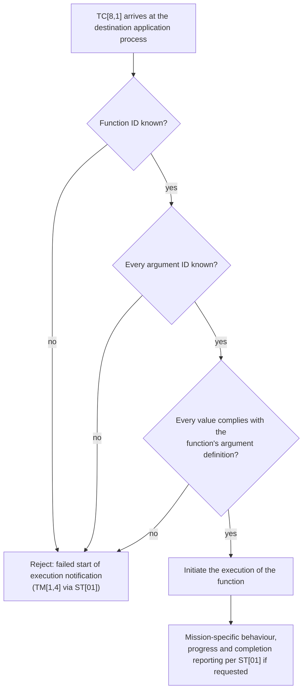
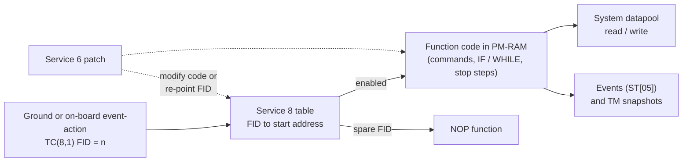
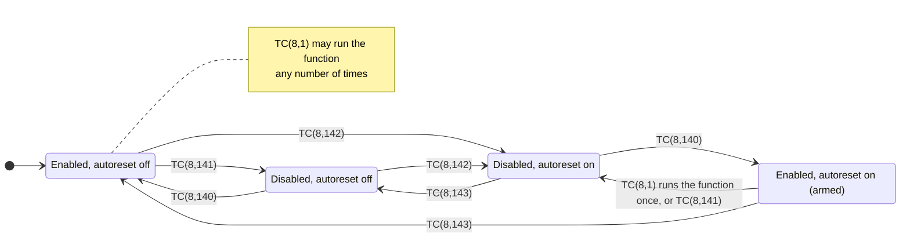
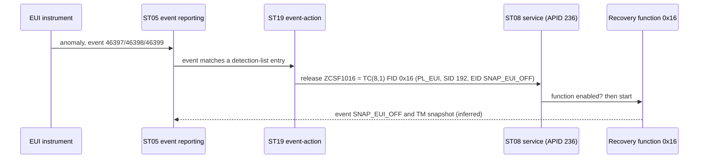

# ST[08] Function management

The **function management service** (service type 8) is the PUS "escape hatch" for on-board
software functions that are not modelled by any other standard service. A single request,
**TC[8,1] perform a function**, names a function by its identifier and optionally passes it a
list of arguments; what the function does is entirely up to the mission.[^c-scope][^c-881] The
service is already part of the first ECSS edition of the [Packet Utilization Standard](index.md)
(ECSS-E-70-41A, "PUS-A", 2003), survives in ECSS-E-ST-70-41C ("PUS-C", 2016) only "for
backward compatibility reasons", and is deleted in the 2024 Rev.1 draft.[^c-scope][^r-reserved]
This page describes the service in full, compares the editions, explains what the SCOS-2000
ground system does (and does not do) with it, and shows from the real
[Solar Orbiter MIB](../../missions/solar-orbiter/mib.md) how one mission uses service 8 to
trigger its on-board recovery functions.

!!! info "At a glance"
    | Item | Value |
    |---|---|
    | Service type | 8[^c-881] |
    | Subservice types | one: the function management subservice[^c-scope] |
    | Message types (PUS-C) | TC[8,1] perform a function, the only one, capability "minimum"[^c-annexc] |
    | Reports | none defined; outcome reported only through [ST[01] request verification](st01-request-verification.md)[^c-perf][^a-123] |
    | Observables | none defined[^c-perf-f] |
    | PUS-A name | Perform Function (8,1), clause 12[^a-123] |
    | 2024 Rev.1 draft | ST[08] deleted; service type 8 becomes "(reserved)"[^r-reserved][^r-changelog] |
    | SCOS-2000 | no specific processing, no specific limitation[^icd-s8] |
    | Solar Orbiter | 64 TC(8,1) commands plus private subtypes 140 to 145 in the 2025 MIB[^mib] |

## 1. Why the service exists

An on-board application process usually has a specialised role, for example controlling a
payload instrument or the attitude and orbit control subsystem, and that role comes with
functions the ground wants to invoke. PUS does not constrain what these functions are: they can
cover any nominal operation of a subsystem or payload, including predefined mode changes.[^c-scope]
PUS-A presents the service as the realisation of its "software management" concept: functions can be
implemented as mission-specific services with their own request and report structures, or
through a generic, high-level function service in which "the function itself is specialized
... but the associated packet structure is standardized".[^a-46] PUS-A also insists that ground
and on-board software talk through packets designed for the purpose, and not through general
memory load and dump packets.[^a-46b]

By 2016 the editors preferred the first route. PUS-C encourages missions to define
mission-specific service types, or mission-specific subservice types of standard services,
"instead of using the function management service type", and keeps ST[08] only for backward
compatibility.[^c-scope] The 2024 Rev.1 draft completes the move: its change log lists the
"deletion of service not used in current and future missions: ST[8] function management", and
clause 6.8 now reads "ST[08] (reserved)", with a note repeating the advice to replace it by
mission-specific service or subservice types.[^r-changelog][^r-reserved]

!!! warning "Inference"
    The standards do not explain the technical drawback, but the structure of TC[8,1] suggests
    it: the meaning of a function and the format of its arguments are hidden behind an opaque
    identifier, so a ground system cannot validate or model the request generically. A
    mission-specific subservice type, by contrast, is specified with the same foundation-model
    rules (request types, instruction types, reports, observables) as every standard service.

## 2. Service model

The PUS-C service model is small. Each function management service contains **at least one**
function management subservice, and each application process hosts **at most one** function
management subservice provider.[^c-sub] The service therefore lives *inside* the application
process whose functions it exposes: a request is addressed to that process by its APID in the
packet primary header (see [PUS packet structures](packets.md)).

### 2.1 Accessibility: the declared function list

The subservice can only access functions that are declared. When a mission specifies a function
management subservice it must declare:[^c-acc]

| Declaration | Clause | Content |
|---|---|---|
| List of functions | 6.8.3.1a | the functions the subservice can perform |
| Argument list per function | 6.8.3.1b | for each function that uses arguments, the arguments and their definition |
| Argument supply policy per function | 6.8.3.1c | either (1) a value is supplied for **every** argument, or (2) only the arguments **to update** are supplied and the others keep their current values |

The supply policy is fixed per function, not per request. PUS-A said the same thing in other
words: the option is chosen "at Function ID-level, rather than at packet instance".[^c-acc][^a-123]
The second policy means that a function keeps a persistent set of argument values on board,
which a request can partially overwrite.

### 2.2 Processing a perform-a-function request

Each request to perform a function carries **exactly one** instruction, and the instruction
contains the function identifier and, if the function uses arguments, the list of arguments and
their values.[^c-perf] The subservice rejects the request if the instruction refers to an
unknown function or an unknown argument, or if an argument value does not comply with the
function's argument definition. A rejected request produces a **failed start of execution**
notification, which the [request verification service](st01-request-verification.md) turns into a
TM[1,4] report.[^c-perf][^c-141] For a valid instruction the subservice "initiate[s] the execution
of the function"; nothing more is specified, and no observables are defined.[^c-perf-f]



The diagram follows clause 6.8.4d to f.[^c-perf][^c-perf-f] Because the standard says only that
execution is *initiated*, the meaning of a successful completion report (TM[1,7]) for a function
is a mission decision.

## 3. TC[8,1] perform a function

Every packet of the service has service type 8; a perform-a-function request has message
subtype 1. Its application data field has the structure of PUS-C Figure 8-87:[^c-881]

| Field | PUS-C type | Presence | Meaning |
|---|---|---|---|
| function ID | fixed character-string | always | identifier of the function to perform |
| N | unsigned integer | optional | number of (argument ID, argument value) pairs that follow |
| argument ID | enumerated | repeated N times | identifies the argument |
| argument value | deduced | repeated N times | the value; its type is deduced from the argument ID |

The field types are the PUS packet field type codes (PTC) of
[PUS parameter types](parameter-types.md): fixed character-string is PTC 8, unsigned integer
PTC 3, enumerated PTC 2 and deduced PTC 11.[^c-ptc] A *deduced* field must get its structure
only from preceding fields of the same packet, from mission constants, or both; here the
preceding argument ID tells the receiver how to read the value.[^c-deduced] Below the argument
part, Figure 8-87 carries the annotations *optional* and *deduced presence*: in PUS structure
diagrams, an optional field is one whose presence is fixed at the level of the mission,
application process or service instance, and here the presence of arguments follows from the
function's declaration (6.8.3.1b).[^c-881][^c-conv][^c-acc]

<div class="bitfield" data-title="TC[8,1] application data, PUS-C generic layout (widths illustrative)" data-width="16"
     data-fields='[{"n":"Function ID","b":32,"d":"Fixed character-string (PTC 8); its length is a mission choice"},{"n":"N","b":8,"d":"Unsigned integer, optional: number of argument pairs"},{"n":"Argument ID","b":8,"g":"repeated N times","d":"Enumerated"},{"n":"Argument value","b":16,"g":"repeated N times","d":"Deduced from the argument ID"}]'></div>

!!! warning "Inference"
    PUS-C fixes the field *types* but none of the field *lengths* in Figure 8-87. The widths in
    the diagram above (32, 8, 8 and 16 bits) are chosen by this wiki for illustration. The real
    Solar Orbiter layout in section 7 uses a 1-octet unsigned function ID instead.

PUS-A defines the same request with two variants, one for each supply policy:[^a-123]

=== "PUS-A, subset of parameters loaded"

    | Field | Type | Presence | Meaning |
    |---|---|---|---|
    | Function ID | Fixed CharString | always | together with the APID, implicitly defines the presence and structure of the fields that follow; its internal structure is "beyond the scope" of PUS-A |
    | N | Unsigned Integer | optional | number of (Parameter#, Value) pairs |
    | Parameter# | Enumerated | repeated N times | which parameter the following value belongs to |
    | Value | Deduced | repeated N times | type deduced from Parameter#; parameters not loaded keep their current values |

=== "PUS-A, full set of parameters loaded"

    | Field | Type | Presence | Meaning |
    |---|---|---|---|
    | Function ID | Fixed CharString | always | as above |
    | Parameters | Any | optional | a data structure of parameter values following structure rules set #1 (PUS-A subclause 23.6.2), whose structure is known implicitly |

PUS-A states that the length of the Function ID character string may be defined per mission or
per application process, and that the Function ID is assigned "at the level of the individual
controls", for example load manoeuvre parameters, start manoeuvre or configure an instrument to
a mode.[^a-122][^a-123]

## 4. Capability sets

PUS-C classifies each message type by an *applicability constraint*: "minimum" means every
subservice of that type provides it, "by declaration" means the mission decides, and "implied
by" or "requires" link capabilities together.[^c-cap] For ST[08] the summary is trivial:[^c-annexc]

| Edition | Message | Capability | Notes |
|---|---|---|---|
| PUS-C (2016) | TC[8,1] perform a function | minimum | the only message type of the service |
| PUS-A (2003) | (8,1) Perform Function | minimum capability set (Table 19) | "There are no additional capability sets"[^a-124] |
| Rev.1 DIR1 (2024) | - | - | service type 8 reserved[^r-reserved] |

PUS-A adds that any number of on-board application processes may each provide a single
instance of the service, and that "There are currently no service reports defined".[^a-121][^a-123]

## 5. Edition differences

| Aspect | PUS-A (ECSS-E-70-41A) | PUS-C (ECSS-E-ST-70-41C) | Rev.1 DIR1 (2024 draft) |
|---|---|---|---|
| Status | standard service, clause 12 | kept for backward compatibility, clause 6.8 / 8.8 | deleted, type 8 reserved |
| Request | Perform Function (8,1) | TC[8,1] perform a function | - |
| Argument naming | Parameter#, Value | argument ID, argument value | - |
| Supply policies | subset (array of pairs) or full set (implicit structure "Any") | supply all arguments, or only those to update; declared per function | - |
| Rejection rules | not specified | unknown function, unknown argument, non-compliant value; failed start of execution | - |
| Reports | none | none; no observables | - |

The table is assembled from the clauses cited in sections 2 to 4.[^a-123][^c-acc][^c-perf][^r-reserved]
The wider picture of the editions is on [PUS-A vs PUS-C](pus-a-vs-pus-c.md).

!!! note "What replaces it"
    The Rev.1 draft gives no direct successor. Its note points missions to mission-specific
    service types or mission-specific subservice types of standardized services.[^r-reserved]
    In PUS-C, request-driven behaviour that is close to "perform a function" is also available
    through [ST[18] on-board operations procedures](st18-onboard-operations-procedure.md) and
    [ST[21] request sequencing](st21-request-sequencing.md), which have full models with
    status reports.

## 6. Ground side: SCOS-2000

SCOS-2000 decodes and encodes every PUS type and subtype through its database, and only some
services get extra ground processing, such as report-based verification or a model of the
on-board scheduler.[^icd-appc3] For service 8 the Database Import ICD is explicit: "There is no
specific processing of Service 8 TM/TC packets in SCOS-2000", and no specific limitation
applies.[^icd-s8]

A TC[8,1] is therefore defined in the [MIB](../../mib/index.md) like any other command, with one
[ccf](../../mib/tables/ccf.md) record and a [cdf](../../mib/tables/cdf.md) layout (see
[Commanding in the MIB](../../mib/commanding.md)). A cdf element can be a *fixed area*
(`CDF_ELTYPE` = `A`), whose value is a raw unsigned integer written in hexadecimal and never
visible as a command parameter in the command history.[^icd-cdf][^icd-cmd]

!!! warning "Inference"
    The ICD's PUS appendix labels its references "Section 12 of [AD-5]" for service 8 and
    "Section 13" and "Section 14" for services 9 and 11. In the ICD's own reference list, AD-5 is
    a display ICD, so the label is a slip. The numbers match the clauses of ECSS-E-70-41A for
    every service in the appendix (verification 6, device commanding 7, housekeeping 8, ...,
    function management 12, time management 13, scheduling 14, test 19), and so do the
    subclauses it cites (13.3.1 for the rate change, 14.3.4 for time-shifting), so the appendix
    most likely refers to PUS-A.[^icd-appc][^icd-ad][^a-toc] The ICD's reference list itself cites the PUS
    only as RD-6, ESA PSS-07-101 (May 1994).[^icd-rd6] The clause numbering of that older
    standard is not available here, so it cannot be ruled out as the intended reference.

## 7. Solar Orbiter: service 8 for FDIR recovery functions

Solar Orbiter's packet structure ICD (SOL.S.ASTR.TN.00079, Airbus Defence and Space) tailors
its TM/TC services from the ESA PUS, which its applicable document AD1 identifies as
ECSS-E-70-41A, and from the ESA operations interface requirements, and it refers to the
ECSS-E-70-41A capability sets.[^solo-ad1][^solo-sum] In its service table, service 8 carries the
mnemonic **O** (a user may choose to implement the service), and every service 8 message is marked
X, "shall be implemented", for the central software (CSW) of the on-board computer. TC(8,1) and
TC(8,140) to TC(8,143) are also marked O (optional) in the payload software column; the SSMM and
star tracker columns are empty.[^solo-sum][^solo-sum8]

### 7.1 What the functions are

The ICD gives service 8 one objective: to support the FDIR recovery actions that are not
implemented on board through standard services.[^solo-8obj] The design is described as follows:[^solo-8obj]

* The functions (recovery actions) sit in the processor module RAM (PM-RAM) at fixed addresses
  for a given CSW release, and can be modified by [service 6](st06-memory-management.md) memory
  patches without recompiling the CSW.
* The service maps each function ID to the start address of the function code. Two spare
  function IDs point to a non-operational (NOP) function, so up to two new functions can be
  added by patching new code and re-pointing the spare IDs.
* A function can be removed by patching its mapping to the NOP function, or by disabling it with
  a dedicated service 8 command.
* A function is typically a sequence of commands with branching logic (for example IF and WHILE)
  and stop steps; it reads and writes the system datapool and can generate events and TM
  snapshots.



The diagram restates the ICD description.[^solo-8obj]

### 7.2 TC(8,1) Start Function and the private subtypes

Solar Orbiter names TC(8,1) "Start Function" in its detailed definition ("Perform Function" in
the summary table). The function runs only if its execution is currently enabled. The
application data are a **1-octet unsigned function ID** (range 1 to 255) followed by 0 to *m*
octets of function-specific parameters "of any Type".[^solo-81][^solo-sum8] This departs from both
PUS editions, where the function ID is a fixed character-string.[^a-123][^c-881]

The mission adds five private telecommands and one private report to manage the function
table:[^solo-sum8][^solo-8140][^solo-8142][^solo-8144]

| Message | Name | Application / source data |
|---|---|---|
| TC(8,140) | Enable Function Execution | NFID (1 octet), then NFID × FID (1 octet). NFID = 0 enables at service level, keeping the individual statuses |
| TC(8,141) | Disable Function Execution | same layout; NFID = 0 disables at service level |
| TC(8,142) | Enable Autoreset of Execution Enable Flag | same layout; sets autoreset "Enabled" and the execution status "Disabled" |
| TC(8,143) | Disable Autoreset of Execution Enable Flag | same layout; execution status unaffected |
| TC(8,144) | Report Function Status | N (1 octet; 0 = all functions), then N × Function ID |
| TM(8,145) | Function Status Report | N, then N × (Function ID, Execution status, Autoreset status), 1 octet each; statuses 0 = Disabled, 1 = Enabled |

The autoreset mechanism makes a function **one-shot**: once autoreset is enabled, the function
must be explicitly enabled before it can run, and after it has run its status returns to
"Disabled" automatically. With autoreset disabled, the execution status stays at whatever
TC(8,140) or TC(8,141) last set.[^solo-8142]



!!! warning "Inference"
    The state diagram is this wiki's reading of the TC(8,140) to TC(8,143) descriptions.[^solo-8140][^solo-8142]
    The initial state drawn (enabled, autoreset off) is arbitrary: the initial state of each function, and how the service-level enable flag (NFID = 0)
    combines with the per-function status, are not stated in the available sources.

All these telecommands are verified with the mission's standard rule: a TM(1,2) acceptance
failure if a service 1 static check fails, and a TM(1,8) completion failure in the cases listed
in a reference document not available here.[^solo-81]

### 7.3 Service 8 in the 2025 MIB

The MIB release MIB__20250916M25925PFMS001_SOL defines 64 TC(8,1) commands and one command for
each private subtype. All of them go to **APID 236**; the status report TM(8,145) comes from
**APID 227**.[^mib] On Solar Orbiter the upper 7 bits of the APID are the process ID and the
lower 4 bits the packet category (12 for every telecommand), so both APIDs belong to process
ID 14, the CSW **System Control Application** in charge of system modes, configuration, FDIR and
autonomy.[^solo-apid][^solo-pid14] APID 227 carries packet category 3, which the ICD's category
table reserves for variable-length tabular reports.[^solo-cat]

!!! warning "Inference: a packet category slip in the ICD"
    The ICD's own definition of TM(8,145) gives "Packet Cat: 12", the value of its telecommand
    definitions, although category 12 is reserved for service 21 telemetry and for
    telecommands.[^solo-8144][^solo-cat] The MIB's APID 227 (category 3, tabular report) fits the
    variable-length status report, so the "12" is most likely copied from the TC template. The
    available sources do not confirm this.

| Subtype | MIB command(s) | Parameters | Explorer |
|---|---|---|---|
| 1 | ZCSF0002 to ZCSF1016 (64 commands) | function ID as a fixed area, plus 0 to 6 parameters | [ZCSF0003](../../explorer/index.md#/solo/command/ZCSF0003) |
| 140 | ZCS0088C Enable Function Execution | PCD088C1 "Number of function" (repeater), PCD08011 "FID" | [ZCS0088C](../../explorer/index.md#/solo/command/ZCS0088C) |
| 141 | ZCS0088D Disable Function Execution | same | [ZCS0088D](../../explorer/index.md#/solo/command/ZCS0088D) |
| 142 | ZCS0088E Enable Autoreset Execution Enable Flag | same | [ZCS0088E](../../explorer/index.md#/solo/command/ZCS0088E) |
| 143 | ZCS0088F Disable Autoreset Execution Enable Flag | same | [ZCS0088F](../../explorer/index.md#/solo/command/ZCS0088F) |
| 144 | ZCS00890 Report Function Status | same | [ZCS00890](../../explorer/index.md#/solo/command/ZCS00890) |
| TM 145 | SPID 10096 Function Status Report | variable packet: NCD08911 count, then NCD08912 FID, NCD08913 execution status, NCD08914 autoreset | [SPID 10096](../../explorer/index.md#/solo/packet/10096) |

The function ID never appears as an editable parameter of a TC(8,1): it is a fixed area of 8
bits in the cdf, so **each on-board function is a separate MIB command**. The 64 commands use 63
distinct function IDs between `0x02` and `0x54` (2 to 84); ZCSF0016 and ZCSF1016 share `0x16`.
The same 63 values, with names such as `RCV_TTR_TMEOBT` (3) or `REC_SYS_1` (16), form the textual
calibration CCDT0048TC of the FID parameter of the private subtypes.[^mib] The status values in
TM(8,145) are calibrated by CCDT0003TX (0 = DISABLED, 1 = ENABLED).[^mib]

The arguments of the 64 functions follow a clear pattern:[^mib]

| Argument pattern | Commands | Example |
|---|---|---|
| no argument (function ID only) | 9 | ZCSF0003 "TME / OBT Failure Recovery"; ZCSF0005 and ZCSF0006 "Spare function 1" and "2" |
| HK SID (PCD03011, 8 bits) and EID (PCD038B1, 16 bits); the last two arguments in all but ZCSF0049, which appends a second SID and an EID (PCSB0090, PCSB0141) | 55 | ZCSF0010 "System Failure Recovery: PM reset" |
| of which also a textually calibrated unit or channel selector | 34 | ZCSF0040 "STR Execute Recovery Action 1 Function" (STR unit identifier) |
| of which also an FMON Id (PCD8E012, 32 bits) | 17 | ZCSF0022 "PCDU Execute Recovery Action 1 Function" |

The two spare functions match the two spare function IDs of the ICD.[^solo-8obj][^mib]

!!! warning "Inference"
    The ICD says functions "will be able to generate events and TM snapshots".[^solo-8obj] The
    trailing HK SID and EID arguments of 55 functions very probably select which housekeeping
    snapshot and which event the function emits; one fixed instance (ZCSF1016, below) supplies
    EID `SNAP_EUI_OFF`, which supports that reading. Their exact semantics are not stated in the
    available sources. Likewise "FMON Id" suggests a functional-monitoring identifier.

Between the April 2020 release (61 TC(8,1) commands) and the September 2025 release, three
TC(8,1) commands were added: ZCSF000D "EPS Execute Recovery Action 4 Function", ZCSF000E "SADE
Execute Recovery Action 2 Function" and ZCSF1016 "Start REC_SpW2 for EUI".[^mib][^mib20]

### 7.4 How the functions are triggered

Service 8 commands appear in only seven command sequences, which wrap the management subtypes
(for example ADMC081A "Enable Function Exec", which sends TC(8,140) followed by TC(8,144)) and
one direct use, ADMC401A "Trigger RM OPS Alarm", which sends ZCSF0010 with HK SID 192 and EID
`GND_OPS_ALARM`.[^mib] The more typical trigger is on board. Sequence AIUC900A "EUI
DefineSwOffFdir" loads three [event-action](st19-event-action.md) definitions with TC(19,1)
ZCS01301 "Add Event to the Detection List": for the EUI events 46397, 46398 and 46399, the
action to release is ZCSF1016.[^mib] ZCSF1016 is FID `0x16` (the same function as ZCSF0016
"PL/SPW Execute Recovery Action 2 Functio", a description truncated to 40 characters in the
MIB) with all three arguments frozen as fixed values:
payload type `PL_EUI`, HK SID 192 and EID `SNAP_EUI_OFF`.[^mib]



The last arrow is inferred, as explained above; the rest of the chain is MIB data.[^mib]

### 7.5 Worked example: encoding ZCSF1016

The bytes below build the complete TC packet for ZCSF1016. The **application data are real**:
they follow from the MIB cdf definition and the raw values of the calibrations (`PL_EUI` = 1 in
CCDT0282TX, `SNAP_EUI_OFF` = 65281 in CCDT0004TX). The sequence count, the source ID and therefore
the CRC are **illustrative**.[^mib]

```text
18 EC  C0 03  00 0A   19 08 01 78   16 01 C0 FF 01   5B E7
|----primary----|     |---DFH---|   |-app data--|    |CRC|
```

| Octets | Field | Value | Source |
|---|---|---|---|
| `18 EC` | version 0, type 1 (TC), data field header flag 1, APID 236 | header `NOM_TC` | MIB tcp/pcdf[^mib] |
| `C0 03` | sequence flags `0b11` (stand-alone), sequence count 3 | count illustrative | Solar Orbiter ICD[^solo-seq] |
| `00 0A` | packet data length C = 10 (11 octets follow) | computed | |
| `19` | secondary header flag 0, PUS version 1, ack `0b1001` (acceptance and completion) | CCF_ACK = 9 | MIB[^mib][^solo-ack] |
| `08 01` | service type 8, subtype 1 | | |
| `78` | source ID 120 ("Direct commands") | illustrative choice | Solar Orbiter ICD[^solo-src] |
| `16` | function ID `0x16` | fixed area | MIB cdf[^mib] |
| `01` | payload type `PL_EUI` | fixed value | MIB cdf, pas[^mib] |
| `C0` | HK SID 192 | fixed value | MIB cdf[^mib] |
| `FF 01` | EID `SNAP_EUI_OFF` = 65281 | fixed value | MIB cdf, pas[^mib] |
| `5B E7` | packet error control, CRC-16 (polynomial $x^{16}+x^{12}+x^5+1$, preset all ones) over the 15 preceding octets | computed by this wiki | Solar Orbiter ICD Annex 6[^solo-crc] |

The CRC routine used here reproduces the PUS-C Annex B test vectors (for example `00 00` gives
`1D 0F`).[^c-crc]

## 8. Related pages

* [PUS overview](index.md), [PUS packet structures](packets.md) and [PUS parameter types](parameter-types.md).
* [ST[01] Request verification](st01-request-verification.md): how TC[8,1] success and failure are reported.
* [ST[06] Memory management](st06-memory-management.md): how Solar Orbiter patches its function code.
* [ST[19] Event-action](st19-event-action.md) and [ST[18] On-board operations procedure](st18-onboard-operations-procedure.md).
* [PUS-A vs PUS-C](pus-a-vs-pus-c.md) and the [message type catalogue](message-types.md).
* [How Solar Orbiter uses PUS](../../missions/solar-orbiter/pus-usage.md) and [Commanding in the MIB](../../mib/commanding.md).

## SQL used

??? example "SQL used"
    ```sql
    -- solo-2025-09-16.sqlite (MIB__20250916M25925PFMS001_SOL)
    SELECT CCF_TYPE, CCF_STYPE, COUNT(*), COUNT(DISTINCT CCF_APID)
      FROM ccf WHERE CCF_TYPE = '8' GROUP BY 1, 2;                 -- 1:64, 140..144: 1 each, all APID 236
    SELECT * FROM pid WHERE PID_TYPE = '8';                         -- SPID 10096, APID 227, TPSD 10096
    SELECT v.*, p.PCF_DESCR, p.PCF_PTC, p.PCF_PFC, p.PCF_CURTX
      FROM vpd v LEFT JOIN pcf p ON p.PCF_NAME = v.VPD_NAME
     WHERE VPD_TPSD = '10096' ORDER BY CAST(VPD_POS AS INT);
    -- layout of every TC(8,1): fixed-area FID plus parameter names
    SELECT c.CCF_CNAME, c.CCF_DESCR,
           (SELECT group_concat(COALESCE(CDF_PNAME, 'FID') || '=' || COALESCE(CDF_VALUE, ''), ' ')
              FROM (SELECT * FROM cdf WHERE CDF_CNAME = c.CCF_CNAME ORDER BY CAST(CDF_BIT AS INT)))
      FROM ccf c WHERE CCF_TYPE = '8' AND CCF_STYPE = '1';
    SELECT COUNT(DISTINCT CDF_VALUE) FROM cdf
     WHERE CDF_BIT = '0' AND CDF_CNAME IN (SELECT CCF_CNAME FROM ccf WHERE CCF_TYPE='8' AND CCF_STYPE='1');  -- 63
    SELECT PAS_ALVAL, PAS_ALTXT FROM pas WHERE PAS_NUMBR = 'CCDT0048TC';     -- 63 FIDs, 2..84
    SELECT * FROM pas WHERE PAS_NUMBR IN ('CCDT0282TX') OR (PAS_NUMBR = 'CCDT0004TX' AND PAS_ALTXT = 'SNAP_EUI_OFF');
    -- where service 8 commands are used
    SELECT CSS_SQNAME, CSS_ELEMID FROM css
     WHERE CSS_ELEMID IN (SELECT CCF_CNAME FROM ccf WHERE CCF_TYPE = '8');
    SELECT * FROM sdf WHERE SDF_VALUE IN (SELECT CCF_CNAME FROM ccf WHERE CCF_TYPE = '8');  -- AIUC900A -> ZCSF1016
    SELECT * FROM sdf WHERE SDF_SQNAME IN ('AIUC900A', 'ADMC401A');
    -- release comparison
    ATTACH 'solo-2020-04-16.sqlite' AS o;
    SELECT CCF_CNAME, CCF_DESCR FROM ccf WHERE CCF_TYPE = '8'
       AND CCF_CNAME NOT IN (SELECT CCF_CNAME FROM o.ccf);            -- ZCSF000D, ZCSF000E, ZCSF1016
    ```

[^c-scope]: [ECSS-E-ST-70-41C, Telemetry and telecommand packet utilization](../../library/ecss-e-st-70-41c-15april2016.md), §6.8.1.1 General, PDF p. 157.
[^c-sub]: [ECSS-E-ST-70-41C](../../library/ecss-e-st-70-41c-15april2016.md), §6.8.1.2 and §6.8.2 Service layout (6.8.2.1.1a, 6.8.2.2a), PDF p. 157.
[^c-acc]: [ECSS-E-ST-70-41C](../../library/ecss-e-st-70-41c-15april2016.md), §6.8.3.1 Function, requirements a to c, PDF p. 158.
[^c-perf]: [ECSS-E-ST-70-41C](../../library/ecss-e-st-70-41c-15april2016.md), §6.8.4 Perform a function, requirements a to e, PDF p. 158.
[^c-perf-f]: [ECSS-E-ST-70-41C](../../library/ecss-e-st-70-41c-15april2016.md), §6.8.4f and §6.8.5 Subservice observables, PDF p. 159.
[^c-141]: [ECSS-E-ST-70-41C](../../library/ecss-e-st-70-41c-15april2016.md), §6.1.5.1.2 Reporting failed start of execution, PDF p. 61.
[^c-881]: [ECSS-E-ST-70-41C](../../library/ecss-e-st-70-41c-15april2016.md), §8.8.1 General and §8.8.2.1 TC[8,1] perform a function, Figure 8-87, PDF p. 492.
[^c-annexc]: [ECSS-E-ST-70-41C](../../library/ecss-e-st-70-41c-15april2016.md), Annex C.2.8, Table C-14 Function management message types, PDF p. 636.
[^c-cap]: [ECSS-E-ST-70-41C](../../library/ecss-e-st-70-41c-15april2016.md), §5.3.4 Capability type, requirement b and notes, PDF pp. 32-33.
[^c-ptc]: [ECSS-E-ST-70-41C](../../library/ecss-e-st-70-41c-15april2016.md), §7.3.1, Table 7-1 PTC, PDF pp. 428-429.
[^c-deduced]: [ECSS-E-ST-70-41C](../../library/ecss-e-st-70-41c-15april2016.md), §7.3.12 Deduced, PDF p. 437.
[^c-conv]: [ECSS-E-ST-70-41C](../../library/ecss-e-st-70-41c-15april2016.md), §7.2.1 Structure diagram, PDF pp. 427-428.
[^c-crc]: [ECSS-E-ST-70-41C](../../library/ecss-e-st-70-41c-15april2016.md), Annex B.1 CRC, test vectors and verification output, PDF pp. 617-621.
[^a-46]: [ECSS-E-70-41A, Ground systems and operations - Telemetry and telecommand packet utilization](../../library/ecss-e-70-41a-30jan2003-pus.md), §4.6 Software management, PDF pp. 31-32.
[^a-46b]: [ECSS-E-70-41A](../../library/ecss-e-70-41a-30jan2003-pus.md), §4.6, last paragraph, PDF p. 32.
[^a-121]: [ECSS-E-70-41A](../../library/ecss-e-70-41a-30jan2003-pus.md), §12.1 Scope, PDF p. 91.
[^a-122]: [ECSS-E-70-41A](../../library/ecss-e-70-41a-30jan2003-pus.md), §12.2 Service concept, PDF p. 91.
[^a-123]: [ECSS-E-70-41A](../../library/ecss-e-70-41a-30jan2003-pus.md), §12.3.1 General and §12.3.2 Perform function, PDF pp. 91-92.
[^a-124]: [ECSS-E-70-41A](../../library/ecss-e-70-41a-30jan2003-pus.md), §12.4 Capability sets, Table 19, PDF p. 93.
[^r-reserved]: [ECSS-E-ST-70-41C Rev.1 DIR1 (draft, 11 December 2024)](../../library/ecss-e-st-70-41c-rev1-dir1.md), §6.8 ST[08] (reserved) and its note, PDF p. 145; §8.8 ST[08] (reserved), PDF p. 538.
[^r-changelog]: [ECSS-E-ST-70-41C Rev.1 DIR1](../../library/ecss-e-st-70-41c-rev1-dir1.md), Change log, main changes, PDF p. 3.
[^icd-appc3]: [SCOS-2000 Database Import ICD, issue 7.0](../../library/icd-7-0-final.md), Appendix C §3 Specific support of TM/TC services, introduction, PDF p. 237.
[^icd-s8]: [SCOS-2000 Database Import ICD 7.0](../../library/icd-7-0-final.md), Appendix C §3.7 Service 8: Function management service, PDF p. 240.
[^icd-ad]: [SCOS-2000 Database Import ICD 7.0](../../library/icd-7-0-final.md), §1.4.1 Applicable documents (AD-5 = ICD-5001), PDF p. 18.
[^icd-rd6]: [SCOS-2000 Database Import ICD 7.0](../../library/icd-7-0-final.md), §1.4.2 Reference documents, RD-6 (ESA PSS-07-101, Packet Utilisation Standard, issue 1, May 1994), PDF p. 19.
[^icd-appc]: [SCOS-2000 Database Import ICD 7.0](../../library/icd-7-0-final.md), Appendix C §3.1 to §3.14 (section references of each service, including 13.3.1 and 14.3.4), PDF pp. 237-242.
[^a-toc]: [ECSS-E-70-41A](../../library/ecss-e-70-41a-30jan2003-pus.md), Contents, clauses 6 to 13, PDF p. 7.
[^icd-cdf]: [SCOS-2000 Database Import ICD 7.0](../../library/icd-7-0-final.md), §3.3.3.2.3 cdf, fields CDF_ELTYPE and CDF_VALUE, PDF pp. 151-157.
[^icd-cmd]: [SCOS-2000 Database Import ICD 7.0](../../library/icd-7-0-final.md), §3.3.3.2 Commands, remarks, PDF p. 131.
[^solo-sum]: [SOL.S.ASTR.TN.00079 issue 7, Solar Orbiter TM-TC and Packet Structure ICD](../../library/sol-s-astr-tn-00079-07.md), §5.1 Summary, mnemonics R/M/O/X, PDF p. 31.
[^solo-ad1]: [SOL.S.ASTR.TN.00079](../../library/sol-s-astr-tn-00079-07.md), §2.1 Applicable Documents, AD1 = ECSS-E-70-41A, PDF p. 13.
[^solo-cat]: [SOL.S.ASTR.TN.00079](../../library/sol-s-astr-tn-00079-07.md), Annex 8 §13.1, Figure 13.1-1 Packet Category Allocation, PDF p. 272.
[^solo-sum8]: [SOL.S.ASTR.TN.00079](../../library/sol-s-astr-tn-00079-07.md), §5.1 Summary table, Service 8 rows, PDF p. 33.
[^solo-8obj]: [SOL.S.ASTR.TN.00079](../../library/sol-s-astr-tn-00079-07.md), §5.9 Service 8: Function Management, objective and description, PDF pp. 89-90.
[^solo-81]: [SOL.S.ASTR.TN.00079](../../library/sol-s-astr-tn-00079-07.md), §5.9.1 TC (8,1) Start Function, PDF p. 90.
[^solo-8140]: [SOL.S.ASTR.TN.00079](../../library/sol-s-astr-tn-00079-07.md), §5.9.2 TC (8,140) and §5.9.3 TC (8,141), PDF pp. 90-92.
[^solo-8142]: [SOL.S.ASTR.TN.00079](../../library/sol-s-astr-tn-00079-07.md), §5.9.4 TC (8,142) and §5.9.5 TC (8,143), PDF pp. 92-93.
[^solo-8144]: [SOL.S.ASTR.TN.00079](../../library/sol-s-astr-tn-00079-07.md), §5.9.6 TC (8,144) and §5.9.7 TM (8,145), PDF pp. 93-95.
[^solo-apid]: [SOL.S.ASTR.TN.00079](../../library/sol-s-astr-tn-00079-07.md), §3.2.1.1 TC Packet ID (PUS-24 to PUS-31), PDF p. 15.
[^solo-pid14]: [SOL.S.ASTR.TN.00079](../../library/sol-s-astr-tn-00079-07.md), Annex 8 §13.1 Application Process ID Assignment, process IDs 10 to 16, PDF p. 273.
[^solo-seq]: [SOL.S.ASTR.TN.00079](../../library/sol-s-astr-tn-00079-07.md), §3.2.1.2 TC Packet Sequence Control and §3.2.1.3 TC Packet Length, PDF p. 16.
[^solo-ack]: [SOL.S.ASTR.TN.00079](../../library/sol-s-astr-tn-00079-07.md), §3.2.2.1 TC Data Field Header, PUS-51 to PUS-66, PDF pp. 16-17.
[^solo-src]: [SOL.S.ASTR.TN.00079](../../library/sol-s-astr-tn-00079-07.md), §13.2 Source ID, PDF pp. 275-276.
[^solo-crc]: [SOL.S.ASTR.TN.00079](../../library/sol-s-astr-tn-00079-07.md), Annex 6 §11.1 CRC Checksum Algorithms, PDF pp. 268-269.
[^mib]: [Solar Orbiter MIB release MIB__20250916M25925PFMS001_SOL](../../library/mib-20250916m25925pfms001-sol.md), tables ccf, cdf, cpc, pas, pid, vpd, pcf, tcp, pcdf, css, csf and sdf; this wiki's queries (see "SQL used").
[^mib20]: [Solar Orbiter MIB release MIB__20200416M10720PFMS001_SOL](../../library/mib-20200416m10720pfms001-sol.md), table ccf; this wiki's queries (see "SQL used").
