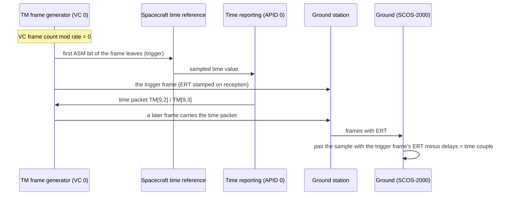
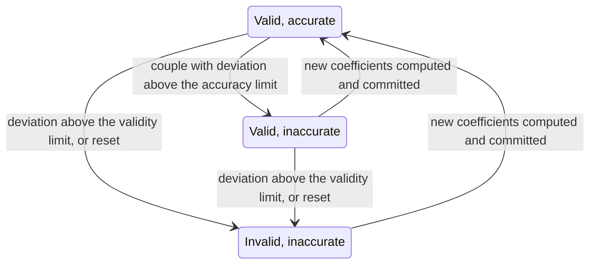

# ST[09] Time management

Every spacecraft keeps a **spacecraft time reference** (an on-board clock), and every PUS
telemetry report is time-tagged with it. The ground, however, works in UTC. The **time
management service** (service type 9) closes that gap: it periodically samples the on-board
clock at a precisely defined instant, the start of a particular telemetry transfer frame, and
sends the sample to the ground in a *time report*. The ground, which also time-stamps the
reception of that frame, can then pair the two times and maintain a correlation between
on-board time and UTC, and from it reconstruct when every other reported event happened.[^c-scope]
This page covers the PUS-C service (ECSS-E-ST-70-41C, 2016) in full, compares it with PUS-A
(2003) and the 2024 Rev.1 draft, explains how SCOS-2000 turns time reports into time
correlation coefficients, and shows Solar Orbiter's real time packet and time commands from its
[MIB](../../missions/solar-orbiter/mib.md).

!!! info "At a glance"
    | Item | Value |
    |---|---|
    | Service type | 9[^c-891] |
    | Subservices (PUS-C) | time reporting (exactly one); time reporting control (at most one)[^c-layout] |
    | Message types (PUS-C) | TC[9,1] set the time report generation rate; TM[9,2] CUC time report; TM[9,3] CDS time report[^c-annexc] |
    | Where the reports come from | application process **APID 0**, in packets **without a secondary header**[^c-layout][^c-891] |
    | Sampling trigger | leading edge of the first bit of the attached synchronization marker of selected VC 0 frames[^c-gen] |
    | Generation rate | every 1, 2, 4, ... 256 VC 0 frames, set as a rate exponential value 0 to 8[^c-ref][^c-tc1] |
    | Added in the 2024 Rev.1 draft | TC[9,4] to TC[9,7]: set the reference time, distribute time to on-board users[^r-89] |
    | Ground counterpart | [time correlation](../../scos2000/time-correlation.md) (SCOS-2000 TCO)[^icd-s9] |
    | Solar Orbiter | SPID 9999 "Time Report", OBT in CUC 4+2, private TC(9,128) to TC(9,131)[^solo-9][^mib] |

## 1. Concepts

### 1.1 Spacecraft time, time codes and correlation

PUS-C does not say how the on-board clock is built: it may be a free-running counter or a clock
synchronized to a GPS receiver.[^c-ref] What it fixes is how the clock is *reported*. The time
in a time report uses one of two [CCSDS time code formats](../../ccsds/time-codes.md):[^c-sub]

* **CUC** (CCSDS unsegmented time code), consecutive bits of a binary counter, suited to
  spacecraft time measurement;
* **CDS** (CCSDS day segmented time code), typically used when the on-board time is
  synchronized with a ground reference such as TAI or UTC.

Both consist of a preamble field (P-field), which says how to read the time, and a time
specification field (T-field), which carries the value.[^c-sub] In CCSDS 301.0-B-4 the CUC
T-field is a count of basic time units (normally seconds) since an epoch plus an optional binary
fraction, and the first P-field octet encodes the epoch type (`001` for 1958 January 1, `010`
for an agency-defined epoch), the number of coarse octets minus one, and the number of fine
octets.[^ccsds-cuc] The CDS T-field is a day count, milliseconds of day and an optional
submillisecond field; its P-field identifies the code (`100`), the epoch, the day-segment width
and the submillisecond resolution.[^ccsds-cds]

A time reporting subservice supports **exactly one** of the two formats.[^c-sub][^c-cap] PUS-C uses
this choice as its own example of an "exclusive-or" capability constraint.[^c-captype]

The correlation itself is a ground function. PUS-A summarises why it matters: once the
correlation is known, the ground can reconstruct the on-board time of every event or parameter
sample, whether the sample is explicitly time-stamped or deduced from implicit time offsets
relative to the packet time. PUS-A leaves on-board time distribution and GPS-based schemes out of
scope.[^a-454]

### 1.2 What the operability standard requires

ECSS-E-ST-70-11C Rev.1 (space segment operability, October 2025) states the system-level
requirements that ST[09] serves. Among them:[^e70-11]

| Requirement | Content (paraphrased) |
|---|---|
| 5.4a | the space segment provides timing information that lets the ground keep the OBT-UTC correlation better than `<TIME_CORREL_ACCUR>` over `<TIME_CORREL_PERIOD>` |
| 5.4b | the ground can set the on-board time by telecommand |
| 5.4c | on-board time increases monotonically in all modes, including standby and survival |
| 5.4d | all on-board timing derives from a single Central Time Reference |
| 5.4e to g | engineering telemetry shows whether an application process has achieved time synchronization |
| 5.4h, j | no on-board clock, and no telemetered on-board time, wraps around during the mission |
| 5.4i | every TM source packet should carry its on-board generation time |
| 5.4o, w | the on-board time system's contribution to correlation error is bounded (`<ONBOARD_STABILITY>` ms/day) and every on-board delay is documented |

The angle-bracket items are mission parameters to be filled in during tailoring.[^e70-11]

## 2. Service layout

PUS-C constrains where the two subservices live:[^c-layout]

| Rule | Clause | Content |
|---|---|---|
| One service per spacecraft | 6.9.2.1a | each spacecraft contains exactly one time management service |
| One time reporting subservice | 6.9.2.2.1a | exactly one per time management service |
| Optional rate control | 6.9.2.2.2a | at most one time reporting control subservice |
| APID 0 | 6.9.2.3a | the time reporting subservice provider is hosted by the application process with APID 0 |
| One control provider per process | 6.9.2.3b | each application process hosts at most one time reporting control subservice provider; the note adds that the two subservices may be hosted by different application processes |
| No reports from APID 0 other than time reports | 6.9.2.3c | if the control subservice can generate reports, it must not be hosted by the APID 0 process |

The last rule exists because APID 0 packets have no secondary header: a report of any other
type sent from APID 0 could not be identified.[^c-layout] PUS-C reserves APID 0 for spacecraft
time packets (and APID 2047 for idle packets) in its general application process rules.[^c-apid]

## 3. Spacecraft time reference and its declared parameters

PUS-C leaves several properties for the mission to declare. Together they are the "managed
parameters" of the service:[^c-ref][^c-cap][^c-cuc][^c-cds]

| Declaration | Clause | Notes |
|---|---|---|
| default time report generation rate | 6.9.3b | used until TC[9,1] changes it |
| supported generation rates | 6.9.3c | a subset of 1, 2, 4, 8, 16, 32, 64, 128, 256; counted in VC 0 transfer frames |
| sampling accuracy of the time reference | 6.9.3d | declared at spacecraft architecture level; contributes to correlation accuracy |
| accuracy of the time between frame transmission and the reported sample | 6.9.3e | PUS-C does not require the time packet to go down in the frame that triggered it |
| format: CUC or CDS | 6.9.4.1a | exactly one |
| time reference status reported? and its meaning | 6.9.4.1b, c | optional field of the time report |
| generation rate included in the report? | 6.9.4.1d | optional field of the time report |
| P-field explicit or implicit, and the implicit value | 6.9.4.2b, c / 6.9.4.3b, c | an omitted P-field is "considered implicit" |

The service also supplies the synchronized time that **all** services use to time-stamp their
reports (6.9.3f).[^c-ref] Each on-board application process time-tags every report with the
on-board reference time, declares whether it time-tags before or after collecting the parameter
values, and declares whether it can report the status of the time reference.[^c-ts] That status
travels in the 4-bit *spacecraft time reference status* field of every PUS-C TM secondary
header; an application process that does not support it sets the field to 0. The PFC of the TM
header time field is declared when specifying the time service.[^c-tmsh][^c-tmsh2] See
[PUS packet structures](packets.md) for the header itself.

!!! warning "Inference"
    PUS-C defines no values for the spacecraft time reference status; requirement 6.9.4.1c leaves
    its meaning to the mission.[^c-cap] A typical use would be to flag an unsynchronized or freshly
    reset clock, as the operability requirements 5.4e to g ask for, but that pairing is this
    wiki's reading.[^e70-11]

## 4. The time report generation process

This is the heart of the service. The time reporting subservice:[^c-gen]

1. samples the spacecraft time reference once for each telemetry transfer frame on
   [virtual channel](../../ccsds/tm-sdlp.md) 0 whose **virtual channel frame count modulo the
   generation rate equals 0**;
2. takes the sample at the instant of the **leading edge of the first bit of the attached
   synchronization marker** ([ASM](../../ccsds/tm-coding.md)) of that frame;
3. generates the time report at the required rate, with the T-field set to the sampled value
   formatted in the chosen time code;
4. applies a new rate **immediately** to determine the next frame that triggers sampling.



The on-board part of the diagram follows PUS-C clause 6.9.4.4; the ground part follows the
SCOS-2000 time correlation note (section 9).[^c-gen][^tn-mech]

The VC frame count is an 8-bit, modulo-256 counter in bits 24 to 31 of the TM transfer frame
primary header.[^tm-vcfc] A rate of $2^n$ frames, $n$ = 0 to 8, therefore divides the 256-frame
counter cycle exactly: with rate 32 the frames with counts 0, 32, 64, ..., 224 trigger a sample,
8 per counter cycle; with rate 256 only count 0 does.[^c-tc1][^tm-vcfc] PUS-A's annex C gives the
reason for the upper limit: the sample taken at frame count 0 must be telemetered before the VC 0
frame counter has counted 255 more frames, "so as to avoid ambiguity"; for a higher sampling rate
it must be sent before the selected number of frames has elapsed.[^a-c4]

!!! example "Which frames trigger a sample? (illustrative)"
    Rate exponential value 5, so rate $2^5 = 32$. VC 0 frames are numbered by their VC frame count.

    | VC 0 frame count | 30 | 31 | **32** | 33 | ... | 63 | **64** | ... | 255 | **0** |
    |---|---|---|---|---|---|---|---|---|---|---|
    | triggers sampling? | no | no | yes | no | | no | yes | | no | yes |

    If TC[9,1] sets the exponent to 8 while the count is 40, the next trigger is the frame with
    count 0 (the next multiple of 256), because the new rate applies immediately.[^c-gen]

## 5. Spacecraft time packets: TM[9,2] and TM[9,3]

### 5.1 The packet

Time reports are **spacecraft time packets**. They have no packet secondary header, so their
secondary header flag is 0, and their APID is 0. They therefore carry no service type or
subtype on the wire. PUS-C still *associates* the message types TM[9,2] and TM[9,3] with them, so
that other services can refer to them, for example
[ST[14] real-time forwarding control](st14-real-time-forwarding-control.md).[^c-891] PUS-C's TM
secondary header rule makes the same exception.[^c-tmsh]

<div class="bitfield" data-title="Spacecraft time packet: primary header (48 bits)" data-width="16"
     data-fields='[{"n":"Version","b":3,"v":"000"},{"n":"Type","b":1,"v":"0","d":"0 = telemetry"},{"n":"Sec. hdr flag","b":1,"v":"0","d":"no packet secondary header (8.9.1c)"},{"n":"APID","b":11,"v":"00000000000","d":"APID 0 is reserved for spacecraft time packets"},{"n":"Sequence flags","b":2},{"n":"Sequence count","b":14},{"n":"Packet data length","b":16,"d":"octets in the packet data field minus one"}]'></div>

The fixed values are those of PUS-C clause 8.9.1; the field sizes are those of the
[Space Packet](../../ccsds/space-packet.md) primary header.[^c-891][^c-pkt]

### 5.2 Source data

TM[9,2] (CUC) and TM[9,3] (CDS) have the same structure:[^c-892]

| Field | PUS-C type | Presence | Meaning |
|---|---|---|---|
| rate exponential value | unsigned integer | optional (6.9.4.1d) | $n$ such that the report rate is $2^n$ VC 0 frames, 0 to 8 |
| spacecraft time | absolute time | always | the sampled time reference, CUC (TM[9,2]) or CDS (TM[9,3]) per CCSDS 301.0-B-4 |
| spacecraft time reference status | deduced | optional (6.9.4.1b) | mission-defined status of the time reference |

Each report contains a single time notification with these items.[^c-cuc][^c-cds] PUS-C does not
fix the width of the rate field; PUS-A makes it one octet.[^c-892][^a-133]

!!! warning "Inference: a copy-paste slip"
    Requirement 6.9.4.3e.2 says the subservice generates "a single CDS time report containing the
    CUC time notification". In the CDS clause this can only mean the CDS notification of item 1;
    the wording repeats the CUC clause.[^c-cds]

### 5.3 The time field: PTC 9

An absolute time in a PUS-C packet is of PTC 9, a positive offset in seconds and fractions of a
second from an epoch. CUC may use the CCSDS 1958 epoch or an agency epoch, in which case the
value is a free-running counter converted on ground with the time correlation coefficients; CDS
must use the 1958 epoch.[^c-abs] The PFC selects the format:[^c-abs-tab]

| PFC | Format | Length |
|---|---|---|
| 0 | explicit: P-field included (CUC or CDS) | variable |
| 1 | CDS, 2-octet day, no µs | 6 octets |
| 2 | CDS, 2-octet day, with µs (day, ms of day, µs of ms) | 8 octets |
| 3 to 18 | CUC, implicit P-field: coarse octets = (PFC + 1) div 4, fine octets = (PFC + 1) mod 4 | 1 to 7 octets |
| 19 to 46 | CUC, implicit P-field: coarse octets = (PFC - 12) div 7, fine octets = 4 + (PFC - 12) mod 7 | up to 14 octets |

A note of clause 7.3.10 says PUS-C implements CUC with 1 to 4 coarse octets and 1 to 10 fine
octets, where CCSDS 301.0-B-4 allows up to 7 coarse octets.[^c-abs] PFC 17, for example, is 4 coarse and 2 fine octets, the format Solar
Orbiter uses (section 10). The full catalogue is on [PUS parameter types](parameter-types.md).

## 6. TC[9,1] set the time report generation rate

The time reporting control subservice exists for missions whose time correlation accuracy needs
vary.[^c-sub] Its single request:[^c-tc1][^c-892]

* contains exactly one instruction, with one argument: the **rate exponential value**, where
  rate = $2^{\text{rate exponential value}}$;
* is rejected, with a failed start of execution notification, if the rate is invalid (not one
  of the supported rates);
* otherwise sets the rate used by the time reporting subservice.

The subservice's only observable is the current time report generation rate.[^c-tc1]

| Field | PUS-C type | Meaning |
|---|---|---|
| rate exponential value | unsigned integer | 0 to 8 (1 to 256 frames), limited to the declared supported rates |

PUS-A calls the request "Change Time Report Generation Rate (9,1)" and fixes the field as a
1-octet unsigned integer in the range 0 to 8.[^a-133]

## 7. Capability sets

| Edition | Message | Capability |
|---|---|---|
| PUS-C | TM[9,2] CUC time report | exactly one of TM[9,2] / TM[9,3] is "minimum"; each is "by declaration"[^c-annexc] |
| PUS-C | TM[9,3] CDS time report | (see above)[^c-annexc] |
| PUS-C | TC[9,1] set the time report generation rate | minimum for the time reporting control subservice[^c-annexc] |
| PUS-A | (9,2) Time Report | minimum capability set of the time reporting sub-service, provided only by APID 0 (Table 21)[^a-134] |
| PUS-A | (9,1) Change Time Report Generation Rate | minimum set of the optional rate control sub-service, which requires time reporting (Table 20)[^a-134] |

PUS-A adds that sending the time packet to the ground is enabled and disabled with the packet
forwarding control service, and that there are no additional capability sets.[^a-134]

## 8. Edition differences

=== "PUS-A (2003) and annex C"

    PUS-A clause 13 defines the two sub-services. The rate control sub-service maintains one of
    the rates 1 to 256 and passes it to the time reporting sub-service, which samples the
    "satellite time reference" (a free-running counter from a given epoch) at VC 0 frame count 0
    and every frame where the count modulo the rate is 0, downlinks it before the next sample,
    and applies a new rate from the next qualifying frame.[^a-132] The Time Report (9,2) holds an
    optional 1-octet Rate (omitted if the rate is fixed), the Satellite Time in **CUC only**,
    with an implicit or explicit P-field (implicit value: the mission constant
    `<MISSION_TIME_CODE>`), and an optional Status whose type and values are not specified.[^a-133]

    Annex C, transcribed from ESA PSS-04-106, details the older ESA scheme:[^a-c1][^a-c2][^a-c3][^a-c4]

    * the on-board reference is "Spacecraft Elapsed Time", a free-running counter from an
      arbitrary epoch, in TAI seconds, coded CUC with 1 to 4 coarse and 0 to 3 fine octets
      (P-field `0010` followed by the octet counts);
    * the standard time source packet has APID all zeros and no data field header; its first
      data octet carries the sampling rate in bits 4 to 7 (`0000` = 1 frame to `1000` = 256
      frames), then the P-field and T-field, then mission-defined time-system parameters such as
      fixed on-board delays;
    * the ground time-tags, in CDS-coded UTC, the reception of the first ASM bit of the VC 0
      frame with count 0, extracts the CUC sample from the time packet, and thereby correlates
      elapsed time with UTC.

=== "PUS-C (2016)"

    PUS-C keeps the frame-count sampling rule and the APID 0 packet, and adds:[^c-sub][^c-ref][^c-cap][^c-892]

    * the **CDS** report TM[9,3] next to the CUC report TM[9,2];
    * the rate as an explicit **rate exponential value** in TC[9,1] and, optionally, in the report;
    * the **spacecraft time reference status**, optional in the report and present in every TM
      secondary header;
    * declared sampling and timing accuracies;
    * formal rejection of TC[9,1] with a failed start of execution notification.

=== "Rev.1 DIR1 (2024 draft)"

    The draft grows ST[09] to four subservices:[^r-91][^r-layout]

    * **time reporting** and **time reporting control**, as in PUS-C; the time reporting
      subservice is now described as hosted by the application that provides the spacecraft
      time reference from the on-board clock (still APID 0);
    * **time control**: at least one per service, hosted by the process maintaining the
      reference time and by every on-board user that receives distributed time. TC[9,4] sets the
      reference time to an absolute time, TC[9,5] adds a signed relative offset; both may carry an
      optional time reference status whose processing is application-specific;[^r-tc][^r-89]
    * **time distribution**: at most one per service. TC[9,6] starts a one-shot (interval 0) or
      periodic (interval in seconds) distribution to N application processes; TC[9,7] stops it.
      The distributed time can travel in a TC[9,4] packet or any other on-board means; the
      observable is each periodic distribution's period.[^r-dist][^r-89]

    It also requires the time reference and its status to be accessible on board by all
    services (6.9.3g).[^r-ref] The draft "may not be referred to as an ECSS Standard until
    published as such" (see [PUS-A vs PUS-C](pus-a-vs-pus-c.md)).[^r-cover]

## 9. Ground side: SCOS-2000 time correlation

### 9.1 What SCOS-2000 does with time reports

The SCOS-2000 Database Import ICD lists service 9 among the services with specific ground
processing: time report packets feed the **time correlation** function, which builds *time
couples* (an on-board time and the corresponding UTC). Support for both free-running and
synchronized clocks is available from SCOS-2000 R5.2; before that, time correlation was a
mission-specific function. One limitation matters operationally: SCOS-2000 does **not**
automatically update its ground parameters when a TC(9,1) succeeds.[^icd-s9]

!!! warning "Inference"
    Because the ground's frame-matching rule depends on the rate (section 9.2), a rate change by
    TC(9,1) presumably has to be mirrored in the ground configuration by the operators. The ICD
    states only the absence of the automatic update.[^icd-s9][^tn-engine]

### 9.2 From a time report to a time couple

The SCOS-2000 time correlation technical note (EGOS-MCS-S2K-TN-1030) describes the mechanism.
The spacecraft samples its clock when a frame whose counter is a multiple of $N$ (a power of 2
from 1 to 256) is transmitted, and sends the sample in a later frame; knowing $N$, the ground
identifies the triggering frame and takes its Earth reception time (ERT) from the NIS header.[^tn-mech]
It then removes the delays:[^tn-mech][^tn-times]

$$
\text{FTT} = \text{ERT} - \text{ground delay} - \text{propagation delay} - \text{on-board processing (radiation) delay}
$$

$$
\text{OLT} = \text{FTT} + \text{on-board latching delay}
$$

FTT is the frame transmission time, when the frame generator starts the frame and requests the
clock sample; OLT is the OBT latching time, when the sample is actually latched. The pair
(OBT in the time report, OLT in UTC) is the **time couple**. For SLE service providers the
ground delay is zero by definition, because the provider already corrects the ERT.[^tn-times]
Because the time packet arrives in a later frame, the packetiser opens a configurable window
after each triggering frame; a time packet outside the window is ignored (the "plausibility
check", bounded by the MISCdynamic variables `TCO_FAR_FTT_PLAUSIBILITY_LIMIT` and
`TCO_CLOSE_FTT_PLAUSIBILITY_LIMIT`).[^tn-mech][^tn-engine]

!!! example "A time couple (illustrative numbers)"
    | Quantity | Value |
    |---|---|
    | ERT of the triggering VC 0 frame | 12:10:00.250 000 UTC |
    | ground delay | 0.000 120 s |
    | propagation delay (one-way light time) | 480.000 000 s |
    | on-board frame radiation delay | 0.000 050 s |
    | on-board latching delay | 0.000 010 s |
    | FTT = ERT - 0.000 120 - 480 - 0.000 050 | 12:02:00.249 830 UTC |
    | OLT = FTT + 0.000 010 | 12:02:00.249 840 UTC |
    | OBT in the time report | 811 339 200.5 s (CUC) |

    The couple is (811 339 200.5, 12:02:00.249 840). The formulas are from TN-1030; the numbers
    are invented by this wiki.[^tn-mech]

### 9.3 Coefficients, accuracy and validity

From the couples the time correlation server computes the coefficients of a linear
OBT-to-UTC relation, expressed relative to the last couple used ($\text{UTC}_N$, $\text{OBT}_N$)
for resolution:[^tn-alg][^tn-ctx]

| Clock type | Method | Relation |
|---|---|---|
| free-running | least-squares fit over a set of couples (gradient and offset) | $\text{UTC(OBT)} = \text{UTC}_N + \text{Gradient}\,(\text{OBT} - \text{OBT}_N) + \text{Offset}$ |
| synchronized (e.g. GPS) | difference, one couple suffices (gradient 1) | $\text{UTC(OBT)} = \text{UTC}_N + \text{OBT} - \text{OBT}_N - \text{Offset}$ |

The two methods can be switched at run time.[^tn-methods] Every new couple is checked: the
*deviation* is the difference between the couple's UTC and the UTC computed from its OBT with the
current coefficients. Against two configurable limits (accuracy, the tighter, and validity) the
coefficients are "valid and accurate", "valid and inaccurate" or "invalid and inaccurate". For
synchronized clocks a separate *synchronization status* compares the computed offset with the
expected offset of the time source (for example the GPS-UTC leap-second offset).[^tn-mech][^tn-methods]



The state machine is TN-1030 Figure 6.[^tn-methods] In automatic mode the system recalculates
the coefficients from the latest couples when the deviation grows, and after a configurable
number of consecutive invalid deviations (`TCO_AUTORESET_INVALID_DEVIATIONS`) it resets: the
couple buffer is emptied and a new correlation is computed once two new time reports have been
received.[^tn-engine]

!!! warning "Inference: two triggers for the automatic update"
    TN-1030 states the automatic recalculation trigger in two ways. Section 4, section 6.2 and
    the summary at the end of the engine description say it happens when the deviation exceeds
    half the accuracy limit (section 6.2 writes "accuracy" for "deviation"). Step 6 of the engine
    description states the condition as a deviation within the validity interval but above the
    accuracy interval.[^tn-mech][^tn-methods][^tn-engine] The available sources do not say which
    one the software implements.

The full SCOS-2000 design (TCO engine, client library, coefficient packets) is on
[Time correlation in SCOS-2000](../../scos2000/time-correlation.md).

## 10. Solar Orbiter

### 10.1 The on-board time

In Solar Orbiter's packet structure ICD, service 9 carries the mnemonic **M**: a user must
implement the service.[^solo-sum][^solo-sum9] The
on-board computer (OBC) maintains the On Board Time (OBT), normally synchronized with a
controlled oscillator, from which clock signals and a PPS (pulse per second) signal are
distributed. The mission's zero time reference is 00:00 on 1 January 2000. The OBT is CUC with 4
coarse octets and 2 fine octets; it starts at 0 at OBC power-up, is set to real time with the
private TC(9,128) "Set OBT", and is maintained in the OBC processor module and in two TTR
boards.[^solo-9] Every TM data field header carries the packet time in the same CUC 4+2 format
(PTC 9, PFC 17).[^solo-dfh]

### 10.2 The time packet

The standard spacecraft time source packet has the name and layout of PUS-A annex C: APID 0, no
data field header, 8 octets of data (packet length C = 7), and a T-field referred to the first
ASM bit of the VC 0 frame with frame count 0. The annex does not restate the other multiples of
the rate; TC(9,1) sets the rate.[^solo-a4][^solo-91] The TM(9,2) definition gives process ID 0
and packet category 0, the category that the ICD reserves for the service 9 time packet.[^solo-91][^solo-cat]

<div class="bitfield" data-title="Solar Orbiter time packet, data field (64 bits)" data-width="16"
     data-fields='[{"n":"spare","b":4,"v":"0000","g":"S-field"},{"n":"Rate","b":4,"g":"S-field","d":"generation frequency, 2^n VC 0 frames"},{"n":"P-field","b":8,"v":"00101110","d":"CUC, agency epoch, 4 coarse + 2 fine octets"},{"n":"Coarse time","b":32,"g":"T-field","d":"seconds"},{"n":"Fine time","b":16,"g":"T-field","d":"2^-16 s units"}]'></div>

The layout is from the ICD (annex 4 and TM(9,2), where the Rate is a 1-octet enumerated
"S-field" and the OBT is 6 octets).[^solo-a4][^solo-91] In the MIB the packet is
[SPID 9999](../../explorer/index.md#/solo/packet/9999) "Time Report": type 9, subtype 2, APID 0,
`PID_TPSD` = -1 (a fixed packet), `PID_DFHSIZE` = 6 and `PID_TIME` = `Y`; the
[tpcf](../../mib/tables/tpcf.md) record names it YCD00902 with a size of 14 octets. Its
[plf](../../mib/tables/plf.md) entries extract three parameters:[^mib]

| Octet | Parameter | Description | PTC/PFC | Calibration |
|---|---|---|---|---|
| 6 | [NCD09021](../../explorer/index.md#/solo/param/NCD09021) | OBCHP_Time Rep S-Field | 2/8 | textual [CCDT0043TX](../../explorer/index.md#/solo/calib/txt/CCDT0043TX): 0 = EVERY_TMFR ... 8 = EVERY_256_TMFR |
| 7 | [NCD09022](../../explorer/index.md#/solo/param/NCD09022) | OBCHP_Time Rep P-Field | 3/4 | none |
| 8 | [NCD09023](../../explorer/index.md#/solo/param/NCD09023) | OBCHP_OBT | 9/17 | none; PCF_CORR blank, so the ICD default `Y` (correlate) applies |

!!! warning "Inference"
    The S-field occupies a whole octet but its upper 4 bits are always zero, so reading it as an
    8-bit enumerated value gives the same 0 to 8 as the PUS-A bit 4-7 code. PID_DFHSIZE = 6
    equals the 6-octet primary header, consistent with a packet without a data field header,
    but the ICD says the field is irrelevant for fixed packets (`PID_TPSD` = -1). What locates
    the parameters is plf: its offsets count from the start of the packet header, so octet 6 is
    the first data octet.[^mib][^icd-dfh][^icd-plf]

!!! example "Decoding a complete Solar Orbiter time packet (illustrative bytes)"
    `00 00 C3 4A 00 07 05 2E 30 5C 0D C0 80 00`

    | Octets | Field | Value |
    |---|---|---|
    | `00 00` | version 0, type 0, no secondary header, APID 0 | time packet |
    | `C3 4A` | sequence flags `0b11`, count 842 | (illustrative) |
    | `00 07` | data length C = 7 | 8 data octets |
    | `05` | S-field: rate code 5 | every 32 VC 0 frames (EVERY_32_TMFR) |
    | `2E` | P-field `0 010 11 10` | CUC, agency epoch, 4 coarse, 2 fine |
    | `30 5C 0D C0` | coarse | 811 339 200 s |
    | `80 00` | fine | 0.5 s |

    The OBT is 811 339 200.5 s after the zero reference, nominally 2025-09-16 12:00:00.5. That is
    *not* UTC: SCOS-2000 applies the correlation of section 9 to obtain it. The bytes are
    constructed by this wiki.[^solo-a4][^solo-9]

### 10.3 Commands, then and now

The ICD defines one standard and four private telecommands:[^solo-sum9][^solo-91][^solo-9128][^solo-9129][^solo-9131]

| Message | Name | Application data |
|---|---|---|
| TC(9,1) | Change Time Report Generation Rate | Rate, 1-octet unsigned, 0 to 8: once every $2^{\text{Rate}}$ VC 0 frames |
| TC(9,128) | Set OBT | Action (1 octet: 0 = set absolute value, 1 = add delta, 2 = subtract delta), OBT seconds (4 octets), OBT subseconds (2 octets, "n/a if action = 0") |
| TC(9,129) | Accept Time Synchronisation | OBT at the next synchronization signal, CUC, 6 octets with the fine part zero |
| TC(9,130) | Start Time Synchronisation to User | PID of the user (1 octet; SSMM, STR or payload), Period (1 octet: 0 = one-shot, 1 to 255 s) |
| TC(9,131) | Stop Time Synchronisation to User | PID (1 octet) |

TC(9,129) is the interesting one. The CSW does not execute it: it **generates** it and sends it
to other packet terminals (for example the solid-state mass memory) at the frequency set by
TC(9,130). The time it carries is that of the next synchronization signal the addressee will see:
the PPS, the MIL-STD-1553 bus major frame synchronization, or a SpaceWire time code.[^solo-9129]
It is the only service 9 message with an entry in all four software columns of the summary
table: X (shall be implemented) for the CSW, SSMM and STR software, and M for payload
software.[^solo-sum][^solo-sum9]

!!! warning "Inference"
    Solar Orbiter's private TC(9,128), TC(9,129)/(9,130) and TC(9,131) cover the same ground as
    the time control (TC[9,4], TC[9,5]) and time distribution (TC[9,6], TC[9,7]) subservices that
    the 2024 Rev.1 draft standardizes: a one-shot or periodic distribution to named application
    processes, with interval 0 meaning one-shot.[^r-89][^solo-9129] The available sources do not
    say whether the draft was inspired by such mission practice.

The two MIB releases differ markedly here:[^mib][^mib20]

| Subtype | 2020-04-16 release | 2025-09-16 release |
|---|---|---|
| 1 | [ZCD00901](../../explorer/index.md#/solo/command/ZCD00901) | ZCD00901 (APID 172, parameter PCD09011, 2/8, calibration CCDT0043TX) |
| 128 | ZCD00980 "Set OBT" (action + 9/17 time), ZCD2Z01R add and ZCD2Z01S subtract (fixed action + 10/17 relative time), ZCD2Z01T absolute (32-bit seconds + 16-bit fixed zero) | **none** |
| 129 | 11 commands, one per user: ZSM00045/46/47 (SSMM), ZIX09129 (STIX), ZIA58057 (SWA), ... | **none** |
| 130 | ZCD00982, ZCD2Z00U ("to SSMM": fixed PID `OP_SSMM`, period 0) | unchanged |
| 131 | ZCD00983 | unchanged |

The PID parameter of TC(9,130) and TC(9,131) (PCD09821, calibration CCDT0130TC) lists the
7-bit process IDs of the ICD's APID annex: `OP_SSMM` = 30, `SSMM_DEBUG_A`/`B` = 31/32,
`STAR_TRACKER_A`/`B` = 40/41, `PLOAD_BCAST` = 49 and the payload process IDs 50 to 104.[^mib][^solo-pid]
The SWA instrument database still contains its own TC(9,129) "SWA_TC_ACC_TIME" with the time split
into COARSE_TIME (PTC 9, PFC 15) and FINE_TIME (PTC 3, PFC 12).[^swa]

!!! warning "Inference"
    Why the 2025 release drops TC(9,128) and all TC(9,129) commands is not stated in the
    available sources. One fact points to a deliberate removal of the command definitions only:
    the 2025 release still contains the TC(9,128) command parameters PCD09801, PCD09802 and
    PCD2Z05D and the action calibration CCDT0044TC, but no ccf, cdf or sequence entry uses them.[^mib]
    For TC(9,129) a plausible reason is that the CSW, not the ground, generates it. For TC(9,128)
    the definitions may have moved to a restricted database, but this is speculation.

### 10.4 Ground-generated time correlation packets

The Solar Orbiter MIB also describes the packets SCOS-2000 itself generates for time
correlation, on APID 1966 with service type 164:[^mib]

| SPID | Description | Main fields (offset in octets) |
|---|---|---|
| [66840](../../explorer/index.md#/solo/packet/66840) | Time Correlation Report | period from/to (PTC 9, PFC 30, Unix time), packets received, bit rate, offset, gradient, standard deviation and error, deviation |
| [66841](../../explorer/index.md#/solo/packet/66841) | TCO Time_Couples OBT | OBT (16), OBT latching time (24), frame transmission time (36), Earth reception time (48), light time delay (60), on-board frame radiation delay (68), ground station delay (76), ground station ID (84), deviation (88), frame counters (96, 97), OBT size (98), raw OBT 9/17 (99) |
| [66842](../../explorer/index.md#/solo/packet/66842) | TCO_Coefficients OBT | validity (16), accuracy (17), gradient (18), offset (26), OBT_N (34), UTC_N (42), standard deviation (50), standard error (58) |

The time couple packet carries most of the quantities of the TN-1030 time couple packet (OBT,
OLT, FTT, ERT, light time delay, radiation delay, ground station delay and ID, deviation), plus
frame counters and the raw OBT. TN-1030's Table 1 also has an 8-octet **OBT latching delay**
between the radiation delay and the ground station delay. The Solar Orbiter definition has no
such field: its ground station delay starts at octet 76, which is where the latching delay would
be (TN-1030 offset 60 plus the 16 octets that the MIB offsets of SPIDs 66840 to 66842 start
from, `PID_DFHSIZE` = 16).[^tn-tcp][^mib]

## 11. Related pages

* [Time code formats (CCSDS 301.0-B-4)](../../ccsds/time-codes.md): CUC, CDS and the P-field in depth.
* [Time correlation in SCOS-2000](../../scos2000/time-correlation.md) and [NCTRS, NIS and the ground station interface](../../scos2000/nctrs-nis.md) (where the ERT comes from).
* [TM Space Data Link Protocol](../../ccsds/tm-sdlp.md) (VC frame count) and [TM synchronization and channel coding](../../ccsds/tm-coding.md) (ASM).
* [PUS packet structures](packets.md), [PUS parameter types](parameter-types.md), [ST[11] Time-based scheduling](st11-time-based-scheduling.md) (which consumes on-board time) and [ST[14] Real-time forwarding control](st14-real-time-forwarding-control.md).
* [ECSS-E-ST-70-11C: space segment operability](../e-st-70-11c.md) and [How Solar Orbiter uses PUS](../../missions/solar-orbiter/pus-usage.md).

## SQL used

??? example "SQL used"
    ```sql
    -- solo-2025-09-16.sqlite (MIB__20250916M25925PFMS001_SOL)
    SELECT * FROM pid WHERE PID_TYPE = '9';                 -- SPID 9999, APID 0, TPSD -1, DFHSIZE 6, TIME Y
    SELECT * FROM tpcf WHERE TPCF_SPID = '9999';            -- YCD00902, 14
    SELECT l.PLF_NAME, l.PLF_OFFBY, p.PCF_DESCR, p.PCF_PTC, p.PCF_PFC, p.PCF_CURTX, p.PCF_CORR
      FROM plf l JOIN pcf p ON p.PCF_NAME = l.PLF_NAME WHERE PLF_SPID = '9999';
    SELECT * FROM txp WHERE TXP_NUMBR = 'CCDT0043TX';
    SELECT CCF_CNAME, CCF_DESCR, CCF_TYPE, CCF_STYPE, CCF_APID, CCF_NPARS FROM ccf WHERE CCF_TYPE = '9';
    SELECT d.CDF_CNAME, d.CDF_ELTYPE, d.CDF_ELLEN, d.CDF_PNAME, d.CDF_VALUE, c.CPC_DESCR, c.CPC_PTC, c.CPC_PFC
      FROM cdf d LEFT JOIN cpc c ON c.CPC_NAME = d.CDF_PNAME
     WHERE d.CDF_CNAME IN ('ZCD00901', 'ZCD00982', 'ZCD2Z00U', 'ZCD00983');
    SELECT PAS_ALVAL, PAS_ALTXT FROM pas WHERE PAS_NUMBR = 'CCDT0130TC';
    SELECT CPC_NAME FROM cpc WHERE CPC_NAME IN ('PCD09801', 'PCD09802', 'PCD2Z05D');  -- still defined, unused
    SELECT COUNT(*) FROM pas WHERE PAS_NUMBR = 'CCDT0044TC';                          -- 3
    SELECT * FROM pid WHERE PID_APID = '1966';             -- SPIDs 66840..66842 (type 164)
    SELECT l.PLF_SPID, l.PLF_NAME, l.PLF_OFFBY, p.PCF_DESCR, p.PCF_PTC, p.PCF_PFC
      FROM plf l JOIN pcf p ON p.PCF_NAME = l.PLF_NAME
     WHERE PLF_SPID IN ('66840', '66841', '66842') ORDER BY 1, CAST(PLF_OFFBY AS INT);
    -- solo-2020-04-16.sqlite (MIB__20200416M10720PFMS001_SOL)
    SELECT CCF_CNAME, CCF_DESCR, CCF_STYPE, CCF_APID FROM ccf WHERE CCF_TYPE = '9';   -- 19 commands
    SELECT * FROM cdf WHERE CDF_CNAME IN ('ZCD00980', 'ZCD2Z01R', 'ZCD2Z01T', 'ZSM00045');
    SELECT * FROM pas WHERE PAS_NUMBR = 'CCDT0044TC';      -- SET_ABSOLUTE 0, ADD_DELTA 1, SUB_DELTA 2
    -- swa-idb.sqlite (SWA instrument database)
    SELECT * FROM cdf WHERE CDF_CNAME = 'ZIA58057';         -- COARSE_TIME 9/15, FINE_TIME 3/12
    ```

[^c-scope]: [ECSS-E-ST-70-41C, Telemetry and telecommand packet utilization](../../library/ecss-e-st-70-41c-15april2016.md), §6.9.1.1 General, PDF p. 160.
[^c-sub]: [ECSS-E-ST-70-41C](../../library/ecss-e-st-70-41c-15april2016.md), §6.9.1.2 Time reporting subservice and §6.9.1.3 Time reporting control subservice, PDF p. 160.
[^c-layout]: [ECSS-E-ST-70-41C](../../library/ecss-e-st-70-41c-15april2016.md), §6.9.2 Service layout (6.9.2.1 to 6.9.2.3 and notes), PDF p. 161.
[^c-ref]: [ECSS-E-ST-70-41C](../../library/ecss-e-st-70-41c-15april2016.md), §6.9.3 Spacecraft time reference, requirements a to f and notes, PDF pp. 161-162.
[^c-cap]: [ECSS-E-ST-70-41C](../../library/ecss-e-st-70-41c-15april2016.md), §6.9.4.1 Capability, requirements a to d, PDF p. 162.
[^c-captype]: [ECSS-E-ST-70-41C](../../library/ecss-e-st-70-41c-15april2016.md), §5.3.4 Capability type, notes, PDF pp. 32-33.
[^c-cuc]: [ECSS-E-ST-70-41C](../../library/ecss-e-st-70-41c-15april2016.md), §6.9.4.2 Time reporting in CUC format, PDF p. 163.
[^c-cds]: [ECSS-E-ST-70-41C](../../library/ecss-e-st-70-41c-15april2016.md), §6.9.4.3 Time reporting in CDS format, PDF pp. 163-164.
[^c-gen]: [ECSS-E-ST-70-41C](../../library/ecss-e-st-70-41c-15april2016.md), §6.9.4.4 Time report generation process, requirements a to e, and §6.9.4.5, PDF pp. 164-165.
[^c-tc1]: [ECSS-E-ST-70-41C](../../library/ecss-e-st-70-41c-15april2016.md), §6.9.5.1.1 Set the time report generation rate and §6.9.5.2 Subservice observables, PDF pp. 165-166.
[^c-891]: [ECSS-E-ST-70-41C](../../library/ecss-e-st-70-41c-15april2016.md), §8.9.1 General, requirements a to d and notes, PDF p. 493.
[^c-892]: [ECSS-E-ST-70-41C](../../library/ecss-e-st-70-41c-15april2016.md), §8.9.2.1 to §8.9.2.3, Figures 8-88 to 8-90, PDF pp. 493-494.
[^c-annexc]: [ECSS-E-ST-70-41C](../../library/ecss-e-st-70-41c-15april2016.md), Annex C.2.9, Tables C-15 and C-16, PDF pp. 636-637.
[^c-apid]: [ECSS-E-ST-70-41C](../../library/ecss-e-st-70-41c-15april2016.md), §5.4.2.1c and note 2, PDF p. 39.
[^c-ts]: [ECSS-E-ST-70-41C](../../library/ecss-e-st-70-41c-15april2016.md), §5.4.2.1 requirements f to h, PDF p. 40.
[^c-tmsh]: [ECSS-E-ST-70-41C](../../library/ecss-e-st-70-41c-15april2016.md), §7.4.3.1 Telemetry packet secondary header, requirements a and b, Figure 7-7, PDF p. 439.
[^c-tmsh2]: [ECSS-E-ST-70-41C](../../library/ecss-e-st-70-41c-15april2016.md), §7.4.3.1 requirements d, e, j and k, PDF pp. 440-441.
[^c-pkt]: [ECSS-E-ST-70-41C](../../library/ecss-e-st-70-41c-15april2016.md), §7.4.1 Overview, Figure 7-6 The space packet structure, PDF pp. 438-439.
[^c-abs]: [ECSS-E-ST-70-41C](../../library/ecss-e-st-70-41c-15april2016.md), §7.3.10 Absolute time, requirements a to c and notes, PDF p. 435.
[^c-abs-tab]: [ECSS-E-ST-70-41C](../../library/ecss-e-st-70-41c-15april2016.md), §7.3.10d, Table 7-10 PFC for absolute time values, PDF p. 436.
[^ccsds-cuc]: [CCSDS 301.0-B-4, Time Code Formats](../../library/ccsds-301-0-301x0b4e1.md), §3.2.1 and §3.2.2 CUC T-field and P-field, PDF p. 15.
[^ccsds-cds]: [CCSDS 301.0-B-4](../../library/ccsds-301-0-301x0b4e1.md), §3.3.1 and §3.3.2 CDS T-field and P-field, PDF p. 16.
[^tm-vcfc]: [CCSDS 132.0-B-3, TM Space Data Link Protocol](../../library/ccsds-132-0-132x0b3.md), §4.1.2.6 Virtual Channel Frame Count, PDF p. 63.
[^e70-11]: [ECSS-E-ST-70-11C Rev.1, Space segment operability (15 October 2025)](../../library/ecss-e-st-70-11c-rev-1-15october2025.md), §5.4 Datation and synchronization, requirements a to x, PDF pp. 32-34.
[^a-454]: [ECSS-E-70-41A, Ground systems and operations - Telemetry and telecommand packet utilization](../../library/ecss-e-70-41a-30jan2003-pus.md), §4.5.4 Time information, PDF p. 31.
[^a-132]: [ECSS-E-70-41A](../../library/ecss-e-70-41a-30jan2003-pus.md), §13.1 Scope and §13.2 Service concept, PDF p. 95.
[^a-133]: [ECSS-E-70-41A](../../library/ecss-e-70-41a-30jan2003-pus.md), §13.3.1 Controlling the time report generation rate and §13.3.2 Time reporting, PDF p. 96.
[^a-134]: [ECSS-E-70-41A](../../library/ecss-e-70-41a-30jan2003-pus.md), §13.4 Capability sets, Tables 20 and 21 and note, PDF p. 97.
[^a-c1]: [ECSS-E-70-41A](../../library/ecss-e-70-41a-30jan2003-pus.md), Annex C §C.1 Introduction, PDF p. 217.
[^a-c2]: [ECSS-E-70-41A](../../library/ecss-e-70-41a-30jan2003-pus.md), Annex C §C.2 Presentation of spacecraft elapsed time, PDF pp. 217-218.
[^a-c3]: [ECSS-E-70-41A](../../library/ecss-e-70-41a-30jan2003-pus.md), Annex C §C.3 Standard spacecraft time source packet, PDF p. 219.
[^a-c4]: [ECSS-E-70-41A](../../library/ecss-e-70-41a-30jan2003-pus.md), Annex C §C.4 Spacecraft time correlation procedures, PDF pp. 219-220.
[^r-91]: [ECSS-E-ST-70-41C Rev.1 DIR1 (draft, 11 December 2024)](../../library/ecss-e-st-70-41c-rev1-dir1.md), §6.9.1 Scope (6.9.1.1 to 6.9.1.5), PDF pp. 146-147.
[^r-layout]: [ECSS-E-ST-70-41C Rev.1 DIR1](../../library/ecss-e-st-70-41c-rev1-dir1.md), §6.9.2 Service layout, PDF pp. 147-148.
[^r-cover]: [ECSS-E-ST-70-41C Rev.1 DIR1](../../library/ecss-e-st-70-41c-rev1-dir1.md), cover page, PDF p. 1.
[^r-ref]: [ECSS-E-ST-70-41C Rev.1 DIR1](../../library/ecss-e-st-70-41c-rev1-dir1.md), §6.9.3 Spacecraft time reference, requirement g, PDF p. 149.
[^r-tc]: [ECSS-E-ST-70-41C Rev.1 DIR1](../../library/ecss-e-st-70-41c-rev1-dir1.md), §6.9.6 Time control subservice, PDF pp. 153-155.
[^r-dist]: [ECSS-E-ST-70-41C Rev.1 DIR1](../../library/ecss-e-st-70-41c-rev1-dir1.md), §6.9.7 Time distribution subservice, PDF pp. 155-157.
[^r-89]: [ECSS-E-ST-70-41C Rev.1 DIR1](../../library/ecss-e-st-70-41c-rev1-dir1.md), §8.9.2.4 to §8.9.2.7, Figures 8.9-4 to 8.9-7, PDF pp. 540-542.
[^icd-s9]: [SCOS-2000 Database Import ICD, issue 7.0](../../library/icd-7-0-final.md), Appendix C §3.8 Service 9: Time management service, PDF p. 240.
[^icd-dfh]: [SCOS-2000 Database Import ICD 7.0](../../library/icd-7-0-final.md), §3.3.2.4.1 pid, field PID_DFHSIZE, PDF p. 87.
[^icd-plf]: [SCOS-2000 Database Import ICD 7.0](../../library/icd-7-0-final.md), §3.3.2.5.1 plf, field PLF_OFFBY, PDF p. 97.
[^tn-ctx]: [EGOS-MCS-S2K-TN-1030, SCOS-2000 Technical Note - Time Correlation](../../library/tn-1030-time-correlation.md), §3.1 General context, PDF pp. 10-11.
[^tn-mech]: [TN-1030](../../library/tn-1030-time-correlation.md), §4 Time correlation mechanisms, PDF pp. 13-15.
[^tn-alg]: [TN-1030](../../library/tn-1030-time-correlation.md), §4.1 Algorithm, PDF p. 16.
[^tn-tcp]: [TN-1030](../../library/tn-1030-time-correlation.md), §5.2.1 Time Couple Packet, Table 1, PDF pp. 21-22.
[^tn-times]: [TN-1030](../../library/tn-1030-time-correlation.md), §6.1 Times and delays used in time correlation, Figure 5, PDF pp. 26-27.
[^tn-methods]: [TN-1030](../../library/tn-1030-time-correlation.md), §6.2 Methods of time correlation, Figures 6 and 7, PDF pp. 27-29.
[^tn-engine]: [TN-1030](../../library/tn-1030-time-correlation.md), §6.3 TCO engine and §6.3.2.1.1 TPKTMtcoEngine, steps 1 to 7, PDF pp. 29-33.
[^solo-sum]: [SOL.S.ASTR.TN.00079 issue 7, Solar Orbiter TM-TC and Packet Structure ICD](../../library/sol-s-astr-tn-00079-07.md), §5.1 Summary, mnemonics R/M/O/X, PDF p. 31.
[^solo-sum9]: [SOL.S.ASTR.TN.00079](../../library/sol-s-astr-tn-00079-07.md), §5.1 Summary table, Service 9 rows, PDF p. 33.
[^solo-9]: [SOL.S.ASTR.TN.00079](../../library/sol-s-astr-tn-00079-07.md), §5.10 Service 9: Time Management, objective and description, PDF p. 95.
[^solo-91]: [SOL.S.ASTR.TN.00079](../../library/sol-s-astr-tn-00079-07.md), §5.10.1 TC (9,1) and §5.10.2 TM (9,2), PDF pp. 96-97.
[^solo-9128]: [SOL.S.ASTR.TN.00079](../../library/sol-s-astr-tn-00079-07.md), §5.10.3 TC (9,128) Set OBT, PDF p. 97.
[^solo-9129]: [SOL.S.ASTR.TN.00079](../../library/sol-s-astr-tn-00079-07.md), §5.10.4 TC (9,129) and §5.10.5 TC (9,130), PDF pp. 97-99.
[^solo-9131]: [SOL.S.ASTR.TN.00079](../../library/sol-s-astr-tn-00079-07.md), §5.10.6 TC (9,131), PDF pp. 99-100.
[^solo-dfh]: [SOL.S.ASTR.TN.00079](../../library/sol-s-astr-tn-00079-07.md), §4.2.2.1 TM Data Field Header, PUS-233, PDF p. 26.
[^solo-a4]: [SOL.S.ASTR.TN.00079](../../library/sol-s-astr-tn-00079-07.md), Annex 4 §9.1 Standard Spacecraft Time Source Packet (PUS-2997 to PUS-3022), PDF pp. 265-266.
[^solo-pid]: [SOL.S.ASTR.TN.00079](../../library/sol-s-astr-tn-00079-07.md), Annex 8 §13.1 Application Process ID Assignment, PDF pp. 273-274.
[^solo-cat]: [SOL.S.ASTR.TN.00079](../../library/sol-s-astr-tn-00079-07.md), Annex 8 §13.1, Figure 13.1-1 Packet Category Allocation, PDF p. 272.
[^mib]: [Solar Orbiter MIB release MIB__20250916M25925PFMS001_SOL](../../library/mib-20250916m25925pfms001-sol.md), tables pid, tpcf, plf, pcf, txp, pas, ccf, cdf and cpc; this wiki's queries (see "SQL used").
[^mib20]: [Solar Orbiter MIB release MIB__20200416M10720PFMS001_SOL](../../library/mib-20200416m10720pfms001-sol.md), tables ccf, cdf, cpc and pas; this wiki's queries (see "SQL used").
[^swa]: [Solar Orbiter SWA instrument database (ASCII)](../../library/swa-idb-ascii.md), tables ccf, cdf and cpc, command ZIA58057; this wiki's queries (see "SQL used").
