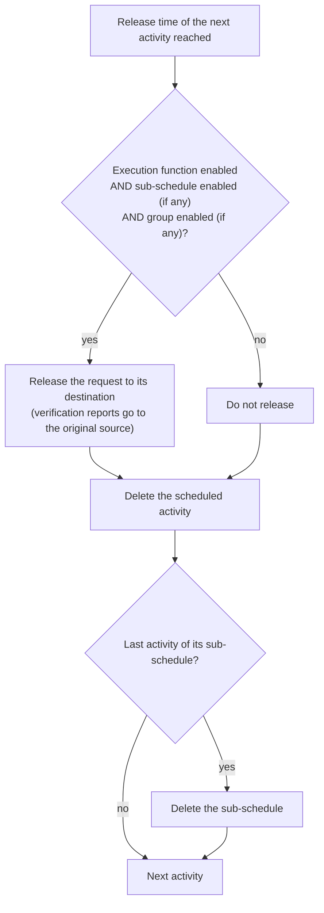
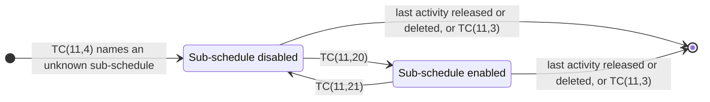
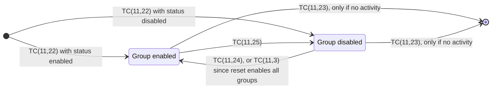
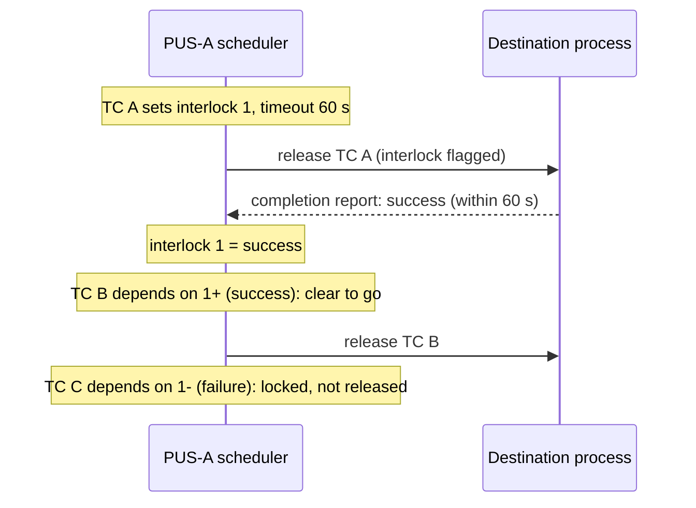
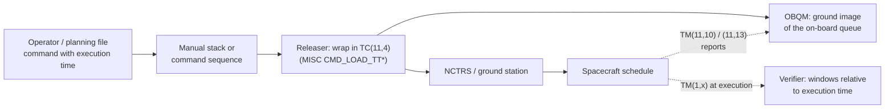
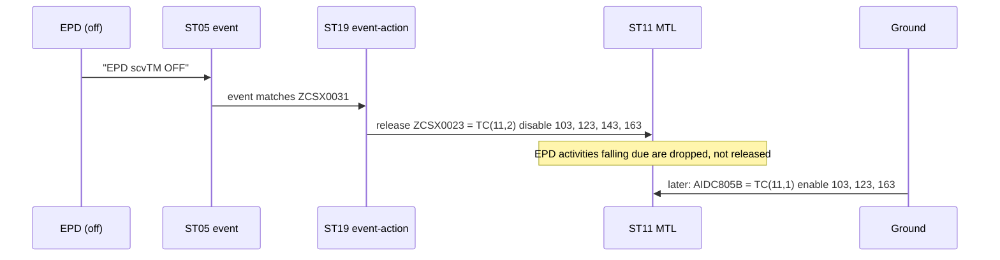

# ST[11] Time-based scheduling

A spacecraft is not always reachable from the ground: a low Earth orbiter sees a ground station
only part of the time, and a deep-space probe suffers long signal propagation delays. The **time-based scheduling
service** (service type 11) lets the ground load telecommands *in advance*, each with a release
time, into an on-board **time-based schedule**; the service releases each request to its
destination application process when its time comes.[^c-scope][^a-47] ESA ground systems call
these *execution time-tagged* commands, and the Solar Orbiter project calls its schedule the
**Mission Timeline (MTL)**.[^icd-s11][^solo-11] This page describes the PUS-C service
(ECSS-E-ST-70-41C, 2016) in full: its model, every one of its 27 message types, the filters and
the capability sets. It then covers the PUS-A predecessor ("on-board operations scheduling", with
interlocks and relative times), the 2024 Rev.1 draft, how SCOS-2000 builds and models TC(11,4)
commands, and how Solar Orbiter uses the service, with data from its real
[MIB](../../missions/solar-orbiter/mib.md).

!!! info "At a glance"
    | Item | Value |
    |---|---|
    | Service type | 11[^c-811] |
    | Subservice | the time-based scheduling subservice (at least one per service, at most one per application process)[^c-scope][^c-layout] |
    | Message types (PUS-C) | 27 subtypes: TC[11,1] to TC[11,9], TM[11,10], TC[11,11], TC[11,12], TM[11,13], TC[11,14] to TC[11,18], TM[11,19], TC[11,20] to TC[11,26], TM[11,27][^c-annexc] |
    | Minimum capability | TC[11,1] enable, TC[11,2] disable, TC[11,3] reset, TC[11,4] insert[^c-annexc] |
    | Optional concepts | sub-schedules, groups, identification by request identifier, time-window filters, time-shift[^c-cap][^c-rid][^c-filter] |
    | Status at start-up | schedule execution function **disabled**[^c-status] |
    | PUS-A name | on-board operations scheduling service, clause 14, with interlocks and relative times[^a-141] |
    | SCOS-2000 | automatic TC(11,4) encapsulation, ground model of the on-board queue (OBQM), delayed verification[^icd-s11] |
    | Solar Orbiter | MTL on APID 172, sub-schedules per subsystem and instrument, backup MTL[^solo-11][^mib] |

## 1. Concepts

### 1.1 The scheduled activity

The schedule holds **scheduled activities**. Each consists of scheduling data (the release time
and, if supported, a sub-schedule identifier and a group identifier) and the **request** to
release later. An activity is identified by the identifier of its request.[^c-sub] A PUS request
identifier combines the source identifier of the issuer, the destination (APID of the executing
process plus a system identifier) and the packet sequence count; in a TC packet these are the
source ID field of the secondary header and the APID and sequence count of the primary
header.[^c-reqid]

### 1.2 An extension of ground control

PUS-C describes the service as an extension of ground monitoring and control. A released request
is executed as if it had come straight from its original source: the executing process sends its
verification reports, if any, to the source identified in the request, not to the scheduler. The
release of a request does not depend on the success or failure of earlier released requests.[^c-sub][^c-acc]
The schedule is therefore open-loop. This differs from PUS-A, whose optional
interlocks let a release depend on the outcome of an earlier command (section 7).[^a-47]

### 1.3 Sub-schedules and groups

Two optional grouping concepts organise the schedule:[^c-sub]

| | Sub-schedule | Group |
|---|---|---|
| Purpose | one coherent on-board operation | a spacecraft entity, for example one instrument or a software item |
| Creation | automatically, when an insert request names an unknown sub-schedule (created **disabled**) | explicitly, by TC[11,22], with an initial status |
| Deletion | automatically, when its last activity is released or deleted; also by reset | explicitly, by TC[11,23], only when empty |
| Can exist empty? | no | yes |
| Control | enable or disable by TC[11,20] / TC[11,21] | enable or disable by TC[11,24] / TC[11,25] |
| Status report | TC[11,18] gives TM[11,19] | TC[11,26] gives TM[11,27] |

Groups let operations disable, for example, all activities of one instrument when the conditions
for their execution are not met, independently of the application processes and sub-schedules
the activities belong to.[^c-sub] The PUS-C working group presented the service with exactly
these two concepts at ADCSS 2015, as one of three services resulting from a complete
re-assessment of the PUS-A scheduling service. The other two were then called "telecommand
sequencing" (ST21) and "orbit-based scheduling" (ST22); PUS-C publishes them as ST[21] request
sequencing and ST[22] position-based scheduling.[^v15-st11][^c-toc]

### 1.4 Operational requirements behind the service

The space segment operability standard ECSS-E-ST-70-11C Rev.1 defines an on-board operations
schedule as an on-board facility that stores and releases telecommands loaded in advance, and
asks, among others, that:[^e70-def][^e70-sched]

* any telecommand can be loaded into the schedule (5.8.5a);
* the schedule content can be changed both while the execution function is enabled and while it
  is disabled (5.8.5b, c);
* its capacity covers at least the autonomy period (5.8.5d);
* the transfer delay to the destination process is predictable, and transfer errors are
  reported to the ground and to the schedule service (5.8.5e to g);
* a telecommand with the same release tag as one already loaded is not rejected but released
  immediately after it (5.8.5h);
* telecommands that "elapsed" while their schedule, sub-schedule or application process was
  disabled are not released when it is re-enabled (5.8.5i).

## 2. Service layout and accessibility

Each time-based scheduling service contains at least one subservice, and each application
process hosts at most one provider.[^c-layout] The mission declares the list of application
processes the subservice may release requests to; all requests of an addressable process can be
scheduled, and the hosting process is addressable by nature. A released request is processed by
the service named by its service type in the destination process.[^c-acc]

## 3. Managed parameters and observables

PUS-C leaves a long list of properties to be **declared when specifying the subservice**. They
are the knobs a mission tailors:[^c-cap][^c-gen][^c-insert2][^c-subsch][^c-groups][^c-rid][^c-filter]

| Declaration | Clause | Meaning |
|---|---|---|
| sub-schedules supported? | 6.11.4.1a | enables the sub-schedule identifier fields and TC[11,18] to TC[11,21] |
| groups supported? | 6.11.4.1b | enables the group identifier fields and TC[11,22] to TC[11,27] |
| maximum number of scheduled activities | 6.11.4.2c | resources are assumed sufficient whatever the request sizes |
| time-based schedule time margin | 6.11.4.2d | an activity can only be inserted or time-shifted to a release time at or after *now + margin* |
| maximum delta between specified and real release time | 6.11.4.2e | release accuracy |
| verification checks applied to inserted requests | 6.11.4.5f | a request failing any of them is not inserted |
| maximum number of sub-schedules | 6.11.5.1a | |
| maximum number of groups | 6.11.6.1a | |
| identification by request identifier supported? | 6.11.9.1a | needed for TC[11,5], [11,7], [11,9], [11,12] |
| time-window filtering supported? | 6.11.10.1a | needed for TC[11,6], [11,8], [11,11], [11,14] |
| each optional capability | 6.11.5 to 6.11.10 | "by declaration" entries of Annex C (section 6) |

The subservice must expose four **observables**: the execution function status, the current
number of scheduled activities, and, if supported, the current numbers of sub-schedules and of
groups.[^c-obs]

## 4. State and execution logic

### 4.1 The three statuses

The subservice keeps a **time-based schedule execution function status** (enabled or disabled),
set to "disabled" when the subservice starts; one **sub-schedule status** per sub-schedule; and
one **group status** per group.[^c-status][^c-subsch][^c-groups]

### 4.2 Releasing activities

The execution process handles activities in the order of their release times. An activity is
**disabled** if the execution function is disabled, *or* its sub-schedule is disabled, *or* its
group is disabled. When an activity's release time is reached, the process, in sequence:
releases the request if the activity is not disabled; deletes the activity; and deletes the
sub-schedule if that was its last activity.[^c-logic]



The flowchart restates clause 6.11.4.6.[^c-logic] Three consequences are worth spelling out.
First, a disabled activity is **lost**, not postponed: disabling the schedule over a release time
discards what falls due. Second, PUS-C prescribes no notification to the ground when an activity
is deleted without release. Third, PUS-C does not prescribe the release order of activities with
exactly the same time.[^c-logic] The operability standard and the 2024 draft both fill that last
gap with "insertion order" (sections 1.4 and 9).[^e70-sched][^r-logic]

### 4.3 Sub-schedule and group life cycles





The diagrams write TC(11,x) for TC[11,x]; they follow clauses 6.11.4.4, 6.11.4.5j, 6.11.4.6, 6.11.5 and 6.11.6.[^c-reset][^c-insert2][^c-logic][^c-subsch-en][^c-groups-cd]
A newly created sub-schedule starts **disabled**, so an operator who loads a new sub-schedule
must enable it explicitly; groups, in contrast, get their initial status in the creation request.

## 5. Message types and data fields

### 5.1 Catalogue

All 27 message types, with the PUS-C clause that defines each:[^c-annexc]

| Message | Name (PUS-C) | System / interface clause |
|---|---|---|
| TC[11,1] | enable the time-based schedule execution function | 6.11.4.3.2 / 8.11.2.1 |
| TC[11,2] | disable the time-based schedule execution function | 6.11.4.3.3 / 8.11.2.2 |
| TC[11,3] | reset the time-based schedule | 6.11.4.4 / 8.11.2.3 |
| TC[11,4] | insert activities into the time-based schedule | 6.11.4.5 / 8.11.2.4 |
| TC[11,5] | delete time-based scheduled activities identified by request identifier | 6.11.9.2 / 8.11.2.5 |
| TC[11,6] | delete the time-based scheduled activities identified by a filter | 6.11.10.3 / 8.11.2.6 |
| TC[11,7] | time-shift scheduled activities identified by request identifier | 6.11.9.3 / 8.11.2.7 |
| TC[11,8] | time-shift the scheduled activities identified by a filter | 6.11.10.4 / 8.11.2.8 |
| TC[11,9] | detail-report time-based scheduled activities identified by request identifier | 6.11.9.5 / 8.11.2.9 |
| TM[11,10] | time-based schedule detail report | 6.11.7.2 / 8.11.2.10 |
| TC[11,11] | detail-report the time-based scheduled activities identified by a filter | 6.11.10.6 / 8.11.2.11 |
| TC[11,12] | summary-report time-based scheduled activities identified by request identifier | 6.11.9.4 / 8.11.2.12 |
| TM[11,13] | time-based schedule summary report | 6.11.7.1 / 8.11.2.13 |
| TC[11,14] | summary-report the time-based scheduled activities identified by a filter | 6.11.10.5 / 8.11.2.14 |
| TC[11,15] | time-shift all scheduled activities | 6.11.8.1 / 8.11.2.15 |
| TC[11,16] | detail-report all time-based scheduled activities | 6.11.8.3 / 8.11.2.16 |
| TC[11,17] | summary-report all time-based scheduled activities | 6.11.8.2 / 8.11.2.17 |
| TC[11,18] | report the status of each time-based sub-schedule | 6.11.5.2.3 / 8.11.2.18 |
| TM[11,19] | time-based sub-schedule status report | 6.11.5.2.3 / 8.11.2.19 |
| TC[11,20] | enable time-based sub-schedules | 6.11.5.2.1 / 8.11.2.20 |
| TC[11,21] | disable time-based sub-schedules | 6.11.5.2.2 / 8.11.2.21 |
| TC[11,22] | create time-based scheduling groups | 6.11.6.2.1 / 8.11.2.22 |
| TC[11,23] | delete time-based scheduling groups | 6.11.6.2.2 / 8.11.2.23 |
| TC[11,24] | enable time-based scheduling groups | 6.11.6.3.1 / 8.11.2.24 |
| TC[11,25] | disable time-based scheduling groups | 6.11.6.3.2 / 8.11.2.25 |
| TC[11,26] | report the status of each time-based scheduling group | 6.11.6.3.3 / 8.11.2.26 |
| TM[11,27] | time-based scheduling group status report | 6.11.6.3.3 / 8.11.2.27 |

In the field tables below, the PUS-C field types map to packet field type codes as in
[PUS parameter types](parameter-types.md): enumerated PTC 2, unsigned integer PTC 3, absolute
time PTC 9, relative time PTC 10, deduced PTC 11, and "TC packet" PTC 12 (PFC 1, a CCSDS
telecommand packet compliant with the standard).[^c-ptc][^c-pkt] Absolute times are offsets from an
epoch in CUC or CDS; relative times are signed offsets, negative values in two's complement.[^c-abs]
PUS-C fixes no field widths for this service: they are mission choices.

### 5.2 Controlling the schedule: TC[11,1], TC[11,2], TC[11,3]

These three requests have **no application data**.[^c-811] Enable and disable set the execution
function status; neither depends on whether the schedule contains activities.[^c-enable] Reset is
accepted whatever the execution status, and in sequence sets the status to "disabled", deletes
all activities, deletes all sub-schedules (if supported) and **enables** all groups (if
supported).[^c-reset]

### 5.3 Inserting: TC[11,4]

| Field | Type | Presence | Meaning |
|---|---|---|---|
| sub-schedule ID | enumerated | if sub-schedules are supported | one sub-schedule for the whole request |
| N | unsigned integer | always | number of instructions |
| group ID | enumerated | repeated N times; if groups are supported | group of this activity |
| release time | absolute time | repeated N times | when to release |
| request | TC packet | repeated N times | the complete telecommand packet to release |

The layout is PUS-C Figure 8-91.[^c-811] The processing rules are:[^c-insert][^c-insert2]

* The **request** is rejected as a whole (failed start of execution) only if it would create a
  new sub-schedule while the maximum number of sub-schedules is already reached.
* Each **instruction** is rejected individually, with its own failed start of execution
  notification, if the schedule is full, if its release time is earlier than *now + time margin*,
  if it names an unknown group, or if the embedded request fails the declared verification checks.
* Valid instructions are processed **regardless of faulty ones** in the same request.
* If the named sub-schedule is unknown, it is created with status "disabled"; each valid
  instruction then creates an activity with its request, release time, sub-schedule and group.

<div class="bitfield" data-title="TC[11,4] application data, PUS-C generic layout (widths illustrative)" data-width="32"
     data-fields='[{"n":"Sub-schedule ID","b":8,"d":"Enumerated, present only if sub-schedules are supported"},{"n":"N","b":8,"d":"Unsigned integer"},{"n":"Group ID","b":8,"g":"repeated N times","d":"Enumerated, present only if groups are supported"},{"n":"Release time","b":40,"g":"repeated N times","d":"Absolute time, for example CUC"},{"n":"Request (TC packet)","b":64,"g":"repeated N times","d":"Complete TC packet: primary header, secondary header, data, PEC"}]'></div>

!!! warning "Inference"
    PUS-C fixes the field types of Figure 8-91, not their widths. The 8, 8, 8 and 40-bit widths
    and the 64-bit placeholder for the embedded packet are illustrative. Section 11 shows the
    real Solar Orbiter layout.

### 5.4 Selecting by request identifier: TC[11,5], TC[11,7], TC[11,9], TC[11,12]

These four requests list activities by the identifier of their request:[^c-8115][^c-8119]

| Field | Type | Presence |
|---|---|---|
| time offset | relative time | TC[11,7] only, before the list; applies to every instruction |
| N | unsigned integer | always |
| source ID | enumerated | repeated N times |
| application process ID | enumerated | repeated N times |
| sequence count | unsigned integer | repeated N times |

Putting the time offset before the instruction list is an application of a general PUS-C rule:
arguments that constrain the scope of all instructions of a request are grouped at request
level.[^c-reqtype-g]

| Request | Action on each identified activity | Rejection |
|---|---|---|
| TC[11,5] delete | delete it; delete its sub-schedule if it was the last activity | instruction: unknown request identifier |
| TC[11,7] time-shift | add the offset to its release time | request: earliest identified activity + offset earlier than *now + margin* (nothing shifted); instruction: unknown identifier |
| TC[11,9] detail-report | one detail notification each, all in one TM[11,10] | instruction: unknown identifier |
| TC[11,12] summary-report | one summary notification each, all in one TM[11,13] | instruction: unknown identifier |

The rules are those of clauses 6.11.9.2 to 6.11.9.5; in all four, valid instructions are
processed regardless of faulty ones.[^c-rid]

### 5.5 Selecting by filter: TC[11,6], TC[11,8], TC[11,11], TC[11,14]

A filter is a **time window** combined with zero or more sub-schedules and zero or more groups.
The set selected is the intersection of the time-window set with the union of the listed
sub-schedules' activities and with the union of the listed groups' activities; unknown
sub-schedules in a filter are ignored.[^c-filter]

| Field | Type | Presence |
|---|---|---|
| time offset | relative time | TC[11,8] only, first |
| time window type | enumerated | always (Table 8-5) |
| time tag 1 | absolute time | deduced presence: "from time tag" and "from time tag to time tag" |
| time tag 2 | absolute time | deduced presence: "to time tag" and "from time tag to time tag" |
| N1 | unsigned integer | if sub-schedules are supported |
| sub-schedule ID | enumerated | repeated N1 times |
| N2 | unsigned integer | if groups are supported |
| group ID | enumerated | repeated N2 times |

The structures are Figures 8-93, 8-95, 8-98 and 8-101.[^c-8115][^c-8119] The time window types
and their raw values are:[^c-enum][^c-filter]

| Raw | Time window type | Selected activities |
|---|---|---|
| 0 | select all | all |
| 1 | from time tag to time tag | from time tag 1 to time tag 2, both included |
| 2 | from time tag | at and after time tag 1 |
| 3 | to time tag | before and at the "to" time tag |

| Request | Action | Rejected if |
|---|---|---|
| TC[11,6] delete | delete each selected activity (and emptied sub-schedules) | invalid window type; from-tag later than to-tag |
| TC[11,8] time-shift | add the offset to each selected activity | as TC[11,6], **plus** an unknown sub-schedule, an unknown group, or earliest selected + offset earlier than *now + margin* |
| TC[11,11] detail-report | one TM[11,10] with all selected activities | invalid window type; from-tag later than to-tag |
| TC[11,14] summary-report | one TM[11,13] with all selected activities | invalid window type; from-tag later than to-tag |

These requests contain exactly one instruction each, and a rejection applies to the whole
request.[^c-fdel][^c-fshift][^c-frep]

!!! warning "Inference"
    The filter semantics differ subtly: an unknown sub-schedule is silently ignored by delete and
    report filters, but makes a time-shift filter fail.[^c-filter][^c-fshift] A reasonable reading
    is that a time-shift that silently skips a mistyped sub-schedule would leave the schedule
    inconsistent, whereas deleting or reporting nothing is harmless; the standard gives no
    rationale.

<div class="bitfield" data-title="TC[11,8] time-shift by filter, PUS-C generic layout (widths illustrative)" data-width="32"
     data-fields='[{"n":"Time offset","b":40,"d":"Relative time, signed"},{"n":"Window type","b":8,"d":"0 all, 1 from-to, 2 from, 3 to"},{"n":"Time tag 1","b":40,"d":"Absolute time, deduced presence"},{"n":"Time tag 2","b":40,"d":"Absolute time, deduced presence"},{"n":"N1","b":8},{"n":"Sub-schedule ID","b":8,"g":"repeated N1 times"},{"n":"N2","b":8},{"n":"Group ID","b":8,"g":"repeated N2 times"}]'></div>

The widths in this diagram are again illustrative.[^c-8115]

### 5.6 Acting on everything: TC[11,15], TC[11,16], TC[11,17]

TC[11,15] carries one field, a **time offset** (relative time), added to the release time of
every activity. It is rejected, and nothing is shifted, if the earliest activity plus the offset
would fall before *now + margin*. TC[11,16] and TC[11,17] have no application data and return a
detail report TM[11,10] or a summary report TM[11,13] of all activities.[^c-all][^c-81115]

### 5.7 Reports: TM[11,10] and TM[11,13]

Both reports contain N notifications **ordered by release time**:[^c-sum][^c-det][^c-8119]

| Field | TM[11,10] detail report | TM[11,13] summary report |
|---|---|---|
| N | unsigned integer | unsigned integer |
| sub-schedule ID | enumerated, optional | enumerated, optional |
| group ID | enumerated, optional | enumerated, optional |
| release time | absolute time | absolute time |
| request | **the complete TC packet** | only its identifier: source ID, APID (enumerated), sequence count (unsigned integer) |

PUS-C's note 4 of clause 6.11.7.2 states the difference: the summary report includes only the
identifier of each scheduled request, the detail report the complete request.[^c-det]

### 5.8 Sub-schedule messages: TC[11,18] to TC[11,21]

| Message | Data | Behaviour |
|---|---|---|
| TC[11,18] | none | one TM[11,19] with a notification per sub-schedule |
| TM[11,19] | N, then N × (sub-schedule ID: enumerated, status: enumerated 0 disabled / 1 enabled) | |
| TC[11,20] enable | N, then N × sub-schedule ID; **N = 0 means all** | unknown sub-schedule: instruction rejected, others processed |
| TC[11,21] disable | same | same |

The structures and the status enumeration (Table 8-3) are from clauses 8.11.2.18 to 8.11.2.21
and 8.11.3; the behaviour from clause 6.11.5.2.[^c-81115][^c-81120][^c-enum][^c-subsch-en][^c-subsch-rep]

### 5.9 Group messages: TC[11,22] to TM[11,27]

| Message | Data | Behaviour |
|---|---|---|
| TC[11,22] create | N, then N × (group ID, group status) | rejected per instruction if the group exists or the maximum is reached |
| TC[11,23] delete | N × group ID; N = 0 means all | rejected per instruction if unknown or **not empty**; "delete all" deletes empty groups and gives a failed execution notification for each non-empty one |
| TC[11,24] enable | N × group ID; N = 0 means all | unknown group rejected |
| TC[11,25] disable | N × group ID; N = 0 means all | unknown group rejected |
| TC[11,26] | none | one TM[11,27] |
| TM[11,27] | N, then N × (group ID, group status) | status 0 disabled / 1 enabled (Table 8-4) |

The rules are from clauses 6.11.6 and 8.11.2.22 to 8.11.2.27.[^c-groups-cd][^c-groups-ed][^c-81120][^c-enum]

## 6. Capability sets

PUS-C Annex C, Table C-17, gives the applicability constraint of each message type:[^c-annexc][^c-captype]

| Capability | Message types | Constraint |
|---|---|---|
| control and insert | TC[11,1], TC[11,2], TC[11,3], TC[11,4] | minimum |
| sub-schedules | TC[11,20] | by declaration |
| | TC[11,21] | implied by TC[11,20] |
| | TC[11,18] with TM[11,19] | requires TC[11,20] |
| groups | TC[11,22] | by declaration |
| | TC[11,23], TC[11,24] | implied by TC[11,22] |
| | TC[11,25] | implied by TC[11,24] |
| | TC[11,26] with TM[11,27] | requires TC[11,22] |
| all activities | TC[11,15], TC[11,16], TC[11,17] | by declaration; TM[11,10] / TM[11,13] as responses |
| by request identifier | TC[11,5], TC[11,7], TC[11,9], TC[11,12] | by declaration |
| by filter | TC[11,6], TC[11,8], TC[11,11], TC[11,14] | by declaration |

!!! warning "Inference: a typo in Table C-17"
    The row for TM[11,10] that follows TC[11,16] gives "TC[11,10] response" as its constraint.
    Since TC[11,10] does not exist and every other response row names its request, this should
    read "TC[11,16] response".[^c-annexc]

## 7. PUS-A: the on-board operations scheduling service

Solar Orbiter's on-board software implements the **2003** version of service 11: its applicable
PUS document is ECSS-E-70-41A.[^solo-11][^solo-ad1] SCOS-2000's built-in service 11 support also
predates PUS-C: it assumes the Rosetta packet structure, and its section references match the
clause numbers of PUS-A (see the inference on [ST[08]](st08-function-management.md#6-ground-side-scos-2000)).[^icd-s11]
The PUS-A service is therefore described here in detail.

### 7.1 Concept

PUS-A motivates on-board scheduling by two scenarios: missions out of ground contact for long
periods (low Earth orbit, deep space), and missions that want to minimise their dependency on
the ground even when permanently in view, such as geostationary telecommunication or
meteorological spacecraft. The simplest form stores time-tagged commands and releases them when
their on-board time is reached, open-loop. Optional extensions are:[^a-47]

* **sub-schedules**, logical partitions without their own size limit, to group commands per
  destination or per sequence;
* **interlocks**: a command's release can depend on the success, or the failure, of one earlier
  command of the same sub-schedule, giving simple preconditions and even IF-THEN-ELSE branches;
* **time-shift "en bloc"** by a delta time, instead of deleting and reloading;
* **relative times**, counted from a scheduling event such as the start of the schedule or of a
  sub-schedule, or the execution of the interlocking command.

### 7.2 The command schedule

Each telecommand in the PUS-A command schedule has these scheduling attributes: its
sub-schedule, the interlock it sets (if any), the interlock it depends on (if any), whether it
depends on the success or the failure of that interlock, and an absolute or relative release
time, all in CUC.[^a-1422] Its **release status** is "enabled" only if release is enabled at
three independent levels, the whole schedule, its sub-schedule and its destination application
process:[^a-1423]

| Schedule | Sub-schedule | Destination APID | Release status |
|---|---|---|---|
| enabled | enabled | enabled | **enabled** |
| any other combination | | | disabled |

This collapses PUS-A Table 22, whose eight rows give "enabled" only in the all-enabled case.[^a-1423]

### 7.3 Interlocks and scheduling events

When a command that sets an interlock is due: if its release status is disabled or its own
interlock status is "locked", it is not released and its execution result becomes "failure";
otherwise it is released, the destination is told to report its completion back to the
scheduler, and the result becomes "success" or "failure" on that report, or "failure" if no
report arrives within the command's execution timeout. A dependent command is **locked** if it
waits for success and the interlock result is failure, or waits for failure and the result is
success.[^a-1424]



The example mirrors PUS-A Figure 5 ("1+" means the release depends on the success of the command
setting interlock 1, "1-" the opposite).[^a-1424] Scheduling events give relative times an
absolute anchor: the on-board CUC time at which the schedule was enabled, at which a sub-schedule
was enabled, or at which an interlocking command's completion report (or timeout) arrived. Once
an event has occurred, the absolute times of the dependent commands are known; a repeat of the
event does not change them. Insertions and time-shifts that would put an interlock-dependent
command before the end of its interlocking command's execution window are refused.[^a-1425]

### 7.4 Auxiliary information and the scheduling activity

The PUS-A service also needs the maximum size of the schedule, the maximum numbers of
sub-schedules and interlocks, the list of sources it accepts commands from and the list of
destination processes, which it uses for error detection.[^a-1426] A command whose release time is
due is **always processed, even if the schedule is disabled**: if its release status is disabled
or its interlock status locked, it is not released, its execution result becomes "failure" if it
sets an interlock, and the time of the scheduling event it defines (if any) becomes the current
time; otherwise it is released. The service must also detect and report on-board CUC **time jumps**, and on a jump
suspend itself once it has processed the commands interlocked with commands already released.[^a-1427]
Requests that would make the schedule inconsistent are refused as a whole.[^a-142]

### 7.5 PUS-A messages

| Subtype | PUS-A name | Application / source data |
|---|---|---|
| (11,1) / (11,2) | Enable / Disable Release of Telecommands | N1 (optional), N1 × [sub-schedule ID (0 = all), N2 (optional), N2 × APID] |
| (11,3) | Reset Command Schedule | none |
| (11,4) | Insert Telecommands in Command Schedule | sub-schedule ID (optional, not 0), N (optional), N × [interlock set ID, interlock assessed ID, assessment type, scheduling event (all optional), absolute or relative time tag, execution timeout (optional), telecommand packet] |
| (11,5) | Delete Telecommands | N (optional), N × [APID, sequence count, number of telecommands] |
| (11,6) | Delete Telecommands over Time Period | range, time tag 1, time tag 2, N1, N1 × [sub-schedule ID, N2, N2 × APID] |
| (11,7) | Time-Shift Selected Telecommands | time offset, N, N × [APID, sequence count, number of telecommands] |
| (11,8) | Time-Shift Selected Telecommands over Time Period | range, time tag 1, time tag 2, time offset, N1 × [sub-schedule ID, N2 × APID] |
| (11,9) | Report Subset of Command Schedule in Detailed Form | as (11,5) |
| (11,10) | Detailed Schedule Report | N × [sub-schedule ID, interlock set ID, interlock assessed ID, assessment type, scheduling event, time tag, execution timeout, telecommand packet] |
| (11,11) | Report Subset of Command Schedule in Detailed Form over Time Period | as (11,6) |
| (11,12) | Report Subset of Command Schedule in Summary Form | as (11,5) |
| (11,13) | Summary Schedule Report | N × [sub-schedule ID, scheduling event, time tag, APID, sequence count] |
| (11,14) | Report Subset of Command Schedule in Summary Form over Time Period | as (11,6) |
| (11,15) | Time-Shift All Telecommands | time offset |
| (11,16) / (11,17) | Report Command Schedule in Detailed / Summary Form | none |
| (11,18) | Report Status of Command Schedule | none |
| (11,19) | Command Schedule Status Report | N1 × [sub-schedule ID, status, N2 × (APID, status)] |

The table condenses PUS-A clauses 14.3.1 to 14.3.6.[^a-1431][^a-1432][^a-1433][^a-1434][^a-1435][^a-1436]
Selected details:

* **(11,1)/(11,2)**: N1 = 0 acts on the whole schedule (and an enable sets the schedule's
  scheduling event time); N1 > 0 with N2 = 0 acts on the listed sub-schedules; N1 > 0 with N2 > 0
  acts on the listed APIDs *within* the listed sub-schedules. An error in one part does not stop
  the rest.[^a-1431]
* **(11,3)**: clears all entries, disables the schedule and all sub-schedules, enables commanding
  to all APIDs, and resets interlocks and scheduling event times.[^a-1431]
* **(11,4)** assessment type: 1 = "Success", 0 = "Failure"; scheduling event: 0 = absolute,
  1 = schedule, 2 = sub-schedule, 3 = interlock, other values mission-specific. Errors include a
  full schedule, an invalid destination, a time in the past or inside the execution window of the
  interlocking command, and equal interlock IDs.[^a-1432]
* **Deletion** refuses to delete an interlocking command whose dependants survive; any error
  means **nothing is deleted**. (11,5) deletes a run of successive commands to one APID starting
  at a sequence count; commands with not-yet-known relative release times can only be deleted
  this way.[^a-1433]
* **Time-shift**: refused if a command would move into the past, before the end of its
  interlocking command's window, or to a negative relative time; any error means nothing is
  shifted; commands whose absolute time is still unknown are not shifted.[^a-1434]
* **Reports** cover all sources, are ordered by predicted release time, include only commands not
  yet released, and must reflect a consistent view at the report packet time.[^a-1435]

The PUS-A "Range" field of (11,6), (11,8), (11,11) and (11,14) has values 0 = "All", 1 =
"Between" (time tag 1 to 2 inclusive), 2 = "Before" (at or before time tag 1) and 3 = "After" (at
or after time tag 1).[^a-1433]

!!! danger "Range values 2 and 3 swapped between editions"
    PUS-A value 2 means "Before" and 3 "After". PUS-C Table 8-5 assigns 2 to "from time tag" (at
    and after) and 3 to "to time tag" (before and at), the opposite meanings.[^a-1433][^c-enum] A
    ground system or database that mixes the editions would delete or shift the wrong half of the
    schedule. Solar Orbiter follows PUS-A here (section 11.3).

### 7.6 PUS-A capability sets

The minimum capability set is (11,1) to (11,4). Additional capabilities are sub-schedules,
relative times, interlocking, "scatter" delete, time-shift and report (the N arrays), selection
at sub-schedule and at APID level, and subtypes 5 to 19 with dependencies; for example (11,8)
requires (11,7) and (11,15), and (11,18) and (11,19) require each other.[^a-144]

## 8. PUS-A to PUS-C: what changed

| Aspect | PUS-A (2003) | PUS-C (2016) |
|---|---|---|
| Name | on-board operations scheduling | time-based scheduling |
| Interlocks, execution timeout, assessment type | yes (optional) | removed; releases are independent |
| Relative times and scheduling events | yes (optional) | removed; release times are absolute |
| Enable/disable granularity | schedule, sub-schedule, destination APID within sub-schedule | execution function, sub-schedule, group |
| Sub-schedule creation | not specified; an insert names a non-zero sub-schedule ID, and ID 0 means "all" in the other requests | created on first insert (disabled), deleted when empty; N = 0 means "all" |
| Groups | - | yes (optional), explicit create/delete |
| Identification of a command | (APID, sequence count, number of successive telecommands) | request identifier: (source ID, APID, sequence count) |
| Reset | disables schedule and sub-schedules, enables APIDs, clears interlocks | disables function, deletes activities and sub-schedules, enables groups |
| Failed instructions | insert: processed one by one; delete/time-shift: all or nothing | most instructions rejected individually; time-shift offset checks per request |
| (11,19) | command schedule status (sub-schedules and APIDs) | sub-schedule status only; groups via TM[11,27] |
| Time margin, release accuracy | not specified | declared parameters |

The comparison is assembled from the clauses cited in sections 4 to 7.[^a-1422][^a-1431][^a-1433][^c-reset][^c-insert2][^c-rid]
The PUS-C working group replaced the PUS-A service by three service types: ST[11],
[ST[21] request sequencing](st21-request-sequencing.md) (called telecommand sequencing at ADCSS 2015) and
[ST[22] position-based scheduling](st22-position-based-scheduling.md) (then called orbit-based scheduling).[^v15-st11][^c-toc] See also
[PUS-A vs PUS-C](pus-a-vs-pus-c.md).

!!! warning "Inference"
    No PUS-C service keeps the PUS-A interlocks as such. Missions that need a release to depend
    on the outcome of an earlier command would, in PUS-C terms, use
    [ST[21] request sequences](st21-request-sequencing.md) or
    [ST[18] on-board control procedures](st18-onboard-operations-procedure.md); the standard
    does not state this mapping.

## 9. The 2024 Rev.1 draft

ECSS-E-ST-70-41C Rev.1 DIR1 keeps the 27 message types (its Table C-17 lists the same
interface clauses 8.11.2.1 to 8.11.2.27) and changes the model in several
places:[^r-annexc][^r-svc][^r-gen][^r-status][^r-reset][^r-insert][^r-logic]

* each time-based scheduling subservice is associated with exactly one
  [event reporting](st05-event-reporting.md) subservice that issues its events (new 6.11.3.2);
* the declarations gain the **time resolution**, a **maximum activity release time** (how late a
  due activity may still be released; it takes the place of PUS-C's maximum delta between
  specified and real release time, 6.11.4.2e) and a **configuration policy for start and restart**,
  covering for example whether emptied sub-schedules or groups are automatically disabled and
  loading an alternative content after a safe mode;
* the execution function status at start-up becomes a declaration instead of always "disabled";
* reset **enables** all sub-schedules (PUS-C deletes them);
* an insert instruction naming an **unknown sub-schedule** is rejected, and a request whose
  instructions are all valid executes them in order;
* activities with the same release time are released **in insertion order**;
* a due activity that cannot be released within the maximum activity release time is deleted
  and an **event report** is generated;
* releasing requests must not block the processing of other requests to the subservice, so a
  report request is accepted even while a sub-schedule is executing.

The draft is not yet a standard.[^r-cover]

## 10. Ground side: SCOS-2000 and time-tagged commands

### 10.1 What SCOS-2000 does

The SCOS-2000 Database Import ICD lists service 11 among the services with specific ground
support:[^icd-s11]

* commands with an **execution time-tag** are automatically encapsulated in (11,4) commands;
* a **ground image of the on-board schedule** is maintained by modelling the effect of service 11
  commands, and (from SCOS-2000 R5.2) also built from the reports received from the spacecraft;
* **delayed verification** of execution time-tagged commands works with live and playback
  telemetry; playback data must be in chronological order for parameter-based verification;
* service 11 commands implementing an action selected in the ground image (for example deleting
  a range of commands) are generated automatically.

The limitations are equally explicit: the structure of the service 11 packets cannot be
configured; the Rosetta spacecraft structure is the reference, and other structures need
mission-specific modifications; each (11,4) contains **one** TC packet, several time-tagged
commands blocked together become several (11,4) packets aggregated in one TC segment; only
**absolute** time tags are supported; interlocks and the time-shift commands are not modelled;
(11,19) reports are not used to update the ground image.[^icd-s11] The model is the **On-Board
Queue Model (OBQM)**, listed among the SCOS-2000 TC servers with the multiplexer, releaser and
verifier, and shown on the On-Board Queue Display (OBQD).[^gsaw-s19][^gsaw-s25]



The diagram combines the ICD statements of this section; the component names are those of the
GSAW 2003 SCOS-2000 presentation.[^icd-s11][^icd-cmd][^gsaw-s25] The ICD does not say which
component performs the TC(11,4) encapsulation: placing it in the releaser is this wiki's
assumption.

### 10.2 What the MIB says about time tags

The [MIB](../../mib/index.md) has **no time-tag field** in its command definition table
[ccf](../../mib/tables/ccf.md): a time tag is attached when a command is loaded onto a stack or
through a sequence. Several fields prepare that use:[^icd-hipri][^icd-cmd][^icd-csf][^icd-css][^icd-cvs][^icd-cdf11]

| Table, field | Role for time-tagged commands |
|---|---|
| ccf `CCF_HIPRI` | `Y` for high-priority commands (typically CPDU commands): fixed MAP ID, **cannot be execution time-tagged**, cannot be blocked |
| ccf `CCF_SUBSCHEDID` | default on-board sub-schedule (1 to 65535) when loaded as execution time-tagged; if null, `CCF_SUBSYS` is used |
| [csf](../../mib/tables/csf.md) `CSF_IFTT` | `Y`: the sequence has execution time-tagged commands, the user gives a reference time at load; `B`: the user chooses at load to treat it as on-board time-tagged (execution times only) or ground time-tagged (release times only); `N`: none |
| csf `CSF_SUBSCHEDID` | default sub-schedule for all execution time-tagged commands of the sequence; overrides `CCF_SUBSCHEDID` |
| [css](../../mib/tables/css.md) `CSS_EXTIME` | delta execution time-tag of an element, `[+][ddd.]hh.mm.ss[.mmm]` or negative; relative to the previous execution time-tagged command (`CSS_PREVREL` = `R`) or to the sequence execution start (`A`); null means immediate execution |
| css `CSS_RELTIME` | delta *release* (ground) time-tag, `hh.mm.ss`; a separate concept |
| [cvs](../../mib/tables/cvs.md) `CVS_START` | verification window opens this many seconds after release, **or after execution for time-tagged commands** |
| [cdf](../../mib/tables/cdf.md) `CDF_VALUE` | fixed areas must not be used for service 11 elements that the OBQM has to process |

The (11,4) command itself must exist in the MIB (ccf and cdf); its name, type, subtype and
parameters are configured in SCOS-2000 through the MISCconfig variables `CMD_LOAD_TT*`.[^icd-cmd]
From SCOS-2000 5.5.4, (11,4) is encoded according to its cdf definition.[^icd-8226] In the Solar
Orbiter MIB, 3 354 of the 3 404 sequences have `CSF_IFTT` = `B` and 50 have `N`; none uses `Y`.
Of the 13 879 sequence elements, 13 784 carry a `CSS_EXTIME` delta, most often `00.00.01`
(6 635 elements) or `00.00.00` (3 159).[^mib] CPDU commands
can be defined so that they cannot be put into a TC(11,4) or aggregated with other commands.[^icd-cpdu]

### 10.3 The size budget

The maximum size of a command is the MISC variable `CMDP_MAX_BLOCK_SIZE` (default 248 octets).
The space for parameters shrinks by the header, the CRC (`CMD_CRC_SIZE`, default 2 octets) and,
for time-tagged commands, the size of the time-tag wrapper named by `CMD_LOAD_TT_NAME` (20 octets
if that command is not found). With a 10-octet header, a command can then carry at most 238
octets of parameters without time tag or CRC, or 216 with both. The final encoded time-tagged
command is *larger* than `CMDP_MAX_BLOCK_SIZE` by the wrapper, so the variable must be set to the
maximum CLTU size minus the length of the wrapper parameters.[^icd-cmd]

!!! note "Solar Orbiter's numbers match"
    On Solar Orbiter a TC data field is at most 242 octets (4 header, 236 data, 2 CRC), so a TC
    packet is at most 248 octets. A command for the MTL is limited to 228 octets (216 of
    application data), so that its TC(11,4) stays within 248.[^solo-len][^solo-114] The TC(11,4)
    overhead is 6 (primary header) + 4 (data field header) + 1 (sub-schedule) + 1 (N) + 6 (time
    tag) + 2 (CRC) = **20 octets**, exactly the ICD's default wrapper size, and 248 - 10 - 2 - 20 =
    216 is the ICD's own example.[^icd-cmd][^solo-114] The arithmetic is this wiki's.

## 11. Solar Orbiter: the Mission Timeline

### 11.1 The service on board

Solar Orbiter's central software implements service 11 following PUS-A: the ICD reproduces the
PUS-A objective and activity list, and the summary table lists all PUS-A subtypes 1 to 19 for the
CSW.[^solo-11][^solo-sum11] The schedule is the **MTL**. A **Back-Up Timeline** is a file of
service 11 time-tagged TCs kept in the safeguard memory (SGM); at software initialisation the TC
sequencer service 134 executes the selected file and so loads the backup TCs into the MTL queue,
after which all service 11 functions apply to them. At least two file placeholders exist, so the
ground can update one while the other is selected.[^solo-11] Service 134 executes TC files
uploaded with service 13; a file marked "Immediate" runs as soon as its upload completes, which is
"the intended mechanism for MTL uploading".[^solo-134]

The ICD reserves ground source IDs 110 for the Mission TimeLine and 113 for the Back-Up Mission
TimeLine, next to 111 (TC sequences), 112 (event-action recovery commands) and 120 (direct
commands).[^solo-src]

!!! warning "Inference"
    The ICD lists these as "ground sources (set by ground)", so a TC destined for the MTL
    presumably carries source ID 110 in its own data field header, and its verification reports
    can then be told apart from those of direct commands. The available sources do not show an
    example.[^solo-src]

### 11.2 Message layouts

The mission fixes the PUS-A fields as follows:[^solo-111][^solo-114][^solo-115][^solo-117][^solo-119][^solo-1111][^solo-1114][^solo-1116]

| Message | Solar Orbiter layout and rules |
|---|---|
| TC(11,1) / (11,2) | N1, sub-schedule IDs (0 to 255, 0 = all), N2, PIDs. N1 = 0: whole MTL; N1 > 0, N2 = 0: the listed sub-schedules; N1 = 1, N2 > 0, sub-schedule 0: the listed PIDs. PID and sub-schedule statuses are **independent**: a disabled PID releases nothing, whatever the sub-schedule |
| TC(11,3) | no application data; clears all entries |
| TC(11,4) | sub-schedule ID (1 octet, 1 to 255), N (1 octet), then N × [time tag (6 octets, absolute release time), complete TC packet (at most 228 octets)] |
| TC(11,5) | N, then N × [filler (1 bit), PID (7 bits), filler (2 bits), sequence count (14 bits), number of TCs (1 octet)]; successive TCs are counted **by time tag, not by sequence count** |
| TC(11,6) | range (1 octet: 0 complete, 1 between, 2 before time tag 1, 3 after time tag 1), time tags 1 and 2 (6 octets each), N1, sub-schedule IDs, N2, PIDs (1 filler bit + 7 bits) |
| TC(11,7) | time offset, N (1 to 57), PID, sequence count, number of TCs |
| TC(11,8) | range, time tags, time offset, N1 (0 = all sub-schedules, 1 = select by PID, 2 or more = by sub-schedule), sub-schedule IDs, N2, PIDs |
| TC(11,9) / (11,12) | N (1 to 58), PID, sequence count, number of TCs |
| TM(11,10) | N × [sub-schedule ID, sub-schedule status, PID status, time tag, TC packet] |
| TC(11,11) / (11,14) | as TC(11,8) without the offset |
| TM(11,13) | N × [sub-schedule ID, sub-schedule status, PID status, time tag, TC packet header, TC data field header] |
| TC(11,15) | time offset, CUC, 6 octets |
| TC(11,16), (11,17), (11,18) | no application data |
| TM(11,19) | N1 × [sub-schedule ID (0 = global status), status, N2 (number of registered PIDs for ID 0, else 0), N2 × (PID, status)] |

The 57 and 58 limits follow from the 236-octet maximum application data field and the wish to
avoid nesting service 11 commands in the MTL.[^solo-117][^solo-119] The arithmetic works out if each
entry takes 4 octets: 6 (offset) + 1 (N) + 57 × 4 = 235 for TC(11,7), and 1 + 58 × 4 = 233 for
TC(11,9) (this wiki's check). TC(11,15) fails at completion
if the new time tag is in the past, with the note "Time Tags later than OBT + 5secs are considered
as past".[^solo-1114]

!!! warning "Inference"
    Read literally, the note would treat almost every future time as "past". It most likely
    means time tags *earlier* than OBT + 5 s, that is, a 5-second time margin in the sense of
    PUS-C's time-based schedule time margin.[^solo-1114][^c-gen]

<div class="bitfield" data-title="Solar Orbiter TC(11,4) application data, one embedded TC (N = 1)" data-width="32"
     data-fields='[{"n":"Sub-schedule ID","b":8,"d":"1 to 255"},{"n":"N","b":8,"d":"number of TCs"},{"n":"Time tag: coarse","b":32,"g":"repeated N times","d":"CUC seconds"},{"n":"Time tag: fine","b":16,"g":"repeated N times","d":"CUC 2^-16 s"},{"n":"TC packet (variable, at most 228 octets)","b":64,"g":"repeated N times","d":"complete TC packet; drawn as 64 bits"}]'></div>

<div class="bitfield" data-title="Solar Orbiter TC(11,5) Delete TCs: one repeated entry (32 bits)" data-width="32"
     data-fields='[{"n":"Filler","b":1,"v":"0"},{"n":"PID","b":7,"d":"destination process ID"},{"n":"Filler","b":2},{"n":"Sequence count","b":14,"d":"of the first TC to delete"},{"n":"Number of TCs","b":8,"d":"successive by time tag"}]'></div>

The two diagrams follow the ICD tables; the embedded TC packet is variable and drawn with a
nominal width.[^solo-114][^solo-115] In TC(11,5) the 1-bit filler pads the 7-bit process ID to
an octet and the 2-bit filler pads the 14-bit sequence count to 16 bits.

### 11.3 Service 11 in the 2025 MIB

All service 11 telecommands in release MIB__20250916M25925PFMS001_SOL go to **APID 172** and all
service 11 reports come from **APID 163**; both belong to process ID 10, the CSW Data Management
System application, which handles the PUS services.[^mib][^solo-apid]

| Subtype | MIB command | Parameters (PTC/PFC) | Explorer |
|---|---|---|---|
| 1 | ZCD00B01 Enable Release of Telecommands | PCD0B011 N1 (3/4, 0 to 78), PCD0B012 sub-schedule (3/4), PCD0B013 N2 (3/4), PCD0B014 PID (3/4) | [ZCD00B01](../../explorer/index.md#/solo/command/ZCD00B01) |
| 2 | ZCD00B02 Disable Release of Telecommands, and 14 fixed variants ZCSX0021 to ZCSX0030 and ZCSX0043 to ZCSX0046 | as subtype 1 | [ZCD00B02](../../explorer/index.md#/solo/command/ZCD00B02) |
| 3 | ZCD00B03 Reset Command Schedule ("resets the MTL to its default state") | none | [ZCD00B03](../../explorer/index.md#/solo/command/ZCD00B03) |
| 4 | ZCD00B04 and INSERTTT Insert Telecommands in Command Schedule | PCD0B041 sub-schedule (3/4, range 1 to 254), PCD0B042 N (3/4, 1 to 13, default 1), PCD0B043 time tag (9/17), TC packet (7/0) | [ZCD00B04](../../explorer/index.md#/solo/command/ZCD00B04) |
| 5 | ZCD00B05 Delete Telecommands | N (1 to 58), PID, SSC (3/12), number of TCs | [ZCD00B05](../../explorer/index.md#/solo/command/ZCD00B05) |
| 6 | ZCD00B06 Delete Telecommands over Time Period | time span (2/8, calibration CCDT0022TC), time tags 1 and 2 (9/17), N1, sub-schedule, N2, PID | [ZCD00B06](../../explorer/index.md#/solo/command/ZCD00B06) |
| 7 | ZCD00B07 Time-Shift Selected Telecommands | relative time (10/17), N (1 to 57), PID, SSC, number of TCs | [ZCD00B07](../../explorer/index.md#/solo/command/ZCD00B07) |
| 8 | ZCD00B08 TimeShift Selected TCs over Time Period | time span, time tags, relative time, N1, sub-schedule, N2, PID | [ZCD00B08](../../explorer/index.md#/solo/command/ZCD00B08) |
| 9, 11, 12, 14 | ZCD00B09, ZCD00B0B, ZCD00B0C, ZCD00B0E (reports of subsets) | as 5 and 6 | [ZCD00B09](../../explorer/index.md#/solo/command/ZCD00B09) |
| 15 | ZCD00B0F Time-Shift all Time-Tagged Telecommands | relative time (10/17) | [ZCD00B0F](../../explorer/index.md#/solo/command/ZCD00B0F) |
| 16, 17, 18 | ZCD00B10, ZCD00B11, ZCD00B12 | none | [ZCD00B12](../../explorer/index.md#/solo/command/ZCD00B12) |
| 132 (private) | ZCD00B84 and INSERTBU Insert Backup MTL Telecommands in Command Schedule | same as subtype 4 | [ZCD00B84](../../explorer/index.md#/solo/command/ZCD00B84) |

The values come from this wiki's queries of ccf, cdf, cpc, prf and prv.[^mib] Three details:

* The textual calibration CCDT0022TC of the "Time Span" field is `COMPLETE` = 0,
  `BETWEEN_TTAGS` = 1, `BEFORE_TTAG_1` = 2, `AFTER_TTAG_1` = 3: the **PUS-A** meaning of the
  range values.[^mib][^a-1433]
* The range set VCD00269 of the sub-schedule ID is described as "Integer between 1 and 25" but
  allows 1 to 254; the description field is 24 characters wide, so the text is truncated.[^mib][^icd-prf]
* The two TC(11,4) commands differ only in the TC packet parameter: in ZCD00B04 it is PCD0B044
  with `CPC_CATEG` = `A`, a "Command ID" parameter (PTC 7, PFC 0) whose value is another MIB
  command, while INSERTTT and INSERTBU use PCDXB044 with category `N`, a plain octet string.[^mib][^icd-categ]

!!! warning "Inference"
    The name INSERTTT ("insert time-tagged") and its plain octet-string packet field suggest
    that it is the command SCOS-2000 uses as `CMD_LOAD_TT_NAME` to wrap execution time-tagged
    commands, while ZCD00B04 lets an operator compose a TC(11,4) by naming the command to insert.
    The MISC configuration is not part of the MIB, so this cannot be confirmed from the
    available sources.[^icd-cmd][^mib]

The reports are **variable packets** ([vpd](../../mib/tables/vpd.md)), all with
`PID_DFHSIZE` = 16:[^mib][^icd-vpd]

| SPID | Report | Decoding in the vpd |
|---|---|---|
| [14174](../../explorer/index.md#/solo/packet/14174) | TM(11,19) Command Schedule Status Report | NCD0B131 count, group of 5: sub-schedule ID, its status (CCDT0003TX), NCD0B134 count of registered PIDs, group of 2: PID (CCDT0018TX), PID status |
| [14175](../../explorer/index.md#/solo/packet/14175) | TM(11,10) Detailed Schedule Report | NCD0B0A1 count (16 bits), group of 9: sub-schedule ID, sub-schedule status, PID status, release time (9/17), TC packet ID, TC sequence control, packet length (a repeat counter for one data byte), data bytes, last data byte |
| [14176](../../explorer/index.md#/solo/packet/14176) | TM(11,13) Summary Schedule Report | NCD0B0A1 count, group of 17: sub-schedule ID, statuses, release time, TC packet ID, sequence control, length, the 32-bit data field header, then its fields (secondary header flag, PUS version, four ack bits, service type, subtype, source ID) |

!!! warning "Inference: two decoding tricks"
    In SPID 14175 the TC packet length C is used as the repeat counter of a one-octet data field,
    followed by a "last byte": C repetitions plus one octet equals the C + 1 octets of the packet
    data field, so the embedded TC is unpacked octet by octet. In SPID 14176 the first data
    field header sub-field has `VPD_OFFSET` = -32, so the 32 bits just read as "Data field
    header" are read again field by field.[^mib][^icd-vpd]

### 11.4 How the sub-schedules are organised

Every command definition with a value has `CCF_SUBSCHEDID` equal to `CCF_SUBSYS`, so the default
sub-schedule is the subsystem number. Platform commands use 1, 2 and 4 to 8; the ten instruments
use 101 to 110.[^mib]

| Sub-schedule | Instrument (command prefix) | Commands | Further sub-schedules seen |
|---|---|---|---|
| 101 | MAG (ZIM) | 127 | 121, 141, 161 |
| 102 | EUI (ZIU) | 122 | 122, 142, 162 |
| 103 | EPD (ZID) | 119 | 123, 143, 163 |
| 104 | PHI (ZIP) | 200 | 124, 144, 164 |
| 105 | STIX (ZIX) | 100 | 125, 145, 165 |
| 106 | RPW (ZIW) | 138 | 126, 146, 166 |
| 107 | SoloHI (ZIH) | 102 | 127, 147, 167 |
| 108 | SPICE (ZIC) | 91 | 128, 148, 168 |
| 109 | SWA (ZIA) | 200 | 129, 149, 169, and 111 to 114 for EAS1, EAS2, PAS, HIS |
| 110 | METIS (ZIT) | 126 | 130, 150, 170 |

The "further sub-schedules" are the ones the MIB's own commands and sequences address:[^mib]

* **141 to 150** are each instrument's **iVSTP** sub-schedule: sequences ADMF740A to ADMF740U
  "Enable iVSTP *instrument*" and "Disable iVSTP *instrument*" send TC(11,1) or TC(11,2) with
  exactly that sub-schedule.
* **161 to 170** are the default sub-schedules of each instrument's recovery sequences, for
  example AIMC805A "Recover MAG OFF" and AIMC805B "Rcvr MTL P_OFF MAG".
* **121 to 130** appear only where an instrument's whole set of sub-schedules is disabled or
  re-enabled: the protection and recovery commands below, the emergency-configuration
  sequences ASYC602C to ASYC602K, and the EPD and RPW pre-action sequences AIDC060A, AIWC060A and
  AIWC060B.
* Sequences default mostly to sub-schedule 1 (780 of 3 404), 2 (404) and the instrument numbers;
  56 sequences use 254, the top of the allowed range.

!!! warning "Inference"
    "iVSTP" is not expanded in the available sources; given Solar Orbiter's planning cycles it
    probably denotes an instrument very-short-term-planning product. The meaning of the 101-110
    and 121-130 bands, beyond being per-instrument, is not stated in the available sources.

### 11.5 Protecting the MTL when an instrument switches off

The MIB shows a complete on-board protection loop built from events, event-action definitions and
the MTL:[^mib]

1. Sequence ADMF730A "Define P_OFF S12 S19" loads on-board monitoring and
   [event-action](st19-event-action.md) definitions. Each TC(19,1), for example ZCSX0031
   "Define P_OFF_EPD S19", ties an event such as "EPD scvTM OFF" (a fixed event ID parameter) to
   a TC to send (a fixed "Command ID" parameter).
2. That TC is a fixed TC(11,2), for example ZCSX0023 "P_OFF_EPD SSID", whose four fixed octet
   pairs disable sub-schedules `0x67`, `0x7B`, `0x8F`, `0xA3`, that is 103, 123, 143 and 163, with
   N2 = 0 each (raw cdf values `4 67 0 7B 0 8F 0 A3 0`).
3. When the instrument is recovered, a sequence such as AIDC805B "EPD_Enable_MTL" sends TC(11,1)
   with sub-schedules 103, 123 and 163.

| Instrument | Event-action TC(19,1) | Embedded TC(11,2) | Sub-schedules disabled | Re-enabled by |
|---|---|---|---|---|
| MAG | ZCSX0033 (defined, but not loaded by ADMF730A in 2025, see below) | ZCSX0021 | 101, 121, 141, 161 | AIMC805B: 101, 121, 161 |
| EUI | ZCSX0032 | ZCSX0022 | 102, 122, 142, 162 | AIUC805D: 102, 122, 162 |
| EPD | ZCSX0031 | ZCSX0023 | 103, 123, 143, 163 | AIDC805B: 103, 123, 163 |
| PHI | ZCSX0035 | ZCSX0024 | 104, 124, 144, 164 | AIPC805A: 104, 124, 164 |
| STIX | ZCSX0039 | ZCSX0025 | 105, 125, 145, 165 | AIXC805B: 105, 125, 165 |
| RPW | ZCSX0036 | ZCSX0026 | 106, 126, 146, 166 | AIWC805B: 106, 126, 166 |
| SoloHI | ZCSX0037 | ZCSX0027 | 107, 127, 147, 167 | AIHC805B: 107, 127, 167 |
| SPICE | ZCSX0038 | ZCSX0028 | 108, 128, 148, 168 | AICC805A: 108, 128, 168 |
| SWA | ZCSX0040 | ZCSX0029 | 109, 129, 149, 169, 111 to 114 | AIAC805G: 109, 129, 169 |
| METIS | ZCSX0034 | ZCSX0030 | 110, 130, 150, 170 | AITC805D: 110, 130, 170 |

The SWA sensors have their own events and fixed commands: the event-action definitions ZCSX0047
to ZCSX0054 release ZCSX0043 to ZCSX0046, which disable 111 (EAS1), 112 (EAS2), 113 (PAS) and
114 (HIS), on events such as `Eas1OffEvent` or `PasDetOffErOFF`. For MAG, the 2025 ADMF730A loads
a different definition, ZCSX0042, instead of ZCSX0033: it reacts to "MAG scvTM OFF" by loading and
starting an OBCP (TC(18,140) ZCPX0009 "Load and start OBCP (MAG2)"). No sequence of the 2025
release loads ZCSX0033 or uses ZCSX0021; the 2020 release loaded ZCSX0033.[^mib][^mib20]



The note in the diagram applies the PUS-A rule that a due command whose release is disabled is
not released; the rest of the chain is MIB data.[^a-1427][^mib]

!!! warning "Inference"
    The recovery sequences re-enable three of the four sub-schedules and leave the iVSTP
    sub-schedule (14x) disabled; enabling it is a separate operation (ADMF740x). The reason is not
    stated in the available sources. Note also that these TC(11,2) commands are built entirely
    from fixed areas, which the ICD says should not be used for service 11 elements the OBQM must
    process: the ground model presumably cannot reflect them, which matters little since they are
    released on board.[^icd-cdf11][^mib]

Between the April 2020 and September 2025 releases the protection loop changed:[^mib][^mib20]

* the four SWA sensor commands ZCSX0043 to ZCSX0046 and their event-action definitions ZCSX0047
  to ZCSX0054 were added, as was the MAG OBCP definition ZCSX0042;
* the ten fixed TC(11,2) commands ZCSX0021 to ZCSX0030 disabled **three** sub-schedules in 2020
  (raw cdf values `3 67 0 7B 0 8F 0` for EPD: 103, 123 and 143). In 2025 they disable four, with
  the 16x band added, and the SWA command also disables 111 to 114;
* the 2020 release has none of the recovery sequences AI?C805x, iVSTP sequences ADMF740x or
  emergency sequences ASYC602x, and no sequence defaults to sub-schedules 161 to 170.

### 11.6 Verification

Every service 11 command in the MIB has two report-based verification stages, acceptance and
completion: stages 14001 and 14007 for the 17 ZCD00Bxx commands, stages 11 and 17 for INSERTTT,
INSERTBU and the 14 ZCSX commands; all four stages open at 0 s with a 20 s interval.[^mib] This
matches the ICD, which has each of these TCs generate TM(1,2) on a failed static check and
TM(1,8) on a completion failure.[^solo-111]
See [Command verification in the MIB](../../mib/command-verification.md).

### 11.7 Worked example: a TC(9,1) inserted in the MTL

The bytes below insert TC(9,1) "Change Time Report Generation Rate" (MIB command ZCD00901, rate
code 5) into sub-schedule 1, its default `CCF_SUBSCHEDID`, for release at OBT 811 339 200.0 s. The
**layouts are real** (MIB cdf of ZCD00B04 and ZCD00901, ICD field sizes); the sequence counts,
source IDs, time and therefore CRCs are **illustrative**.[^mib][^solo-114][^solo-91]

```text
18 AC C0 02 00 1A | 19 0B 04 78 | 01 01 | 30 5C 0D C0 00 00 | 18 AC C0 01 00 06 19 09 01 6E 05 23 43 | AF 55
 primary header     DFH (11,4)    SS N    time tag (CUC 4+2)  embedded TC(9,1), 13 octets               CRC
```

| Octets | Field | Value |
|---|---|---|
| `18 AC` | TC, data field header present, APID 172 (process 10, category 12) | |
| `C0 02` | stand-alone packet, sequence count 2 | illustrative |
| `00 1A` | data length C = 26: 4 + 1 + 1 + 6 + 13 + 2 = 27 octets | |
| `19 0B 04 78` | PUS version 1, ack acceptance + completion (`CCF_ACK` 9), service 11, subtype 4, source 120 (direct command) | source illustrative |
| `01` | sub-schedule 1 (PCD0B041) | `CCF_SUBSCHEDID` of ZCD00901 |
| `01` | N = 1 (PCD0B042) | |
| `30 5C 0D C0 00 00` | time tag (PCD0B043, PTC 9 PFC 17): 811 339 200 s, fine 0 | nominally 2025-09-16 12:00:00 OBT |
| `18 AC C0 01 00 06` | embedded TC primary header: APID 172, count 1, C = 6 | illustrative count |
| `19 09 01 6E` | embedded data field header: service 9, subtype 1, source 110 (Mission TimeLine) | source per section 11.1 inference |
| `05` | rate exponent 5 (PCD09011, EVERY_32_TMFR) | |
| `23 43` | embedded TC CRC | computed |
| `AF 55` | CRC of the TC(11,4) over its first 31 octets | computed |

The CRC is the CCITT CRC-16 with all-ones preset of the Solar Orbiter ICD; the routine used here
reproduces the PUS-C Annex B test vectors.[^solo-crc][^c-crc] The embedded TC is 13 octets, far
below the 228-octet MTL limit; the outer TC is 33 octets, of which 20 are the wrapper overhead.

## 12. Related pages

* [PUS overview](index.md), [PUS packet structures](packets.md), [PUS parameter types](parameter-types.md) and the [message type catalogue](message-types.md).
* [ST[09] Time management](st09-time-management.md): the on-board time that release times refer to.
* [ST[01] Request verification](st01-request-verification.md), [ST[05] Event reporting](st05-event-reporting.md) and [ST[19] Event-action](st19-event-action.md).
* [ST[21] Request sequencing](st21-request-sequencing.md) and [ST[22] Position-based scheduling](st22-position-based-scheduling.md), the other two heirs of PUS-A service 11.
* [Commanding in the MIB](../../mib/commanding.md), [Command sequences and parameter sets](../../mib/sequences.md) and [Command verification in the MIB](../../mib/command-verification.md).
* [SCOS-2000 architecture](../../scos2000/architecture.md), [Uplink: from operator command to on-board execution](../../overview/uplink.md) and [How Solar Orbiter uses PUS](../../missions/solar-orbiter/pus-usage.md).

## SQL used

??? example "SQL used"
    ```sql
    -- solo-2025-09-16.sqlite (MIB__20250916M25925PFMS001_SOL)
    SELECT CCF_TYPE, CCF_STYPE, COUNT(*), group_concat(CCF_CNAME) FROM ccf
     WHERE CCF_TYPE = '11' GROUP BY 1, 2;                                -- all APID 172
    SELECT d.CDF_CNAME, d.CDF_ELTYPE, d.CDF_ELLEN, d.CDF_BIT, d.CDF_GRPSIZE, d.CDF_PNAME, d.CDF_VALUE,
           c.CPC_DESCR, c.CPC_PTC, c.CPC_PFC, c.CPC_CATEG, c.CPC_PAFREF, c.CPC_PRFREF, c.CPC_DEFVAL
      FROM cdf d LEFT JOIN cpc c ON c.CPC_NAME = d.CDF_PNAME
     WHERE d.CDF_CNAME IN (SELECT CCF_CNAME FROM ccf WHERE CCF_TYPE = '11')
     ORDER BY d.CDF_CNAME, CAST(d.CDF_BIT AS INT);
    SELECT f.PRF_NUMBR, f.PRF_DESCR, v.PRV_MINVAL, v.PRV_MAXVAL FROM prf f JOIN prv v ON v.PRV_NUMBR = f.PRF_NUMBR
     WHERE f.PRF_NUMBR IN ('VCD00164','VCD00265','VCD00269','VCD00170','VCD00185','VCD00186');
    SELECT * FROM pas WHERE PAS_NUMBR = 'CCDT0022TC';
    SELECT * FROM pid WHERE PID_TYPE = '11';                             -- SPIDs 14174..14176, APID 163
    SELECT * FROM vpd WHERE VPD_TPSD IN ('14174','14175','14176') ORDER BY 1, CAST(VPD_POS AS INT);
    -- default sub-schedules
    SELECT CCF_SUBSCHEDID, CCF_SUBSYS, COUNT(*), substr(MIN(CCF_CNAME), 1, 3) FROM ccf GROUP BY 1, 2;
    SELECT CSF_SUBSCHEDID, COUNT(*) FROM csf GROUP BY 1;
    SELECT CSF_IFTT, COUNT(*) FROM csf GROUP BY 1;                       -- B 3354, N 50
    -- protection loop
    SELECT c.CCF_CNAME, c.CCF_DESCR, (SELECT group_concat(CDF_VALUE, ' ') FROM
           (SELECT CDF_VALUE FROM cdf WHERE CDF_CNAME = c.CCF_CNAME ORDER BY CAST(CDF_BIT AS INT)))
      FROM ccf c WHERE c.CCF_CNAME LIKE 'ZCSX00%' AND CCF_TYPE = '11';
    SELECT d.CDF_CNAME, (SELECT CDF_VALUE FROM cdf e WHERE e.CDF_CNAME = d.CDF_CNAME AND e.CDF_PNAME = 'PCD038B1'),
           d.CDF_VALUE, t.CCF_DESCR
      FROM cdf d JOIN ccf t ON t.CCF_CNAME = d.CDF_VALUE
     WHERE d.CDF_PNAME = 'PCD13013' AND d.CDF_CNAME LIKE 'ZCSX00%';
    SELECT SDF_SQNAME, group_concat(SDF_VALUE, ',') FROM
           (SELECT * FROM sdf WHERE SDF_ELEMID IN ('ZCD00B01','ZCD00B02') AND SDF_PNAME = 'PCD0B012'
             ORDER BY SDF_SQNAME, CAST(SDF_POS AS INT)) GROUP BY SDF_SQNAME;
    -- verification stages (cvp/cvs have generic columns COL1..COLn in ICD order)
    SELECT p.COL1, p.COL3, s.COL2, s.COL3, s.COL4, s.COL5 FROM cvp p LEFT JOIN cvs s ON s.COL1 = p.COL3
     WHERE p.COL1 IN ('ZCD00B04', 'INSERTTT', 'ZCD00B01', 'ZCSX0021');
    -- release comparison
    ATTACH 'solo-2020-04-16.sqlite' AS o;
    SELECT CCF_CNAME FROM ccf WHERE CCF_TYPE = '11' AND CCF_CNAME NOT IN (SELECT CCF_CNAME FROM o.ccf);
    SELECT CCF_CNAME FROM ccf WHERE CCF_CNAME LIKE 'ZCSX%' AND CCF_CNAME NOT IN (SELECT CCF_CNAME FROM o.ccf);
    SELECT CDF_CNAME, group_concat(CDF_VALUE, ' ') FROM (SELECT * FROM o.cdf WHERE CDF_CNAME LIKE 'ZCSX00%'
           ORDER BY CDF_CNAME, CAST(CDF_BIT AS INT)) GROUP BY 1;                -- 2020: N1 = 3
    SELECT CSS_SQNAME, CSS_ELEMID FROM css WHERE CSS_ELEMID IN ('ZCSX0033', 'ZCSX0042', 'ZCSX0021');
    SELECT CSS_ELEMID FROM o.css WHERE CSS_SQNAME = 'ADMF730A';                 -- 2020 loads ZCSX0033
    SELECT COUNT(*) FROM o.csf WHERE CSF_NAME LIKE 'ADMF740%' OR CSF_NAME GLOB 'AI?C805*';  -- 0
    ```

[^c-scope]: [ECSS-E-ST-70-41C, Telemetry and telecommand packet utilization](../../library/ecss-e-st-70-41c-15april2016.md), §6.11.1.1 General, PDF p. 168.
[^c-sub]: [ECSS-E-ST-70-41C](../../library/ecss-e-st-70-41c-15april2016.md), §6.11.1.2 Time-based scheduling subservice, PDF pp. 168-169.
[^c-layout]: [ECSS-E-ST-70-41C](../../library/ecss-e-st-70-41c-15april2016.md), §6.11.2 Service layout, PDF p. 169.
[^c-acc]: [ECSS-E-ST-70-41C](../../library/ecss-e-st-70-41c-15april2016.md), §6.11.3.1 Accessibility, application process, and notes 1 to 3, PDF p. 169.
[^c-cap]: [ECSS-E-ST-70-41C](../../library/ecss-e-st-70-41c-15april2016.md), §6.11.4.1 Capability, PDF p. 170.
[^c-gen]: [ECSS-E-ST-70-41C](../../library/ecss-e-st-70-41c-15april2016.md), §6.11.4.2 General, requirements a to e, PDF pp. 170-171.
[^c-status]: [ECSS-E-ST-70-41C](../../library/ecss-e-st-70-41c-15april2016.md), §6.11.4.3.1 Status, PDF p. 171.
[^c-enable]: [ECSS-E-ST-70-41C](../../library/ecss-e-st-70-41c-15april2016.md), §6.11.4.3.2 and §6.11.4.3.3, PDF pp. 171-172.
[^c-reset]: [ECSS-E-ST-70-41C](../../library/ecss-e-st-70-41c-15april2016.md), §6.11.4.4 Reset the time-based schedule, PDF p. 172.
[^c-insert]: [ECSS-E-ST-70-41C](../../library/ecss-e-st-70-41c-15april2016.md), §6.11.4.5 Insert activities, requirements a to e, PDF pp. 172-173.
[^c-insert2]: [ECSS-E-ST-70-41C](../../library/ecss-e-st-70-41c-15april2016.md), §6.11.4.5 requirements f to k, PDF pp. 173-174.
[^c-logic]: [ECSS-E-ST-70-41C](../../library/ecss-e-st-70-41c-15april2016.md), §6.11.4.6 Schedule execution logic and notes 1 to 3, PDF pp. 174-175.
[^c-subsch]: [ECSS-E-ST-70-41C](../../library/ecss-e-st-70-41c-15april2016.md), §6.11.5.1 Time-based sub-schedules, PDF p. 175.
[^c-subsch-en]: [ECSS-E-ST-70-41C](../../library/ecss-e-st-70-41c-15april2016.md), §6.11.5.2.1 and §6.11.5.2.2 Enable and disable time-based sub-schedules, PDF pp. 175-176.
[^c-subsch-rep]: [ECSS-E-ST-70-41C](../../library/ecss-e-st-70-41c-15april2016.md), §6.11.5.2.3 Report the status of each time-based sub-schedule, PDF p. 177.
[^c-groups]: [ECSS-E-ST-70-41C](../../library/ecss-e-st-70-41c-15april2016.md), §6.11.6.1 Time-based scheduling groups, PDF p. 177.
[^c-groups-cd]: [ECSS-E-ST-70-41C](../../library/ecss-e-st-70-41c-15april2016.md), §6.11.6.2 Creating and deleting time-based scheduling groups, PDF pp. 178-179.
[^c-groups-ed]: [ECSS-E-ST-70-41C](../../library/ecss-e-st-70-41c-15april2016.md), §6.11.6.3 Enabling, disabling and reporting groups, PDF pp. 179-181.
[^c-sum]: [ECSS-E-ST-70-41C](../../library/ecss-e-st-70-41c-15april2016.md), §6.11.7.1 Time-based schedule summary report, PDF pp. 181-182.
[^c-det]: [ECSS-E-ST-70-41C](../../library/ecss-e-st-70-41c-15april2016.md), §6.11.7.2 Time-based schedule detail report and note 4, PDF pp. 182-183.
[^c-all]: [ECSS-E-ST-70-41C](../../library/ecss-e-st-70-41c-15april2016.md), §6.11.8 Managing all time-based scheduled activities, PDF pp. 183-185.
[^c-rid]: [ECSS-E-ST-70-41C](../../library/ecss-e-st-70-41c-15april2016.md), §6.11.9 Managing time-based scheduled activities identified by request identifier, PDF pp. 185-189.
[^c-filter]: [ECSS-E-ST-70-41C](../../library/ecss-e-st-70-41c-15april2016.md), §6.11.10.1 General and §6.11.10.2 Time-window filtering function, PDF pp. 190-192.
[^c-fdel]: [ECSS-E-ST-70-41C](../../library/ecss-e-st-70-41c-15april2016.md), §6.11.10.3 Delete the time-based scheduled activities identified by a filter, PDF pp. 192-193.
[^c-fshift]: [ECSS-E-ST-70-41C](../../library/ecss-e-st-70-41c-15april2016.md), §6.11.10.4 Time-shift the scheduled activities identified by a filter, PDF pp. 193-194.
[^c-frep]: [ECSS-E-ST-70-41C](../../library/ecss-e-st-70-41c-15april2016.md), §6.11.10.5 and §6.11.10.6 Summary- and detail-report by filter, PDF pp. 194-196.
[^c-obs]: [ECSS-E-ST-70-41C](../../library/ecss-e-st-70-41c-15april2016.md), §6.11.11 Subservice observables, PDF p. 197.
[^c-811]: [ECSS-E-ST-70-41C](../../library/ecss-e-st-70-41c-15april2016.md), §8.11.1 and §8.11.2.1 to §8.11.2.4, Figure 8-91, PDF pp. 496-497.
[^c-8115]: [ECSS-E-ST-70-41C](../../library/ecss-e-st-70-41c-15april2016.md), §8.11.2.5 to §8.11.2.8, Figures 8-92 to 8-95, PDF pp. 497-499.
[^c-8119]: [ECSS-E-ST-70-41C](../../library/ecss-e-st-70-41c-15april2016.md), §8.11.2.9 to §8.11.2.14, Figures 8-96 to 8-101, PDF pp. 499-502.
[^c-81115]: [ECSS-E-ST-70-41C](../../library/ecss-e-st-70-41c-15april2016.md), §8.11.2.15 to §8.11.2.19, Figures 8-102 and 8-103, PDF pp. 502-503.
[^c-81120]: [ECSS-E-ST-70-41C](../../library/ecss-e-st-70-41c-15april2016.md), §8.11.2.20 to §8.11.2.27, Figures 8-104 to 8-110, PDF pp. 503-506.
[^c-enum]: [ECSS-E-ST-70-41C](../../library/ecss-e-st-70-41c-15april2016.md), §8.11.3 Enumeration, Tables 8-3 to 8-5, PDF p. 507.
[^c-annexc]: [ECSS-E-ST-70-41C](../../library/ecss-e-st-70-41c-15april2016.md), Annex C.2.11, Table C-17 Time-based scheduling message types, PDF pp. 637-639.
[^c-captype]: [ECSS-E-ST-70-41C](../../library/ecss-e-st-70-41c-15april2016.md), §5.3.4 Capability type, PDF pp. 32-33.
[^c-reqtype-g]: [ECSS-E-ST-70-41C](../../library/ecss-e-st-70-41c-15april2016.md), §5.3.3.2g and note, PDF p. 30.
[^c-reqid]: [ECSS-E-ST-70-41C](../../library/ecss-e-st-70-41c-15april2016.md), §5.4.11.2.1c and note 4, PDF p. 49.
[^c-ptc]: [ECSS-E-ST-70-41C](../../library/ecss-e-st-70-41c-15april2016.md), §7.3.1, Table 7-1 PTC, PDF p. 429.
[^c-pkt]: [ECSS-E-ST-70-41C](../../library/ecss-e-st-70-41c-15april2016.md), §7.3.13 Packet, Table 7-12, PDF p. 437.
[^c-abs]: [ECSS-E-ST-70-41C](../../library/ecss-e-st-70-41c-15april2016.md), §7.3.10 Absolute time and §7.3.11 Relative time, PDF pp. 435-437.
[^c-crc]: [ECSS-E-ST-70-41C](../../library/ecss-e-st-70-41c-15april2016.md), Annex B.1 CRC, test vectors and verification output, PDF pp. 617-621.
[^c-toc]: [ECSS-E-ST-70-41C](../../library/ecss-e-st-70-41c-15april2016.md), Contents, clauses 6.21 ST[21] request sequencing and 6.22 ST[22] position-based scheduling, PDF p. 5.
[^a-47]: [ECSS-E-70-41A, Ground systems and operations - Telemetry and telecommand packet utilization](../../library/ecss-e-70-41a-30jan2003-pus.md), §4.7 On-board operations scheduling, PDF pp. 32-33.
[^a-141]: [ECSS-E-70-41A](../../library/ecss-e-70-41a-30jan2003-pus.md), §14.1 Scope, PDF p. 99.
[^a-142]: [ECSS-E-70-41A](../../library/ecss-e-70-41a-30jan2003-pus.md), §14.2.1 General, PDF pp. 99-100.
[^a-1422]: [ECSS-E-70-41A](../../library/ecss-e-70-41a-30jan2003-pus.md), §14.2.2 The command schedule, PDF p. 100.
[^a-1423]: [ECSS-E-70-41A](../../library/ecss-e-70-41a-30jan2003-pus.md), §14.2.3 Telecommand release status, Table 22, PDF pp. 100-101.
[^a-1424]: [ECSS-E-70-41A](../../library/ecss-e-70-41a-30jan2003-pus.md), §14.2.4 Telecommand interlock status, Figure 5, PDF pp. 101-102.
[^a-1425]: [ECSS-E-70-41A](../../library/ecss-e-70-41a-30jan2003-pus.md), §14.2.5 Scheduling events, PDF pp. 102-103.
[^a-1426]: [ECSS-E-70-41A](../../library/ecss-e-70-41a-30jan2003-pus.md), §14.2.6 Auxiliary information, PDF p. 103.
[^a-1427]: [ECSS-E-70-41A](../../library/ecss-e-70-41a-30jan2003-pus.md), §14.2.7 The scheduling activity, PDF p. 103.
[^a-1431]: [ECSS-E-70-41A](../../library/ecss-e-70-41a-30jan2003-pus.md), §14.3.1 Controlling the command schedule (11,1), (11,2), (11,3), PDF pp. 103-105.
[^a-1432]: [ECSS-E-70-41A](../../library/ecss-e-70-41a-30jan2003-pus.md), §14.3.2 Inserting telecommands (11,4), PDF pp. 105-107.
[^a-1433]: [ECSS-E-70-41A](../../library/ecss-e-70-41a-30jan2003-pus.md), §14.3.3 Deleting telecommands (11,5), (11,6), PDF pp. 107-109.
[^a-1434]: [ECSS-E-70-41A](../../library/ecss-e-70-41a-30jan2003-pus.md), §14.3.4 Time-shifting (11,15), (11,7), (11,8), PDF pp. 109-111.
[^a-1435]: [ECSS-E-70-41A](../../library/ecss-e-70-41a-30jan2003-pus.md), §14.3.5 Reporting of the command schedule contents (11,9) to (11,17), PDF pp. 112-115.
[^a-1436]: [ECSS-E-70-41A](../../library/ecss-e-70-41a-30jan2003-pus.md), §14.3.6 Reporting of the status of the command schedule (11,18), (11,19), PDF pp. 115-116.
[^a-144]: [ECSS-E-70-41A](../../library/ecss-e-70-41a-30jan2003-pus.md), §14.4 Capability sets, Tables 23 and 24, PDF pp. 116-117.
[^r-svc]: [ECSS-E-ST-70-41C Rev.1 DIR1 (draft, 11 December 2024)](../../library/ecss-e-st-70-41c-rev1-dir1.md), §6.11.3.2 Service, PDF pp. 160-161.
[^r-gen]: [ECSS-E-ST-70-41C Rev.1 DIR1](../../library/ecss-e-st-70-41c-rev1-dir1.md), §6.11.4.2 General, requirements c to g, PDF pp. 161-162.
[^r-status]: [ECSS-E-ST-70-41C Rev.1 DIR1](../../library/ecss-e-st-70-41c-rev1-dir1.md), §6.11.4.3.1 Status, PDF p. 163.
[^r-reset]: [ECSS-E-ST-70-41C Rev.1 DIR1](../../library/ecss-e-st-70-41c-rev1-dir1.md), §6.11.4.4 Reset the time-based schedule, PDF p. 164.
[^r-insert]: [ECSS-E-ST-70-41C Rev.1 DIR1](../../library/ecss-e-st-70-41c-rev1-dir1.md), §6.11.4.5 Insert activities, PDF pp. 164-166.
[^r-logic]: [ECSS-E-ST-70-41C Rev.1 DIR1](../../library/ecss-e-st-70-41c-rev1-dir1.md), §6.11.4.6 Schedule execution logic, PDF p. 166.
[^r-cover]: [ECSS-E-ST-70-41C Rev.1 DIR1](../../library/ecss-e-st-70-41c-rev1-dir1.md), cover page, PDF p. 1.
[^r-annexc]: [ECSS-E-ST-70-41C Rev.1 DIR1](../../library/ecss-e-st-70-41c-rev1-dir1.md), Annex C.2.11, Table C-17 Time-based scheduling message types, PDF pp. 709-711.
[^e70-def]: [ECSS-E-ST-70-11C Rev.1, Space segment operability (15 October 2025)](../../library/ecss-e-st-70-11c-rev-1-15october2025.md), §3.2.3.10 deferred command and §3.2.3.24 on-board operations schedule, PDF pp. 12-14.
[^e70-sched]: [ECSS-E-ST-70-11C Rev.1](../../library/ecss-e-st-70-11c-rev-1-15october2025.md), §5.8.5 On-board operations scheduling, requirements a to i, PDF p. 62.
[^v15-st11]: [S. Valera, ECSS-E-ST-70-41C status, ADCSS 2015](../../library/valera-2015-adcss-ecss-e-st-70-41c-status.md), slide 9 "ST11 - time-based scheduling", PDF p. 9.
[^icd-s11]: [SCOS-2000 Database Import ICD, issue 7.0](../../library/icd-7-0-final.md), Appendix C §3.9 Service 11: On-board operations scheduling service, PDF pp. 240-241.
[^icd-cmd]: [SCOS-2000 Database Import ICD 7.0](../../library/icd-7-0-final.md), §3.3.3.2 Commands, remarks on (11,4) and on command size, PDF pp. 131-132.
[^icd-hipri]: [SCOS-2000 Database Import ICD 7.0](../../library/icd-7-0-final.md), §3.3.3.2.1 ccf, fields CCF_HIPRI, CCF_MAPID and CCF_SUBSCHEDID, PDF pp. 139-140.
[^icd-csf]: [SCOS-2000 Database Import ICD 7.0](../../library/icd-7-0-final.md), §3.3.3.3.1 Command sequence characteristics: csf, fields CSF_IFTT and CSF_SUBSCHEDID, PDF pp. 165-168.
[^icd-css]: [SCOS-2000 Database Import ICD 7.0](../../library/icd-7-0-final.md), §3.3.3.3.2 css, fields CSS_RELTIME, CSS_EXTIME and CSS_PREVREL, PDF pp. 170-175.
[^icd-cvs]: [SCOS-2000 Database Import ICD 7.0](../../library/icd-7-0-final.md), §3.3.3.4.1 Verification stages file: cvs, field CVS_START, PDF p. 193.
[^icd-cdf11]: [SCOS-2000 Database Import ICD 7.0](../../library/icd-7-0-final.md), §3.3.3.2.3 cdf, field CDF_VALUE, PDF p. 157.
[^icd-cpdu]: [SCOS-2000 Database Import ICD 7.0](../../library/icd-7-0-final.md), Appendix C §3.2 Service 2, PDF p. 238.
[^icd-8226]: [SCOS-2000 Database Import ICD 7.0](../../library/icd-7-0-final.md), change record S2K-8226, PDF p. 263.
[^icd-prf]: [SCOS-2000 Database Import ICD 7.0](../../library/icd-7-0-final.md), §3.3.3.7.1 Parameter range sets: prf, field PRF_DESCR Char(24), PDF pp. 210-211.
[^icd-categ]: [SCOS-2000 Database Import ICD 7.0](../../library/icd-7-0-final.md), §3.3.3.2.2 cpc, field CPC_CATEG, PDF p. 146.
[^icd-vpd]: [SCOS-2000 Database Import ICD 7.0](../../library/icd-7-0-final.md), §3.3.2.5.2 vpd, fields VPD_GRPSIZE, VPD_FIXREP and VPD_OFFSET, PDF pp. 101-105.
[^gsaw-s19]: [N. Peccia, SCOS-2000, GSAW 2003](../../library/gsaw2003-peccia.md), slide 19 "SCOS-2000 Client / Server", PDF p. 19.
[^gsaw-s25]: [N. Peccia, GSAW 2003](../../library/gsaw2003-peccia.md), slide 25 "Commanding functions", PDF p. 25.
[^solo-11]: [SOL.S.ASTR.TN.00079 issue 7, Solar Orbiter TM-TC and Packet Structure ICD](../../library/sol-s-astr-tn-00079-07.md), §5.12 Service 11: Onboard Operations Scheduling, objective, description and notes, PDF p. 100.
[^solo-sum11]: [SOL.S.ASTR.TN.00079](../../library/sol-s-astr-tn-00079-07.md), §5.1 Summary table, Service 11 rows, PDF p. 33.
[^solo-ad1]: [SOL.S.ASTR.TN.00079](../../library/sol-s-astr-tn-00079-07.md), §2.1 Applicable Documents, AD1 = ECSS-E-70-41A, PDF p. 13.
[^solo-111]: [SOL.S.ASTR.TN.00079](../../library/sol-s-astr-tn-00079-07.md), §5.12.1 to §5.12.3 TC (11,1), (11,2), (11,3), PDF pp. 100-102.
[^solo-114]: [SOL.S.ASTR.TN.00079](../../library/sol-s-astr-tn-00079-07.md), §5.12.4 TC (11,4) Insert TCs in Command Schedule, PDF pp. 102-103.
[^solo-115]: [SOL.S.ASTR.TN.00079](../../library/sol-s-astr-tn-00079-07.md), §5.12.5 TC (11,5) and §5.12.6 TC (11,6), PDF pp. 103-105.
[^solo-117]: [SOL.S.ASTR.TN.00079](../../library/sol-s-astr-tn-00079-07.md), §5.12.7 TC (11,7) and §5.12.8 TC (11,8), PDF pp. 106-108.
[^solo-119]: [SOL.S.ASTR.TN.00079](../../library/sol-s-astr-tn-00079-07.md), §5.12.9 TC (11,9) and §5.12.10 TM (11,10), PDF pp. 108-109.
[^solo-1111]: [SOL.S.ASTR.TN.00079](../../library/sol-s-astr-tn-00079-07.md), §5.12.11 to §5.12.13 TC (11,11), TC (11,12), TM (11,13), PDF pp. 110-112.
[^solo-1114]: [SOL.S.ASTR.TN.00079](../../library/sol-s-astr-tn-00079-07.md), §5.12.14 TC (11,14) and §5.12.15 TC (11,15), PDF pp. 112-114.
[^solo-1116]: [SOL.S.ASTR.TN.00079](../../library/sol-s-astr-tn-00079-07.md), §5.12.16 to §5.12.19 TC (11,16) to TM (11,19), PDF pp. 114-116.
[^solo-91]: [SOL.S.ASTR.TN.00079](../../library/sol-s-astr-tn-00079-07.md), §5.10.1 TC (9,1) Change Time Report Generation Rate, PDF p. 96.
[^solo-len]: [SOL.S.ASTR.TN.00079](../../library/sol-s-astr-tn-00079-07.md), §3.2.1.3 TC Packet Length, PDF p. 16.
[^solo-src]: [SOL.S.ASTR.TN.00079](../../library/sol-s-astr-tn-00079-07.md), §13.2 Source ID, PDF pp. 275-276.
[^solo-134]: [SOL.S.ASTR.TN.00079](../../library/sol-s-astr-tn-00079-07.md), §5.28 Service 134: TC Sequencer, PDF p. 242.
[^solo-apid]: [SOL.S.ASTR.TN.00079](../../library/sol-s-astr-tn-00079-07.md), §3.2.1.1 TC Packet ID and Annex 8 §13.1 (process ID 10), PDF pp. 15 and 273.
[^solo-crc]: [SOL.S.ASTR.TN.00079](../../library/sol-s-astr-tn-00079-07.md), Annex 6 §11.1 CRC Checksum Algorithms, PDF pp. 268-269.
[^mib]: [Solar Orbiter MIB release MIB__20250916M25925PFMS001_SOL](../../library/mib-20250916m25925pfms001-sol.md), tables ccf, cdf, cpc, prf, prv, pas, pid, vpd, csf, css, sdf, cvp and cvs; this wiki's queries (see "SQL used").
[^mib20]: [Solar Orbiter MIB release MIB__20200416M10720PFMS001_SOL](../../library/mib-20200416m10720pfms001-sol.md), tables ccf, cdf, csf, css and sdf; this wiki's queries (see "SQL used").
