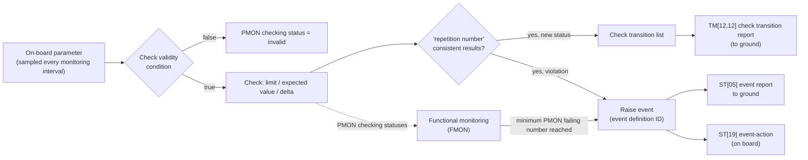
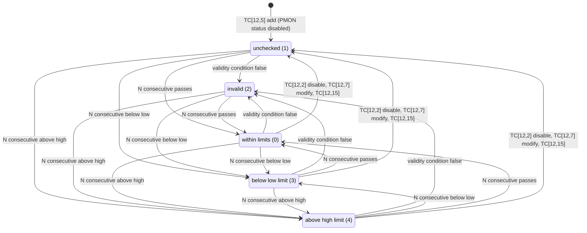
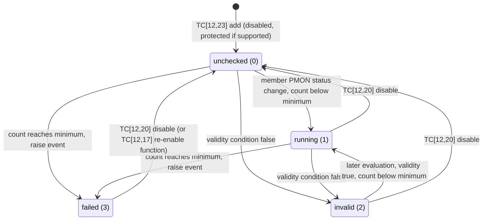

# ST[12] On-board monitoring

The **on-board monitoring** service type, ST[12] of the [Packet Utilization Standard](index.md),
moves part of the limit checking that a [mission control system](../../scos2000/index.md) does
on the ground into the spacecraft. An on-board application process samples its own parameters,
compares them with checks loaded by the ground, records every change of check result
("check transition"), reports those transitions to the ground and, when a monitoring condition
is violated, raises an event. The event can go to the ground through
[ST[05] event reporting](st05-event-reporting.md) and can be caught on board, for example by
[ST[19] event-action](st19-event-action.md), to start an autonomous recovery.[^c-scope]
PUS-A explained the purpose plainly: monitoring on board removes the need to downlink all
low-level housekeeping and to have the ground permanently watching it.[^a-48] Abbreviations
such as PMON and FMON are expanded in the [glossary](../../glossary.md).

!!! info "At a glance"
    | Item | Value |
    |---|---|
    | Service type | 12[^c-812gen] |
    | Subservices (PUS-C) | parameter monitoring (exactly one), functional monitoring (at most one)[^c-layout] |
    | Check types | limit-check and expected-value-check (minimum), delta-check (optional)[^c-checktypes] |
    | Message types (PUS-C) | 22 requests and 6 reports: TC[12,1]-[12,8], [12,10], [12,13], [12,15]-[12,25], [12,27]; TM[12,9], [12,11], [12,12], [12,14], [12,26], [12,28][^c-annexc] |
    | Minimum capability | TC[12,1], [12,2], [12,15], [12,16], TM[12,12]; plus TC[12,17]-[12,20] if functional monitoring exists[^c-annexc] |
    | Depends on | one [ST[05]](st05-event-reporting.md) event reporting subservice per monitoring service[^c-access][^c-interdep] |
    | PUS-A (2003) | clause 15 "On-board monitoring service", subtypes 1-12[^a-151] |
    | Solar Orbiter | PUS-A based service 12 in six Central Software applications plus METIS; functional monitoring in private service 142[^so-sum][^mib-ccf] |

## Where it sits



The figure summarises clauses 6.12.3 and 6.12.4 of ECSS-E-ST-70-41C: the parameter monitoring
process, the check transition list and its report, the events raised by violations and the
functional monitoring layer built on top of the parameter checks.[^c-process][^c-transrep][^c-fmonproc]
Ground-side limit checking in SCOS-2000 is a separate mechanism, defined in the MIB
[monitoring check tables](../../mib/monitoring-checks.md); SCOS-2000 applies no specific
processing to service 12 packets, which it decodes as ordinary variable packets.[^icd-s12]

## Service layout

* Each on-board monitoring service contains **exactly one** parameter monitoring subservice and
  **at most one** functional monitoring subservice; when both exist they are hosted by the same
  application process.[^c-layout]
* Each service is associated with **exactly one** [event reporting](st05-event-reporting.md)
  subservice, declared in the service specification. That subservice catches the events raised
  by the monitoring service and issues the event notifications; an event is identified by the
  application process that hosts the event reporting subservice plus an event definition
  identifier.[^c-access]
* The foundation model lists this dependency among the few cross-service rules: the on-board
  monitoring and event-action services require an event reporting service.[^c-interdep]
* The parameter monitoring subservice can monitor every on-board parameter accessible to its
  hosting application process.[^c-paramacc] On-board parameters are identified by a
  spacecraft-unique parameter identifier, and each belongs to an "on-board parameter minimum
  sampling interval", the time unit used by monitoring and housekeeping (the standard's example:
  125 ms for a platform, 500 ms for a payload).[^c-5432]

## Parameter monitoring subservice

### Check types

| Check type | What is compared | Success condition | Capability |
|---|---|---|---|
| **Limit-check** | the parameter value with a low and a high limit | low limit <= value <= high limit | minimum |
| **Expected-value-check** | the parameter value after a bitwise AND with a mask, with an expected value | masked value = expected value | minimum |
| **Delta-check** | the difference between two consecutive values with a low and a high threshold | low threshold <= delta <= high threshold | optional, declared |

Sources: requirements 6.12.3.2.1 and 6.12.3.2.2.[^c-checktypes] The standard notes that the
applicable check depends on the nature of the parameter: analogue values are limit or delta
checked, status values are expected-value checked.[^c-checkdef2] There is no limit on how many
checks one parameter may have: one definition can hold warning limits and another danger limits
for the same parameter, and a parameter can be limit-checked and delta-checked at the same
time through two definitions.[^c-scope]

### The parameter monitoring definition

Each check is a separate **parameter monitoring definition**, kept in the **PMON list**. Its
maximum size is declared for the subservice, which must accept several definitions for the
same parameter, for example to adapt the monitoring plan to spacecraft modes through different
validity conditions.[^c-pmondef]

| Element | Content | Present |
|---|---|---|
| PMON identifier | identifier of the definition | always |
| Monitored parameter ID | on-board parameter to monitor | always |
| Check validity condition | validity parameter ID, bit-mask, expected value; the check runs only when (sample AND mask) = expected value | if conditional checking is declared |
| Monitoring interval | time between two evaluations, in minimum-sampling-interval units | if definition-specific intervals are declared (otherwise one subservice-wide interval) |
| Check definition | repetition number, check type and type-dependent criteria (below) | always |

Sources: requirements 6.12.3.3d-i.[^c-pmondef][^c-checkdef]

| Check type | Type-dependent criteria |
|---|---|
| Limit-check | low limit, event definition ID for "below low limit", high limit, event definition ID for "above high limit" |
| Expected-value-check | expected value, mask applied to the sample, event definition ID for "unexpected value" |
| Delta-check | number of consecutive delta values averaged, low delta threshold, event ID for "below low threshold", high delta threshold, event ID for "above high threshold" |

Every event ID is optional in the sense that the value 0 means "no event report to
generate".[^c-checkdef][^c-125]

The **repetition number** is the count of successive, consistent check results needed before
a new checking status is established; it filters out single noisy samples. For a delta check,
the averaged delta is

$$\overline{\Delta} = \frac{1}{n}\sum_{k=1}^{n}\left(x_k - x_{k-1}\right),$$

where $n$ is the "number of consecutive delta values" and $x_k$ are consecutive samples; the
standard defines the delta as the difference of two consecutive values and compares the average
of $n$ such deltas with the thresholds.[^c-checktypes][^c-checkdef] (Arithmetically the sum
telescopes to $(x_n - x_0)/n$.)

### Statuses

| Status | Scope | Values |
|---|---|---|
| PMON function status | whole subservice | enabled, disabled; "enabled" when the subservice starts |
| PMON status | each definition | enabled (1), disabled (0) |
| PMON checking status | each definition | depends on the check type (table below) |

The checking status is the *established* result. "Unchecked" and "invalid" mean that no
checking status is currently established.[^c-status]

| Raw value | Expected-value-check | Limit-check | Delta-check |
|---|---|---|---|
| 0 | expected value | within limits | within thresholds |
| 1 | unchecked | unchecked | unchecked |
| 2 | invalid | invalid | invalid |
| 3 | unexpected value | below low limit | below low threshold |
| 4 | - | above high limit | above high threshold |

Sources: Tables 8-7 to 8-9 and 8-10 of the interface specification.[^c-enum12]

### The monitoring process

At the end of each monitoring interval, for each enabled definition (and only while the PMON
function is enabled), the subservice:

1. computes the check validity condition, if conditional checking is supported;
2. if it is false, sets the checking status to "invalid" and resets the repetition counter;
3. otherwise performs the check with a newly sampled value and, if the last "repetition number"
   checks all produced the same result, establishes a new checking status;
4. if the newly established status differs from the previous one, records a **check
   transition** in the check transition list and, if an event definition is attached to that
   transition, raises the event.[^c-process]

For a limit-check, "above high limit" is established only when every one of the repeated checks
was above the high limit, "below low limit" only when every one was below the low limit, and
"within limits" when all passed; the delta-check works the same way with thresholds, and the
expected-value-check distinguishes only "expected" and "unexpected".[^c-process2]



The diagram assembles requirements 6.12.3.5.1c (enabling the function resets enabled
definitions to "unchecked"), 6.12.3.6.2g (disabling a definition), 6.12.3.6.3 (validity and
repetition), 6.12.3.9.1h (a new definition starts "unchecked" and disabled) and 6.12.3.9.4g
(a modification resets the definition) for a limit-check; N is the repetition
number.[^c-pmonfn][^c-pmondis][^c-process][^c-add][^c-modify]

!!! warning "Inference"
    The standard does not say explicitly whether entering "invalid" because the validity
    condition is false is itself a *recorded* check transition, since requirement 6.12.3.6.3c.2
    sets the status directly rather than "establishing" it. The out-of-limits rules
    (6.12.3.12) do treat "invalid" as a valid previous status.

!!! example "Worked example (illustrative values)"
    A limit-check with low limit 10, high limit 50 and repetition number 3, starting
    "unchecked". Samples arrive at t1, t2, ...

    | Sample | Value | Result | Established status | Recorded transition |
    |---|---|---|---|---|
    | t1-t3 | 30, 31, 29 | pass x3 | within limits | unchecked -> within limits (time t1) |
    | t4-t6 | 55, 56, 48 | above, above, pass | (unchanged) | none: the three results differ |
    | t7-t9 | 57, 58, 60 | above x3 | above high limit | within limits -> above high limit (time t7); event raised if its ID is not 0 |
    | t10-t12 | 5, 4, 6 | below x3 | below low limit | above high limit -> below low limit (time t10) |

    The transition time is the sampling time of the *first* of the samples that established the
    new status, and the reported value is the last sample used.[^c-transrep]

### Reporting the check transitions: TM[12,12]

The subservice reports the **check transition list** in a TM[12,12] check transition report,
then removes the reported transitions from the list. A report is issued when either the declared
maximum number of transitions is reached or the **maximum transition reporting delay** has
elapsed since the first transition in the list. The delay is expressed in minimum-sampling-interval
units; its default is declared, and if the capability exists TC[12,3] changes it.[^c-transrep][^c-delay]
Each notification carries: PMON ID, monitored parameter ID, check type, the expected-value mask
(expected-value checks only), the parameter value that caused the transition, the limit crossed,
the previous and new checking statuses and the transition time.[^c-transrep]

### Out-of-limits: TC[12,10] and TM[12,11]

On request, TM[12,11] lists only the transitions that represent a violation:[^c-ool]

| Check type | Reported transitions |
|---|---|
| Expected-value | unchecked, invalid or expected value -> unexpected value |
| Limit | unchecked, invalid or within limits -> below low limit / above high limit; below low <-> above high |
| Delta | unchecked, invalid or within threshold -> below low / above high threshold; below low <-> above high threshold |

Generating an out-of-limits report does **not** clear the check transition list; only a check
transition report does.[^c-ool2]

!!! note "Printed typo"
    Requirement 6.12.3.12e.5 prints "within threshold" to "below high threshold"; from the
    structure of the list it is evidently meant to read "below low threshold". Figure 8-122 is
    also captioned "limit-checking" although it shows the delta-checking fields.[^c-ool][^c-127]

### Managing definitions: requests and rejection rules

All multi-instruction requests follow the PUS rule that valid instructions are executed even if
others in the same request are rejected; each rejected instruction gives a failed start of
execution notification through [ST[01]](st01-request-verification.md).[^c-enable][^c-add]

| Request | Effect | Rejected when |
|---|---|---|
| TC[12,15] enable the PMON function | function enabled; every enabled definition reset to "unchecked" with its repetition counter; process starts (PMON statuses unchanged) | - |
| TC[12,16] disable the PMON function | function disabled; process stops (statuses kept) | a functional monitoring subservice has its FMON function enabled |
| TC[12,1] enable definitions | PMON status enabled, repetition counter reset (checking status unchanged) | ID not in PMON list; used by a protected FMON |
| TC[12,2] disable definitions | PMON status disabled, checking status "unchecked" | ID not in PMON list; used by a protected FMON |
| TC[12,3] change max reporting delay | new delay | (capability by declaration) |
| TC[12,5] add definitions | added as "unchecked" and **disabled** | list full; ID already used; parameter or validity parameter not accessible; high limit < low limit; high threshold < low threshold |
| TC[12,4] delete all | PMON list and check transition list emptied | any definition used by functional monitoring; PMON function enabled |
| TC[12,6] delete definitions | removed | ID unknown; definition enabled; used by an FMON |
| TC[12,7] modify definitions | repetition number, limits/mask/expected value/thresholds and event IDs replaced; status "unchecked"; counter reset | ID unknown; monitored parameter differs; inconsistent limits or thresholds; used by a protected FMON; check type differs |
| TC[12,8] report definitions | TM[12,9] with each definition and its PMON status (N = 0 means all) | ID unknown |
| TC[12,13] report status of each definition | TM[12,14] with ID and PMON status of every definition | - |
| TC[12,10] report the out-of-limits | TM[12,11] | - |

Sources: clauses 6.12.3.5 to 6.12.3.12 and 8.12.2.7c.[^c-pmonfn][^c-pmondis2][^c-enable][^c-pmondis][^c-delay][^c-add][^c-delall][^c-delete][^c-modify][^c-modify2][^c-report][^c-status-rep][^c-ool]
To change anything else in a definition, such as the check type, the standard recommends
deleting it and adding a new one.[^c-modify] If a subservice can add definitions it must also be
able to delete them (TC[12,4] or TC[12,6]).[^c-add]

The subservice exposes three **observables**: the number of free PMON list entries, the number
of enabled definitions and the PMON function status.[^c-obs]

## Functional monitoring subservice

**Functional monitoring** watches the health of an on-board element (a software application,
a hardware unit) by combining parameter monitoring definitions. A **functional monitoring
definition** (in the **FMON list**) names a set of PMON definitions; when at least a "minimum
PMON failing number" of them are in violation at the same time, the functional definition fails
and its event is raised. A minimum of 1 behaves as a logical OR; a minimum equal to the number of
members behaves as a logical AND. If the subservice does not support the parameter, 1 is
used.[^c-fmonscope][^c-fmondef]

| Element | Present |
|---|---|
| FMON identifier | always |
| Check validity condition (validity parameter ID, mask, expected value) | if conditional checking is declared |
| Event definition ID of the event to raise | always |
| Minimum PMON failing number | if declared |
| List of one or more PMON identifiers (maximum count declared) | always |

Sources: requirement 6.12.4.2.1.[^c-fmondef]

The subservice keeps an **FMON function status**, a per-definition **FMON status**
(enabled/disabled), an **FMON checking status** ("unchecked" 0, "running" 1, "invalid" 2,
"failed" 3) and, if protection is supported, an **FMON protection status** (unprotected 0,
protected 1).[^c-fmonstat][^c-enum12f] Whenever a member PMON definition establishes a new
checking status, an enabled FMON that is not "failed" first evaluates its validity condition
("invalid" if false) and, if not invalid, counts its members in violation: reaching the minimum
sets "failed" and raises the event, otherwise the status becomes "running".[^c-fmonproc]



The transitions follow requirements 6.12.4.4.1e, 6.12.4.5.1, 6.12.4.5.3g and
6.12.4.7.1i.[^c-fmonfn][^c-fmonproc][^c-fmonen][^c-fmonadd] A "failed" definition stays
failed: the evaluation is skipped while the status is "failed".[^c-fmonproc]

!!! warning "Inference"
    Requirement 6.12.4.5.1 evaluates the validity condition only when the status is not
    "failed", and counts violations only when it is neither "failed" nor "invalid". Read
    literally, nothing moves an "invalid" definition back to "running" when its validity
    condition becomes true again, except disabling and re-enabling it. The arrow FI to FR above
    is this wiki's assumption; it matches the rule Solar Orbiter's service 142 states
    explicitly (see [below](#functional-monitoring-as-service-142)).[^so-142r]

**Protection** freezes a functional monitoring definition and its members: a protected FMON
cannot be deleted, and the PMON definitions it uses cannot be enabled, disabled or
modified.[^c-fmonstat][^c-protect] The standard gives no rationale; guarding FDIR monitoring
against accidental changes is the obvious use (this wiki's reading).

| Request | Effect | Rejected when | Capability |
|---|---|---|---|
| TC[12,17] enable FMON function | enabled; enabled definitions set "unchecked"; monitoring starts | PMON function disabled | minimum |
| TC[12,18] disable FMON function | disabled; monitoring stops (statuses kept) | - | minimum |
| TC[12,19] / TC[12,20] enable / disable definitions | FMON status set; disabling also sets "unchecked" | ID unknown | minimum |
| TC[12,21] / TC[12,22] protect / unprotect | protection status set | ID unknown | by declaration / implied by TC[12,21] |
| TC[12,23] add definitions | added "unchecked", disabled, protected (if supported) | whole request: an ID already exists or appears twice; instruction: list full, unknown PMON ID, validity parameter not accessible | by declaration |
| TC[12,24] delete definitions | removed | ID unknown; enabled; protected | implied by TC[12,23] |
| TC[12,25] report definitions | TM[12,26] with contents, protection and FMON status (N = 0 means all) | ID unknown | requires TC[12,23] |
| TC[12,27] report status of each | TM[12,28] with protection, FMON status and checking status | - | by declaration |

Sources: clauses 6.12.4.4 to 6.12.4.9 and Annex C Table C-19.[^c-fmonfn][^c-fmonen][^c-protect][^c-unprotect][^c-fmonadd][^c-fmondel][^c-fmonrep][^c-annexc]
The observables are the free FMON entries, the enabled definitions and the FMON function
status.[^c-fmonobs]

## Message types and data fields (PUS-C)

PUS-C gives field *types* but leaves most *widths* to the mission ("enumerated", "unsigned
integer"); "deduced" fields take the format of the monitored or validity parameter.[^c-125]
The tables below restate the interface figures; the [Solar Orbiter section](#solar-orbiter)
draws real layouts with sizes. Type names follow the [PUS parameter types](parameter-types.md).

### Simple identifier lists

TC[12,1], [12,2], [12,6] and [12,8] carry `N` (unsigned integer) followed by N PMON IDs
(enumerated); TC[12,8] uses N = 0 for "all". TC[12,19]-[12,22], [12,24] and [12,25] carry
`N` and N FMON IDs; TC[12,25] uses N = 0 for "all". TC[12,3] carries one unsigned integer, the
maximum reporting delay. TC[12,4], [12,10], [12,13], [12,15]-[12,18] and [12,27] have no
application data.[^c-111][^c-113][^c-118][^c-123][^c-131][^c-noappdata]

### TC[12,5] add parameter monitoring definitions

| Field | Type | Notes |
|---|---|---|
| N | unsigned integer | number of definitions |
| PMON ID | enumerated | repeated N times from here |
| monitored parameter ID | enumerated | |
| validity parameter ID | enumerated | optional (check validity condition) |
| mask | bit-string, size deduced from the validity parameter | optional |
| expected value | deduced from the validity parameter | optional |
| monitoring interval | unsigned integer | optional (definition-specific intervals) |
| repetition number | unsigned integer | |
| check type | enumerated: 0 expected-value, 1 limit, 2 delta | Table 8-6 |
| check type dependent criteria | see next table | |

TC[12,7] modify has the same outer shape without the validity condition and the monitoring
interval (N, PMON ID, monitored parameter ID, repetition number, check type,
criteria).[^c-125][^c-127]

| Check type | Criteria fields in order |
|---|---|
| expected-value (0) | mask (bit-string, size of the monitored parameter), expected value (deduced), event definition ID (enumerated), optional spare bit-string to harmonise sizes |
| limit (1) | low limit (deduced), event definition ID, high limit (deduced), event definition ID |
| delta (2) | number of consecutive delta values (unsigned integer), low delta threshold (deduced), event definition ID, high delta threshold (deduced), event definition ID |

Source: Figures 8-114 to 8-122.[^c-125][^c-127] The presence of the spare field is declared per
mission.[^c-125]

### TM[12,9] parameter monitoring definition report

Optional maximum transition reporting delay (unsigned integer, present if TC[12,3] is
supported), N, then per definition: PMON ID, monitored parameter ID, optional check validity
condition (validity parameter ID, mask, expected value), optional monitoring interval, **PMON
status** (enumerated), repetition number, check type and criteria as in TC[12,5].[^c-129]

### TM[12,11] out-of-limits report and TM[12,12] check transition report

Both reports have the same structure (Figures 8-128 and 8-129):[^c-1211]

| Field | Type |
|---|---|
| N | unsigned integer |
| PMON ID | enumerated |
| monitored parameter ID | enumerated |
| check type | enumerated |
| expected value check mask | bit-string (present only for expected-value checks) |
| parameter value | deduced |
| limit crossed | deduced |
| previous PMON checking status | enumerated |
| current PMON checking status | enumerated |
| transition time | absolute time |

### Functional monitoring reports and requests

| Message | Fields (per repetition) |
|---|---|
| TC[12,23] add FMON definitions | N1; FMON ID; optional validity parameter ID, mask, expected value; event definition ID; optional minimum PMON failing number; N2; N2 x PMON ID |
| TM[12,26] FMON definition report | N1; FMON ID; optional validity condition; optional FMON protection status; FMON status; event definition ID; optional minimum PMON failing number; N2; N2 x PMON ID |
| TM[12,14] PMON definition status report | N; PMON ID; PMON status |
| TM[12,28] FMON definition status report | N; FMON ID; optional FMON protection status; FMON status; FMON checking status |

Sources: Figures 8-130, 8-135, 8-138 and 8-139.[^c-1214][^c-1223][^c-1226]

### Message catalogue

| Message | Name | Applicability | System / interface clause |
|---|---|---|---|
| TC[12,1] | enable parameter monitoring definitions | minimum | 6.12.3.6.1 / 8.12.2.1 |
| TC[12,2] | disable parameter monitoring definitions | minimum | 6.12.3.6.2 / 8.12.2.2 |
| TC[12,3] | change the maximum transition reporting delay | by declaration | 6.12.3.8 / 8.12.2.3 |
| TC[12,4] | delete all parameter monitoring definitions | by declaration | 6.12.3.9.2 / 8.12.2.4 |
| TC[12,5] | add parameter monitoring definitions | by declaration | 6.12.3.9.1 / 8.12.2.5 |
| TC[12,6] | delete parameter monitoring definitions | by declaration | 6.12.3.9.3 / 8.12.2.6 |
| TC[12,7] | modify parameter monitoring definitions | by declaration | 6.12.3.9.4 / 8.12.2.7 |
| TC[12,8] / TM[12,9] | report parameter monitoring definitions / report | requires TC[12,5] or TC[12,7] | 6.12.3.10 / 8.12.2.8-9 |
| TC[12,10] / TM[12,11] | report the out-of-limits / out-of-limits report | by declaration | 6.12.3.12 / 8.12.2.10-11 |
| TM[12,12] | check transition report | minimum | 6.12.3.7 / 8.12.2.12 |
| TC[12,13] / TM[12,14] | report the status of each parameter monitoring definition / report | requires TC[12,1] | 6.12.3.11 / 8.12.2.13-14 |
| TC[12,15] / TC[12,16] | enable / disable the parameter monitoring function | minimum | 6.12.3.5 / 8.12.2.15-16 |
| TC[12,17]-TC[12,28] | functional monitoring (see above) | see table above | 6.12.4 / 8.12.2.17-28 |

Source: Annex C, Tables C-18 and C-19.[^c-annexc] All services are listed in the
[PUS message type catalogue](message-types.md).

!!! note "Annex C and the main text"
    Table C-18 lists the "at least one of" alternatives implied by TC[12,5] as TC[12,4] and
    TC[12,5]; requirement 6.12.3.9.1b, which the table summarises, names TC[12,4] and TC[12,6],
    and the 2024 draft's Table C-18 prints TC[12,6].[^c-annexc][^c-add][^r-annexc]

## The 2024 Rev.1 draft

The ECSS-E-ST-70-41C Rev.1 DIR1 draft (public review until 28 February 2025) keeps the service
structure and adds two requests, TC[12,29] and TC[12,30], to start and stop logging check
transitions in the check transition list (stopping also empties the list).[^r-log] It renames
TC[12,10]/TM[12,11] "report the current out-of-limits", drops the separate mask from the check
transition notification (the value is reported after the mask is applied), and changes the add
request so that a faulty instruction rejects the whole ordered request.[^r-annexc][^r-trans][^r-add]
The draft also proposes 2-byte PMON and FMON identifiers in its key element size table.[^r-sizes]
Until published, these remain proposals; see [PUS-A vs PUS-C](pus-a-vs-pus-c.md).

## PUS-A (ECSS-E-70-41A, 2003)

PUS-A organised the service around a **monitoring list** of parameters, each carrying a set of
check definitions, instead of one definition per check.[^a-152] Per parameter it stored:
whether its monitoring is enabled, an optional Boolean **validity parameter**, a monitoring
interval in units of the mission constant `<DIAG_MIN_INTERV>`, and the check definitions.[^a-1522]
Each check definition held its type, its limits/thresholds/expected value, an optional Boolean
**check selection parameter** (the check applies only while it is TRUE), a number of repetitions
`#REP` and the report identifier (RID) of the event to generate.[^a-1522] For delta checks
`#REP` was the number of deltas averaged, not a repetition filter.[^a-1522]

A check definition was used only if monitoring was enabled at service level and for the
parameter, the validity parameter was TRUE and the selection parameter was TRUE. Otherwise its
status became "unchecked", "invalid" or **"unselected"** respectively - a status PUS-C
dropped.[^a-1523] Violations generated an event report TM(5,4) "high severity" containing the RID
and no auxiliary data.[^a-1523b] One behaviour differs from PUS-C: from "within limits", samples
alternating below and above the limits counted towards the repetition, and the new status was the
result of the current sample.[^a-1523b] PUS-C requires all repeated results to be the same.[^c-process2]

| Subtype | PUS-A request or report | Data |
|---|---|---|
| (12,1) / (12,2) | Enable / Disable Monitoring of Parameters | N, N x Parameter#; N = 0 means service level |
| (12,3) | Change Maximum Reporting Delay | delay in `<DIAG_MIN_INTERV>` units |
| (12,4) | Clear Monitoring List | none; also disables monitoring at service level |
| (12,5) | Add Parameters to Monitoring List | optional interval, Value #REP, Delta #REP, N; per parameter: Parameter#, optional Validity Parameter#, then NOL limit checks (selection parameter, low limit, RID, high limit, RID), NOD delta checks (same with thresholds), NOE expected-value checks (selection parameter, expected value, RID) |
| (12,6) | Delete Parameters from Monitoring List | N, N x Parameter# |
| (12,7) | Modify Parameter Checking Information | per check a signed **Check Position**: > 0 replace, < 0 delete, 0 add |
| (12,8) / (12,9) | Report Current Monitoring List / Current Monitoring List Report | monitoring status, maximum reporting delay, the list |
| (12,10) / (12,11) | Report Current Parameters Out-of-limit List / report | N; Parameter#, value, limit crossed, previous and current status, transition time |
| (12,12) | Check Transition Report | same entry layout; transition time optional |

Sources: clauses 15.3.1 to 15.3.9.[^a-1531][^a-1532][^a-1534][^a-1535][^a-1536][^a-1537][^a-1538][^a-1539]
The minimum capability set was (12,1), (12,2) and (12,12); everything else, including support
for validity parameters, several checks of a type per parameter and each check type, was an
additional capability.[^a-154]

| Encoding | PUS-A checking status value | PUS-C raw value |
|---|---|---|
| within limits / thresholds, expected value | 0 | 0 |
| unchecked | 1 | 1 |
| invalid | 2 | 2 |
| unselected | 3 | (removed) |
| below low limit / threshold, unexpected value | 4 | 3 |
| above high limit / threshold | 5 | 4 |

Sources: PUS-A §15.3.8 and PUS-C Tables 8-7 to 8-9.[^a-1538][^c-enum12] The violation codes moved
down by one, so the two issues are not wire-compatible here.

## Solar Orbiter

Solar Orbiter's spacecraft interface follows PUS-A tailored by Airbus (see also
[How Solar Orbiter uses PUS](../../missions/solar-orbiter/pus-usage.md) and
[The Solar Orbiter MIB](../../missions/solar-orbiter/mib.md)). In the service table of
the TM/TC and packet structure ICD, service 12 is optional for payload software, with TC(12,1),
TC(12,2) and TM(12,12) mandatory if implemented; all subtypes 1-12 are provided by the Central
Software (CSW) of the on-board computer.[^so-sum] Each CSW application hosts its own instance:
a request applies only to the service 12 instance of the application addressed by the
packet's APID. In TC(12,1) and TC(12,2), N = 0 enables or disables monitoring at service level
and leaves each entry in its current state; N > 0 acts on the listed monitoring IDs (1 byte
each).[^so-121]

### Data structures

The ICD fixes the field sizes. Monitoring IDs are 1 byte (1-255), parameter IDs 4 bytes, and
limits and expected values occupy fixed 8-byte and 4-byte fields, right-aligned and padded with
zeros on the left when the parameter is shorter.[^so-125][^so-123]

<div class="bitfield" data-title="Solar Orbiter TC(12,5) add/modify one monitoring entry, as printed in the ICD (46 octets with N)" data-width="32"
     data-fields='[{"n":"N","b":8},{"n":"Monitoring ID","b":8,"d":"1..255","g":"repeated N times"},{"n":"Parameter ID","b":32},{"n":"Validity parameter ID","b":32,"d":"0 = always valid"},{"n":"Monitoring interval","b":16,"d":"cycles of the application"},{"n":"Rep","b":8,"d":"successive samples, 1..255"},{"n":"Monitoring status","b":8,"d":"0 disabled, 1 enabled"},{"n":"NOL","b":8,"d":"1 = limit check present"},{"n":"Low limit","b":64,"d":"right-aligned"},{"n":"EID low","b":16},{"n":"High limit","b":64,"d":"right-aligned"},{"n":"EID high","b":16},{"n":"NOE","b":8,"d":"1 = expected-value check present"},{"n":"Mask","b":32},{"n":"Expected value","b":32},{"n":"EID expected","b":16}]'></div>

Unlike PUS-A's separate add and modify, Solar Orbiter's TC(12,5) adds *or replaces*: an existing
monitoring ID is overwritten. Each entry has either a limit check (NOL = 1) or an expected-value
check (NOE = 1); there is no delta check and no check selection parameter.[^so-125][^so-123]
TC(12,7) modifies only the criteria (N, monitoring ID, NOL, 20-byte limit criteria, NOE, 10-byte
expected-value criteria).[^so-127] The ICD recommends not using TC(12,4) "Clear Monitoring
List" in flight.[^so-124] TC(12,3) carries a 1-byte delay counted in **8 Hz cycles** (125 ms),
where 0 means no transition report is generated.[^so-123d]

<div class="bitfield" data-title="Solar Orbiter TM(12,12) check transition report (one entry = 33 octets)" data-width="32"
     data-fields='[{"n":"N","b":16},{"n":"Monitoring ID","b":8,"g":"repeated N times"},{"n":"Parameter ID","b":32},{"n":"Mask","b":32},{"n":"Parameter value","b":64,"d":"right-aligned, format of the monitored parameter"},{"n":"Limit crossed","b":64},{"n":"Previous checking status","b":8},{"n":"Current checking status","b":8},{"n":"Transition time (CUC 4+2)","b":48}]'></div>

TM(12,11) has the same entry layout, and TM(12,9) echoes TC(12,5) preceded by the global
monitoring status (1 byte) and the maximum reporting delay (1 byte).[^so-1211][^so-129][^so-1212]
The checking status uses the **PUS-A codes**: 0 valid (within limits or expected), 1 unchecked,
2 invalid, 4 unexpected or below low, 5 above high; 3 (unselected) is not used.[^so-1211][^so-1212]
When a monitor triggers, the event report carries the monitoring ID, parameter ID, mask, value,
limit crossed, both statuses and the transition time (CUC, 4 + 2 bytes).[^so-evt]

### Solar Orbiter in the MIB

The 2025 MIB release defines **254** service 12 commands and **32** service 12 packet
definitions (the April 2020 release: 247 and 19).[^mib-ccf][^mib-pid] The commands are addressed to seven
APIDs. Decoding APID = 16 x PID + category with the ICD's allocation, 172/188/204/220/236/268 are
the DMS, AOCS, payload, platform, system control and thermal control applications of the CSW
(PID 10, 11, 12, 13, 14, 16, category 12) and 1084 is METIS (PID 67).[^so-pid][^mib-ccf]

| Subtype | Commands | Applications (APID) |
|---|---|---|
| 1 / 2 enable / disable | 13 each | 6 CSW applications (one each) + 7 METIS variants |
| 3 change delay | 7 | 6 CSW + METIS |
| 4 clear, 6 delete, 8 report list, 10 report OOL | 6 each | 6 CSW |
| 5 add | 114 | 6 CSW (15-36 per application) |
| 7 modify | 83 | 6 CSW (13-18 per application) |

Data: [ccf](../../mib/tables/ccf.md) grouped by type and subtype.[^mib-ccf] Explore
[APID 172](../../explorer/index.md#/solo/apid/172) or the generic add command
[ZCD00C05](../../explorer/index.md#/solo/command/ZCD00C05).

The MIB (see [commanding in the MIB](../../mib/commanding.md)) shows how operators fill the
"deduced" limit fields. Besides one generic command per
application whose limits are 8-byte octet strings, there are typed variants such as
[ZCD2Z08A](../../explorer/index.md#/solo/command/ZCD2Z08A) "Add param monitor high/low (uint8)":
fixed areas zero-fill the leading bytes and an 8-bit editable limit sits at bit 200, the last
byte of the 8-byte low-limit field - the right alignment the ICD asks for.[^mib-cdf] Variants
exist for uint8/16/32, sint16/32 and float4/8 limits and for uint/sint expected values. The
thermal application adds sensor-specific modify commands such as
[ZTC2X02F](../../explorer/index.md#/solo/command/ZTC2X02F) "Mod Hi/Lo ANY PT-1000", whose
limits are entered in degrees Celsius and converted to raw values by the 31-point command
[calibration](../../mib/calibration.md) `CTC4Z102TC` ([cca](../../mib/tables/cca.md)).[^mib-cdf][^mib-cca] The parameter
identifiers use command parameters of category `P` in [cpc](../../mib/tables/cpc.md): the
operator types a telemetry parameter name and SCOS-2000 encodes its on-board identifier.[^mib-cdf][^icd-catp]
The system control application also carries predefined monitors such as "Define SWA_A_OFF S12"
(`ZCSX0019`).[^mib-ccf]

!!! warning "Inference: repetition field width"
    In every MIB definition of the DMS add command (`ZCD00C05`, bits 96-127) and of the
    monitoring list reports, "Repetition Interval" is a 32-bit unsigned integer (PTC 3, PFC 14),
    making each entry 48 octets, while the ICD prints "Rep" as 1 byte (45-octet entry). The
    fixed-layout reports confirm 48-octet entries (consecutive monitoring IDs at byte offsets
    19 and 67).[^mib-cdf][^mib-plf][^so-125] The MIB reflects what the ground actually sends, so
    the ICD table is probably out of date on this point; the available sources do not say.

On the telemetry side the 2025 MIB defines TM(12,9), TM(12,11) and TM(12,12) for each of the six
CSW applications at category 3 ("table generation") APIDs 163, 179, 195, 211, 227 and 259, and a
TM(12,12) for METIS at APID 1075.[^mib-pid][^so-pid] They are
[variable packets](../../mib/tables/vpd.md): for example
[SPID 14171](../../explorer/index.md#/solo/packet/14171) decodes a 16-bit count, then per entry
the monitoring ID, the monitored parameter ID
[NCD0C095](../../explorer/index.md#/solo/param/NCD0C095) flagged `VPD_PIDREF = Y`, the mask, the
value and limit as *deduced* parameters (PTC 11), both statuses through the text calibration
[CCDT0011TX](../../explorer/index.md#/solo/calib/txt/CCDT0011TX) and a CUC time (PTC 9,
PFC 17).[^mib-vpd] `VPD_PIDREF = Y` tells SCOS-2000 to look the value up among the PCF_PID
values to find the parameter.[^icd-pidref][^icd-vpd1211] Each deduced field names NCD0C095 in
`PCF_RELATED`, which identifies the parameter whose value gives the on-board parameter ID, and
carries a `PCF_WIDTH` of 64 bits (32 for the expected value); for a deduced parameter with a
PCF_WIDTH the import ICD says the value is extracted from a fixed-width field rather than one
sized by the parameter type. This matches the ICD's fixed 8-byte (4-byte) slots.[^mib-vpd][^icd-pcfwidth]
`CCDT0011TX` maps 0 VALID, 1 UNCHECKED, 2 INVALID,
4 BELOW_LOW, 5 ABOVE_HIGH and 6 OUT_OF_LIMIT; the identifier calibration `PARAMIDTM` has 19 803
entries.[^mib-txp] The value 6 is not a service 12 checking status in the ICD. It does appear
there as the "check state type" "Out of Limit" (below low or above high) that a service 142 FMON
can trigger on (TC(142,5)).[^so-1211][^so-1425]

!!! warning "Inference: two ways to decode the monitoring list"
    The MIB also holds fixed-layout definitions of TM(12,9) at APIDs 1986-1990 (PID 124, inside
    the EGSE range 112-127 of the ICD), one set per application, keyed by the first monitoring ID
    at byte 19 (PIC PI1) and holding up to 85 entries each: AOCS 189 entries, payload 129,
    platform 228, system 47 or 49, thermal 216.[^mib-pic][^mib-plf][^so-pid] The parameter names
    (`PID11_S001_...`) suggest ground-side decoders for the fixed 8-byte limit fields; the
    available sources do not explain these APIDs. The per-monitor S12 event definitions
    described below sit on APIDs 1954-1979 (PIDs 122 and 123), also inside that EGSE
    range.[^mib-evt][^so-pid] The SCOS-2000 import ICD does not say where, inside a 64-bit
    PCF_WIDTH slot, a shorter deduced value is taken from. The Solar Orbiter ICD right-aligns
    it.[^icd-pcfwidth][^so-123]

Monitoring violations reach the operators as [ST[05]](st05-event-reporting.md) events. The
MIB defines TM(5,3) event packets with event IDs 33537 "S12_Higher_Limit_Exceeded", 33538
"S12_Lower_Limit_Exceeded" and 33539 "S12_Unexpected_Value", each with the SCOS-2000 event
severity `A` (alarm), and TM(5,2) warning variants 32512 (unexpected value), 32513 (lower limit)
and 32514 (higher limit) with severity `W`.[^mib-evt][^icd-pidevent] In the ICD, TM(5,2) is a
low-criticality (warning) and TM(5,3) a medium-criticality anomaly report, which needs a ground
recovery action. PUS-A §15.2.3 instead prescribes a TM(5,4) high-severity report for monitoring
violations.[^so-s5][^a-1523b] In hexadecimal, 33537-33539 are 0x8301-0x8303, inside the ICD's
TM(5,3) range for general application software events. 32512-32514 are 0x7F00-0x7F02, inside
the TM(5,2) range that Annex 9 allocates to ESOC (this conversion is this wiki's).[^so-eid]
Besides one generic definition per CSW application (for example SPID 14425 for the DMS), 573
high-limit, 573 low-limit and 220 unexpected-value definitions distinguish individual monitors
through PI2 at byte 18 (the monitoring ID), for example "S_DST1A_A DST TX-A Temp_HI".[^mib-evt]

### Functional monitoring as service 142

Solar Orbiter's service set is tailored from PUS-A (its capability sets refer to
ECSS-E-70-41A), which has no functional monitoring, so this function is the private
**service 142**.[^so-sum][^a-151] It groups
service 12 monitors into an FMON with OR or AND logic, can be protected, and is used for
FDIR.[^so-142] Rules from the ICD: a disabled FMON becomes "unchecked"; enabling it makes it
"running"; a false validity condition makes it "invalid"; after triggering it stays enabled in a
failed state until disabled and re-enabled; and new FMONs start disabled and protected.[^so-142r]
Each FMON also has a timeout, in cycles, before it is re-enabled if the triggered event-action
sequence has not done so.[^so-1425] The MIB carries 59 service 142 commands (58 in April 2020):
subtypes 1, 2, 5, 6 and 8 for the six CSW applications and the SSMM (APID 492), 10, 12 and 13
for the CSW applications only, and 3, 4 and 14 only for the SSMM, whose own service 142 manages
redundancy. It also carries the FMON event 45718 (a TM(5,3) on the system control application,
alias "FMON_TRIGGERED" in the event-ID set `CCDT0004TX`).[^mib-ccf][^mib-evt][^so-142]

### The Herschel/Planck precedent

The Herschel/Planck Operations Interface Requirements Document required a single centralised
on-board monitoring function in the CDMS, active by default, able to monitor any housekeeping
parameter, with unique monitoring identifiers, partial modification of entries, and an event
when an item changes state in either direction after the repetition count.[^hp-obmf]

??? example "SQL used"
    ```sql
    -- solo-2025-09-16.sqlite (MIB__20250916M25925PFMS001_SOL); same counts on solo-2020-04-16.sqlite
    SELECT CCF_TYPE, CCF_STYPE, COUNT(*), GROUP_CONCAT(DISTINCT CCF_APID)
      FROM ccf WHERE CCF_TYPE IN ('12','142') GROUP BY 1, 2;
    SELECT CCF_TYPE, COUNT(*) FROM ccf WHERE CCF_TYPE IN ('12','13','14','142') GROUP BY 1;
    SELECT PID_TYPE, PID_STYPE, PID_APID, PID_PI1_VAL, PID_SPID, PID_DESCR, PID_TPSD
      FROM pid WHERE PID_TYPE IN ('12','142');
    SELECT c.CDF_ELTYPE, c.CDF_DESCR, c.CDF_ELLEN, c.CDF_BIT, c.CDF_GRPSIZE, c.CDF_PNAME,
           p.CPC_PTC, p.CPC_PFC, p.CPC_CATEG, p.CPC_CCAREF
      FROM cdf c LEFT JOIN cpc p ON p.CPC_NAME = c.CDF_PNAME
     WHERE c.CDF_CNAME IN ('ZCD00C05','ZCD2Z08A','ZTC2X02F') ORDER BY c.CDF_CNAME, CAST(c.CDF_BIT AS INT);
    SELECT * FROM cca WHERE CCA_NUMBR = 'CTC4Z102TC';
    SELECT v.VPD_POS, v.VPD_NAME, v.VPD_GRPSIZE, v.VPD_PIDREF, p.PCF_PTC, p.PCF_PFC, p.PCF_CURTX
      FROM vpd v JOIN pcf p ON p.PCF_NAME = v.VPD_NAME WHERE VPD_TPSD IN ('14171','14172','14173');
    SELECT PCF_NAME, PCF_PTC, PCF_PFC, PCF_WIDTH, PCF_RELATED FROM pcf
     WHERE PCF_NAME IN ('NCD0C095','NCD0C09B','NCD0C09D','NCD0C09H','NCD0C0B5','NCD0C0B6');
    SELECT * FROM pas WHERE PAS_NUMBR = 'CCDT0004TX'
       AND PAS_ALVAL IN ('32512','32513','32514','33537','33538','33539','45718');
    SELECT * FROM txp WHERE TXP_NUMBR = 'CCDT0011TX';
    SELECT COUNT(*) FROM txp WHERE TXP_NUMBR = 'PARAMIDTM';
    SELECT * FROM pic WHERE PIC_TYPE IN ('12','142');
    SELECT l.PLF_SPID, COUNT(*), SUM(p.PCF_DESCR LIKE '%\_ID' ESCAPE '\')
      FROM plf l JOIN pcf p ON p.PCF_NAME = l.PLF_NAME
     WHERE CAST(l.PLF_SPID AS INT) BETWEEN 65909 AND 65925 OR l.PLF_SPID = '65954' GROUP BY 1;
    SELECT PID_STYPE, PID_PI1_VAL, PID_EVENT, COUNT(*), COUNT(DISTINCT PID_APID)
      FROM pid WHERE PID_TYPE = '5'
       AND PID_PI1_VAL IN ('32512','32513','32514','33537','33538','33539','45718') GROUP BY 1, 2, 3;
    ```

[^c-scope]: [ECSS-E-ST-70-41C, Telemetry and telecommand packet utilization](../../library/ecss-e-st-70-41c-15april2016.md), §6.12.1, PDF pp. 198-199.
[^c-812gen]: [ECSS-E-ST-70-41C](../../library/ecss-e-st-70-41c-15april2016.md), §8.12.1, PDF p. 508.
[^c-layout]: [ECSS-E-ST-70-41C](../../library/ecss-e-st-70-41c-15april2016.md), §6.12.2.1-6.12.2.2, PDF p. 199.
[^c-access]: [ECSS-E-ST-70-41C](../../library/ecss-e-st-70-41c-15april2016.md), §6.12.2.3, PDF p. 199.
[^c-interdep]: [ECSS-E-ST-70-41C](../../library/ecss-e-st-70-41c-15april2016.md), §4.2.4, PDF p. 24.
[^c-paramacc]: [ECSS-E-ST-70-41C](../../library/ecss-e-st-70-41c-15april2016.md), §6.12.3.1, PDF p. 200.
[^c-5432]: [ECSS-E-ST-70-41C](../../library/ecss-e-st-70-41c-15april2016.md), §5.4.3.2a-c, PDF pp. 41-42.
[^c-checktypes]: [ECSS-E-ST-70-41C](../../library/ecss-e-st-70-41c-15april2016.md), §6.12.3.2, PDF p. 200.
[^c-pmondef]: [ECSS-E-ST-70-41C](../../library/ecss-e-st-70-41c-15april2016.md), §6.12.3.3a-g, PDF pp. 201-202.
[^c-checkdef]: [ECSS-E-ST-70-41C](../../library/ecss-e-st-70-41c-15april2016.md), §6.12.3.3h-j, PDF pp. 202-203.
[^c-checkdef2]: [ECSS-E-ST-70-41C](../../library/ecss-e-st-70-41c-15april2016.md), §6.12.3.3j NOTE, PDF p. 203.
[^c-status]: [ECSS-E-ST-70-41C](../../library/ecss-e-st-70-41c-15april2016.md), §6.12.3.4, PDF pp. 203-204.
[^c-pmonfn]: [ECSS-E-ST-70-41C](../../library/ecss-e-st-70-41c-15april2016.md), §6.12.3.5.1, PDF p. 204.
[^c-pmondis2]: [ECSS-E-ST-70-41C](../../library/ecss-e-st-70-41c-15april2016.md), §6.12.3.5.2, PDF pp. 204-205.
[^c-enable]: [ECSS-E-ST-70-41C](../../library/ecss-e-st-70-41c-15april2016.md), §6.12.3.6.1, PDF pp. 205-206.
[^c-pmondis]: [ECSS-E-ST-70-41C](../../library/ecss-e-st-70-41c-15april2016.md), §6.12.3.6.2, PDF pp. 206-207.
[^c-process]: [ECSS-E-ST-70-41C](../../library/ecss-e-st-70-41c-15april2016.md), §6.12.3.6.3a-d, PDF p. 207.
[^c-process2]: [ECSS-E-ST-70-41C](../../library/ecss-e-st-70-41c-15april2016.md), §6.12.3.6.3e-g, PDF pp. 207-208.
[^c-transrep]: [ECSS-E-ST-70-41C](../../library/ecss-e-st-70-41c-15april2016.md), §6.12.3.7, PDF pp. 208-209.
[^c-delay]: [ECSS-E-ST-70-41C](../../library/ecss-e-st-70-41c-15april2016.md), §6.12.3.8, PDF pp. 209-210.
[^c-add]: [ECSS-E-ST-70-41C](../../library/ecss-e-st-70-41c-15april2016.md), §6.12.3.9.1, PDF pp. 210-211.
[^c-delall]: [ECSS-E-ST-70-41C](../../library/ecss-e-st-70-41c-15april2016.md), §6.12.3.9.2, PDF p. 211.
[^c-delete]: [ECSS-E-ST-70-41C](../../library/ecss-e-st-70-41c-15april2016.md), §6.12.3.9.3, PDF pp. 211-212.
[^c-modify]: [ECSS-E-ST-70-41C](../../library/ecss-e-st-70-41c-15april2016.md), §6.12.3.9.4, PDF pp. 212-214.
[^c-modify2]: [ECSS-E-ST-70-41C](../../library/ecss-e-st-70-41c-15april2016.md), §8.12.2.7c, PDF p. 512.
[^c-report]: [ECSS-E-ST-70-41C](../../library/ecss-e-st-70-41c-15april2016.md), §6.12.3.10, PDF pp. 214-215.
[^c-status-rep]: [ECSS-E-ST-70-41C](../../library/ecss-e-st-70-41c-15april2016.md), §6.12.3.11, PDF pp. 215-216.
[^c-ool]: [ECSS-E-ST-70-41C](../../library/ecss-e-st-70-41c-15april2016.md), §6.12.3.12a-e, PDF p. 216.
[^c-ool2]: [ECSS-E-ST-70-41C](../../library/ecss-e-st-70-41c-15april2016.md), §6.12.3.12f-g, PDF p. 217.
[^c-obs]: [ECSS-E-ST-70-41C](../../library/ecss-e-st-70-41c-15april2016.md), §6.12.3.13, PDF p. 217.
[^c-fmonscope]: [ECSS-E-ST-70-41C](../../library/ecss-e-st-70-41c-15april2016.md), §6.12.1.3, PDF pp. 198-199.
[^c-fmondef]: [ECSS-E-ST-70-41C](../../library/ecss-e-st-70-41c-15april2016.md), §6.12.4.1-6.12.4.2, PDF pp. 218-219.
[^c-fmonstat]: [ECSS-E-ST-70-41C](../../library/ecss-e-st-70-41c-15april2016.md), §6.12.4.3, PDF pp. 219-220.
[^c-fmonfn]: [ECSS-E-ST-70-41C](../../library/ecss-e-st-70-41c-15april2016.md), §6.12.4.4, PDF pp. 220-221.
[^c-fmonproc]: [ECSS-E-ST-70-41C](../../library/ecss-e-st-70-41c-15april2016.md), §6.12.4.5.1, PDF p. 221.
[^c-fmonen]: [ECSS-E-ST-70-41C](../../library/ecss-e-st-70-41c-15april2016.md), §6.12.4.5.2-6.12.4.5.3, PDF pp. 221-223.
[^c-protect]: [ECSS-E-ST-70-41C](../../library/ecss-e-st-70-41c-15april2016.md), §6.12.4.6.1, PDF p. 223.
[^c-unprotect]: [ECSS-E-ST-70-41C](../../library/ecss-e-st-70-41c-15april2016.md), §6.12.4.6.2, PDF p. 224.
[^c-fmonadd]: [ECSS-E-ST-70-41C](../../library/ecss-e-st-70-41c-15april2016.md), §6.12.4.7.1, PDF pp. 224-225.
[^c-fmondel]: [ECSS-E-ST-70-41C](../../library/ecss-e-st-70-41c-15april2016.md), §6.12.4.7.2, PDF pp. 225-226.
[^c-fmonrep]: [ECSS-E-ST-70-41C](../../library/ecss-e-st-70-41c-15april2016.md), §6.12.4.8-6.12.4.9, PDF pp. 226-228.
[^c-fmonobs]: [ECSS-E-ST-70-41C](../../library/ecss-e-st-70-41c-15april2016.md), §6.12.4.10, PDF p. 228.
[^c-111]: [ECSS-E-ST-70-41C](../../library/ecss-e-st-70-41c-15april2016.md), §8.12.2.1-8.12.2.2, Figures 8-111 and 8-112, PDF p. 508.
[^c-113]: [ECSS-E-ST-70-41C](../../library/ecss-e-st-70-41c-15april2016.md), §8.12.2.3-8.12.2.4, Figure 8-113, PDF pp. 508-509.
[^c-118]: [ECSS-E-ST-70-41C](../../library/ecss-e-st-70-41c-15april2016.md), §8.12.2.6 and §8.12.2.8, Figures 8-118 and 8-123, PDF pp. 511 and 513-514.
[^c-123]: [ECSS-E-ST-70-41C](../../library/ecss-e-st-70-41c-15april2016.md), §8.12.2.19-8.12.2.22, Figures 8-131 to 8-134, PDF pp. 519-520.
[^c-131]: [ECSS-E-ST-70-41C](../../library/ecss-e-st-70-41c-15april2016.md), §8.12.2.24-8.12.2.25, Figures 8-136 and 8-137, PDF pp. 521-522.
[^c-noappdata]: [ECSS-E-ST-70-41C](../../library/ecss-e-st-70-41c-15april2016.md), §8.12.2.10, §8.12.2.13, §8.12.2.15-8.12.2.18 and §8.12.2.27, PDF pp. 516, 518-519 and 522-523.
[^c-125]: [ECSS-E-ST-70-41C](../../library/ecss-e-st-70-41c-15april2016.md), §8.12.2.5, Figures 8-114 to 8-117, PDF pp. 509-511.
[^c-127]: [ECSS-E-ST-70-41C](../../library/ecss-e-st-70-41c-15april2016.md), §8.12.2.7, Figures 8-119 to 8-122, PDF pp. 511-513.
[^c-129]: [ECSS-E-ST-70-41C](../../library/ecss-e-st-70-41c-15april2016.md), §8.12.2.9, Figures 8-124 to 8-127, PDF pp. 514-516.
[^c-1211]: [ECSS-E-ST-70-41C](../../library/ecss-e-st-70-41c-15april2016.md), §8.12.2.11-8.12.2.12, Figures 8-128 and 8-129, PDF pp. 516-517.
[^c-1214]: [ECSS-E-ST-70-41C](../../library/ecss-e-st-70-41c-15april2016.md), §8.12.2.14, Figure 8-130, PDF p. 518.
[^c-1223]: [ECSS-E-ST-70-41C](../../library/ecss-e-st-70-41c-15april2016.md), §8.12.2.23, Figure 8-135, PDF p. 521.
[^c-1226]: [ECSS-E-ST-70-41C](../../library/ecss-e-st-70-41c-15april2016.md), §8.12.2.26 and §8.12.2.28, Figures 8-138 and 8-139, PDF pp. 522-523.
[^c-enum12]: [ECSS-E-ST-70-41C](../../library/ecss-e-st-70-41c-15april2016.md), §8.12.3.1, Tables 8-6 to 8-10, PDF pp. 523-524.
[^c-enum12f]: [ECSS-E-ST-70-41C](../../library/ecss-e-st-70-41c-15april2016.md), §8.12.3.2, Tables 8-11 to 8-13, PDF pp. 524-525.
[^c-annexc]: [ECSS-E-ST-70-41C](../../library/ecss-e-st-70-41c-15april2016.md), Annex C.2.12, Tables C-18 and C-19, PDF pp. 639-640.
[^r-log]: [ECSS-E-ST-70-41C Rev.1 DIR1 (draft, 11 December 2024)](../../library/ecss-e-st-70-41c-rev1-dir1.md), §6.12.3.7.3-6.12.3.7.4, PDF pp. 202-203.
[^r-trans]: [ECSS-E-ST-70-41C Rev.1 DIR1](../../library/ecss-e-st-70-41c-rev1-dir1.md), §6.12.3.7.1b, PDF pp. 200-201.
[^r-add]: [ECSS-E-ST-70-41C Rev.1 DIR1](../../library/ecss-e-st-70-41c-rev1-dir1.md), §6.12.3.8.1c-e, PDF p. 203.
[^r-annexc]: [ECSS-E-ST-70-41C Rev.1 DIR1](../../library/ecss-e-st-70-41c-rev1-dir1.md), Annex C.2.12, Table C-18, PDF pp. 711-712.
[^r-sizes]: [ECSS-E-ST-70-41C Rev.1 DIR1](../../library/ecss-e-st-70-41c-rev1-dir1.md), §7.3.14, Table 7-13, PDF p. 486.
[^a-48]: [ECSS-E-70-41A, Ground systems and operations - Telemetry and telecommand packet utilization](../../library/ecss-e-70-41a-30jan2003-pus.md), §4.8, PDF p. 33.
[^a-151]: [ECSS-E-70-41A](../../library/ecss-e-70-41a-30jan2003-pus.md), clause 15, §15.1, PDF p. 119.
[^a-152]: [ECSS-E-70-41A](../../library/ecss-e-70-41a-30jan2003-pus.md), §15.2.1, PDF pp. 119-120.
[^a-1522]: [ECSS-E-70-41A](../../library/ecss-e-70-41a-30jan2003-pus.md), §15.2.2, PDF p. 120.
[^a-1523]: [ECSS-E-70-41A](../../library/ecss-e-70-41a-30jan2003-pus.md), §15.2.3, Figure 6, PDF p. 121.
[^a-1523b]: [ECSS-E-70-41A](../../library/ecss-e-70-41a-30jan2003-pus.md), §15.2.3 a-d, PDF p. 122.
[^a-1531]: [ECSS-E-70-41A](../../library/ecss-e-70-41a-30jan2003-pus.md), §15.3.1, PDF pp. 123-124.
[^a-1532]: [ECSS-E-70-41A](../../library/ecss-e-70-41a-30jan2003-pus.md), §15.3.2-15.3.3, PDF p. 124.
[^a-1534]: [ECSS-E-70-41A](../../library/ecss-e-70-41a-30jan2003-pus.md), §15.3.4, PDF pp. 125-127.
[^a-1535]: [ECSS-E-70-41A](../../library/ecss-e-70-41a-30jan2003-pus.md), §15.3.5, PDF p. 127.
[^a-1536]: [ECSS-E-70-41A](../../library/ecss-e-70-41a-30jan2003-pus.md), §15.3.6, PDF pp. 128-129.
[^a-1537]: [ECSS-E-70-41A](../../library/ecss-e-70-41a-30jan2003-pus.md), §15.3.7, PDF pp. 129-131.
[^a-1538]: [ECSS-E-70-41A](../../library/ecss-e-70-41a-30jan2003-pus.md), §15.3.8, PDF pp. 131-132.
[^a-1539]: [ECSS-E-70-41A](../../library/ecss-e-70-41a-30jan2003-pus.md), §15.3.9, PDF p. 133.
[^a-154]: [ECSS-E-70-41A](../../library/ecss-e-70-41a-30jan2003-pus.md), §15.4, Tables 25 and 26, PDF p. 134.
[^so-sum]: [SOL.S.ASTR.TN.00079 Issue 7, Solar Orbiter TM-TC and Packet Structure ICD](../../library/sol-s-astr-tn-00079-07.md), §5.1, service summary and mnemonics, PDF pp. 31 and 33-34.
[^so-121]: [SOL.S.ASTR.TN.00079 Issue 7](../../library/sol-s-astr-tn-00079-07.md), §5.13.1-5.13.2, PDF pp. 118-120.
[^so-123d]: [SOL.S.ASTR.TN.00079 Issue 7](../../library/sol-s-astr-tn-00079-07.md), §5.13.3, PDF pp. 120-121.
[^so-124]: [SOL.S.ASTR.TN.00079 Issue 7](../../library/sol-s-astr-tn-00079-07.md), §5.13.4, PDF p. 121.
[^so-125]: [SOL.S.ASTR.TN.00079 Issue 7](../../library/sol-s-astr-tn-00079-07.md), §5.13.5, TC(12,5) structure, PDF pp. 121-122.
[^so-123]: [SOL.S.ASTR.TN.00079 Issue 7](../../library/sol-s-astr-tn-00079-07.md), §5.13.5, parameter definition, PDF pp. 122-124.
[^so-127]: [SOL.S.ASTR.TN.00079 Issue 7](../../library/sol-s-astr-tn-00079-07.md), §5.13.6-5.13.7, PDF pp. 124-126.
[^so-129]: [SOL.S.ASTR.TN.00079 Issue 7](../../library/sol-s-astr-tn-00079-07.md), §5.13.8-5.13.9, PDF pp. 126-129.
[^so-1211]: [SOL.S.ASTR.TN.00079 Issue 7](../../library/sol-s-astr-tn-00079-07.md), §5.13.10-5.13.11, PDF pp. 129-130.
[^so-1212]: [SOL.S.ASTR.TN.00079 Issue 7](../../library/sol-s-astr-tn-00079-07.md), §5.13.12, PDF pp. 131-132.
[^so-evt]: [SOL.S.ASTR.TN.00079 Issue 7](../../library/sol-s-astr-tn-00079-07.md), §5.13 Notes, event parameters, PDF pp. 117-118.
[^so-pid]: [SOL.S.ASTR.TN.00079 Issue 7](../../library/sol-s-astr-tn-00079-07.md), Annex 8, §13.1, packet categories and process IDs, PDF pp. 272-274.
[^so-142]: [SOL.S.ASTR.TN.00079 Issue 7](../../library/sol-s-astr-tn-00079-07.md), §5.32 objective and description, PDF pp. 249-250.
[^so-142r]: [SOL.S.ASTR.TN.00079 Issue 7](../../library/sol-s-astr-tn-00079-07.md), §5.32 description and notes, PDF pp. 250-252.
[^so-1425]: [SOL.S.ASTR.TN.00079 Issue 7](../../library/sol-s-astr-tn-00079-07.md), §5.32.3, TC(142,5), PDF pp. 253-255.
[^mib-ccf]: [Solar Orbiter MIB release MIB__20250916M25925PFMS001_SOL](../../library/mib-20250916m25925pfms001-sol.md), table ccf, queried by this wiki; April 2020 counts from [MIB__20200416M10720PFMS001_SOL](../../library/mib-20200416m10720pfms001-sol.md).
[^mib-cdf]: [Solar Orbiter MIB release MIB__20250916M25925PFMS001_SOL](../../library/mib-20250916m25925pfms001-sol.md), tables cdf and cpc (commands ZCD00C05, ZCD2Z08A, ZTC2X02F), queried by this wiki.
[^mib-cca]: [Solar Orbiter MIB release MIB__20250916M25925PFMS001_SOL](../../library/mib-20250916m25925pfms001-sol.md), table cca (CTC4Z102TC), queried by this wiki.
[^mib-pid]: [Solar Orbiter MIB release MIB__20250916M25925PFMS001_SOL](../../library/mib-20250916m25925pfms001-sol.md), table pid (type 12), queried by this wiki; April 2020 count from [MIB__20200416M10720PFMS001_SOL](../../library/mib-20200416m10720pfms001-sol.md).
[^mib-vpd]: [Solar Orbiter MIB release MIB__20250916M25925PFMS001_SOL](../../library/mib-20250916m25925pfms001-sol.md), tables vpd and pcf (TPSD 14171, 14172, 14173), queried by this wiki.
[^mib-txp]: [Solar Orbiter MIB release MIB__20250916M25925PFMS001_SOL](../../library/mib-20250916m25925pfms001-sol.md), tables txf and txp (CCDT0011TX, PARAMIDTM), queried by this wiki.
[^mib-pic]: [Solar Orbiter MIB release MIB__20250916M25925PFMS001_SOL](../../library/mib-20250916m25925pfms001-sol.md), tables pic and pid (type 12 subtype 9, APIDs 1986-1990), queried by this wiki.
[^mib-plf]: [Solar Orbiter MIB release MIB__20250916M25925PFMS001_SOL](../../library/mib-20250916m25925pfms001-sol.md), tables plf and pcf (SPIDs 65909-65920 and 65954), queried by this wiki.
[^mib-evt]: [Solar Orbiter MIB release MIB__20250916M25925PFMS001_SOL](../../library/mib-20250916m25925pfms001-sol.md), tables pid, pic and pas (type 5, event IDs 32512-32514, 33537-33539, 45718; alias set CCDT0004TX), queried by this wiki.
[^so-s5]: [SOL.S.ASTR.TN.00079 Issue 7](../../library/sol-s-astr-tn-00079-07.md), §5.6 description, event categories, PDF p. 66.
[^so-eid]: [SOL.S.ASTR.TN.00079 Issue 7](../../library/sol-s-astr-tn-00079-07.md), Annex 9 §14.2, Figure 14.2-1 Event ID allocation, PDF p. 279.
[^icd-pcfwidth]: [SCOS-2000 Database Import ICD 7.0](../../library/icd-7-0-final.md), §3.3.2.1.1 (pcf), fields PCF_WIDTH and PCF_RELATED, PDF pp. 44 and 46.
[^icd-s12]: [SCOS-2000 Database Import ICD, issue 7.0](../../library/icd-7-0-final.md), Appendix C, §3.10, PDF pp. 241-242.
[^icd-pidref]: [SCOS-2000 Database Import ICD 7.0](../../library/icd-7-0-final.md), §3.3.2.5.2 (vpd), field VPD_PIDREF, PDF p. 102.
[^icd-vpd1211]: [SCOS-2000 Database Import ICD 7.0](../../library/icd-7-0-final.md), §3.3.2.5.2 (vpd), example of the out-of-limit list report (12,11), PDF pp. 105-106.
[^icd-pidevent]: [SCOS-2000 Database Import ICD 7.0](../../library/icd-7-0-final.md), §3.3.2.4.1 (pid), field PID_EVENT, PDF p. 90.
[^icd-catp]: [SCOS-2000 Database Import ICD 7.0](../../library/icd-7-0-final.md), §3.3.3.2.2 (cpc), field CPC_CATEG, PDF p. 146, and Appendix C §1, PDF p. 235.
[^hp-obmf]: [Herschel/Planck Operations Interface Requirements Document, SCI-PT-RS-07360 Issue 2.2](../../library/cosmos-operations-interface-requirements.md), §3.10, requirements OBMF-1 to OBMF-9, PDF pp. 33-34.
