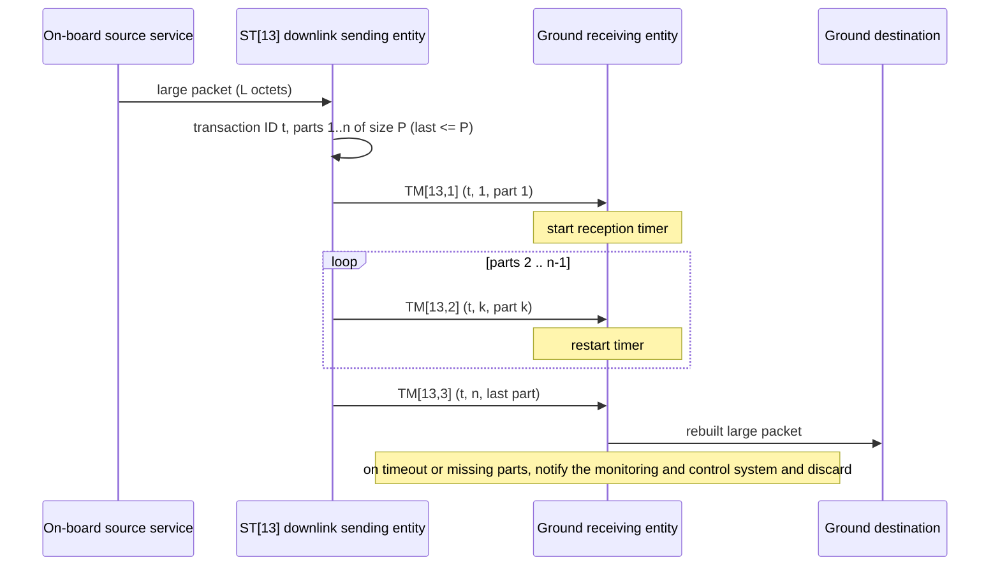
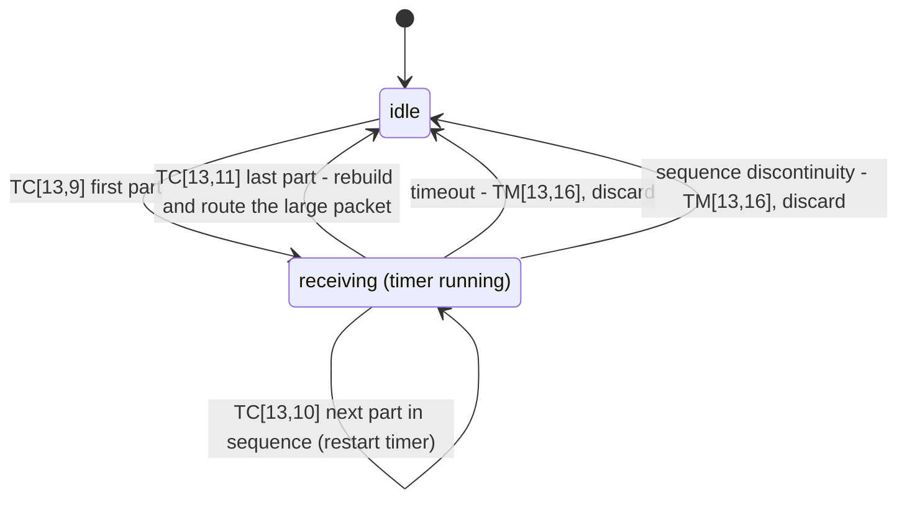

# ST[13] Large packet transfer

A [space packet](../../ccsds/space-packet.md) may be up to 65 542 octets long, but real
spacecraft impose much smaller limits on the packets they exchange with the ground.[^spp-len]
Some requests (a large memory load, a file) and some reports (a big table dump) do not fit. The
**large packet transfer** service type, ST[13] of the [Packet Utilization Standard](index.md),
splits such a "large packet" into smaller parts, carries each part in an ordinary TM or TC
packet, and rebuilds the large packet at the other end. The services that produce and consume
the large packets need not know that this happened.[^c-scope] Abbreviations are expanded in the
[glossary](../../glossary.md).

!!! info "At a glance"
    | Item | Value |
    |---|---|
    | Service type | 13[^c-813] |
    | Subservices (PUS-C) | large packet downlink, large packet uplink; at least one, at most one of each[^c-layout] |
    | Messages (PUS-C) | TM[13,1]-[13,3] downlink parts, TC[13,9]-[13,11] uplink parts, TM[13,16] uplink abortion report - all "minimum"[^c-annexc] |
    | Size limit | packets up to the CCSDS maximum (about 65 KB); no retransmission[^v15-st13] |
    | Accessible from | any other service (like event reporting)[^c-interdep] |
    | PUS-A (2003) | clause 16 "Large data transfer service", subtypes 1-16, with acknowledgement, sliding window and retransmission[^a-161] |
    | Solar Orbiter | service 13 used as a **file transfer**: uplink to CSW partitions (subtypes 9-11, 13-16 and 128; no 12), downlink from the SSMM (subtypes 129-153)[^so-sum] |

## Why the service exists

Ground-to-space protocols usually cap the TM and TC packet lengths below the CCSDS maximum, so a
large request can exceed the mission's maximum telecommand packet length and a large report the
maximum telemetry packet length.[^c-scope] Solar Orbiter is a concrete case: a telecommand
packet data field holds at most 242 octets (236 of application data) and a telemetry packet at
most 4 112 octets.[^so-tclen][^so-tmlen] By principle, the sources and destinations of large
packets are not supposed to know about these link constraints.[^c-scope]

## From PUS-A to PUS-C

PUS-A had a complete transfer protocol (described [below](#pus-a-ecss-e-70-41a-2003)). During the
PUS-C revision the working group weighed standardising PUS-A service 13 with or without its
"extended packets", a new service 24 limited to 65 KB packets with or without retransmission,
both, or leaving the problem to the lower layers.[^v14-large] The final standard kept number 13
for what the 2015 status presentation calls a simplification of PUS-A large data transfer that
only uploads and downloads CCSDS packets of at most 65 KB, without retransmission.[^v15-st13]
Recovering lost parts is left to the space link (for example [COP-1](../../ccsds/cop-1.md) on
the uplink); bulk file movement belongs to [ST[23] file management](st23-file-management.md) and
[CFDP](../../ccsds/cfdp.md).

!!! warning "Inference"
    The pointers to COP-1, ST[23] and CFDP are this wiki's reading of where the removed functions
    now live; clause 6.13 itself does not name them.

## Service layout

* Each large packet transfer service contains at least one of the two subservices and at most one
  of each.[^c-layout]
* Each provider is hosted by exactly one application process, and an application process hosts at
  most one provider; when both subservices exist, the on-board downlink *sending* entity and the
  on-board uplink *receiving* entity live in the same application process.[^c-layout]
* The foundation model makes large packet transfer, like event reporting, accessible to every
  other service.[^c-interdep]

Each subservice has two entities, one on board and one on the ground:

| Subservice | Sending entity | Receiving entity |
|---|---|---|
| Large packet downlink | on board: splits the large packet, wraps each part in a "downlink part report", downlinks them | ground: collects the part reports, rebuilds the packet, delivers it to its destination |
| Large packet uplink | ground: splits the large packet, wraps each part in an "uplink part request", uplinks them | on board: collects the part requests, rebuilds the packet, delivers it to its destination |

Source: §6.13.1.2-6.13.1.3.[^c-scope][^c-uplscope]

## Large packet downlink subservice

### Configuration

| Item | Meaning |
|---|---|
| Maximum concurrent downlinks | how many large packets can be in transit at once |
| Downlink maximum part size | size of each part; bounded by the packet data field of a maximum-length TM packet |
| Downlink reception timeout | longest wait allowed between two successive part reports at the receiving end |
| Resources | resources given to the sending entity, declared with the spacecraft architecture |

Sources: §6.13.3.1-6.13.3.2.[^c-dlconf]

### Sending: splitting into part reports

For each large packet the on-board sending entity assigns a unique **large message transaction
identifier**, splits the packet into parts, numbers the parts with a **part sequence number**
starting at 1, and wraps each part in one report: TM[13,1] for the first part, TM[13,2] for
intermediate parts and TM[13,3] for the last part. All parts have the downlink maximum part size
except the last, which may be shorter. Part reports go out in increasing sequence number at the
highest frequency the operational constraints allow, to a ground application process declared in
the space-to-ground architecture.[^c-dlgen] The standard assumes large packets are not duplicated
on board and leaves the hand-over between the source service and ST[13] out of scope.[^c-dlgen]

### Receiving: reconstruction on the ground

The ground receiving entity starts a downlink operation on the first part, restarts a reception
timer after every successful first or intermediate part, adds each part to the reconstruction,
and ends the operation with the last part. If the timer reaches the reception timeout the
operation is aborted. When all parts arrived, the large packet is generated for routing to its
destination; the receiving entity does not check the large packet's checksum. If the operation
was aborted or completed with parts missing, the ground monitoring and control system is
notified of the abortion and the missing parts, and the packet and its parts are
discarded.[^c-dlrec]



The diagram restates §6.13.3.3.[^c-dlgen][^c-dlrec] The observables of the on-board downlink
subservice are the number of on-going downlinks and the list of their transaction
identifiers.[^c-dlobs]

## Large packet uplink subservice

### Configuration

The uplink mirrors the downlink: a declared maximum number of concurrent uplinks, an **uplink
maximum part size** (the user data space of a maximum-length TC packet), an **uplink reception
timeout** between two part requests, and declared on-board resources.[^c-ulconf]

### Sending: uplink part requests

The ground sending entity assigns a transaction identifier, numbers the parts from 1, wraps them
in TC[13,9] (first), TC[13,10] (intermediate) and TC[13,11] (last) and sends them in increasing
order to the on-board application process that hosts the receiving entity.[^c-ulgen]

### Receiving: on-board reconstruction and abortion

The on-board receiving entity starts the uplink operation on the first part, restarts its timer
after the first and each intermediate part, ends on the last part, and **aborts** on timeout or
when it detects a **discontinuity** in the sequence. A successful uplink generates the large
packet for routing to its destination (again without checking its checksum). An aborted uplink
produces one **large packet uplink abortion notification** with the reason, reported in a
TM[13,16] large packet uplink abortion report, and the packet and its parts are
discarded.[^c-ulrec][^c-ulabort] The observables are the number of on-going uplinks and their
transaction identifiers.[^c-ulobs]



One state machine runs per transaction identifier, up to the declared number of concurrent
uplinks.[^c-ulconf][^c-ulrec]

!!! warning "Inference"
    The standard does not say what the receiving entity does with a TC[13,10] or TC[13,11] whose
    transaction identifier is unknown, nor how a duplicated part is treated; a repeated sequence
    number is presumably a "discontinuity".

## Message types and data fields (PUS-C)

| Message | Name | Fields |
|---|---|---|
| TM[13,1] | first downlink part report | large message transaction identifier (unsigned integer), part sequence number (unsigned integer), part (fixed octet-string) |
| TM[13,2] | intermediate downlink part report | same as TM[13,1] |
| TM[13,3] | last downlink part report | same, but the part is a fixed octet-string of **deduced size** (from the packet length) |
| TC[13,9] | uplink the first part | transaction identifier, part sequence number, part (fixed octet-string) |
| TC[13,10] | uplink an intermediate part | same as TC[13,9] |
| TC[13,11] | uplink the last part | same, last part of deduced size |
| TM[13,16] | large packet uplink abortion report | transaction identifier (unsigned integer), failure reason (enumerated) |

Sources: §8.13.2, Figures 8-140 to 8-146.[^c-1313][^c-13916] The widths of the identifier and
sequence number fields, and the values of the failure reason, are not stated in the available
sources; they are left to the mission. Every message type is "minimum" for its subservice in
Annex C.[^c-annexc]

!!! example "Worked example (illustrative values)"
    A mission whose largest TM packet leaves 1 000 octets for the part (the downlink maximum part
    size P) has to downlink a 9 500-octet large packet. It needs
    $n = \lceil 9500 / 1000 \rceil = 10$ parts: TM[13,1] with sequence number 1, TM[13,2] with
    2 to 9, and TM[13,3] with 10 carrying the remaining 500 octets. The receiving entity knows
    the last part's size from the TM packet length.[^c-dlgen][^c-1313]

## The 2024 Rev.1 draft

A comparison by this wiki of clause 6.13 and of §8.13 in the Rev.1 DIR1 draft with the 2016
issue found no change other than renumbered figures (8.13-1 to 8.13-7); Annex C lists the same
message types with the same "minimum" applicability.[^r-613][^r-813][^r-annexc]

## PUS-A (ECSS-E-70-41A, 2003)

The PUS-A **large data transfer** service was a supporting service, used by the ground or other
services to move large service data units in a controlled way, avoiding service-specific
solutions. Its examples were reporting a command schedule bigger than one packet and loading a
large memory area with size-limited telecommands.[^a-161] It aimed at three properties: knowing
when a transfer is complete, re-transmitting only the lost or erroneous parts, and delivering the
parts in order and without duplicates.[^a-161]

### The service data unit

The unit passed to the service was a TM or TC packet or an **extended packet**, whose data field
could exceed the 65 535-octet limit; an extended packet had the same structure but its packet
length field set to 0.[^a-1622]

| Field | Type | Meaning |
|---|---|---|
| Unit Type | enumerated | 0 = standard packet, 1 = extended packet |
| Packet Header | 6 octets | standard primary header (length 0 if extended) |
| Data Field Header | deduced | TM or TC data field header |
| Packet Data | any | source data of a large report or application data of a large request |

A **Large Data Unit ID** distinguished overlapping transfers from or to the same application
process. Parts had a fixed **part size**, smaller than the maximum data field, except possibly
the last.[^a-1621][^a-1622]

### The protocol

* **Sliding window** (optional): the sender may run ahead of the last acknowledged part by at most
  "window size" parts; several window sizes may be used, for example a large one for memory
  management. Without a window, parts are sent at the highest rate allowed.[^a-1623]
* The receiver tracks the **last successfully received part** (no gaps before it) and acknowledges
  it at the window boundary, or only at the end without a window; the final acknowledgement is sent
  only once the destination has the whole unit.[^a-1623]
* **Acknowledgement timer** at the sender after the last part of a window or of the unit, and a
  **reception timer** at the receiver after each first or intermediate part; expiry on either side
  fails the transfer.[^a-1623]
* Erroneous or missing parts form the set of **failed parts**, reported to the sender (at the
  window boundary when a window is used) and re-transmitted with the same sequence number.[^a-1623]
* Either end, or the ground, may **abort** at any time.[^a-1623]

| Subtype | Direction | Name | Role |
|---|---|---|---|
| (13,1) / (13,2) / (13,3) | TM | First / Intermediate / Last Downlink Part Report | downlink parts |
| (13,4) | TM | Downlink Abort Report | sender (on board) aborted |
| (13,5) | TC | Downlink Reception Acknowledgement | ground acknowledges up to a part |
| (13,6) | TC | Repeat Parts | ground lists failed parts |
| (13,7) | TM | Repeated Part Report | re-sent part |
| (13,8) | TC | Abort Downlink | receiver (ground) aborts |
| (13,9) / (13,10) / (13,11) | TC | Accept First / Intermediate / Last Uplink Part | uplink parts |
| (13,12) | TC | Accept Repeated Part | re-sent part |
| (13,13) | TC | Abort Reception of Uplinked Data | sender (ground) aborts |
| (13,14) | TM | Uplink Reception Acknowledgement Report | on board acknowledges up to a part |
| (13,15) | TM | Unsuccessfully Received Parts Report | on board lists failed parts |
| (13,16) | TM | Reception Abort Report | receiver (on board) aborted |

Sources: §16.3.[^a-1632][^a-1634][^a-1636][^a-1638] Every downlink request has an uplink report of
identical structure and vice versa.[^a-1632] The part messages carry an optional Large Data Unit
ID (omitted when only one transfer at a time is supported), a sequence number starting at 1 and
the part; the abort messages carry the unit ID and a mission-specific reason code; the
acknowledgement carries the unit ID and a sequence number; the failed-parts messages carry the
unit ID, N and N sequence numbers.[^a-1632][^a-1636][^a-1638]

Capability sets: the downlink minimum was (13,1)-(13,5) and (13,8); the uplink minimum (13,9)-(13,11),
(13,13), (13,14) and (13,16). Selective repeat, (13,6)/(13,7) on the downlink and (13,12)/(13,15)
on the uplink, and the sliding window were additional capabilities.[^a-164][^a-1642]

| Aspect | PUS-A large data transfer | PUS-C large packet transfer |
|---|---|---|
| Unit | packet or extended packet (beyond 65 535 octets) | CCSDS packet only |
| Acknowledgement | (13,5) / (13,14) | none |
| Retransmission | optional selective repeat, sliding window | none |
| Aborts | both ends, both directions: (13,4), (13,8), (13,13), (13,16) | on-board uplink abortion report TM[13,16] only; ground downlink aborts are local |
| Subtypes kept | - | 1, 2, 3, 9, 10, 11, 16 (same numbers) |

Sources: PUS-A clause 16 and PUS-C clause 6.13 and Annex C.[^a-1622][^a-1623][^c-dlrec][^c-ulabort][^c-annexc]

## Solar Orbiter

Solar Orbiter (see [How Solar Orbiter uses PUS](../../missions/solar-orbiter/pus-usage.md))
uses service 13 to transfer **files**. The uplink goes from the ground to the
Central Software (CSW) of the on-board computer, which stores files in "partitions" of the OBC
mass memory or the SafeGuard Memory (SGM). The downlink goes from the Solid State Mass Memory
(SSMM) to the ground, with structures specified in the SSMM software TM/TC ICD
(SOL.A.TAS.ICD.00001, not in this library).[^so-obj][^so-rd]

### Uplink: files into CSW partitions

An uplinked file is split into a first part carrying the **SDU header** (file characteristics)
and the first data, intermediate parts carrying data, and a last part carrying the last data and
a checksum (the ICD's overview calls it a CRC). The ICD states that the reception of all parts
can be confirmed at the end of a transfer and that retransmission of the relevant parts can be
requested after an unsuccessful one, without saying here which side does what.[^so-obj] Each
file has an attribute:[^so-attr]

| Attribute | Meaning |
|---|---|
| 1 | OBCP ([on-board control procedure](st18-onboard-operations-procedure.md)) |
| 2 | TC sequence, delayed |
| 3 | TC sequence, immediate |
| 4, 5 | unused |
| 6 | other |
| 7 | FAT, internal software use only |

Typical uploads are TC files, profiles and ephemerides, and OBCPs; typical downloads are SSMM data
files such as science files.[^so-attr]

<div class="bitfield" data-title="Solar Orbiter TC(13,9) Accept First Uplink Part (3 octets unit ID and sequence number, 13-octet SDU header, then file data)" data-width="32"
     data-fields='[{"n":"Large Data Unit ID","b":8,"d":"file transfer session, greater than 0"},{"n":"Sequence number = 1","b":16,"v":"0x0001"},{"n":"Partition ID","b":8,"g":"SDU header"},{"n":"File ID","b":32},{"n":"File size (octets)","b":32,"d":"useful data, without SDU header and checksum"},{"n":"File attribute","b":32},{"n":"File data (variable)","b":32,"d":"variable length, shown as 32 bits"}]'></div>

<div class="bitfield" data-title="Solar Orbiter TC(13,10) Accept Intermediate Uplink Part and TC(13,11) Accept Last Uplink Part" data-width="32"
     data-fields='[{"n":"Large Data Unit ID","b":8},{"n":"Sequence number (2 or more)","b":16},{"n":"SDU data (variable)","b":32,"d":"TC(13,10): same SDU length as TC(13,9)"},{"n":"File checksum (last part only)","b":32,"d":"TC(13,11) SDU trailer"}]'></div>

The rules: the SDU length of TC(13,9) (header plus data) fixes the length of every TC(13,10) SDU;
the last part is shorter; and if the data and the 4-octet checksum do not fit, the checksum may
go into another TC(13,11). When the attribute is "TC sequence - immediate", the CSW executes the
file as a TC sequence once TC(13,11) completes, creating a TC(134,1) with sequence identifier 1
and an execution rate of 1 Hz.[^so-139][^so-1310][^so-1311]

| Message | Content (sizes in octets) | Purpose |
|---|---|---|
| TC(13,13) Abort Reception of Uplinked Data | unit ID (1) | aborts a session or confirms an on-board autonomous abort reported by TM(13,16) |
| TM(13,14) Uplink Reception Acknowledgement Report | unit ID (1), sequence number (2) | all parts up to that number received; also reports completion of upload and storage |
| TM(13,15) Unsuccessfully Received Parts Report | unit ID (1), N (2), N x sequence number (2) | sent after TC(13,11) when parts are missing |
| TM(13,16) Reception Abort Report | unit ID (1), reason (4): 0 file manager storage error, 1 checksum error, 2 file transfer time-out | session aborted |
| TC(13,128) Change File Transfer Time-out value | time-out (4), in seconds | private subtype |

Sources: §5.14.4-5.14.8.[^so-1313][^so-1314][^so-1316]

<div class="bitfield" data-title="Solar Orbiter TM(13,15) Unsuccessfully Received Parts Report" data-width="16"
     data-fields='[{"n":"Large Data Unit ID","b":8},{"n":"N","b":16,"d":"number of parts not received"},{"n":"Sequence number","b":16,"g":"repeated N times"}]'></div>

<div class="bitfield" data-title="Solar Orbiter TM(13,16) Reception Abort Report" data-width="8"
     data-fields='[{"n":"Large Data Unit ID","b":8},{"n":"Reason code","b":32,"d":"0 storage error, 1 checksum error, 2 time-out"}]'></div>

!!! example "Worked example (derived from the ICD limits)"
    With the full 236 octets of application data, TC(13,9) has 3 octets of unit ID and sequence
    number, 13 of SDU header and 220 of file data, so its SDU is 233 octets and every TC(13,10)
    carries 233 octets of file data. A 10 000-octet file then needs 1 first part (220 octets),
    41 intermediate parts (9 553 octets) and 1 last part with the remaining 227 octets plus the
    4-octet checksum: 43 telecommands with sequence numbers 1 to 43. This arithmetic is this
    wiki's, assuming maximum-length commands.[^so-tclen][^so-139][^so-1311]

Compared with PUS-C, Solar Orbiter keeps the PUS-A uplink half: acknowledgement (13,14), the
failed-parts report (13,15) and abort on both sides, with a file header added inside the first
part.[^so-sum][^a-1638] It does not, however, define PUS-A's TC(13,12) Accept Repeated Part,
which PUS-A Table 30 pairs with (13,15); neither the ICD service table nor the MIB has a
subtype 12.[^so-sum][^a-1642][^mib-ccf13] How the parts listed in a TM(13,15) are re-sent is not
stated in the available sources. The ICD service table also lists subtype 128 as a TM
("Change Timeout value"), whereas §5.14.8 and the MIB (ZCD00D80) define it as a
telecommand.[^so-sum][^so-1316][^mib-ccf13]

### Downlink: SSMM file transfer sessions

The downlink subtypes are all private and implemented only in the SSMM software: start, suspend,
resume, terminate and abort a file transfer session (TC(13,129) and 13,131-134), change session
parameters, end-of-file-transfer timeout, downlink virtual channel and retransmission limit
(13,135-138), report the parameters (13,139/140), and control **low-level file transfers**
(enable/disable, start, suspend, resume, abort, repeat parts, confirm reception, request the
end-of-transfer report: 13,141-148), with reports 13,130 and 13,149-153.[^so-dl][^so-sum]

In the 2025 MIB the SSMM commands (APID 492) show the mechanism: an LLFT is appended or replaced
by time window or data volume with a packet store index (ZSM00075, ZSMX0075, ZSMX1075, ZSM00105),
and TC(13,146) "SSMM Repeat LLFT Parts" asks for blocks between a start and an end ID - a
selective repeat. The reports are SSMM LLFT start and end-of-file-transfer reports, a
retransmission-limit report and an EOFT timeout on APID 490, an FTS parameters report on
APID 483 and TM(13,152) "SSMM FDU Layout" carrying the session ID, an FDU counter and packet
store data words on APID 493.[^mib-ccf13][^mib-pid13] With the ICD's allocation, 490 is the SSMM
(PID 30) with category 10, "file transfer, exclusive for service 13 telemetry", and 493 is
category 13, listed as spare.[^so-pid]

!!! warning "Inference: FDUs and naming differences"
    "FDU" is not expanded in the available Solar Orbiter sources; "file data unit" is the ICD
    title of TM(13,153). The MIB, however, has no TM(13,153): it uses subtype 153 for the TC "SSMM
    Reset FTS Queue" and carries the FDUs in TM(13,152), which the ICD names "Low-level file
    transfer abort report". Two other MIB names differ from the ICD titles: subtype 135 is
    "SSMM Append LLFT" in the MIB but "Change file transfer session parameters" in the ICD, and
    subtype 142 is "SSMM Replace LLFT" in the MIB but "Start low-level file transfer" in the
    ICD.[^so-dl][^so-sum][^mib-ccf13][^mib-pid13] The SSMM ICD (RD9) would settle this.

On the ground the downlinked files become **TM files** in the mission file archive
([FARC](../../scos2000/archives.md)), served by [EDDS](../../scos2000/edds.md) as plain
concatenations of TM packets; extracting the packets into the packet archive is not part of the
baseline. Event packets with SPID 4000 record each transfer: transaction ID, packet store ID,
status (ACTIVE, COMPLETED, INCOMPLETE, INJECTED, ABORTED and others), FDUs received and expected,
retransmissions, times and file name.[^ddid-tmf][^ddid-ev]

### Service 13 in the MIB

| Commands | APID | Content |
|---|---|---|
| ZCD00D09, ZCD00D0A, ZCD00D0B, ZCD00D0D, ZCD00D80 | 172 (DMS, CSW) | TC(13,9), (13,10), (13,11), (13,13), (13,128) |
| 23 SSMM commands, subtypes 129-153 | 492 (SSMM) | file transfer session and LLFT control |

Source: [ccf](../../mib/tables/ccf.md); 28 service 13 commands and 9 service 13 packets in both
the 2025 and the April 2020 release.[^mib-ccf13][^mib-pid13]

The TC(13,9) definition [ZCD00D09](../../explorer/index.md#/solo/command/ZCD00D09) fixes the
sequence number to 0x0001 and makes the partition and file attribute selectable through text
aliases; the file content is a single variable-length octet string (PTC 7, PFC 0), and
TC(13,10)/(13,11) have no separate checksum field, so the checksum must be appended to the octet
string by whoever builds the commands.[^mib-cdf13] The ranges allow session IDs 1-255 and
sequence numbers 2-65 535 for later parts.[^mib-cdf13] The reports TM(13,14)-(13,16) are SPIDs
14166-14168 on APID 170, the DMS with category 10, and TM(13,16) decodes the reason through the
calibration LDT_FMS_STOR / LDT_CHECKSUM / LDT_TIME_OUT.[^mib-pid13]

| Partition alias (`CCDT0192TX`) | Value | Partition alias | Value |
|---|---|---|---|
| OMM_TC_FILES_A | 161 | OMM_TC_FILES_B | 177 |
| OMM_OBCPS_A | 162 | OMM_OBCPS_B | 178 |
| OMM_S_FILES_A | 163 | OMM_S_FILES_B | 179 |
| OMM_PAYLOAD_A | 164 | OMM_PAYLOAD_B | 180 |
| SGMA_TC_FILES | 193 | SGM_OBCPS | 194 |
| SGMB_TC_FILES | 195 | | |

| File type alias (`CCDT0082TX`) | Value |
|---|---|
| FT_INVALID, FT_OBCP, FT_DEL_TCSEQ, FT_IMM_TCSEQ | 0, 1, 2, 3 |
| FT_PL_CTX, FT_PS, FT_PLAIN, FT_FAT | 4, 5, 6, 7 |

Source: [paf](../../mib/tables/paf.md) and [pas](../../mib/tables/pas.md).[^mib-cdf13]

### The s13a, s13p and s13t tables

The 2025 [MIB release](../../missions/solar-orbiter/mib.md) contains three files that are not MIB tables of the SCOS-2000 import ICD:
`s13a.dat` (7 rows), `s13p.dat` (11 rows) and `s13t.dat` (12 rows). They are absent from the
April 2020 release. No document in this library mentions them; the column names below are
therefore generic.[^mib-s13][^mib-s13-2020]

=== "s13a (7 rows)"

    | COL1 | COL2 | COL3 | COL4 | COL5 | COL6 |
    |---|---|---|---|---|---|
    | PLAIN | N | 0 | 0 | PAYLOAD | PLAIN |
    | OBCP | O | 1 | 1 | OBCP | OBCP |
    | DEL | D | 2 | 2 | DEL | DELAYED TC |
    | IMM | I | 3 | 3 | IMM | IMMEDIATE TC |
    | PAYLOAD | N | 4 | 4 | PAYLOAD | PAYLOAD CONTEXT |
    | INVALID | N | 5 | 5 | INVALID | INVALID |
    | OTHER | N | 6 | 6 | OTHER | OTHER |

=== "s13p (11 rows)"

    | COL1 | COL2 | COL3 | COL4 | COL5 | COL6 |
    |---|---|---|---|---|---|
    | TCFA | M | 161 | 161 | TCFA | OMM TC Files (A) |
    | OBCA | M | 162 | 162 | OBCA | OMM OBCPs (A) |
    | SYSA | B | 163 | 163 | SYSA | OMM System Files (A) |
    | SPRA | M | 164 | 164 | SPRA | OMM Spare (A) |
    | TCFB | M | 177 | 177 | TCFB | OMM TC Files (B) |
    | OBCB | M | 178 | 178 | OBCB | OMM OBCPs (B) |
    | SYSB | B | 179 | 179 | SYSB | OMM System Files (B) |
    | SPRB | M | 180 | 180 | SPRB | OMM Spare (B) |
    | CSWA | N | 193 | 193 | CSWA | SGM-EEPROM CSW TC Files (A) |
    | OBCS | N | 194 | 194 | OBCS | SGM-EEPROM Default OBCPs |
    | CSWB | N | 195 | 195 | CSWB | SGM-EEPROM CSW TC Files (B) |

=== "s13t (12 rows)"

    | COL1 | COL2 | COL3 | COL4 | COL5 | COL6 | COL7 |
    |---|---|---|---|---|---|---|
    | UNKNOWN | C | -2 | UNKNOWN | Plain file | OTHER | SYSA |
    | OBCP | C | -1 | OBCP | OBCP | OBCP | OBCA |
    | SCOS0 - SCOS3 | C | 0 - 3 | UNKNOWN | SCOS stack file | | |
    | CSF1 | C | 4 | CSF1 | TC sequence (CSF type 1) | | TCFA |
    | CSF2 | C | 5 | CSF2 | Time tagged TC sequence (CSF type 2) | | TCFA |
    | CSF3 | C | 6 | CSF3 | Backup MTL (CSF type 3) | | SYSA |
    | CSF0 | C | 7 | CSF0 | Mixed TC sequence (CSF type 0) | | TCFA |
    | PLAIN | W | 8 | BINARY | Plain file | | |
    | ALL | W | 9 | UNKNOWN | UNKNOWN | | |

    (The four SCOS0-SCOS3 rows, codes 0 to 3, are merged here.)

!!! warning "Inference: what the s13 tables appear to contain"
    * **s13a = file attributes.** COL3 (always equal to COL4) gives the numeric attribute: OBCP 1,
      delayed TC 2 and immediate TC 3 agree with the ICD's attribute table and with the MIB alias
      set `CCDT0082TX`, and payload context 4 agrees with `CCDT0082TX`.[^so-attr][^mib-cdf13]
      The mnemonics PLAIN, OBCP, DEL, IMM and PAYLOAD match the five values the Solar Orbiter
      DDID gives for the command-history field `s13ObFileAttribute` (PLAIN, OBCP, TC_DELAYED,
      TC_IMMEDIATE, PAYLOAD_CONTEXT).[^ddid-cmd] The codes for 0, 5 and 6 do *not* agree:
      s13a says 0 PLAIN, 5 INVALID, 6 OTHER; `CCDT0082TX` says 0 FT_INVALID, 5 FT_PS, 6 FT_PLAIN;
      the ICD says 4-5 unused and 6 other.
    * **s13p = destination partitions.** COL3 equals the partition values of the TC(13,9)
      alias set `CCDT0192TX`, and the descriptions name the OBC mass memory (OMM) sides A and B and
      the SGM EEPROM.[^mib-cdf13] The values read naturally in hexadecimal: 0xA1-0xA4 for OMM side
      A, 0xB1-0xB4 for side B, 0xC1-0xC3 for the SGM.
    * **s13t = ground file types.** Each row maps a file type to a format tag (COL4), optionally
      a default attribute (COL6, an s13a COL1 value) and a default partition (COL7, an s13p COL1
      value): OBCP files go to OBCA, TC sequence files (CSF types 0-2) to TCFA, the backup MTL
      (mission timeline) to SYSA.
    * The one-letter codes (s13a COL2 N/O/D/I, s13p COL2 M/B/N, s13t COL2 C/W) and the negative
      codes in s13t COL3 are not explained by any available source.
    * Taken together, the tables look like configuration for a ground tool that turns files
      (OBCPs, command sequences, SCOS-2000 command stack files) into service 13 uplinks.

### Service 13 elsewhere on the ground

The SCOS-2000 import ICD states that SCOS-2000 has no specific support for service 13; a
mission-specific uplink implementation exists from Rosetta, and other missions need their own
implementation to generate service 13 data units and process the reports.[^icd-s13] The
Rosetta, Mars Express and Venus Express data delivery ICD shows the trace this leaves in the
command history: a column flags commands encapsulated in a service 13 packet, and commands of an
aborted transfer are shown as "ABORTED".[^ro-cmd] For Solar Orbiter, the EDDS packet TC report
carries `s13ObFileId` (the file a command was uplinked in) and `s13ObFileAttribute`.[^ddid-cmd]

??? example "SQL used"
    ```sql
    -- solo-2025-09-16.sqlite (MIB__20250916M25925PFMS001_SOL)
    SELECT CCF_CNAME, CCF_DESCR, CCF_STYPE, CCF_APID, CCF_NPARS
      FROM ccf WHERE CCF_TYPE = '13' ORDER BY CAST(CCF_STYPE AS INT);
    SELECT PID_TYPE, PID_STYPE, PID_APID, PID_SPID, PID_DESCR, PID_TPSD
      FROM pid WHERE PID_TYPE = '13';
    SELECT c.CDF_ELTYPE, c.CDF_DESCR, c.CDF_ELLEN, c.CDF_BIT, c.CDF_PNAME, c.CDF_VALUE,
           p.CPC_PTC, p.CPC_PFC, p.CPC_CATEG, p.CPC_PAFREF, p.CPC_PRFREF
      FROM cdf c LEFT JOIN cpc p ON p.CPC_NAME = c.CDF_PNAME
     WHERE c.CDF_CNAME IN ('ZCD00D09','ZCD00D0A','ZCD00D0B','ZSM00075','ZSM00125')
     ORDER BY c.CDF_CNAME, CAST(c.CDF_BIT AS INT);
    SELECT * FROM pas WHERE PAS_NUMBR IN ('CCDT0192TX','CCDT0082TX');
    SELECT * FROM prv WHERE PRV_NUMBR IN ('VCD00176','VCD00248');
    SELECT l.PLF_NAME, l.PLF_OFFBY, p.PCF_DESCR, p.PCF_PTC, p.PCF_PFC, p.PCF_CURTX
      FROM plf l JOIN pcf p ON p.PCF_NAME = l.PLF_NAME
     WHERE l.PLF_SPID IN ('14166','14168','80012','80014','80018');
    SELECT * FROM txp WHERE TXP_NUMBR = 'CCDT0027TM';
    SELECT * FROM s13a; SELECT * FROM s13p; SELECT * FROM s13t;
    -- solo-2020-04-16.sqlite (MIB__20200416M10720PFMS001_SOL)
    SELECT CCF_TYPE, COUNT(*) FROM ccf WHERE CCF_TYPE = '13' GROUP BY 1;
    SELECT PID_TYPE, COUNT(*) FROM pid WHERE PID_TYPE = '13' GROUP BY 1;
    SELECT name FROM sqlite_master WHERE name LIKE 's13%';   -- returns nothing
    ```

## Related pages

* [PUS: the Packet Utilization Standard](index.md), the [message type catalogue](message-types.md) and [PUS-A vs PUS-C](pus-a-vs-pus-c.md)
* [ST[23] File management](st23-file-management.md) and [CFDP](../../ccsds/cfdp.md), the file-based alternatives
* [ST[15] On-board storage and retrieval](st15-onboard-storage-retrieval.md), whose PUS-A packet store contents report (15,8) can be long, and [ST[18] On-board operations procedure](st18-onboard-operations-procedure.md), whose OBCP files Solar Orbiter uploads with service 13
* [Space Packet Protocol](../../ccsds/space-packet.md), the 65 542-octet packet limit that the service works around
* [How Solar Orbiter uses PUS](../../missions/solar-orbiter/pus-usage.md) and [the Solar Orbiter MIB](../../missions/solar-orbiter/mib.md)

[^spp-len]: [CCSDS 133.0-B-2, Space Packet Protocol](../../library/ccsds-133-0-133x0b2e2.md), §4.1.2.2, PDF p. 31.
[^c-scope]: [ECSS-E-ST-70-41C, Telemetry and telecommand packet utilization](../../library/ecss-e-st-70-41c-15april2016.md), §6.13.1.1-6.13.1.2, PDF p. 229.
[^c-uplscope]: [ECSS-E-ST-70-41C](../../library/ecss-e-st-70-41c-15april2016.md), §6.13.1.3, PDF p. 230.
[^c-813]: [ECSS-E-ST-70-41C](../../library/ecss-e-st-70-41c-15april2016.md), §8.13.1, PDF p. 526.
[^c-layout]: [ECSS-E-ST-70-41C](../../library/ecss-e-st-70-41c-15april2016.md), §6.13.2, PDF p. 230.
[^c-interdep]: [ECSS-E-ST-70-41C](../../library/ecss-e-st-70-41c-15april2016.md), §4.2.4, PDF p. 24.
[^c-dlconf]: [ECSS-E-ST-70-41C](../../library/ecss-e-st-70-41c-15april2016.md), §6.13.3.1-6.13.3.2, PDF p. 231.
[^c-dlgen]: [ECSS-E-ST-70-41C](../../library/ecss-e-st-70-41c-15april2016.md), §6.13.3.3.1, PDF pp. 231-232.
[^c-dlrec]: [ECSS-E-ST-70-41C](../../library/ecss-e-st-70-41c-15april2016.md), §6.13.3.3.2, PDF pp. 232-233.
[^c-dlobs]: [ECSS-E-ST-70-41C](../../library/ecss-e-st-70-41c-15april2016.md), §6.13.3.4, PDF p. 233.
[^c-ulconf]: [ECSS-E-ST-70-41C](../../library/ecss-e-st-70-41c-15april2016.md), §6.13.4.1-6.13.4.2, PDF pp. 233-234.
[^c-ulgen]: [ECSS-E-ST-70-41C](../../library/ecss-e-st-70-41c-15april2016.md), §6.13.4.3.1, PDF pp. 234-235.
[^c-ulrec]: [ECSS-E-ST-70-41C](../../library/ecss-e-st-70-41c-15april2016.md), §6.13.4.3.2, PDF pp. 235-236.
[^c-ulabort]: [ECSS-E-ST-70-41C](../../library/ecss-e-st-70-41c-15april2016.md), §6.13.4.3.3, PDF p. 236.
[^c-ulobs]: [ECSS-E-ST-70-41C](../../library/ecss-e-st-70-41c-15april2016.md), §6.13.4.4, PDF p. 236.
[^c-1313]: [ECSS-E-ST-70-41C](../../library/ecss-e-st-70-41c-15april2016.md), §8.13.2.1-8.13.2.3, Figures 8-140 to 8-142, PDF pp. 526-527.
[^c-13916]: [ECSS-E-ST-70-41C](../../library/ecss-e-st-70-41c-15april2016.md), §8.13.2.4-8.13.2.7, Figures 8-143 to 8-146, PDF pp. 527-528.
[^c-annexc]: [ECSS-E-ST-70-41C](../../library/ecss-e-st-70-41c-15april2016.md), Annex C.2.13, Tables C-20 and C-21, PDF p. 641.
[^r-613]: [ECSS-E-ST-70-41C Rev.1 DIR1 (draft, 11 December 2024)](../../library/ecss-e-st-70-41c-rev1-dir1.md), §6.13, PDF pp. 221-228 (compared by this wiki).
[^r-813]: [ECSS-E-ST-70-41C Rev.1 DIR1](../../library/ecss-e-st-70-41c-rev1-dir1.md), §8.13, Figures 8.13-1 to 8.13-7, PDF pp. 575-577.
[^r-annexc]: [ECSS-E-ST-70-41C Rev.1 DIR1](../../library/ecss-e-st-70-41c-rev1-dir1.md), Annex C.2.13, Tables C-20 and C-21, PDF p. 713.
[^v14-large]: [S. Valera, ECSS-E-ST-70-41C status, SAVOIR Mass Memory Day, 13 February 2014](../../library/valera-2014-ecss-e-st-70-41c-status.md), slides 13-15, PDF pp. 13-15.
[^v15-st13]: [S. Valera, ECSS-E-ST-70-41C status, ADCSS 2015](../../library/valera-2015-adcss-ecss-e-st-70-41c-status.md), slide 10, PDF p. 10.
[^a-161]: [ECSS-E-70-41A, Ground systems and operations - Telemetry and telecommand packet utilization](../../library/ecss-e-70-41a-30jan2003-pus.md), clause 16, §16.1, PDF p. 135.
[^a-1621]: [ECSS-E-70-41A](../../library/ecss-e-70-41a-30jan2003-pus.md), §16.2.1, Figure 7, PDF p. 136.
[^a-1622]: [ECSS-E-70-41A](../../library/ecss-e-70-41a-30jan2003-pus.md), §16.2.2, PDF pp. 137-138.
[^a-1623]: [ECSS-E-70-41A](../../library/ecss-e-70-41a-30jan2003-pus.md), §16.2.3, PDF pp. 138-139.
[^a-1632]: [ECSS-E-70-41A](../../library/ecss-e-70-41a-30jan2003-pus.md), §16.3.1-16.3.3, PDF pp. 139-140.
[^a-1634]: [ECSS-E-70-41A](../../library/ecss-e-70-41a-30jan2003-pus.md), §16.3.4-16.3.5, PDF pp. 140-141.
[^a-1636]: [ECSS-E-70-41A](../../library/ecss-e-70-41a-30jan2003-pus.md), §16.3.6-16.3.7, PDF pp. 141-142.
[^a-1638]: [ECSS-E-70-41A](../../library/ecss-e-70-41a-30jan2003-pus.md), §16.3.8-16.3.9, PDF pp. 142-143.
[^a-164]: [ECSS-E-70-41A](../../library/ecss-e-70-41a-30jan2003-pus.md), §16.4.1, Tables 27 and 28, PDF p. 143.
[^a-1642]: [ECSS-E-70-41A](../../library/ecss-e-70-41a-30jan2003-pus.md), §16.4.2, Tables 29 and 30, PDF p. 144.
[^so-sum]: [SOL.S.ASTR.TN.00079 Issue 7, Solar Orbiter TM-TC and Packet Structure ICD](../../library/sol-s-astr-tn-00079-07.md), §5.1, service summary, PDF pp. 31 and 34-35.
[^so-tclen]: [SOL.S.ASTR.TN.00079 Issue 7](../../library/sol-s-astr-tn-00079-07.md), §3.2.1.3, PDF p. 16.
[^so-tmlen]: [SOL.S.ASTR.TN.00079 Issue 7](../../library/sol-s-astr-tn-00079-07.md), §4.1, PDF p. 23.
[^so-rd]: [SOL.S.ASTR.TN.00079 Issue 7](../../library/sol-s-astr-tn-00079-07.md), §2.2 reference documents RD5 and RD9, PDF p. 13.
[^so-obj]: [SOL.S.ASTR.TN.00079 Issue 7](../../library/sol-s-astr-tn-00079-07.md), §5.14 objective and description, PDF p. 132.
[^so-attr]: [SOL.S.ASTR.TN.00079 Issue 7](../../library/sol-s-astr-tn-00079-07.md), §5.14 description, file attributes, PDF pp. 132-133.
[^so-139]: [SOL.S.ASTR.TN.00079 Issue 7](../../library/sol-s-astr-tn-00079-07.md), §5.14.1, TC(13,9), PDF pp. 133-134.
[^so-1310]: [SOL.S.ASTR.TN.00079 Issue 7](../../library/sol-s-astr-tn-00079-07.md), §5.14.2, TC(13,10), PDF pp. 134-135.
[^so-1311]: [SOL.S.ASTR.TN.00079 Issue 7](../../library/sol-s-astr-tn-00079-07.md), §5.14.3, TC(13,11), PDF pp. 135-136.
[^so-1313]: [SOL.S.ASTR.TN.00079 Issue 7](../../library/sol-s-astr-tn-00079-07.md), §5.14.4-5.14.5, PDF pp. 136-137.
[^so-1314]: [SOL.S.ASTR.TN.00079 Issue 7](../../library/sol-s-astr-tn-00079-07.md), §5.14.6-5.14.7, PDF pp. 137-138.
[^so-1316]: [SOL.S.ASTR.TN.00079 Issue 7](../../library/sol-s-astr-tn-00079-07.md), §5.14.8, PDF p. 139.
[^so-dl]: [SOL.S.ASTR.TN.00079 Issue 7](../../library/sol-s-astr-tn-00079-07.md), §5.14.9-5.14.33, PDF pp. 139-151.
[^so-pid]: [SOL.S.ASTR.TN.00079 Issue 7](../../library/sol-s-astr-tn-00079-07.md), Annex 8, §13.1, packet categories and process IDs, PDF pp. 272-274.
[^ddid-tmf]: [Solar Orbiter Data Delivery ICD, SOL-ESC-IF-05011 Issue 1 Rev 2](../../library/solo-ddid-i1r2.md), §6.2 and §8.4.2-8.4.2.1, PDF pp. 16 and 29.
[^ddid-ev]: [Solar Orbiter Data Delivery ICD](../../library/solo-ddid-i1r2.md), §8.4.2.2-8.4.2.3, PDF pp. 30-31.
[^ddid-cmd]: [Solar Orbiter Data Delivery ICD](../../library/solo-ddid-i1r2.md), §8.3.1, PDF p. 28.
[^ro-cmd]: [Rosetta/Mars Express/Venus Express MCS Data Delivery Interface Document, RO-ESC-IF-5003 Issue C2](../../library/ro-esc-if-5003-ddid-c2.md), command history fields, PDF pp. 72-73.
[^icd-s13]: [SCOS-2000 Database Import ICD, issue 7.0](../../library/icd-7-0-final.md), Appendix C, §3.11, PDF p. 242.
[^mib-ccf13]: [Solar Orbiter MIB release MIB__20250916M25925PFMS001_SOL](../../library/mib-20250916m25925pfms001-sol.md), tables ccf and cdf (type 13), queried by this wiki; April 2020 count from [MIB__20200416M10720PFMS001_SOL](../../library/mib-20200416m10720pfms001-sol.md).
[^mib-pid13]: [Solar Orbiter MIB release MIB__20250916M25925PFMS001_SOL](../../library/mib-20250916m25925pfms001-sol.md), tables pid, plf, vpd, pcf and txp (type 13), queried by this wiki; April 2020 count from [MIB__20200416M10720PFMS001_SOL](../../library/mib-20200416m10720pfms001-sol.md).
[^mib-cdf13]: [Solar Orbiter MIB release MIB__20250916M25925PFMS001_SOL](../../library/mib-20250916m25925pfms001-sol.md), tables cdf, cpc, paf, pas, prf and prv (ZCD00D09, ZCD00D0A, ZCD00D0B), queried by this wiki.
[^mib-s13]: [Solar Orbiter MIB release MIB__20250916M25925PFMS001_SOL](../../library/mib-20250916m25925pfms001-sol.md), files s13a.dat, s13p.dat and s13t.dat (tables s13a, s13p, s13t), queried by this wiki.
[^mib-s13-2020]: [Solar Orbiter MIB release MIB__20200416M10720PFMS001_SOL](../../library/mib-20200416m10720pfms001-sol.md), list of tables, queried by this wiki.
