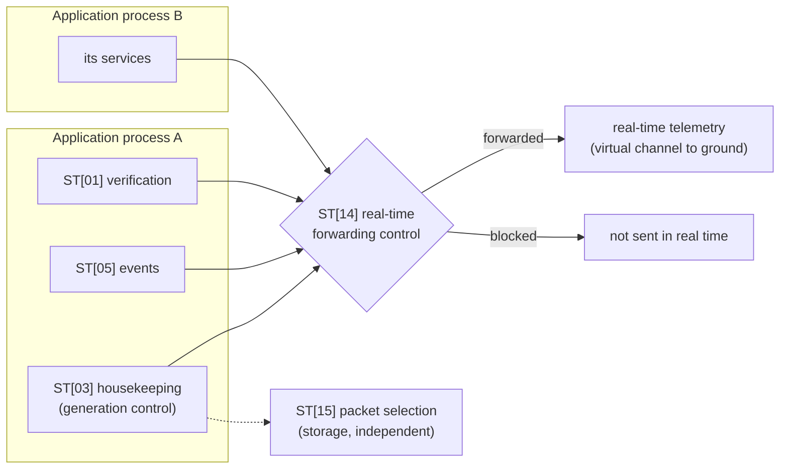
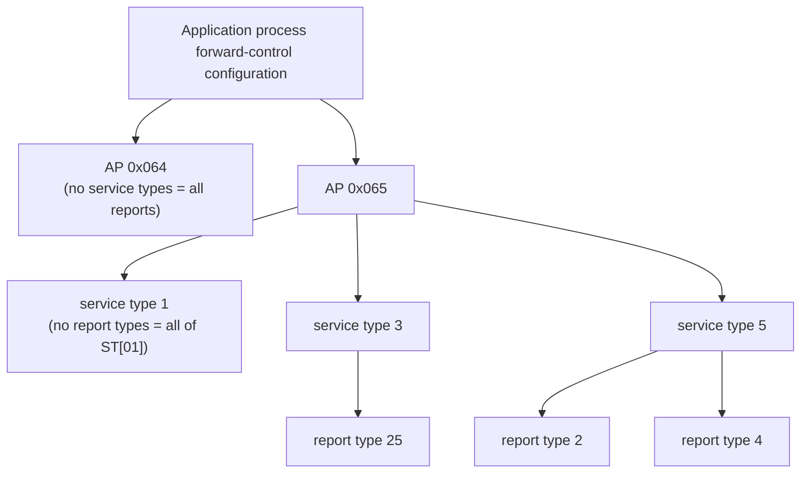
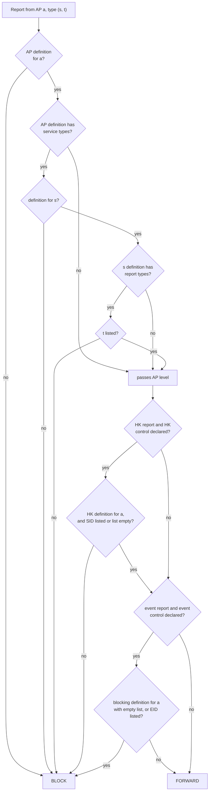

# ST[14] Real-time forwarding control

Every report an on-board service generates - a [verification report](st01-request-verification.md),
a [housekeeping](st03-housekeeping.md) packet, an [event](st05-event-reporting.md) - costs
processing, on-board network capacity and downlink bandwidth. The **real-time forwarding control**
service type, ST[14] of the [Packet Utilization Standard](index.md), lets the ground decide
which of those reports actually leave the spacecraft in the **real-time** telemetry channel,
per application process, per service type, per report type and, optionally, per housekeeping or
diagnostic structure and per event definition.[^c-scope] Whether the same reports are *stored*
on board is a separate matter, handled by [ST[15] on-board storage and
retrieval](st15-onboard-storage-retrieval.md).[^r-indep] Abbreviations are expanded in the
[glossary](../../glossary.md); the PUS-A and PUS-C issues are compared in
[PUS-A vs PUS-C](pus-a-vs-pus-c.md).

!!! info "At a glance"
    | Item | Value |
    |---|---|
    | Service type | 14[^c-814] |
    | Subservice | real-time forwarding control (one), hosted at most once per application process[^c-layout] |
    | Configurations | application process forward-control (always); housekeeping, diagnostic and event-blocking forward-control (each by declaration)[^c-cap] |
    | Messages (PUS-C) | TC[14,1]-[14,3], [14,5]-[14,7], [14,9]-[14,11], [14,13]-[14,15]; TM[14,4], [14,8], [14,12], [14,16][^c-annexc] |
    | Minimum capability | TC[14,1] and TC[14,2][^c-annexc] |
    | Observables | none defined[^c-obs] |
    | PUS-A (2003) | clause 17 "Packet forwarding control service", subtypes 1-16, enable/disable flags[^a-171] |
    | Solar Orbiter | PUS-A based, hosted by the CSW Data Management System application, real-time VC only, everything enabled by default[^so-obj][^mib-ccf] |

## Generation versus forwarding

PUS-A set out the principle: generating telemetry is controlled inside each originating service
(for example ST[03] enables or disables a housekeeping structure), but **forwarding** is a
higher-level control, done either by the originating application process (a packet may be
generated but not forwarded) or by a centralised application process that receives all packets
bound for the ground and routes the downlink.[^a-412] PUS-C keeps the idea: a subservice controls
reports of its own application process and of the other application processes declared for it,
and it knows those application processes but not which service and report types they can
produce, so keeping the configuration meaningful is a ground responsibility.[^c-access][^c-apcfg]



The figure combines PUS-A §4.12 and PUS-C §6.14.1; the independence of ST[15] is stated
explicitly in the 2024 draft.[^a-412][^c-scope][^r-indep]

## Service layout and accessibility

* Each real-time forwarding control service contains at least one subservice, and each
  application process hosts at most one subservice provider.[^c-layout]
* The list of controlled application processes is declared; the hosting application process is
  always included, and the subservice must be able to handle all reports from all of them at any
  time.[^c-access]

## The four forward-control configurations

Capabilities declared per mission decide which configurations exist: per housekeeping structure,
per diagnostic structure, per event definition, and, if either structure-level control exists,
whether a **subsampling rate** can be attached to a structure.[^c-cap]

| Configuration | One definition per controlled AP contains | Empty configuration means | Present |
|---|---|---|---|
| Application process forward-control | AP ID; 0..n **service type** definitions, each with 0..n **report type** (message subtype) definitions | block all reports | always |
| Housekeeping parameter report forward-control | AP ID; 0..n housekeeping structure IDs (each with a subsampling rate if supported) | block all housekeeping reports | by declaration |
| Diagnostic parameter report forward-control | AP ID; 0..n diagnostic structure IDs (each with a subsampling rate if supported) | block all diagnostic reports | by declaration |
| Event report blocking forward-control | AP ID; 0..n event definition IDs | block nothing | by declaration |

Sources: §6.14.3.2.2-6.14.3.2.5.[^c-apcfg][^c-hkcfg][^c-diagcfg][^c-evcfg] The maximum number
of definitions in each configuration equals the number of controlled application processes (that
can produce that kind of report); the maximum numbers of service types per AP, report types per
service type, structure IDs per definition and event IDs per definition are
declared.[^c-apcfg][^c-hkcfg][^c-diagcfg][^c-evcfg]

Inside a definition an **empty list means "all"**: an AP definition without service types
forwards every report of the AP, a service type definition without report types forwards the
whole service type, a housekeeping definition without structure IDs forwards all its
housekeeping reports - and an event-blocking definition without event IDs blocks *all* events of
the AP.[^c-apcfg][^c-hkcfg][^c-evcfg] The first three configurations are therefore allow-lists
and the last a block-list.



Illustrative content (constructed for explanation, not from a source): every report of AP 0x064,
all ST[01] reports of AP 0x065, its TM[3,25] reports and its TM[5,2] and TM[5,4] events are
allowed in real time.

## Forwarding control processing logic

A report is blocked as soon as one applicable configuration blocks it.[^c-logic]



The decision tree restates requirements 6.14.3.3a-i; diagnostic reports follow the same
branch as housekeeping reports with the diagnostic configuration.[^c-logic] If none of the
optional capabilities is provided, only the application process configuration
applies.[^c-apcfg2]

## Managing the configurations: requests

Each instruction rejected in a request produces a failed start of execution notification
([ST[01]](st01-request-verification.md)); the valid instructions of the same request are still
executed.[^c-add2]

### Application process forward-control

**TC[14,1] add report types** carries any mix of three instructions: add a report type (AP ID,
service type, message subtype), add all report types of a service type (AP ID, service type),
and add all report types of an AP (AP ID). It creates the AP and service type definitions as
needed; adding a whole service type deletes its report type list, and adding a whole AP deletes
its service type list - turning the definition into "all".[^c-add][^c-add2] Instructions are
rejected when:[^c-add][^c-add2]

* the AP is not controlled by the subservice;
* a new service type definition would exceed the maximum per AP, or a new report type would exceed
  the maximum per service type;
* the instruction is meaningless because the whole AP (empty service type list) or the whole service
  type (empty report type list) is already forwarded.

**TC[14,2] delete report types** carries either any mix of "delete a report type", "delete a
service type" and "delete an AP", or one "empty the configuration" instruction. Unknown items are
rejected. Deletions **cascade**: removing the last report type of a service type removes that
service type definition, and removing the last service type of an AP removes the AP
definition.[^c-del]

!!! warning "Inference: why the deletions cascade"
    Without the cascade, deleting the last listed report type would leave an empty list, which
    means "forward everything" - the opposite of the intention. Deleting the emptied definition
    instead makes the report types (or service types) fall back to "blocked". The standard states
    the rule but not this rationale.

**TC[14,3]** (requires TC[14,1]) asks for **TM[14,4]**, one notification per AP definition with
its service types and their report types.[^c-rep]

### Housekeeping and diagnostic parameter report forward-control

**TC[14,5]** adds housekeeping structure IDs (AP ID, SID and, if supported, a subsampling rate)
or "all structure IDs" of an AP (which empties the list); it is rejected for an uncontrolled AP,
when the maximum number of SIDs is reached, or when the AP already forwards all its
SIDs.[^c-hkadd] **TC[14,6]** deletes SIDs, whole APs, or empties the configuration, with the same
cascade (an emptied definition is deleted, so that AP's housekeeping becomes blocked); deleting a
SID also deletes its subsampling rate.[^c-hkdel] **TC[14,7]** (requires TC[14,5]) returns
**TM[14,8]** with each AP, its SIDs and their subsampling rates.[^c-hkrep] TC[14,9] to TC[14,11]
and TM[14,12] do the same for diagnostic structures.[^c-diag]

!!! note "Subsampling rate"
    The standard lets missions declare a subsampling rate per structure but does not define its
    meaning (for example "forward one report in N"); that is not stated in the available
    sources.[^c-cap][^c-hkadd]

### Event report blocking forward-control

**TC[14,14]** adds event definition IDs to block (AP ID, event ID) or blocks all events of an AP
(empty list); it is rejected for an uncontrolled AP, when the maximum is reached, or when the AP
already blocks all events.[^c-evadd] **TC[14,13]** deletes event IDs, whole APs, or empties the
configuration; an emptied definition is deleted, which un-blocks that AP's events.[^c-evdel]
**TC[14,15]** (requires TC[14,14]) returns **TM[14,16]**.[^c-evrep]

## Message types and data fields (PUS-C)

| Message | Fields | Conventions |
|---|---|---|
| TC[14,1] add / TC[14,2] delete report types, TM[14,4] content report | N1; N1 x (AP ID; N2; N2 x (service type; N3; N3 x message subtype)) | add: N2 = 0 all of AP, N3 = 0 all of service type; delete: N1 = 0 empty, N2 = 0 delete AP, N3 = 0 delete service type; report: N1 = 0 empty, N2/N3 = 0 nothing listed |
| TC[14,5] add HK SIDs, TM[14,8] HK content report | N1; N1 x (AP ID; N2; N2 x (HK structure ID; optional subsampling rate)) | add: N2 = 0 all SIDs; report: N1 = 0 empty, N2 = 0 none |
| TC[14,6] delete HK SIDs | N1; N1 x (AP ID; N2; N2 x HK structure ID) | N1 = 0 empty, N2 = 0 delete AP |
| TC[14,9], TC[14,10], TM[14,12] | as TC[14,5], TC[14,6], TM[14,8] with diagnostic structure IDs | same |
| TC[14,13] delete / TC[14,14] add event IDs, TM[14,16] content report | N1; N1 x (AP ID; N2; N2 x event definition ID) | delete: N2 = 0 delete AP; add: N2 = 0 all; report: N1 = 0 empty, N2 = 0 none |
| TC[14,3], TC[14,7], TC[14,11], TC[14,15] | no application data | |

Sources: §8.14.2, Figures 8-147 to 8-158.[^c-1414][^c-1458][^c-14912][^c-141316] The counters N1,
N2 and N3 and the subsampling rate are unsigned integers; the AP, service type, subtype, structure
and event IDs are enumerated; widths are mission-defined.[^c-1414][^c-1458]

!!! note "Not stated"
    For TC[14,6] and TC[14,10] the interface clause defines N1 = 0 as "empty the configuration";
    for TC[14,13] it defines only N2 = 0 ("delete an application process"). How the "empty the
    event report blocking configuration" instruction of §6.14.3.7.1 is encoded is not stated in the
    available sources.[^c-141316][^c-evdel]

| Message | Applicability (Annex C) |
|---|---|
| TC[14,1], TC[14,2] | minimum |
| TC[14,3] / TM[14,4] | requires TC[14,1] / response |
| HK per-structure capability | by declaration; TC[14,5], TC[14,6] implied; TC[14,7] requires TC[14,5]; TM[14,8] response |
| diagnostic per-structure capability | by declaration; TC[14,9], TC[14,10] implied; TC[14,11] requires TC[14,9]; TM[14,12] response |
| event per-definition capability | by declaration; TC[14,13], TC[14,14] implied; TC[14,15] requires TC[14,14]; TM[14,16] response |

Source: Table C-22.[^c-annexc]

!!! example "Worked example (illustrative values)"
    Starting from an empty configuration on a subservice that controls AP 0x065 and supports
    housekeeping and event control:

    | Step | Request | Effect |
    |---|---|---|
    | 1 | TC[14,1]: AP 0x065, N2 = 2: service type 1 (N3 = 0), service type 5 (N3 = 2: subtypes 2, 4) | all ST[01] reports and TM[5,2], TM[5,4] pass the AP level |
    | 2 | TC[14,1]: AP 0x065, service type 3, subtype 25 | TM[3,25] passes the AP level |
    | 3 | TC[14,5]: AP 0x065, SID 7 | only housekeeping structure 7 passes the HK level |
    | 4 | TC[14,14]: AP 0x065, event ID 0x0201 | that event is blocked; other TM[5,2]/TM[5,4] still pass |
    | 5 | TC[14,2]: AP 0x065, service type 5, subtypes 2 and 4 | the emptied service type 5 definition is deleted: events of AP 0x065 are blocked again |

    Each step follows the requirements quoted above.[^c-add][^c-hkadd][^c-evadd][^c-del]

## The 2024 Rev.1 draft

The Rev.1 DIR1 draft adds that the configuration policy applied when the subservice starts and
restarts must be declared, keeps only the housekeeping and event capabilities (its Annex C no
longer lists TC[14,9]-[14,12] for diagnostic structures), and says explicitly that ST[14] is fully
independent of ST[15].[^r-policy][^r-indep][^r-annexc] The 2015 status presentation records that the service was
"completely remodelled" during the PUS-C review to keep service types independent of each
other.[^v15-remodel]

## PUS-A (ECSS-E-70-41A, 2003)

The PUS-A **packet forwarding control** service kept, per application process, sets of enabled
*types*, enabled *subtypes* per type, and enabled housekeeping, diagnostic and event report
definitions (SID and RID). A packet was forwarded only if its type and its subtype were enabled
and, for housekeeping, diagnostic and event packets, also its SID or RID - three independent
attributes that all had to be "enabled".[^a-172] The service could sit in the originating
application process (then N1 and the APID were omitted from the requests) or in a centralised
one.[^a-172][^a-1731]

| Subtype | PUS-A request or report | Data |
|---|---|---|
| (14,1) / (14,2) | Enable / Disable Forwarding of Telemetry Source Packets | N1, APID, N2, type, N3, subtype |
| (14,3) / (14,4) | Report Enabled Telemetry Source Packets / report | same layout |
| (14,5) / (14,6) | Enable / Disable Forwarding of Housekeeping Packets | N1, APID, N2, SID |
| (14,7) / (14,8) | Report Enabled Housekeeping Packets / report | same layout |
| (14,9) - (14,12) | the same for diagnostic packets | N1, APID, N2, SID |
| (14,13) - (14,16) | the same for event report packets | N1, APID, N2, RID |

Sources: §17.3.[^a-1731][^a-1732][^a-1733][^a-1735][^a-1737] For (14,1)/(14,2), N2 = 0 enabled all
types of the AP, or disabled them and cleared their subtype sets; N3 = 0 added or removed the
listed types (removing also cleared their subtypes); N3 > 0 added or removed subtypes of a type.
These requests did not touch the SID/RID level, and an unknown type or subtype was an error that
did not stop the rest of the request.[^a-1731] The minimum capability set was (14,1) and (14,2);
the rest were additional, and control of a kind of definition was offered only if the AP generated
it.[^a-174]

!!! warning "Inference"
    Read literally, PUS-A enabling a type with N3 = 0 adds the type but no subtype, and the report
    (14,4) says that N3 = 0 means none of its subtypes is enabled; yet the forwarding rule needs
    both. Solar Orbiter's private status report instead uses N3 = 0 to mean that the status applies
    to all subtypes of the type (see below).[^a-1732][^so-14129]

| Aspect | PUS-A packet forwarding control | PUS-C real-time forwarding control |
|---|---|---|
| Model | enable/disable flags at type, subtype, SID/RID level | add/delete definitions in four configurations |
| Default meaning of "nothing defined" | not stated | AP and HK/diagnostic: blocked; events: not blocked |
| Events | enable list (RID) | block list (event definition ID) |
| Subsampling | none | optional per HK/diagnostic structure |
| Status reports | (14,3)/(14,4), (14,7)/(14,8), (14,11)/(14,12), (14,15)/(14,16) | TC[14,3]/TM[14,4], TC[14,7]/TM[14,8], TC[14,11]/TM[14,12], TC[14,15]/TM[14,16] |

Sources: PUS-A clause 17 and PUS-C clause 6.14.[^a-172][^c-apcfg][^c-evcfg][^c-cap]

## Solar Orbiter

In Solar Orbiter's TM/TC ICD (see also
[How Solar Orbiter uses PUS](../../missions/solar-orbiter/pus-usage.md)), service 14 applies only to the real-time virtual channel; the
service keeps, per process ID, which packets may be transmitted, and **by default every packet of
every on-board process ID is enabled**. The forwarding rule is PUS-A's: type and subtype, plus the
SID or EID for housekeeping, diagnostic and event packets, must all be enabled.[^so-obj] The
ICD's service table marks every service 14 message for the CSW only, with no entry for the SSMM,
star tracker or payload software.[^so-sum] Instead of PUS-A subtypes 3/4 and 15/16, Solar Orbiter
defines private reports: TC(14,128)/TM(14,129) for TM source packets and TC(14,130)/TM(14,131) for
event packets.[^so-sum]

Solar Orbiter addresses applications by their 7-bit **process ID** (the high bits of the APID);
the ICD shows it as a 1-bit filler and a 7-bit PRID.[^so-141][^so-pid]

<div class="bitfield" data-title="Solar Orbiter TC(14,1) / TC(14,2) Enable / Disable Forwarding of TM Packets" data-width="16"
     data-fields='[{"n":"N1","b":8},{"n":"Filler","b":1,"v":"0","g":"repeated N1 times"},{"n":"PRID","b":7,"d":"process ID, Annex 8"},{"n":"N2","b":8,"d":"0 = all types"},{"n":"Type","b":8,"g":"repeated N2 times"},{"n":"N3","b":8,"d":"0 = whole type"},{"n":"Subtype","b":8,"g":"repeated N3 times"}]'></div>

<div class="bitfield" data-title="Solar Orbiter TC(14,5), TC(14,6), TC(14,9), TC(14,10): HK or diagnostic SIDs" data-width="16"
     data-fields='[{"n":"N1","b":8},{"n":"Filler","b":1,"v":"0"},{"n":"PRID","b":7},{"n":"N2","b":8},{"n":"SID","b":8,"g":"repeated N2 times"}]'></div>

<div class="bitfield" data-title="Solar Orbiter TC(14,13), TC(14,14): event report packets" data-width="16"
     data-fields='[{"n":"N1","b":8},{"n":"Filler","b":1,"v":"0"},{"n":"PRID","b":7},{"n":"N2","b":8},{"n":"EID","b":16,"g":"repeated N2 times"}]'></div>

Sources: §5.15.1-5.15.12.[^so-141][^so-145][^so-1413]

!!! note "Printed typo"
    §5.15.8 of the ICD gives TC(14,10) "Disable Forwarding of Diagnostic Packets" the service
    subtype 6; its heading, the service summary and the MIB (ZCD00E0A) all use subtype
    10.[^so-145][^so-sum][^mib-ccf]

The status reports carry a forwarding status FSTAT (0 disabled, 1 enabled) at each level.
TM(14,8) and TM(14,12) list, per PRID, the SIDs with their FSTAT (SID 0 meaning all); TM(14,131)
lists EIDs (2 octets, 0 meaning all) with FSTAT; TM(14,129) gives an FSTAT for the process ID,
each type and each subtype, where N2 = 0 applies the status to all types, N3 = 0 to all subtypes
of a type, and type or subtype 0 means "all".[^so-148][^so-14129][^so-14131]

<div class="bitfield" data-title="Solar Orbiter TM(14,129) TM Source Packet Forwarding Status Report" data-width="16"
     data-fields='[{"n":"N1","b":8},{"n":"Filler","b":1,"v":"0","g":"repeated N1 times"},{"n":"PRID","b":7},{"n":"FSTAT (PID)","b":8},{"n":"N2","b":8},{"n":"Type","b":8,"g":"repeated N2 times"},{"n":"FSTAT (type)","b":8},{"n":"N3","b":8},{"n":"Subtype","b":8,"g":"repeated N3 times"},{"n":"FSTAT (subtype)","b":8}]'></div>

### Service 14 in the MIB

The 2025 [Solar Orbiter MIB](../../missions/solar-orbiter/mib.md) has **12** service 14 commands and **4** service 14 packets, the same as in April
2020, all on the DMS application: commands on APID 172 (PID 10, category 12) and reports on
APID 163 (category 3).[^mib-ccf][^mib-pid][^so-pid]

| Command | Subtype | Name in the MIB |
|---|---|---|
| [ZCD00E01](../../explorer/index.md#/solo/command/ZCD00E01) / ZCD00E02 | 1 / 2 | Enable / Disable Forwarding TM Source Pkts |
| ZCD00E05 / ZCD00E06 / ZCD00E07 | 5 / 6 / 7 | Enable / Disable Forwarding HK Pkts, Report Housekeeping Packets Forwarding S (description truncated in the MIB) |
| ZCD00E09 / ZCD00E0A / ZCD00E0B | 9 / 10 / 11 | Enable / Disable Forwarding of Diagnostic Packets, Report Diagnostic Packets Forwarding Sta (truncated) |
| ZCD00E0D / ZCD00E0E | 13 / 14 | Enable / Disable Forwarding RID Pkts |
| ZCD00E80 / ZCD00E82 | 128 / 130 | Rpt TM Source Pkt / RID Pkt Forwarding Status |

Source: [ccf](../../mib/tables/ccf.md).[^mib-ccf]

The three nested repeat groups of TC(14,1) are encoded with [cdf](../../mib/tables/cdf.md) group
sizes: "Number of Process IDs" (bit 0) repeats the next 5 parameters, "Number of PUS Types" (bit
16) the next 3 and "Number of PUS Subtypes" (bit 32) the next 1 - the same technique the SCOS-2000
import ICD illustrates with a two-level (14,2) example.[^mib-cdf][^icd-grp] The process ID is an
8-bit enumerated parameter with a 70-value text alias set `CCDT0018TX` (TIME 0, DMS 10, AOCS 11,
PAYLOAD 12, PLATFORM 13, SYSTEM 14, OBCP 15, THERMAL 16, OBDB 17, OP_SSMM 30, SSMM_DEBUG_A/B 31/32,
SSMM_HK_SOURCE 33, STR1/STR2 40/41, then the instrument process IDs from EPD_0 50 to SPICE_8 104,
for example SWA_0 95 to SWA_4 99), and the event IDs of TC(14,13) are 16-bit unsigned
integers.[^mib-cdf] The reports are [variable packets](../../mib/tables/vpd.md):
[SPID 14160](../../explorer/index.md#/solo/packet/14160) decodes TM(14,129) with a status
parameter after the PID, each type and each subtype, matching the ICD.[^mib-vpd][^so-14129]

| Command | Counter ranges in [prv](../../mib/tables/prv.md) |
|---|---|
| TC(14,1) | N1 1-117, N2 0-116, N3 0-231 |
| TC(14,5) | N1 1-78, N2 1-233, SID 1-192 |
| TC(14,13) | N1 1-58, N2 1-116, EID 1-65 535 |

Source: [prf](../../mib/tables/prf.md) and prv.[^mib-cdf]

!!! warning "Inference: where the ranges come from"
    The maxima are exactly what fits in Solar Orbiter's 236 octets of TC application data: for
    TC(14,13) with one process ID, 3 octets of N1, PRID and N2 leave room for 116 two-octet event
    IDs; with one event each (4 octets per process ID) 58 process IDs fit after N1. TC(14,5) and
    TC(14,1) give 233, 78, 117, 116 and 231 the same way. The MIB does not state the
    derivation.[^so-tclen][^mib-cdf] The minimum of 1 for N2 in TC(14,5) also means that the MIB
    offers no N2 = 0 ("all structures") form there; neither PUS-A §17.3.3 nor the Solar Orbiter
    ICD defines one for (14,5) - only PUS-C TC[14,5] does.[^a-1733][^so-145][^c-1458]

The Herschel/Planck Operations Interface Requirements Document asked for the same control on
that mission - per APID, all packets, types and subtypes, housekeeping, diagnostic and report
packets - and classified these commands as hazardous; each application also had to report, on
request, which packets were enabled and their generation frequency.[^hp-ptxc] SCOS-2000 itself
does no specific processing of service 14 packets.[^icd-s14]

??? example "SQL used"
    ```sql
    -- solo-2025-09-16.sqlite (MIB__20250916M25925PFMS001_SOL); counts repeated on solo-2020-04-16.sqlite
    SELECT CCF_CNAME, CCF_DESCR, CCF_STYPE, CCF_APID, CCF_NPARS
      FROM ccf WHERE CCF_TYPE = '14' ORDER BY CAST(CCF_STYPE AS INT);
    SELECT PID_TYPE, PID_STYPE, PID_APID, PID_SPID, PID_DESCR, PID_TPSD FROM pid WHERE PID_TYPE = '14';
    SELECT c.CDF_ELTYPE, c.CDF_ELLEN, c.CDF_BIT, c.CDF_GRPSIZE, c.CDF_PNAME,
           p.CPC_PTC, p.CPC_PFC, p.CPC_DESCR, p.CPC_PAFREF, p.CPC_PRFREF
      FROM cdf c LEFT JOIN cpc p ON p.CPC_NAME = c.CDF_PNAME
     WHERE c.CDF_CNAME IN ('ZCD00E01','ZCD00E05','ZCD00E0D') ORDER BY c.CDF_CNAME, CAST(c.CDF_BIT AS INT);
    SELECT * FROM paf WHERE PAF_NUMBR = 'CCDT0018TX';
    SELECT * FROM pas WHERE PAS_NUMBR = 'CCDT0018TX' ORDER BY CAST(PAS_ALVAL AS INT);
    SELECT r.PRF_NUMBR, r.PRF_DESCR, v.PRV_MINVAL, v.PRV_MAXVAL
      FROM prf r JOIN prv v ON v.PRV_NUMBR = r.PRF_NUMBR
     WHERE r.PRF_NUMBR IN ('VCD00243','VCD00254','VCD00153','VCD00176','VCD00270',
                           'VCD00246','VCD00353','VCD00186','VCD00268','VCD00187');
    SELECT v.VPD_TPSD, v.VPD_POS, v.VPD_NAME, v.VPD_GRPSIZE, p.PCF_DESCR, p.PCF_PTC, p.PCF_PFC
      FROM vpd v JOIN pcf p ON p.PCF_NAME = v.VPD_NAME
     WHERE VPD_TPSD IN ('14158','14159','14160') ORDER BY 1, CAST(VPD_POS AS INT);
    ```

[^c-scope]: [ECSS-E-ST-70-41C, Telemetry and telecommand packet utilization](../../library/ecss-e-st-70-41c-15april2016.md), §6.14.1, PDF p. 237.
[^c-814]: [ECSS-E-ST-70-41C](../../library/ecss-e-st-70-41c-15april2016.md), §8.14.1, PDF p. 529.
[^c-layout]: [ECSS-E-ST-70-41C](../../library/ecss-e-st-70-41c-15april2016.md), §6.14.2, PDF p. 238.
[^c-access]: [ECSS-E-ST-70-41C](../../library/ecss-e-st-70-41c-15april2016.md), §6.14.3.1, PDF p. 238.
[^c-cap]: [ECSS-E-ST-70-41C](../../library/ecss-e-st-70-41c-15april2016.md), §6.14.3.2.1, PDF pp. 238-239.
[^c-apcfg]: [ECSS-E-ST-70-41C](../../library/ecss-e-st-70-41c-15april2016.md), §6.14.3.2.2a-b, PDF p. 239.
[^c-apcfg2]: [ECSS-E-ST-70-41C](../../library/ecss-e-st-70-41c-15april2016.md), §6.14.3.2.2 NOTE 3 and c-d, PDF p. 240.
[^c-hkcfg]: [ECSS-E-ST-70-41C](../../library/ecss-e-st-70-41c-15april2016.md), §6.14.3.2.3, PDF pp. 240-241.
[^c-diagcfg]: [ECSS-E-ST-70-41C](../../library/ecss-e-st-70-41c-15april2016.md), §6.14.3.2.4, PDF pp. 241-242.
[^c-evcfg]: [ECSS-E-ST-70-41C](../../library/ecss-e-st-70-41c-15april2016.md), §6.14.3.2.5, PDF pp. 242-243.
[^c-logic]: [ECSS-E-ST-70-41C](../../library/ecss-e-st-70-41c-15april2016.md), §6.14.3.3, PDF pp. 243-245.
[^c-add]: [ECSS-E-ST-70-41C](../../library/ecss-e-st-70-41c-15april2016.md), §6.14.3.4.1a-g, PDF pp. 245-247.
[^c-add2]: [ECSS-E-ST-70-41C](../../library/ecss-e-st-70-41c-15april2016.md), §6.14.3.4.1h-m, PDF p. 247.
[^c-del]: [ECSS-E-ST-70-41C](../../library/ecss-e-st-70-41c-15april2016.md), §6.14.3.4.2, PDF pp. 248-250.
[^c-rep]: [ECSS-E-ST-70-41C](../../library/ecss-e-st-70-41c-15april2016.md), §6.14.3.4.3, PDF p. 250.
[^c-hkadd]: [ECSS-E-ST-70-41C](../../library/ecss-e-st-70-41c-15april2016.md), §6.14.3.5.1, PDF pp. 251-252.
[^c-hkdel]: [ECSS-E-ST-70-41C](../../library/ecss-e-st-70-41c-15april2016.md), §6.14.3.5.2, PDF pp. 252-254.
[^c-hkrep]: [ECSS-E-ST-70-41C](../../library/ecss-e-st-70-41c-15april2016.md), §6.14.3.5.3, PDF pp. 254-255.
[^c-diag]: [ECSS-E-ST-70-41C](../../library/ecss-e-st-70-41c-15april2016.md), §6.14.3.6, PDF pp. 255-260.
[^c-evdel]: [ECSS-E-ST-70-41C](../../library/ecss-e-st-70-41c-15april2016.md), §6.14.3.7.1, PDF pp. 260-261.
[^c-evadd]: [ECSS-E-ST-70-41C](../../library/ecss-e-st-70-41c-15april2016.md), §6.14.3.7.2, PDF pp. 262-263.
[^c-evrep]: [ECSS-E-ST-70-41C](../../library/ecss-e-st-70-41c-15april2016.md), §6.14.3.7.3, PDF pp. 263-264.
[^c-obs]: [ECSS-E-ST-70-41C](../../library/ecss-e-st-70-41c-15april2016.md), §6.14.4, PDF p. 264.
[^c-1414]: [ECSS-E-ST-70-41C](../../library/ecss-e-st-70-41c-15april2016.md), §8.14.2.1-8.14.2.4, Figures 8-147 to 8-149, PDF pp. 529-531.
[^c-1458]: [ECSS-E-ST-70-41C](../../library/ecss-e-st-70-41c-15april2016.md), §8.14.2.5-8.14.2.8, Figures 8-150 to 8-152, PDF pp. 531-533.
[^c-14912]: [ECSS-E-ST-70-41C](../../library/ecss-e-st-70-41c-15april2016.md), §8.14.2.9-8.14.2.12, Figures 8-153 to 8-155, PDF pp. 533-535.
[^c-141316]: [ECSS-E-ST-70-41C](../../library/ecss-e-st-70-41c-15april2016.md), §8.14.2.13-8.14.2.16, Figures 8-156 to 8-158, PDF pp. 535-537.
[^c-annexc]: [ECSS-E-ST-70-41C](../../library/ecss-e-st-70-41c-15april2016.md), Annex C.2.14, Table C-22, PDF pp. 641-642.
[^r-indep]: [ECSS-E-ST-70-41C Rev.1 DIR1 (draft, 11 December 2024)](../../library/ecss-e-st-70-41c-rev1-dir1.md), §6.14.1.1, PDF p. 229.
[^r-policy]: [ECSS-E-ST-70-41C Rev.1 DIR1](../../library/ecss-e-st-70-41c-rev1-dir1.md), §6.14.3.2-6.14.3.3.1, PDF pp. 230-231.
[^r-annexc]: [ECSS-E-ST-70-41C Rev.1 DIR1](../../library/ecss-e-st-70-41c-rev1-dir1.md), Annex C.2.14, Table C-22, PDF pp. 714-715.
[^v15-remodel]: [S. Valera, ECSS-E-ST-70-41C status, ADCSS 2015](../../library/valera-2015-adcss-ecss-e-st-70-41c-status.md), slide 17, PDF p. 17.
[^a-412]: [ECSS-E-70-41A, Ground systems and operations - Telemetry and telecommand packet utilization](../../library/ecss-e-70-41a-30jan2003-pus.md), §4.12, PDF p. 35.
[^a-171]: [ECSS-E-70-41A](../../library/ecss-e-70-41a-30jan2003-pus.md), clause 17, §17.1, PDF p. 145.
[^a-172]: [ECSS-E-70-41A](../../library/ecss-e-70-41a-30jan2003-pus.md), §17.2, Table 31, PDF pp. 145-146.
[^a-1731]: [ECSS-E-70-41A](../../library/ecss-e-70-41a-30jan2003-pus.md), §17.3.1, PDF pp. 146-147.
[^a-1732]: [ECSS-E-70-41A](../../library/ecss-e-70-41a-30jan2003-pus.md), §17.3.2, PDF pp. 147-148.
[^a-1733]: [ECSS-E-70-41A](../../library/ecss-e-70-41a-30jan2003-pus.md), §17.3.3-17.3.4, PDF pp. 148-149.
[^a-1735]: [ECSS-E-70-41A](../../library/ecss-e-70-41a-30jan2003-pus.md), §17.3.5-17.3.6, PDF pp. 149-150.
[^a-1737]: [ECSS-E-70-41A](../../library/ecss-e-70-41a-30jan2003-pus.md), §17.3.7-17.3.8, PDF pp. 150-151.
[^a-174]: [ECSS-E-70-41A](../../library/ecss-e-70-41a-30jan2003-pus.md), §17.4, Tables 32 and 33, PDF pp. 151-152.
[^so-obj]: [SOL.S.ASTR.TN.00079 Issue 7, Solar Orbiter TM-TC and Packet Structure ICD](../../library/sol-s-astr-tn-00079-07.md), §5.15 objective and description, PDF p. 151.
[^so-sum]: [SOL.S.ASTR.TN.00079 Issue 7](../../library/sol-s-astr-tn-00079-07.md), §5.1, service summary, PDF pp. 31 and 35.
[^so-141]: [SOL.S.ASTR.TN.00079 Issue 7](../../library/sol-s-astr-tn-00079-07.md), §5.15.1-5.15.2, PDF pp. 151-153.
[^so-145]: [SOL.S.ASTR.TN.00079 Issue 7](../../library/sol-s-astr-tn-00079-07.md), §5.15.3-5.15.4 and §5.15.7-5.15.8, PDF pp. 153-158.
[^so-1413]: [SOL.S.ASTR.TN.00079 Issue 7](../../library/sol-s-astr-tn-00079-07.md), §5.15.11-5.15.12, PDF pp. 159-160.
[^so-148]: [SOL.S.ASTR.TN.00079 Issue 7](../../library/sol-s-astr-tn-00079-07.md), §5.15.5-5.15.6 and §5.15.9-5.15.10, PDF pp. 155-159.
[^so-14129]: [SOL.S.ASTR.TN.00079 Issue 7](../../library/sol-s-astr-tn-00079-07.md), §5.15.13-5.15.14, PDF pp. 160-162.
[^so-14131]: [SOL.S.ASTR.TN.00079 Issue 7](../../library/sol-s-astr-tn-00079-07.md), §5.15.15-5.15.16, PDF pp. 162-163.
[^so-pid]: [SOL.S.ASTR.TN.00079 Issue 7](../../library/sol-s-astr-tn-00079-07.md), §3.2.1.1 and Annex 8 §13.1, PDF pp. 15 and 272-274.
[^so-tclen]: [SOL.S.ASTR.TN.00079 Issue 7](../../library/sol-s-astr-tn-00079-07.md), §3.2.1.3, PDF p. 16.
[^mib-ccf]: [Solar Orbiter MIB release MIB__20250916M25925PFMS001_SOL](../../library/mib-20250916m25925pfms001-sol.md), table ccf (type 14), queried by this wiki; April 2020 count from [MIB__20200416M10720PFMS001_SOL](../../library/mib-20200416m10720pfms001-sol.md).
[^mib-pid]: [Solar Orbiter MIB release MIB__20250916M25925PFMS001_SOL](../../library/mib-20250916m25925pfms001-sol.md), table pid (type 14), queried by this wiki; April 2020 count from [MIB__20200416M10720PFMS001_SOL](../../library/mib-20200416m10720pfms001-sol.md).
[^mib-cdf]: [Solar Orbiter MIB release MIB__20250916M25925PFMS001_SOL](../../library/mib-20250916m25925pfms001-sol.md), tables cdf, cpc, paf, pas, prf and prv (ZCD00E01, ZCD00E05, ZCD00E0D), queried by this wiki.
[^mib-vpd]: [Solar Orbiter MIB release MIB__20250916M25925PFMS001_SOL](../../library/mib-20250916m25925pfms001-sol.md), tables vpd and pcf (TPSD 14158, 14159, 14160), queried by this wiki.
[^icd-grp]: [SCOS-2000 Database Import ICD, issue 7.0](../../library/icd-7-0-final.md), §3.3.3.2.3 (cdf), repeated groups, PDF pp. 152-153.
[^icd-s14]: [SCOS-2000 Database Import ICD 7.0](../../library/icd-7-0-final.md), Appendix C, §3.12, PDF p. 242.
[^hp-ptxc]: [Herschel/Planck Operations Interface Requirements Document, SCI-PT-RS-07360 Issue 2.2](../../library/cosmos-operations-interface-requirements.md), §3.11, PTXC-1 and PTXC-2, PDF p. 34.
